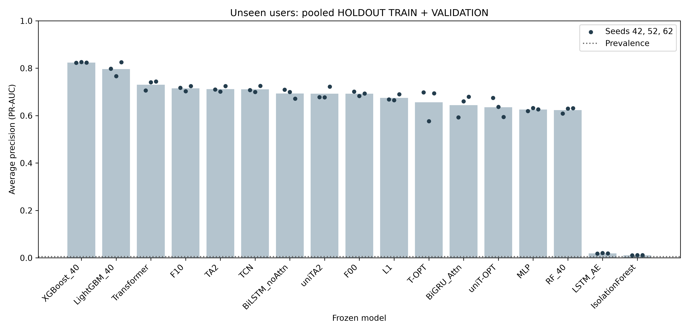
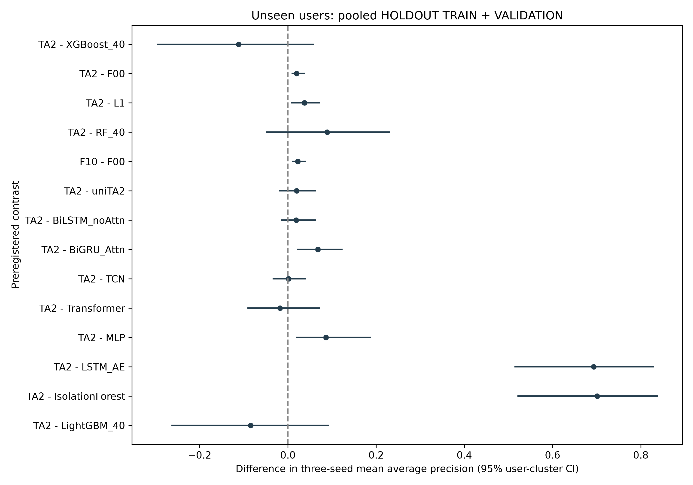

# Phase 4: additional baselines and unseen-user Option C evaluation

Completed UTC: 2026-10-22T03:01:51.854981+00:00

The preregistered Option C evaluation used 500 HOLDOUT users excluded from every DEVELOPMENT fit, scaler and selection. The primary cohort pools 197,000 TRAIN windows (917 positives) and 16,000 VALIDATION windows (255 positives): 213,000 completed windows with 1,172 positives. No r5.2 TEST data was opened, built or scored. No r5.1, r6.1 or r6.2 data was used.

Qasim reports that Assoc. Prof. Dr. Mohd Murtadha bin Mohamad agreed in person on 22 Oct 2026 to using CERT r5.2 user splits for this evaluation. Qasim approved execution at 09:51 (+08). The disclosure record is SUPERVISOR_DISCLOSURE_PHASE4.json.

## Amendments, chronology and hashes

The original 3,370 preregistration bytes were preserved. Their SHA-256 is `0a58a2319dc0248d5862607ef98738c333a18703955ec573bcc6e198f4074470`. Both amendments were appended before baseline training and before any HOLDOUT feature window or prediction was materialized. The two original receipts are reproduced below, with the amendment text.

## Amendment 1 (Option C), 22 Oct 2026

Qasim approved Option C on 22 Oct 2026 at 09:51 (+08).
- The evaluation period changes from HOLDOUT VALIDATION + TEST to HOLDOUT users' TRAIN + VALIDATION periods: TRAIN 197,000 windows with 917 positives, plus VALIDATION 16,000 windows with 255 positives.
- The r5.2 TEST period stays sealed for all users, reserved for the PhD thesis.
- Primary view: the HOLDOUT TRAIN + VALIDATION completed windows pooled.
- Secondary views: TRAIN only, VALIDATION only, offset-0 de-overlap, and endpoint label.
- Everything else is unchanged: metrics, primary contrasts, bootstrap (2,000 replicates, seed 42, user-cluster over HOLDOUT users), decision rules, frozen thresholds, no recalibration.
- Rationale: these HOLDOUT users were excluded from every DEVELOPMENT fit, scaler and selection, so their TRAIN-period windows are unseen.
- Supervisor disclosure: Qasim reports that his supervisor, Assoc. Prof. Dr. Mohd Murtadha bin Mohamad, agreed in person on 22 Oct 2026 to using CERT r5.2 user splits for this evaluation.
- Amendment 1 is written before any holdout feature window or prediction exists, consistent with the Phase 2 deferred-scoring records and the absence of Phase 4 execution.

Amendment 1 receipt: SHA-256 of this amendment section's UTF-8 bytes, from its leading newline through its final newline: 7453c022dffb578872bc178ac660888eb3ad65e9cd260d1d764a0745df97eb83
UTC: 2026-10-22T02:08:49.9175396Z

## Amendment 2: additional baselines (secondary, exploratory)

The following recipes are preregistered before any additional baseline training. Existing frozen Phase 2 models and thresholds remain unchanged.

2. All baselines share the following frozen recipe:
   - Data: DEVELOPMENT users' TRAIN windows only (591,000 windows, 3,040 positives).
   - Inputs: the same development scaler and the same standardized 20×13 tensor.
   - Checkpoint selection: DEVELOPMENT VALIDATION AP.
   - Threshold: maximum F1 on DEVELOPMENT VALIDATION.
   - Seeds: 42, 52 and 62.
   - Training (neural models): Adam 1e-3, batch 1024, gradient clip 1.0, maximum 15 epochs, early-stopping patience 4 on development validation AP.
   - Supervised neural models use BCE with w+ = 0.25·N−/N+ (same rule as TA2).
3. Models:
   - B1 BiLSTM_noAttn: BiLSTM with 64 units per direction; concatenate the final forward and backward states; linear output head.
   - B2 BiGRU_Attn: BiGRU with 64 units per direction; additive attention with dimension 64; linear output head.
   - B3 TCN: three residual dilated Conv1d blocks with 64 channels, kernel 3 and dilations 1, 2 and 4; ReLU; dropout 0.1; global average pooling; linear output head.
   - B4 Transformer: input projection 13→64; learned positional embedding of length 20; 2 encoder layers with 4 heads, feed-forward size 128 and dropout 0.1; mean pooling; linear output head.
   - B5 MLP: flatten to 260; layers 260→128→64→1 with ReLU and dropout 0.2.
   - B6 LSTM_AE (unsupervised, after Ketepalli et al. 2022):
     - Train on DEVELOPMENT TRAIN windows labelled benign only, with MSE reconstruction loss.
     - Encoder: LSTM 64. Decoder: LSTM 64 repeated over 20 steps, then a linear layer to 13.
     - Use the same epoch, patience and selection rules (select on development validation AP of the reconstruction-error score).
     - The anomaly score is the mean squared reconstruction error.
   - B7 IsolationForest (unsupervised):
     - Use the 40 parity-gated tabular summaries.
     - Settings: n_estimators=200, max_samples=256, contamination='auto', random_state set to the seed.
     - Fit on all DEVELOPMENT TRAIN windows. The score is −score_samples.
   - B8 LightGBM_40:
     - Use the 40 parity-gated summaries.
     - Settings: n_estimators=300, num_leaves=31, learning_rate=0.05, scale_pos_weight=N−/N+ (development), subsample 0.8 with subsample_freq 1, colsample_bytree 0.8, deterministic=True.
     - If lightgbm cannot be installed into an isolated environment, skip B8 and record why.
4. Time limit: if any single baseline seed exceeds 90 minutes, stop it, record "TIMEOUT", and continue with the next one.
5. Log every run in phase4\TRAINING_LOG_PHASE4.csv with these fields: model, seed, epochs, best epoch, development AP, duration, device.
6. Freeze the models in phase4\MODELS_FROZEN_PHASE4.json, with the checkpoint hashes.

Amendment 2 receipt: SHA-256 of this amendment section's UTF-8 bytes, from its leading newline through its final newline: 318a460dd7d810caf4f808755f829b1fe359107567eac524fadf3d97478491cc
UTC: 2026-10-22T02:09:27.6404967Z

## Training and frozen recipes

All 24 additional runs used the same frozen DEVELOPMENT TRAIN/VALIDATION tensors and development-only scaler. All inputs have shape 20 × 13; tabular baselines use the same parity-gated 40 summaries of standardized float32 tensors. Supervised neural models used BCE with positive weight 48.35197368421053. Adam learning rate 0.001, batch 1,024, gradient clipping 1.0, maximum 15 epochs and patience four on DEVELOPMENT VALIDATION AP were fixed in advance. LSTM_AE used benign TRAIN windows only and MSE reconstruction scores. Three seeds (42, 52, 62) were retained. Existing Phase 2 models and thresholds were unchanged.

New baseline thresholds maximize DEVELOPMENT VALIDATION F1 over all distinct observed scores; ties select the lowest threshold. The existing Phase 2 thresholds retain their frozen grid-plus-quantile rule. No HOLDOUT recalibration or model selection occurred. For IsolationForest and LightGBM, the log's epochs/best_epoch fields denote their fixed estimator/boosting-round counts, not repeated neural training epochs.

Implementation details fixed before training: each TCN residual block contains two causal convolutions, left zero padding and a 1 × 1 skip projection when required; the Transformer uses the PyTorch default post-norm encoder with ReLU; the AE repeats the encoder final hidden vector as decoder inputs and uses zero initial decoder states. These resolve details not specified in the prompt and do not constitute a hyperparameter search.

Runs were sequential with two CPU threads and a per-process 45% GPU memory cap. Only experiment-owned subprocesses were managed. The shared Python installation, other chat and existing teacher-anchored repositories/worktrees were not modified. LightGBM and bootstrap acceleration dependencies were installed into phase4/.venv with shared read-only access to existing packages.

| model | seed | epochs | best_epoch | development_AP | duration | device | status |
| --- | --- | --- | --- | --- | --- | --- | --- |
| BiLSTM_noAttn | 42 | 8 | 4 | 0.949029461 | 75.9277227 | cuda | ok |
| BiLSTM_noAttn | 52 | 8 | 4 | 0.934775685 | 66.6986429 | cuda | ok |
| BiLSTM_noAttn | 62 | 10 | 6 | 0.951332701 | 79.8230608 | cuda | ok |
| BiGRU_Attn | 42 | 6 | 2 | 0.942928052 | 50.6938895 | cuda | ok |
| BiGRU_Attn | 52 | 6 | 2 | 0.937369669 | 51.2382035 | cuda | ok |
| BiGRU_Attn | 62 | 10 | 6 | 0.954314227 | 75.4332687 | cuda | ok |
| TCN | 42 | 10 | 6 | 0.954854025 | 89.2129232 | cuda | ok |
| TCN | 52 | 13 | 9 | 0.957206474 | 120.733763 | cuda | ok |
| TCN | 62 | 11 | 7 | 0.949355436 | 96.8212559 | cuda | ok |
| Transformer | 42 | 11 | 7 | 0.974534147 | 115.2887 | cuda | ok |
| Transformer | 52 | 6 | 2 | 0.968905936 | 59.9762167 | cuda | ok |
| Transformer | 62 | 9 | 5 | 0.975578952 | 98.088118 | cuda | ok |
| MLP | 42 | 15 | 12 | 0.933791833 | 117.34229 | cuda | ok |
| MLP | 52 | 13 | 9 | 0.919857875 | 89.1315959 | cuda | ok |
| MLP | 62 | 15 | 11 | 0.921400388 | 124.737095 | cuda | ok |
| LSTM_AE | 42 | 15 | 15 | 0.0390578034 | 137.342042 | cuda | ok |
| LSTM_AE | 52 | 5 | 1 | 0.03735692 | 41.803765 | cuda | ok |
| LSTM_AE | 62 | 15 | 15 | 0.0424459698 | 120.236314 | cuda | ok |
| IsolationForest | 42 | 200 | 200 | 0.0148304807 | 1.5394586 | CPU | ok |
| IsolationForest | 52 | 200 | 200 | 0.0145818733 | 1.4985536 | CPU | ok |
| IsolationForest | 62 | 200 | 200 | 0.0147498045 | 1.5524932 | CPU | ok |
| LightGBM_40 | 42 | 300 | 300 | 0.930566574 | 16.2641814 | CPU | ok |
| LightGBM_40 | 52 | 300 | 300 | 0.889802188 | 13.2820784 | CPU | ok |
| LightGBM_40 | 62 | 300 | 300 | 0.900332504 | 14.3958731 | CPU | ok |

Original MODELS_FROZEN.json v2 SHA-256: `90fcc54224afba7c2f63c8a1d8f38065780bbf662c0379ef9bd8950d0d0e515b`. Additional checkpoints and their hashes, original checkpoint references, exact thresholds, dependencies and scorer hash are in MODELS_FROZEN_PHASE4.json (SHA-256 `50553f20b48164c0d4014d8e67764c828b88ac245bab2c69ed1fd1327b18e27c`). All original implementation and model hashes were verified before scoring and again after execution.

Option C scorer SHA-256: `3e0bd959d4862b7f4d99b784324474fb1e2c26fd787097de474b53d4626cff69`. The original deferred scorer was preserved; its Option C successor resides in the new phase4 code folder. Original exclusive sentinel HOLDOUT_SCORING_CONSUMED.json was consumed before any HOLDOUT feature build or inference. Prediction passes: one; reruns: zero. Subsequent metrics read saved predictions only.

## Metrics and inference

AP is average precision (PR-AUC); ranking excess is AP minus the prevalence for that view. Precision, recall, F1 and alerts per 1,000 use each seed's frozen DEVELOPMENT threshold. A mean row is the arithmetic mean of the three seed-level metrics, not an ensemble-score metric. There is no common threshold for a mean row.

Primary contrasts are TA2 − XGBoost_40 and TA2 − F00. Additional-baseline contrasts are secondary exploratory. The paired user-cluster bootstrap uses 2,000 resamples with seed 42 over all 500 HOLDOUT users and shares each resample across models, seeds and views. Each replicate averages the three fixed-seed AP values, then forms the contrast. Tied scores are grouped exactly as in average precision. Percentile 95% intervals and all preregistered decision labels are reported. No multiplicity correction was preregistered.

The primary view is pooled completed windows; secondary views are TRAIN completed windows, VALIDATION completed windows, pooled offset-0 de-overlap (offset restarts within each user and period), and pooled endpoint labels. All secondary views use the same completed-window scores and frozen thresholds.

## Full results

### pooled_completed

| view | model | seed | windows | positives | prevalence | AP | ranking_excess | threshold | precision | recall | F1 | alerts_per_1000 |
| --- | --- | --- | --- | --- | --- | --- | --- | --- | --- | --- | --- | --- |
| pooled_completed | T-OPT | 42 | 213000 | 1172 | 0.00550234742 | 0.698306278 | 0.692803931 | 0.72 | 0.37163233 | 0.800341297 | 0.507575758 | 11.8497653 |
| pooled_completed | T-OPT | 52 | 213000 | 1172 | 0.00550234742 | 0.576710849 | 0.571208502 | 0.63 | 0.318778843 | 0.766211604 | 0.450238155 | 13.2253521 |
| pooled_completed | T-OPT | 62 | 213000 | 1172 | 0.00550234742 | 0.694395316 | 0.688892969 | 0.4 | 0.327499159 | 0.830204778 | 0.469707941 | 13.9483568 |
| pooled_completed | F00 | 42 | 213000 | 1172 | 0.00550234742 | 0.701404169 | 0.695901821 | 0.95 | 0.807989691 | 0.534982935 | 0.643737166 | 3.64319249 |
| pooled_completed | F00 | 52 | 213000 | 1172 | 0.00550234742 | 0.682492532 | 0.676990185 | 0.56 | 0.300277179 | 0.831911263 | 0.441276307 | 15.2441315 |
| pooled_completed | F00 | 62 | 213000 | 1172 | 0.00550234742 | 0.693575372 | 0.688073025 | 0.22 | 0.34939759 | 0.816552901 | 0.489388903 | 12.8591549 |
| pooled_completed | TA2 | 42 | 213000 | 1172 | 0.00550234742 | 0.71004108 | 0.704538732 | 0.56 | 0.345714286 | 0.825938567 | 0.487411883 | 13.1455399 |
| pooled_completed | TA2 | 52 | 213000 | 1172 | 0.00550234742 | 0.70143022 | 0.695927872 | 0.56 | 0.327586207 | 0.826791809 | 0.469249395 | 13.8873239 |
| pooled_completed | TA2 | 62 | 213000 | 1172 | 0.00550234742 | 0.72513028 | 0.719627932 | 0.38 | 0.334594223 | 0.830204778 | 0.476960784 | 13.6525822 |
| pooled_completed | L1 | 42 | 213000 | 1172 | 0.00550234742 | 0.668330498 | 0.66282815 | 0.66 | 0.364478764 | 0.805460751 | 0.501860712 | 12.1596244 |
| pooled_completed | L1 | 52 | 213000 | 1172 | 0.00550234742 | 0.66536307 | 0.659860722 | 0.59 | 0.335572843 | 0.809726962 | 0.4745 | 13.2769953 |
| pooled_completed | L1 | 62 | 213000 | 1172 | 0.00550234742 | 0.689795244 | 0.684292897 | 0.44 | 0.342827004 | 0.831911263 | 0.485557769 | 13.3521127 |
| pooled_completed | F10 | 42 | 213000 | 1172 | 0.00550234742 | 0.717176503 | 0.711674156 | 0.47 | 0.345880682 | 0.83105802 | 0.488465396 | 13.2206573 |
| pooled_completed | F10 | 52 | 213000 | 1172 | 0.00550234742 | 0.703301686 | 0.697799338 | 0.59 | 0.348981077 | 0.818259386 | 0.489285714 | 12.9014085 |
| pooled_completed | F10 | 62 | 213000 | 1172 | 0.00550234742 | 0.724587672 | 0.719085325 | 0.38 | 0.338557994 | 0.829351536 | 0.480831066 | 13.4788732 |
| pooled_completed | uniT-OPT | 42 | 213000 | 1172 | 0.00550234742 | 0.674430875 | 0.668928527 | 0.9 | 0.473407364 | 0.69112628 | 0.561914672 | 8.03286385 |
| pooled_completed | uniT-OPT | 52 | 213000 | 1172 | 0.00550234742 | 0.637138658 | 0.63163631 | 0.87 | 0.400089807 | 0.760238908 | 0.524271845 | 10.4553991 |
| pooled_completed | uniT-OPT | 62 | 213000 | 1172 | 0.00550234742 | 0.594160413 | 0.588658065 | 0.64 | 0.387755102 | 0.745733788 | 0.510215995 | 10.5821596 |
| pooled_completed | uniTA2 | 42 | 213000 | 1172 | 0.00550234742 | 0.678279498 | 0.67277715 | 0.86 | 0.474329055 | 0.693686007 | 0.563409563 | 8.04694836 |
| pooled_completed | uniTA2 | 52 | 213000 | 1172 | 0.00550234742 | 0.677209822 | 0.671707475 | 0.85 | 0.406307978 | 0.747440273 | 0.526442308 | 10.1220657 |
| pooled_completed | uniTA2 | 62 | 213000 | 1172 | 0.00550234742 | 0.722670546 | 0.717168199 | 0.85 | 0.451710262 | 0.766211604 | 0.56835443 | 9.33333333 |
| pooled_completed | XGBoost_40 | 42 | 213000 | 1172 | 0.00550234742 | 0.822810419 | 0.817308072 | 0.64 | 0.871062992 | 0.755119454 | 0.808957952 | 4.76995305 |
| pooled_completed | XGBoost_40 | 52 | 213000 | 1172 | 0.00550234742 | 0.825752973 | 0.820250625 | 0.51 | 0.82764977 | 0.766211604 | 0.795746566 | 5.09389671 |
| pooled_completed | XGBoost_40 | 62 | 213000 | 1172 | 0.00550234742 | 0.823445606 | 0.817943258 | 0.06 | 0.517351842 | 0.826791809 | 0.636453202 | 8.79342723 |
| pooled_completed | RF_40 | 42 | 213000 | 1172 | 0.00550234742 | 0.608553773 | 0.603051426 | 0.46 | 0.443416757 | 0.695392491 | 0.541528239 | 8.62910798 |
| pooled_completed | RF_40 | 52 | 213000 | 1172 | 0.00550234742 | 0.629783903 | 0.624281556 | 0.46 | 0.457207207 | 0.692832765 | 0.550881954 | 8.33802817 |
| pooled_completed | RF_40 | 62 | 213000 | 1172 | 0.00550234742 | 0.631262746 | 0.625760399 | 0.15 | 0.265854334 | 0.819112628 | 0.401421702 | 16.9530516 |
| pooled_completed | BiLSTM_noAttn | 42 | 213000 | 1172 | 0.00550234742 | 0.709372284 | 0.703869937 | 0.494974225 | 0.305986696 | 0.824232082 | 0.446292446 | 14.8215962 |
| pooled_completed | BiLSTM_noAttn | 52 | 213000 | 1172 | 0.00550234742 | 0.699533931 | 0.694031584 | 0.898216441 | 0.384821429 | 0.735494881 | 0.505275498 | 10.5164319 |
| pooled_completed | BiLSTM_noAttn | 62 | 213000 | 1172 | 0.00550234742 | 0.671945223 | 0.666442875 | 0.925618409 | 0.455907781 | 0.674914676 | 0.544203646 | 8.14553991 |
| pooled_completed | BiGRU_Attn | 42 | 213000 | 1172 | 0.00550234742 | 0.592915418 | 0.587413071 | 0.808020914 | 0.369621343 | 0.732935154 | 0.491418764 | 10.9107981 |
| pooled_completed | BiGRU_Attn | 52 | 213000 | 1172 | 0.00550234742 | 0.660231053 | 0.654728705 | 0.926261842 | 0.456413104 | 0.701365188 | 0.552976791 | 8.45539906 |
| pooled_completed | BiGRU_Attn | 62 | 213000 | 1172 | 0.00550234742 | 0.679631231 | 0.674128883 | 0.460659328 | 0.319439813 | 0.817406143 | 0.459362263 | 14.0798122 |
| pooled_completed | TCN | 42 | 213000 | 1172 | 0.00550234742 | 0.708204988 | 0.70270264 | 0.247543623 | 0.345331834 | 0.785836177 | 0.479812451 | 12.5211268 |
| pooled_completed | TCN | 52 | 213000 | 1172 | 0.00550234742 | 0.699778219 | 0.694275871 | 0.0378780876 | 0.341126461 | 0.821672355 | 0.482102628 | 13.2535211 |
| pooled_completed | TCN | 62 | 213000 | 1172 | 0.00550234742 | 0.725152037 | 0.71964969 | 0.999736704 | 0.925117005 | 0.505972696 | 0.654164368 | 3.00938967 |
| pooled_completed | Transformer | 42 | 213000 | 1172 | 0.00550234742 | 0.706270552 | 0.700768205 | 0.58755578 | 0.378355705 | 0.769624573 | 0.507311586 | 11.1924883 |
| pooled_completed | Transformer | 52 | 213000 | 1172 | 0.00550234742 | 0.740442382 | 0.734940035 | 0.881881248 | 0.476996298 | 0.769624573 | 0.588965067 | 8.87793427 |
| pooled_completed | Transformer | 62 | 213000 | 1172 | 0.00550234742 | 0.743726647 | 0.738224299 | 0.863857686 | 0.366238532 | 0.851535836 | 0.512188863 | 12.7934272 |
| pooled_completed | MLP | 42 | 213000 | 1172 | 0.00550234742 | 0.619277925 | 0.613775577 | 0.875426498 | 0.338306452 | 0.715870307 | 0.459474261 | 11.6431925 |
| pooled_completed | MLP | 52 | 213000 | 1172 | 0.00550234742 | 0.632172541 | 0.626670194 | 0.846036343 | 0.375057104 | 0.700511945 | 0.488545076 | 10.2769953 |
| pooled_completed | MLP | 62 | 213000 | 1172 | 0.00550234742 | 0.62616953 | 0.620667183 | 0.83850645 | 0.367628067 | 0.728668942 | 0.48869814 | 10.9061033 |
| pooled_completed | LSTM_AE | 42 | 213000 | 1172 | 0.00550234742 | 0.0179234005 | 0.012421053 | 0.0703619942 | 0.0202787103 | 0.886518771 | 0.039650435 | 240.544601 |
| pooled_completed | LSTM_AE | 52 | 213000 | 1172 | 0.00550234742 | 0.0202126645 | 0.0147103171 | 0.0725400001 | 0.0119254097 | 0.991467577 | 0.0235673505 | 457.460094 |
| pooled_completed | LSTM_AE | 62 | 213000 | 1172 | 0.00550234742 | 0.0184930932 | 0.0129907458 | 0.0553076677 | 0.0198168525 | 0.934300341 | 0.0388105196 | 259.41784 |
| pooled_completed | IsolationForest | 42 | 213000 | 1172 | 0.00550234742 | 0.0108934845 | 0.00539113709 | 0.400082327 | 0.011737218 | 0.912969283 | 0.023176477 | 427.995305 |
| pooled_completed | IsolationForest | 52 | 213000 | 1172 | 0.00550234742 | 0.0112686333 | 0.00576628592 | 0.395446075 | 0.011646679 | 0.947952218 | 0.0230106458 | 447.849765 |
| pooled_completed | IsolationForest | 62 | 213000 | 1172 | 0.00550234742 | 0.0112866104 | 0.005784263 | 0.399137675 | 0.0115612028 | 0.895904437 | 0.0228278239 | 426.389671 |
| pooled_completed | LightGBM_40 | 42 | 213000 | 1172 | 0.00550234742 | 0.798201344 | 0.792698997 | 0.0392766517 | 0.434625789 | 0.822525597 | 0.568731563 | 10.4131455 |
| pooled_completed | LightGBM_40 | 52 | 213000 | 1172 | 0.00550234742 | 0.7668009 | 0.761298553 | 0.477009474 | 0.732870772 | 0.720989761 | 0.72688172 | 5.41314554 |
| pooled_completed | LightGBM_40 | 62 | 213000 | 1172 | 0.00550234742 | 0.825059494 | 0.819557147 | 0.286614165 | 0.672727273 | 0.789249147 | 0.726344719 | 6.45539906 |
| pooled_completed | T-OPT | mean | 213000 | 1172 | 0.00550234742 | 0.656470814 | 0.650968467 |  | 0.339303444 | 0.798919226 | 0.475840618 | 13.0078247 |
| pooled_completed | F00 | mean | 213000 | 1172 | 0.00550234742 | 0.692490691 | 0.686988344 |  | 0.485888153 | 0.7278157 | 0.524800792 | 10.5821596 |
| pooled_completed | TA2 | mean | 213000 | 1172 | 0.00550234742 | 0.712200526 | 0.706698179 |  | 0.335964905 | 0.827645051 | 0.477874021 | 13.5618153 |
| pooled_completed | L1 | mean | 213000 | 1172 | 0.00550234742 | 0.674496271 | 0.668993923 |  | 0.347626204 | 0.815699659 | 0.48730616 | 12.9295775 |
| pooled_completed | F10 | mean | 213000 | 1172 | 0.00550234742 | 0.715021954 | 0.709519606 |  | 0.344473251 | 0.826222981 | 0.486194059 | 13.200313 |
| pooled_completed | uniT-OPT | mean | 213000 | 1172 | 0.00550234742 | 0.635243315 | 0.629740968 |  | 0.420417424 | 0.732366325 | 0.532134171 | 9.69014085 |
| pooled_completed | uniTA2 | mean | 213000 | 1172 | 0.00550234742 | 0.692719955 | 0.687217608 |  | 0.444115765 | 0.735779295 | 0.552735434 | 9.16744914 |
| pooled_completed | XGBoost_40 | mean | 213000 | 1172 | 0.00550234742 | 0.824002999 | 0.818500652 |  | 0.738688201 | 0.782707622 | 0.747052574 | 6.21909233 |
| pooled_completed | RF_40 | mean | 213000 | 1172 | 0.00550234742 | 0.623200141 | 0.617697793 |  | 0.3888261 | 0.735779295 | 0.497943965 | 11.3067293 |
| pooled_completed | BiLSTM_noAttn | mean | 213000 | 1172 | 0.00550234742 | 0.693617146 | 0.688114798 |  | 0.382238635 | 0.744880546 | 0.49859053 | 11.1611894 |
| pooled_completed | BiGRU_Attn | mean | 213000 | 1172 | 0.00550234742 | 0.644259234 | 0.638756887 |  | 0.381824753 | 0.750568828 | 0.501252606 | 11.1486698 |
| pooled_completed | TCN | mean | 213000 | 1172 | 0.00550234742 | 0.711045081 | 0.705542734 |  | 0.537191766 | 0.704493743 | 0.538693149 | 9.59467919 |
| pooled_completed | Transformer | mean | 213000 | 1172 | 0.00550234742 | 0.730146527 | 0.72464418 |  | 0.407196845 | 0.796928328 | 0.536155172 | 10.9546166 |
| pooled_completed | MLP | mean | 213000 | 1172 | 0.00550234742 | 0.625873332 | 0.620370985 |  | 0.360330541 | 0.715017065 | 0.478905826 | 10.942097 |
| pooled_completed | LSTM_AE | mean | 213000 | 1172 | 0.00550234742 | 0.018876386 | 0.0133740386 |  | 0.0173403242 | 0.937428896 | 0.034009435 | 319.140845 |
| pooled_completed | IsolationForest | mean | 213000 | 1172 | 0.00550234742 | 0.0111495761 | 0.00564722867 |  | 0.0116483666 | 0.91894198 | 0.0230049822 | 434.078247 |
| pooled_completed | LightGBM_40 | mean | 213000 | 1172 | 0.00550234742 | 0.796687246 | 0.791184899 |  | 0.613407945 | 0.777588168 | 0.673986001 | 7.42723005 |

### train_completed

| view | model | seed | windows | positives | prevalence | AP | ranking_excess | threshold | precision | recall | F1 | alerts_per_1000 |
| --- | --- | --- | --- | --- | --- | --- | --- | --- | --- | --- | --- | --- |
| train_completed | T-OPT | 42 | 197000 | 917 | 0.00465482234 | 0.629507634 | 0.624852811 | 0.72 | 0.320123294 | 0.792802617 | 0.45608532 | 11.5279188 |
| train_completed | T-OPT | 52 | 197000 | 917 | 0.00465482234 | 0.488975429 | 0.484320607 | 0.63 | 0.269909769 | 0.750272628 | 0.396999423 | 12.9390863 |
| train_completed | T-OPT | 62 | 197000 | 917 | 0.00465482234 | 0.622486981 | 0.617832159 | 0.4 | 0.280446927 | 0.821155943 | 0.418101055 | 13.6294416 |
| train_completed | F00 | 42 | 197000 | 917 | 0.00465482234 | 0.636366523 | 0.631711701 | 0.95 | 0.766784452 | 0.473282443 | 0.585300067 | 2.87309645 |
| train_completed | F00 | 52 | 197000 | 917 | 0.00465482234 | 0.606636172 | 0.60198135 | 0.56 | 0.256592292 | 0.827699019 | 0.391741935 | 15.0152284 |
| train_completed | F00 | 62 | 197000 | 917 | 0.00465482234 | 0.620902451 | 0.616247629 | 0.22 | 0.298026581 | 0.80697928 | 0.435294118 | 12.6040609 |
| train_completed | TA2 | 42 | 197000 | 917 | 0.00465482234 | 0.648173666 | 0.643518844 | 0.56 | 0.295552932 | 0.818974918 | 0.434355119 | 12.8984772 |
| train_completed | TA2 | 52 | 197000 | 917 | 0.00465482234 | 0.635214183 | 0.630559361 | 0.56 | 0.279881218 | 0.822246456 | 0.41761285 | 13.6751269 |
| train_completed | TA2 | 62 | 197000 | 917 | 0.00465482234 | 0.659087906 | 0.654433084 | 0.38 | 0.284577491 | 0.818974918 | 0.422384702 | 13.3959391 |
| train_completed | L1 | 42 | 197000 | 917 | 0.00465482234 | 0.611697977 | 0.607043155 | 0.66 | 0.31377551 | 0.804798255 | 0.451514225 | 11.9390863 |
| train_completed | L1 | 52 | 197000 | 917 | 0.00465482234 | 0.601235646 | 0.596580824 | 0.59 | 0.288784682 | 0.805888768 | 0.425201381 | 12.9898477 |
| train_completed | L1 | 62 | 197000 | 917 | 0.00465482234 | 0.622001027 | 0.617346205 | 0.44 | 0.291569992 | 0.822246456 | 0.430488153 | 13.1269036 |
| train_completed | F10 | 42 | 197000 | 917 | 0.00465482234 | 0.65770165 | 0.653046828 | 0.47 | 0.294851794 | 0.824427481 | 0.434357943 | 13.0152284 |
| train_completed | F10 | 52 | 197000 | 917 | 0.00465482234 | 0.63602282 | 0.631367998 | 0.59 | 0.298638911 | 0.813522356 | 0.436896047 | 12.680203 |
| train_completed | F10 | 62 | 197000 | 917 | 0.00465482234 | 0.656396731 | 0.651741909 | 0.38 | 0.287246266 | 0.817884406 | 0.425170068 | 13.2538071 |
| train_completed | uniT-OPT | 42 | 197000 | 917 | 0.00465482234 | 0.60187526 | 0.597220438 | 0.9 | 0.409912927 | 0.667393675 | 0.507883817 | 7.5786802 |
| train_completed | uniT-OPT | 52 | 197000 | 917 | 0.00465482234 | 0.542547927 | 0.537893105 | 0.87 | 0.340510766 | 0.741548528 | 0.466712423 | 10.1370558 |
| train_completed | uniT-OPT | 62 | 197000 | 917 | 0.00465482234 | 0.508808431 | 0.504153609 | 0.64 | 0.328599412 | 0.731733915 | 0.453531599 | 10.3654822 |
| train_completed | uniTA2 | 42 | 197000 | 917 | 0.00465482234 | 0.605004459 | 0.600349637 | 0.86 | 0.410307898 | 0.668484188 | 0.508502696 | 7.58375635 |
| train_completed | uniTA2 | 52 | 197000 | 917 | 0.00465482234 | 0.593490008 | 0.588835186 | 0.85 | 0.345435685 | 0.726281352 | 0.468189807 | 9.78680203 |
| train_completed | uniTA2 | 62 | 197000 | 917 | 0.00465482234 | 0.651163506 | 0.646508683 | 0.85 | 0.388857305 | 0.745910578 | 0.511210762 | 8.92893401 |
| train_completed | XGBoost_40 | 42 | 197000 | 917 | 0.00465482234 | 0.801470145 | 0.796815322 | 0.64 | 0.857881137 | 0.724100327 | 0.785334122 | 3.92893401 |
| train_completed | XGBoost_40 | 52 | 197000 | 917 | 0.00465482234 | 0.806176777 | 0.801521955 | 0.51 | 0.799763033 | 0.736095965 | 0.766609881 | 4.28426396 |
| train_completed | XGBoost_40 | 62 | 197000 | 917 | 0.00465482234 | 0.801728819 | 0.797073997 | 0.06 | 0.471853257 | 0.813522356 | 0.597277822 | 8.02538071 |
| train_completed | RF_40 | 42 | 197000 | 917 | 0.00465482234 | 0.555777285 | 0.551122463 | 0.46 | 0.384101942 | 0.690294438 | 0.493567251 | 8.36548223 |
| train_completed | RF_40 | 52 | 197000 | 917 | 0.00465482234 | 0.56892157 | 0.564266747 | 0.46 | 0.393421885 | 0.6782988 | 0.497998399 | 8.02538071 |
| train_completed | RF_40 | 62 | 197000 | 917 | 0.00465482234 | 0.572945359 | 0.568290537 | 0.15 | 0.224106602 | 0.80697928 | 0.350794027 | 16.7614213 |
| train_completed | BiLSTM_noAttn | 42 | 197000 | 917 | 0.00465482234 | 0.657823682 | 0.65316886 | 0.494974225 | 0.26148532 | 0.825517993 | 0.397166842 | 14.6954315 |
| train_completed | BiLSTM_noAttn | 52 | 197000 | 917 | 0.00465482234 | 0.618577659 | 0.613922837 | 0.898216441 | 0.327402135 | 0.702290076 | 0.446601942 | 9.98477157 |
| train_completed | BiLSTM_noAttn | 62 | 197000 | 917 | 0.00465482234 | 0.585592792 | 0.58093797 | 0.925618409 | 0.386639676 | 0.624863686 | 0.477699041 | 7.52284264 |
| train_completed | BiGRU_Attn | 42 | 197000 | 917 | 0.00465482234 | 0.490709753 | 0.486054931 | 0.808020914 | 0.309489747 | 0.707742639 | 0.430656934 | 10.6446701 |
| train_completed | BiGRU_Attn | 52 | 197000 | 917 | 0.00465482234 | 0.55425237 | 0.549597548 | 0.926261842 | 0.383386581 | 0.654307525 | 0.483481064 | 7.94416244 |
| train_completed | BiGRU_Attn | 62 | 197000 | 917 | 0.00465482234 | 0.588537237 | 0.583882414 | 0.460659328 | 0.270319971 | 0.801526718 | 0.404290429 | 13.8020305 |
| train_completed | TCN | 42 | 197000 | 917 | 0.00465482234 | 0.636184969 | 0.631530146 | 0.247543623 | 0.289626556 | 0.761177754 | 0.419597235 | 12.2335025 |
| train_completed | TCN | 52 | 197000 | 917 | 0.00465482234 | 0.62129126 | 0.616636437 | 0.0378780876 | 0.288499025 | 0.80697928 | 0.425043079 | 13.0203046 |
| train_completed | TCN | 62 | 197000 | 917 | 0.00465482234 | 0.653239741 | 0.648584919 | 0.999736704 | 0.896226415 | 0.414394766 | 0.566741238 | 2.15228426 |
| train_completed | Transformer | 42 | 197000 | 917 | 0.00465482234 | 0.641939434 | 0.637284611 | 0.58755578 | 0.318435754 | 0.745910578 | 0.446329527 | 10.9035533 |
| train_completed | Transformer | 52 | 197000 | 917 | 0.00465482234 | 0.666118783 | 0.661463961 | 0.881881248 | 0.412051126 | 0.73827699 | 0.52890625 | 8.34010152 |
| train_completed | Transformer | 62 | 197000 | 917 | 0.00465482234 | 0.69155716 | 0.686902338 | 0.863857686 | 0.318958503 | 0.854961832 | 0.464592593 | 12.4771574 |
| train_completed | MLP | 42 | 197000 | 917 | 0.00465482234 | 0.551781798 | 0.547126976 | 0.875426498 | 0.289964476 | 0.712104689 | 0.412117387 | 11.4314721 |
| train_completed | MLP | 52 | 197000 | 917 | 0.00465482234 | 0.569512178 | 0.564857356 | 0.846036343 | 0.322810591 | 0.691384951 | 0.440124957 | 9.96954315 |
| train_completed | MLP | 62 | 197000 | 917 | 0.00465482234 | 0.55089097 | 0.546236147 | 0.83850645 | 0.316642823 | 0.724100327 | 0.440610484 | 10.6446701 |
| train_completed | LSTM_AE | 42 | 197000 | 917 | 0.00465482234 | 0.0154218282 | 0.0107670059 | 0.0703619942 | 0.0170785951 | 0.887677208 | 0.0335124231 | 241.939086 |
| train_completed | LSTM_AE | 52 | 197000 | 917 | 0.00465482234 | 0.020858947 | 0.0162041247 | 0.0725400001 | 0.00980243981 | 0.990185387 | 0.0194127016 | 470.203046 |
| train_completed | LSTM_AE | 62 | 197000 | 917 | 0.00465482234 | 0.015718635 | 0.0110638126 | 0.0553076677 | 0.0165658844 | 0.929116685 | 0.0325513869 | 261.071066 |
| train_completed | IsolationForest | 42 | 197000 | 917 | 0.00465482234 | 0.0105408295 | 0.00588600717 | 0.400082327 | 0.00988107213 | 0.910577972 | 0.0195499988 | 428.959391 |
| train_completed | IsolationForest | 52 | 197000 | 917 | 0.00465482234 | 0.0110080262 | 0.00635320384 | 0.395446075 | 0.00975305845 | 0.938931298 | 0.019305582 | 448.121827 |
| train_completed | IsolationForest | 62 | 197000 | 917 | 0.00465482234 | 0.0109870918 | 0.00633226947 | 0.399137675 | 0.00964320154 | 0.883315158 | 0.0190781261 | 426.380711 |
| train_completed | LightGBM_40 | 42 | 197000 | 917 | 0.00465482234 | 0.783313243 | 0.778658421 | 0.0392766517 | 0.390649351 | 0.820065431 | 0.529204785 | 9.7715736 |
| train_completed | LightGBM_40 | 52 | 197000 | 917 | 0.00465482234 | 0.760201322 | 0.7555465 | 0.477009474 | 0.703586498 | 0.727371865 | 0.715281501 | 4.81218274 |
| train_completed | LightGBM_40 | 62 | 197000 | 917 | 0.00465482234 | 0.808414838 | 0.803760016 | 0.286614165 | 0.635714286 | 0.776444929 | 0.699067256 | 5.68527919 |
| train_completed | T-OPT | mean | 197000 | 917 | 0.00465482234 | 0.580323348 | 0.575668526 |  | 0.290159997 | 0.788077063 | 0.423728599 | 12.6988156 |
| train_completed | F00 | mean | 197000 | 917 | 0.00465482234 | 0.621301716 | 0.616646893 |  | 0.440467775 | 0.702653581 | 0.470778707 | 10.1641286 |
| train_completed | TA2 | mean | 197000 | 917 | 0.00465482234 | 0.647491918 | 0.642837096 |  | 0.286670547 | 0.820065431 | 0.424784223 | 13.323181 |
| train_completed | L1 | mean | 197000 | 917 | 0.00465482234 | 0.611644883 | 0.606990061 |  | 0.298043395 | 0.810977826 | 0.435734586 | 12.6852792 |
| train_completed | F10 | mean | 197000 | 917 | 0.00465482234 | 0.6500404 | 0.645385578 |  | 0.29357899 | 0.818611414 | 0.432141353 | 12.9830795 |
| train_completed | uniT-OPT | mean | 197000 | 917 | 0.00465482234 | 0.551077206 | 0.546422384 |  | 0.359674368 | 0.713558706 | 0.476042613 | 9.36040609 |
| train_completed | uniTA2 | mean | 197000 | 917 | 0.00465482234 | 0.616552658 | 0.611897835 |  | 0.381533629 | 0.713558706 | 0.495967755 | 8.76649746 |
| train_completed | XGBoost_40 | mean | 197000 | 917 | 0.00465482234 | 0.803125247 | 0.798470425 |  | 0.709832476 | 0.757906216 | 0.716407275 | 5.41285956 |
| train_completed | RF_40 | mean | 197000 | 917 | 0.00465482234 | 0.565881405 | 0.561226582 |  | 0.33387681 | 0.72519084 | 0.447453226 | 11.0507614 |
| train_completed | BiLSTM_noAttn | mean | 197000 | 917 | 0.00465482234 | 0.620664711 | 0.616009889 |  | 0.32517571 | 0.717557252 | 0.440489275 | 10.7343486 |
| train_completed | BiGRU_Attn | mean | 197000 | 917 | 0.00465482234 | 0.544499787 | 0.539844964 |  | 0.321065433 | 0.721192294 | 0.439476142 | 10.7969543 |
| train_completed | TCN | mean | 197000 | 917 | 0.00465482234 | 0.636905323 | 0.632250501 |  | 0.491450665 | 0.6608506 | 0.470460517 | 9.13536379 |
| train_completed | Transformer | mean | 197000 | 917 | 0.00465482234 | 0.666538459 | 0.661883637 |  | 0.349815128 | 0.779716467 | 0.47994279 | 10.5736041 |
| train_completed | MLP | mean | 197000 | 917 | 0.00465482234 | 0.557394982 | 0.55274016 |  | 0.309805963 | 0.709196656 | 0.430950943 | 10.6818951 |
| train_completed | LSTM_AE | mean | 197000 | 917 | 0.00465482234 | 0.0173331367 | 0.0126783144 |  | 0.0144823064 | 0.93565976 | 0.0284921705 | 324.404399 |
| train_completed | IsolationForest | mean | 197000 | 917 | 0.00465482234 | 0.0108453158 | 0.00619049349 |  | 0.00975911071 | 0.910941476 | 0.0193112357 | 434.48731 |
| train_completed | LightGBM_40 | mean | 197000 | 917 | 0.00465482234 | 0.783976468 | 0.779321646 |  | 0.576650045 | 0.774627408 | 0.647851181 | 6.75634518 |

### validation_completed

| view | model | seed | windows | positives | prevalence | AP | ranking_excess | threshold | precision | recall | F1 | alerts_per_1000 |
| --- | --- | --- | --- | --- | --- | --- | --- | --- | --- | --- | --- | --- |
| validation_completed | T-OPT | 42 | 16000 | 255 | 0.0159375 | 0.880562045 | 0.864624545 | 0.72 | 0.833992095 | 0.82745098 | 0.830708661 | 15.8125 |
| validation_completed | T-OPT | 52 | 16000 | 255 | 0.0159375 | 0.883249412 | 0.867311912 | 0.63 | 0.78358209 | 0.823529412 | 0.803059273 | 16.75 |
| validation_completed | T-OPT | 62 | 16000 | 255 | 0.0159375 | 0.878841044 | 0.862903544 | 0.4 | 0.769230769 | 0.862745098 | 0.813308688 | 17.875 |
| validation_completed | F00 | 42 | 16000 | 255 | 0.0159375 | 0.876043901 | 0.860106401 | 0.95 | 0.919047619 | 0.756862745 | 0.830107527 | 13.125 |
| validation_completed | F00 | 52 | 16000 | 255 | 0.0159375 | 0.883100348 | 0.867162848 | 0.56 | 0.747404844 | 0.847058824 | 0.794117647 | 18.0625 |
| validation_completed | F00 | 62 | 16000 | 255 | 0.0159375 | 0.879252342 | 0.863314842 | 0.22 | 0.84765625 | 0.850980392 | 0.849315068 | 16 |
| validation_completed | TA2 | 42 | 16000 | 255 | 0.0159375 | 0.882508808 | 0.866571308 | 0.56 | 0.837837838 | 0.850980392 | 0.844357977 | 16.1875 |
| validation_completed | TA2 | 52 | 16000 | 255 | 0.0159375 | 0.883436174 | 0.867498674 | 0.56 | 0.814393939 | 0.843137255 | 0.828516378 | 16.5 |
| validation_completed | TA2 | 62 | 16000 | 255 | 0.0159375 | 0.896523639 | 0.880586139 | 0.38 | 0.82527881 | 0.870588235 | 0.847328244 | 16.8125 |
| validation_completed | L1 | 42 | 16000 | 255 | 0.0159375 | 0.868651748 | 0.852714248 | 0.66 | 0.865546218 | 0.807843137 | 0.835699797 | 14.875 |
| validation_completed | L1 | 52 | 16000 | 255 | 0.0159375 | 0.876669156 | 0.860731656 | 0.59 | 0.780669145 | 0.823529412 | 0.801526718 | 16.8125 |
| validation_completed | L1 | 62 | 16000 | 255 | 0.0159375 | 0.891194756 | 0.875257256 | 0.44 | 0.856589147 | 0.866666667 | 0.861598441 | 16.125 |
| validation_completed | F10 | 42 | 16000 | 255 | 0.0159375 | 0.882172616 | 0.866235116 | 0.47 | 0.865079365 | 0.854901961 | 0.859960552 | 15.75 |
| validation_completed | F10 | 52 | 16000 | 255 | 0.0159375 | 0.888132017 | 0.872194517 | 0.59 | 0.852 | 0.835294118 | 0.843564356 | 15.625 |
| validation_completed | F10 | 62 | 16000 | 255 | 0.0159375 | 0.903059847 | 0.887122347 | 0.38 | 0.853846154 | 0.870588235 | 0.862135922 | 16.25 |
| validation_completed | uniT-OPT | 42 | 16000 | 255 | 0.0159375 | 0.893777505 | 0.877840005 | 0.9 | 0.908256881 | 0.776470588 | 0.837209302 | 13.625 |
| validation_completed | uniT-OPT | 52 | 16000 | 255 | 0.0159375 | 0.909744808 | 0.893807308 | 0.87 | 0.917391304 | 0.82745098 | 0.870103093 | 14.375 |
| validation_completed | uniT-OPT | 62 | 16000 | 255 | 0.0159375 | 0.879645629 | 0.863708129 | 0.64 | 0.95754717 | 0.796078431 | 0.869379015 | 13.25 |
| validation_completed | uniTA2 | 42 | 16000 | 255 | 0.0159375 | 0.901767621 | 0.885830121 | 0.86 | 0.909090909 | 0.784313725 | 0.842105263 | 13.75 |
| validation_completed | uniTA2 | 52 | 16000 | 255 | 0.0159375 | 0.908940451 | 0.893002951 | 0.85 | 0.921052632 | 0.823529412 | 0.869565217 | 14.25 |
| validation_completed | uniTA2 | 62 | 16000 | 255 | 0.0159375 | 0.914046872 | 0.898109372 | 0.85 | 0.934497817 | 0.839215686 | 0.884297521 | 14.3125 |
| validation_completed | XGBoost_40 | 42 | 16000 | 255 | 0.0159375 | 0.893591096 | 0.877653596 | 0.64 | 0.91322314 | 0.866666667 | 0.889336016 | 15.125 |
| validation_completed | XGBoost_40 | 52 | 16000 | 255 | 0.0159375 | 0.892772187 | 0.876834687 | 0.51 | 0.925311203 | 0.874509804 | 0.899193548 | 15.0625 |
| validation_completed | XGBoost_40 | 62 | 16000 | 255 | 0.0159375 | 0.902784617 | 0.886847117 | 0.06 | 0.76369863 | 0.874509804 | 0.81535649 | 18.25 |
| validation_completed | RF_40 | 42 | 16000 | 255 | 0.0159375 | 0.882874273 | 0.866936773 | 0.46 | 0.957894737 | 0.71372549 | 0.817977528 | 11.875 |
| validation_completed | RF_40 | 52 | 16000 | 255 | 0.0159375 | 0.900907924 | 0.884970424 | 0.46 | 0.974358974 | 0.745098039 | 0.844444444 | 12.1875 |
| validation_completed | RF_40 | 62 | 16000 | 255 | 0.0159375 | 0.893316165 | 0.877378665 | 0.15 | 0.71197411 | 0.862745098 | 0.780141844 | 19.3125 |
| validation_completed | BiLSTM_noAttn | 42 | 16000 | 255 | 0.0159375 | 0.875248357 | 0.859310857 | 0.494974225 | 0.797709924 | 0.819607843 | 0.808510638 | 16.375 |
| validation_completed | BiLSTM_noAttn | 52 | 16000 | 255 | 0.0159375 | 0.903032878 | 0.887095378 | 0.898216441 | 0.798534799 | 0.854901961 | 0.825757576 | 17.0625 |
| validation_completed | BiLSTM_noAttn | 62 | 16000 | 255 | 0.0159375 | 0.904509199 | 0.888571699 | 0.925618409 | 0.861660079 | 0.854901961 | 0.858267717 | 15.8125 |
| validation_completed | BiGRU_Attn | 42 | 16000 | 255 | 0.0159375 | 0.928892799 | 0.912955299 | 0.808020914 | 0.925110132 | 0.823529412 | 0.871369295 | 14.1875 |
| validation_completed | BiGRU_Attn | 52 | 16000 | 255 | 0.0159375 | 0.949459653 | 0.933522153 | 0.926261842 | 0.940677966 | 0.870588235 | 0.904276986 | 14.75 |
| validation_completed | BiGRU_Attn | 62 | 16000 | 255 | 0.0159375 | 0.891584584 | 0.875647084 | 0.460659328 | 0.796428571 | 0.874509804 | 0.83364486 | 17.5 |
| validation_completed | TCN | 42 | 16000 | 255 | 0.0159375 | 0.885969363 | 0.870031863 | 0.247543623 | 0.86770428 | 0.874509804 | 0.87109375 | 16.0625 |
| validation_completed | TCN | 52 | 16000 | 255 | 0.0159375 | 0.881850909 | 0.865913409 | 0.0378780876 | 0.864341085 | 0.874509804 | 0.869395712 | 16.125 |
| validation_completed | TCN | 62 | 16000 | 255 | 0.0159375 | 0.889480718 | 0.873543218 | 0.999736704 | 0.98156682 | 0.835294118 | 0.902542373 | 13.5625 |
| validation_completed | Transformer | 42 | 16000 | 255 | 0.0159375 | 0.908933573 | 0.892996073 | 0.58755578 | 0.923728814 | 0.854901961 | 0.887983707 | 14.75 |
| validation_completed | Transformer | 52 | 16000 | 255 | 0.0159375 | 0.937563057 | 0.921625557 | 0.881881248 | 0.907258065 | 0.882352941 | 0.894632207 | 15.5 |
| validation_completed | Transformer | 62 | 16000 | 255 | 0.0159375 | 0.892748073 | 0.876810573 | 0.863857686 | 0.801498127 | 0.839215686 | 0.819923372 | 16.6875 |
| validation_completed | MLP | 42 | 16000 | 255 | 0.0159375 | 0.835614819 | 0.819677319 | 0.875426498 | 0.815789474 | 0.729411765 | 0.770186335 | 14.25 |
| validation_completed | MLP | 52 | 16000 | 255 | 0.0159375 | 0.839737212 | 0.823799712 | 0.846036343 | 0.831111111 | 0.733333333 | 0.779166667 | 14.0625 |
| validation_completed | MLP | 62 | 16000 | 255 | 0.0159375 | 0.864351181 | 0.848413681 | 0.83850645 | 0.840707965 | 0.745098039 | 0.79002079 | 14.125 |
| validation_completed | LSTM_AE | 42 | 16000 | 255 | 0.0159375 | 0.0522204845 | 0.0362829845 | 0.0703619942 | 0.0629546726 | 0.882352941 | 0.117524158 | 223.375 |
| validation_completed | LSTM_AE | 52 | 16000 | 255 | 0.0159375 | 0.0389819993 | 0.0230444993 | 0.0725400001 | 0.0528176336 | 0.996078431 | 0.100315956 | 300.5625 |
| validation_completed | LSTM_AE | 62 | 16000 | 255 | 0.0159375 | 0.0557276916 | 0.0397901916 | 0.0553076677 | 0.0635294118 | 0.952941176 | 0.119117647 | 239.0625 |
| validation_completed | IsolationForest | 42 | 16000 | 255 | 0.0159375 | 0.0217474303 | 0.00580993026 | 0.400082327 | 0.0352958847 | 0.921568627 | 0.067987849 | 416.125 |
| validation_completed | IsolationForest | 52 | 16000 | 255 | 0.0159375 | 0.0216990897 | 0.00576158967 | 0.395446075 | 0.035151856 | 0.980392157 | 0.0678702321 | 444.5 |
| validation_completed | IsolationForest | 62 | 16000 | 255 | 0.0159375 | 0.0215281425 | 0.00559064245 | 0.399137675 | 0.0351699883 | 0.941176471 | 0.0678061873 | 426.5 |
| validation_completed | LightGBM_40 | 42 | 16000 | 255 | 0.0159375 | 0.850602268 | 0.834664768 | 0.0392766517 | 0.723549488 | 0.831372549 | 0.773722628 | 18.3125 |
| validation_completed | LightGBM_40 | 52 | 16000 | 255 | 0.0159375 | 0.825196063 | 0.809258563 | 0.477009474 | 0.868292683 | 0.698039216 | 0.773913043 | 12.8125 |
| validation_completed | LightGBM_40 | 62 | 16000 | 255 | 0.0159375 | 0.879054325 | 0.863116825 | 0.286614165 | 0.835294118 | 0.835294118 | 0.835294118 | 15.9375 |
| validation_completed | T-OPT | mean | 16000 | 255 | 0.0159375 | 0.880884167 | 0.864946667 |  | 0.795601651 | 0.837908497 | 0.815692207 | 16.8125 |
| validation_completed | F00 | mean | 16000 | 255 | 0.0159375 | 0.87946553 | 0.86352803 |  | 0.838036238 | 0.818300654 | 0.824513414 | 15.7291667 |
| validation_completed | TA2 | mean | 16000 | 255 | 0.0159375 | 0.88748954 | 0.87155204 |  | 0.825836863 | 0.854901961 | 0.840067533 | 16.5 |
| validation_completed | L1 | mean | 16000 | 255 | 0.0159375 | 0.878838553 | 0.862901053 |  | 0.83426817 | 0.832679739 | 0.832941652 | 15.9375 |
| validation_completed | F10 | mean | 16000 | 255 | 0.0159375 | 0.891121493 | 0.875183993 |  | 0.856975173 | 0.853594771 | 0.855220277 | 15.875 |
| validation_completed | uniT-OPT | mean | 16000 | 255 | 0.0159375 | 0.894389314 | 0.878451814 |  | 0.927731785 | 0.8 | 0.858897137 | 13.75 |
| validation_completed | uniTA2 | mean | 16000 | 255 | 0.0159375 | 0.908251648 | 0.892314148 |  | 0.921547119 | 0.815686275 | 0.865322667 | 14.1041667 |
| validation_completed | XGBoost_40 | mean | 16000 | 255 | 0.0159375 | 0.896382633 | 0.880445133 |  | 0.867410991 | 0.871895425 | 0.867962018 | 16.1458333 |
| validation_completed | RF_40 | mean | 16000 | 255 | 0.0159375 | 0.892366121 | 0.876428621 |  | 0.881409274 | 0.773856209 | 0.814187939 | 14.4583333 |
| validation_completed | BiLSTM_noAttn | mean | 16000 | 255 | 0.0159375 | 0.894263478 | 0.878325978 |  | 0.8193016 | 0.843137255 | 0.83084531 | 16.4166667 |
| validation_completed | BiGRU_Attn | mean | 16000 | 255 | 0.0159375 | 0.923312345 | 0.907374845 |  | 0.887405557 | 0.85620915 | 0.869763713 | 15.4791667 |
| validation_completed | TCN | mean | 16000 | 255 | 0.0159375 | 0.885766997 | 0.869829497 |  | 0.904537395 | 0.861437908 | 0.881010611 | 15.25 |
| validation_completed | Transformer | mean | 16000 | 255 | 0.0159375 | 0.913081568 | 0.897144068 |  | 0.877495002 | 0.858823529 | 0.867513095 | 15.6458333 |
| validation_completed | MLP | mean | 16000 | 255 | 0.0159375 | 0.846567737 | 0.830630237 |  | 0.82920285 | 0.735947712 | 0.779791264 | 14.1458333 |
| validation_completed | LSTM_AE | mean | 16000 | 255 | 0.0159375 | 0.0489767251 | 0.0330392251 |  | 0.0597672393 | 0.94379085 | 0.112319254 | 254.333333 |
| validation_completed | IsolationForest | mean | 16000 | 255 | 0.0159375 | 0.0216582208 | 0.00572072079 |  | 0.0352059096 | 0.947712418 | 0.0678880895 | 429.041667 |
| validation_completed | LightGBM_40 | mean | 16000 | 255 | 0.0159375 | 0.851617552 | 0.835680052 |  | 0.80904543 | 0.788235294 | 0.79430993 | 15.6875 |

### pooled_offset0

| view | model | seed | windows | positives | prevalence | AP | ranking_excess | threshold | precision | recall | F1 | alerts_per_1000 |
| --- | --- | --- | --- | --- | --- | --- | --- | --- | --- | --- | --- | --- |
| pooled_offset0 | T-OPT | 42 | 11000 | 62 | 0.00563636364 | 0.70094032 | 0.695303957 | 0.72 | 0.392 | 0.790322581 | 0.524064171 | 11.3636364 |
| pooled_offset0 | T-OPT | 52 | 11000 | 62 | 0.00563636364 | 0.588242461 | 0.582606097 | 0.63 | 0.32885906 | 0.790322581 | 0.464454976 | 13.5454545 |
| pooled_offset0 | T-OPT | 62 | 11000 | 62 | 0.00563636364 | 0.703607407 | 0.697971043 | 0.4 | 0.331125828 | 0.806451613 | 0.469483568 | 13.7272727 |
| pooled_offset0 | F00 | 42 | 11000 | 62 | 0.00563636364 | 0.707473278 | 0.701836915 | 0.95 | 0.804878049 | 0.532258065 | 0.640776699 | 3.72727273 |
| pooled_offset0 | F00 | 52 | 11000 | 62 | 0.00563636364 | 0.728046411 | 0.722410047 | 0.56 | 0.297752809 | 0.85483871 | 0.441666667 | 16.1818182 |
| pooled_offset0 | F00 | 62 | 11000 | 62 | 0.00563636364 | 0.705665352 | 0.700028988 | 0.22 | 0.362318841 | 0.806451613 | 0.5 | 12.5454545 |
| pooled_offset0 | TA2 | 42 | 11000 | 62 | 0.00563636364 | 0.715065204 | 0.70942884 | 0.56 | 0.368794326 | 0.838709677 | 0.512315271 | 12.8181818 |
| pooled_offset0 | TA2 | 52 | 11000 | 62 | 0.00563636364 | 0.717866252 | 0.712229888 | 0.56 | 0.333333333 | 0.85483871 | 0.479638009 | 14.4545455 |
| pooled_offset0 | TA2 | 62 | 11000 | 62 | 0.00563636364 | 0.735447635 | 0.729811272 | 0.38 | 0.344594595 | 0.822580645 | 0.485714286 | 13.4545455 |
| pooled_offset0 | L1 | 42 | 11000 | 62 | 0.00563636364 | 0.646403395 | 0.640767031 | 0.66 | 0.385185185 | 0.838709677 | 0.527918782 | 12.2727273 |
| pooled_offset0 | L1 | 52 | 11000 | 62 | 0.00563636364 | 0.68107877 | 0.675442407 | 0.59 | 0.348993289 | 0.838709677 | 0.492890995 | 13.5454545 |
| pooled_offset0 | L1 | 62 | 11000 | 62 | 0.00563636364 | 0.729827894 | 0.724191531 | 0.44 | 0.340136054 | 0.806451613 | 0.4784689 | 13.3636364 |
| pooled_offset0 | F10 | 42 | 11000 | 62 | 0.00563636364 | 0.732586407 | 0.726950043 | 0.47 | 0.366197183 | 0.838709677 | 0.509803922 | 12.9090909 |
| pooled_offset0 | F10 | 52 | 11000 | 62 | 0.00563636364 | 0.730683941 | 0.725047577 | 0.59 | 0.355704698 | 0.85483871 | 0.502369668 | 13.5454545 |
| pooled_offset0 | F10 | 62 | 11000 | 62 | 0.00563636364 | 0.733256836 | 0.727620473 | 0.38 | 0.344594595 | 0.822580645 | 0.485714286 | 13.4545455 |
| pooled_offset0 | uniT-OPT | 42 | 11000 | 62 | 0.00563636364 | 0.653432362 | 0.647795998 | 0.9 | 0.476190476 | 0.64516129 | 0.547945205 | 7.63636364 |
| pooled_offset0 | uniT-OPT | 52 | 11000 | 62 | 0.00563636364 | 0.672165057 | 0.666528694 | 0.87 | 0.424778761 | 0.774193548 | 0.548571429 | 10.2727273 |
| pooled_offset0 | uniT-OPT | 62 | 11000 | 62 | 0.00563636364 | 0.669253738 | 0.663617374 | 0.64 | 0.423423423 | 0.758064516 | 0.543352601 | 10.0909091 |
| pooled_offset0 | uniTA2 | 42 | 11000 | 62 | 0.00563636364 | 0.658495955 | 0.652859592 | 0.86 | 0.464285714 | 0.629032258 | 0.534246575 | 7.63636364 |
| pooled_offset0 | uniTA2 | 52 | 11000 | 62 | 0.00563636364 | 0.700367957 | 0.694731593 | 0.85 | 0.424778761 | 0.774193548 | 0.548571429 | 10.2727273 |
| pooled_offset0 | uniTA2 | 62 | 11000 | 62 | 0.00563636364 | 0.724654445 | 0.719018081 | 0.85 | 0.494949495 | 0.790322581 | 0.608695652 | 9 |
| pooled_offset0 | XGBoost_40 | 42 | 11000 | 62 | 0.00563636364 | 0.829347386 | 0.823711022 | 0.64 | 0.92 | 0.741935484 | 0.821428571 | 4.54545455 |
| pooled_offset0 | XGBoost_40 | 52 | 11000 | 62 | 0.00563636364 | 0.831748635 | 0.826112271 | 0.51 | 0.92 | 0.741935484 | 0.821428571 | 4.54545455 |
| pooled_offset0 | XGBoost_40 | 62 | 11000 | 62 | 0.00563636364 | 0.829646783 | 0.82401042 | 0.06 | 0.574712644 | 0.806451613 | 0.67114094 | 7.90909091 |
| pooled_offset0 | RF_40 | 42 | 11000 | 62 | 0.00563636364 | 0.587240252 | 0.581603888 | 0.46 | 0.472527473 | 0.693548387 | 0.562091503 | 8.27272727 |
| pooled_offset0 | RF_40 | 52 | 11000 | 62 | 0.00563636364 | 0.607543659 | 0.601907295 | 0.46 | 0.471264368 | 0.661290323 | 0.55033557 | 7.90909091 |
| pooled_offset0 | RF_40 | 62 | 11000 | 62 | 0.00563636364 | 0.609537194 | 0.603900831 | 0.15 | 0.264550265 | 0.806451613 | 0.398406375 | 17.1818182 |
| pooled_offset0 | BiLSTM_noAttn | 42 | 11000 | 62 | 0.00563636364 | 0.708827742 | 0.703191379 | 0.494974225 | 0.298245614 | 0.822580645 | 0.43776824 | 15.5454545 |
| pooled_offset0 | BiLSTM_noAttn | 52 | 11000 | 62 | 0.00563636364 | 0.710790443 | 0.70515408 | 0.898216441 | 0.410714286 | 0.741935484 | 0.528735632 | 10.1818182 |
| pooled_offset0 | BiLSTM_noAttn | 62 | 11000 | 62 | 0.00563636364 | 0.691333856 | 0.685697492 | 0.925618409 | 0.488372093 | 0.677419355 | 0.567567568 | 7.81818182 |
| pooled_offset0 | BiGRU_Attn | 42 | 11000 | 62 | 0.00563636364 | 0.620987217 | 0.615350854 | 0.808020914 | 0.380165289 | 0.741935484 | 0.50273224 | 11 |
| pooled_offset0 | BiGRU_Attn | 52 | 11000 | 62 | 0.00563636364 | 0.665514592 | 0.659878229 | 0.926261842 | 0.444444444 | 0.709677419 | 0.546583851 | 9 |
| pooled_offset0 | BiGRU_Attn | 62 | 11000 | 62 | 0.00563636364 | 0.688957358 | 0.683320994 | 0.460659328 | 0.327044025 | 0.838709677 | 0.470588235 | 14.4545455 |
| pooled_offset0 | TCN | 42 | 11000 | 62 | 0.00563636364 | 0.718086983 | 0.712450619 | 0.247543623 | 0.347826087 | 0.774193548 | 0.48 | 12.5454545 |
| pooled_offset0 | TCN | 52 | 11000 | 62 | 0.00563636364 | 0.710221415 | 0.704585052 | 0.0378780876 | 0.344594595 | 0.822580645 | 0.485714286 | 13.4545455 |
| pooled_offset0 | TCN | 62 | 11000 | 62 | 0.00563636364 | 0.736934607 | 0.731298243 | 0.999736704 | 0.941176471 | 0.516129032 | 0.666666667 | 3.09090909 |
| pooled_offset0 | Transformer | 42 | 11000 | 62 | 0.00563636364 | 0.724141282 | 0.718504918 | 0.58755578 | 0.396694215 | 0.774193548 | 0.524590164 | 11 |
| pooled_offset0 | Transformer | 52 | 11000 | 62 | 0.00563636364 | 0.754987947 | 0.749351583 | 0.881881248 | 0.480392157 | 0.790322581 | 0.597560976 | 9.27272727 |
| pooled_offset0 | Transformer | 62 | 11000 | 62 | 0.00563636364 | 0.742398282 | 0.736761918 | 0.863857686 | 0.402985075 | 0.870967742 | 0.551020408 | 12.1818182 |
| pooled_offset0 | MLP | 42 | 11000 | 62 | 0.00563636364 | 0.635394696 | 0.629758333 | 0.875426498 | 0.335820896 | 0.725806452 | 0.459183673 | 12.1818182 |
| pooled_offset0 | MLP | 52 | 11000 | 62 | 0.00563636364 | 0.631768136 | 0.626131772 | 0.846036343 | 0.391304348 | 0.725806452 | 0.508474576 | 10.4545455 |
| pooled_offset0 | MLP | 62 | 11000 | 62 | 0.00563636364 | 0.663880204 | 0.65824384 | 0.83850645 | 0.378151261 | 0.725806452 | 0.497237569 | 10.8181818 |
| pooled_offset0 | LSTM_AE | 42 | 11000 | 62 | 0.00563636364 | 0.0193789598 | 0.0137425961 | 0.0703619942 | 0.0212765957 | 0.903225806 | 0.0415738679 | 239.272727 |
| pooled_offset0 | LSTM_AE | 52 | 11000 | 62 | 0.00563636364 | 0.0185038121 | 0.0128674485 | 0.0725400001 | 0.0117468738 | 1 | 0.0232209738 | 479.818182 |
| pooled_offset0 | LSTM_AE | 62 | 11000 | 62 | 0.00563636364 | 0.0199828392 | 0.0143464756 | 0.0553076677 | 0.0209059233 | 0.967741935 | 0.0409276944 | 260.909091 |
| pooled_offset0 | IsolationForest | 42 | 11000 | 62 | 0.00563636364 | 0.0114613141 | 0.00582495049 | 0.400082327 | 0.0119949495 | 0.919354839 | 0.0236809306 | 432 |
| pooled_offset0 | IsolationForest | 52 | 11000 | 62 | 0.00563636364 | 0.0117065263 | 0.00607016264 | 0.395446075 | 0.0120168236 | 0.967741935 | 0.0237388724 | 453.909091 |
| pooled_offset0 | IsolationForest | 62 | 11000 | 62 | 0.00563636364 | 0.0117323097 | 0.00609594611 | 0.399137675 | 0.0118719525 | 0.903225806 | 0.0234358652 | 428.818182 |
| pooled_offset0 | LightGBM_40 | 42 | 11000 | 62 | 0.00563636364 | 0.784632114 | 0.77899575 | 0.0392766517 | 0.462962963 | 0.806451613 | 0.588235294 | 9.81818182 |
| pooled_offset0 | LightGBM_40 | 52 | 11000 | 62 | 0.00563636364 | 0.751593285 | 0.745956921 | 0.477009474 | 0.773584906 | 0.661290323 | 0.713043478 | 4.81818182 |
| pooled_offset0 | LightGBM_40 | 62 | 11000 | 62 | 0.00563636364 | 0.827828215 | 0.822191852 | 0.286614165 | 0.71641791 | 0.774193548 | 0.744186047 | 6.09090909 |
| pooled_offset0 | T-OPT | mean | 11000 | 62 | 0.00563636364 | 0.664263396 | 0.658627032 |  | 0.350661629 | 0.795698925 | 0.486000905 | 12.8787879 |
| pooled_offset0 | F00 | mean | 11000 | 62 | 0.00563636364 | 0.713728347 | 0.708091983 |  | 0.488316566 | 0.731182796 | 0.527481122 | 10.8181818 |
| pooled_offset0 | TA2 | mean | 11000 | 62 | 0.00563636364 | 0.72279303 | 0.717156667 |  | 0.348907418 | 0.838709677 | 0.492555855 | 13.5757576 |
| pooled_offset0 | L1 | mean | 11000 | 62 | 0.00563636364 | 0.68577002 | 0.680133656 |  | 0.358104843 | 0.827956989 | 0.499759559 | 13.0606061 |
| pooled_offset0 | F10 | mean | 11000 | 62 | 0.00563636364 | 0.732175728 | 0.726539364 |  | 0.355498825 | 0.838709677 | 0.499295959 | 13.3030303 |
| pooled_offset0 | uniT-OPT | mean | 11000 | 62 | 0.00563636364 | 0.664950386 | 0.659314022 |  | 0.44146422 | 0.725806452 | 0.546623078 | 9.33333333 |
| pooled_offset0 | uniTA2 | mean | 11000 | 62 | 0.00563636364 | 0.694506119 | 0.688869755 |  | 0.46133799 | 0.731182796 | 0.563837885 | 8.96969697 |
| pooled_offset0 | XGBoost_40 | mean | 11000 | 62 | 0.00563636364 | 0.830247601 | 0.824611238 |  | 0.804904215 | 0.76344086 | 0.771332694 | 5.66666667 |
| pooled_offset0 | RF_40 | mean | 11000 | 62 | 0.00563636364 | 0.601440368 | 0.595804005 |  | 0.402780702 | 0.720430108 | 0.503611149 | 11.1212121 |
| pooled_offset0 | BiLSTM_noAttn | mean | 11000 | 62 | 0.00563636364 | 0.70365068 | 0.698014317 |  | 0.399110664 | 0.747311828 | 0.511357147 | 11.1818182 |
| pooled_offset0 | BiGRU_Attn | mean | 11000 | 62 | 0.00563636364 | 0.658486389 | 0.652850025 |  | 0.383884586 | 0.76344086 | 0.506634776 | 11.4848485 |
| pooled_offset0 | TCN | mean | 11000 | 62 | 0.00563636364 | 0.721747668 | 0.716111305 |  | 0.544532384 | 0.704301075 | 0.544126984 | 9.6969697 |
| pooled_offset0 | Transformer | mean | 11000 | 62 | 0.00563636364 | 0.74050917 | 0.734872806 |  | 0.426690482 | 0.811827957 | 0.557723849 | 10.8181818 |
| pooled_offset0 | MLP | mean | 11000 | 62 | 0.00563636364 | 0.643681012 | 0.638044648 |  | 0.368425501 | 0.725806452 | 0.488298606 | 11.1515152 |
| pooled_offset0 | LSTM_AE | mean | 11000 | 62 | 0.00563636364 | 0.019288537 | 0.0136521734 |  | 0.0179764643 | 0.956989247 | 0.0352408453 | 326.666667 |
| pooled_offset0 | IsolationForest | mean | 11000 | 62 | 0.00563636364 | 0.0116333834 | 0.00599701975 |  | 0.0119612419 | 0.930107527 | 0.0236185561 | 438.242424 |
| pooled_offset0 | LightGBM_40 | mean | 11000 | 62 | 0.00563636364 | 0.788017871 | 0.782381508 |  | 0.650988593 | 0.747311828 | 0.681821606 | 6.90909091 |

### pooled_endpoint

| view | model | seed | windows | positives | prevalence | AP | ranking_excess | threshold | precision | recall | F1 | alerts_per_1000 |
| --- | --- | --- | --- | --- | --- | --- | --- | --- | --- | --- | --- | --- |
| pooled_endpoint | T-OPT | 42 | 213000 | 302 | 0.00141784038 | 0.104564425 | 0.103146585 | 0.72 | 0.0867670365 | 0.725165563 | 0.154989384 | 11.8497653 |
| pooled_endpoint | T-OPT | 52 | 213000 | 302 | 0.00141784038 | 0.0957300295 | 0.0943121891 | 0.63 | 0.0770323039 | 0.718543046 | 0.139147163 | 13.2253521 |
| pooled_endpoint | T-OPT | 62 | 213000 | 302 | 0.00141784038 | 0.0993080686 | 0.0978902283 | 0.4 | 0.0774150118 | 0.761589404 | 0.140543844 | 13.9483568 |
| pooled_endpoint | F00 | 42 | 213000 | 302 | 0.00141784038 | 0.104726437 | 0.103308596 | 0.95 | 0.12242268 | 0.314569536 | 0.176252319 | 3.64319249 |
| pooled_endpoint | F00 | 52 | 213000 | 302 | 0.00141784038 | 0.0977537709 | 0.0963359306 | 0.56 | 0.0723744995 | 0.778145695 | 0.132431671 | 15.2441315 |
| pooled_endpoint | F00 | 62 | 213000 | 302 | 0.00141784038 | 0.106428251 | 0.105010411 | 0.22 | 0.0825118656 | 0.748344371 | 0.148635317 | 12.8591549 |
| pooled_endpoint | TA2 | 42 | 213000 | 302 | 0.00141784038 | 0.107643864 | 0.106226023 | 0.56 | 0.0817857143 | 0.758278146 | 0.14764668 | 13.1455399 |
| pooled_endpoint | TA2 | 52 | 213000 | 302 | 0.00141784038 | 0.100604803 | 0.0991869631 | 0.56 | 0.0791075051 | 0.774834437 | 0.143558282 | 13.8873239 |
| pooled_endpoint | TA2 | 62 | 213000 | 302 | 0.00141784038 | 0.108230081 | 0.10681224 | 0.38 | 0.0794360385 | 0.764900662 | 0.143925234 | 13.6525822 |
| pooled_endpoint | L1 | 42 | 213000 | 302 | 0.00141784038 | 0.101208604 | 0.0997907632 | 0.66 | 0.0872586873 | 0.748344371 | 0.156293223 | 12.1596244 |
| pooled_endpoint | L1 | 52 | 213000 | 302 | 0.00141784038 | 0.101636584 | 0.100218744 | 0.59 | 0.0823903819 | 0.771523179 | 0.148881789 | 13.2769953 |
| pooled_endpoint | L1 | 62 | 213000 | 302 | 0.00141784038 | 0.103473604 | 0.102055764 | 0.44 | 0.0801687764 | 0.754966887 | 0.144945963 | 13.3521127 |
| pooled_endpoint | F10 | 42 | 213000 | 302 | 0.00141784038 | 0.104729405 | 0.103311565 | 0.47 | 0.08203125 | 0.764900662 | 0.148171905 | 13.2206573 |
| pooled_endpoint | F10 | 52 | 213000 | 302 | 0.00141784038 | 0.100828943 | 0.0994111029 | 0.59 | 0.0847889374 | 0.771523179 | 0.152786885 | 12.9014085 |
| pooled_endpoint | F10 | 62 | 213000 | 302 | 0.00141784038 | 0.108443543 | 0.107025702 | 0.38 | 0.0808080808 | 0.768211921 | 0.146233848 | 13.4788732 |
| pooled_endpoint | uniT-OPT | 42 | 213000 | 302 | 0.00141784038 | 0.0889133327 | 0.0874954923 | 0.9 | 0.0993571011 | 0.562913907 | 0.168902136 | 8.03286385 |
| pooled_endpoint | uniT-OPT | 52 | 213000 | 302 | 0.00141784038 | 0.0822177411 | 0.0807999007 | 0.87 | 0.0925011226 | 0.682119205 | 0.162910241 | 10.4553991 |
| pooled_endpoint | uniT-OPT | 62 | 213000 | 302 | 0.00141784038 | 0.0759009499 | 0.0744831095 | 0.64 | 0.0918367347 | 0.685430464 | 0.161971831 | 10.5821596 |
| pooled_endpoint | uniTA2 | 42 | 213000 | 302 | 0.00141784038 | 0.0864332873 | 0.0850154469 | 0.86 | 0.0968494749 | 0.549668874 | 0.16468254 | 8.04694836 |
| pooled_endpoint | uniTA2 | 52 | 213000 | 302 | 0.00141784038 | 0.0840548015 | 0.0826369612 | 0.85 | 0.0913729128 | 0.652317881 | 0.160292921 | 10.1220657 |
| pooled_endpoint | uniTA2 | 62 | 213000 | 302 | 0.00141784038 | 0.0913117978 | 0.0898939574 | 0.85 | 0.0965794769 | 0.635761589 | 0.16768559 | 9.33333333 |
| pooled_endpoint | XGBoost_40 | 42 | 213000 | 302 | 0.00141784038 | 0.21042327 | 0.209005429 | 0.64 | 0.232283465 | 0.781456954 | 0.358118361 | 4.76995305 |
| pooled_endpoint | XGBoost_40 | 52 | 213000 | 302 | 0.00141784038 | 0.207555589 | 0.206137749 | 0.51 | 0.221198157 | 0.794701987 | 0.346070656 | 5.09389671 |
| pooled_endpoint | XGBoost_40 | 62 | 213000 | 302 | 0.00141784038 | 0.209301311 | 0.207883471 | 0.06 | 0.137213027 | 0.850993377 | 0.236321839 | 8.79342723 |
| pooled_endpoint | RF_40 | 42 | 213000 | 302 | 0.00141784038 | 0.113262427 | 0.111844587 | 0.46 | 0.115342764 | 0.701986755 | 0.198130841 | 8.62910798 |
| pooled_endpoint | RF_40 | 52 | 213000 | 302 | 0.00141784038 | 0.113271646 | 0.111853805 | 0.46 | 0.11768018 | 0.69205298 | 0.201154957 | 8.33802817 |
| pooled_endpoint | RF_40 | 62 | 213000 | 302 | 0.00141784038 | 0.117664333 | 0.116246493 | 0.15 | 0.0700636943 | 0.837748344 | 0.129312548 | 16.9530516 |
| pooled_endpoint | BiLSTM_noAttn | 42 | 213000 | 302 | 0.00141784038 | 0.100295135 | 0.0988772945 | 0.494974225 | 0.0766550523 | 0.801324503 | 0.139924834 | 14.8215962 |
| pooled_endpoint | BiLSTM_noAttn | 52 | 213000 | 302 | 0.00141784038 | 0.0902150742 | 0.0887972338 | 0.898216441 | 0.0754464286 | 0.559602649 | 0.132966168 | 10.5164319 |
| pooled_endpoint | BiLSTM_noAttn | 62 | 213000 | 302 | 0.00141784038 | 0.0944093596 | 0.0929915193 | 0.925618409 | 0.0904899135 | 0.51986755 | 0.154148257 | 8.14553991 |
| pooled_endpoint | BiGRU_Attn | 42 | 213000 | 302 | 0.00141784038 | 0.0848810911 | 0.0834632507 | 0.808020914 | 0.0899311532 | 0.69205298 | 0.159177456 | 10.9107981 |
| pooled_endpoint | BiGRU_Attn | 52 | 213000 | 302 | 0.00141784038 | 0.111376274 | 0.109958434 | 0.926261842 | 0.104941699 | 0.625827815 | 0.179743224 | 8.45539906 |
| pooled_endpoint | BiGRU_Attn | 62 | 213000 | 302 | 0.00141784038 | 0.0903819304 | 0.08896409 | 0.460659328 | 0.0770256752 | 0.764900662 | 0.139957589 | 14.0798122 |
| pooled_endpoint | TCN | 42 | 213000 | 302 | 0.00141784038 | 0.0925547508 | 0.0911369105 | 0.247543623 | 0.08023997 | 0.708609272 | 0.144156282 | 12.5211268 |
| pooled_endpoint | TCN | 52 | 213000 | 302 | 0.00141784038 | 0.0919627064 | 0.090544866 | 0.0378780876 | 0.0818278427 | 0.764900662 | 0.14784 | 13.2535211 |
| pooled_endpoint | TCN | 62 | 213000 | 302 | 0.00141784038 | 0.091522939 | 0.0901050986 | 0.999736704 | 0.12324493 | 0.261589404 | 0.167550371 | 3.00938967 |
| pooled_endpoint | Transformer | 42 | 213000 | 302 | 0.00141784038 | 0.10149022 | 0.10007238 | 0.58755578 | 0.0910234899 | 0.718543046 | 0.161578555 | 11.1924883 |
| pooled_endpoint | Transformer | 52 | 213000 | 302 | 0.00141784038 | 0.101458149 | 0.100040308 | 0.881881248 | 0.0988894765 | 0.619205298 | 0.170542636 | 8.87793427 |
| pooled_endpoint | Transformer | 62 | 213000 | 302 | 0.00141784038 | 0.0979323482 | 0.0965145078 | 0.863857686 | 0.087706422 | 0.791390728 | 0.157912124 | 12.7934272 |
| pooled_endpoint | MLP | 42 | 213000 | 302 | 0.00141784038 | 0.0974840173 | 0.096066177 | 0.875426498 | 0.0798387097 | 0.655629139 | 0.142343638 | 11.6431925 |
| pooled_endpoint | MLP | 52 | 213000 | 302 | 0.00141784038 | 0.114752574 | 0.113334734 | 0.846036343 | 0.0899954317 | 0.652317881 | 0.15816941 | 10.2769953 |
| pooled_endpoint | MLP | 62 | 213000 | 302 | 0.00141784038 | 0.0891802682 | 0.0877624279 | 0.83850645 | 0.0904003444 | 0.695364238 | 0.16 | 10.9061033 |
| pooled_endpoint | LSTM_AE | 42 | 213000 | 302 | 0.00141784038 | 0.0041828365 | 0.00276499612 | 0.0703619942 | 0.00542587243 | 0.920529801 | 0.0107881563 | 240.544601 |
| pooled_endpoint | LSTM_AE | 52 | 213000 | 302 | 0.00141784038 | 0.00366824332 | 0.00225040295 | 0.0725400001 | 0.00309937499 | 1 | 0.0061795971 | 457.460094 |
| pooled_endpoint | LSTM_AE | 62 | 213000 | 302 | 0.00141784038 | 0.00411437709 | 0.00269653671 | 0.0553076677 | 0.00508542059 | 0.930463576 | 0.0101155549 | 259.41784 |
| pooled_endpoint | IsolationForest | 42 | 213000 | 302 | 0.00141784038 | 0.00296767301 | 0.00154983263 | 0.400082327 | 0.00318111515 | 0.960264901 | 0.00634122342 | 427.995305 |
| pooled_endpoint | IsolationForest | 52 | 213000 | 302 | 0.00141784038 | 0.00311852802 | 0.00170068765 | 0.395446075 | 0.00312395169 | 0.986754967 | 0.00622818568 | 447.849765 |
| pooled_endpoint | IsolationForest | 62 | 213000 | 302 | 0.00141784038 | 0.00303111417 | 0.0016132738 | 0.399137675 | 0.00317107277 | 0.953642384 | 0.00632112639 | 426.389671 |
| pooled_endpoint | LightGBM_40 | 42 | 213000 | 302 | 0.00141784038 | 0.207955956 | 0.206538116 | 0.0392766517 | 0.116771867 | 0.857615894 | 0.205555556 | 10.4131455 |
| pooled_endpoint | LightGBM_40 | 52 | 213000 | 302 | 0.00141784038 | 0.191005268 | 0.189587428 | 0.477009474 | 0.189071986 | 0.721854305 | 0.299656357 | 5.41314554 |
| pooled_endpoint | LightGBM_40 | 62 | 213000 | 302 | 0.00141784038 | 0.207906379 | 0.206488539 | 0.286614165 | 0.174545455 | 0.794701987 | 0.286225403 | 6.45539906 |
| pooled_endpoint | T-OPT | mean | 213000 | 302 | 0.00141784038 | 0.0998675077 | 0.0984496674 |  | 0.080404784 | 0.735099338 | 0.144893463 | 13.0078247 |
| pooled_endpoint | F00 | mean | 213000 | 302 | 0.00141784038 | 0.102969486 | 0.101551646 |  | 0.0924363485 | 0.613686534 | 0.152439769 | 10.5821596 |
| pooled_endpoint | TA2 | mean | 213000 | 302 | 0.00141784038 | 0.105492916 | 0.104075076 |  | 0.0801097526 | 0.766004415 | 0.145043398 | 13.5618153 |
| pooled_endpoint | L1 | mean | 213000 | 302 | 0.00141784038 | 0.102106264 | 0.100688423 |  | 0.0832726152 | 0.758278146 | 0.150040325 | 12.9295775 |
| pooled_endpoint | F10 | mean | 213000 | 302 | 0.00141784038 | 0.104667297 | 0.103249457 |  | 0.0825427561 | 0.768211921 | 0.149064213 | 13.200313 |
| pooled_endpoint | uniT-OPT | mean | 213000 | 302 | 0.00141784038 | 0.0823440079 | 0.0809261675 |  | 0.0945649861 | 0.643487859 | 0.164594736 | 9.69014085 |
| pooled_endpoint | uniTA2 | mean | 213000 | 302 | 0.00141784038 | 0.0872666289 | 0.0858487885 |  | 0.0949339549 | 0.612582781 | 0.16422035 | 9.16744914 |
| pooled_endpoint | XGBoost_40 | mean | 213000 | 302 | 0.00141784038 | 0.20909339 | 0.20767555 |  | 0.196898216 | 0.809050773 | 0.313503619 | 6.21909233 |
| pooled_endpoint | RF_40 | mean | 213000 | 302 | 0.00141784038 | 0.114732802 | 0.113314962 |  | 0.101028879 | 0.74392936 | 0.176199449 | 11.3067293 |
| pooled_endpoint | BiLSTM_noAttn | mean | 213000 | 302 | 0.00141784038 | 0.0949731896 | 0.0935553492 |  | 0.0808637981 | 0.626931567 | 0.14234642 | 11.1611894 |
| pooled_endpoint | BiGRU_Attn | mean | 213000 | 302 | 0.00141784038 | 0.0955464319 | 0.0941285915 |  | 0.0906328425 | 0.694260486 | 0.15962609 | 11.1486698 |
| pooled_endpoint | TCN | mean | 213000 | 302 | 0.00141784038 | 0.0920134654 | 0.090595625 |  | 0.0951042475 | 0.578366446 | 0.153182218 | 9.59467919 |
| pooled_endpoint | Transformer | mean | 213000 | 302 | 0.00141784038 | 0.100293572 | 0.098875732 |  | 0.0925397961 | 0.709713024 | 0.163344438 | 10.9546166 |
| pooled_endpoint | MLP | mean | 213000 | 302 | 0.00141784038 | 0.100472287 | 0.0990544463 |  | 0.0867448286 | 0.667770419 | 0.153504349 | 10.942097 |
| pooled_endpoint | LSTM_AE | mean | 213000 | 302 | 0.00141784038 | 0.00398848564 | 0.00257064526 |  | 0.00453688934 | 0.950331126 | 0.00902776944 | 319.140845 |
| pooled_endpoint | IsolationForest | mean | 213000 | 302 | 0.00141784038 | 0.00303910507 | 0.00162126469 |  | 0.0031587132 | 0.966887417 | 0.00629684516 | 434.078247 |
| pooled_endpoint | LightGBM_40 | mean | 213000 | 302 | 0.00141784038 | 0.202289201 | 0.200871361 |  | 0.160129769 | 0.791390728 | 0.263812438 | 7.42723005 |

## All contrasts and decision rules

### pooled_completed

| view | contrast | role | status | delta_AP | ci95_low | ci95_high | decision | valid_bootstrap_replicates |
| --- | --- | --- | --- | --- | --- | --- | --- | --- |
| pooled_completed | TA2 - XGBoost_40 | primary | ok | -0.111802473 | -0.296960424 | 0.0587761873 | comparable / not distinguishable | 2000 |
| pooled_completed | TA2 - F00 | primary | ok | 0.0197098353 | 0.00827082637 | 0.0398282908 | ranks above (bounded to unseen CERT r5.2 users) | 2000 |
| pooled_completed | TA2 - L1 | secondary | ok | 0.0377042556 | 0.00747569695 | 0.073075685 | ranks above (bounded to unseen CERT r5.2 users) | 2000 |
| pooled_completed | TA2 - RF_40 | secondary | ok | 0.0890003854 | -0.0504206257 | 0.231262894 | comparable / not distinguishable | 2000 |
| pooled_completed | F10 - F00 | secondary | ok | 0.0225312626 | 0.00921762091 | 0.0411496081 | ranks above (bounded to unseen CERT r5.2 users) | 2000 |
| pooled_completed | TA2 - uniTA2 | secondary | ok | 0.0194805708 | -0.0194037116 | 0.0636529612 | comparable / not distinguishable | 2000 |
| pooled_completed | TA2 - BiLSTM_noAttn | secondary_exploratory | ok | 0.0185833804 | -0.0166507371 | 0.0635490447 | comparable / not distinguishable | 2000 |
| pooled_completed | TA2 - BiGRU_Attn | secondary_exploratory | ok | 0.0679412923 | 0.0212971545 | 0.123737181 | ranks above (bounded to unseen CERT r5.2 users) | 2000 |
| pooled_completed | TA2 - TCN | secondary_exploratory | ok | 0.0011554452 | -0.034830659 | 0.0406221379 | comparable / not distinguishable | 2000 |
| pooled_completed | TA2 - Transformer | secondary_exploratory | ok | -0.0179460007 | -0.0917775368 | 0.0724336174 | comparable / not distinguishable | 2000 |
| pooled_completed | TA2 - MLP | secondary_exploratory | ok | 0.0863271942 | 0.0175086776 | 0.188677141 | ranks above (bounded to unseen CERT r5.2 users) | 2000 |
| pooled_completed | TA2 - LSTM_AE | secondary_exploratory | ok | 0.69332414 | 0.513428697 | 0.829796571 | ranks above (bounded to unseen CERT r5.2 users) | 2000 |
| pooled_completed | TA2 - IsolationForest | secondary_exploratory | ok | 0.70105095 | 0.520306499 | 0.837943466 | ranks above (bounded to unseen CERT r5.2 users) | 2000 |
| pooled_completed | TA2 - LightGBM_40 | secondary_exploratory | ok | -0.0844867198 | -0.264171942 | 0.0932705345 | comparable / not distinguishable | 2000 |

### train_completed

| view | contrast | role | status | delta_AP | ci95_low | ci95_high | decision | valid_bootstrap_replicates |
| --- | --- | --- | --- | --- | --- | --- | --- | --- |
| train_completed | TA2 - XGBoost_40 | primary | ok | -0.155633329 | -0.369969292 | 0.0631678107 | comparable / not distinguishable | 2000 |
| train_completed | TA2 - F00 | primary | ok | 0.0261902028 | 0.0100852756 | 0.0524111504 | ranks above (bounded to unseen CERT r5.2 users) | 2000 |
| train_completed | TA2 - L1 | secondary | ok | 0.0358470349 | -0.00722780438 | 0.0810734241 | comparable / not distinguishable | 2000 |
| train_completed | TA2 - RF_40 | secondary | ok | 0.0816105138 | -0.0886679569 | 0.248395647 | comparable / not distinguishable | 2000 |
| train_completed | F10 - F00 | secondary | ok | 0.0287386848 | 0.0106117557 | 0.0522643102 | ranks above (bounded to unseen CERT r5.2 users) | 2000 |
| train_completed | TA2 - uniTA2 | secondary | ok | 0.0309392607 | -0.0170718418 | 0.0870205169 | comparable / not distinguishable | 2000 |
| train_completed | TA2 - BiLSTM_noAttn | secondary_exploratory | ok | 0.0268272072 | -0.0173693626 | 0.0857150271 | comparable / not distinguishable | 2000 |
| train_completed | TA2 - BiGRU_Attn | secondary_exploratory | ok | 0.102992132 | 0.049415764 | 0.167347856 | ranks above (bounded to unseen CERT r5.2 users) | 2000 |
| train_completed | TA2 - TCN | secondary_exploratory | ok | 0.0105865951 | -0.0322684956 | 0.0653759363 | comparable / not distinguishable | 2000 |
| train_completed | TA2 - Transformer | secondary_exploratory | ok | -0.0190465405 | -0.12403815 | 0.100287742 | comparable / not distinguishable | 2000 |
| train_completed | TA2 - MLP | secondary_exploratory | ok | 0.0900969363 | 0.00494076383 | 0.220147229 | ranks above (bounded to unseen CERT r5.2 users) | 2000 |
| train_completed | TA2 - LSTM_AE | secondary_exploratory | ok | 0.630158782 | 0.422465625 | 0.795677159 | ranks above (bounded to unseen CERT r5.2 users) | 2000 |
| train_completed | TA2 - IsolationForest | secondary_exploratory | ok | 0.636646603 | 0.430364577 | 0.804289079 | ranks above (bounded to unseen CERT r5.2 users) | 2000 |
| train_completed | TA2 - LightGBM_40 | secondary_exploratory | ok | -0.136484549 | -0.354263406 | 0.0820519429 | comparable / not distinguishable | 2000 |

### validation_completed

| view | contrast | role | status | delta_AP | ci95_low | ci95_high | decision | valid_bootstrap_replicates |
| --- | --- | --- | --- | --- | --- | --- | --- | --- |
| validation_completed | TA2 - XGBoost_40 | primary | ok | -0.00889309322 | -0.294663707 | 0.275683836 | comparable / not distinguishable | 2000 |
| validation_completed | TA2 - F00 | primary | ok | 0.00802400976 | 0.000409053549 | 0.0268514119 | ranks above (bounded to unseen CERT r5.2 users) | 2000 |
| validation_completed | TA2 - L1 | secondary | ok | 0.00865098686 | 0 | 0.0416922829 | comparable / not distinguishable | 2000 |
| validation_completed | TA2 - RF_40 | secondary | ok | -0.00487658028 | -0.2469168 | 0.248472751 | comparable / not distinguishable | 2000 |
| validation_completed | F10 - F00 | secondary | ok | 0.0116559624 | 0 | 0.0314335683 | comparable / not distinguishable | 2000 |
| validation_completed | TA2 - uniTA2 | secondary | ok | -0.0207621077 | -0.0920325938 | 0.0341562754 | comparable / not distinguishable | 2000 |
| validation_completed | TA2 - BiLSTM_noAttn | secondary_exploratory | ok | -0.0067739377 | -0.0475632988 | 0.0345657216 | comparable / not distinguishable | 2000 |
| validation_completed | TA2 - BiGRU_Attn | secondary_exploratory | ok | -0.0358228051 | -0.100898876 | 0.00286502444 | comparable / not distinguishable | 2000 |
| validation_completed | TA2 - TCN | secondary_exploratory | ok | 0.00172254372 | -0.0435171072 | 0.0370260145 | comparable / not distinguishable | 2000 |
| validation_completed | TA2 - Transformer | secondary_exploratory | ok | -0.0255920273 | -0.0878510693 | 0.0203262101 | comparable / not distinguishable | 2000 |
| validation_completed | TA2 - MLP | secondary_exploratory | ok | 0.040921803 | -0.0725325841 | 0.221917312 | comparable / not distinguishable | 2000 |
| validation_completed | TA2 - LSTM_AE | secondary_exploratory | ok | 0.838512815 | 0.610231194 | 0.971381553 | ranks above (bounded to unseen CERT r5.2 users) | 2000 |
| validation_completed | TA2 - IsolationForest | secondary_exploratory | ok | 0.865831319 | 0.632219087 | 0.984343089 | ranks above (bounded to unseen CERT r5.2 users) | 2000 |
| validation_completed | TA2 - LightGBM_40 | secondary_exploratory | ok | 0.0358719884 | -0.22397521 | 0.337372254 | comparable / not distinguishable | 2000 |

### pooled_offset0

| view | contrast | role | status | delta_AP | ci95_low | ci95_high | decision | valid_bootstrap_replicates |
| --- | --- | --- | --- | --- | --- | --- | --- | --- |
| pooled_offset0 | TA2 - XGBoost_40 | primary | ok | -0.107454571 | -0.296834932 | 0.0691774664 | comparable / not distinguishable | 2000 |
| pooled_offset0 | TA2 - F00 | primary | ok | 0.00906468343 | -0.00808521403 | 0.0306286412 | comparable / not distinguishable | 2000 |
| pooled_offset0 | TA2 - L1 | secondary | ok | 0.0370230104 | -0.00429617237 | 0.0695636287 | comparable / not distinguishable | 2000 |
| pooled_offset0 | TA2 - RF_40 | secondary | ok | 0.121352662 | -0.0365029184 | 0.282136694 | comparable / not distinguishable | 2000 |
| pooled_offset0 | F10 - F00 | secondary | ok | 0.0184473811 | 0.000862171644 | 0.0395723113 | ranks above (bounded to unseen CERT r5.2 users) | 2000 |
| pooled_offset0 | TA2 - uniTA2 | secondary | ok | 0.0282869115 | -0.0236743742 | 0.089055256 | comparable / not distinguishable | 2000 |
| pooled_offset0 | TA2 - BiLSTM_noAttn | secondary_exploratory | ok | 0.0191423498 | -0.0433277555 | 0.0856087021 | comparable / not distinguishable | 2000 |
| pooled_offset0 | TA2 - BiGRU_Attn | secondary_exploratory | ok | 0.0643066412 | -0.00363389952 | 0.137519063 | comparable / not distinguishable | 2000 |
| pooled_offset0 | TA2 - TCN | secondary_exploratory | ok | 0.00104536194 | -0.0521757666 | 0.0507466801 | comparable / not distinguishable | 2000 |
| pooled_offset0 | TA2 - Transformer | secondary_exploratory | ok | -0.0177161398 | -0.0991152496 | 0.0800669763 | comparable / not distinguishable | 2000 |
| pooled_offset0 | TA2 - MLP | secondary_exploratory | ok | 0.0791120183 | -0.0208343287 | 0.212093343 | comparable / not distinguishable | 2000 |
| pooled_offset0 | TA2 - LSTM_AE | secondary_exploratory | ok | 0.703504493 | 0.530439925 | 0.838042796 | ranks above (bounded to unseen CERT r5.2 users) | 2000 |
| pooled_offset0 | TA2 - IsolationForest | secondary_exploratory | ok | 0.711159647 | 0.541515958 | 0.848080376 | ranks above (bounded to unseen CERT r5.2 users) | 2000 |
| pooled_offset0 | TA2 - LightGBM_40 | secondary_exploratory | ok | -0.0652248409 | -0.23987798 | 0.112689751 | comparable / not distinguishable | 2000 |

### pooled_endpoint

| view | contrast | role | status | delta_AP | ci95_low | ci95_high | decision | valid_bootstrap_replicates |
| --- | --- | --- | --- | --- | --- | --- | --- | --- |
| pooled_endpoint | TA2 - XGBoost_40 | primary | ok | -0.103600474 | -0.190793781 | -0.00955869003 | ranks below | 2000 |
| pooled_endpoint | TA2 - F00 | primary | ok | 0.0025234296 | -0.000335237895 | 0.00950671781 | comparable / not distinguishable | 2000 |
| pooled_endpoint | TA2 - L1 | secondary | ok | 0.00338665209 | -0.00622575537 | 0.0165135293 | comparable / not distinguishable | 2000 |
| pooled_endpoint | TA2 - RF_40 | secondary | ok | -0.00923988619 | -0.0459957804 | 0.0249461736 | comparable / not distinguishable | 2000 |
| pooled_endpoint | F10 - F00 | secondary | ok | 0.00169781072 | -0.00243235993 | 0.00899323829 | comparable / not distinguishable | 2000 |
| pooled_endpoint | TA2 - uniTA2 | secondary | ok | 0.018226287 | 0.00294139861 | 0.0414272457 | ranks above (bounded to unseen CERT r5.2 users) | 2000 |
| pooled_endpoint | TA2 - BiLSTM_noAttn | secondary_exploratory | ok | 0.0105197263 | -0.000872476499 | 0.0258487574 | comparable / not distinguishable | 2000 |
| pooled_endpoint | TA2 - BiGRU_Attn | secondary_exploratory | ok | 0.00994648403 | -0.00173590707 | 0.0241481208 | comparable / not distinguishable | 2000 |
| pooled_endpoint | TA2 - TCN | secondary_exploratory | ok | 0.0134794505 | 0.00387968357 | 0.0283898885 | ranks above (bounded to unseen CERT r5.2 users) | 2000 |
| pooled_endpoint | TA2 - Transformer | secondary_exploratory | ok | 0.00519934358 | -0.00947775136 | 0.0218180546 | comparable / not distinguishable | 2000 |
| pooled_endpoint | TA2 - MLP | secondary_exploratory | ok | 0.0050206293 | -0.0161365197 | 0.0284937236 | comparable / not distinguishable | 2000 |
| pooled_endpoint | TA2 - LSTM_AE | secondary_exploratory | ok | 0.10150443 | 0.069829459 | 0.140519289 | ranks above (bounded to unseen CERT r5.2 users) | 2000 |
| pooled_endpoint | TA2 - IsolationForest | secondary_exploratory | ok | 0.102453811 | 0.0707796907 | 0.14173298 | ranks above (bounded to unseen CERT r5.2 users) | 2000 |
| pooled_endpoint | TA2 - LightGBM_40 | secondary_exploratory | ok | -0.0967962852 | -0.178055246 | -0.00672287039 | ranks below | 2000 |

## Figures and data

Data: mean_AP_seed_dots_data.csv. Resolution: 300 dpi.

Data: contrasts_forest_data.csv. Resolution: 300 dpi.

## HOLDOUT explanation check

The original deferred explanation script matched HOLDOUT_EXPLANATION_SCRIPT_HASH.txt: `135fd7b7ad3bf356f1b1b99a6017b2386368b06a21b12ab6dee2fd4b12fc78ad`. Its original bytes and frozen numerical engine were preserved. The Option C adapter hash `30c041c43b9a61136743e594a5e7eb37e1fe50e5a3045f6dc4b0ffdb9888920e` and all changes were recorded before execution in EXPLANATION_ADAPTER_RECEIPT.json. The adapter replaces the obsolete final-marker gate with the verified v2 parity freeze, uses the isolated Phase 2 TA2 loader and corrects the inherited validation-only figure title. All explanation algorithms and numerical settings remain frozen.

The explanation pass ran once on all 1,172 malicious pooled HOLDOUT windows and 1,172 randomly selected benign windows (RNG 20261022), covering 448 users. References were medians from DEVELOPMENT TRAIN only; per-model logit standard deviations came from DEVELOPMENT VALIDATION only. No HOLDOUT reference fitting occurred.

The original 50-interval integrated-gradients method (51 trapezoidal nodes, eight tree outputs and final logit), TreeSHAP, same-sign interventions, 200 random subset draws and paired user-bootstrap comparisons were retained. Large IG completeness errors or weak faithfulness are reported as observed rather than suppressed. Explanation contrasts are exploratory and retain the 13-input versus 40-summary resolution difference; raw-feature sensitivity results are supplied separately.

### Paired explanation comparisons

| seed | sign | stratum | k | metric | estimate | ci_low | ci_high | n_paired | bootstrap_valid |
| --- | --- | --- | --- | --- | --- | --- | --- | --- | --- |
| 42 | class_supporting | overall | 3 | TA2_minus_XGBoost_directional_accuracy | 0.203671329 | 0.157519714 | 0.26949465 | 2288 | 2000 |
| 42 | class_supporting | overall | 3 | TA2_minus_XGBoost_accuracy_gap_from_random | -0.0119602273 | -0.0471391272 | 0.0292103172 | 2288 | 2000 |
| 42 | class_supporting | malicious | 3 | TA2_minus_XGBoost_directional_accuracy | -0.00853242321 | -0.0234882653 | 0.003680707 | 1172 | 2000 |
| 42 | class_supporting | malicious | 3 | TA2_minus_XGBoost_accuracy_gap_from_random | -0.0913267918 | -0.131386488 | -0.0537787388 | 1172 | 2000 |
| 52 | class_supporting | overall | 3 | TA2_minus_XGBoost_directional_accuracy | 0.183690987 | 0.140009686 | 0.244116238 | 2330 | 2000 |
| 52 | class_supporting | overall | 3 | TA2_minus_XGBoost_accuracy_gap_from_random | -0.00971459227 | -0.0463027122 | 0.0267695125 | 2330 | 2000 |
| 52 | class_supporting | malicious | 3 | TA2_minus_XGBoost_directional_accuracy | -0.0127986348 | -0.0402659563 | 0 | 1172 | 2000 |
| 52 | class_supporting | malicious | 3 | TA2_minus_XGBoost_accuracy_gap_from_random | -0.027862628 | -0.0726680773 | 0.017284691 | 1172 | 2000 |
| 62 | class_supporting | overall | 3 | TA2_minus_XGBoost_directional_accuracy | 0.126839827 | 0.0926206816 | 0.171416478 | 2310 | 2000 |
| 62 | class_supporting | overall | 3 | TA2_minus_XGBoost_accuracy_gap_from_random | -0.0133679654 | -0.048239491 | 0.0292439791 | 2310 | 2000 |
| 62 | class_supporting | malicious | 3 | TA2_minus_XGBoost_directional_accuracy | -0.00853242321 | -0.0362518043 | 0.00825802259 | 1172 | 2000 |
| 62 | class_supporting | malicious | 3 | TA2_minus_XGBoost_accuracy_gap_from_random | -0.0968387372 | -0.141778237 | -0.05075507 | 1172 | 2000 |
| mean_of_seeds | class_supporting | overall | 3 | TA2_minus_XGBoost_directional_accuracy | 0.165709236 | 0.125745447 | 0.221082129 | 2263 | 2000 |
| mean_of_seeds | class_supporting | overall | 3 | TA2_minus_XGBoost_accuracy_gap_from_random | -0.0192723523 | -0.0493925193 | 0.0162779427 | 2263 | 2000 |
| mean_of_seeds | class_supporting | malicious | 3 | TA2_minus_XGBoost_directional_accuracy | -0.00995449374 | -0.0314285398 | 0.00328114687 | 1172 | 2000 |
| mean_of_seeds | class_supporting | malicious | 3 | TA2_minus_XGBoost_accuracy_gap_from_random | -0.0720093857 | -0.107625662 | -0.0369353226 | 1172 | 2000 |
| 42 | positive | overall | 3 | TA2_minus_XGBoost_directional_accuracy | 0.209734069 | 0.157784641 | 0.28933639 | 1993 | 2000 |
| 42 | positive | overall | 3 | TA2_minus_XGBoost_accuracy_gap_from_random | 0.12781987 | 0.0722942619 | 0.207439406 | 1993 | 2000 |
| 42 | positive | malicious | 3 | TA2_minus_XGBoost_directional_accuracy | -0.00853242321 | -0.0234882653 | 0.003680707 | 1172 | 2000 |
| 42 | positive | malicious | 3 | TA2_minus_XGBoost_accuracy_gap_from_random | -0.0913267918 | -0.131386488 | -0.0537787388 | 1172 | 2000 |
| 52 | positive | overall | 3 | TA2_minus_XGBoost_directional_accuracy | 0.0151515152 | -0.0104491643 | 0.0445193755 | 1584 | 2000 |
| 52 | positive | overall | 3 | TA2_minus_XGBoost_accuracy_gap_from_random | -0.00416035354 | -0.0432308018 | 0.0340850559 | 1584 | 2000 |
| 52 | positive | malicious | 3 | TA2_minus_XGBoost_directional_accuracy | -0.0127986348 | -0.0402659563 | 0 | 1172 | 2000 |
| 52 | positive | malicious | 3 | TA2_minus_XGBoost_accuracy_gap_from_random | -0.027862628 | -0.0726680773 | 0.017284691 | 1172 | 2000 |
| 62 | positive | overall | 3 | TA2_minus_XGBoost_directional_accuracy | 0.163911195 | 0.123307984 | 0.219795757 | 2117 | 2000 |
| 62 | positive | overall | 3 | TA2_minus_XGBoost_accuracy_gap_from_random | 0.103412848 | 0.0502292752 | 0.169586475 | 2117 | 2000 |
| 62 | positive | malicious | 3 | TA2_minus_XGBoost_directional_accuracy | -0.00853242321 | -0.0362518043 | 0.00825802259 | 1172 | 2000 |
| 62 | positive | malicious | 3 | TA2_minus_XGBoost_accuracy_gap_from_random | -0.0968387372 | -0.141778237 | -0.05075507 | 1172 | 2000 |
| mean_of_seeds | positive | overall | 3 | TA2_minus_XGBoost_directional_accuracy | 0.0343293071 | 0.0122353851 | 0.0639931904 | 1573 | 2000 |
| mean_of_seeds | positive | overall | 3 | TA2_minus_XGBoost_accuracy_gap_from_random | -0.0068542064 | -0.0439366927 | 0.0356192972 | 1573 | 2000 |
| mean_of_seeds | positive | malicious | 3 | TA2_minus_XGBoost_directional_accuracy | -0.00995449374 | -0.0314285398 | 0.00328114687 | 1172 | 2000 |
| mean_of_seeds | positive | malicious | 3 | TA2_minus_XGBoost_accuracy_gap_from_random | -0.0720093857 | -0.107625662 | -0.0369353226 | 1172 | 2000 |
| 42 | negative | overall | 3 | TA2_minus_XGBoost_directional_accuracy | 0.205855019 | 0.106847529 | 0.311876131 | 2152 | 2000 |
| 42 | negative | overall | 3 | TA2_minus_XGBoost_accuracy_gap_from_random | -0.0299976766 | -0.0832799435 | 0.0346638735 | 2152 | 2000 |
| 42 | negative | malicious | 3 | TA2_minus_XGBoost_directional_accuracy | -0.0318532819 | -0.224187494 | 0.159302831 | 1036 | 2000 |
| 42 | negative | malicious | 3 | TA2_minus_XGBoost_accuracy_gap_from_random | -0.13921332 | -0.235494105 | -0.0458843063 | 1036 | 2000 |
| 52 | negative | overall | 3 | TA2_minus_XGBoost_directional_accuracy | 0.265845873 | 0.195500427 | 0.345254446 | 2193 | 2000 |
| 52 | negative | overall | 3 | TA2_minus_XGBoost_accuracy_gap_from_random | -0.0778226174 | -0.123246474 | -0.0246096342 | 2193 | 2000 |
| 52 | negative | malicious | 3 | TA2_minus_XGBoost_directional_accuracy | 0.1352657 | 0.00648496352 | 0.27376536 | 1035 | 2000 |
| 52 | negative | malicious | 3 | TA2_minus_XGBoost_accuracy_gap_from_random | -0.174574879 | -0.247114445 | -0.097857795 | 1035 | 2000 |
| 62 | negative | overall | 3 | TA2_minus_XGBoost_directional_accuracy | 0.124220837 | 0.0387288535 | 0.212276422 | 2246 | 2000 |
| 62 | negative | overall | 3 | TA2_minus_XGBoost_accuracy_gap_from_random | -0.0517631345 | -0.104766093 | 0.0120251988 | 2246 | 2000 |
| 62 | negative | malicious | 3 | TA2_minus_XGBoost_directional_accuracy | -0.0216606498 | -0.188710557 | 0.137454816 | 1108 | 2000 |
| 62 | negative | malicious | 3 | TA2_minus_XGBoost_accuracy_gap_from_random | -0.179490072 | -0.275312135 | -0.0903484815 | 1108 | 2000 |
| mean_of_seeds | negative | overall | 3 | TA2_minus_XGBoost_directional_accuracy | 0.212584196 | 0.140468818 | 0.295919392 | 2029 | 2000 |
| mean_of_seeds | negative | overall | 3 | TA2_minus_XGBoost_accuracy_gap_from_random | -0.057019057 | -0.101653112 | -0.00360293756 | 2029 | 2000 |
| mean_of_seeds | negative | malicious | 3 | TA2_minus_XGBoost_directional_accuracy | 0.0476190476 | -0.102386977 | 0.200865133 | 938 | 2000 |
| mean_of_seeds | negative | malicious | 3 | TA2_minus_XGBoost_accuracy_gap_from_random | -0.16681592 | -0.239568142 | -0.0989592415 | 938 | 2000 |

### Integrated-gradients completeness by seed, class and target

| seed | stratum | target | median_relative_error | p95_relative_error | median_absolute_error | near_zero_output_difference |
| --- | --- | --- | --- | --- | --- | --- |
| 42 | overall | tree_1 | 0.00227202921 | 6.19770665 | 5.96457751e-05 | 6 |
| 42 | overall | tree_2 | 0.00210414772 | 0.938376764 | 4.69739462e-06 | 0 |
| 42 | overall | tree_3 | 0.00200087511 | 9.45255281 | 1.08585918e-05 | 6 |
| 42 | overall | tree_4 | 0.0022862348 | 83.9639068 | 0.000115311781 | 1 |
| 42 | overall | tree_5 | 0.000709702637 | 2.74548602 | 2.5859038e-05 | 0 |
| 42 | overall | tree_6 | 0.00085434847 | 0.505456836 | 8.91079205e-05 | 0 |
| 42 | overall | tree_7 | 0.00120271005 | 7.27273706 | 0.000159474577 | 2 |
| 42 | overall | tree_8 | 0.000439316001 | 0.806210127 | 0.000106728148 | 0 |
| 42 | overall | final_logit | 0.000723212703 | 30.7183509 | 0.000169004408 | 1 |
| 42 | malicious | tree_1 | 0.000686500333 | 0.293068655 | 0.00148869383 | 0 |
| 42 | malicious | tree_2 | 9.5158252e-05 | 0.019501362 | 0.000200871793 | 0 |
| 42 | malicious | tree_3 | 0.000394630459 | 0.562790112 | 0.00117133857 | 0 |
| 42 | malicious | tree_4 | 0.0112001083 | 46.3953094 | 0.0295819502 | 0 |
| 42 | malicious | tree_5 | 0.000310316493 | 0.13558261 | 0.000809558541 | 0 |
| 42 | malicious | tree_6 | 0.000395702467 | 0.0468626499 | 0.00124401287 | 0 |
| 42 | malicious | tree_7 | 0.00106424418 | 0.241393902 | 0.00313279123 | 0 |
| 42 | malicious | tree_8 | 0.000701449753 | 0.163652959 | 0.00177569047 | 0 |
| 42 | malicious | final_logit | 0.00225525633 | 1.14525115 | 0.00665732389 | 0 |
| 42 | benign | tree_1 | 0.00428289991 | 108.400299 | 1.88717651e-07 | 6 |
| 42 | benign | tree_2 | 0.00375216871 | 11.8206595 | 8.07612697e-07 | 0 |
| 42 | benign | tree_3 | 0.00414455015 | 99.5314838 | 4.93733695e-07 | 6 |
| 42 | benign | tree_4 | 0.00162646787 | 100.807444 | 5.47638562e-07 | 1 |
| 42 | benign | tree_5 | 0.000866396389 | 39.8052362 | 5.44346543e-07 | 0 |
| 42 | benign | tree_6 | 0.0012481745 | 4.13361277 | 2.76466718e-07 | 0 |
| 42 | benign | tree_7 | 0.00133627156 | 48.7448622 | 3.09317135e-07 | 2 |
| 42 | benign | tree_8 | 0.000376858233 | 2.5320997 | 2.23246097e-06 | 0 |
| 42 | benign | final_logit | 0.000615830335 | 134.278043 | 6.03629974e-07 | 1 |
| 52 | overall | tree_1 | 0.000418782168 | 6.40351822 | 6.69246072e-05 | 0 |
| 52 | overall | tree_2 | 0.000329649795 | 1.9695007 | 3.9365289e-05 | 0 |
| 52 | overall | tree_3 | 0.00124433359 | 170.156898 | 6.81503188e-05 | 0 |
| 52 | overall | tree_4 | 0.00127171107 | 114.22524 | 0.00039501552 | 0 |
| 52 | overall | tree_5 | 0.0427547594 | 9.49245827 | 0.000104598552 | 111 |
| 52 | overall | tree_6 | 0.00480536647 | 272.937032 | 0.00396762139 | 0 |
| 52 | overall | tree_7 | 0.000658159417 | 27.7518624 | 0.000158390324 | 0 |
| 52 | overall | tree_8 | 0.00132237912 | 3.65255842 | 0.000385127175 | 1 |
| 52 | overall | final_logit | 0.00216830671 | 34.9350271 | 0.00355371713 | 0 |
| 52 | malicious | tree_1 | 0.000962212556 | 0.226779506 | 0.00335527069 | 0 |
| 52 | malicious | tree_2 | 0.000337178124 | 0.170106133 | 0.000907560781 | 0 |
| 52 | malicious | tree_3 | 0.0012854714 | 13.3856228 | 0.00426439043 | 0 |
| 52 | malicious | tree_4 | 0.011865699 | 5.56388198 | 0.0371436716 | 0 |
| 52 | malicious | tree_5 | 0.002176185 | 0.311735065 | 0.00340347887 | 0 |
| 52 | malicious | tree_6 | 0.047983323 | 7.5403749 | 0.125933587 | 0 |
| 52 | malicious | tree_7 | 0.0100653007 | 22.2632937 | 0.0327997997 | 0 |
| 52 | malicious | tree_8 | 0.00795124287 | 0.621920571 | 0.0181103839 | 0 |
| 52 | malicious | final_logit | 0.010458952 | 5.1623737 | 0.0396987032 | 0 |
| 52 | benign | tree_1 | 0.000320616752 | 74.0426748 | 3.45138376e-07 | 0 |
| 52 | benign | tree_2 | 0.000328913647 | 10.8305054 | 4.01097502e-07 | 0 |
| 52 | benign | tree_3 | 0.00123574163 | 365.696689 | 9.80668741e-07 | 0 |
| 52 | benign | tree_4 | 0.000503095124 | 560.503469 | 5.32237333e-07 | 0 |
| 52 | benign | tree_5 | 0.0902152967 | 179.035721 | 3.70816712e-07 | 111 |
| 52 | benign | tree_6 | 0.00100742114 | 3148.48827 | 2.78569137e-07 | 0 |
| 52 | benign | tree_7 | 0.000318713182 | 30.6432605 | 1.15104008e-06 | 0 |
| 52 | benign | tree_8 | 0.000671125737 | 75.1462235 | 1.81018425e-07 | 1 |
| 52 | benign | final_logit | 0.000317874291 | 61.9988654 | 3.29626382e-07 | 0 |
| 62 | overall | tree_1 | 0.00105502515 | 5.2152023 | 2.03961804e-05 | 0 |
| 62 | overall | tree_2 | 0.000864042153 | 1.03287668 | 0.000134620073 | 0 |
| 62 | overall | tree_3 | 0.000701840751 | 1.79703895 | 9.09041993e-05 | 0 |
| 62 | overall | tree_4 | 0.000956521231 | 6.7939292 | 7.95462211e-06 | 0 |
| 62 | overall | tree_5 | 0.00355585316 | 79.6898676 | 0.00187004376 | 1 |
| 62 | overall | tree_6 | 0.00254422635 | 4.61027212 | 7.92759374e-05 | 2 |
| 62 | overall | tree_7 | 0.00137383723 | 2.2797085 | 1.29539296e-05 | 0 |
| 62 | overall | tree_8 | 0.00109366328 | 2.77188119 | 7.69419615e-05 | 1 |
| 62 | overall | final_logit | 0.00144906782 | 2.42965885 | 0.000527817353 | 0 |
| 62 | malicious | tree_1 | 0.00107467167 | 3.6214368 | 0.000897422763 | 0 |
| 62 | malicious | tree_2 | 0.00128562605 | 0.666990254 | 0.00382970473 | 0 |
| 62 | malicious | tree_3 | 0.000970750671 | 1.25660891 | 0.00241091028 | 0 |
| 62 | malicious | tree_4 | 0.000777171566 | 4.30037856 | 0.000613644832 | 0 |
| 62 | malicious | tree_5 | 0.0262706443 | 18.8259043 | 0.0813280792 | 0 |
| 62 | malicious | tree_6 | 0.00772659833 | 1.98880408 | 0.0228891396 | 0 |
| 62 | malicious | tree_7 | 0.000914979597 | 1.66583215 | 0.00130132612 | 0 |
| 62 | malicious | tree_8 | 0.00147792034 | 1.95606722 | 0.00291607025 | 0 |
| 62 | malicious | final_logit | 0.00426723663 | 1.40763036 | 0.0125746491 | 0 |
| 62 | benign | tree_1 | 0.00104907178 | 1647.43162 | 8.17444753e-07 | 0 |
| 62 | benign | tree_2 | 0.000800190917 | 23.4992901 | 1.07659366e-05 | 0 |
| 62 | benign | tree_3 | 0.000649320155 | 30.2274131 | 1.17421219e-06 | 0 |
| 62 | benign | tree_4 | 0.000981166402 | 1160.22871 | 3.13400516e-07 | 0 |
| 62 | benign | tree_5 | 0.00099887773 | 2863.85809 | 3.87193755e-07 | 1 |
| 62 | benign | tree_6 | 0.00171799436 | 124.009049 | 5.67805976e-07 | 2 |
| 62 | benign | tree_7 | 0.00154268175 | 401.293753 | 3.38068344e-07 | 0 |
| 62 | benign | tree_8 | 0.00099793458 | 138.367215 | 2.78562822e-07 | 1 |
| 62 | benign | final_logit | 0.000938027095 | 176.087186 | 1.99015361e-06 | 0 |

### TreeSHAP additivity checks

| model | seed | TreeSHAP_completeness_max_abs_error |
| --- | --- | --- |
| XGBoost_40 | 42 | 1.37297466e-05 |
| XGBoost_40 | 52 | 1.73486769e-05 |
| XGBoost_40 | 62 | 1.73211447e-05 |

All intervention outcomes, eligible/excluded counts and confidence intervals are in explanation/holdout/faithfulness.csv and faithfulness.json; 13-versus-13 sensitivity is in raw_feature_sensitivity.csv. Per-feature/day attributions, source correlations and explanation figures are in the same directory.

## Skips, timeouts and deviations

No baseline was skipped, failed or timed out. All eight baselines completed three seeds.

Recorded implementation adaptations: a new deferred scorer replaces the superseded VALIDATION + TEST evaluation with TRAIN + VALIDATION and extends the frozen model list and metrics; the explanation adapter handles the superseded report marker and the isolated checkpoint loader; new baseline thresholds use the exact F1 maximum, and the existing thresholds are preserved. The original Phase 2 scorer, freeze, data pipeline, scaler and checkpoint bytes were not edited. No other authorization was needed. Nothing was pushed to GitHub.

Interpretation is bounded to unseen CERT r5.2 users in these TRAIN + VALIDATION calendar periods. The deliberately sealed TEST period is reserved for the PhD thesis. Outcomes from this post-amendment evaluation and the exploratory added baselines should be disclosed as such in the paper.

PHASE4_COMPLETE
