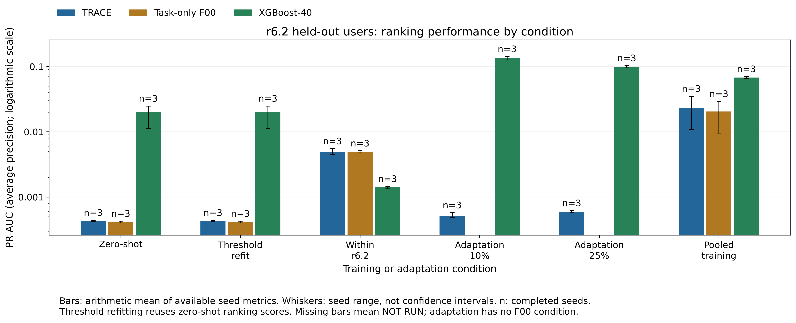

# Phase 10: r6.2 cross-release tests (exploratory)

Updated UTC: 2026-10-23T09:51:22.421581+00:00. Status: **PHASE10_COMPLETE**. Approved by Qasim 23 October 2026 at 15:25 (+08). All results are exploratory. The computation deadline was extended to18:30 (+08) by Qasim’s16:49 update; all other rules remain unchanged.

## Main findings from the priority seed42 runs

Threshold-only refitting leaves TRACE PR-AUC exactly 0.000439189. Detected insiders change 10→6 /15 and flagged non-insiders 1462→1226 /1985. This is an operating-point trade-off; ranking does not change.

TRAIN-and-test within r6.2 gives TRACE PR-AUC 0.00549846 versus zero-shot 0.000439189, AP/prevalence 14.04, 15/15 insiders detected, 1438/1985 non-insiders flagged and top1% insider share 0.2. The ranking improvement and the high false-alarm burden must be read together.

The matched within-r6.2 controls have PR-AUC 0.00509499 (F00) and 0.00133071 (XGBoost-40). F00 flags 1536/1985 non-insiders and XGBoost-40 941/1985. The paired contrast CIs below assess the differences; point ordering alone does not establish a model advantage.

With 10% labelled development users, adapted TRACE PR-AUC is 0.000480118, detects 15/15 insiders and flags 1985/1985 non-insiders.

The corresponding r5.2-plus-10% XGBoost retraining has PR-AUC 0.141278, detects 2/15 insiders and flags 111/1985 non-insiders.

With 25% labelled development users, adapted TRACE PR-AUC is 0.00057428, detects 15/15 insiders and flags 1985/1985 non-insiders.

The corresponding r5.2-plus-25% XGBoost retraining has PR-AUC 0.0955258, detects 3/15 insiders and flags 86/1985 non-insiders.

Pooled TRACE on r6.2 has PR-AUC 0.0240032, compared with within-release 0.00549846 and zero-shot 0.000439189; it detects 2/15 and flags 34/1985.

On the original r5.2 held-out users, TRACE PR-AUC changes 0.710041→0.64136 after pooling; detected insiders 24→22/25 and flagged non-insiders 23→15/475.

Pooled Task-only F00 on r6.2 has PR-AUC 0.0225367, compared with within-release 0.00509499 and zero-shot 0.000400326; it detects 3/15 and flags 34/1985.

On the original r5.2 held-out users, Task-only F00 PR-AUC changes 0.701404→0.599926 after pooling; detected insiders 23→22/25 and flagged non-insiders 17→14/475.

Pooled XGBoost-40 on r6.2 has PR-AUC 0.067486, compared with within-release 0.00133071 and zero-shot 0.0239174; it detects 1/15 and flags 31/1985.

On the original r5.2 held-out users, XGBoost-40 PR-AUC changes 0.82281→0.815255 after pooling; detected insiders 22→23/25 and flagged non-insiders 6→3/475.

These primary seed42 descriptions are exploratory. Every additional seed, all formal paired contrasts and all failures appear below; no outcome is selected to support a preferred explanation.

The priority seed42 results show that learning r6.2 can improve TRACE ranking, so its zero-shot failure does not establish an inability to detect r6.2 insiders. These tests do not isolate release mismatch as the only cause: the within-release F00 control is close to TRACE, the mixed-release XGBoost adaptation comparator ranks better, and TRACE adaptation has no positive validation windows. Pooling changes ranking, threshold-based detection and original-release performance together. The evidence supports further release-specific development, without establishing TRACE superiority or an operationally satisfactory frozen threshold.

## Amendment 10 and frozen split

Amendment 10 was written before feature processing, scoring or training. SHA-256 of its 94969 frozen prefix bytes: `9a0522f11c4babaa6a862debe9952c3d7509d2326eab0f333f7bd3cfbc42d4d7`. [Receipt](AMENDMENT10_RECEIPT.json). The pre-split schema clarification hash is `621d5c15fe5d5c1f6876130a5180208555a909f8e50f48b9f2f732b0b8a73d75`; both versions remain in the append-only [preregistration](../holdout/PREREGISTRATION_R2_HOLDOUT.md).

The bundle official-insider field covered only five users. Under the clarification, per-user positive completed-window status identifies the requested 29 insiders and is used solely to stratify the split. The initial metadata assertion stopped before a split or feature processing. The split receipt’s `features_or_labels_opened=false` field is inaccurate for split-only labels; [the correction](SPLIT_METADATA_ACCESS_CORRECTION.json) records this explicitly. No feature or score was read before split hashing.

One default_rng(42), identity-sorted insider stratum then non-insider stratum: development **2000 users / 14 insiders**, held-out **2000 users / 15 insiders**. Sorted held-out pseudonym-list SHA-256: `2c86c6788633a9b1db561c4f6cc6256aaf940aec9b5334edfa980d07c7211b62`. Split-receipt SHA-256: `b719319abc2194e2dfcca7ce01fca5301348e0b9e3894ca1b3bfad6cbc52c323`. [Split receipt](R62_SPLIT_RECEIPT.json); [held-out pseudonyms](R62_HOLDOUT_PSEUDONYMS.txt). Nested adaptation samples contain 200 users / 1 insider and 500 users / 4 insiders.

Inherited chronological rule floor(80% days) TRAIN, floor(10%) VALIDATION, remainder excluded: r6.2 TRAIN 2010-01-02–2011-02-17, VALIDATION 2011-02-18–2011-04-09; 2011-04-10–2011-06-01 unused. T=20 windows are built separately within periods, and held-out evaluation pools permitted TRAIN+VALIDATION completed windows. No period-crossing windows. r5.2 TEST remains sealed. Its original 500 HOLDOUT users supply only evaluation for new pooled models. All held-out populations are excluded from fitting, scaling, teachers, selection and thresholds.

## Recipes, inference and resource limits

The Phase 4 Adam recipes, batch size 1024, at most 15 epochs, patience four, best development VALIDATION AP checkpoint and inherited max-F1 candidate threshold rule are retained. Class weights are recomputed from each own TRAIN labels. Full TRACE chains require three matched precursor/optimized-teacher seeds before the first seed42 TRACE, then their equal mean TRAIN logit consensus. Extra detector seeds start only after all priority tests complete at seed42. XGBoost-40 retains 300 histogram trees, depth6 and inherited settings, with two CPU threads.

Adaptation starts at the corresponding original r5.2 TRACE checkpoint, uses original r5.2 teachers, all three parameter-group learning rates divided by ten, at most ten epochs and inherited patience/checkpoint/threshold rules. Own selected-r6.2 TRAIN daily scaling is applied consistently to student and teachers. Its XGBoost comparator uses r5.2 plus selected r6.2 development TRAIN and pooled development VALIDATION. The pooled chain uses both releases’ complete development TRAIN and pooled VALIDATION. All scales fit own development TRAIN daily rows. Existing standardized storage is inverted with its immutable source scaler as a coordinate codec; float32 storage quantization remains. Pooled daily scaler moments combine r5.2 development-only moments with r6.2 development TRAIN moments.

Only one GPU training/inference child runs at a time, capped at 35% allocator memory, with two numerical CPU threads and cooperative pauses. CPU bootstrap analysis runs alongside it. No other chat’s process is controlled. Each child has a 45-minute timeout and the deadline cuts it short at 18:30 (+08). No scientific computation is permitted after that time; only report writing/integrity bookkeeping may finish. No repository modifications or pushes. Each new held-out model/condition has an exclusive pre-score receipt; existing baseline and threshold-only condition scores are reused.

## Training log

| Condition | Model | Seed | Status | Epochs | Best epoch | Validation PR-AUC | Threshold | Seconds |
| --- | --- | --- | --- | --- | --- | --- | --- | --- |
| within | AL_PRECURSOR | 42 | ok | 5 | 1 | 0.000543524 | 0.00922478 | 109.87 |
| within | T-OPT | 42 | ok | 10 | 6 | 0.000499331 | 0.0902438 | 221.779 |
| within | TA2 | 42 | ok | 6 | 2 | 0.000516921 | 0.106959 | 222.911 |
| within | F00 | 42 | ok | 6 | 2 | 0.000479364 | 0.0718373 | 154.081 |
| within | XGBoost_40 | 42 | ok | 300 | 300 | 0.00345299 | 6.88401e-05 | 20.9593 |
| within | AL_PRECURSOR | 52 | ok | 5 | 1 | 0.000458655 | 0.0234031 | 97.0167 |
| within | T-OPT | 52 | ok | 7 | 3 | 0.000509619 | 0.171688 | 160.348 |
| within | TA2 | 52 | ok | 5 | 1 | 0.000552049 | 0.117814 | 190.009 |
| within | F00 | 52 | ok | 9 | 5 | 0.00051381 | 0.0853641 | 219.631 |
| within | XGBoost_40 | 52 | ok | 300 | 300 | 0.00311358 | 5.48161e-05 | 20.6021 |
| within | AL_PRECURSOR | 62 | ok | 5 | 1 | 0.000488254 | 0.0069394 | 90.9998 |
| within | T-OPT | 62 | ok | 13 | 9 | 0.000542087 | 0.0907347 | 284.349 |
| within | TA2 | 62 | ok | 6 | 2 | 0.000575969 | 0.114055 | 219.524 |
| within | F00 | 62 | ok | 10 | 6 | 0.000551946 | 0.0611515 | 256.054 |
| within | XGBoost_40 | 62 | ok | 300 | 300 | 0.00307442 | 6.56301e-05 | 21.297 |
| pooled | AL_PRECURSOR | 42 | ok | 11 | 7 | 0.81024 | 0.99 | 367.095 |
| pooled | T-OPT | 42 | ok | 5 | 1 | 0.797686 | 0.75 | 178.219 |
| pooled | TA2 | 42 | ok | 10 | 6 | 0.839555 | 0.95 | 628.076 |
| pooled | F00 | 42 | ok | 5 | 1 | 0.753073 | 0.88 | 329.191 |
| pooled | XGBoost_40 | 42 | ok | 300 | 300 | 0.873427 | 0.9 | 33.0938 |
| pooled | AL_PRECURSOR | 52 | ok | 6 | 2 | 0.813312 | 0.96 | 192.025 |
| pooled | T-OPT | 52 | ok | 10 | 6 | 0.848806 | 0.94 | 381.748 |
| pooled | TA2 | 52 | ok | 8 | 4 | 0.856646 | 0.9 | 449.271 |
| pooled | F00 | 52 | ok | 6 | 2 | 0.794626 | 0.95 | 267.546 |
| pooled | XGBoost_40 | 52 | ok | 300 | 300 | 0.86847 | 0.88 | 34.5076 |
| pooled | AL_PRECURSOR | 62 | ok | 6 | 2 | 0.759495 | 0.95 | 204.131 |
| pooled | T-OPT | 62 | ok | 9 | 5 | 0.780261 | 0.87 | 343.475 |
| pooled | TA2 | 62 | ok | 15 | 13 | 0.822945 | 0.79 | 812.097 |
| pooled | F00 | 62 | ok | 6 | 2 | 0.766151 | 0.85 | 248.241 |
| pooled | XGBoost_40 | 62 | ok | 300 | 300 | 0.863394 | 0.84 | 35.7394 |
| adapt10 | TA2 | 42 | ok | 5 | 1 | 0 | 0.01 | 22.7357 |
| adapt10 | TA2 | 52 | ok | 5 | 1 | 0 | 0.01 | 20.6999 |
| adapt10 | TA2 | 62 | ok | 5 | 1 | 0 | 0.01 | 21.4533 |
| xadapt10 | XGBoost_40 | 42 | ok | 300 | 300 | 0.925642 | 0.1 | 18.2038 |
| xadapt10 | XGBoost_40 | 52 | ok | 300 | 300 | 0.927734 | 0.18 | 17.8361 |
| xadapt10 | XGBoost_40 | 62 | ok | 300 | 300 | 0.923771 | 0.14 | 18.0691 |
| adapt25 | TA2 | 42 | ok | 5 | 1 | 0 | 0.01 | 53.3138 |
| adapt25 | TA2 | 52 | ok | 5 | 1 | 0 | 0.01 | 44.3338 |
| adapt25 | TA2 | 62 | ok | 5 | 1 | 0 | 0.01 | 45.9075 |
| xadapt25 | XGBoost_40 | 42 | ok | 300 | 300 | 0.918726 | 0.1 | 20.6562 |
| xadapt25 | XGBoost_40 | 52 | ok | 300 | 300 | 0.919482 | 0.26 | 20.2025 |
| xadapt25 | XGBoost_40 | 62 | ok | 300 | 300 | 0.91889 | 0.58 | 20.7831 |

[Full training log](TRAINING_LOG.csv). Private per-run result files retain complete recipes, epoch histories and checkpoint hashes; child outcomes/logs retain failures and timeout details. One initial coordinator syntax error was corrected before preparation/training or new held-out inference; the initial code-freeze receipt is preserved.

## Baseline: cached zero-shot scores

| Model / condition / seed / cohort | PR-AUC | AP / prevalence | Insiders detected | Non-insiders flagged | Top 1% insider share | Insider denominator | Non-insider denominator | Insiders with positive windows | Threshold |
| --- | --- | --- | --- | --- | --- | --- | --- | --- | --- |
| zero_F00_42_r52 | 0.701404 | 127.474 | 23 | 17 | 0.2 | 25 | 475 | 25 | 0.95 |
| zero_F00_42_r62 | 0.000400326 | 1.02185 | 9 | 1377 | 0 | 15 | 1985 | 15 | 0.95 |
| zero_F00_52_r52 | 0.682493 | 124.037 | 24 | 34 | 0.2 | 25 | 475 | 25 | 0.56 |
| zero_F00_52_r62 | 0.000425589 | 1.08634 | 10 | 1434 | 0 | 15 | 1985 | 15 | 0.56 |
| zero_F00_62_r52 | 0.693575 | 126.051 | 24 | 32 | 0.2 | 25 | 475 | 25 | 0.22 |
| zero_F00_62_r62 | 0.00041022 | 1.04711 | 10 | 1493 | 0 | 15 | 1985 | 15 | 0.22 |
| zero_TA2_42_r52 | 0.710041 | 129.043 | 24 | 23 | 0.2 | 25 | 475 | 25 | 0.56 |
| zero_TA2_42_r62 | 0.000439189 | 1.12105 | 10 | 1462 | 0.133333 | 15 | 1985 | 15 | 0.56 |
| zero_TA2_52_r52 | 0.70143 | 127.478 | 24 | 27 | 0.2 | 25 | 475 | 25 | 0.56 |
| zero_TA2_52_r62 | 0.000418692 | 1.06873 | 10 | 1430 | 0 | 15 | 1985 | 15 | 0.56 |
| zero_TA2_62_r52 | 0.72513 | 131.786 | 24 | 28 | 0.2 | 25 | 475 | 25 | 0.38 |
| zero_TA2_62_r62 | 0.000430788 | 1.09961 | 10 | 1497 | 0 | 15 | 1985 | 15 | 0.38 |
| zero_XGBoost_40_42_r52 | 0.82281 | 149.538 | 22 | 6 | 0.2 | 25 | 475 | 25 | 0.64 |
| zero_XGBoost_40_42_r62 | 0.0239174 | 61.0504 | 8 | 1329 | 0.0666667 | 15 | 1985 | 15 | 0.64 |
| zero_XGBoost_40_52_r52 | 0.825753 | 150.073 | 23 | 8 | 0.2 | 25 | 475 | 25 | 0.51 |
| zero_XGBoost_40_52_r62 | 0.0247649 | 63.2136 | 8 | 1324 | 0.133333 | 15 | 1985 | 15 | 0.51 |
| zero_XGBoost_40_62_r52 | 0.823446 | 149.654 | 24 | 22 | 0.2 | 25 | 475 | 25 | 0.06 |
| zero_XGBoost_40_62_r62 | 0.0112347 | 28.6772 | 8 | 1385 | 0.0666667 | 15 | 1985 | 15 | 0.06 |

The zero-shot baseline reuses cached r6.2 probabilities from the exact original Phase4 models and the inherited r5.2 development scaler. No new baseline inference. Top1% insider share means the fraction of all frozen insiders captured among ceil(1% × users), ranked by maximum completed-window score; it is recall, not precision among the selected users.

## Priority 1: Threshold re-fit only

| Model / condition / seed / cohort | Insiders detected | Non-insiders flagged | Insider denominator | Non-insider denominator | Threshold |
| --- | --- | --- | --- | --- | --- |
| P1_F00_42_r62 | 7 | 1290 | 15 | 1985 | 0.959471 |
| P1_F00_52_r62 | 7 | 1157 | 15 | 1985 | 0.960074 |
| P1_F00_62_r62 | 1 | 731 | 15 | 1985 | 0.969968 |
| P1_TA2_42_r62 | 6 | 1226 | 15 | 1985 | 0.967945 |
| P1_TA2_52_r62 | 2 | 1012 | 15 | 1985 | 0.945316 |
| P1_TA2_62_r62 | 3 | 780 | 15 | 1985 | 0.969208 |
| P1_XGBoost_40_42_r62 | 3 | 388 | 15 | 1985 | 0.999986 |
| P1_XGBoost_40_52_r62 | 2 | 150 | 15 | 1985 | 0.999993 |
| P1_XGBoost_40_62_r62 | 2 | 202 | 15 | 1985 | 0.999995 |

Computed paired contrasts: 24 / 24. Every planned contrast, including missing seeds and means with p=1, is retained in [P1_CONTRASTS.csv](P1_CONTRASTS.csv).

PR-AUC, AP/prevalence and top1% ranking are exactly unchanged; only detection/false-alarm contrasts are tested. Thresholds come only from r6.2 development VALIDATION.

| Left | Reference | Seed | Metric | Difference | 95% low | 95% high | Holm p | Holm rejects |
| --- | --- | --- | --- | --- | --- | --- | --- | --- |
| P1_TA2_{s}_r62 | zero_TA2_{s}_r62 | 42 | insiders_detected | -4 | -8 | -1 | 0.131934 | False |
| P1_TA2_{s}_r62 | zero_TA2_{s}_r62 | 42 | noninsiders_flagged | -236 | -264 | -208 | 0.023988 | True |
| P1_TA2_{s}_r62 | zero_TA2_{s}_r62 | 52 | insiders_detected | -8 | -14 | -3 | 0.023988 | True |
| P1_TA2_{s}_r62 | zero_TA2_{s}_r62 | 52 | noninsiders_flagged | -418 | -453.025 | -383 | 0.023988 | True |
| P1_TA2_{s}_r62 | zero_TA2_{s}_r62 | 62 | insiders_detected | -7 | -13 | -2 | 0.023988 | True |
| P1_TA2_{s}_r62 | zero_TA2_{s}_r62 | 62 | noninsiders_flagged | -717 | -760 | -676 | 0.023988 | True |
| P1_TA2_{s}_r62 | zero_TA2_{s}_r62 | mean | insiders_detected | -6.33333 | -11 | -2.33333 | 0.023988 | True |
| P1_TA2_{s}_r62 | zero_TA2_{s}_r62 | mean | noninsiders_flagged | -457 | -486.342 | -427.667 | 0.023988 | True |
| P1_F00_{s}_r62 | zero_F00_{s}_r62 | 42 | insiders_detected | -2 | -5 | 0 | 0.25987 | False |
| P1_F00_{s}_r62 | zero_F00_{s}_r62 | 42 | noninsiders_flagged | -87 | -106 | -69 | 0.023988 | True |
| P1_F00_{s}_r62 | zero_F00_{s}_r62 | 52 | insiders_detected | -3 | -7 | 0 | 0.191904 | False |
| P1_F00_{s}_r62 | zero_F00_{s}_r62 | 52 | noninsiders_flagged | -277 | -309 | -247 | 0.023988 | True |
| P1_F00_{s}_r62 | zero_F00_{s}_r62 | 62 | insiders_detected | -9 | -16 | -4 | 0.023988 | True |
| P1_F00_{s}_r62 | zero_F00_{s}_r62 | 62 | noninsiders_flagged | -762 | -804 | -720 | 0.023988 | True |
| P1_F00_{s}_r62 | zero_F00_{s}_r62 | mean | insiders_detected | -4.66667 | -8.66667 | -1.66667 | 0.023988 | True |
| P1_F00_{s}_r62 | zero_F00_{s}_r62 | mean | noninsiders_flagged | -375.333 | -400.008 | -352 | 0.023988 | True |
| P1_XGBoost_40_{s}_r62 | zero_XGBoost_40_{s}_r62 | 42 | insiders_detected | -5 | -10 | -1 | 0.055972 | False |
| P1_XGBoost_40_{s}_r62 | zero_XGBoost_40_{s}_r62 | 42 | noninsiders_flagged | -941 | -984 | -899 | 0.023988 | True |
| P1_XGBoost_40_{s}_r62 | zero_XGBoost_40_{s}_r62 | 52 | insiders_detected | -6 | -11 | -2 | 0.0449775 | True |
| P1_XGBoost_40_{s}_r62 | zero_XGBoost_40_{s}_r62 | 52 | noninsiders_flagged | -1174 | -1217 | -1130 | 0.023988 | True |
| P1_XGBoost_40_{s}_r62 | zero_XGBoost_40_{s}_r62 | 62 | insiders_detected | -6 | -11 | -2 | 0.023988 | True |
| P1_XGBoost_40_{s}_r62 | zero_XGBoost_40_{s}_r62 | 62 | noninsiders_flagged | -1183 | -1226 | -1140 | 0.023988 | True |
| P1_XGBoost_40_{s}_r62 | zero_XGBoost_40_{s}_r62 | mean | insiders_detected | -5.66667 | -10.3417 | -1.66667 | 0.023988 | True |
| P1_XGBoost_40_{s}_r62 | zero_XGBoost_40_{s}_r62 | mean | noninsiders_flagged | -1099.33 | -1138 | -1060.33 | 0.023988 | True |

## Priority 2: Train and test within r6.2

| Model / condition / seed / cohort | PR-AUC | AP / prevalence | Insiders detected | Non-insiders flagged | Top 1% insider share | Insider denominator | Non-insider denominator | Insiders with positive windows | Threshold |
| --- | --- | --- | --- | --- | --- | --- | --- | --- | --- |
| within_F00_42_r62 | 0.00509499 | 13.0052 | 15 | 1536 | 0.2 | 15 | 1985 | 15 | 0.0718373 |
| within_F00_52_r62 | 0.00474863 | 12.1211 | 13 | 1336 | 0.2 | 15 | 1985 | 15 | 0.0853641 |
| within_F00_62_r62 | 0.00497612 | 12.7018 | 14 | 1360 | 0.2 | 15 | 1985 | 15 | 0.0611515 |
| within_TA2_42_r62 | 0.00549846 | 14.0351 | 15 | 1438 | 0.2 | 15 | 1985 | 15 | 0.106959 |
| within_TA2_52_r62 | 0.00447718 | 11.4282 | 13 | 1336 | 0.266667 | 15 | 1985 | 15 | 0.117814 |
| within_TA2_62_r62 | 0.00474385 | 12.1089 | 14 | 1341 | 0.266667 | 15 | 1985 | 15 | 0.114055 |
| within_XGBoost_40_42_r62 | 0.00133071 | 3.39671 | 6 | 941 | 0.2 | 15 | 1985 | 15 | 6.88401e-05 |
| within_XGBoost_40_52_r62 | 0.00145245 | 3.70746 | 7 | 986 | 0.133333 | 15 | 1985 | 15 | 5.48161e-05 |
| within_XGBoost_40_62_r62 | 0.00142755 | 3.64389 | 7 | 939 | 0.133333 | 15 | 1985 | 15 | 6.56301e-05 |

Computed paired contrasts: 60 / 60. Every planned contrast, including missing seeds and means with p=1, is retained in [P2_CONTRASTS.csv](P2_CONTRASTS.csv).

| Left | Reference | Seed | Metric | Difference | 95% low | 95% high | Holm p | Holm rejects |
| --- | --- | --- | --- | --- | --- | --- | --- | --- |
| within_TA2_{s}_r62 | within_XGBoost_40_{s}_r62 | 42 | PR_AUC | 0.00416775 | -7.20945e-05 | 0.0164725 | 1 | False |
| within_TA2_{s}_r62 | within_XGBoost_40_{s}_r62 | 42 | AP_over_prevalence | 10.6384 | -0.253723 | 45.6084 | 1 | False |
| within_TA2_{s}_r62 | within_XGBoost_40_{s}_r62 | 42 | insiders_detected | 9 | 4 | 15 | 0.091954 | False |
| within_TA2_{s}_r62 | within_XGBoost_40_{s}_r62 | 42 | noninsiders_flagged | 497 | 458 | 538 | 0.05997 | False |
| within_TA2_{s}_r62 | within_XGBoost_40_{s}_r62 | 42 | top1_insider_recall | 0 | -0.272727 | 0.272727 | 1 | False |
| within_TA2_{s}_r62 | within_XGBoost_40_{s}_r62 | 52 | PR_AUC | 0.00302473 | -0.00073078 | 0.00832981 | 1 | False |
| within_TA2_{s}_r62 | within_XGBoost_40_{s}_r62 | 52 | AP_over_prevalence | 7.72077 | -1.85552 | 23.3415 | 1 | False |
| within_TA2_{s}_r62 | within_XGBoost_40_{s}_r62 | 52 | insiders_detected | 6 | 2 | 11 | 0.233883 | False |
| within_TA2_{s}_r62 | within_XGBoost_40_{s}_r62 | 52 | noninsiders_flagged | 350 | 313.975 | 388 | 0.05997 | False |
| within_TA2_{s}_r62 | within_XGBoost_40_{s}_r62 | 52 | top1_insider_recall | 0.133333 | -0.142857 | 0.4 | 1 | False |
| within_TA2_{s}_r62 | within_XGBoost_40_{s}_r62 | 62 | PR_AUC | 0.00331631 | -0.000181183 | 0.009884 | 1 | False |
| within_TA2_{s}_r62 | within_XGBoost_40_{s}_r62 | 62 | AP_over_prevalence | 8.46505 | -0.564899 | 25.7677 | 1 | False |
| within_TA2_{s}_r62 | within_XGBoost_40_{s}_r62 | 62 | insiders_detected | 7 | 2 | 13 | 0.091954 | False |
| within_TA2_{s}_r62 | within_XGBoost_40_{s}_r62 | 62 | noninsiders_flagged | 402 | 364 | 439.025 | 0.05997 | False |
| within_TA2_{s}_r62 | within_XGBoost_40_{s}_r62 | 62 | top1_insider_recall | 0.133333 | -0.111111 | 0.4 | 1 | False |
| within_TA2_{s}_r62 | within_XGBoost_40_{s}_r62 | mean | PR_AUC | 0.00350293 | -0.000135782 | 0.0113952 | 1 | False |
| within_TA2_{s}_r62 | within_XGBoost_40_{s}_r62 | mean | AP_over_prevalence | 8.94141 | -0.406008 | 29.1683 | 1 | False |
| within_TA2_{s}_r62 | within_XGBoost_40_{s}_r62 | mean | insiders_detected | 7.33333 | 2.66667 | 12.6667 | 0.091954 | False |
| within_TA2_{s}_r62 | within_XGBoost_40_{s}_r62 | mean | noninsiders_flagged | 416.333 | 382.667 | 451.342 | 0.05997 | False |
| within_TA2_{s}_r62 | within_XGBoost_40_{s}_r62 | mean | top1_insider_recall | 0.0888889 | -0.142857 | 0.333333 | 1 | False |
| within_TA2_{s}_r62 | within_F00_{s}_r62 | 42 | PR_AUC | 0.000403473 | -0.000670275 | 0.00405344 | 1 | False |
| within_TA2_{s}_r62 | within_F00_{s}_r62 | 42 | AP_over_prevalence | 1.02989 | -1.91762 | 12.5385 | 1 | False |
| within_TA2_{s}_r62 | within_F00_{s}_r62 | 42 | insiders_detected | 0 | 0 | 0 | 1 | False |
| within_TA2_{s}_r62 | within_F00_{s}_r62 | 42 | noninsiders_flagged | -98 | -117 | -79 | 0.05997 | False |
| within_TA2_{s}_r62 | within_F00_{s}_r62 | 42 | top1_insider_recall | 0 | 0 | 0 | 1 | False |
| within_TA2_{s}_r62 | within_F00_{s}_r62 | 52 | PR_AUC | -0.000271452 | -0.00173369 | 0.00100638 | 1 | False |
| within_TA2_{s}_r62 | within_F00_{s}_r62 | 52 | AP_over_prevalence | -0.692894 | -4.74544 | 2.66484 | 1 | False |
| within_TA2_{s}_r62 | within_F00_{s}_r62 | 52 | insiders_detected | 0 | -3 | 3 | 1 | False |
| within_TA2_{s}_r62 | within_F00_{s}_r62 | 52 | noninsiders_flagged | 0 | -7 | 7 | 1 | False |
| within_TA2_{s}_r62 | within_F00_{s}_r62 | 52 | top1_insider_recall | 0.0666667 | -0.166667 | 0.3125 | 1 | False |
| within_TA2_{s}_r62 | within_F00_{s}_r62 | 62 | PR_AUC | -0.000232262 | -0.00211871 | 0.000259456 | 1 | False |
| within_TA2_{s}_r62 | within_F00_{s}_r62 | 62 | AP_over_prevalence | -0.592862 | -5.93688 | 0.736899 | 1 | False |
| within_TA2_{s}_r62 | within_F00_{s}_r62 | 62 | insiders_detected | 0 | 0 | 0 | 1 | False |
| within_TA2_{s}_r62 | within_F00_{s}_r62 | 62 | noninsiders_flagged | -19 | -30 | -9 | 0.05997 | False |
| within_TA2_{s}_r62 | within_F00_{s}_r62 | 62 | top1_insider_recall | 0.0666667 | 0 | 0.230769 | 1 | False |
| within_TA2_{s}_r62 | within_F00_{s}_r62 | mean | PR_AUC | -3.34136e-05 | -0.000706626 | 0.0010557 | 1 | False |
| within_TA2_{s}_r62 | within_F00_{s}_r62 | mean | AP_over_prevalence | -0.08529 | -2.0333 | 3.17002 | 1 | False |
| within_TA2_{s}_r62 | within_F00_{s}_r62 | mean | insiders_detected | 0 | -1 | 1 | 1 | False |
| within_TA2_{s}_r62 | within_F00_{s}_r62 | mean | noninsiders_flagged | -39 | -46.6667 | -31 | 0.05997 | False |
| within_TA2_{s}_r62 | within_F00_{s}_r62 | mean | top1_insider_recall | 0.0444444 | 0 | 0.111111 | 1 | False |
| within_TA2_{s}_r62 | zero_TA2_{s}_r62 | 42 | PR_AUC | 0.00505927 | 0.000998291 | 0.0188442 | 0.05997 | False |
| within_TA2_{s}_r62 | zero_TA2_{s}_r62 | 42 | AP_over_prevalence | 12.9141 | 3.1014 | 51.1925 | 0.05997 | False |
| within_TA2_{s}_r62 | zero_TA2_{s}_r62 | 42 | insiders_detected | 5 | 1 | 10 | 0.531734 | False |
| within_TA2_{s}_r62 | zero_TA2_{s}_r62 | 42 | noninsiders_flagged | -24 | -75.025 | 29 | 1 | False |
| within_TA2_{s}_r62 | zero_TA2_{s}_r62 | 42 | top1_insider_recall | 0.0666667 | -0.153846 | 0.3125 | 1 | False |
| within_TA2_{s}_r62 | zero_TA2_{s}_r62 | 52 | PR_AUC | 0.00405849 | 0.00103465 | 0.0102897 | 0.091954 | False |
| within_TA2_{s}_r62 | zero_TA2_{s}_r62 | 52 | AP_over_prevalence | 10.3595 | 3.08994 | 29.4308 | 0.091954 | False |
| within_TA2_{s}_r62 | zero_TA2_{s}_r62 | 52 | insiders_detected | 3 | -1 | 8 | 1 | False |
| within_TA2_{s}_r62 | zero_TA2_{s}_r62 | 52 | noninsiders_flagged | -94 | -148 | -40 | 0.091954 | False |
| within_TA2_{s}_r62 | zero_TA2_{s}_r62 | 52 | top1_insider_recall | 0.266667 | 0.05 | 0.5 | 1 | False |
| within_TA2_{s}_r62 | zero_TA2_{s}_r62 | 62 | PR_AUC | 0.00431307 | 0.0011152 | 0.0118938 | 0.05997 | False |
| within_TA2_{s}_r62 | zero_TA2_{s}_r62 | 62 | AP_over_prevalence | 11.0093 | 3.51848 | 33.3321 | 0.05997 | False |
| within_TA2_{s}_r62 | zero_TA2_{s}_r62 | 62 | insiders_detected | 4 | 1 | 8 | 1 | False |
| within_TA2_{s}_r62 | zero_TA2_{s}_r62 | 62 | noninsiders_flagged | -156 | -207 | -103 | 0.05997 | False |
| within_TA2_{s}_r62 | zero_TA2_{s}_r62 | 62 | top1_insider_recall | 0.266667 | 0.0624081 | 0.5 | 1 | False |
| within_TA2_{s}_r62 | zero_TA2_{s}_r62 | mean | PR_AUC | 0.00447694 | 0.00112331 | 0.0132086 | 0.05997 | False |
| within_TA2_{s}_r62 | zero_TA2_{s}_r62 | mean | AP_over_prevalence | 11.4276 | 3.33061 | 37.0571 | 0.05997 | False |
| within_TA2_{s}_r62 | zero_TA2_{s}_r62 | mean | insiders_detected | 4 | 0.333333 | 8.66667 | 1 | False |
| within_TA2_{s}_r62 | zero_TA2_{s}_r62 | mean | noninsiders_flagged | -91.3333 | -142.333 | -39.3333 | 0.091954 | False |
| within_TA2_{s}_r62 | zero_TA2_{s}_r62 | mean | top1_insider_recall | 0.2 | 0.0277244 | 0.407407 | 1 | False |

Seed42 `within_TA2_42_r62` minus `within_XGBoost_40_42_r62`: AP difference 0.00416775, paired 95% CI [-7.20945e-05, 0.0164725], Holm p=1.

Seed42 `within_TA2_42_r62` minus `within_F00_42_r62`: AP difference 0.000403473, paired 95% CI [-0.000670275, 0.00405344], Holm p=1.

Seed42 `within_TA2_42_r62` minus `zero_TA2_42_r62`: AP difference 0.00505927, paired 95% CI [0.000998291, 0.0188442], Holm p=0.05997.

## Priority 3: Light adaptation of the r5.2 model

| Model / condition / seed / cohort | PR-AUC | AP / prevalence | Insiders detected | Non-insiders flagged | Top 1% insider share | Insider denominator | Non-insider denominator | Insiders with positive windows | Threshold |
| --- | --- | --- | --- | --- | --- | --- | --- | --- | --- |
| adapt10_TA2_42_r62 | 0.000480118 | 1.22553 | 15 | 1985 | 0 | 15 | 1985 | 15 | 0.01 |
| adapt10_TA2_52_r62 | 0.000574022 | 1.46522 | 15 | 1985 | 0 | 15 | 1985 | 15 | 0.01 |
| adapt10_TA2_62_r62 | 0.000483528 | 1.23423 | 15 | 1985 | 0 | 15 | 1985 | 15 | 0.01 |
| adapt25_TA2_42_r62 | 0.00057428 | 1.46588 | 15 | 1985 | 0 | 15 | 1985 | 15 | 0.01 |
| adapt25_TA2_52_r62 | 0.000589746 | 1.50536 | 15 | 1985 | 0 | 15 | 1985 | 15 | 0.01 |
| adapt25_TA2_62_r62 | 0.000617708 | 1.57673 | 15 | 1985 | 0 | 15 | 1985 | 15 | 0.01 |
| xadapt10_XGBoost_40_42_r62 | 0.141278 | 360.619 | 2 | 111 | 0.133333 | 15 | 1985 | 15 | 0.1 |
| xadapt10_XGBoost_40_52_r62 | 0.125525 | 320.41 | 2 | 84 | 0.133333 | 15 | 1985 | 15 | 0.18 |
| xadapt10_XGBoost_40_62_r62 | 0.142155 | 362.857 | 2 | 93 | 0.133333 | 15 | 1985 | 15 | 0.14 |
| xadapt25_XGBoost_40_42_r62 | 0.0955258 | 243.835 | 3 | 86 | 0.133333 | 15 | 1985 | 15 | 0.1 |
| xadapt25_XGBoost_40_52_r62 | 0.0982029 | 250.668 | 3 | 69 | 0.2 | 15 | 1985 | 15 | 0.26 |
| xadapt25_XGBoost_40_62_r62 | 0.103221 | 263.476 | 2 | 52 | 0.2 | 15 | 1985 | 15 | 0.58 |

Computed paired contrasts: 120 / 120. Every planned contrast, including missing seeds and means with p=1, is retained in [P3_CONTRASTS.csv](P3_CONTRASTS.csv).

| Left | Reference | Seed | Metric | Difference | 95% low | 95% high | Holm p | Holm rejects |
| --- | --- | --- | --- | --- | --- | --- | --- | --- |
| adapt10_TA2_{s}_r62 | zero_TA2_{s}_r62 | 42 | PR_AUC | 4.09292e-05 | -5.62967e-05 | 0.000240989 | 1 | False |
| adapt10_TA2_{s}_r62 | zero_TA2_{s}_r62 | 42 | AP_over_prevalence | 0.104474 | -0.156864 | 0.599204 | 1 | False |
| adapt10_TA2_{s}_r62 | zero_TA2_{s}_r62 | 42 | insiders_detected | 5 | 1 | 10 | 0.909545 | False |
| adapt10_TA2_{s}_r62 | zero_TA2_{s}_r62 | 42 | noninsiders_flagged | 523 | 486 | 560 | 0.11994 | False |
| adapt10_TA2_{s}_r62 | zero_TA2_{s}_r62 | 42 | top1_insider_recall | -0.133333 | -0.333333 | 0 | 1 | False |
| adapt10_TA2_{s}_r62 | zero_TA2_{s}_r62 | 52 | PR_AUC | 0.00015533 | 2.1906e-05 | 0.000601545 | 0.257871 | False |
| adapt10_TA2_{s}_r62 | zero_TA2_{s}_r62 | 52 | AP_over_prevalence | 0.396488 | 0.0758307 | 1.61312 | 0.257871 | False |
| adapt10_TA2_{s}_r62 | zero_TA2_{s}_r62 | 52 | insiders_detected | 5 | 1 | 10 | 0.909545 | False |
| adapt10_TA2_{s}_r62 | zero_TA2_{s}_r62 | 52 | noninsiders_flagged | 555 | 516.975 | 592 | 0.11994 | False |
| adapt10_TA2_{s}_r62 | zero_TA2_{s}_r62 | 52 | top1_insider_recall | 0 | 0 | 0 | 1 | False |
| adapt10_TA2_{s}_r62 | zero_TA2_{s}_r62 | 62 | PR_AUC | 5.27392e-05 | 3.14432e-06 | 0.000152339 | 0.989505 | False |
| adapt10_TA2_{s}_r62 | zero_TA2_{s}_r62 | 62 | AP_over_prevalence | 0.13462 | 0.0122606 | 0.415562 | 0.989505 | False |
| adapt10_TA2_{s}_r62 | zero_TA2_{s}_r62 | 62 | insiders_detected | 5 | 1 | 10 | 0.909545 | False |
| adapt10_TA2_{s}_r62 | zero_TA2_{s}_r62 | 62 | noninsiders_flagged | 488 | 452 | 525 | 0.11994 | False |
| adapt10_TA2_{s}_r62 | zero_TA2_{s}_r62 | 62 | top1_insider_recall | 0 | 0 | 0 | 1 | False |
| adapt10_TA2_{s}_r62 | zero_TA2_{s}_r62 | mean | PR_AUC | 8.29995e-05 | 9.22437e-06 | 0.000286795 | 0.911544 | False |
| adapt10_TA2_{s}_r62 | zero_TA2_{s}_r62 | mean | AP_over_prevalence | 0.211861 | 0.0337192 | 0.755452 | 0.911544 | False |
| adapt10_TA2_{s}_r62 | zero_TA2_{s}_r62 | mean | insiders_detected | 5 | 1 | 10 | 0.909545 | False |
| adapt10_TA2_{s}_r62 | zero_TA2_{s}_r62 | mean | noninsiders_flagged | 522 | 485 | 558 | 0.11994 | False |
| adapt10_TA2_{s}_r62 | zero_TA2_{s}_r62 | mean | top1_insider_recall | -0.0444444 | -0.111111 | 0 | 1 | False |
| xadapt10_XGBoost_40_{s}_r62 | zero_XGBoost_40_{s}_r62 | 42 | PR_AUC | 0.11736 | -7.8851e-05 | 0.290569 | 1 | False |
| xadapt10_XGBoost_40_{s}_r62 | zero_XGBoost_40_{s}_r62 | 42 | AP_over_prevalence | 299.568 | -0.248729 | 822.278 | 1 | False |
| xadapt10_XGBoost_40_{s}_r62 | zero_XGBoost_40_{s}_r62 | 42 | insiders_detected | -6 | -11 | -2 | 0.491754 | False |
| xadapt10_XGBoost_40_{s}_r62 | zero_XGBoost_40_{s}_r62 | 42 | noninsiders_flagged | -1218 | -1261 | -1177 | 0.11994 | False |
| xadapt10_XGBoost_40_{s}_r62 | zero_XGBoost_40_{s}_r62 | 42 | top1_insider_recall | 0.0666667 | 0 | 0.22736 | 1 | False |
| xadapt10_XGBoost_40_{s}_r62 | zero_XGBoost_40_{s}_r62 | 52 | PR_AUC | 0.100761 | -0.00136921 | 0.263891 | 1 | False |
| xadapt10_XGBoost_40_{s}_r62 | zero_XGBoost_40_{s}_r62 | 52 | AP_over_prevalence | 257.197 | -4.38615 | 754.974 | 1 | False |
| xadapt10_XGBoost_40_{s}_r62 | zero_XGBoost_40_{s}_r62 | 52 | insiders_detected | -6 | -11 | -2 | 0.491754 | False |
| xadapt10_XGBoost_40_{s}_r62 | zero_XGBoost_40_{s}_r62 | 52 | noninsiders_flagged | -1240 | -1282 | -1200 | 0.11994 | False |
| xadapt10_XGBoost_40_{s}_r62 | zero_XGBoost_40_{s}_r62 | 52 | top1_insider_recall | 0 | -0.2 | 0.2 | 1 | False |
| xadapt10_XGBoost_40_{s}_r62 | zero_XGBoost_40_{s}_r62 | 62 | PR_AUC | 0.13092 | -0.000137169 | 0.320989 | 1 | False |
| xadapt10_XGBoost_40_{s}_r62 | zero_XGBoost_40_{s}_r62 | 62 | AP_over_prevalence | 334.18 | -0.428045 | 929.457 | 1 | False |
| xadapt10_XGBoost_40_{s}_r62 | zero_XGBoost_40_{s}_r62 | 62 | insiders_detected | -6 | -11 | -2 | 0.491754 | False |
| xadapt10_XGBoost_40_{s}_r62 | zero_XGBoost_40_{s}_r62 | 62 | noninsiders_flagged | -1292 | -1333 | -1251 | 0.11994 | False |
| xadapt10_XGBoost_40_{s}_r62 | zero_XGBoost_40_{s}_r62 | 62 | top1_insider_recall | 0.0666667 | 0 | 0.22736 | 1 | False |
| xadapt10_XGBoost_40_{s}_r62 | zero_XGBoost_40_{s}_r62 | mean | PR_AUC | 0.116347 | -0.000443246 | 0.292431 | 1 | False |
| xadapt10_XGBoost_40_{s}_r62 | zero_XGBoost_40_{s}_r62 | mean | AP_over_prevalence | 296.982 | -1.68863 | 829.58 | 1 | False |
| xadapt10_XGBoost_40_{s}_r62 | zero_XGBoost_40_{s}_r62 | mean | insiders_detected | -6 | -11 | -2 | 0.491754 | False |
| xadapt10_XGBoost_40_{s}_r62 | zero_XGBoost_40_{s}_r62 | mean | noninsiders_flagged | -1250 | -1290.68 | -1210.33 | 0.11994 | False |
| xadapt10_XGBoost_40_{s}_r62 | zero_XGBoost_40_{s}_r62 | mean | top1_insider_recall | 0.0444444 | -0.0666667 | 0.215686 | 1 | False |
| adapt10_TA2_{s}_r62 | xadapt10_XGBoost_40_{s}_r62 | 42 | PR_AUC | -0.140798 | -0.367116 | 0.000105256 | 1 | False |
| adapt10_TA2_{s}_r62 | xadapt10_XGBoost_40_{s}_r62 | 42 | AP_over_prevalence | -359.393 | -1052.89 | 0.329923 | 1 | False |
| adapt10_TA2_{s}_r62 | xadapt10_XGBoost_40_{s}_r62 | 42 | insiders_detected | 13 | 6 | 20.025 | 0.11994 | False |
| adapt10_TA2_{s}_r62 | xadapt10_XGBoost_40_{s}_r62 | 42 | noninsiders_flagged | 1874 | 1852 | 1896 | 0.11994 | False |
| adapt10_TA2_{s}_r62 | xadapt10_XGBoost_40_{s}_r62 | 42 | top1_insider_recall | -0.133333 | -0.315789 | 0 | 1 | False |
| adapt10_TA2_{s}_r62 | xadapt10_XGBoost_40_{s}_r62 | 52 | PR_AUC | -0.124951 | -0.332566 | 0.000160064 | 1 | False |
| adapt10_TA2_{s}_r62 | xadapt10_XGBoost_40_{s}_r62 | 52 | AP_over_prevalence | -318.945 | -933.303 | 0.511033 | 1 | False |
| adapt10_TA2_{s}_r62 | xadapt10_XGBoost_40_{s}_r62 | 52 | insiders_detected | 13 | 6 | 20.025 | 0.11994 | False |
| adapt10_TA2_{s}_r62 | xadapt10_XGBoost_40_{s}_r62 | 52 | noninsiders_flagged | 1901 | 1882 | 1920 | 0.11994 | False |
| adapt10_TA2_{s}_r62 | xadapt10_XGBoost_40_{s}_r62 | 52 | top1_insider_recall | -0.133333 | -0.315789 | 0 | 1 | False |
| adapt10_TA2_{s}_r62 | xadapt10_XGBoost_40_{s}_r62 | 62 | PR_AUC | -0.141671 | -0.369128 | 9.51635e-05 | 1 | False |
| adapt10_TA2_{s}_r62 | xadapt10_XGBoost_40_{s}_r62 | 62 | AP_over_prevalence | -361.623 | -1053.52 | 0.311722 | 1 | False |
| adapt10_TA2_{s}_r62 | xadapt10_XGBoost_40_{s}_r62 | 62 | insiders_detected | 13 | 6 | 20.025 | 0.11994 | False |
| adapt10_TA2_{s}_r62 | xadapt10_XGBoost_40_{s}_r62 | 62 | noninsiders_flagged | 1892 | 1871.97 | 1912 | 0.11994 | False |
| adapt10_TA2_{s}_r62 | xadapt10_XGBoost_40_{s}_r62 | 62 | top1_insider_recall | -0.133333 | -0.315789 | 0 | 1 | False |
| adapt10_TA2_{s}_r62 | xadapt10_XGBoost_40_{s}_r62 | mean | PR_AUC | -0.135807 | -0.355456 | 0.000106719 | 1 | False |
| adapt10_TA2_{s}_r62 | xadapt10_XGBoost_40_{s}_r62 | mean | AP_over_prevalence | -346.654 | -1013.43 | 0.361206 | 1 | False |
| adapt10_TA2_{s}_r62 | xadapt10_XGBoost_40_{s}_r62 | mean | insiders_detected | 13 | 6 | 20.025 | 0.11994 | False |
| adapt10_TA2_{s}_r62 | xadapt10_XGBoost_40_{s}_r62 | mean | noninsiders_flagged | 1889 | 1869.33 | 1909.01 | 0.11994 | False |
| adapt10_TA2_{s}_r62 | xadapt10_XGBoost_40_{s}_r62 | mean | top1_insider_recall | -0.133333 | -0.315789 | 0 | 1 | False |
| adapt25_TA2_{s}_r62 | zero_TA2_{s}_r62 | 42 | PR_AUC | 0.000135092 | -2.08793e-05 | 0.000390251 | 1 | False |
| adapt25_TA2_{s}_r62 | zero_TA2_{s}_r62 | 42 | AP_over_prevalence | 0.344829 | -0.0592898 | 0.920683 | 1 | False |
| adapt25_TA2_{s}_r62 | zero_TA2_{s}_r62 | 42 | insiders_detected | 5 | 1 | 10 | 0.909545 | False |
| adapt25_TA2_{s}_r62 | zero_TA2_{s}_r62 | 42 | noninsiders_flagged | 523 | 486 | 560 | 0.11994 | False |
| adapt25_TA2_{s}_r62 | zero_TA2_{s}_r62 | 42 | top1_insider_recall | -0.133333 | -0.333333 | 0 | 1 | False |
| adapt25_TA2_{s}_r62 | zero_TA2_{s}_r62 | 52 | PR_AUC | 0.000171054 | 2.99508e-05 | 0.000446744 | 0.175912 | False |
| adapt25_TA2_{s}_r62 | zero_TA2_{s}_r62 | 52 | AP_over_prevalence | 0.436625 | 0.100329 | 1.07065 | 0.175912 | False |
| adapt25_TA2_{s}_r62 | zero_TA2_{s}_r62 | 52 | insiders_detected | 5 | 1 | 10 | 0.909545 | False |
| adapt25_TA2_{s}_r62 | zero_TA2_{s}_r62 | 52 | noninsiders_flagged | 555 | 516.975 | 592 | 0.11994 | False |
| adapt25_TA2_{s}_r62 | zero_TA2_{s}_r62 | 52 | top1_insider_recall | 0 | 0 | 0 | 1 | False |
| adapt25_TA2_{s}_r62 | zero_TA2_{s}_r62 | 62 | PR_AUC | 0.000186919 | 5.36024e-06 | 0.000569923 | 1 | False |
| adapt25_TA2_{s}_r62 | zero_TA2_{s}_r62 | 62 | AP_over_prevalence | 0.477122 | 0.0228951 | 1.2694 | 1 | False |
| adapt25_TA2_{s}_r62 | zero_TA2_{s}_r62 | 62 | insiders_detected | 5 | 1 | 10 | 0.909545 | False |
| adapt25_TA2_{s}_r62 | zero_TA2_{s}_r62 | 62 | noninsiders_flagged | 488 | 452 | 525 | 0.11994 | False |
| adapt25_TA2_{s}_r62 | zero_TA2_{s}_r62 | 62 | top1_insider_recall | 0 | 0 | 0 | 1 | False |
| adapt25_TA2_{s}_r62 | zero_TA2_{s}_r62 | mean | PR_AUC | 0.000164355 | 1.81084e-05 | 0.000451126 | 0.669665 | False |
| adapt25_TA2_{s}_r62 | zero_TA2_{s}_r62 | mean | AP_over_prevalence | 0.419525 | 0.0595674 | 1.01244 | 0.669665 | False |
| adapt25_TA2_{s}_r62 | zero_TA2_{s}_r62 | mean | insiders_detected | 5 | 1 | 10 | 0.909545 | False |
| adapt25_TA2_{s}_r62 | zero_TA2_{s}_r62 | mean | noninsiders_flagged | 522 | 485 | 558 | 0.11994 | False |
| adapt25_TA2_{s}_r62 | zero_TA2_{s}_r62 | mean | top1_insider_recall | -0.0444444 | -0.111111 | 0 | 1 | False |
| xadapt25_XGBoost_40_{s}_r62 | zero_XGBoost_40_{s}_r62 | 42 | PR_AUC | 0.0716084 | 0.000577798 | 0.182516 | 0.551724 | False |
| xadapt25_XGBoost_40_{s}_r62 | zero_XGBoost_40_{s}_r62 | 42 | AP_over_prevalence | 182.784 | 1.90146 | 498.829 | 0.551724 | False |
| xadapt25_XGBoost_40_{s}_r62 | zero_XGBoost_40_{s}_r62 | 42 | insiders_detected | -5 | -11 | 0 | 1 | False |
| xadapt25_XGBoost_40_{s}_r62 | zero_XGBoost_40_{s}_r62 | 42 | noninsiders_flagged | -1243 | -1284 | -1201 | 0.11994 | False |
| xadapt25_XGBoost_40_{s}_r62 | zero_XGBoost_40_{s}_r62 | 42 | top1_insider_recall | 0.0666667 | 0 | 0.230769 | 1 | False |
| xadapt25_XGBoost_40_{s}_r62 | zero_XGBoost_40_{s}_r62 | 52 | PR_AUC | 0.073438 | -0.000613746 | 0.202764 | 1 | False |
| xadapt25_XGBoost_40_{s}_r62 | zero_XGBoost_40_{s}_r62 | 52 | AP_over_prevalence | 187.454 | -1.80726 | 530.385 | 1 | False |
| xadapt25_XGBoost_40_{s}_r62 | zero_XGBoost_40_{s}_r62 | 52 | insiders_detected | -5 | -11 | 0 | 1 | False |
| xadapt25_XGBoost_40_{s}_r62 | zero_XGBoost_40_{s}_r62 | 52 | noninsiders_flagged | -1255 | -1296.03 | -1213 | 0.11994 | False |
| xadapt25_XGBoost_40_{s}_r62 | zero_XGBoost_40_{s}_r62 | 52 | top1_insider_recall | 0.0666667 | -0.158114 | 0.307692 | 1 | False |
| xadapt25_XGBoost_40_{s}_r62 | zero_XGBoost_40_{s}_r62 | 62 | PR_AUC | 0.0919859 | 0.000533587 | 0.232945 | 0.510745 | False |
| xadapt25_XGBoost_40_{s}_r62 | zero_XGBoost_40_{s}_r62 | 62 | AP_over_prevalence | 234.799 | 1.70509 | 630.582 | 0.510745 | False |
| xadapt25_XGBoost_40_{s}_r62 | zero_XGBoost_40_{s}_r62 | 62 | insiders_detected | -6 | -11 | -2 | 0.491754 | False |
| xadapt25_XGBoost_40_{s}_r62 | zero_XGBoost_40_{s}_r62 | 62 | noninsiders_flagged | -1333 | -1373 | -1293.98 | 0.11994 | False |
| xadapt25_XGBoost_40_{s}_r62 | zero_XGBoost_40_{s}_r62 | 62 | top1_insider_recall | 0.133333 | 0 | 0.333333 | 1 | False |
| xadapt25_XGBoost_40_{s}_r62 | zero_XGBoost_40_{s}_r62 | mean | PR_AUC | 0.0790108 | 0.000309411 | 0.205382 | 1 | False |
| xadapt25_XGBoost_40_{s}_r62 | zero_XGBoost_40_{s}_r62 | mean | AP_over_prevalence | 201.679 | 0.968641 | 554.067 | 1 | False |
| xadapt25_XGBoost_40_{s}_r62 | zero_XGBoost_40_{s}_r62 | mean | insiders_detected | -5.33333 | -11 | -0.666667 | 1 | False |
| xadapt25_XGBoost_40_{s}_r62 | zero_XGBoost_40_{s}_r62 | mean | noninsiders_flagged | -1277 | -1316.67 | -1235.67 | 0.11994 | False |
| xadapt25_XGBoost_40_{s}_r62 | zero_XGBoost_40_{s}_r62 | mean | top1_insider_recall | 0.0888889 | -0.037037 | 0.25641 | 1 | False |
| adapt25_TA2_{s}_r62 | xadapt25_XGBoost_40_{s}_r62 | 42 | PR_AUC | -0.0949515 | -0.272026 | -0.000541815 | 0.491754 | False |
| adapt25_TA2_{s}_r62 | xadapt25_XGBoost_40_{s}_r62 | 42 | AP_over_prevalence | -242.369 | -700.969 | -1.85646 | 0.491754 | False |
| adapt25_TA2_{s}_r62 | xadapt25_XGBoost_40_{s}_r62 | 42 | insiders_detected | 12 | 6 | 19 | 0.11994 | False |
| adapt25_TA2_{s}_r62 | xadapt25_XGBoost_40_{s}_r62 | 42 | noninsiders_flagged | 1899 | 1880 | 1918 | 0.11994 | False |
| adapt25_TA2_{s}_r62 | xadapt25_XGBoost_40_{s}_r62 | 42 | top1_insider_recall | -0.133333 | -0.333333 | 0 | 1 | False |
| adapt25_TA2_{s}_r62 | xadapt25_XGBoost_40_{s}_r62 | 52 | PR_AUC | -0.0976131 | -0.280601 | -0.000546625 | 0.41979 | False |
| adapt25_TA2_{s}_r62 | xadapt25_XGBoost_40_{s}_r62 | 52 | AP_over_prevalence | -249.163 | -731.432 | -1.85886 | 0.41979 | False |
| adapt25_TA2_{s}_r62 | xadapt25_XGBoost_40_{s}_r62 | 52 | insiders_detected | 12 | 6 | 19 | 0.11994 | False |
| adapt25_TA2_{s}_r62 | xadapt25_XGBoost_40_{s}_r62 | 52 | noninsiders_flagged | 1916 | 1898 | 1933 | 0.11994 | False |
| adapt25_TA2_{s}_r62 | xadapt25_XGBoost_40_{s}_r62 | 52 | top1_insider_recall | -0.2 | -0.416667 | 0 | 1 | False |
| adapt25_TA2_{s}_r62 | xadapt25_XGBoost_40_{s}_r62 | 62 | PR_AUC | -0.102603 | -0.288364 | -0.000520037 | 0.491754 | False |
| adapt25_TA2_{s}_r62 | xadapt25_XGBoost_40_{s}_r62 | 62 | AP_over_prevalence | -261.899 | -753.616 | -1.86084 | 0.491754 | False |
| adapt25_TA2_{s}_r62 | xadapt25_XGBoost_40_{s}_r62 | 62 | insiders_detected | 13 | 6 | 20.025 | 0.11994 | False |
| adapt25_TA2_{s}_r62 | xadapt25_XGBoost_40_{s}_r62 | 62 | noninsiders_flagged | 1933 | 1917 | 1948 | 0.11994 | False |
| adapt25_TA2_{s}_r62 | xadapt25_XGBoost_40_{s}_r62 | 62 | top1_insider_recall | -0.2 | -0.434851 | 0 | 1 | False |
| adapt25_TA2_{s}_r62 | xadapt25_XGBoost_40_{s}_r62 | mean | PR_AUC | -0.0983892 | -0.281313 | -0.000550109 | 0.510745 | False |
| adapt25_TA2_{s}_r62 | xadapt25_XGBoost_40_{s}_r62 | mean | AP_over_prevalence | -251.144 | -732.23 | -1.84806 | 0.510745 | False |
| adapt25_TA2_{s}_r62 | xadapt25_XGBoost_40_{s}_r62 | mean | insiders_detected | 12.3333 | 6 | 19.3333 | 0.11994 | False |
| adapt25_TA2_{s}_r62 | xadapt25_XGBoost_40_{s}_r62 | mean | noninsiders_flagged | 1916 | 1898.67 | 1932 | 0.11994 | False |
| adapt25_TA2_{s}_r62 | xadapt25_XGBoost_40_{s}_r62 | mean | top1_insider_recall | -0.177778 | -0.377857 | -0.0237698 | 1 | False |

Seed42 `adapt10_TA2_42_r62` minus `zero_TA2_42_r62`: AP difference 4.09292e-05, paired 95% CI [-5.62967e-05, 0.000240989], Holm p=1.

Seed42 `xadapt10_XGBoost_40_42_r62` minus `zero_XGBoost_40_42_r62`: AP difference 0.11736, paired 95% CI [-7.8851e-05, 0.290569], Holm p=1.

Seed42 `adapt10_TA2_42_r62` minus `xadapt10_XGBoost_40_42_r62`: AP difference -0.140798, paired 95% CI [-0.367116, 0.000105256], Holm p=1.

Seed42 `adapt25_TA2_42_r62` minus `zero_TA2_42_r62`: AP difference 0.000135092, paired 95% CI [-2.08793e-05, 0.000390251], Holm p=1.

Seed42 `xadapt25_XGBoost_40_42_r62` minus `zero_XGBoost_40_42_r62`: AP difference 0.0716084, paired 95% CI [0.000577798, 0.182516], Holm p=0.551724.

Seed42 `adapt25_TA2_42_r62` minus `xadapt25_XGBoost_40_42_r62`: AP difference -0.0949515, paired 95% CI [-0.272026, -0.000541815], Holm p=0.491754.

## Priority 4: Pooled training on r5.2 and r6.2

| Model / condition / seed / cohort | PR-AUC | AP / prevalence | Insiders detected | Non-insiders flagged | Top 1% insider share | Insider denominator | Non-insider denominator | Insiders with positive windows | Threshold |
| --- | --- | --- | --- | --- | --- | --- | --- | --- | --- |
| pooled_F00_42_r52 | 0.599926 | 109.031 | 22 | 14 | 0.2 | 25 | 475 | 25 | 0.88 |
| pooled_F00_42_r62 | 0.0225367 | 57.5262 | 3 | 34 | 0.0666667 | 15 | 1985 | 15 | 0.88 |
| pooled_F00_52_r52 | 0.608006 | 110.499 | 24 | 30 | 0.16 | 25 | 475 | 25 | 0.95 |
| pooled_F00_52_r62 | 0.00953939 | 24.3498 | 2 | 36 | 0.0666667 | 15 | 1985 | 15 | 0.95 |
| pooled_F00_62_r52 | 0.55119 | 100.174 | 23 | 27 | 0.2 | 25 | 475 | 25 | 0.85 |
| pooled_F00_62_r62 | 0.0291708 | 74.46 | 2 | 71 | 0.133333 | 15 | 1985 | 15 | 0.85 |
| pooled_TA2_42_r52 | 0.64136 | 116.561 | 22 | 15 | 0.2 | 25 | 475 | 25 | 0.95 |
| pooled_TA2_42_r62 | 0.0240032 | 61.2693 | 2 | 34 | 0.0666667 | 15 | 1985 | 15 | 0.95 |
| pooled_TA2_52_r52 | 0.631192 | 114.713 | 23 | 31 | 0.2 | 25 | 475 | 25 | 0.9 |
| pooled_TA2_52_r62 | 0.0108351 | 27.6572 | 2 | 36 | 0.133333 | 15 | 1985 | 15 | 0.9 |
| pooled_TA2_62_r52 | 0.603043 | 109.597 | 24 | 25 | 0.2 | 25 | 475 | 25 | 0.79 |
| pooled_TA2_62_r62 | 0.035046 | 89.4567 | 2 | 51 | 0.133333 | 15 | 1985 | 15 | 0.79 |
| pooled_XGBoost_40_42_r52 | 0.815255 | 148.165 | 23 | 3 | 0.2 | 25 | 475 | 25 | 0.9 |
| pooled_XGBoost_40_42_r62 | 0.067486 | 172.262 | 1 | 31 | 0.133333 | 15 | 1985 | 15 | 0.9 |
| pooled_XGBoost_40_52_r52 | 0.827984 | 150.478 | 22 | 4 | 0.2 | 25 | 475 | 25 | 0.88 |
| pooled_XGBoost_40_52_r62 | 0.0701688 | 179.11 | 1 | 31 | 0.133333 | 15 | 1985 | 15 | 0.88 |
| pooled_XGBoost_40_62_r52 | 0.814035 | 147.943 | 23 | 4 | 0.2 | 25 | 475 | 25 | 0.84 |
| pooled_XGBoost_40_62_r62 | 0.0662157 | 169.019 | 1 | 38 | 0.133333 | 15 | 1985 | 15 | 0.84 |

Computed paired contrasts: 180 / 180. Every planned contrast, including missing seeds and means with p=1, is retained in [P4_CONTRASTS.csv](P4_CONTRASTS.csv).

| Left | Reference | Seed | Metric | Difference | 95% low | 95% high | Holm p | Holm rejects |
| --- | --- | --- | --- | --- | --- | --- | --- | --- |
| pooled_TA2_{s}_r62 | within_TA2_{s}_r62 | 42 | PR_AUC | 0.0185047 | -0.00107603 | 0.0523198 | 1 | False |
| pooled_TA2_{s}_r62 | within_TA2_{s}_r62 | 42 | AP_over_prevalence | 47.2342 | -3.80466 | 127.974 | 1 | False |
| pooled_TA2_{s}_r62 | within_TA2_{s}_r62 | 42 | insiders_detected | -13 | -20.025 | -6 | 0.17991 | False |
| pooled_TA2_{s}_r62 | within_TA2_{s}_r62 | 42 | noninsiders_flagged | -1404 | -1446 | -1362.98 | 0.17991 | False |
| pooled_TA2_{s}_r62 | within_TA2_{s}_r62 | 42 | top1_insider_recall | -0.133333 | -0.4 | 0.120125 | 1 | False |
| pooled_TA2_{s}_r62 | within_TA2_{s}_r62 | 52 | PR_AUC | 0.00635794 | -0.00107767 | 0.0249602 | 1 | False |
| pooled_TA2_{s}_r62 | within_TA2_{s}_r62 | 52 | AP_over_prevalence | 16.229 | -3.15875 | 66.8982 | 1 | False |
| pooled_TA2_{s}_r62 | within_TA2_{s}_r62 | 52 | insiders_detected | -11 | -18 | -5 | 0.17991 | False |
| pooled_TA2_{s}_r62 | within_TA2_{s}_r62 | 52 | noninsiders_flagged | -1300 | -1344 | -1257 | 0.17991 | False |
| pooled_TA2_{s}_r62 | within_TA2_{s}_r62 | 52 | top1_insider_recall | -0.133333 | -0.454545 | 0.190714 | 1 | False |
| pooled_TA2_{s}_r62 | within_TA2_{s}_r62 | 62 | PR_AUC | 0.0303021 | -0.00107515 | 0.0830901 | 1 | False |
| pooled_TA2_{s}_r62 | within_TA2_{s}_r62 | 62 | AP_over_prevalence | 77.3478 | -3.51968 | 218.311 | 1 | False |
| pooled_TA2_{s}_r62 | within_TA2_{s}_r62 | 62 | insiders_detected | -12 | -19 | -6 | 0.17991 | False |
| pooled_TA2_{s}_r62 | within_TA2_{s}_r62 | 62 | noninsiders_flagged | -1290 | -1336 | -1246 | 0.17991 | False |
| pooled_TA2_{s}_r62 | within_TA2_{s}_r62 | 62 | top1_insider_recall | -0.133333 | -0.45472 | 0.181818 | 1 | False |
| pooled_TA2_{s}_r62 | within_TA2_{s}_r62 | mean | PR_AUC | 0.0183883 | -0.0010293 | 0.0517914 | 1 | False |
| pooled_TA2_{s}_r62 | within_TA2_{s}_r62 | mean | AP_over_prevalence | 46.937 | -3.38776 | 132.983 | 1 | False |
| pooled_TA2_{s}_r62 | within_TA2_{s}_r62 | mean | insiders_detected | -12 | -19 | -5.99167 | 0.17991 | False |
| pooled_TA2_{s}_r62 | within_TA2_{s}_r62 | mean | noninsiders_flagged | -1331.33 | -1374.33 | -1289.33 | 0.17991 | False |
| pooled_TA2_{s}_r62 | within_TA2_{s}_r62 | mean | top1_insider_recall | -0.133333 | -0.416667 | 0.138988 | 1 | False |
| pooled_TA2_{s}_r62 | zero_TA2_{s}_r62 | 42 | PR_AUC | 0.023564 | 0.00298241 | 0.0587584 | 0.17991 | False |
| pooled_TA2_{s}_r62 | zero_TA2_{s}_r62 | 42 | AP_over_prevalence | 60.1483 | 9.67313 | 150.589 | 0.17991 | False |
| pooled_TA2_{s}_r62 | zero_TA2_{s}_r62 | 42 | insiders_detected | -8 | -14 | -3 | 0.17991 | False |
| pooled_TA2_{s}_r62 | zero_TA2_{s}_r62 | 42 | noninsiders_flagged | -1428 | -1467 | -1389 | 0.17991 | False |
| pooled_TA2_{s}_r62 | zero_TA2_{s}_r62 | 42 | top1_insider_recall | -0.0666667 | -0.3 | 0.153846 | 1 | False |
| pooled_TA2_{s}_r62 | zero_TA2_{s}_r62 | 52 | PR_AUC | 0.0104164 | 0.00245911 | 0.031615 | 0.17991 | False |
| pooled_TA2_{s}_r62 | zero_TA2_{s}_r62 | 52 | AP_over_prevalence | 26.5885 | 7.94721 | 81.7273 | 0.17991 | False |
| pooled_TA2_{s}_r62 | zero_TA2_{s}_r62 | 52 | insiders_detected | -8 | -14 | -3 | 0.17991 | False |
| pooled_TA2_{s}_r62 | zero_TA2_{s}_r62 | 52 | noninsiders_flagged | -1394 | -1434 | -1353.98 | 0.17991 | False |
| pooled_TA2_{s}_r62 | zero_TA2_{s}_r62 | 52 | top1_insider_recall | 0.133333 | 0 | 0.315789 | 1 | False |
| pooled_TA2_{s}_r62 | zero_TA2_{s}_r62 | 62 | PR_AUC | 0.0346152 | 0.00279868 | 0.0871798 | 0.17991 | False |
| pooled_TA2_{s}_r62 | zero_TA2_{s}_r62 | 62 | AP_over_prevalence | 88.3571 | 9.27961 | 228.974 | 0.17991 | False |
| pooled_TA2_{s}_r62 | zero_TA2_{s}_r62 | 62 | insiders_detected | -8 | -14 | -3 | 0.17991 | False |
| pooled_TA2_{s}_r62 | zero_TA2_{s}_r62 | 62 | noninsiders_flagged | -1446 | -1484 | -1407.98 | 0.17991 | False |
| pooled_TA2_{s}_r62 | zero_TA2_{s}_r62 | 62 | top1_insider_recall | 0.133333 | 0 | 0.315789 | 1 | False |
| pooled_TA2_{s}_r62 | zero_TA2_{s}_r62 | mean | PR_AUC | 0.0228652 | 0.00301485 | 0.0567296 | 0.17991 | False |
| pooled_TA2_{s}_r62 | zero_TA2_{s}_r62 | mean | AP_over_prevalence | 58.3646 | 9.49506 | 146.105 | 0.17991 | False |
| pooled_TA2_{s}_r62 | zero_TA2_{s}_r62 | mean | insiders_detected | -8 | -14 | -3 | 0.17991 | False |
| pooled_TA2_{s}_r62 | zero_TA2_{s}_r62 | mean | noninsiders_flagged | -1422.67 | -1460 | -1384.99 | 0.17991 | False |
| pooled_TA2_{s}_r62 | zero_TA2_{s}_r62 | mean | top1_insider_recall | 0.0666667 | -0.0833333 | 0.245724 | 1 | False |
| pooled_TA2_{s}_r52 | zero_TA2_{s}_r52 | 42 | PR_AUC | -0.068681 | -0.173069 | 0.0112157 | 1 | False |
| pooled_TA2_{s}_r52 | zero_TA2_{s}_r52 | 42 | AP_over_prevalence | -12.4821 | -37.8728 | 2.40931 | 1 | False |
| pooled_TA2_{s}_r52 | zero_TA2_{s}_r52 | 42 | insiders_detected | -2 | -5 | 0 | 1 | False |
| pooled_TA2_{s}_r52 | zero_TA2_{s}_r52 | 42 | noninsiders_flagged | -8 | -15 | -2 | 0.832584 | False |
| pooled_TA2_{s}_r52 | zero_TA2_{s}_r52 | 42 | top1_insider_recall | 0 | -0.111218 | 0.115441 | 1 | False |
| pooled_TA2_{s}_r52 | zero_TA2_{s}_r52 | 52 | PR_AUC | -0.0702383 | -0.171752 | 0.00192134 | 1 | False |
| pooled_TA2_{s}_r52 | zero_TA2_{s}_r52 | 52 | AP_over_prevalence | -12.7652 | -37.8634 | 0.755182 | 1 | False |
| pooled_TA2_{s}_r52 | zero_TA2_{s}_r52 | 52 | insiders_detected | -1 | -3 | 0 | 1 | False |
| pooled_TA2_{s}_r52 | zero_TA2_{s}_r52 | 52 | noninsiders_flagged | 4 | -4 | 12 | 1 | False |
| pooled_TA2_{s}_r52 | zero_TA2_{s}_r52 | 52 | top1_insider_recall | 0 | -0.111111 | 0.111111 | 1 | False |
| pooled_TA2_{s}_r52 | zero_TA2_{s}_r52 | 62 | PR_AUC | -0.122088 | -0.26143 | -0.0228673 | 1 | False |
| pooled_TA2_{s}_r52 | zero_TA2_{s}_r52 | 62 | AP_over_prevalence | -22.1883 | -59.4607 | -4.0012 | 1 | False |
| pooled_TA2_{s}_r52 | zero_TA2_{s}_r52 | 62 | insiders_detected | 0 | -3 | 3 | 1 | False |
| pooled_TA2_{s}_r52 | zero_TA2_{s}_r52 | 62 | noninsiders_flagged | -3 | -11 | 4 | 1 | False |
| pooled_TA2_{s}_r52 | zero_TA2_{s}_r52 | 62 | top1_insider_recall | 0 | -0.111218 | 0.125 | 1 | False |
| pooled_TA2_{s}_r52 | zero_TA2_{s}_r52 | mean | PR_AUC | -0.0870023 | -0.196057 | -0.00973925 | 1 | False |
| pooled_TA2_{s}_r52 | zero_TA2_{s}_r52 | mean | AP_over_prevalence | -15.8118 | -43.2239 | -1.67976 | 1 | False |
| pooled_TA2_{s}_r52 | zero_TA2_{s}_r52 | mean | insiders_detected | -1 | -3.66667 | 0.666667 | 1 | False |
| pooled_TA2_{s}_r52 | zero_TA2_{s}_r52 | mean | noninsiders_flagged | -2.33333 | -7.66667 | 2.33333 | 1 | False |
| pooled_TA2_{s}_r52 | zero_TA2_{s}_r52 | mean | top1_insider_recall | 0 | -0.0702068 | 0.0606061 | 1 | False |
| pooled_F00_{s}_r62 | within_F00_{s}_r62 | 42 | PR_AUC | 0.0174418 | -0.000680029 | 0.0448649 | 1 | False |
| pooled_F00_{s}_r62 | within_F00_{s}_r62 | 42 | AP_over_prevalence | 44.521 | -2.20285 | 111.619 | 1 | False |
| pooled_F00_{s}_r62 | within_F00_{s}_r62 | 42 | insiders_detected | -12 | -19 | -6 | 0.17991 | False |
| pooled_F00_{s}_r62 | within_F00_{s}_r62 | 42 | noninsiders_flagged | -1502 | -1539 | -1463 | 0.17991 | False |
| pooled_F00_{s}_r62 | within_F00_{s}_r62 | 42 | top1_insider_recall | -0.133333 | -0.4 | 0.120125 | 1 | False |
| pooled_F00_{s}_r62 | within_F00_{s}_r62 | 52 | PR_AUC | 0.00479076 | -0.00201967 | 0.0263966 | 1 | False |
| pooled_F00_{s}_r62 | within_F00_{s}_r62 | 52 | AP_over_prevalence | 12.2287 | -6.0245 | 76.4939 | 1 | False |
| pooled_F00_{s}_r62 | within_F00_{s}_r62 | 52 | insiders_detected | -11 | -18 | -4 | 0.249875 | False |
| pooled_F00_{s}_r62 | within_F00_{s}_r62 | 52 | noninsiders_flagged | -1300 | -1344.03 | -1257 | 0.17991 | False |
| pooled_F00_{s}_r62 | within_F00_{s}_r62 | 52 | top1_insider_recall | -0.133333 | -0.4 | 0.111275 | 1 | False |
| pooled_F00_{s}_r62 | within_F00_{s}_r62 | 62 | PR_AUC | 0.0241947 | -0.00220657 | 0.0641171 | 1 | False |
| pooled_F00_{s}_r62 | within_F00_{s}_r62 | 62 | AP_over_prevalence | 61.7582 | -7.07547 | 170.266 | 1 | False |
| pooled_F00_{s}_r62 | within_F00_{s}_r62 | 62 | insiders_detected | -12 | -19 | -6 | 0.17991 | False |
| pooled_F00_{s}_r62 | within_F00_{s}_r62 | 62 | noninsiders_flagged | -1289 | -1335.03 | -1245 | 0.17991 | False |
| pooled_F00_{s}_r62 | within_F00_{s}_r62 | 62 | top1_insider_recall | -0.0666667 | -0.363636 | 0.230769 | 1 | False |
| pooled_F00_{s}_r62 | within_F00_{s}_r62 | mean | PR_AUC | 0.0154757 | -0.000906165 | 0.0414523 | 1 | False |
| pooled_F00_{s}_r62 | within_F00_{s}_r62 | mean | AP_over_prevalence | 39.5026 | -3.17342 | 106.273 | 1 | False |
| pooled_F00_{s}_r62 | within_F00_{s}_r62 | mean | insiders_detected | -11.6667 | -18.6667 | -5.66667 | 0.17991 | False |
| pooled_F00_{s}_r62 | within_F00_{s}_r62 | mean | noninsiders_flagged | -1363.67 | -1404.33 | -1324.67 | 0.17991 | False |
| pooled_F00_{s}_r62 | within_F00_{s}_r62 | mean | top1_insider_recall | -0.111111 | -0.355694 | 0.125 | 1 | False |
| pooled_F00_{s}_r62 | zero_F00_{s}_r62 | 42 | PR_AUC | 0.0221364 | 0.00227016 | 0.0517933 | 0.17991 | False |
| pooled_F00_{s}_r62 | zero_F00_{s}_r62 | 42 | AP_over_prevalence | 56.5044 | 7.19867 | 135.198 | 0.17991 | False |
| pooled_F00_{s}_r62 | zero_F00_{s}_r62 | 42 | insiders_detected | -6 | -12 | -1 | 1 | False |
| pooled_F00_{s}_r62 | zero_F00_{s}_r62 | 42 | noninsiders_flagged | -1343 | -1384 | -1302 | 0.17991 | False |
| pooled_F00_{s}_r62 | zero_F00_{s}_r62 | 42 | top1_insider_recall | 0.0666667 | 0 | 0.222222 | 1 | False |
| pooled_F00_{s}_r62 | zero_F00_{s}_r62 | 52 | PR_AUC | 0.0091138 | 0.00210196 | 0.0333169 | 0.17991 | False |
| pooled_F00_{s}_r62 | zero_F00_{s}_r62 | 52 | AP_over_prevalence | 23.2635 | 6.81482 | 91.7329 | 0.17991 | False |
| pooled_F00_{s}_r62 | zero_F00_{s}_r62 | 52 | insiders_detected | -8 | -14 | -3 | 0.17991 | False |
| pooled_F00_{s}_r62 | zero_F00_{s}_r62 | 52 | noninsiders_flagged | -1398 | -1438 | -1359 | 0.17991 | False |
| pooled_F00_{s}_r62 | zero_F00_{s}_r62 | 52 | top1_insider_recall | 0.0666667 | 0 | 0.22736 | 1 | False |
| pooled_F00_{s}_r62 | zero_F00_{s}_r62 | 62 | PR_AUC | 0.0287606 | 0.00249819 | 0.0690164 | 0.17991 | False |
| pooled_F00_{s}_r62 | zero_F00_{s}_r62 | 62 | AP_over_prevalence | 73.4129 | 8.12988 | 183.745 | 0.17991 | False |
| pooled_F00_{s}_r62 | zero_F00_{s}_r62 | 62 | insiders_detected | -8 | -14 | -3 | 0.17991 | False |
| pooled_F00_{s}_r62 | zero_F00_{s}_r62 | 62 | noninsiders_flagged | -1422 | -1461 | -1384 | 0.17991 | False |
| pooled_F00_{s}_r62 | zero_F00_{s}_r62 | 62 | top1_insider_recall | 0.133333 | 0 | 0.315789 | 1 | False |
| pooled_F00_{s}_r62 | zero_F00_{s}_r62 | mean | PR_AUC | 0.0200036 | 0.00300697 | 0.0468564 | 0.17991 | False |
| pooled_F00_{s}_r62 | zero_F00_{s}_r62 | mean | AP_over_prevalence | 51.0602 | 9.17124 | 121.163 | 0.17991 | False |
| pooled_F00_{s}_r62 | zero_F00_{s}_r62 | mean | insiders_detected | -7.33333 | -13.3333 | -2.33333 | 0.249875 | False |
| pooled_F00_{s}_r62 | zero_F00_{s}_r62 | mean | noninsiders_flagged | -1387.67 | -1425.01 | -1349.67 | 0.17991 | False |
| pooled_F00_{s}_r62 | zero_F00_{s}_r62 | mean | top1_insider_recall | 0.0888889 | 0 | 0.210526 | 1 | False |
| pooled_F00_{s}_r52 | zero_F00_{s}_r52 | 42 | PR_AUC | -0.101478 | -0.201479 | -0.0115379 | 1 | False |
| pooled_F00_{s}_r52 | zero_F00_{s}_r52 | 42 | AP_over_prevalence | -18.4426 | -44.8746 | -2.50805 | 1 | False |
| pooled_F00_{s}_r52 | zero_F00_{s}_r52 | 42 | insiders_detected | -1 | -4 | 2 | 1 | False |
| pooled_F00_{s}_r52 | zero_F00_{s}_r52 | 42 | noninsiders_flagged | -3 | -8 | 1 | 1 | False |
| pooled_F00_{s}_r52 | zero_F00_{s}_r52 | 42 | top1_insider_recall | 0 | -0.160032 | 0.166667 | 1 | False |
| pooled_F00_{s}_r52 | zero_F00_{s}_r52 | 52 | PR_AUC | -0.0744861 | -0.17626 | 0.00767184 | 1 | False |
| pooled_F00_{s}_r52 | zero_F00_{s}_r52 | 52 | AP_over_prevalence | -13.5371 | -39.1028 | 1.58794 | 1 | False |
| pooled_F00_{s}_r52 | zero_F00_{s}_r52 | 52 | insiders_detected | 0 | -3 | 3 | 1 | False |
| pooled_F00_{s}_r52 | zero_F00_{s}_r52 | 52 | noninsiders_flagged | -4 | -12 | 4 | 1 | False |
| pooled_F00_{s}_r52 | zero_F00_{s}_r52 | 52 | top1_insider_recall | -0.04 | -0.185243 | 0.0909091 | 1 | False |
| pooled_F00_{s}_r52 | zero_F00_{s}_r52 | 62 | PR_AUC | -0.142386 | -0.288625 | -0.0323946 | 0.911544 | False |
| pooled_F00_{s}_r52 | zero_F00_{s}_r52 | 62 | AP_over_prevalence | -25.8773 | -65.4044 | -6.03786 | 0.911544 | False |
| pooled_F00_{s}_r52 | zero_F00_{s}_r52 | 62 | insiders_detected | -1 | -3 | 0 | 1 | False |
| pooled_F00_{s}_r52 | zero_F00_{s}_r52 | 62 | noninsiders_flagged | -5 | -14 | 4 | 1 | False |
| pooled_F00_{s}_r52 | zero_F00_{s}_r52 | 62 | top1_insider_recall | 0 | -0.22736 | 0.227273 | 1 | False |
| pooled_F00_{s}_r52 | zero_F00_{s}_r52 | mean | PR_AUC | -0.106116 | -0.216158 | -0.0230742 | 0.911544 | False |
| pooled_F00_{s}_r52 | zero_F00_{s}_r52 | mean | AP_over_prevalence | -19.2857 | -48.4126 | -4.69829 | 0.911544 | False |
| pooled_F00_{s}_r52 | zero_F00_{s}_r52 | mean | insiders_detected | -0.666667 | -3.33333 | 1.33333 | 1 | False |
| pooled_F00_{s}_r52 | zero_F00_{s}_r52 | mean | noninsiders_flagged | -4 | -8.66667 | 0.666667 | 1 | False |
| pooled_F00_{s}_r52 | zero_F00_{s}_r52 | mean | top1_insider_recall | -0.0133333 | -0.121212 | 0.0888889 | 1 | False |
| pooled_XGBoost_40_{s}_r62 | within_XGBoost_40_{s}_r62 | 42 | PR_AUC | 0.0661553 | -8.19589e-06 | 0.216859 | 1 | False |
| pooled_XGBoost_40_{s}_r62 | within_XGBoost_40_{s}_r62 | 42 | AP_over_prevalence | 168.865 | -0.0266378 | 553.626 | 1 | False |
| pooled_XGBoost_40_{s}_r62 | within_XGBoost_40_{s}_r62 | 42 | insiders_detected | -5 | -11 | 0 | 1 | False |
| pooled_XGBoost_40_{s}_r62 | within_XGBoost_40_{s}_r62 | 42 | noninsiders_flagged | -910 | -956 | -865 | 0.17991 | False |
| pooled_XGBoost_40_{s}_r62 | within_XGBoost_40_{s}_r62 | 42 | top1_insider_recall | -0.0666667 | -0.3 | 0.166667 | 1 | False |
| pooled_XGBoost_40_{s}_r62 | within_XGBoost_40_{s}_r62 | 52 | PR_AUC | 0.0687164 | 0.000145797 | 0.218535 | 1 | False |
| pooled_XGBoost_40_{s}_r62 | within_XGBoost_40_{s}_r62 | 52 | AP_over_prevalence | 175.402 | 0.515873 | 552.97 | 1 | False |
| pooled_XGBoost_40_{s}_r62 | within_XGBoost_40_{s}_r62 | 52 | insiders_detected | -6 | -12 | -1 | 1 | False |
| pooled_XGBoost_40_{s}_r62 | within_XGBoost_40_{s}_r62 | 52 | noninsiders_flagged | -955 | -998.025 | -908 | 0.17991 | False |
| pooled_XGBoost_40_{s}_r62 | within_XGBoost_40_{s}_r62 | 52 | top1_insider_recall | 0 | -0.2 | 0.187574 | 1 | False |
| pooled_XGBoost_40_{s}_r62 | within_XGBoost_40_{s}_r62 | 62 | PR_AUC | 0.0647882 | -0.000105434 | 0.208804 | 1 | False |
| pooled_XGBoost_40_{s}_r62 | within_XGBoost_40_{s}_r62 | 62 | AP_over_prevalence | 165.375 | -0.29961 | 523.966 | 1 | False |
| pooled_XGBoost_40_{s}_r62 | within_XGBoost_40_{s}_r62 | 62 | insiders_detected | -6 | -12 | -1 | 1 | False |
| pooled_XGBoost_40_{s}_r62 | within_XGBoost_40_{s}_r62 | 62 | noninsiders_flagged | -901 | -945 | -855.975 | 0.17991 | False |
| pooled_XGBoost_40_{s}_r62 | within_XGBoost_40_{s}_r62 | 62 | top1_insider_recall | 0 | -0.2 | 0.187574 | 1 | False |
| pooled_XGBoost_40_{s}_r62 | within_XGBoost_40_{s}_r62 | mean | PR_AUC | 0.0665533 | 6.28221e-05 | 0.215244 | 1 | False |
| pooled_XGBoost_40_{s}_r62 | within_XGBoost_40_{s}_r62 | mean | AP_over_prevalence | 169.881 | 0.209184 | 542.265 | 1 | False |
| pooled_XGBoost_40_{s}_r62 | within_XGBoost_40_{s}_r62 | mean | insiders_detected | -5.66667 | -11.6667 | -0.666667 | 1 | False |
| pooled_XGBoost_40_{s}_r62 | within_XGBoost_40_{s}_r62 | mean | noninsiders_flagged | -922 | -965.008 | -878 | 0.17991 | False |
| pooled_XGBoost_40_{s}_r62 | within_XGBoost_40_{s}_r62 | mean | top1_insider_recall | -0.0222222 | -0.222222 | 0.181818 | 1 | False |
| pooled_XGBoost_40_{s}_r62 | zero_XGBoost_40_{s}_r62 | 42 | PR_AUC | 0.0435686 | 0.000710208 | 0.131589 | 0.832584 | False |
| pooled_XGBoost_40_{s}_r62 | zero_XGBoost_40_{s}_r62 | 42 | AP_over_prevalence | 111.211 | 2.16687 | 352.394 | 0.832584 | False |
| pooled_XGBoost_40_{s}_r62 | zero_XGBoost_40_{s}_r62 | 42 | insiders_detected | -7 | -13 | -2 | 0.368816 | False |
| pooled_XGBoost_40_{s}_r62 | zero_XGBoost_40_{s}_r62 | 42 | noninsiders_flagged | -1298 | -1339 | -1255 | 0.17991 | False |
| pooled_XGBoost_40_{s}_r62 | zero_XGBoost_40_{s}_r62 | 42 | top1_insider_recall | 0.0666667 | 0 | 0.222222 | 1 | False |
| pooled_XGBoost_40_{s}_r62 | zero_XGBoost_40_{s}_r62 | 52 | PR_AUC | 0.045404 | -0.000705795 | 0.144079 | 1 | False |
| pooled_XGBoost_40_{s}_r62 | zero_XGBoost_40_{s}_r62 | 52 | AP_over_prevalence | 115.896 | -2.232 | 370.152 | 1 | False |
| pooled_XGBoost_40_{s}_r62 | zero_XGBoost_40_{s}_r62 | 52 | insiders_detected | -7 | -13 | -2 | 0.368816 | False |
| pooled_XGBoost_40_{s}_r62 | zero_XGBoost_40_{s}_r62 | 52 | noninsiders_flagged | -1293 | -1333.03 | -1251 | 0.17991 | False |
| pooled_XGBoost_40_{s}_r62 | zero_XGBoost_40_{s}_r62 | 52 | top1_insider_recall | 0 | -0.187812 | 0.2 | 1 | False |
| pooled_XGBoost_40_{s}_r62 | zero_XGBoost_40_{s}_r62 | 62 | PR_AUC | 0.054981 | 0.000683391 | 0.159077 | 0.832584 | False |
| pooled_XGBoost_40_{s}_r62 | zero_XGBoost_40_{s}_r62 | 62 | AP_over_prevalence | 140.342 | 2.30117 | 412.345 | 0.832584 | False |
| pooled_XGBoost_40_{s}_r62 | zero_XGBoost_40_{s}_r62 | 62 | insiders_detected | -7 | -13 | -2 | 0.368816 | False |
| pooled_XGBoost_40_{s}_r62 | zero_XGBoost_40_{s}_r62 | 62 | noninsiders_flagged | -1347 | -1387 | -1305 | 0.17991 | False |
| pooled_XGBoost_40_{s}_r62 | zero_XGBoost_40_{s}_r62 | 62 | top1_insider_recall | 0.0666667 | 0 | 0.222222 | 1 | False |
| pooled_XGBoost_40_{s}_r62 | zero_XGBoost_40_{s}_r62 | mean | PR_AUC | 0.0479845 | 0.000332032 | 0.144803 | 1 | False |
| pooled_XGBoost_40_{s}_r62 | zero_XGBoost_40_{s}_r62 | mean | AP_over_prevalence | 122.483 | 1.1706 | 375.952 | 1 | False |
| pooled_XGBoost_40_{s}_r62 | zero_XGBoost_40_{s}_r62 | mean | insiders_detected | -7 | -13 | -2 | 0.368816 | False |
| pooled_XGBoost_40_{s}_r62 | zero_XGBoost_40_{s}_r62 | mean | noninsiders_flagged | -1312.67 | -1352.67 | -1272 | 0.17991 | False |
| pooled_XGBoost_40_{s}_r62 | zero_XGBoost_40_{s}_r62 | mean | top1_insider_recall | 0.0444444 | -0.0625 | 0.21062 | 1 | False |
| pooled_XGBoost_40_{s}_r52 | zero_XGBoost_40_{s}_r52 | 42 | PR_AUC | -0.00755522 | -0.0552287 | 0.0388182 | 1 | False |
| pooled_XGBoost_40_{s}_r52 | zero_XGBoost_40_{s}_r52 | 42 | AP_over_prevalence | -1.37309 | -11.3503 | 8.83322 | 1 | False |
| pooled_XGBoost_40_{s}_r52 | zero_XGBoost_40_{s}_r52 | 42 | insiders_detected | 1 | 0 | 3 | 1 | False |
| pooled_XGBoost_40_{s}_r52 | zero_XGBoost_40_{s}_r52 | 42 | noninsiders_flagged | -3 | -7 | 1 | 1 | False |
| pooled_XGBoost_40_{s}_r52 | zero_XGBoost_40_{s}_r52 | 42 | top1_insider_recall | 0 | -0.172451 | 0.157895 | 1 | False |
| pooled_XGBoost_40_{s}_r52 | zero_XGBoost_40_{s}_r52 | 52 | PR_AUC | 0.00223057 | -0.0416128 | 0.0463809 | 1 | False |
| pooled_XGBoost_40_{s}_r52 | zero_XGBoost_40_{s}_r52 | 52 | AP_over_prevalence | 0.405384 | -7.96962 | 11.0736 | 1 | False |
| pooled_XGBoost_40_{s}_r52 | zero_XGBoost_40_{s}_r52 | 52 | insiders_detected | -1 | -3 | 0 | 1 | False |
| pooled_XGBoost_40_{s}_r52 | zero_XGBoost_40_{s}_r52 | 52 | noninsiders_flagged | -4 | -9 | 2 | 1 | False |
| pooled_XGBoost_40_{s}_r52 | zero_XGBoost_40_{s}_r52 | 52 | top1_insider_recall | 0 | -0.166667 | 0.150096 | 1 | False |
| pooled_XGBoost_40_{s}_r52 | zero_XGBoost_40_{s}_r52 | 62 | PR_AUC | -0.00941052 | -0.0483822 | 0.0267262 | 1 | False |
| pooled_XGBoost_40_{s}_r52 | zero_XGBoost_40_{s}_r52 | 62 | AP_over_prevalence | -1.71027 | -9.99486 | 5.90405 | 1 | False |
| pooled_XGBoost_40_{s}_r52 | zero_XGBoost_40_{s}_r52 | 62 | insiders_detected | -1 | -3 | 0 | 1 | False |
| pooled_XGBoost_40_{s}_r52 | zero_XGBoost_40_{s}_r52 | 62 | noninsiders_flagged | -18 | -26 | -10 | 0.17991 | False |
| pooled_XGBoost_40_{s}_r52 | zero_XGBoost_40_{s}_r52 | 62 | top1_insider_recall | 0 | -0.166667 | 0.150096 | 1 | False |
| pooled_XGBoost_40_{s}_r52 | zero_XGBoost_40_{s}_r52 | mean | PR_AUC | -0.00491173 | -0.0455122 | 0.035142 | 1 | False |
| pooled_XGBoost_40_{s}_r52 | zero_XGBoost_40_{s}_r52 | mean | AP_over_prevalence | -0.89266 | -9.55982 | 8.24017 | 1 | False |
| pooled_XGBoost_40_{s}_r52 | zero_XGBoost_40_{s}_r52 | mean | insiders_detected | -0.333333 | -1.66667 | 0.666667 | 1 | False |
| pooled_XGBoost_40_{s}_r52 | zero_XGBoost_40_{s}_r52 | mean | noninsiders_flagged | -8.33333 | -13.3333 | -3.66667 | 0.17991 | False |
| pooled_XGBoost_40_{s}_r52 | zero_XGBoost_40_{s}_r52 | mean | top1_insider_recall | 0 | -0.157916 | 0.138925 | 1 | False |

Seed42 `pooled_TA2_42_r62` minus `within_TA2_42_r62`: AP difference 0.0185047, paired 95% CI [-0.00107603, 0.0523198], Holm p=1.

Seed42 `pooled_TA2_42_r62` minus `zero_TA2_42_r62`: AP difference 0.023564, paired 95% CI [0.00298241, 0.0587584], Holm p=0.17991.

Seed42 `pooled_TA2_42_r52` minus `zero_TA2_42_r52`: AP difference -0.068681, paired 95% CI [-0.173069, 0.0112157], Holm p=1.

Seed42 `pooled_F00_42_r62` minus `within_F00_42_r62`: AP difference 0.0174418, paired 95% CI [-0.000680029, 0.0448649], Holm p=1.

Seed42 `pooled_F00_42_r62` minus `zero_F00_42_r62`: AP difference 0.0221364, paired 95% CI [0.00227016, 0.0517933], Holm p=0.17991.

Seed42 `pooled_F00_42_r52` minus `zero_F00_42_r52`: AP difference -0.101478, paired 95% CI [-0.201479, -0.0115379], Holm p=1.

Seed42 `pooled_XGBoost_40_42_r62` minus `within_XGBoost_40_42_r62`: AP difference 0.0661553, paired 95% CI [-8.19589e-06, 0.216859], Holm p=1.

Seed42 `pooled_XGBoost_40_42_r62` minus `zero_XGBoost_40_42_r62`: AP difference 0.0435686, paired 95% CI [0.000710208, 0.131589], Holm p=0.832584.

Seed42 `pooled_XGBoost_40_42_r52` minus `zero_XGBoost_40_42_r52`: AP difference -0.00755522, paired 95% CI [-0.0552287, 0.0388182], Holm p=1.

## Uncertainty, limitations and interpretation

Paired whole-user cluster bootstrap: 2,000 replicates with numpy default_rng(42), identical user multiplicities on both sides and across seeds within a release; percentile 95% CIs, undefined no-positive replicates excluded and counted. AP ties are grouped exactly. Raw p uses the preregistered add-one two-sided sign-tail rule. Holm families retain 24/60/120/180 tests respectively, including unavailable tests with p=1. Means require all three seeds and average metrics, not probabilities. Point-metric bootstrap intervals and replicate counts are retained in PHASE10_RESULTS.json. Top1% intervals condition on the observed selected set; sampled multiplicities reweight it without recomputing the ranking boundary.

Finite-resampling resolution: the smallest possible two-sided add-one sign-tail p with 2,000 valid replicates is 2/2001. Consequently the smallest possible initial Holm values for families P2/P3/P4 are 60*2/2001=0.05997, 120*2/2001=0.11994 and 180*2/2001=0.17991. These three families cannot reject at 0.05 under the frozen resampling/family rules. Their non-rejections are a resolution limitation, not evidence of no effect. Families and p rules are retained unchanged after outcomes. Unadjusted percentile CIs remain separately reported.

This is a retrospectively drawn exploratory split of a release whose full-cohort results were already examined in previous phases. It is a new user-disjoint fitting/evaluation boundary, not an untouched confirmatory dataset. The terminal r6.2 time segment is excluded. Official mapping coverage is incomplete; frozen label-positive user status supplies the requested 29-user stratification. The first 19 days of each period have no ending-window decision; their activity can enter a later completed window. Insiders with any positive completed evaluation window are reported separately from the frozen status denominator. The 10% adaptation sample contains only one known insider and its eligible TRAIN/VALIDATION class support is disclosed in the manifests; no favourable redraw is allowed. Counts and wide intervals must be assessed alongside AP and prevalence. A non-significant contrast does not establish equivalence; threshold improvement alone cannot repair ranking failure.

## Summary figure



[Figure CSV](PHASE10_SUMMARY.csv). 300 dpi; every visible font is at least12pt. Available-seed means and ranges are descriptive; paired bootstrap intervals are in the tables.

## Every unrun or unfinished condition

_Every planned condition and seed completed._

All planned bootstrap contrasts also retain explicit NOT RUN rows in their CSVs. Individual TIMEOUT/FAILED runs are retained in the execution log and private child logs.

## Reproducibility and integrity

[PHASE10_RESULTS.json](PHASE10_RESULTS.json), [all point metrics](ALL_METRICS.csv), [execution log](EXECUTION_LOG.json), [source integrity freeze](SOURCE_INTEGRITY_FROZEN.json), [training code freeze](TRAINING_CODE_FROZEN.json), [analysis code freeze](ANALYSIS_CODE_FROZEN.json). No original predictions or checkpoints are modified. Public tables use model labels or pseudonyms only.

## Development class support

| Condition | Period | Windows | Positive windows | r6.2 development users | r5.2 development users |
| --- | --- | --- | --- | --- | --- |
| adapt10 | train | 78600 | 20 | 200 | 0 |
| adapt10 | validation | 6400 | 0 | 200 | 0 |
| adapt25 | train | 196500 | 82 | 500 | 0 |
| adapt25 | validation | 16000 | 0 | 500 | 0 |
| pooled | train | 1377000 | 3315 | 2000 | 1500 |
| pooled | validation | 112000 | 501 | 2000 | 1500 |
| within | train | 786000 | 275 | 2000 | 0 |
| within | validation | 64000 | 28 | 2000 | 0 |
| xadapt10 | train | 669600 | 3060 | 200 | 1500 |
| xadapt10 | validation | 54400 | 473 | 200 | 1500 |
| xadapt25 | train | 787500 | 3122 | 500 | 1500 |
| xadapt25 | validation | 64000 | 473 | 500 | 1500 |

If a selected adaptation VALIDATION set has zero positives, its AP and max-F1 selection are degenerate. The frozen implementation still chooses the first best checkpoint/candidate under its inherited tie rule; such an operating point is not evidence of calibrated detection. No users are redrawn and no held-out labels resolve the degeneracy.

## Exact frozen Amendment 10 and pre-split clarification

The initial assumption and its hashed correction are reproduced together. The receipts above identify their exact append-only byte prefixes.

````text

## Amendment 10: r6.2 cross-release tests (exploratory)

Approved by Qasim on 23 October 2026 at 15:25 (+08). Freeze before feature/statistical computation or training. Hard computational deadline 23 October 2026 17:45 (+08); each individual run has a 45-minute timeout. One GPU child, 35% allocator cap, two numerical CPU threads, cooperative pauses; no management of another chat's processes. No repository edits or pushes. Pseudonyms only in outputs.

Split: use official insider-status metadata solely for stratification. Sort r6.2 user identities within insider/non-insider strata, then one numpy default_rng(42), insider stratum first. Allocate 15 of 29 insiders and 1,985 of 3,971 non-insiders to HOLDOUT, 2,000 users in each arm. Shuffle each stratum, take its allocated prefix, and persist sorted pseudonyms (SHA256 identity first ten hex, prefixed U_) and private numeric indices; hash before opening features or window labels. Freeze nested adaptation samples with a separate default_rng(42), insider then non-insider development strata; 10%=200 and 25%=500 development users, half-up insider rounding, non-insider remainder, shared shuffled prefixes. Held-out identities/status never choose models or thresholds.

Chronology: exactly inherited cert_common13_pipeline.py rule nTRAIN=floor(0.80*nDays), nVALIDATION=floor(0.10*nDays), final remainder unused. Record dates from calendar metadata. Complete T=20 stride-one windows separately inside TRAIN and VALIDATION, never crossing boundaries. r6.2 held-out evaluation pools these two periods; terminal 10% unused. r5.2 uses only inherited TRAIN 2010-01-02--2011-02-18 and VALIDATION 2011-02-19--2011-04-10. r5.2 TEST sealed. Original 500 r5.2 HOLDOUT users are scored only for new pooled models, once per model/seed; original scores reused. New r6.2 HOLDOUT users are evaluation-only, once per model/condition; original zero-shot cached scores reused. No held-out fitting, stopping, selection, scaling, consensus references or thresholds.

Baseline: exact Phase4 r5.2 development-trained TRACE(TA2), task-only F00 and XGBoost-40 seeds 42/52/62 and cached Phase5 r6.2 scores, subset by frozen users and permissible completed-window indices. Phase5 storage scaler inverse is a fixed coordinate codec, not a newly fitted r6 scaler. Zero-shot uses inherited r5.2 development scaler and frozen thresholds.

Priority 1: refit only each original detector's max-F1 threshold using r6.2 development VALIDATION; models and scores unchanged. Contrast refit minus zero-shot for insiders detected and non-insiders flagged, for three models at each seed. Ranking measures identical and explicitly reused.

Priority 2: own r6.2 development TRAIN scaler, precursor, optimized teacher, F00, TRACE, XGBoost-40. Full frozen Phase4 training recipe, own TRAIN-label imbalance weights, clean r6.2 development VALIDATION AP checkpoint and max-F1 threshold. TRACE retains three matched teachers (42/52/62) and their equal mean logit consensus. Those prerequisite seeds are required for the first seed42 detector, not additional detector comparisons. Contrasts TRACE minus XGBoost-40, TRACE minus F00, within-release TRACE minus zero-shot TRACE.

Priority 3: TRACE starts from original r5.2 seed42 checkpoint, for nested 10% and 25% r6.2 development users. Fit each adaptation scaler only on its selected r6.2 TRAIN daily rows; use that common normalized representation for student and frozen r5.2 teachers. Frozen r5.2 matched route teacher and original three-teacher consensus on those TRAIN windows; TRACE loss BCE plus 0.5 logit consensus MSE plus 0.5 route loss. Divide each inherited optimizer parameter-group learning rate by ten, at most ten epochs, inherited patience four, clean same-selected-users VALIDATION AP selection and max-F1 threshold. XGBoost-40 retrains on original r5.2 development TRAIN plus same selected r6.2 TRAIN, own pooled TRAIN daily scaler and pooled development VALIDATION threshold. Contrasts adapted minus corresponding zero-shot at each fraction/model; TRACE minus XGBoost-40 at each fraction. Optional seeds52/62 use corresponding original student/matched teacher if all tests seed42 complete.

Priority 4: pooled original r5.2 development and all r6.2 development TRAIN, own pooled TRAIN daily scaler. Full same precursor/three optimized teachers/F00/TRACE/XGBoost recipe, pooled development VALIDATION selection/threshold. Evaluate each new detector once on each held-out release. On r6.2: pooled minus within-release and pooled minus zero-shot, per TRACE/F00/XGBoost. On r5.2: pooled minus original same model, per TRACE/F00/XGBoost.

Metrics: window average precision (PR-AUC), AP divided by window prevalence, insiders detected on at least one malicious-window alert, non-insiders flagged by any window, and share of insiders captured in top ceil(0.01*N) users ranked by max window score (pseudonym ascending ties). Official insider status defines denominators; disclose official insiders without positive completed windows. AP/operational positive labels max daily malicious label, score>=threshold. All metrics, counts, denominators and thresholds retained. Seed means are arithmetic metric means, never probability ensembles.

Inference: 2,000 paired whole-user cluster bootstrap replicates, default_rng(42), same user multiplicities on both sides and seeds within each release; paired percentile 95% CI, exclude and count undefined no-positive replicates. Top1 bootstrap conditions on observed selected set, with user multiplicity reweighting; report this limitation. AP includes tied score groups exactly. Two-sided raw p=min(1,2*min((1+n(delta<=0))/(Bvalid+1),(1+n(delta>=0))/(Bvalid+1))). Holm within each priority across ALL listed contrasts/endpoints and seeds42/52/62 plus mean: P1 3*2*4=24; P2 3*5*4=60; P3 6*5*4=120; P4 9*5*4=180. Missing contrasts retain p=1 and NOT RUN; no family shrinkage. CI direction above/below only if excludes0; Holm direction only adjusted p<.05. All exploratory; no causal, equivalence or general transfer guarantee. P1 ranking unchanged, no AP test. No separate baseline-null tests.

Priority/time: seed42 P1 then P2 then both P3 fractions then P4. Only after every test completes once add detector seeds52 then62 in same priority order. Outcomes never govern stopping. At deadline kill only owned current computation child, retain logs/checkpoints, mark unfinished NOT RUN (time), finalize report from completed results and PHASE10_PARTIAL. Any missing planned seed/test/interval also yields PARTIAL. No scientific computation after17:45; reporting and integrity bookkeeping only. One 300-dpi summary AP figure with >=12pt fonts and adjacent CSV. Preserve exact training/selection/scoring receipts, source/code hashes, all deviations and failures, report and PHASE10_RESULTS.json.


### Amendment 10 pre-split schema clarification

Metadata-only initial check found official_insider_flags has five mapped users, not the 29 label-positive users requested. No split, feature processing, model scoring or training had occurred. Use per-user ANY completed_window_labels positive (via window_index) solely as insider stratification metadata, matching prior Phase9 reported 29 label-positive users. Persist this derived status vector and hash; never use held-out labels for training/selection/scaling/thresholds. Operational insider denominators likewise use frozen 29-user status; disclose insiders without eligible positive evaluation windows. All other split/decision rules unchanged. This replaces the incorrect official-status assumption in the initial amendment; both versions retained.

````

[Point-metric confidence intervals](POINT_METRIC_INTERVALS.csv), [every neural training epoch](TRAINING_EPOCH_HISTORY.csv), [final integrity audit](FINAL_AUDIT.json), [development numerical checks](DEVELOPMENT_NUMERICAL_AUDIT.json) and [figure visual review](VISUAL_QA_RECEIPT.json) accompany the completed report.

The [cross-release identity check](CROSS_RELEASE_USER_DISJOINTNESS.json) found zero overlap between r6.2 HOLDOUT and r5.2 development users, zero overlap between r5.2 HOLDOUT and r6.2 development users, and zero user-ID overlap between either release overall. It discloses counts only.

[Frozen r5.2 evaluation inputs and user-list hashes](EVALUATION_INPUTS_FROZEN.json) were recorded before any new pooled held-out scoring. Hashing supplies integrity bookkeeping only; no target quantity is fitted.

Whole-user resampling allows the number of sampled insiders to vary. Count CIs therefore describe multiplicity-reweighted user counts, rather than binomial intervals conditional on exactly 15 or 25 insiders. The point-table denominators remain the observed cohort counts.

## Approved operational deadline extension

Qasim’s update, relayed by the user at16:49 (+08), extends the hard stop to **18:30 (+08)**. All other scientific rules remain unchanged. Extension prefix SHA-256: `4d3740434ba0819bf5c0249ec7650d626c679f6ddc850db19d1796e9821b02d4`. [Receipt](DEADLINE_EXTENSION_RECEIPT.json); [preserved control/code history](DEADLINE_EXTENSION_CONTROL_CHANGE.json).

````text

### Amendment 10 operational deadline extension (Qasim, 23 October 2026 16:49 +08)

The user relayed Qasim's approval to extend the Phase10 hard computation stop from 17:45 to 18:30 (+08) on 23 October 2026. Keep the same priority order: finish pooled training at seed42, then add seeds52 and62 where possible. The 45-minute individual-run limit, all model recipes, split/users/periods, sample fractions, class weights, checkpoint/threshold rules, metrics, bootstrap/Holm families, once-only evaluation, r5.2 TEST seal, pseudonyms and GPU-sharing limits are unchanged. At18:30 stop computation, retain finished work, mark unfinished NOT RUN (time) and end PHASE10_COMPLETE or PHASE10_PARTIAL.

Implementation controls only: preserve prior clock/code-freeze ledgers; update the clock constant and deadline text; resume coordinator execution logs and cached P1 thresholds without repeating them; retain a single contrast writer. Suspend only this task's coordinators while their current scientific children finish, then restart them with the new clock. Do not interrupt or repeat a held-out prediction pass. No training loss, optimizer, data, model, selection or statistical method is changed.

````

## Failed, timed-out or interrupted computational children

No computational child failed, timed out or was interrupted.

PHASE10_COMPLETE
