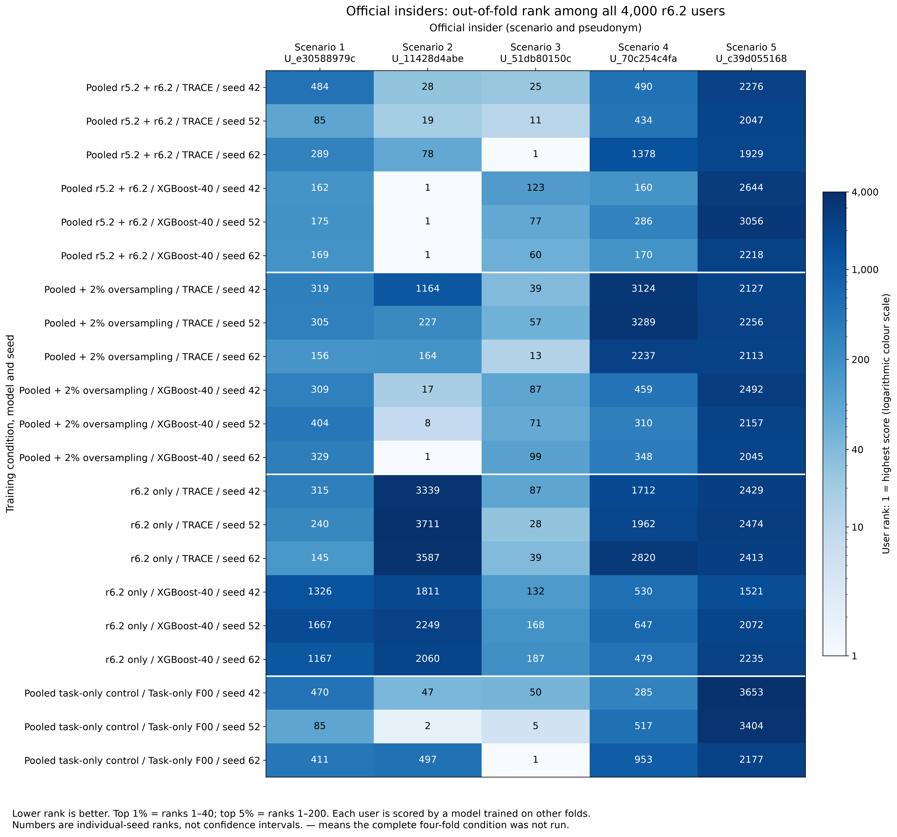

# Phase 11: CERT r6.2 on its own terms (exploratory)

Updated UTC: 2026-10-24T00:28:16.038680+00:00. Status: **PHASE11_COMPLETE**. Approved by Qasim 23 October2026 18:28 (+08), launched19:40. The24October2026 05:53 (+08) update removes the overall time limit: every condition and seed42/52/62 is to finish. Each individual run retains a90-minute timeout.

Completed training runs: 156/156; new held-out score conditions: 99/99; complete four-fold metric rows: 21/21; formal contrasts: 60/60. Every favourable and unfavourable outcome is retained.

## Findings from the priority seed42 runs

Only complete four-fold conditions appear here. These descriptions retain every available primary model; all additional seeds and paired contrasts remain in the tables below.

C1 (Pooled r5.2 + r6.2), TRACE: window PR-AUC 0.00801523 (21.42 times prevalence); user ROC-AUC 0.837321 for official insiders and 0.803975 for all affected accounts. The top1% contains 2/5 official insiders and the top5% 2/5. A daily budget of10 catches 2/5 official insiders and 2/29 affected accounts on actual malicious endpoint days. Fold-specific frozen thresholds flag 2/5 official insiders, 11/29 affected accounts and 87/3971 normal users.

C1 (Pooled r5.2 + r6.2), XGBoost-40: window PR-AUC 0.0305133 (81.56 times prevalence); user ROC-AUC 0.847696 for official insiders and 0.816879 for all affected accounts. The top1% contains 1/5 official insiders and the top5% 4/5. A daily budget of10 catches 2/5 official insiders and 2/29 affected accounts on actual malicious endpoint days. Fold-specific frozen thresholds flag 1/5 official insiders, 4/29 affected accounts and 40/3971 normal users.

C2 (Pooled + 2% oversampling), TRACE: window PR-AUC 0.000654712 (1.75 times prevalence); user ROC-AUC 0.663385 for official insiders and 0.731871 for all affected accounts. The top1% contains 1/5 official insiders and the top5% 1/5. A daily budget of10 catches 0/5 official insiders and 0/29 affected accounts on actual malicious endpoint days. Fold-specific frozen thresholds flag 1/5 official insiders, 12/29 affected accounts and 179/3971 normal users.

C2 (Pooled + 2% oversampling), XGBoost-40: window PR-AUC 0.00553274 (14.79 times prevalence); user ROC-AUC 0.834148 for official insiders and 0.810749 for all affected accounts. The top1% contains 1/5 official insiders and the top5% 2/5. A daily budget of10 catches 1/5 official insiders and 1/29 affected accounts on actual malicious endpoint days. Fold-specific frozen thresholds flag 2/5 official insiders, 8/29 affected accounts and 67/3971 normal users.

C3 (r6.2 only), TRACE: window PR-AUC 0.00316264 (8.454 times prevalence); user ROC-AUC 0.608512 for official insiders and 0.794293 for all affected accounts. The top1% contains 0/5 official insiders and the top5% 1/5. A daily budget of10 catches 0/5 official insiders and 1/29 affected accounts on actual malicious endpoint days. Fold-specific frozen thresholds flag 1/5 official insiders, 20/29 affected accounts and 692/3971 normal users.

C3 (r6.2 only), XGBoost-40: window PR-AUC 0.00171998 (4.597 times prevalence); user ROC-AUC 0.736892 for official insiders and 0.794397 for all affected accounts. The top1% contains 0/5 official insiders and the top5% 1/5. A daily budget of10 catches 0/5 official insiders and 0/29 affected accounts on actual malicious endpoint days. Fold-specific frozen thresholds flag 1/5 official insiders, 16/29 affected accounts and 541/3971 normal users.

C4 (Pooled task-only control), Task-only F00: window PR-AUC 0.00614931 (16.44 times prevalence); user ROC-AUC 0.777386 for official insiders and 0.781485 for all affected accounts. The top1% contains 0/5 official insiders and the top5% 2/5. A daily budget of10 catches 2/5 official insiders and 3/29 affected accounts on actual malicious endpoint days. Fold-specific frozen thresholds flag 2/5 official insiders, 11/29 affected accounts and 93/3971 normal users.

Window ranking, user ranking, frozen-threshold flags and same-day budget catches measure different outcomes. Read the scenario ranks, matched-malicious-window detections, intervals and original-release cost alongside these point summaries. Point ordering alone does not establish a model advantage.

## Amendment 11 and folds

Amendment11 prefix SHA-256 `4629ee483000bd0145464bdc2b41522b010433c35cf487ca94a4f6dae1a4c0c1`, 107960 bytes, written before the fold computation. [Amendment receipt](AMENDMENT11_RECEIPT.json). Fold-receipt SHA-256 `8a713d90553c55a47a843f85ef28f3755c3df0b53051eddc1048b6f3bf4ece3f`; [fold receipt](FOLD_RECEIPT.json), [pseudonymised assignment](R62_FOLD_ASSIGNMENT.csv). Status labels were read solely for the preregistered split before feature processing or model/metric computation.

| Fold | Users | Official insiders | Other affected accounts | Normal users |
| --- | --- | --- | --- | --- |
| 1 | 1000 | 2 | 6 | 992 |
| 2 | 1000 | 1 | 6 | 993 |
| 3 | 1000 | 1 | 6 | 993 |
| 4 | 1000 | 1 | 6 | 993 |

All4,000 users receive exactly one fold-held-out evaluation per condition/model/seed. Official user ROC compares5 official insiders against3,971 normal users and excludes the other24 affected accounts; affected user ROC compares all29 against3,971 normal users. Official ranks and top budgets include all4,000 users. Fold-k users are excluded from that fold’s scaler, fitting, teacher consensus, validation, checkpoint and threshold. [Cross-release disjointness](CROSS_RELEASE_USER_DISJOINTNESS.json) records counts only.

r6.2 TRAIN 2010-01-02–2011-02-17; VALIDATION 2011-02-18–2011-04-09; remainder unused. T20 stride1 windows are built separately within each period. The first19 days per period have no ending-window decision; their activity can enter a later window. r5.2 TEST stays sealed. Its500 HOLDOUT users only evaluate new pooled fold1 models, once each.

## Frozen recipes and priority order

File key TA2 denotes TRACE; XGBoost_40 denotes XGBoost-40. C1: pooled r5.2 development plus three r6.2 folds. C2: the same, repeating only r6.2 positive TRAIN windows to at least2% of that r6.2 portion. C3: r6.2 folds alone. C4: task-only F00 on C1 data. Every priority/fold at detector seed42 precedes extra detector seeds52 then62. The original three teacher seeds are required prerequisites for the first frozen-consensus TRACE student. C4 reuses its exact C1 teacher/scaler prerequisites.

Original Phase4 architectures, losses, Adam learning rates, batch1024, max15 neural epochs, patience4, validation-AP checkpoint and max-F1 sorted candidate threshold tie rules remain frozen. XGBoost uses300 trees, depth6 and inherited settings, limited to2 CPU threads. Class weights come from each effective TRAIN labels, including repeated positives in C2. Scalers use original eligible TRAIN daily rows before repetition; validation is never oversampled. Inverting the immutable storage coordinate codec retains float32 quantization. Pooled scalers combine original r5.2 development-only daily moments and the three eligible r6.2 folds.

One GPU child at a time,35% CUDA allocator cap,2 CPU threads and cooperative pauses. Only exact owned Phase11 processes are subject to the90-minute per-run timeout. There is no overall deadline. No other chat’s process is controlled and no existing repository is edited or pushed.

## Training log

| Condition | Held-out fold | Model | Seed | Status | Epochs / trees | Best epoch / trees | Validation AP | Threshold | Seconds |
| --- | --- | --- | --- | --- | --- | --- | --- | --- | --- |
| C1 | 1 | AL_PRECURSOR | 42 | ok | 7 | 3 | 0.793225 | 0.98 | 378.43 |
| C1 | 1 | T-OPT | 42 | ok | 9 | 5 | 0.802491 | 0.85 | 506.801 |
| C1 | 1 | TA2 | 42 | ok | 5 | 1 | 0.806 | 0.86 | 468.968 |
| C1 | 1 | XGBoost_40 | 42 | ok | 300 | 300 | 0.863041 | 0.84 | 37.7704 |
| C1 | 1 | AL_PRECURSOR | 52 | ok | 6 | 2 | 0.818994 | 0.96 | 298.719 |
| C1 | 1 | T-OPT | 52 | ok | 6 | 2 | 0.833475 | 0.88 | 366.557 |
| C1 | 1 | TA2 | 52 | ok | 7 | 3 | 0.848066 | 0.91 | 336.64 |
| C1 | 1 | XGBoost_40 | 52 | ok | 300 | 300 | 0.867243 | 0.91 | 35.5652 |
| C1 | 1 | AL_PRECURSOR | 62 | ok | 8 | 4 | 0.801778 | 0.98 | 400.756 |
| C1 | 1 | T-OPT | 62 | ok | 9 | 5 | 0.807279 | 0.93 | 475.84 |
| C1 | 1 | TA2 | 62 | ok | 15 | 12 | 0.819071 | 0.92 | 680.239 |
| C1 | 1 | XGBoost_40 | 62 | ok | 300 | 300 | 0.861406 | 0.87 | 34.1596 |
| C1 | 2 | AL_PRECURSOR | 42 | ok | 11 | 7 | 0.809761 | 0.99 | 639.21 |
| C1 | 2 | T-OPT | 42 | ok | 7 | 3 | 0.783404 | 0.93 | 435.739 |
| C1 | 2 | TA2 | 42 | ok | 15 | 13 | 0.843925 | 0.88 | 1254.42 |
| C1 | 2 | XGBoost_40 | 42 | ok | 300 | 300 | 0.848287 | 0.92 | 43.8571 |
| C1 | 2 | AL_PRECURSOR | 52 | ok | 9 | 5 | 0.853872 | 0.9 | 448.242 |
| C1 | 2 | T-OPT | 52 | ok | 5 | 1 | 0.810806 | 0.78 | 304.034 |
| C1 | 2 | TA2 | 52 | ok | 11 | 7 | 0.842938 | 0.77 | 515.913 |
| C1 | 2 | XGBoost_40 | 52 | ok | 300 | 300 | 0.851461 | 0.98 | 33.6586 |
| C1 | 2 | AL_PRECURSOR | 62 | ok | 7 | 3 | 0.788675 | 0.99 | 354.692 |
| C1 | 2 | T-OPT | 62 | ok | 15 | 14 | 0.822166 | 0.95 | 879.718 |
| C1 | 2 | TA2 | 62 | ok | 9 | 5 | 0.816734 | 0.89 | 413.123 |
| C1 | 2 | XGBoost_40 | 62 | ok | 300 | 300 | 0.865574 | 0.9 | 34.147 |
| C1 | 3 | AL_PRECURSOR | 42 | ok | 12 | 8 | 0.851157 | 0.96 | 584.739 |
| C1 | 3 | T-OPT | 42 | ok | 15 | 14 | 0.86433 | 0.95 | 890.803 |
| C1 | 3 | TA2 | 42 | ok | 14 | 10 | 0.871769 | 0.86 | 696.889 |
| C1 | 3 | XGBoost_40 | 42 | ok | 300 | 300 | 0.887914 | 0.96 | 32.7746 |
| C1 | 3 | AL_PRECURSOR | 52 | ok | 12 | 8 | 0.84349 | 0.98 | 338.239 |
| C1 | 3 | T-OPT | 52 | ok | 5 | 1 | 0.843214 | 0.75 | 151.039 |
| C1 | 3 | TA2 | 52 | ok | 13 | 9 | 0.848751 | 0.94 | 616.008 |
| C1 | 3 | XGBoost_40 | 52 | ok | 300 | 300 | 0.882248 | 0.93 | 34.345 |
| C1 | 3 | AL_PRECURSOR | 62 | ok | 9 | 5 | 0.831412 | 0.99 | 228.808 |
| C1 | 3 | T-OPT | 62 | ok | 9 | 5 | 0.847307 | 0.95 | 271.177 |
| C1 | 3 | TA2 | 62 | ok | 12 | 8 | 0.833665 | 0.72 | 549.841 |
| C1 | 3 | XGBoost_40 | 62 | ok | 300 | 300 | 0.875415 | 0.98 | 34.7222 |
| C1 | 4 | AL_PRECURSOR | 42 | ok | 8 | 4 | 0.746669 | 0.94 | 204.748 |
| C1 | 4 | T-OPT | 42 | ok | 9 | 5 | 0.768834 | 0.91 | 269.798 |
| C1 | 4 | TA2 | 42 | ok | 7 | 3 | 0.781342 | 0.91 | 378.884 |
| C1 | 4 | XGBoost_40 | 42 | ok | 300 | 300 | 0.83183 | 0.99 | 32.759 |
| C1 | 4 | AL_PRECURSOR | 52 | ok | 6 | 2 | 0.775465 | 0.95 | 153.413 |
| C1 | 4 | T-OPT | 52 | ok | 5 | 1 | 0.772598 | 0.76 | 151.134 |
| C1 | 4 | TA2 | 52 | ok | 15 | 13 | 0.800442 | 0.85 | 710.578 |
| C1 | 4 | XGBoost_40 | 52 | ok | 300 | 300 | 0.828171 | 0.98 | 33.9433 |
| C1 | 4 | AL_PRECURSOR | 62 | ok | 9 | 5 | 0.775024 | 0.98 | 227.311 |
| C1 | 4 | T-OPT | 62 | ok | 12 | 8 | 0.825963 | 0.96 | 353.45 |
| C1 | 4 | TA2 | 62 | ok | 11 | 7 | 0.831645 | 0.8 | 534.993 |
| C1 | 4 | XGBoost_40 | 62 | ok | 300 | 300 | 0.840134 | 0.93 | 34.45 |
| C2 | 1 | AL_PRECURSOR | 42 | ok | 15 | 11 | 0.731502 | 0.76 | 386.342 |
| C2 | 1 | T-OPT | 42 | ok | 5 | 1 | 0.703525 | 0.68 | 156.269 |
| C2 | 1 | TA2 | 42 | ok | 15 | 15 | 0.780925 | 0.03 | 766.219 |
| C2 | 1 | XGBoost_40 | 42 | ok | 300 | 300 | 0.826408 | 0.92 | 32.3005 |
| C2 | 1 | AL_PRECURSOR | 52 | ok | 13 | 9 | 0.74141 | 0.44 | 333.985 |
| C2 | 1 | T-OPT | 52 | ok | 12 | 8 | 0.770213 | 0.18 | 367.473 |
| C2 | 1 | TA2 | 52 | ok | 8 | 4 | 0.789073 | 0.1 | 444.262 |
| C2 | 1 | XGBoost_40 | 52 | ok | 300 | 300 | 0.82314 | 0.93 | 33.1532 |
| C2 | 1 | AL_PRECURSOR | 62 | ok | 14 | 10 | 0.750784 | 0.96 | 361.839 |
| C2 | 1 | T-OPT | 62 | ok | 13 | 9 | 0.730613 | 0.29 | 401.123 |
| C2 | 1 | TA2 | 62 | ok | 9 | 5 | 0.819259 | 0.16 | 463.113 |
| C2 | 1 | XGBoost_40 | 62 | ok | 300 | 300 | 0.817194 | 0.84 | 33.2617 |
| C2 | 2 | AL_PRECURSOR | 42 | ok | 15 | 12 | 0.807147 | 0.17 | 393.228 |
| C2 | 2 | T-OPT | 42 | ok | 10 | 6 | 0.79604 | 0.19 | 309.375 |
| C2 | 2 | TA2 | 42 | ok | 15 | 12 | 0.84 | 0.06 | 771.517 |
| C2 | 2 | XGBoost_40 | 42 | ok | 300 | 300 | 0.794568 | 0.96 | 32.2106 |
| C2 | 2 | AL_PRECURSOR | 52 | ok | 15 | 11 | 0.79632 | 0.57 | 391.943 |
| C2 | 2 | T-OPT | 52 | ok | 6 | 2 | 0.741542 | 0.28 | 186.575 |
| C2 | 2 | TA2 | 52 | ok | 11 | 7 | 0.796507 | 0.03 | 555.738 |
| C2 | 2 | XGBoost_40 | 52 | ok | 300 | 300 | 0.79824 | 0.95 | 34.1192 |
| C2 | 2 | AL_PRECURSOR | 62 | ok | 13 | 9 | 0.779294 | 0.72 | 340.281 |
| C2 | 2 | T-OPT | 62 | ok | 12 | 8 | 0.742999 | 0.21 | 372.739 |
| C2 | 2 | TA2 | 62 | ok | 7 | 3 | 0.756922 | 0.08 | 377.19 |
| C2 | 2 | XGBoost_40 | 62 | ok | 300 | 300 | 0.8048 | 0.94 | 33.3385 |
| C2 | 3 | AL_PRECURSOR | 42 | ok | 15 | 13 | 0.799166 | 0.94 | 392.895 |
| C2 | 3 | T-OPT | 42 | ok | 14 | 10 | 0.752509 | 0.91 | 431.138 |
| C2 | 3 | TA2 | 42 | ok | 13 | 9 | 0.802161 | 0.55 | 678.191 |
| C2 | 3 | XGBoost_40 | 42 | ok | 300 | 300 | 0.821629 | 0.98 | 32.4418 |
| C2 | 3 | AL_PRECURSOR | 52 | ok | 10 | 6 | 0.804329 | 0.84 | 264.113 |
| C2 | 3 | T-OPT | 52 | ok | 13 | 9 | 0.794717 | 0.5 | 402.732 |
| C2 | 3 | TA2 | 52 | ok | 11 | 7 | 0.786257 | 0.14 | 591.401 |
| C2 | 3 | XGBoost_40 | 52 | ok | 300 | 300 | 0.812151 | 0.98 | 32.5207 |
| C2 | 3 | AL_PRECURSOR | 62 | ok | 15 | 12 | 0.826951 | 0.76 | 394.71 |
| C2 | 3 | T-OPT | 62 | ok | 7 | 3 | 0.765986 | 0.37 | 219.625 |
| C2 | 3 | TA2 | 62 | ok | 15 | 13 | 0.861406 | 0.01 | 747.325 |
| C2 | 3 | XGBoost_40 | 62 | ok | 300 | 300 | 0.826066 | 0.98 | 33.2952 |
| C2 | 4 | AL_PRECURSOR | 42 | ok | 15 | 12 | 0.771559 | 0.26 | 387.914 |
| C2 | 4 | T-OPT | 42 | ok | 6 | 2 | 0.74275 | 0.2 | 184.442 |
| C2 | 4 | TA2 | 42 | ok | 15 | 14 | 0.797036 | 0.08 | 764.281 |
| C2 | 4 | XGBoost_40 | 42 | ok | 300 | 300 | 0.794426 | 0.99 | 32.537 |
| C2 | 4 | AL_PRECURSOR | 52 | ok | 14 | 10 | 0.75512 | 0.96 | 361.206 |
| C2 | 4 | T-OPT | 52 | ok | 10 | 6 | 0.732711 | 0.35 | 309.388 |
| C2 | 4 | TA2 | 52 | ok | 11 | 7 | 0.772783 | 0.22 | 578.648 |
| C2 | 4 | XGBoost_40 | 52 | ok | 300 | 300 | 0.789486 | 0.98 | 33.143 |
| C2 | 4 | AL_PRECURSOR | 62 | ok | 10 | 6 | 0.741578 | 0.95 | 260.019 |
| C2 | 4 | T-OPT | 62 | ok | 5 | 1 | 0.710956 | 0.68 | 155.879 |
| C2 | 4 | TA2 | 62 | ok | 10 | 6 | 0.762866 | 0.35 | 525.516 |
| C2 | 4 | XGBoost_40 | 62 | ok | 300 | 300 | 0.796755 | 0.99 | 33.6832 |
| C3 | 1 | AL_PRECURSOR | 42 | ok | 13 | 9 | 0.000753068 | 0.01 | 222.512 |
| C3 | 1 | T-OPT | 42 | ok | 6 | 2 | 0.000870101 | 0.141352 | 122.168 |
| C3 | 1 | TA2 | 42 | ok | 6 | 2 | 0.000792362 | 0.0563277 | 221.041 |
| C3 | 1 | XGBoost_40 | 42 | ok | 300 | 300 | 0.00617522 | 0.000474035 | 23.9084 |
| C3 | 1 | AL_PRECURSOR | 52 | ok | 14 | 10 | 0.00172613 | 0.00465763 | 236.157 |
| C3 | 1 | T-OPT | 52 | ok | 10 | 6 | 0.00111707 | 0.0248246 | 200.291 |
| C3 | 1 | TA2 | 52 | ok | 7 | 3 | 0.000985972 | 0.0557452 | 256.9 |
| C3 | 1 | XGBoost_40 | 52 | ok | 300 | 300 | 0.00202909 | 0.000108034 | 22.6938 |
| C3 | 1 | AL_PRECURSOR | 62 | ok | 10 | 6 | 0.000608288 | 0.00935412 | 170.786 |
| C3 | 1 | T-OPT | 62 | ok | 8 | 4 | 0.000402192 | 0.0543792 | 163.632 |
| C3 | 1 | TA2 | 62 | ok | 6 | 2 | 0.00053534 | 0.053809 | 197.216 |
| C3 | 1 | XGBoost_40 | 62 | ok | 300 | 300 | 0.00239185 | 9.35396e-05 | 24.1904 |
| C3 | 2 | AL_PRECURSOR | 42 | ok | 12 | 8 | 0.0951455 | 0.88 | 204.185 |
| C3 | 2 | T-OPT | 42 | ok | 5 | 1 | 0.0353507 | 0.63 | 102.264 |
| C3 | 2 | TA2 | 42 | ok | 7 | 3 | 0.053591 | 0.81 | 252.103 |
| C3 | 2 | XGBoost_40 | 42 | ok | 300 | 300 | 0.0117403 | 0.31 | 22.651 |
| C3 | 2 | AL_PRECURSOR | 52 | ok | 13 | 9 | 0.0231194 | 0.49 | 219.308 |
| C3 | 2 | T-OPT | 52 | ok | 12 | 8 | 0.030897 | 0.93 | 245.378 |
| C3 | 2 | TA2 | 52 | ok | 7 | 3 | 0.0438293 | 0.81 | 261.241 |
| C3 | 2 | XGBoost_40 | 52 | ok | 300 | 300 | 0.010437 | 0.26 | 28.4788 |
| C3 | 2 | AL_PRECURSOR | 62 | ok | 15 | 12 | 0.184858 | 0.69 | 257.56 |
| C3 | 2 | T-OPT | 62 | ok | 7 | 3 | 0.171434 | 0.8 | 143.15 |
| C3 | 2 | TA2 | 62 | ok | 10 | 6 | 0.0901152 | 0.61 | 327.842 |
| C3 | 2 | XGBoost_40 | 62 | ok | 300 | 300 | 0.00691581 | 0.42 | 23.0035 |
| C3 | 3 | AL_PRECURSOR | 42 | ok | 11 | 7 | 0.0806906 | 0.99 | 187.836 |
| C3 | 3 | T-OPT | 42 | ok | 8 | 4 | 0.16936 | 0.82 | 161.907 |
| C3 | 3 | TA2 | 42 | ok | 5 | 1 | 0.15198 | 0.85 | 189.145 |
| C3 | 3 | XGBoost_40 | 42 | ok | 300 | 300 | 0.00461608 | 0.04 | 22.3721 |
| C3 | 3 | AL_PRECURSOR | 52 | ok | 9 | 5 | 0.00477039 | 0.29 | 154.131 |
| C3 | 3 | T-OPT | 52 | ok | 11 | 7 | 0.00817616 | 0.74 | 234.766 |
| C3 | 3 | TA2 | 52 | ok | 7 | 3 | 0.00564797 | 0.87 | 264.877 |
| C3 | 3 | XGBoost_40 | 52 | ok | 300 | 300 | 0.0095606 | 0.48 | 23.4245 |
| C3 | 3 | AL_PRECURSOR | 62 | ok | 5 | 1 | 0.00327745 | 0.32 | 86.9831 |
| C3 | 3 | T-OPT | 62 | ok | 10 | 6 | 0.00556144 | 0.23 | 199.359 |
| C3 | 3 | TA2 | 62 | ok | 15 | 12 | 0.00622782 | 0.23 | 477.121 |
| C3 | 3 | XGBoost_40 | 62 | ok | 300 | 300 | 0.00701336 | 0.08 | 22.8999 |
| C3 | 4 | AL_PRECURSOR | 42 | ok | 15 | 12 | 0.09199 | 0.86 | 261.702 |
| C3 | 4 | T-OPT | 42 | ok | 7 | 3 | 0.0305751 | 0.51 | 139.891 |
| C3 | 4 | TA2 | 42 | ok | 12 | 8 | 0.0406556 | 0.49 | 404.378 |
| C3 | 4 | XGBoost_40 | 42 | ok | 300 | 300 | 0.0136447 | 0.04 | 28.8555 |
| C3 | 4 | AL_PRECURSOR | 52 | ok | 9 | 5 | 0.0218227 | 0.7 | 153.877 |
| C3 | 4 | T-OPT | 52 | ok | 15 | 15 | 0.0687272 | 0.97 | 295.912 |
| C3 | 4 | TA2 | 52 | ok | 5 | 1 | 0.136821 | 0.71 | 190.765 |
| C3 | 4 | XGBoost_40 | 52 | ok | 300 | 300 | 0.0193724 | 0.21 | 22.333 |
| C3 | 4 | AL_PRECURSOR | 62 | ok | 15 | 11 | 0.357029 | 0.99 | 253.649 |
| C3 | 4 | T-OPT | 62 | ok | 5 | 1 | 0.204894 | 0.64 | 100.681 |
| C3 | 4 | TA2 | 62 | ok | 5 | 1 | 0.318898 | 0.73 | 183.83 |
| C3 | 4 | XGBoost_40 | 62 | ok | 300 | 300 | 0.00946867 | 0.06 | 22.9591 |
| C4 | 1 | F00 | 42 | ok | 5 | 1 | 0.758474 | 0.91 | 217.521 |
| C4 | 1 | F00 | 52 | ok | 7 | 3 | 0.825226 | 0.98 | 294.4 |
| C4 | 1 | F00 | 62 | ok | 14 | 10 | 0.776835 | 0.99 | 521.886 |
| C4 | 2 | F00 | 42 | ok | 10 | 6 | 0.781345 | 0.97 | 398.675 |
| C4 | 2 | F00 | 52 | ok | 6 | 2 | 0.7941 | 0.86 | 265.111 |
| C4 | 2 | F00 | 62 | ok | 5 | 1 | 0.80389 | 0.94 | 227.587 |
| C4 | 3 | F00 | 42 | ok | 8 | 4 | 0.823078 | 0.96 | 341.454 |
| C4 | 3 | F00 | 52 | ok | 5 | 1 | 0.803267 | 0.89 | 214.33 |
| C4 | 3 | F00 | 62 | ok | 5 | 1 | 0.822372 | 0.97 | 234.222 |
| C4 | 4 | F00 | 42 | ok | 5 | 1 | 0.744555 | 0.93 | 221.391 |
| C4 | 4 | F00 | 52 | ok | 5 | 1 | 0.760331 | 0.82 | 233.384 |
| C4 | 4 | F00 | 62 | ok | 5 | 1 | 0.802966 | 0.99 | 232.825 |
[Training log CSV](TRAINING_LOG.csv); [every neural epoch](TRAINING_EPOCH_HISTORY.csv). Full configurations, histories and checkpoint hashes are in PHASE11_RESULTS.json and private per-run records.

## C1: Pooled r5.2 + r6.2

| Condition / model / seed | Window PR-AUC | AP / prevalence | Window ROC-AUC | User ROC: official | User ROC: all affected |
| --- | --- | --- | --- | --- | --- |
| C1_TA2_42 | 0.00801523 | 21.4244 | 0.761292 | 0.837321 | 0.803975 |
| C1_TA2_52 | 0.00965851 | 25.8168 | 0.803006 | 0.872173 | 0.808539 |
| C1_TA2_62 | 0.0175312 | 46.8601 | 0.789855 | 0.818736 | 0.800953 |
| C1_XGBoost_40_42 | 0.0305133 | 81.5608 | 0.828054 | 0.847696 | 0.816879 |
| C1_XGBoost_40_52 | 0.0284072 | 75.9313 | 0.831678 | 0.822362 | 0.807718 |
| C1_XGBoost_40_62 | 0.0205019 | 54.8008 | 0.840233 | 0.871367 | 0.818633 |

## C2: Pooled + 2% oversampling

| Condition / model / seed | Window PR-AUC | AP / prevalence | Window ROC-AUC | User ROC: official | User ROC: all affected |
| --- | --- | --- | --- | --- | --- |
| C2_TA2_42 | 0.000654712 | 1.75002 | 0.546321 | 0.663385 | 0.731871 |
| C2_TA2_52 | 0.00119301 | 3.18888 | 0.56747 | 0.695442 | 0.724763 |
| C2_TA2_62 | 0.00198735 | 5.31211 | 0.587284 | 0.767565 | 0.721307 |
| C2_XGBoost_40_42 | 0.00553274 | 14.7888 | 0.802576 | 0.834148 | 0.810749 |
| C2_XGBoost_40_52 | 0.00544329 | 14.5497 | 0.80526 | 0.854898 | 0.817122 |
| C2_XGBoost_40_62 | 0.00828676 | 22.1501 | 0.799777 | 0.861345 | 0.813384 |

## C3: r6.2 only

| Condition / model / seed | Window PR-AUC | AP / prevalence | Window ROC-AUC | User ROC: official | User ROC: all affected |
| --- | --- | --- | --- | --- | --- |
| C3_TA2_42 | 0.00316264 | 8.45359 | 0.707556 | 0.608512 | 0.794293 |
| C3_TA2_52 | 0.00426084 | 11.3891 | 0.724452 | 0.581063 | 0.770517 |
| C3_TA2_62 | 0.00280522 | 7.49822 | 0.66967 | 0.551549 | 0.763527 |
| C3_XGBoost_40_42 | 0.00171998 | 4.59743 | 0.759208 | 0.736892 | 0.794397 |
| C3_XGBoost_40_52 | 0.00172655 | 4.615 | 0.745267 | 0.662402 | 0.775363 |
| C3_XGBoost_40_62 | 0.0018689 | 4.99549 | 0.752329 | 0.696349 | 0.790933 |

## C4: Pooled task-only control

| Condition / model / seed | Window PR-AUC | AP / prevalence | Window ROC-AUC | User ROC: official | User ROC: all affected |
| --- | --- | --- | --- | --- | --- |
| C4_F00_42 | 0.00614931 | 16.4368 | 0.676783 | 0.777386 | 0.781485 |
| C4_F00_52 | 0.0111972 | 29.9297 | 0.732283 | 0.800655 | 0.772714 |
| C4_F00_62 | 0.0153041 | 40.9072 | 0.729082 | 0.800907 | 0.815342 |

## User-level summary

| Condition | Model | Seed | User ROC: official | User ROC: affected | Official in top1% | Official in top2% | Official in top5% | Affected in top1% | Affected in top5% |
| --- | --- | --- | --- | --- | --- | --- | --- | --- | --- |
| C1 | TA2 | 42 | 0.837321 | 0.803975 | 2 | 2 | 2 | 5 | 15 |
| C1 | TA2 | 52 | 0.872173 | 0.808539 | 2 | 2 | 3 | 3 | 19 |
| C1 | TA2 | 62 | 0.818736 | 0.800953 | 1 | 2 | 2 | 3 | 18 |
| C1 | XGBoost_40 | 42 | 0.847696 | 0.816879 | 1 | 1 | 4 | 4 | 17 |
| C1 | XGBoost_40 | 52 | 0.822362 | 0.807718 | 1 | 2 | 3 | 2 | 15 |
| C1 | XGBoost_40 | 62 | 0.871367 | 0.818633 | 1 | 2 | 4 | 3 | 16 |
| C2 | TA2 | 42 | 0.663385 | 0.731871 | 1 | 1 | 1 | 7 | 12 |
| C2 | TA2 | 52 | 0.695442 | 0.724763 | 0 | 1 | 1 | 5 | 14 |
| C2 | TA2 | 62 | 0.767565 | 0.721307 | 1 | 1 | 3 | 4 | 13 |
| C2 | XGBoost_40 | 42 | 0.834148 | 0.810749 | 1 | 1 | 2 | 4 | 14 |
| C2 | XGBoost_40 | 52 | 0.854898 | 0.817122 | 1 | 2 | 2 | 2 | 14 |
| C2 | XGBoost_40 | 62 | 0.861345 | 0.813384 | 1 | 1 | 2 | 5 | 13 |
| C3 | TA2 | 42 | 0.608512 | 0.794293 | 0 | 0 | 1 | 8 | 17 |
| C3 | TA2 | 52 | 0.581063 | 0.770517 | 1 | 1 | 1 | 6 | 17 |
| C3 | TA2 | 62 | 0.551549 | 0.763527 | 1 | 1 | 2 | 6 | 19 |
| C3 | XGBoost_40 | 42 | 0.736892 | 0.794397 | 0 | 0 | 1 | 4 | 12 |
| C3 | XGBoost_40 | 52 | 0.662402 | 0.775363 | 0 | 0 | 1 | 3 | 13 |
| C3 | XGBoost_40 | 62 | 0.696349 | 0.790933 | 0 | 0 | 1 | 4 | 12 |
| C4 | F00 | 42 | 0.777386 | 0.781485 | 0 | 2 | 2 | 5 | 16 |
| C4 | F00 | 52 | 0.800655 | 0.772714 | 2 | 2 | 3 | 3 | 16 |
| C4 | F00 | 62 | 0.800907 | 0.815342 | 1 | 1 | 1 | 4 | 16 |
| C1 | TA2 | mean of 3 | 0.842743 | 0.804489 | 1.66667 | 2 | 2.33333 | 3.66667 | 17.3333 |
| C1 | XGBoost_40 | mean of 3 | 0.847142 | 0.81441 | 1 | 1.66667 | 3.66667 | 3 | 16 |
| C2 | TA2 | mean of 3 | 0.708797 | 0.72598 | 0.666667 | 1 | 1.66667 | 5.33333 | 13 |
| C2 | XGBoost_40 | mean of 3 | 0.85013 | 0.813752 | 1 | 1.33333 | 2 | 3.66667 | 13.6667 |
| C3 | TA2 | mean of 3 | 0.580374 | 0.776112 | 0.666667 | 0.666667 | 1.33333 | 6.66667 | 17.6667 |
| C3 | XGBoost_40 | mean of 3 | 0.698548 | 0.786898 | 0 | 0 | 1 | 3.66667 | 12.3333 |
| C4 | F00 | mean of 3 | 0.792982 | 0.789847 | 1 | 1.66667 | 2 | 4 | 16 |

User score is maximum completed-window probability. Ranks break exact score ties by pseudonym. Seed means average metrics/counts over all3 seeds and do not form an ensemble. Mean top-budget counts can therefore be fractional. Full denominators,2% top counts and point intervals are retained in the sidecars. [Summary CSV](USER_LEVEL_SUMMARY.csv); [official ranks](OFFICIAL_RANKS.csv); [point-metric confidence intervals](POINT_METRIC_INTERVALS.csv).

## Frozen thresholds by fold

User detection means any window exceeds that fold’s frozen threshold. Malicious-window-matched detections are separately named to preserve the previous phases’ convention. Normal flagged users have no malicious days. The frozen threshold is selected only from training-fold VALIDATION, at window level.

| Condition / model / seed | Fold | Threshold | Official denominator | Official flagged | Affected denominator | Affected flagged | Normal denominator | Normal flagged | Official: matched malicious window | Affected: matched malicious window |
| --- | --- | --- | --- | --- | --- | --- | --- | --- | --- | --- |
| C1_TA2_42 | 1 | 0.86 | 2 | 2 | 8 | 4 | 992 | 21 | 2 | 2 |
| C1_TA2_42 | 2 | 0.88 | 1 | 0 | 7 | 1 | 993 | 15 | 0 | 0 |
| C1_TA2_42 | 3 | 0.86 | 1 | 0 | 7 | 4 | 993 | 33 | 0 | 2 |
| C1_TA2_42 | 4 | 0.91 | 1 | 0 | 7 | 2 | 993 | 18 | 0 | 0 |
| C1_TA2_52 | 1 | 0.91 | 2 | 2 | 8 | 2 | 992 | 15 | 2 | 2 |
| C1_TA2_52 | 2 | 0.77 | 1 | 0 | 7 | 2 | 993 | 18 | 0 | 1 |
| C1_TA2_52 | 3 | 0.94 | 1 | 0 | 7 | 1 | 993 | 13 | 0 | 1 |
| C1_TA2_52 | 4 | 0.85 | 1 | 1 | 7 | 2 | 993 | 21 | 0 | 0 |
| C1_TA2_62 | 1 | 0.92 | 2 | 1 | 8 | 2 | 992 | 18 | 1 | 1 |
| C1_TA2_62 | 2 | 0.89 | 1 | 0 | 7 | 0 | 993 | 11 | 0 | 0 |
| C1_TA2_62 | 3 | 0.72 | 1 | 0 | 7 | 3 | 993 | 29 | 0 | 2 |
| C1_TA2_62 | 4 | 0.8 | 1 | 0 | 7 | 3 | 993 | 30 | 0 | 1 |
| C1_XGBoost_40_42 | 1 | 0.84 | 2 | 1 | 8 | 2 | 992 | 14 | 1 | 1 |
| C1_XGBoost_40_42 | 2 | 0.92 | 1 | 0 | 7 | 1 | 993 | 10 | 0 | 0 |
| C1_XGBoost_40_42 | 3 | 0.96 | 1 | 0 | 7 | 1 | 993 | 12 | 0 | 0 |
| C1_XGBoost_40_42 | 4 | 0.99 | 1 | 0 | 7 | 0 | 993 | 4 | 0 | 0 |
| C1_XGBoost_40_52 | 1 | 0.91 | 2 | 1 | 8 | 1 | 992 | 11 | 1 | 1 |
| C1_XGBoost_40_52 | 2 | 0.98 | 1 | 0 | 7 | 0 | 993 | 4 | 0 | 0 |
| C1_XGBoost_40_52 | 3 | 0.93 | 1 | 0 | 7 | 1 | 993 | 15 | 0 | 0 |
| C1_XGBoost_40_52 | 4 | 0.98 | 1 | 0 | 7 | 0 | 993 | 6 | 0 | 0 |
| C1_XGBoost_40_62 | 1 | 0.87 | 2 | 2 | 8 | 2 | 992 | 14 | 2 | 2 |
| C1_XGBoost_40_62 | 2 | 0.9 | 1 | 0 | 7 | 1 | 993 | 11 | 0 | 0 |
| C1_XGBoost_40_62 | 3 | 0.98 | 1 | 0 | 7 | 0 | 993 | 4 | 0 | 0 |
| C1_XGBoost_40_62 | 4 | 0.93 | 1 | 0 | 7 | 2 | 993 | 19 | 0 | 0 |
| C2_TA2_42 | 1 | 0.03 | 2 | 1 | 8 | 3 | 992 | 37 | 1 | 1 |
| C2_TA2_42 | 2 | 0.06 | 1 | 0 | 7 | 3 | 993 | 32 | 0 | 0 |
| C2_TA2_42 | 3 | 0.55 | 1 | 0 | 7 | 3 | 993 | 38 | 0 | 0 |
| C2_TA2_42 | 4 | 0.08 | 1 | 0 | 7 | 3 | 993 | 72 | 0 | 0 |
| C2_TA2_52 | 1 | 0.1 | 2 | 2 | 8 | 3 | 992 | 40 | 1 | 1 |
| C2_TA2_52 | 2 | 0.03 | 1 | 0 | 7 | 3 | 993 | 34 | 0 | 0 |
| C2_TA2_52 | 3 | 0.14 | 1 | 0 | 7 | 3 | 993 | 68 | 0 | 2 |
| C2_TA2_52 | 4 | 0.22 | 1 | 0 | 7 | 6 | 993 | 64 | 0 | 0 |
| C2_TA2_62 | 1 | 0.16 | 2 | 2 | 8 | 3 | 992 | 40 | 2 | 2 |
| C2_TA2_62 | 2 | 0.08 | 1 | 0 | 7 | 3 | 993 | 37 | 0 | 0 |
| C2_TA2_62 | 3 | 0.01 | 1 | 0 | 7 | 3 | 993 | 70 | 0 | 1 |
| C2_TA2_62 | 4 | 0.35 | 1 | 1 | 7 | 4 | 993 | 71 | 1 | 1 |
| C2_XGBoost_40_42 | 1 | 0.92 | 2 | 2 | 8 | 3 | 992 | 18 | 1 | 1 |
| C2_XGBoost_40_42 | 2 | 0.96 | 1 | 0 | 7 | 2 | 993 | 13 | 0 | 0 |
| C2_XGBoost_40_42 | 3 | 0.98 | 1 | 0 | 7 | 2 | 993 | 19 | 0 | 0 |
| C2_XGBoost_40_42 | 4 | 0.99 | 1 | 0 | 7 | 1 | 993 | 17 | 0 | 0 |
| C2_XGBoost_40_52 | 1 | 0.93 | 2 | 2 | 8 | 3 | 992 | 20 | 1 | 1 |
| C2_XGBoost_40_52 | 2 | 0.95 | 1 | 0 | 7 | 2 | 993 | 13 | 0 | 0 |
| C2_XGBoost_40_52 | 3 | 0.98 | 1 | 0 | 7 | 1 | 993 | 17 | 0 | 0 |
| C2_XGBoost_40_52 | 4 | 0.98 | 1 | 0 | 7 | 2 | 993 | 22 | 0 | 0 |
| C2_XGBoost_40_62 | 1 | 0.84 | 2 | 2 | 8 | 3 | 992 | 25 | 1 | 1 |
| C2_XGBoost_40_62 | 2 | 0.94 | 1 | 0 | 7 | 3 | 993 | 14 | 0 | 0 |
| C2_XGBoost_40_62 | 3 | 0.98 | 1 | 0 | 7 | 1 | 993 | 18 | 0 | 0 |
| C2_XGBoost_40_62 | 4 | 0.99 | 1 | 0 | 7 | 1 | 993 | 19 | 0 | 0 |
| C3_TA2_42 | 1 | 0.0563277 | 2 | 1 | 8 | 7 | 992 | 607 | 1 | 5 |
| C3_TA2_42 | 2 | 0.81 | 1 | 0 | 7 | 3 | 993 | 22 | 0 | 0 |
| C3_TA2_42 | 3 | 0.85 | 1 | 0 | 7 | 4 | 993 | 24 | 0 | 2 |
| C3_TA2_42 | 4 | 0.49 | 1 | 0 | 7 | 6 | 993 | 39 | 0 | 1 |
| C3_TA2_52 | 1 | 0.0557452 | 2 | 1 | 8 | 5 | 992 | 559 | 1 | 5 |
| C3_TA2_52 | 2 | 0.81 | 1 | 0 | 7 | 2 | 993 | 19 | 0 | 0 |
| C3_TA2_52 | 3 | 0.87 | 1 | 0 | 7 | 3 | 993 | 19 | 0 | 2 |
| C3_TA2_52 | 4 | 0.71 | 1 | 0 | 7 | 6 | 993 | 24 | 0 | 1 |
| C3_TA2_62 | 1 | 0.053809 | 2 | 2 | 8 | 6 | 992 | 631 | 2 | 6 |
| C3_TA2_62 | 2 | 0.61 | 1 | 0 | 7 | 4 | 993 | 24 | 0 | 0 |
| C3_TA2_62 | 3 | 0.23 | 1 | 0 | 7 | 4 | 993 | 39 | 0 | 4 |
| C3_TA2_62 | 4 | 0.73 | 1 | 0 | 7 | 4 | 993 | 13 | 0 | 1 |
| C3_XGBoost_40_42 | 1 | 0.000474035 | 2 | 1 | 8 | 5 | 992 | 288 | 0 | 2 |
| C3_XGBoost_40_42 | 2 | 0.31 | 1 | 0 | 7 | 3 | 993 | 30 | 0 | 0 |
| C3_XGBoost_40_42 | 3 | 0.04 | 1 | 0 | 7 | 4 | 993 | 109 | 0 | 3 |
| C3_XGBoost_40_42 | 4 | 0.04 | 1 | 0 | 7 | 4 | 993 | 114 | 0 | 1 |
| C3_XGBoost_40_52 | 1 | 0.000108034 | 2 | 1 | 8 | 5 | 992 | 435 | 1 | 4 |
| C3_XGBoost_40_52 | 2 | 0.26 | 1 | 0 | 7 | 3 | 993 | 29 | 0 | 0 |
| C3_XGBoost_40_52 | 3 | 0.48 | 1 | 0 | 7 | 2 | 993 | 40 | 0 | 0 |
| C3_XGBoost_40_52 | 4 | 0.21 | 1 | 0 | 7 | 3 | 993 | 59 | 0 | 1 |
| C3_XGBoost_40_62 | 1 | 9.35396e-05 | 2 | 2 | 8 | 6 | 992 | 463 | 1 | 4 |
| C3_XGBoost_40_62 | 2 | 0.42 | 1 | 0 | 7 | 3 | 993 | 23 | 0 | 1 |
| C3_XGBoost_40_62 | 3 | 0.08 | 1 | 0 | 7 | 4 | 993 | 81 | 0 | 1 |
| C3_XGBoost_40_62 | 4 | 0.06 | 1 | 0 | 7 | 3 | 993 | 96 | 0 | 1 |
| C4_F00_42 | 1 | 0.91 | 2 | 2 | 8 | 4 | 992 | 22 | 2 | 2 |
| C4_F00_42 | 2 | 0.97 | 1 | 0 | 7 | 1 | 993 | 13 | 0 | 0 |
| C4_F00_42 | 3 | 0.96 | 1 | 0 | 7 | 4 | 993 | 29 | 0 | 2 |
| C4_F00_42 | 4 | 0.93 | 1 | 0 | 7 | 2 | 993 | 29 | 0 | 0 |
| C4_F00_52 | 1 | 0.98 | 2 | 2 | 8 | 2 | 992 | 11 | 2 | 2 |
| C4_F00_52 | 2 | 0.86 | 1 | 0 | 7 | 1 | 993 | 23 | 0 | 1 |
| C4_F00_52 | 3 | 0.89 | 1 | 0 | 7 | 1 | 993 | 10 | 0 | 1 |
| C4_F00_52 | 4 | 0.82 | 1 | 1 | 7 | 2 | 993 | 37 | 0 | 0 |
| C4_F00_62 | 1 | 0.99 | 2 | 1 | 8 | 1 | 992 | 10 | 1 | 1 |
| C4_F00_62 | 2 | 0.94 | 1 | 0 | 7 | 0 | 993 | 14 | 0 | 0 |
| C4_F00_62 | 3 | 0.97 | 1 | 0 | 7 | 1 | 993 | 12 | 0 | 1 |
| C4_F00_62 | 4 | 0.99 | 1 | 0 | 7 | 0 | 993 | 3 | 0 | 0 |

## Daily alert budgets and scenario days

Every endpoint date ranks users by that date’s ending-window probability; top5/10/20 users are alerted. A catch requires an alert on an actually malicious endpoint day. Off-malicious-day alerts do not count as scenario-day catches. Dates without an ending-window decision are absent. Daily budgets are retrospective evaluations: each fold model was fitted on the complete TRAIN period of the other users, including dates later than some scored TRAIN endpoints. Per-hit CSVs provide pseudonym, official status, calendar date, scenario, elapsed day since first malicious date and malicious-day ordinal.

| Condition / model / seed | Daily user budget | Evaluated days | Distinct official caught | Distinct affected caught |
| --- | --- | --- | --- | --- |
| C1_TA2_42 | 5 | 425 | 2 | 2 |
| C1_TA2_42 | 10 | 425 | 2 | 2 |
| C1_TA2_42 | 20 | 425 | 2 | 3 |
| C1_TA2_52 | 5 | 425 | 0 | 0 |
| C1_TA2_52 | 10 | 425 | 0 | 1 |
| C1_TA2_52 | 20 | 425 | 0 | 2 |
| C1_TA2_62 | 5 | 425 | 0 | 1 |
| C1_TA2_62 | 10 | 425 | 1 | 2 |
| C1_TA2_62 | 20 | 425 | 1 | 4 |
| C1_XGBoost_40_42 | 5 | 425 | 1 | 1 |
| C1_XGBoost_40_42 | 10 | 425 | 2 | 2 |
| C1_XGBoost_40_42 | 20 | 425 | 2 | 2 |
| C1_XGBoost_40_52 | 5 | 425 | 1 | 1 |
| C1_XGBoost_40_52 | 10 | 425 | 1 | 1 |
| C1_XGBoost_40_52 | 20 | 425 | 1 | 1 |
| C1_XGBoost_40_62 | 5 | 425 | 1 | 1 |
| C1_XGBoost_40_62 | 10 | 425 | 2 | 2 |
| C1_XGBoost_40_62 | 20 | 425 | 2 | 3 |
| C2_TA2_42 | 5 | 425 | 0 | 0 |
| C2_TA2_42 | 10 | 425 | 0 | 0 |
| C2_TA2_42 | 20 | 425 | 0 | 0 |
| C2_TA2_52 | 5 | 425 | 0 | 0 |
| C2_TA2_52 | 10 | 425 | 0 | 0 |
| C2_TA2_52 | 20 | 425 | 0 | 0 |
| C2_TA2_62 | 5 | 425 | 0 | 0 |
| C2_TA2_62 | 10 | 425 | 0 | 0 |
| C2_TA2_62 | 20 | 425 | 1 | 1 |
| C2_XGBoost_40_42 | 5 | 425 | 1 | 1 |
| C2_XGBoost_40_42 | 10 | 425 | 1 | 1 |
| C2_XGBoost_40_42 | 20 | 425 | 1 | 2 |
| C2_XGBoost_40_52 | 5 | 425 | 1 | 1 |
| C2_XGBoost_40_52 | 10 | 425 | 1 | 1 |
| C2_XGBoost_40_52 | 20 | 425 | 1 | 2 |
| C2_XGBoost_40_62 | 5 | 425 | 1 | 1 |
| C2_XGBoost_40_62 | 10 | 425 | 1 | 1 |
| C2_XGBoost_40_62 | 20 | 425 | 1 | 2 |
| C3_TA2_42 | 5 | 425 | 0 | 1 |
| C3_TA2_42 | 10 | 425 | 0 | 1 |
| C3_TA2_42 | 20 | 425 | 0 | 1 |
| C3_TA2_52 | 5 | 425 | 0 | 2 |
| C3_TA2_52 | 10 | 425 | 1 | 3 |
| C3_TA2_52 | 20 | 425 | 1 | 4 |
| C3_TA2_62 | 5 | 425 | 0 | 0 |
| C3_TA2_62 | 10 | 425 | 0 | 1 |
| C3_TA2_62 | 20 | 425 | 0 | 2 |
| C3_XGBoost_40_42 | 5 | 425 | 0 | 0 |
| C3_XGBoost_40_42 | 10 | 425 | 0 | 0 |
| C3_XGBoost_40_42 | 20 | 425 | 0 | 0 |
| C3_XGBoost_40_52 | 5 | 425 | 0 | 0 |
| C3_XGBoost_40_52 | 10 | 425 | 0 | 0 |
| C3_XGBoost_40_52 | 20 | 425 | 0 | 1 |
| C3_XGBoost_40_62 | 5 | 425 | 0 | 0 |
| C3_XGBoost_40_62 | 10 | 425 | 0 | 0 |
| C3_XGBoost_40_62 | 20 | 425 | 0 | 1 |
| C4_F00_42 | 5 | 425 | 2 | 2 |
| C4_F00_42 | 10 | 425 | 2 | 3 |
| C4_F00_42 | 20 | 425 | 2 | 3 |
| C4_F00_52 | 5 | 425 | 0 | 0 |
| C4_F00_52 | 10 | 425 | 0 | 1 |
| C4_F00_52 | 20 | 425 | 0 | 3 |
| C4_F00_62 | 5 | 425 | 0 | 1 |
| C4_F00_62 | 10 | 425 | 1 | 2 |
| C4_F00_62 | 20 | 425 | 1 | 6 |

[Daily budget summary](DAILY_BUDGET_SUMMARY.csv). [DAILY_HITS_C1_TA2_42.csv](DAILY_HITS_C1_TA2_42.csv), [DAILY_HITS_C1_TA2_52.csv](DAILY_HITS_C1_TA2_52.csv), [DAILY_HITS_C1_TA2_62.csv](DAILY_HITS_C1_TA2_62.csv), [DAILY_HITS_C1_XGBoost_40_42.csv](DAILY_HITS_C1_XGBoost_40_42.csv), [DAILY_HITS_C1_XGBoost_40_52.csv](DAILY_HITS_C1_XGBoost_40_52.csv), [DAILY_HITS_C1_XGBoost_40_62.csv](DAILY_HITS_C1_XGBoost_40_62.csv), [DAILY_HITS_C2_TA2_42.csv](DAILY_HITS_C2_TA2_42.csv), [DAILY_HITS_C2_TA2_52.csv](DAILY_HITS_C2_TA2_52.csv), [DAILY_HITS_C2_TA2_62.csv](DAILY_HITS_C2_TA2_62.csv), [DAILY_HITS_C2_XGBoost_40_42.csv](DAILY_HITS_C2_XGBoost_40_42.csv), [DAILY_HITS_C2_XGBoost_40_52.csv](DAILY_HITS_C2_XGBoost_40_52.csv), [DAILY_HITS_C2_XGBoost_40_62.csv](DAILY_HITS_C2_XGBoost_40_62.csv), [DAILY_HITS_C3_TA2_42.csv](DAILY_HITS_C3_TA2_42.csv), [DAILY_HITS_C3_TA2_52.csv](DAILY_HITS_C3_TA2_52.csv), [DAILY_HITS_C3_TA2_62.csv](DAILY_HITS_C3_TA2_62.csv), [DAILY_HITS_C3_XGBoost_40_42.csv](DAILY_HITS_C3_XGBoost_40_42.csv), [DAILY_HITS_C3_XGBoost_40_52.csv](DAILY_HITS_C3_XGBoost_40_52.csv), [DAILY_HITS_C3_XGBoost_40_62.csv](DAILY_HITS_C3_XGBoost_40_62.csv), [DAILY_HITS_C4_F00_42.csv](DAILY_HITS_C4_F00_42.csv), [DAILY_HITS_C4_F00_52.csv](DAILY_HITS_C4_F00_52.csv), [DAILY_HITS_C4_F00_62.csv](DAILY_HITS_C4_F00_62.csv)

## Cost on the original500 r5.2 HOLDOUT users

Only pooled fold1 models score this cohort. All models/scalers/thresholds are frozen before its exclusive scoring receipt. Insiders detected here requires a threshold alert on a positive completed window, matching earlier phases.

| Condition | Model | Seed | Original PR-AUC | Pooled PR-AUC | AP change | Original insiders detected | Pooled insiders detected | Pooled normal flagged | Pooled threshold |
| --- | --- | --- | --- | --- | --- | --- | --- | --- | --- |
| C1 | TA2 | 42 | 0.710041 | 0.624323 | -0.0857184 | 24 | 22 | 25 | 0.86 |
| C1 | TA2 | 52 | 0.70143 | 0.611645 | -0.0897851 | 24 | 22 | 24 | 0.91 |
| C1 | TA2 | 62 | 0.72513 | 0.622549 | -0.102582 | 24 | 22 | 21 | 0.92 |
| C1 | XGBoost_40 | 42 | 0.82281 | 0.79727 | -0.0255405 | 22 | 21 | 4 | 0.84 |
| C1 | XGBoost_40 | 52 | 0.825753 | 0.822143 | -0.0036102 | 23 | 22 | 1 | 0.91 |
| C1 | XGBoost_40 | 62 | 0.823446 | 0.808526 | -0.01492 | 24 | 21 | 3 | 0.87 |
| C2 | TA2 | 42 | 0.710041 | 0.591067 | -0.118974 | 24 | 21 | 23 | 0.03 |
| C2 | TA2 | 52 | 0.70143 | 0.643143 | -0.0582876 | 24 | 22 | 20 | 0.1 |
| C2 | TA2 | 62 | 0.72513 | 0.625742 | -0.0993878 | 24 | 23 | 20 | 0.16 |
| C2 | XGBoost_40 | 42 | 0.82281 | 0.794048 | -0.0287626 | 22 | 18 | 0 | 0.92 |
| C2 | XGBoost_40 | 52 | 0.825753 | 0.786103 | -0.0396497 | 23 | 19 | 0 | 0.93 |
| C2 | XGBoost_40 | 62 | 0.823446 | 0.795998 | -0.0274477 | 24 | 20 | 1 | 0.84 |
| C4 | F00 | 42 | 0.701404 | 0.615188 | -0.0862161 | 23 | 24 | 23 | 0.91 |
| C4 | F00 | 52 | 0.682493 | 0.624767 | -0.0577254 | 24 | 22 | 15 | 0.98 |
| C4 | F00 | 62 | 0.693575 | 0.6144 | -0.0791751 | 24 | 21 | 22 | 0.99 |

[Cost comparison CSV](R52_COST_COMPARISON.csv) includes original thresholds and point differences. Original-model values reuse the exact cached Phase10/Phase4 results, bound to the frozen Phase10 final-audit result hash. Detection counts compare each model at its own frozen development-selected threshold; these are descriptive cost comparisons, with no new inference or formal r5.2 significance test.


## Formal paired contrasts

User-cluster bootstrap B2,000, default_rng42, same whole-user multiplicities on both sides and across seeds, conditional on the fitted folds/models. Official ROC excludes24 other affected accounts. Weighted ties receive half-credit for ROC and exact AP tie grouping. Undefined no-positive/no-negative ROC replicates are omitted and counted;95% percentile CIs. Mean contrasts require all3 seed metrics.

| Left | Reference | Seed | Metric | Difference | 95% low | 95% high | Valid / 2000 | Holm p | Holm rejects |
| --- | --- | --- | --- | --- | --- | --- | --- | --- | --- |
| C1_TA2_{s} | C1_XGBoost_40_{s} | 42 | PR_AUC | -0.0224981 | -0.0833045 | 0.0140872 | 2000 | 1 | False |
| C1_TA2_{s} | C1_XGBoost_40_{s} | 52 | PR_AUC | -0.0187487 | -0.0730115 | 0.0119141 | 2000 | 1 | False |
| C1_TA2_{s} | C1_XGBoost_40_{s} | 62 | PR_AUC | -0.00297074 | -0.0602372 | 0.047752 | 2000 | 1 | False |
| C1_TA2_{s} | C1_XGBoost_40_{s} | mean | PR_AUC | -0.0147392 | -0.0710586 | 0.0234943 | 2000 | 1 | False |
| C1_TA2_{s} | C1_XGBoost_40_{s} | 42 | user_ROC_official | -0.0103752 | -0.0803604 | 0.0616402 | 1983 | 1 | False |
| C1_TA2_{s} | C1_XGBoost_40_{s} | 52 | user_ROC_official | 0.0498111 | -0.0224165 | 0.17325 | 1983 | 1 | False |
| C1_TA2_{s} | C1_XGBoost_40_{s} | 62 | user_ROC_official | -0.0526316 | -0.203268 | 0.0471797 | 1983 | 1 | False |
| C1_TA2_{s} | C1_XGBoost_40_{s} | mean | user_ROC_official | -0.00439856 | -0.0930937 | 0.0911515 | 1983 | 1 | False |
| C1_TA2_{s} | C1_XGBoost_40_{s} | 42 | user_ROC_affected | -0.0129039 | -0.0470916 | 0.0201386 | 2000 | 1 | False |
| C1_TA2_{s} | C1_XGBoost_40_{s} | 52 | user_ROC_affected | 0.000820605 | -0.0554988 | 0.0514405 | 2000 | 1 | False |
| C1_TA2_{s} | C1_XGBoost_40_{s} | 62 | user_ROC_affected | -0.0176799 | -0.0760444 | 0.0365387 | 2000 | 1 | False |
| C1_TA2_{s} | C1_XGBoost_40_{s} | mean | user_ROC_affected | -0.00992107 | -0.0556467 | 0.0319315 | 2000 | 1 | False |
| C2_TA2_{s} | C2_XGBoost_40_{s} | 42 | PR_AUC | -0.00487803 | -0.0137052 | -0.00111953 | 2000 | 0.604698 | False |
| C2_TA2_{s} | C2_XGBoost_40_{s} | 52 | PR_AUC | -0.00425028 | -0.0167198 | 0.000342866 | 2000 | 1 | False |
| C2_TA2_{s} | C2_XGBoost_40_{s} | 62 | PR_AUC | -0.0062994 | -0.0198515 | 0.00277921 | 2000 | 1 | False |
| C2_TA2_{s} | C2_XGBoost_40_{s} | mean | PR_AUC | -0.00514257 | -0.0167424 | 0.000115015 | 2000 | 1 | False |
| C2_TA2_{s} | C2_XGBoost_40_{s} | 42 | user_ROC_official | -0.170763 | -0.480126 | 0.0550812 | 1983 | 1 | False |
| C2_TA2_{s} | C2_XGBoost_40_{s} | 52 | user_ROC_official | -0.159456 | -0.507684 | 0.013535 | 1983 | 1 | False |
| C2_TA2_{s} | C2_XGBoost_40_{s} | 62 | user_ROC_official | -0.0937799 | -0.321155 | 0.030069 | 1983 | 1 | False |
| C2_TA2_{s} | C2_XGBoost_40_{s} | mean | user_ROC_official | -0.141333 | -0.419818 | 0.0207612 | 1983 | 1 | False |
| C2_TA2_{s} | C2_XGBoost_40_{s} | 42 | user_ROC_affected | -0.0788779 | -0.162297 | -0.00485693 | 2000 | 1 | False |
| C2_TA2_{s} | C2_XGBoost_40_{s} | 52 | user_ROC_affected | -0.0923593 | -0.184292 | -0.0160169 | 2000 | 1 | False |
| C2_TA2_{s} | C2_XGBoost_40_{s} | 62 | user_ROC_affected | -0.092077 | -0.170847 | -0.0204599 | 2000 | 0.635682 | False |
| C2_TA2_{s} | C2_XGBoost_40_{s} | mean | user_ROC_affected | -0.0877714 | -0.166467 | -0.0201035 | 2000 | 0.764618 | False |
| C3_TA2_{s} | C3_XGBoost_40_{s} | 42 | PR_AUC | 0.00144266 | -0.000216111 | 0.00555974 | 2000 | 1 | False |
| C3_TA2_{s} | C3_XGBoost_40_{s} | 52 | PR_AUC | 0.00253429 | 3.1694e-05 | 0.00767185 | 2000 | 1 | False |
| C3_TA2_{s} | C3_XGBoost_40_{s} | 62 | PR_AUC | 0.000936314 | -0.000799704 | 0.00350404 | 2000 | 1 | False |
| C3_TA2_{s} | C3_XGBoost_40_{s} | mean | PR_AUC | 0.00163775 | -0.000225538 | 0.00537943 | 2000 | 1 | False |
| C3_TA2_{s} | C3_XGBoost_40_{s} | 42 | user_ROC_official | -0.128381 | -0.340418 | 0.132937 | 1983 | 1 | False |
| C3_TA2_{s} | C3_XGBoost_40_{s} | 52 | user_ROC_official | -0.0813397 | -0.343189 | 0.199546 | 1983 | 1 | False |
| C3_TA2_{s} | C3_XGBoost_40_{s} | 62 | user_ROC_official | -0.1448 | -0.479732 | 0.1501 | 1983 | 1 | False |
| C3_TA2_{s} | C3_XGBoost_40_{s} | mean | user_ROC_official | -0.118173 | -0.388498 | 0.158485 | 1983 | 1 | False |
| C3_TA2_{s} | C3_XGBoost_40_{s} | 42 | user_ROC_affected | -0.000104204 | -0.0597515 | 0.0628506 | 2000 | 1 | False |
| C3_TA2_{s} | C3_XGBoost_40_{s} | 52 | user_ROC_affected | -0.00484547 | -0.0754091 | 0.0711882 | 2000 | 1 | False |
| C3_TA2_{s} | C3_XGBoost_40_{s} | 62 | user_ROC_affected | -0.0274056 | -0.103424 | 0.0553991 | 2000 | 1 | False |
| C3_TA2_{s} | C3_XGBoost_40_{s} | mean | user_ROC_affected | -0.0107851 | -0.0775082 | 0.0630193 | 2000 | 1 | False |
| C1_TA2_{s} | C3_TA2_{s} | 42 | PR_AUC | 0.00485259 | -0.000453705 | 0.0242175 | 2000 | 1 | False |
| C1_TA2_{s} | C3_TA2_{s} | 52 | PR_AUC | 0.00539766 | -0.000327439 | 0.0198704 | 2000 | 1 | False |
| C1_TA2_{s} | C3_TA2_{s} | 62 | PR_AUC | 0.014726 | 0.000998198 | 0.0603718 | 2000 | 0.512744 | False |
| C1_TA2_{s} | C3_TA2_{s} | mean | PR_AUC | 0.00832541 | 0.000252186 | 0.0338936 | 2000 | 1 | False |
| C1_TA2_{s} | C3_TA2_{s} | 42 | user_ROC_official | 0.228809 | -0.0165943 | 0.573302 | 1983 | 1 | False |
| C1_TA2_{s} | C3_TA2_{s} | 52 | user_ROC_official | 0.291111 | 0.0209752 | 0.65865 | 1983 | 0.181452 | False |
| C1_TA2_{s} | C3_TA2_{s} | 62 | user_ROC_official | 0.267187 | -0.0130144 | 0.629743 | 1983 | 1 | False |
| C1_TA2_{s} | C3_TA2_{s} | mean | user_ROC_official | 0.262369 | -0.00141719 | 0.618029 | 1983 | 1 | False |
| C1_TA2_{s} | C3_TA2_{s} | 42 | user_ROC_affected | 0.00968227 | -0.0514065 | 0.0866488 | 2000 | 1 | False |
| C1_TA2_{s} | C3_TA2_{s} | 52 | user_ROC_affected | 0.0380213 | -0.0265964 | 0.126285 | 2000 | 1 | False |
| C1_TA2_{s} | C3_TA2_{s} | 62 | user_ROC_affected | 0.0374265 | -0.0353004 | 0.130256 | 2000 | 1 | False |
| C1_TA2_{s} | C3_TA2_{s} | mean | user_ROC_affected | 0.0283767 | -0.0332279 | 0.112504 | 2000 | 1 | False |
| C1_XGBoost_40_{s} | C3_XGBoost_40_{s} | 42 | PR_AUC | 0.0287933 | 0.000906847 | 0.0915607 | 2000 | 0.294853 | False |
| C1_XGBoost_40_{s} | C3_XGBoost_40_{s} | 52 | PR_AUC | 0.0266807 | 0.000763272 | 0.0842521 | 2000 | 0.604698 | False |
| C1_XGBoost_40_{s} | C3_XGBoost_40_{s} | 62 | PR_AUC | 0.018633 | 0.000575333 | 0.0734868 | 2000 | 0.727636 | False |
| C1_XGBoost_40_{s} | C3_XGBoost_40_{s} | mean | PR_AUC | 0.0247024 | 0.000740844 | 0.0823118 | 2000 | 0.512744 | False |
| C1_XGBoost_40_{s} | C3_XGBoost_40_{s} | 42 | user_ROC_official | 0.110803 | -0.160032 | 0.356909 | 1983 | 1 | False |
| C1_XGBoost_40_{s} | C3_XGBoost_40_{s} | 52 | user_ROC_official | 0.15996 | -0.136782 | 0.449757 | 1983 | 1 | False |
| C1_XGBoost_40_{s} | C3_XGBoost_40_{s} | 62 | user_ROC_official | 0.175019 | 0.0194642 | 0.379122 | 1983 | 0.350806 | False |
| C1_XGBoost_40_{s} | C3_XGBoost_40_{s} | mean | user_ROC_official | 0.148594 | -0.0897592 | 0.398806 | 1983 | 1 | False |
| C1_XGBoost_40_{s} | C3_XGBoost_40_{s} | 42 | user_ROC_affected | 0.022482 | -0.0323395 | 0.0842485 | 2000 | 1 | False |
| C1_XGBoost_40_{s} | C3_XGBoost_40_{s} | 52 | user_ROC_affected | 0.0323553 | -0.0263145 | 0.10394 | 2000 | 1 | False |
| C1_XGBoost_40_{s} | C3_XGBoost_40_{s} | 62 | user_ROC_affected | 0.0277008 | -0.0281701 | 0.098854 | 2000 | 1 | False |
| C1_XGBoost_40_{s} | C3_XGBoost_40_{s} | mean | user_ROC_affected | 0.0275127 | -0.0271091 | 0.0952995 | 2000 | 1 | False |

[All60 contrasts, including NOT RUN rows](PHASE11_CONTRASTS.csv). The fixed Holm family retains missing rows with p1. The smallest attainable two-sided add-one p is2/2001 (or larger when undefined replicates are excluded), so the first Holm value for60 tests cannot fall below.05. Non-rejection is a finite-resampling-resolution limitation, not evidence of no effect. Unadjusted confidence intervals remain reported; no family or p rule changes after outcomes.

## Phase10 user-level results: POST HOC, DESCRIPTIVE

These reuse original zero-shot and within-r6.2 cached scores on Phase10’s2,000-user held-out subset. They are not full Phase11 OOF results, contain only the subset’s actual official/affected accounts, and do not enter Phase11 fitting or formal contrasts. Ranks and top-percent budgets use this smaller cohort, so raw ranks/counts are not directly comparable to the4,000-user results. Daily budgets, where shown in sidecars, use the same absolute5/10/20 users on a smaller cohort.

| Cached condition / model / seed | Users | Official denominator | Affected denominator | User ROC: official | User ROC: affected | Official top1% | Official top5% | Normal flagged |
| --- | --- | --- | --- | --- | --- | --- | --- | --- |
| POSTHOC_within_F00_42 | 2000 | 3 | 15 | 0.796474 | 0.864987 | 0 | 1 | 1536 |
| POSTHOC_within_F00_52 | 2000 | 3 | 15 | 0.613098 | 0.80984 | 0 | 1 | 1336 |
| POSTHOC_within_F00_62 | 2000 | 3 | 15 | 0.789924 | 0.817128 | 0 | 1 | 1360 |
| POSTHOC_within_TA2_42 | 2000 | 3 | 15 | 0.688329 | 0.855735 | 0 | 1 | 1438 |
| POSTHOC_within_TA2_52 | 2000 | 3 | 15 | 0.724433 | 0.828044 | 0 | 1 | 1336 |
| POSTHOC_within_TA2_62 | 2000 | 3 | 15 | 0.764903 | 0.817935 | 0 | 1 | 1341 |
| POSTHOC_within_XGBoost_40_42 | 2000 | 3 | 15 | 0.50932 | 0.721142 | 0 | 0 | 941 |
| POSTHOC_within_XGBoost_40_52 | 2000 | 3 | 15 | 0.567758 | 0.722317 | 0 | 0 | 986 |
| POSTHOC_within_XGBoost_40_62 | 2000 | 3 | 15 | 0.553149 | 0.731066 | 0 | 0 | 939 |
| POSTHOC_zero_F00_42 | 2000 | 3 | 15 | 0.483627 | 0.569471 | 0 | 0 | 1377 |
| POSTHOC_zero_F00_52 | 2000 | 3 | 15 | 0.50361 | 0.589605 | 0 | 0 | 1434 |
| POSTHOC_zero_F00_62 | 2000 | 3 | 15 | 0.515281 | 0.580386 | 0 | 0 | 1493 |
| POSTHOC_zero_TA2_42 | 2000 | 3 | 15 | 0.545928 | 0.683711 | 0 | 1 | 1462 |
| POSTHOC_zero_TA2_52 | 2000 | 3 | 15 | 0.533837 | 0.64754 | 0 | 0 | 1430 |
| POSTHOC_zero_TA2_62 | 2000 | 3 | 15 | 0.544249 | 0.602771 | 0 | 0 | 1497 |
| POSTHOC_zero_XGBoost_40_42 | 2000 | 3 | 15 | 0.625945 | 0.475987 | 1 | 1 | 1329 |
| POSTHOC_zero_XGBoost_40_52 | 2000 | 3 | 15 | 0.627708 | 0.510764 | 1 | 1 | 1324 |
| POSTHOC_zero_XGBoost_40_62 | 2000 | 3 | 15 | 0.626532 | 0.51021 | 1 | 1 | 1385 |
[Post hoc summary CSV](POSTHOC_USER_LEVEL_SUMMARY.csv). Original-subset official ranks and scenario-day hits are retained in PHASE11_RESULTS.json and labelled POSTHOC daily-hit CSVs.

## Official-insider rank figure



[Adjacent figure CSV](PHASE11_RANK_SUMMARY.csv).300dpi; all visible fonts at least12pt. Each cell is a rank among all4,000 users for one complete OOF condition and seed; lower is better. Dashes mark unavailable full conditions.

## Training and validation class support

| Condition | Held-out fold | Period | All windows | All positive windows | r6.2 original windows | r6.2 effective windows | r6.2 original positives | r6.2 effective positives | r6.2 effective prevalence |
| --- | --- | --- | --- | --- | --- | --- | --- | --- | --- |
| C1 | 1 | train | 1770000 | 3457 | 1179000 | 1179000 | 417 | 417 | 0.00035369 |
| C1 | 1 | validation | 144000 | 501 | 96000 | 96000 | 28 | 28 | 0.000291667 |
| C1 | 2 | train | 1770000 | 3470 | 1179000 | 1179000 | 430 | 430 | 0.000364716 |
| C1 | 2 | validation | 144000 | 533 | 96000 | 96000 | 60 | 60 | 0.000625 |
| C1 | 3 | train | 1770000 | 3494 | 1179000 | 1179000 | 454 | 454 | 0.000385072 |
| C1 | 3 | validation | 144000 | 505 | 96000 | 96000 | 32 | 32 | 0.000333333 |
| C1 | 4 | train | 1770000 | 3467 | 1179000 | 1179000 | 427 | 427 | 0.000362171 |
| C1 | 4 | validation | 144000 | 533 | 96000 | 96000 | 60 | 60 | 0.000625 |
| C2 | 1 | train | 1793636 | 27093 | 1179000 | 1202636 | 417 | 24053 | 0.0200002 |
| C2 | 1 | validation | 144000 | 501 | 96000 | 96000 | 28 | 28 | 0.000291667 |
| C2 | 2 | train | 1793623 | 27093 | 1179000 | 1202623 | 430 | 24053 | 0.0200004 |
| C2 | 2 | validation | 144000 | 533 | 96000 | 96000 | 60 | 60 | 0.000625 |
| C2 | 3 | train | 1793598 | 27092 | 1179000 | 1202598 | 454 | 24052 | 0.02 |
| C2 | 3 | validation | 144000 | 505 | 96000 | 96000 | 32 | 32 | 0.000333333 |
| C2 | 4 | train | 1793626 | 27093 | 1179000 | 1202626 | 427 | 24053 | 0.0200004 |
| C2 | 4 | validation | 144000 | 533 | 96000 | 96000 | 60 | 60 | 0.000625 |
| C3 | 1 | train | 1179000 | 417 | 1179000 | 1179000 | 417 | 417 | 0.00035369 |
| C3 | 1 | validation | 96000 | 28 | 96000 | 96000 | 28 | 28 | 0.000291667 |
| C3 | 2 | train | 1179000 | 430 | 1179000 | 1179000 | 430 | 430 | 0.000364716 |
| C3 | 2 | validation | 96000 | 60 | 96000 | 96000 | 60 | 60 | 0.000625 |
| C3 | 3 | train | 1179000 | 454 | 1179000 | 1179000 | 454 | 454 | 0.000385072 |
| C3 | 3 | validation | 96000 | 32 | 96000 | 96000 | 32 | 32 | 0.000333333 |
| C3 | 4 | train | 1179000 | 427 | 1179000 | 1179000 | 427 | 427 | 0.000362171 |
| C3 | 4 | validation | 96000 | 60 | 96000 | 96000 | 60 | 60 | 0.000625 |

## Interpretation limits

All tests are exploratory. These user-grouped folds evaluate a release already examined in Phases5-10. Only5 official insiders make user ROC and scenario ranks sensitive to individual accounts; all29 affected accounts are a distinct target population. Pooled OOF probabilities come from separately trained/scaled/thresholded folds; between-fold score calibration can affect a pooled maximum-score ranking. Class imbalance weighting is recomputed after repetition as the frozen recipe requires, so oversampling is not interpreted as an isolated change to positive loss mass. Development VALIDATION can be dominated by r5.2 positives in pooled conditions. Better window or user ranking alone does not establish an acceptable alert burden, calibrated threshold, model superiority or a causal explanation of release mismatch. The24 nonofficial affected accounts from scenario3 span the four folds. The split and bootstrap operate on users with this shared scenario structure; their results are conditional on the observed scenarios. Check all seeds, controls, scenario ranks, daily catches and r5.2 cost together.

## Every unrun, failed or timed-out item

_Every planned condition, seed, score and required analysis completed._

## Reproducibility and integrity

[PHASE11_RESULTS.json](PHASE11_RESULTS.json), [execution log](EXECUTION_LOG.json), [frozen source hashes](SOURCE_INTEGRITY_FROZEN.json), [frozen training code](TRAINING_CODE_FROZEN.json), [frozen analysis code](ANALYSIS_CODE_FROZEN.json), [numerical audit](NUMERICAL_AUDIT.json), [final audit](FINAL_AUDIT.json) and [visual review](VISUAL_QA_RECEIPT.json). Public outputs contain pseudonyms only.

## Positive-account temporal coverage

User-grouped folds include every affected account in three training folds, but inclusion is distinct from supplying a positive TRAIN window. Under the frozen chronology, 4/5 official insiders and 28/29 affected accounts have any positive TRAIN window; 2/5 official insiders and 2/29 affected accounts have positive VALIDATION windows. The [pseudonymised coverage CSV](POSITIVE_ACCOUNT_TEMPORAL_COVERAGE.csv) records dates, days and completed-window counts. Unused-segment counts are label metadata only; no features, model scoring, fitting or selection use that segment.

| Official insider | Scenario | TRAIN positive windows | VALIDATION positive windows |
| --- | --- | --- | --- |
| U_70c254c4fa | r6.2-4 | 0 | 28 |

An account with no positive TRAIN windows cannot supply supervised positive training examples under these rules, even when its user ID belongs to the training folds. Its permitted VALIDATION labels can only influence development selection when it is in a training fold. No dates or users are redrawn to repair this limitation.

## Operational integrity-check optimization

The [guard-only receipt](GUARD_CACHE_RECEIPT.json), prefix SHA-256 `f2ba099548fdf9ca79885711553a2ad1c590da138979719161a7551c038584b4`, preserves the original code/freeze and exact change. Full immutable-file checks run at each process entry and every30 seconds; the clock was checked on every guard call under the schedule then in force. The later authorised schedule update removes the overall stop while preserving the independent90-minute timeout. The running training child was uninterrupted. Data, recipes, RNG calls, batch order, losses, thresholds, inference counts, statistics and priorities are unchanged.

````text


### Amendment 11 operational implementation note: integrity-guard caching

The initial full prefix/fold receipt/CSV verification took3.7322 seconds for500 checks (about7.46ms/check). Repeating those unchanged-file reads several times per batch is avoidable control overhead. Starting with future child processes, retain identical full hash verification on the first guard call and every30 seconds thereafter; every guard call still checks the08:00 safety-stop clock, and the independent exact-process90-minute/safety monitor remains active. No data, model, optimizer, losses, class weights, checkpoints, thresholds, random seeds, RNG calls, batch order, epochs, patience, scoring counts, bootstrap, contrast or priority order changes. The current scientific child runs uninterrupted with its already-loaded guard. Only this phase's exact main coordinator PIDs pause briefly for the code/freeze transaction, then resume. No other chat is controlled. The original code/freeze is preserved and the exact guard-only difference is audited. This is a control implementation optimization, not a scientific protocol change.

````

## Authorised removal of the overall time limit

Qasim removed the08:00 safety stop at05:53 (+08),24October2026. Every condition and seed proceeds in the original priority order; each run retains its90-minute timeout. The [schedule receipt](NO_OVERALL_LIMIT_RECEIPT.json), prefix SHA-256 `367fbe0a84762dd3358c192454aea8dbaf81ff722d0079fbea017f8936ddd0c6`, binds the updated prompt and the exact deadline-only common-code changes. Current scientific children finished naturally and their actual exit codes were adopted once; only exact owned coordinators were refreshed. No training, evaluation or analysis method changed and no held-out condition was rescored. The original source freeze is preserved: its prompt hash predates the authorised schedule edit, which is bound separately in [the source schedule receipt](SOURCE_SCHEDULE_UPDATE_RECEIPT.json). Every research data/model source must still match its original hash. The first transition audit flagged that expected prompt change; its failed snapshot is retained. [Transition receipt](NO_LIMIT_TRANSITION_READY.json).

````text


### Amendment 11 authorised schedule update: no overall time limit

Qasim's explicit 24 October 2026 05:53 (+08) update removes the 08:00 safety stop. The updated Phase 11 prompt was reread and states: "No safety limit (Qasim, 24 Oct 05:53 +08): let every condition and seed finish." Run all four conditions for detector seeds 42, 52 and 62 in the existing priority order; every individual run still has a 90-minute TIMEOUT. No scientific design, data, fitting, scaler, label, teacher, checkpoint, threshold, RNG call, batch order, recipe, inference count, statistic or contrast changes. TEST remains sealed; evaluation users remain excluded from fitting and selection; pseudonyms and GPU sharing remain unchanged.

Only this phase's exact coordinator processes will be replaced so their in-memory deadline is refreshed. Any current scientific training/inference/analysis children finish naturally, without interruption or rerun, before fresh coordinators resume from existing model and single-use scoring receipts. The independent 90-minute monitor is replaced with the same implementation using an infinite overall deadline. Preserve old code/freezes, current child exit codes, execution records, and exact process ownership. No other chat is controlled. The only common-code changes are the overall deadline, its message and the status display. Hash this note before those changes.

````

## Failed, interrupted or timed-out computational children

| Run | Status | Exit / cutoff | Seconds | Preserved log |
| --- | --- | --- | --- | --- |
| metrics_scan_1 | 1 | 1 | 5.51598 | C:\PhD\04_Journal_Papers\Latest IEEE Access Paper July 2026\R2_revision\phase11\private\logs\metrics_scan_1.log |

An initial analysis path-joining guard error stopped before metrics; its failed log, old code/freeze and exact non-method correction are preserved in [the correction receipt](ANALYSIS_PATH_FIX_RECEIPT.json). This did not interrupt training or require held-out rescoring.

## Exact frozen Amendment 11

````text


## Amendment 11: r6.2 user-grouped folds and user-level evaluation (exploratory)

Approved by Qasim 23 October 2026 18:28 (+08), launched 19:40 (+08). Latest user update supersedes the initial 22:40 stop: execute all conditions and seeds 42/52/62 overnight; individual run limit 90 minutes; safety stop 08:00 (+08) on 24 October 2026. Stop scientific computation then, mark unfinished work NOT RUN (time), and write an honest COMPLETE/PARTIAL report. No repository edits or pushes, no r5.2 TEST reads. Share the GPU: one training/inference child at a time, 35% CUDA allocator cap, two CPU threads and cooperative pauses. Only exact owned Phase11 processes may be stopped.

This amendment and its SHA256 prefix receipt are written before data-derived computation. The sole prerequisite computation next is the requested fold assignment using identity/status metadata, followed immediately by its receipt/hash before features, scores, metrics, scaling or training. Official status comes from official_insider_flags (five users); affected status is any malicious_day_labels positive (29 users), with the nonofficial affected stratum of 24. Reading these status labels for stratification is declared and is not model evaluation. Assert these counts; do not silently change definitions.

Folds: one numpy default_rng(42), identity-sorted official, nonofficial affected, and normal strata in that order, independently permuted by that one stream. Allocate official counts 2/1/1/1, nonofficial affected 6/6/6/6, then normal counts 992/993/993/993, so every fold has 1,000 users. Save identity-free index arrays and a pseudonym-sorted assignment CSV, plus SHA256 receipts. Pseudonym U_ plus first ten SHA256 hex digits of the source identity. Fold k never enters that model's fitting, scaling, teachers/consensus, validation, checkpoint selection or thresholds. Check cross-release identity overlap against original r5.2 development/holdout lists; disclose counts only and stop fitting if held-out IDs overlap another release's development.

Chronology and representation are inherited unchanged from Phase10: floor(80% of r6.2 days) TRAIN, next floor(10%) VALIDATION, remainder unused; T=20, stride1, no windows crossing period boundaries. Expected recorded dates: TRAIN 2010-01-02--2011-02-17; VALIDATION 2011-02-18--2011-04-09; remainder unused. Fold k evaluated over permitted TRAIN plus VALIDATION completed windows. The first19 days in each period have no ending-window decision, though their activity can enter a later completed window. r5.2 uses only its existing development TRAIN/VALIDATION tensors and development TRAIN scaler moments; TEST remains sealed. Fixed source-standardized coordinates are inverted solely as an immutable codec, retaining float32 quantization, then scaled with each condition/fold's own original training daily rows (no held-out rows). For pooled conditions combine r5.2 development TRAIN and r6.2 training-fold daily moments. No oversampling of validation or evaluation.

Priority1 C1: pool original r5.2 development users and three r6.2 training folds; full TRACE precursor, own optimized teachers and own three-teacher mean TRAIN logit consensus, plus XGBoost40. Priority2 C2: same, with r6.2 positive TRAIN windows repeated to reach at least2% of the r6.2 TRAIN portion. With Nnegative r6.2 windows, target positives ceil(.02*Nnegative/.98); retain every original positive, repeat every positive equally for complete cycles and distribute the remaining repetitions using default_rng(42) over ascending original positive-window indices. Record exact achieved prevalence, counts and repeat-index hash. Only the r6.2 portion is oversampled; r5.2 is unchanged. Fit scaler before repetition; every chain component and XGBoost uses the same repeated TRAIN rows; recompute frozen class weights from those effective TRAIN labels. Priority3 C3: r6.2 training folds alone, full TRACE and XGBoost40. Priority4 C4: task-only F00 on the exact C1 fold data, reusing the matching C1 optimized teacher prerequisites as the frozen recipe requires; no extra dataset or teachers.

Frozen Phase4 recipes: Adam, original architecture/loss/learning rates, batch1024, max15 epochs, patience4, original validation-AP checkpoint and max-F1 sorted candidate threshold tie rules. XGBoost40 retains frozen300 trees/depth6/other parameters, two CPU threads. Class weights computed from each actual TRAIN tensor. No hyperparameter/outcome-based changes. Full TRACE requires the original42/52/62 teacher seeds as prerequisite components before the first seed42 student; this is necessary to retain the frozen consensus recipe, and is distinct from extra detector seeds. Complete all four priorities at detector seed42 (all four folds per condition) before detector seeds52 then62. For each condition train/evaluate folds1--4 in order. Timeout/failure is recorded and independent work continues; no blind retry or rescore of a consumed condition.

Every new fold-k model scores its own r6.2 fold once, frozen checkpoint/threshold/scaler before exclusive score receipt. Pooled C1/C2 and C4 F00 fold1 models additionally score the original500 r5.2 HOLDOUT users once per new model/seed. No other fold models score r5.2 HOLDOUT. Existing Phase10 baselines are read from cached scores, never rescored. All r5.2 HOLDOUT uses are evaluation-only. All OOF/user metrics use fixed status definitions, not fitted labels or favorable sample redraws.

Window metrics on complete pooled OOF scores over4,000 users: average precision (reported as PR-AUC), AP/prevalence and ROC-AUC. Each condition requires all four scored folds before a full-cohort metric/contrast is reported. Incomplete-fold results may be shown only as clearly labelled descriptive partial-cohort results, never as full OOF. User score is maximum permitted completed-window probability; tie rank by pseudonym ascending. User ROC-AUC(a): five official insiders versus3,971 users with no malicious days, excluding24 other affected accounts from this comparison; (b) all29 affected versus3,971 normal. Official ranks are among all4,000 users and labelled by scenario and pseudonym. Top ceil(1%,2%,5% of users) counts both official and all affected. Per-fold threshold user detection means any user window reaches that fold's frozen threshold; report official, all affected and normal flagged. Also separately report malicious-window-matched detection to retain the previous phases' definition. Denominators and positive-window-eligible counts are explicit.

Daily budgets: each permitted window endpoint date, rank all4,000 OOF users by that date's ending-window score (stable pseudonym ties), alert topB=5/10/20. A primary catch requires an alert on an actually malicious endpoint day. Report distinct official and affected accounts caught, plus pseudonymised hit rows with calendar date, source answer scenario bitmask decoded to scenario numbers, and day number since the account's first malicious date. Off-malicious-day alerts are not counted as scenario-day catches. Dates with no ending-window decision are absent rather than scored artificially. Threshold-free budgets and frozen-threshold detection are separate quantities.

r5.2 cost for pooled fold1 models: AP and malicious-window-matched insiders detected at that model's own frozen threshold; additionally retain user flagged counts. Cache original Phase4 scores if an original-model comparator is shown. Phase10 zero-shot and within-r6.2 existing2,000-user held-out scores, all seeds, get the same user ROC/rank/top-budget/threshold summaries labelled POST HOC, DESCRIPTIVE, smaller cohort with its actual official/affected counts; no formal Phase11 contrast, fitting or selection uses them.

Formal contrasts: TRACE minus XGBoost for each C1,C2,C3, and C1 minus C3 separately for TRACE and XGBoost. Metrics: user ROC official, user ROC all affected, window AP. Each contrast at seeds42/52/62 and arithmetic mean of all3 seed metrics (never pooled probabilities):5*3*4=60 fixed Holm-family rows. No extra C4 significance tests. Paired whole-user cluster bootstrap B=2,000, default_rng(42), same4,000-user multiplicities both sides and across seeds; conditional on fitted models/folds. Recompute weighted AP with exact tie groups and weighted user ROC with half credit for ties. Percentile95% CIs; drop/count undefined official-ROC replicates with zero sampled positives/negatives. Raw two-sided add-one sign-tail p=2*min((1+n(delta<=0))/(Bvalid+1),(1+n(delta>=0))/(Bvalid+1)), capped1. Holm over all60 planned rows; missing rows p1, never reduce family. Mean rows require all3 seeds. Minimum possible first Holm value is60*2/2001>.05, so non-rejection is a finite-bootstrap-resolution limitation, not evidence of no effect. Retain CIs and p rules unchanged after outcomes. User point-metric CIs, when computed, use the same stream. Daily budgets/ranks/top-k point summaries are descriptive.

Report every completed/unrun/failed/timed-out condition and seed, provenance/hashes, full recipes/epochs/logs, one section per condition, user-level summary table, official rank figure with adjacentCSV (300dpi, fonts>=12pt, plain labels), PHASE11_RESULTS.json and final integrity/visual review receipts. All public outputs pseudonyms only; no raw identities. The phase is exploratory and no superiority, calibration repair or operational sufficiency follows from a point improvement alone. All incomplete planned work at the safety stop is NOT RUN(time); report ends PHASE11_PARTIAL, otherwise PHASE11_COMPLETE only when all planned conditions/seeds and required analyses have finished.

````

PHASE11_COMPLETE
