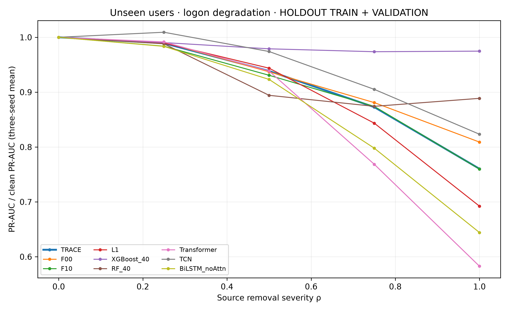
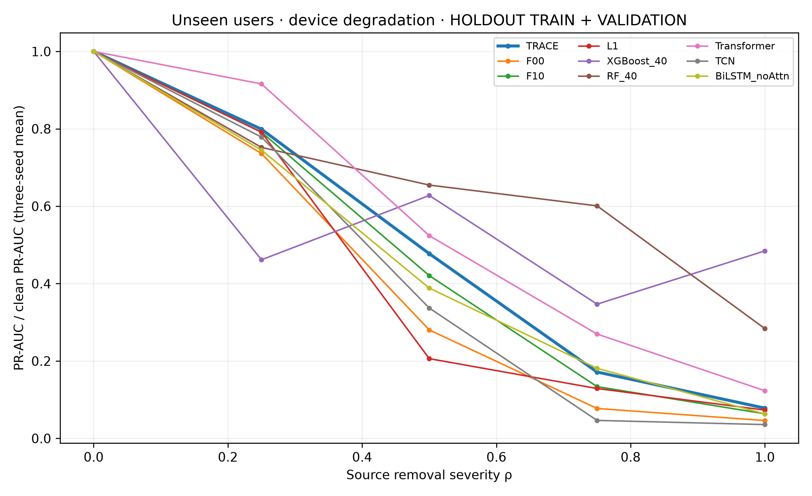
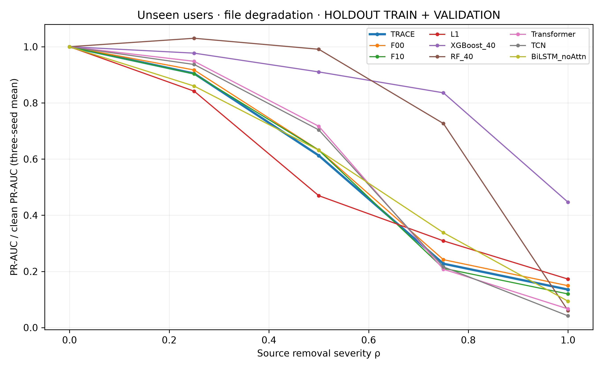
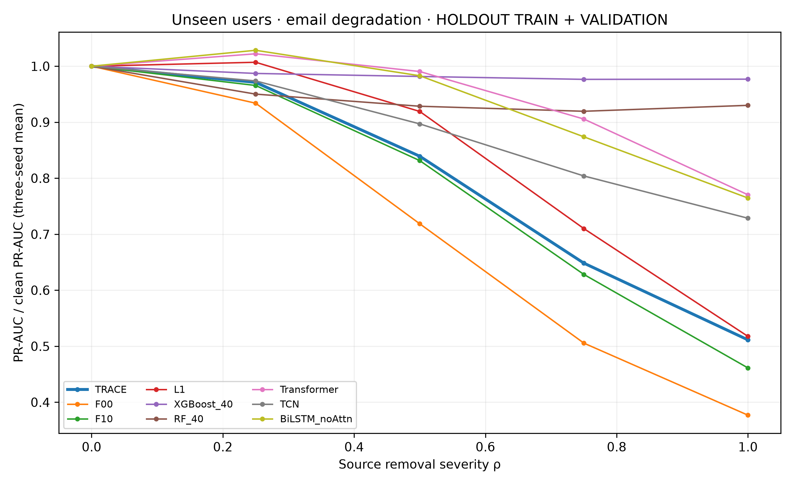
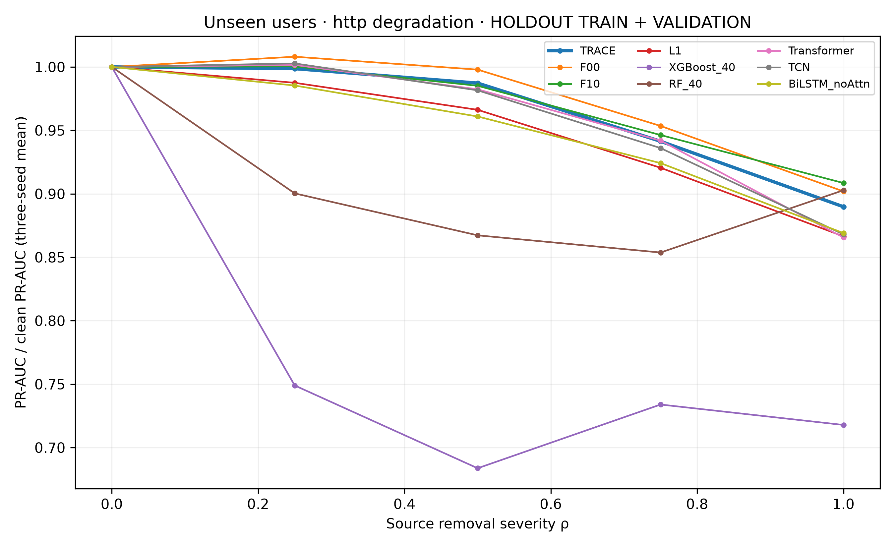
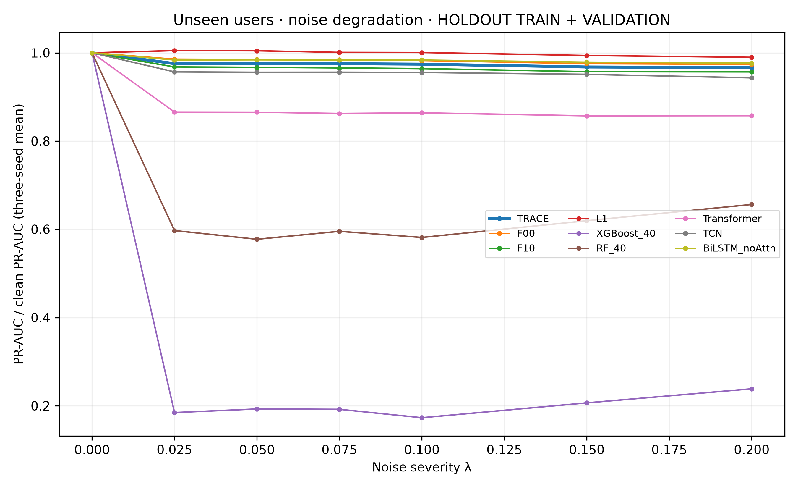
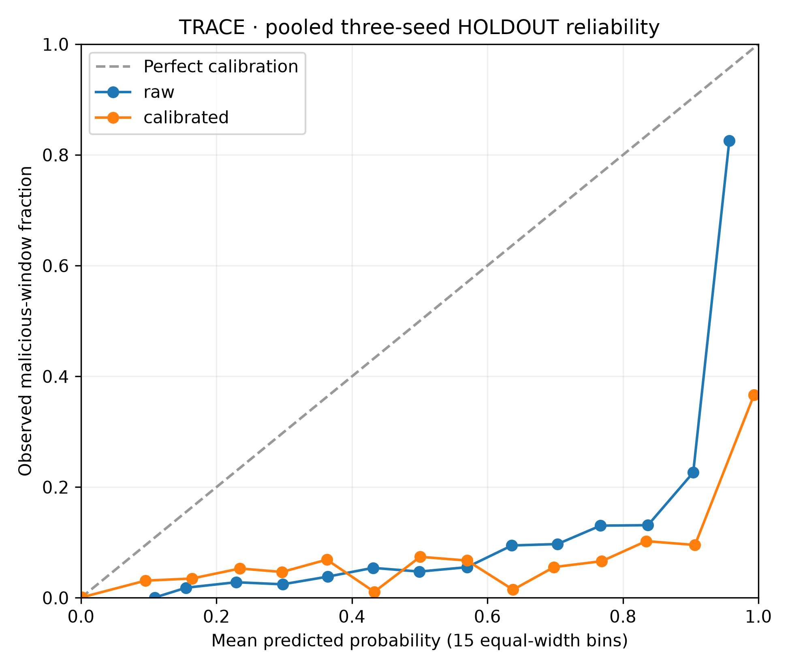
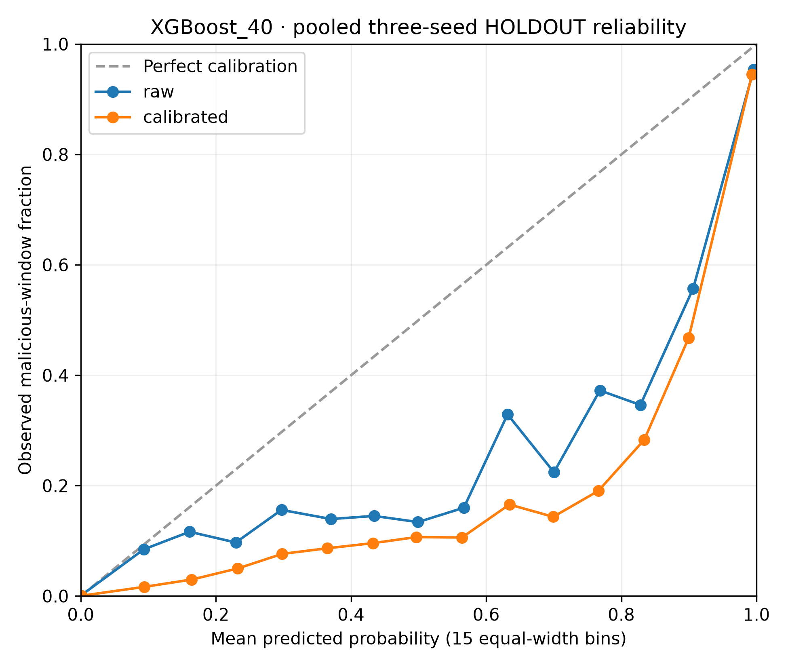

# Phase 5: additional evaluation battery (exploratory)

Completed UTC: 2026-10-22T07:54:20.418893+00:00

All analyses in this report are exploratory. The original frozen model family and all 17 development-user Phase 4 families were evaluated once on r5.1 and r6.2. The nine specified holdout model families underwent the registered degradation battery. Operational, ranking, calibration, stability, multiplicity and precision-of-estimation analyses use the allowed TRAIN + VALIDATION holdout only. No base model was trained, fine-tuned, selected or recalibrated, and no target scaler was fitted. The only fits were the two authorised DEVELOPMENT VALIDATION calibration maps.

The r5.2 TEST period remained sealed for all users. No GitHub push occurred. Existing teacher-anchored repositories, worktrees, frozen checkpoints, scalers, thresholds and prior result files were preserved. New code is in the isolated Phase 2 project's phase5 subfolder. Computation used two CPU threads and a 35% per-process GPU memory cap, with cooperative pauses between neural batches; no unrelated process or window was controlled.

## Amendment 3 and preregistration chronology

## Amendment 3: additional evaluation battery (exploratory)

Qasim approved the complete Phase 5 battery on 22 Oct 2026 at 13:58 (+08). All Phase 5 analyses are exploratory. This amendment is appended before any Phase 5 target inference or analysis. No training, fine-tuning, target-scaler fitting, threshold recalibration, model selection or hyperparameter selection is allowed. The sole exception is the specified once-fitted DEVELOPMENT VALIDATION calibrator in Step E. The r5.2 TEST period remains sealed for every user. Each target evaluation runs once with an exclusive sentinel; no reruns after scoring. All outcomes are reported and all exported user identifiers are pseudonyms (U_ plus the first 10 hex characters of SHA-256 of the original ID). Frozen inputs and historical harnesses are reused as specified in CHATGPT_PHASE5_PROMPT.md. The Steps A-G and their metrics follow verbatim.

STEP A. CROSS-RELEASE TRANSFER OF THE FINAL MODEL (r5.1 and r6.2)
1. Models: the original frozen r5.2 models (trained on all r5.2 users) — TRACE seeds 42/52/62, its task-only control (C2-OPT/F00 family), F10, attention–linear L1, XGBoost-40 and RF-40 — whichever frozen checkpoints exist for the final family. Record exactly which.
2. Run each model once on CERT r5.1 and once on r6.2, using the existing harnesses, the r5.2 TRAIN scaler and the frozen r5.2 thresholds.
3. Views: completed windows (primary), offset-0 de-overlap, and endpoint label where the harness supports it.
4. Report: PR-AUC, prevalence, ranking excess and the ratio to prevalence; precision, recall, F1 and alerts per 1,000 at the frozen threshold; threshold exceedance rate.
5. Contrasts:
   - TRACE − XGBoost-40, TRACE − F00 and TRACE − L1;
   - paired user-cluster bootstrap (2,000 replicates, seed 42), together with an insider/incident-cluster bootstrap where the existing harness defines one.
6. Also score the Phase 4 development-user models (all 17, including the 8 additional baselines) once on r5.1 and r6.2 as a secondary block.
7. Compare with the historical frozen-family results already on file, and state whether TRACE transfers better, similarly or worse.
8. Feature-shift table: the standardised mean shift of each of the 13 features in r5.1, r6.1 and r6.2 relative to r5.2 TRAIN (frozen-scaler z-space).

STEP B. ROBUSTNESS ON UNSEEN USERS
Data: the 500 HOLDOUT users' TRAIN + VALIDATION windows (the same 213,000 windows as Phase 4).
1. Apply the existing controlled degradation protocol (manuscript Section III-K):
   - Source removal: logon, device, file, email and http, one at a time, at severities ρ ∈ {0, 0.25, 0.50, 0.75, 1}.
   - Gaussian noise on the seven continuous/count variables at λ ∈ {0, 0.025, 0.050, 0.075, 0.100, 0.150, 0.200}.
   - Same seeds and the same realised perturbations for every model.
2. Models: the Phase 4 holdout-retrained models TRACE, F00, F10, L1, XGBoost_40, RF_40, Transformer, TCN and BiLSTM_noAttn, seeds 42/52/62.
3. Metrics:
   - PR-AUC at each severity;
   - AURC (normalised area under the severity–retention curve) per source and for noise;
   - paired user-cluster bootstrap contrasts TRACE − L1, TRACE − XGBoost_40 and TRACE − Transformer for source AURC and for noise AURC.
4. Figures: retention curves per source and for noise (300 dpi, data CSV beside each).

STEP C. INSIDER-LEVEL AND OPERATIONAL EVALUATION ON UNSEEN USERS
Same holdout windows; frozen development thresholds; models TRACE, XGBoost_40, F00, L1 and Transformer, seeds 42/52/62.
1. Insider-level detection:
   - for each of the 25 holdout insiders, whether any positive window is flagged at the frozen threshold;
   - the number of insiders detected per model and seed;
   - users flagged per day, with a false-positive user rate among the 475 non-insiders.
2. Detection timeliness: for each detected insider, the delay in days from the first malicious day to the first alert (median and IQR).
3. Alert episodes: consolidate alerts within a user on the same or consecutive days into episodes, then report episodes per 1,000 user-days and the share of episodes that contain a malicious day.
4. Scenario breakdown: map each holdout insider to its CERT r5.2 scenario number using the answer files. Use scenario labels only; read no activity payload. Report detection by scenario.
5. Top-k triage: the precision of the k = 10, 25, 50 and 100 highest-scoring user-days.

STEP D. RANKING METRICS BEYOND PR-AUC
For all 17 Phase 4 models on the holdout (pooled view), report ROC-AUC, precision at 1% and 5% alert budgets, and recall at fixed false-positive rates of 0.1% and 1%. Include paired contrasts versus TRACE for ROC-AUC.

STEP E. CALIBRATION OF THE FINAL MODEL
For TRACE and XGBoost_40 on the holdout:
1. Report Brier score, ECE (15 bins) and a reliability diagram, both raw and after one temperature scaling (TRACE) or Platt scaling (XGBoost).
2. Fit each calibrator ONCE on the DEVELOPMENT VALIDATION period, then apply it unchanged to the holdout.

STEP F. STABILITY AND STATISTICS (analysis of existing outputs)
1. Seed stability:
   - between-seed SD of PR-AUC for every model;
   - Spearman correlation of TRACE scores between seeds on the holdout;
   - agreement of the top-100 flagged windows between seeds.
2. Explanation stability: the Spearman correlation between seeds of the TRACE Integrated Gradients feature ranking, on the validation cohort and on the holdout.
3. Multiplicity: apply the Holm correction across the Phase 4 secondary contrasts in the pooled view, and report which labels change.
4. Power: with the observed CI width, the smallest TRACE − XGBoost difference the holdout could have detected.

STEP G. REPORT
1. Write R2\phase5\CHATGPT_PHASE5_REPORT.md containing:
   - Amendment 3 and its hash;
   - a full results table for every step;
   - every figure with its data CSV;
   - what was skipped and why (for example, a harness view that does not exist);
   - all deviations.
2. Write one machine-readable R2\phase5\PHASE5_RESULTS.json.
3. End the report with the line PHASE5_COMPLETE.

Amendment section SHA-256: `3e50d01f5c7863281ef283d0715cf930567f53fab95d7d0448c744c106cac454`. UTC: 2026-10-22T06:00:50.6121208Z. All preceding 7,934 bytes were preserved; preceding-byte SHA-256: `1f4e8ad4c759ddf90221a741314749d390fc6c4db2bf7ca71aa97e79ed00e37f`. The methods and model manifest was frozen before any Phase 5 target inference.

## Frozen model inventory and methods

Manifest SHA-256: `ddf61e53848db67bcc6dc3179c503b9faef5a27ee092520734d1f9b43976ef24`. Model weights and all declared dependencies were verified before evaluation and again at report assembly. TRACE is the paper name for TA2/F11; the original task-only comparator is the matched C2-OPT/F00 family, rather than the older historical C2 family.

| block | model | seed | threshold | checkpoint | sha256 |
| --- | --- | --- | --- | --- | --- |
| original | F00 | 42 | 0.85 | C:\PhD\07_Projects\teacher-anchored-insider-threat-detection-editor011\outputs\editor011_matched_route_confirmation\C2-OPT\seed42\best_student.pt | d64651d25e48b3bcd4cad7d107d3bc55a4c555a2827f3656a087624e94ac4baf |
| original | F00 | 52 | 0.89 | C:\PhD\07_Projects\teacher-anchored-insider-threat-detection-editor011\outputs\editor011_matched_route_confirmation\C2-OPT\seed52\best_student.pt | f0eea90099ba7dd3e721efb930e367e868049c94f6542d5b2156d9fe469acb7e |
| original | F00 | 62 | 0.17 | C:\PhD\07_Projects\teacher-anchored-insider-threat-detection-editor011\outputs\editor011_matched_route_confirmation\C2-OPT\seed62\best_student.pt | 50512aa5392ee7f4d93dc5f84471fc1074baeb757ae9fb5b96caed141ee586da |
| original | F10 | 42 | 0.84 | C:\PhD\07_Projects\teacher-anchored-insider-threat-detection-editor012\outputs\editor012_teacher_anchor_rescue\F10_DOPT\seed42\best_student.pt | ea8cd41a1ae3f845719956fd7a49230fa82807ffac87841be5f5ab95c64ac0c2 |
| original | F10 | 52 | 0.79 | C:\PhD\07_Projects\teacher-anchored-insider-threat-detection-editor012\outputs\editor012_teacher_anchor_rescue\F10_DOPT\seed52\best_student.pt | 829135230c5629f0b11161e11d76eba7a15e65bf9d03b5a55ffa297a93ddf959 |
| original | F10 | 62 | 0.54 | C:\PhD\07_Projects\teacher-anchored-insider-threat-detection-editor012\outputs\editor012_teacher_anchor_rescue\F10_DOPT\seed62\best_student.pt | 06313d6f2602de51f8dd6e15e1d1292864fd8cbd158f33977fa42c8a47036aee |
| original | TRACE | 42 | 0.79 | C:\PhD\07_Projects\teacher-anchored-insider-threat-detection-editor012\outputs\editor012_teacher_anchor_rescue\F11_DROPT\seed42\best_student.pt | 54f6c097af9568a4ee5701ef375559a2f649cec6c1817e578d3e8e01e6d73df8 |
| original | TRACE | 52 | 0.74 | C:\PhD\07_Projects\teacher-anchored-insider-threat-detection-editor012\outputs\editor012_teacher_anchor_rescue\F11_DROPT\seed52\best_student.pt | 7613ba559bcf55827d04129066eb595b677994494609646f8b2463308ed5edb4 |
| original | TRACE | 62 | 0.59 | C:\PhD\07_Projects\teacher-anchored-insider-threat-detection-editor012\outputs\editor012_teacher_anchor_rescue\F11_DROPT\seed62\best_student.pt | 904003dca219435464476cf36abedb11ee4e2f7a11ff09caa3791d685b8f644d |
| original | L1 | 42 | 0.75 | C:\PhD\07_Projects\teacher-anchored-insider-threat-detection-editor013\outputs\editor013_odst_value_proof\L1\seed42\best.pt | 513e272063250aa209efa2c42b490cc44316c7979fa6b2be5dd8cce4592d1ab2 |
| original | L1 | 52 | 0.73 | C:\PhD\07_Projects\teacher-anchored-insider-threat-detection-editor013\outputs\editor013_odst_value_proof\L1\seed52\best.pt | a503f6705955da221bdbd1921034e9102b90db6acb5187114276ccaeb474e1c4 |
| original | L1 | 62 | 0.63 | C:\PhD\07_Projects\teacher-anchored-insider-threat-detection-editor013\outputs\editor013_odst_value_proof\L1\seed62\best.pt | 60d5c43692a17ba6971c8d23f74048ac3c4fe0bd1b18889eeb21bbab7bf3d3e9 |
| original | RF_40 | 42 | 0.38 | C:\PhD\07_Projects\cert-r52-locked-baselines\outputs\objective2\r52_locked_baselines\random_forest_seed42\model.joblib | 38b8830acec3b9c399411093ac38ed6bed6dca52a0cf05be9c87178cb05f5780 |
| original | RF_40 | 52 | 0.46 | C:\PhD\07_Projects\cert-r52-locked-baselines\outputs\objective2\r52_locked_baselines\random_forest_seed52\model.joblib | 6f409fb9df15a76319a16988ed5ee0ca42da0a9c48981240e15edee773d3d89d |
| original | RF_40 | 62 | 0.37 | C:\PhD\07_Projects\cert-r52-locked-baselines\outputs\objective2\r52_locked_baselines\random_forest_seed62\model.joblib | b0f4e762e34a3e5f0f07a64130130a7f223bfbc486b9bdcd2d2549210fb36df5 |
| original | XGBoost_40 | 42 | 0.18 | C:\PhD\07_Projects\cert-r52-locked-baselines\outputs\objective2\r52_locked_baselines\xgboost_seed42\model.json | 2109554164abdd002ce0a4377f957c5aa3bc26886a197749ea79fc04d9b94fae |
| original | XGBoost_40 | 52 | 0.16 | C:\PhD\07_Projects\cert-r52-locked-baselines\outputs\objective2\r52_locked_baselines\xgboost_seed52\model.json | 0f32857232341cb6a26d6cf55cb2375b8e256e0e0f89519d3059415cac8ad7e6 |
| original | XGBoost_40 | 62 | 0.18 | C:\PhD\07_Projects\cert-r52-locked-baselines\outputs\objective2\r52_locked_baselines\xgboost_seed62\model.json | 3062488680b8bc05959ddcb0cab948378988564fc82a88213e346ca570b0c7ab |
| development | T-OPT | 42 | 0.72 | C:\PhD\04_Journal_Papers\Latest IEEE Access Paper July 2026\R2_revision\holdout\private\checkpoints\T-OPT\seed42\best.pt | 02d53605d688b951e3ba21c40e27db94286282ffb9cf202b02bb702aff79377c |
| development | T-OPT | 52 | 0.63 | C:\PhD\04_Journal_Papers\Latest IEEE Access Paper July 2026\R2_revision\holdout\private\checkpoints\T-OPT\seed52\best.pt | 078ad83248e48686fa653a0c30c81292831e19c0a18fe5f6227e9ea49281c401 |
| development | T-OPT | 62 | 0.4 | C:\PhD\04_Journal_Papers\Latest IEEE Access Paper July 2026\R2_revision\holdout\private\checkpoints\T-OPT\seed62\best.pt | be5b3a1f97f2c65bef5aae13431ee7f181b8078817bf551d0edfb9eb06a3d0ea |
| development | F00 | 42 | 0.95 | C:\PhD\04_Journal_Papers\Latest IEEE Access Paper July 2026\R2_revision\holdout\private\checkpoints\F00\seed42\best.pt | ee6729744d45406186ede9fced2fc99a2b54e62bdd9508853b0afff4d481a54f |
| development | F00 | 52 | 0.56 | C:\PhD\04_Journal_Papers\Latest IEEE Access Paper July 2026\R2_revision\holdout\private\checkpoints\F00\seed52\best.pt | 52fa4e08814f8494b39b1bad586970a9ae037cb39e890a1e336374ff4b6069f5 |
| development | F00 | 62 | 0.22 | C:\PhD\04_Journal_Papers\Latest IEEE Access Paper July 2026\R2_revision\holdout\private\checkpoints\F00\seed62\best.pt | 255487f91ffb2edcc52856d1615eda1fc6e9d0c518057d80f550c9ce1f2f1c32 |
| development | TRACE | 42 | 0.56 | C:\PhD\04_Journal_Papers\Latest IEEE Access Paper July 2026\R2_revision\holdout\private\checkpoints\TA2\seed42\best.pt | 80fd6ecbd8c3f22b5241aad353c02ca34426c9dc34c8c1fa489bb679f87234d9 |
| development | TRACE | 52 | 0.56 | C:\PhD\04_Journal_Papers\Latest IEEE Access Paper July 2026\R2_revision\holdout\private\checkpoints\TA2\seed52\best.pt | 2927c9975a4f59b219afd448c709b964396a879ac4f36b82bfef7538d3612080 |
| development | TRACE | 62 | 0.38 | C:\PhD\04_Journal_Papers\Latest IEEE Access Paper July 2026\R2_revision\holdout\private\checkpoints\TA2\seed62\best.pt | 0d246d87aecbc078bf46bf211fc2a03df7bdf41355da17f82079da39849d5f18 |
| development | L1 | 42 | 0.66 | C:\PhD\04_Journal_Papers\Latest IEEE Access Paper July 2026\R2_revision\holdout\private\checkpoints\L1\seed42\best.pt | 5c0c13dc8a2caaf9335c479f68e3b61e0e7ba534f95d163bbcd54a900ecdc5d7 |
| development | L1 | 52 | 0.59 | C:\PhD\04_Journal_Papers\Latest IEEE Access Paper July 2026\R2_revision\holdout\private\checkpoints\L1\seed52\best.pt | 23aba738c1d1a51354c40386b77d7e474299c15b951297954a1181773c87568c |
| development | L1 | 62 | 0.44 | C:\PhD\04_Journal_Papers\Latest IEEE Access Paper July 2026\R2_revision\holdout\private\checkpoints\L1\seed62\best.pt | fe079206035332ede7b077794955a028c6fbf13460a81ded73016f1559b47923 |
| development | F10 | 42 | 0.47 | C:\PhD\04_Journal_Papers\Latest IEEE Access Paper July 2026\R2_revision\holdout\private\checkpoints\F10\seed42\best.pt | 5865614fc4485f82e2ec666bd876774ad931d19006c63fabd017e86f3fe9b26d |
| development | F10 | 52 | 0.59 | C:\PhD\04_Journal_Papers\Latest IEEE Access Paper July 2026\R2_revision\holdout\private\checkpoints\F10\seed52\best.pt | 0df249d712ae11f75cddb3b2eae3edaca9d200431bef9432a7df153c808787c6 |
| development | F10 | 62 | 0.38 | C:\PhD\04_Journal_Papers\Latest IEEE Access Paper July 2026\R2_revision\holdout\private\checkpoints\F10\seed62\best.pt | 492e80505e9125a0cd75f93eab86b60becb1f1f0a082c812f44f70b4814d6385 |
| development | uniT-OPT | 42 | 0.9 | C:\PhD\04_Journal_Papers\Latest IEEE Access Paper July 2026\R2_revision\holdout\private\checkpoints\uniT-OPT\seed42\best.pt | 1c092c800494ec1e10759b3ccc7f9e9217b6e8686f63a5882aefb562e355d4e9 |
| development | uniT-OPT | 52 | 0.87 | C:\PhD\04_Journal_Papers\Latest IEEE Access Paper July 2026\R2_revision\holdout\private\checkpoints\uniT-OPT\seed52\best.pt | 83c33a8f51ce59f4d506dfbda5eb58ca7da2df114850ef65ff24398fef473f90 |
| development | uniT-OPT | 62 | 0.64 | C:\PhD\04_Journal_Papers\Latest IEEE Access Paper July 2026\R2_revision\holdout\private\checkpoints\uniT-OPT\seed62\best.pt | c12f9da9a0cb45e2cf48c63c5042fd6dbddfd540796e548c8e6849a1f99f6661 |
| development | uniTA2 | 42 | 0.86 | C:\PhD\04_Journal_Papers\Latest IEEE Access Paper July 2026\R2_revision\holdout\private\checkpoints\uniTA2\seed42\best.pt | bc941a789af6ab6c30070ac2e492f390faddf598cd5f34bd83483b3db2a9a3e3 |
| development | uniTA2 | 52 | 0.85 | C:\PhD\04_Journal_Papers\Latest IEEE Access Paper July 2026\R2_revision\holdout\private\checkpoints\uniTA2\seed52\best.pt | 0a4fc078bbd99e3c6708315e52d6627bbef23401f74ced4f231be2d01e3b7725 |
| development | uniTA2 | 62 | 0.85 | C:\PhD\04_Journal_Papers\Latest IEEE Access Paper July 2026\R2_revision\holdout\private\checkpoints\uniTA2\seed62\best.pt | c29d5ed868842475120e38c3362d762785a4c6786aff0dca1b934a2d5e060ae4 |
| development | XGBoost_40 | 42 | 0.64 | C:\PhD\04_Journal_Papers\Latest IEEE Access Paper July 2026\R2_revision\holdout\private\checkpoints_parity_v2\XGBoost_40\seed42\model.json | 07597ac880cc45573fb63b63852e00732f8dd27ed69b34e2f1e5865844984481 |
| development | XGBoost_40 | 52 | 0.51 | C:\PhD\04_Journal_Papers\Latest IEEE Access Paper July 2026\R2_revision\holdout\private\checkpoints_parity_v2\XGBoost_40\seed52\model.json | 230eafa930aa7a47c2467ea86ba32a933fa70c8a7aaa8512bcbde03f8f2254c4 |
| development | XGBoost_40 | 62 | 0.06 | C:\PhD\04_Journal_Papers\Latest IEEE Access Paper July 2026\R2_revision\holdout\private\checkpoints_parity_v2\XGBoost_40\seed62\model.json | 3c8c5d3d528473ed1c88c206f58b1bce7178fc7dc3cf598462fe217a88ddd6fb |
| development | RF_40 | 42 | 0.46 | C:\PhD\04_Journal_Papers\Latest IEEE Access Paper July 2026\R2_revision\holdout\private\checkpoints_parity_v2\RF_40\seed42\model.joblib | a33186795166ba4c0343dc51a61fd84f4006a9ef472083ca80a35c80b2b8b32c |
| development | RF_40 | 52 | 0.46 | C:\PhD\04_Journal_Papers\Latest IEEE Access Paper July 2026\R2_revision\holdout\private\checkpoints_parity_v2\RF_40\seed52\model.joblib | d613813accb345de8080f5b8a216223d8ae68347de88d4c14b913107208387ba |
| development | RF_40 | 62 | 0.15 | C:\PhD\04_Journal_Papers\Latest IEEE Access Paper July 2026\R2_revision\holdout\private\checkpoints_parity_v2\RF_40\seed62\model.joblib | 82c59d136b7a5448422e9086a765db80d7e6a914a8f8f2f31953a29fe4506a2d |
| development | BiLSTM_noAttn | 42 | 0.494974225 | C:\PhD\04_Journal_Papers\Latest IEEE Access Paper July 2026\R2_revision\holdout\private\phase4\checkpoints\BiLSTM_noAttn\seed42\best.pt | 52b0740889fffffc1a517291be56ac3fc3887cafa4a0a7a94acb26e6881897cd |
| development | BiLSTM_noAttn | 52 | 0.898216441 | C:\PhD\04_Journal_Papers\Latest IEEE Access Paper July 2026\R2_revision\holdout\private\phase4\checkpoints\BiLSTM_noAttn\seed52\best.pt | 2f5e6623b4e95b5404597dcc1b7978aeac1b35020ffe0a89c27397d650b0134a |
| development | BiLSTM_noAttn | 62 | 0.925618409 | C:\PhD\04_Journal_Papers\Latest IEEE Access Paper July 2026\R2_revision\holdout\private\phase4\checkpoints\BiLSTM_noAttn\seed62\best.pt | 548ffde4ec3181d687069e26235e00b90e643af4cc4741544fae630632007f50 |
| development | BiGRU_Attn | 42 | 0.808020914 | C:\PhD\04_Journal_Papers\Latest IEEE Access Paper July 2026\R2_revision\holdout\private\phase4\checkpoints\BiGRU_Attn\seed42\best.pt | 2098ca2b7f0cf19c6e34436eb41e8c074a84f030fbcc59794bde7a5b03c1e1de |
| development | BiGRU_Attn | 52 | 0.926261842 | C:\PhD\04_Journal_Papers\Latest IEEE Access Paper July 2026\R2_revision\holdout\private\phase4\checkpoints\BiGRU_Attn\seed52\best.pt | 6b166c2cb6628007d18b2cebe27d36815852dd55a41db3be65f347fe5c5176fe |
| development | BiGRU_Attn | 62 | 0.460659328 | C:\PhD\04_Journal_Papers\Latest IEEE Access Paper July 2026\R2_revision\holdout\private\phase4\checkpoints\BiGRU_Attn\seed62\best.pt | 33b4090fa611ffccfa24de97cd192f2c68b77c740fcfb8549ee020cc783da263 |
| development | TCN | 42 | 0.247543623 | C:\PhD\04_Journal_Papers\Latest IEEE Access Paper July 2026\R2_revision\holdout\private\phase4\checkpoints\TCN\seed42\best.pt | 9626eb0241497979aef7a7603b6dbe9cf727d4ffa6a2eaa44eb66f515e454cea |
| development | TCN | 52 | 0.0378780876 | C:\PhD\04_Journal_Papers\Latest IEEE Access Paper July 2026\R2_revision\holdout\private\phase4\checkpoints\TCN\seed52\best.pt | 908b12a86702090475070e60ebd05227c3655e86ac7cc3bfd19079c44088334d |
| development | TCN | 62 | 0.999736704 | C:\PhD\04_Journal_Papers\Latest IEEE Access Paper July 2026\R2_revision\holdout\private\phase4\checkpoints\TCN\seed62\best.pt | f9c069518313989cad0e3582b63319b4635a8537b98a1b6a4aa0a8a515716caa |
| development | Transformer | 42 | 0.58755578 | C:\PhD\04_Journal_Papers\Latest IEEE Access Paper July 2026\R2_revision\holdout\private\phase4\checkpoints\Transformer\seed42\best.pt | 08f70efaa4c9a1399ba14c93f33744eb171aec023db957f5858520841b278e00 |
| development | Transformer | 52 | 0.881881248 | C:\PhD\04_Journal_Papers\Latest IEEE Access Paper July 2026\R2_revision\holdout\private\phase4\checkpoints\Transformer\seed52\best.pt | c534ad0b719bc2674669b6b8ddc0828abdfbb20537e532abf5eff63b73f5a6ea |
| development | Transformer | 62 | 0.863857686 | C:\PhD\04_Journal_Papers\Latest IEEE Access Paper July 2026\R2_revision\holdout\private\phase4\checkpoints\Transformer\seed62\best.pt | 4212f8f96fed72c69de2429dde49f624aea6100247c483868ee06f1cc168886d |
| development | MLP | 42 | 0.875426498 | C:\PhD\04_Journal_Papers\Latest IEEE Access Paper July 2026\R2_revision\holdout\private\phase4\checkpoints\MLP\seed42\best.pt | d97b0fc02923346a2ed17023233e2ab9ce2a3d545e82e2af6fcaeeae77a4f066 |
| development | MLP | 52 | 0.846036343 | C:\PhD\04_Journal_Papers\Latest IEEE Access Paper July 2026\R2_revision\holdout\private\phase4\checkpoints\MLP\seed52\best.pt | e52a903c238a148359cb1f2221e4c2a08e0f25acecb9c620790a43ed059416a6 |
| development | MLP | 62 | 0.83850645 | C:\PhD\04_Journal_Papers\Latest IEEE Access Paper July 2026\R2_revision\holdout\private\phase4\checkpoints\MLP\seed62\best.pt | 9afd39a4cdec0779904f639e4c34b73fe82c855e3b7469ca54b55d5ba5ee8895 |
| development | LSTM_AE | 42 | 0.0703619942 | C:\PhD\04_Journal_Papers\Latest IEEE Access Paper July 2026\R2_revision\holdout\private\phase4\checkpoints\LSTM_AE\seed42\best.pt | c42b12d6d1387e1086d6ddb55949a388b7acb29b7d969d8909e4077f9a463286 |
| development | LSTM_AE | 52 | 0.0725400001 | C:\PhD\04_Journal_Papers\Latest IEEE Access Paper July 2026\R2_revision\holdout\private\phase4\checkpoints\LSTM_AE\seed52\best.pt | 21f9141ba63751a2aaa5c12ce9ea462048216adfc4e3f7cbd10a36598902f003 |
| development | LSTM_AE | 62 | 0.0553076677 | C:\PhD\04_Journal_Papers\Latest IEEE Access Paper July 2026\R2_revision\holdout\private\phase4\checkpoints\LSTM_AE\seed62\best.pt | f08652dac4e877bb1754f5ef568b6cdf3ee0d6e5cb0a1c930930c4e027b987a4 |
| development | IsolationForest | 42 | 0.400082327 | C:\PhD\04_Journal_Papers\Latest IEEE Access Paper July 2026\R2_revision\holdout\private\phase4\checkpoints\IsolationForest\seed42\best.joblib | ae83d6557ef2ff2ea470699253f6d27f981190804e90b522f633bf1dcae2c8ee |
| development | IsolationForest | 52 | 0.395446075 | C:\PhD\04_Journal_Papers\Latest IEEE Access Paper July 2026\R2_revision\holdout\private\phase4\checkpoints\IsolationForest\seed52\best.joblib | 7fefb37ba8c5f9a912ab65779db576fc7255968a6dfbdc410ed274307d93f9fd |
| development | IsolationForest | 62 | 0.399137675 | C:\PhD\04_Journal_Papers\Latest IEEE Access Paper July 2026\R2_revision\holdout\private\phase4\checkpoints\IsolationForest\seed62\best.joblib | 765a079f6ff5199fbb1ebf5e1a54a5c9bf6c04cbc48d280b91f28f34b93c0f66 |
| development | LightGBM_40 | 42 | 0.0392766517 | C:\PhD\04_Journal_Papers\Latest IEEE Access Paper July 2026\R2_revision\holdout\private\phase4\checkpoints\LightGBM_40\seed42\best.joblib | 70798c25f0087cfb750167f518bcbeff21657fd3ca192cf901d9ff826e19de91 |
| development | LightGBM_40 | 52 | 0.477009474 | C:\PhD\04_Journal_Papers\Latest IEEE Access Paper July 2026\R2_revision\holdout\private\phase4\checkpoints\LightGBM_40\seed52\best.joblib | 9acc798c4976a6a3fbeb9f9539467daa3b15a3c4253d291652efc24bef529d5a |
| development | LightGBM_40 | 62 | 0.286614165 | C:\PhD\04_Journal_Papers\Latest IEEE Access Paper July 2026\R2_revision\holdout\private\phase4\checkpoints\LightGBM_40\seed62\best.joblib | acd993f4a55b7a978600ac09b027a9229b7f417f190a2acf309d05ca1f9f55df |

## A. Cross-release transfer

The existing EDITOR-006E/007C dense-daily window provider, frozen bundle identities, completed-window labels, endpoint labels and offset-0 flags were reused. Each release has 69 frozen model–seed combinations: 18 from the original six-family block and 51 from the 17-family development block. r5.1 has 996,000 windows; r6.2 has 1,988,000. The original block uses the stored all-user r5.2 TRAIN scaler directly; the development block applies its own frozen TRAIN scaler by an affine conversion of the stored z-space, without fitting.

PR-AUC is average precision. Ranking excess is AP minus prevalence; ratio to prevalence is descriptive AP/prevalence. Frozen-threshold exceedance is the flagged-window fraction and equals alerts per 1,000 divided by 1,000. A mean row averages fixed-seed metrics and is not an ensemble-score result. Contrasts compare three-seed mean AP with 2,000 paired user-cluster resamples, seed 42, 95% percentile intervals. A bootstrap draw with no positive windows is invalid and excluded; valid counts are reported. The historical harness does not define an additional independent incident-only bootstrap; official insider/incident correspondence is retained as a qualification.

### All transfer models, seeds and views

Full machine-readable table: [A_TRANSFER_RESULTS.csv](A_TRANSFER_RESULTS.csv).

| release | block | view | model | seed | windows | positive_windows | prevalence | PR_AUC | ranking_excess | ratio_to_prevalence | precision | recall | F1 | alerts_per_1000 | threshold_exceedance_rate | threshold |
| --- | --- | --- | --- | --- | --- | --- | --- | --- | --- | --- | --- | --- | --- | --- | --- | --- |
| r5.1 | original | completed | F00 | 42 | 996000 | 461 | 0.000462851406 | 0.255105103 | 0.254642251 | 551.159832 | 0.09112567 | 0.331887202 | 0.142990654 | 1.68574297 | 0.00168574297 | 0.85 |
| r5.1 | original | completed | F00 | 52 | 996000 | 461 | 0.000462851406 | 0.285570433 | 0.285107582 | 616.980806 | 0.165226782 | 0.331887202 | 0.220620043 | 0.929718876 | 0.000929718876 | 0.89 |
| r5.1 | original | completed | F00 | 62 | 996000 | 461 | 0.000462851406 | 0.271745013 | 0.271282161 | 587.1107 | 0.0746339159 | 0.342733189 | 0.12257564 | 2.12550201 | 0.00212550201 | 0.17 |
| r5.1 | original | completed | F10 | 42 | 996000 | 461 | 0.000462851406 | 0.242857585 | 0.242394734 | 524.698818 | 0.127640845 | 0.314533623 | 0.181590482 | 1.14056225 | 0.00114056225 | 0.84 |
| r5.1 | original | completed | F10 | 52 | 996000 | 461 | 0.000462851406 | 0.289116717 | 0.288653866 | 624.642625 | 0.203679369 | 0.336225597 | 0.253682488 | 0.764056225 | 0.000764056225 | 0.79 |
| r5.1 | original | completed | F10 | 62 | 996000 | 461 | 0.000462851406 | 0.250769863 | 0.250307012 | 541.793457 | 0.0861344538 | 0.355748373 | 0.138689218 | 1.91164659 | 0.00191164659 | 0.54 |
| r5.1 | original | completed | TRACE | 42 | 996000 | 461 | 0.000462851406 | 0.265028522 | 0.264565671 | 572.599584 | 0.11095204 | 0.336225597 | 0.166846071 | 1.40261044 | 0.00140261044 | 0.79 |
| r5.1 | original | completed | TRACE | 52 | 996000 | 461 | 0.000462851406 | 0.294792501 | 0.29432965 | 636.905274 | 0.157575758 | 0.338394794 | 0.215024121 | 0.993975904 | 0.000993975904 | 0.74 |
| r5.1 | original | completed | TRACE | 62 | 996000 | 461 | 0.000462851406 | 0.273795124 | 0.273332273 | 591.540009 | 0.100621118 | 0.351409978 | 0.156446161 | 1.61646586 | 0.00161646586 | 0.59 |
| r5.1 | original | completed | L1 | 42 | 996000 | 461 | 0.000462851406 | 0.250641727 | 0.250178876 | 541.516616 | 0.158273381 | 0.334056399 | 0.214783821 | 0.976907631 | 0.000976907631 | 0.75 |
| r5.1 | original | completed | L1 | 52 | 996000 | 461 | 0.000462851406 | 0.297876365 | 0.297413513 | 643.568025 | 0.150832517 | 0.334056399 | 0.20782726 | 1.0251004 | 0.0010251004 | 0.73 |
| r5.1 | original | completed | L1 | 62 | 996000 | 461 | 0.000462851406 | 0.283209587 | 0.282746735 | 611.880148 | 0.113061798 | 0.349240781 | 0.170822281 | 1.42971888 | 0.00142971888 | 0.63 |
| r5.1 | original | completed | RF_40 | 42 | 996000 | 461 | 0.000462851406 | 0.308619913 | 0.308157062 | 666.779683 | 0.118959108 | 0.347071584 | 0.177187154 | 1.35040161 | 0.00135040161 | 0.38 |
| r5.1 | original | completed | RF_40 | 52 | 996000 | 461 | 0.000462851406 | 0.310828268 | 0.310365417 | 671.550878 | 0.17760181 | 0.340563991 | 0.233457249 | 0.887550201 | 0.000887550201 | 0.46 |
| r5.1 | original | completed | RF_40 | 62 | 996000 | 461 | 0.000462851406 | 0.308103171 | 0.30764032 | 665.66325 | 0.121412804 | 0.35791757 | 0.181318681 | 1.36445783 | 0.00136445783 | 0.37 |
| r5.1 | original | completed | XGBoost_40 | 42 | 996000 | 461 | 0.000462851406 | 0.399439371 | 0.398976519 | 862.996991 | 0.198984772 | 0.42516269 | 0.271092669 | 0.988955823 | 0.000988955823 | 0.18 |
| r5.1 | original | completed | XGBoost_40 | 52 | 996000 | 461 | 0.000462851406 | 0.387105456 | 0.386642604 | 836.349314 | 0.163757273 | 0.427331887 | 0.236778846 | 1.20783133 | 0.00120783133 | 0.16 |
| r5.1 | original | completed | XGBoost_40 | 62 | 996000 | 461 | 0.000462851406 | 0.399685836 | 0.399222985 | 863.529486 | 0.189885496 | 0.431670282 | 0.263750828 | 1.05220884 | 0.00105220884 | 0.18 |
| r5.1 | original | completed | F00 | mean | 996000 | 461 | 0.000462851406 | 0.27080685 | 0.270343998 | 585.083779 | 0.110328789 | 0.335502531 | 0.162062112 | 1.58032129 | 0.00158032129 |  |
| r5.1 | original | completed | F10 | mean | 996000 | 461 | 0.000462851406 | 0.260914722 | 0.26045187 | 563.711633 | 0.139151556 | 0.335502531 | 0.191320729 | 1.27208835 | 0.00127208835 |  |
| r5.1 | original | completed | TRACE | mean | 996000 | 461 | 0.000462851406 | 0.277872049 | 0.277409198 | 600.348289 | 0.123049639 | 0.342010123 | 0.179438785 | 1.33768407 | 0.00133768407 |  |
| r5.1 | original | completed | L1 | mean | 996000 | 461 | 0.000462851406 | 0.27724256 | 0.276779708 | 598.988263 | 0.140722565 | 0.33911786 | 0.197811121 | 1.14390897 | 0.00114390897 |  |
| r5.1 | original | completed | RF_40 | mean | 996000 | 461 | 0.000462851406 | 0.309183784 | 0.308720933 | 667.997937 | 0.139324574 | 0.348517715 | 0.197321028 | 1.20080321 | 0.00120080321 |  |
| r5.1 | original | completed | XGBoost_40 | mean | 996000 | 461 | 0.000462851406 | 0.395410221 | 0.394947369 | 854.291931 | 0.18420918 | 0.428054953 | 0.257207448 | 1.08299866 | 0.00108299866 |  |
| r5.1 | original | offset0 | F00 | 42 | 50000 | 24 | 0.00048 | 0.307930162 | 0.307450162 | 641.52117 | 0.0888888889 | 0.333333333 | 0.140350877 | 1.8 | 0.0018 | 0.85 |
| r5.1 | original | offset0 | F00 | 52 | 50000 | 24 | 0.00048 | 0.323934188 | 0.323454188 | 674.862892 | 0.214285714 | 0.375 | 0.272727273 | 0.84 | 0.00084 | 0.89 |
| r5.1 | original | offset0 | F00 | 62 | 50000 | 24 | 0.00048 | 0.290802332 | 0.290322332 | 605.838191 | 0.1 | 0.375 | 0.157894737 | 1.8 | 0.0018 | 0.17 |
| r5.1 | original | offset0 | F10 | 42 | 50000 | 24 | 0.00048 | 0.312368834 | 0.311888834 | 650.768404 | 0.137931034 | 0.333333333 | 0.195121951 | 1.16 | 0.00116 | 0.84 |
| r5.1 | original | offset0 | F10 | 52 | 50000 | 24 | 0.00048 | 0.335166455 | 0.334686455 | 698.263447 | 0.219512195 | 0.375 | 0.276923077 | 0.82 | 0.00082 | 0.79 |
| r5.1 | original | offset0 | F10 | 62 | 50000 | 24 | 0.00048 | 0.320730673 | 0.320250673 | 668.188902 | 0.102272727 | 0.375 | 0.160714286 | 1.76 | 0.00176 | 0.54 |
| r5.1 | original | offset0 | TRACE | 42 | 50000 | 24 | 0.00048 | 0.310130653 | 0.309650653 | 646.105528 | 0.105263158 | 0.333333333 | 0.16 | 1.52 | 0.00152 | 0.79 |
| r5.1 | original | offset0 | TRACE | 52 | 50000 | 24 | 0.00048 | 0.330789078 | 0.330309078 | 689.143912 | 0.176470588 | 0.375 | 0.24 | 1.02 | 0.00102 | 0.74 |
| r5.1 | original | offset0 | TRACE | 62 | 50000 | 24 | 0.00048 | 0.310333759 | 0.309853759 | 646.528665 | 0.126760563 | 0.375 | 0.189473684 | 1.42 | 0.00142 | 0.59 |
| r5.1 | original | offset0 | L1 | 42 | 50000 | 24 | 0.00048 | 0.323448971 | 0.322968971 | 673.852023 | 0.156862745 | 0.333333333 | 0.213333333 | 1.02 | 0.00102 | 0.75 |
| r5.1 | original | offset0 | L1 | 52 | 50000 | 24 | 0.00048 | 0.352487513 | 0.352007513 | 734.348986 | 0.169811321 | 0.375 | 0.233766234 | 1.06 | 0.00106 | 0.73 |
| r5.1 | original | offset0 | L1 | 62 | 50000 | 24 | 0.00048 | 0.323936192 | 0.323456192 | 674.867068 | 0.140625 | 0.375 | 0.204545455 | 1.28 | 0.00128 | 0.63 |
| r5.1 | original | offset0 | RF_40 | 42 | 50000 | 24 | 0.00048 | 0.35573491 | 0.35525491 | 741.114395 | 0.132352941 | 0.375 | 0.195652174 | 1.36 | 0.00136 | 0.38 |
| r5.1 | original | offset0 | RF_40 | 52 | 50000 | 24 | 0.00048 | 0.359297258 | 0.358817258 | 748.535954 | 0.195652174 | 0.375 | 0.257142857 | 0.92 | 0.00092 | 0.46 |
| r5.1 | original | offset0 | RF_40 | 62 | 50000 | 24 | 0.00048 | 0.351563213 | 0.351083213 | 732.423361 | 0.128571429 | 0.375 | 0.191489362 | 1.4 | 0.0014 | 0.37 |
| r5.1 | original | offset0 | XGBoost_40 | 42 | 50000 | 24 | 0.00048 | 0.43527218 | 0.43479218 | 906.817041 | 0.22 | 0.458333333 | 0.297297297 | 1 | 0.001 | 0.18 |
| r5.1 | original | offset0 | XGBoost_40 | 52 | 50000 | 24 | 0.00048 | 0.413270033 | 0.412790033 | 860.979235 | 0.171875 | 0.458333333 | 0.25 | 1.28 | 0.00128 | 0.16 |
| r5.1 | original | offset0 | XGBoost_40 | 62 | 50000 | 24 | 0.00048 | 0.427239511 | 0.426759511 | 890.082315 | 0.2 | 0.458333333 | 0.278481013 | 1.1 | 0.0011 | 0.18 |
| r5.1 | original | offset0 | F00 | mean | 50000 | 24 | 0.00048 | 0.307555561 | 0.307075561 | 640.740751 | 0.134391534 | 0.361111111 | 0.190324296 | 1.48 | 0.00148 |  |
| r5.1 | original | offset0 | F10 | mean | 50000 | 24 | 0.00048 | 0.32275532 | 0.32227532 | 672.406918 | 0.153238652 | 0.361111111 | 0.210919771 | 1.24666667 | 0.00124666667 |  |
| r5.1 | original | offset0 | TRACE | mean | 50000 | 24 | 0.00048 | 0.317084497 | 0.316604497 | 660.592702 | 0.13616477 | 0.361111111 | 0.196491228 | 1.32 | 0.00132 |  |
| r5.1 | original | offset0 | L1 | mean | 50000 | 24 | 0.00048 | 0.333290892 | 0.332810892 | 694.356026 | 0.155766355 | 0.361111111 | 0.217215007 | 1.12 | 0.00112 |  |
| r5.1 | original | offset0 | RF_40 | mean | 50000 | 24 | 0.00048 | 0.355531794 | 0.355051794 | 740.691237 | 0.152192181 | 0.375 | 0.214761464 | 1.22666667 | 0.00122666667 |  |
| r5.1 | original | offset0 | XGBoost_40 | mean | 50000 | 24 | 0.00048 | 0.425260574 | 0.424780574 | 885.95953 | 0.197291667 | 0.458333333 | 0.275259437 | 1.12666667 | 0.00112666667 |  |
| r5.1 | original | endpoint | F00 | 42 | 996000 | 58 | 5.82329317e-05 | 0.0393234571 | 0.0392652242 | 675.278678 | 0.0136986301 | 0.396551724 | 0.026482441 | 1.68574297 | 0.00168574297 | 0.85 |
| r5.1 | original | endpoint | F00 | 52 | 996000 | 58 | 5.82329317e-05 | 0.0400979476 | 0.0400397147 | 688.578548 | 0.0226781857 | 0.362068966 | 0.0426829268 | 0.929718876 | 0.000929718876 | 0.89 |
| r5.1 | original | endpoint | F00 | 62 | 996000 | 58 | 5.82329317e-05 | 0.0451635909 | 0.0451053579 | 775.567871 | 0.0108644308 | 0.396551724 | 0.0211494253 | 2.12550201 | 0.00212550201 | 0.17 |
| r5.1 | original | endpoint | F10 | 42 | 996000 | 58 | 5.82329317e-05 | 0.0359057302 | 0.0358474973 | 616.588057 | 0.0193661972 | 0.379310345 | 0.0368509213 | 1.14056225 | 0.00114056225 | 0.84 |
| r5.1 | original | endpoint | F10 | 52 | 996000 | 58 | 5.82329317e-05 | 0.0438421281 | 0.0437838951 | 752.875165 | 0.0289093298 | 0.379310345 | 0.0537240537 | 0.764056225 | 0.000764056225 | 0.79 |
| r5.1 | original | endpoint | F10 | 62 | 996000 | 58 | 5.82329317e-05 | 0.0735637542 | 0.0735055213 | 1263.26723 | 0.0120798319 | 0.396551724 | 0.0234454638 | 1.91164659 | 0.00191164659 | 0.54 |
| r5.1 | original | endpoint | TRACE | 42 | 996000 | 58 | 5.82329317e-05 | 0.0793140127 | 0.0792557797 | 1362.01305 | 0.0164638511 | 0.396551724 | 0.0316151203 | 1.40261044 | 0.00140261044 | 0.79 |
| r5.1 | original | endpoint | TRACE | 52 | 996000 | 58 | 5.82329317e-05 | 0.0405485748 | 0.0404903419 | 696.316906 | 0.0222222222 | 0.379310345 | 0.0419847328 | 0.993975904 | 0.000993975904 | 0.74 |
| r5.1 | original | endpoint | TRACE | 62 | 996000 | 58 | 5.82329317e-05 | 0.0504875277 | 0.0504292947 | 866.992717 | 0.0142857143 | 0.396551724 | 0.0275779376 | 1.61646586 | 0.00161646586 | 0.59 |
| r5.1 | original | endpoint | L1 | 42 | 996000 | 58 | 5.82329317e-05 | 0.0383214756 | 0.0382632427 | 658.072236 | 0.0236382323 | 0.396551724 | 0.0446168768 | 0.976907631 | 0.000976907631 | 0.75 |
| r5.1 | original | endpoint | L1 | 52 | 996000 | 58 | 5.82329317e-05 | 0.0486740223 | 0.0486157893 | 835.850451 | 0.0215475024 | 0.379310345 | 0.0407784986 | 1.0251004 | 0.0010251004 | 0.73 |
| r5.1 | original | endpoint | L1 | 62 | 996000 | 58 | 5.82329317e-05 | 0.0376765914 | 0.0376183584 | 646.998017 | 0.0161516854 | 0.396551724 | 0.0310391363 | 1.42971888 | 0.00142971888 | 0.63 |
| r5.1 | original | endpoint | RF_40 | 42 | 996000 | 58 | 5.82329317e-05 | 0.0529935674 | 0.0529353344 | 910.027467 | 0.0171003717 | 0.396551724 | 0.0327868852 | 1.35040161 | 0.00135040161 | 0.38 |
| r5.1 | original | endpoint | RF_40 | 52 | 996000 | 58 | 5.82329317e-05 | 0.0602120711 | 0.0601538381 | 1033.9866 | 0.0260180995 | 0.396551724 | 0.0488322718 | 0.887550201 | 0.000887550201 | 0.46 |
| r5.1 | original | endpoint | RF_40 | 62 | 996000 | 58 | 5.82329317e-05 | 0.0540147089 | 0.053956476 | 927.562933 | 0.0198675497 | 0.465517241 | 0.0381086803 | 1.36445783 | 0.00136445783 | 0.37 |
| r5.1 | original | endpoint | XGBoost_40 | 42 | 996000 | 58 | 5.82329317e-05 | 0.152473861 | 0.152415628 | 2618.34423 | 0.0416243655 | 0.706896552 | 0.0786193672 | 0.988955823 | 0.000988955823 | 0.18 |
| r5.1 | original | endpoint | XGBoost_40 | 52 | 996000 | 58 | 5.82329317e-05 | 0.131145337 | 0.131087104 | 2252.08199 | 0.034081463 | 0.706896552 | 0.0650277557 | 1.20783133 | 0.00120783133 | 0.16 |
| r5.1 | original | endpoint | XGBoost_40 | 62 | 996000 | 58 | 5.82329317e-05 | 0.147239847 | 0.147181614 | 2528.46358 | 0.0419847328 | 0.75862069 | 0.0795660036 | 1.05220884 | 0.00105220884 | 0.18 |
| r5.1 | original | endpoint | F00 | mean | 996000 | 58 | 5.82329317e-05 | 0.0415283319 | 0.0414700989 | 713.141699 | 0.0157470822 | 0.385057471 | 0.030104931 | 1.58032129 | 0.00158032129 |  |
| r5.1 | original | endpoint | F10 | mean | 996000 | 58 | 5.82329317e-05 | 0.0511038708 | 0.0510456379 | 877.576816 | 0.020118453 | 0.385057471 | 0.0380068129 | 1.27208835 | 0.00127208835 |  |
| r5.1 | original | endpoint | TRACE | mean | 996000 | 58 | 5.82329317e-05 | 0.0567833717 | 0.0567251388 | 975.107556 | 0.0176572625 | 0.390804598 | 0.0337259302 | 1.33768407 | 0.00133768407 |  |
| r5.1 | original | endpoint | L1 | mean | 996000 | 58 | 5.82329317e-05 | 0.0415573631 | 0.0414991302 | 713.640235 | 0.0204458067 | 0.390804598 | 0.0388115039 | 1.14390897 | 0.00114390897 |  |
| r5.1 | original | endpoint | RF_40 | mean | 996000 | 58 | 5.82329317e-05 | 0.0557401158 | 0.0556818829 | 957.192333 | 0.0209953403 | 0.41954023 | 0.0399092791 | 1.20080321 | 0.00120080321 |  |
| r5.1 | original | endpoint | XGBoost_40 | mean | 996000 | 58 | 5.82329317e-05 | 0.143619682 | 0.143561449 | 2466.2966 | 0.0392301871 | 0.724137931 | 0.0744043755 | 1.08299866 | 0.00108299866 |  |
| r5.1 | development | completed | T-OPT | 42 | 996000 | 461 | 0.000462851406 | 0.212791015 | 0.212328163 | 459.739372 | 0.106356199 | 0.36659436 | 0.164878049 | 1.59538153 | 0.00159538153 | 0.72 |
| r5.1 | development | completed | T-OPT | 52 | 996000 | 461 | 0.000462851406 | 0.226099608 | 0.225636757 | 488.492863 | 0.0597495528 | 0.362255965 | 0.102579853 | 2.8062249 | 0.0028062249 | 0.63 |
| r5.1 | development | completed | T-OPT | 62 | 996000 | 461 | 0.000462851406 | 0.27438078 | 0.273917928 | 592.805329 | 0.0770642202 | 0.364425163 | 0.127224536 | 2.18875502 | 0.00218875502 | 0.4 |
| r5.1 | development | completed | F00 | 42 | 996000 | 461 | 0.000462851406 | 0.217011343 | 0.216548491 | 468.857478 | 0.265267176 | 0.301518438 | 0.282233503 | 0.526104418 | 0.000526104418 | 0.95 |
| r5.1 | development | completed | F00 | 52 | 996000 | 461 | 0.000462851406 | 0.234053448 | 0.233590597 | 505.677298 | 0.0538555692 | 0.381778742 | 0.0943952802 | 3.2811245 | 0.0032811245 | 0.56 |
| r5.1 | development | completed | F00 | 62 | 996000 | 461 | 0.000462851406 | 0.278375648 | 0.277912796 | 601.436323 | 0.101194217 | 0.349240781 | 0.156920078 | 1.59738956 | 0.00159738956 | 0.22 |
| r5.1 | development | completed | TRACE | 42 | 996000 | 461 | 0.000462851406 | 0.282163014 | 0.281700163 | 609.619006 | 0.108638743 | 0.360086768 | 0.166918049 | 1.53413655 | 0.00153413655 | 0.56 |
| r5.1 | development | completed | TRACE | 52 | 996000 | 461 | 0.000462851406 | 0.256466425 | 0.256003574 | 554.100997 | 0.0670368901 | 0.36659436 | 0.113346747 | 2.5311245 | 0.0025311245 | 0.56 |
| r5.1 | development | completed | TRACE | 62 | 996000 | 461 | 0.000462851406 | 0.302465172 | 0.302002321 | 653.482238 | 0.0971751412 | 0.373101952 | 0.154190946 | 1.77710843 | 0.00177710843 | 0.38 |
| r5.1 | development | completed | L1 | 42 | 996000 | 461 | 0.000462851406 | 0.287145818 | 0.286682966 | 620.384457 | 0.16 | 0.355748373 | 0.220726783 | 1.02911647 | 0.00102911647 | 0.66 |
| r5.1 | development | completed | L1 | 52 | 996000 | 461 | 0.000462851406 | 0.241484667 | 0.241021815 | 521.732598 | 0.0816023739 | 0.35791757 | 0.132903745 | 2.03012048 | 0.00203012048 | 0.59 |
| r5.1 | development | completed | L1 | 62 | 996000 | 461 | 0.000462851406 | 0.294671197 | 0.294208345 | 636.643193 | 0.0940076965 | 0.370932755 | 0.15 | 1.82630522 | 0.00182630522 | 0.44 |
| r5.1 | development | completed | F10 | 42 | 996000 | 461 | 0.000462851406 | 0.288690756 | 0.288227905 | 623.722328 | 0.105597964 | 0.360086768 | 0.16330546 | 1.57831325 | 0.00157831325 | 0.47 |
| r5.1 | development | completed | F10 | 52 | 996000 | 461 | 0.000462851406 | 0.261389368 | 0.260926516 | 564.737116 | 0.087664042 | 0.362255965 | 0.141166526 | 1.9126506 | 0.0019126506 | 0.59 |
| r5.1 | development | completed | F10 | 62 | 996000 | 461 | 0.000462851406 | 0.294434432 | 0.293971581 | 636.131658 | 0.10315534 | 0.368763557 | 0.161213845 | 1.65461847 | 0.00165461847 | 0.38 |
| r5.1 | development | completed | uniT-OPT | 42 | 996000 | 461 | 0.000462851406 | 0.270472712 | 0.27000986 | 584.361867 | 0.139513109 | 0.323210412 | 0.194898627 | 1.07228916 | 0.00107228916 | 0.9 |
| r5.1 | development | completed | uniT-OPT | 52 | 996000 | 461 | 0.000462851406 | 0.247398762 | 0.24693591 | 534.510123 | 0.0961538462 | 0.336225597 | 0.149541727 | 1.6184739 | 0.0016184739 | 0.87 |
| r5.1 | development | completed | uniT-OPT | 62 | 996000 | 461 | 0.000462851406 | 0.245388502 | 0.24492565 | 530.166914 | 0.186799502 | 0.32537961 | 0.237341772 | 0.8062249 | 0.0008062249 | 0.64 |
| r5.1 | development | completed | uniTA2 | 42 | 996000 | 461 | 0.000462851406 | 0.284188547 | 0.283725696 | 613.995213 | 0.133333333 | 0.334056399 | 0.190594059 | 1.15963855 | 0.00115963855 | 0.86 |
| r5.1 | development | completed | uniTA2 | 52 | 996000 | 461 | 0.000462851406 | 0.271050286 | 0.270587434 | 585.609728 | 0.129251701 | 0.329718004 | 0.185705559 | 1.18072289 | 0.00118072289 | 0.85 |
| r5.1 | development | completed | uniTA2 | 62 | 996000 | 461 | 0.000462851406 | 0.284853859 | 0.284391008 | 615.432633 | 0.187041565 | 0.331887202 | 0.239249414 | 0.821285141 | 0.000821285141 | 0.85 |
| r5.1 | development | completed | XGBoost_40 | 42 | 996000 | 461 | 0.000462851406 | 0.348211967 | 0.347749116 | 752.31913 | 0.155645161 | 0.418655098 | 0.226925338 | 1.24497992 | 0.00124497992 | 0.64 |
| r5.1 | development | completed | XGBoost_40 | 52 | 996000 | 461 | 0.000462851406 | 0.359687188 | 0.359224336 | 777.111581 | 0.181132075 | 0.4164859 | 0.252465483 | 1.06425703 | 0.00106425703 | 0.51 |
| r5.1 | development | completed | XGBoost_40 | 62 | 996000 | 461 | 0.000462851406 | 0.348263199 | 0.347800347 | 752.429817 | 0.0420344683 | 0.433839479 | 0.0766430351 | 4.77710843 | 0.00477710843 | 0.06 |
| r5.1 | development | completed | RF_40 | 42 | 996000 | 461 | 0.000462851406 | 0.332134097 | 0.331671245 | 717.582561 | 0.318 | 0.344902386 | 0.330905307 | 0.502008032 | 0.000502008032 | 0.46 |
| r5.1 | development | completed | RF_40 | 52 | 996000 | 461 | 0.000462851406 | 0.335577527 | 0.335114675 | 725.022162 | 0.329809725 | 0.338394794 | 0.334047109 | 0.474899598 | 0.000474899598 | 0.46 |
| r5.1 | development | completed | RF_40 | 62 | 996000 | 461 | 0.000462851406 | 0.334153169 | 0.333690317 | 721.944807 | 0.0285162632 | 0.4164859 | 0.0533778148 | 6.76004016 | 0.00676004016 | 0.15 |
| r5.1 | development | completed | BiLSTM_noAttn | 42 | 996000 | 461 | 0.000462851406 | 0.26685059 | 0.266387739 | 576.536199 | 0.0617283951 | 0.390455531 | 0.106603494 | 2.92771084 | 0.00292771084 | 0.494974225 |
| r5.1 | development | completed | BiLSTM_noAttn | 52 | 996000 | 461 | 0.000462851406 | 0.280622867 | 0.280160015 | 606.291486 | 0.0712365591 | 0.344902386 | 0.118083921 | 2.24096386 | 0.00224096386 | 0.898216441 |
| r5.1 | development | completed | BiLSTM_noAttn | 62 | 996000 | 461 | 0.000462851406 | 0.276534418 | 0.276071567 | 597.45831 | 0.148335015 | 0.318872017 | 0.202479339 | 0.99497992 | 0.00099497992 | 0.925618409 |
| r5.1 | development | completed | BiGRU_Attn | 42 | 996000 | 461 | 0.000462851406 | 0.271451646 | 0.270988795 | 586.476876 | 0.176348548 | 0.368763557 | 0.238596491 | 0.967871486 | 0.000967871486 | 0.808020914 |
| r5.1 | development | completed | BiGRU_Attn | 52 | 996000 | 461 | 0.000462851406 | 0.258607273 | 0.258144422 | 558.726343 | 0.221712538 | 0.314533623 | 0.260089686 | 0.656626506 | 0.000656626506 | 0.926261842 |
| r5.1 | development | completed | BiGRU_Attn | 62 | 996000 | 461 | 0.000462851406 | 0.256541797 | 0.256078945 | 554.263838 | 0.0808351178 | 0.327548807 | 0.129669386 | 1.87550201 | 0.00187550201 | 0.460659328 |
| r5.1 | development | completed | TCN | 42 | 996000 | 461 | 0.000462851406 | 0.276011361 | 0.275548509 | 596.328232 | 0.107409925 | 0.342733189 | 0.163561077 | 1.47690763 | 0.00147690763 | 0.247543623 |
| r5.1 | development | completed | TCN | 52 | 996000 | 461 | 0.000462851406 | 0.297650363 | 0.297187511 | 643.079743 | 0.0778985507 | 0.373101952 | 0.128887224 | 2.21686747 | 0.00221686747 | 0.0378780876 |
| r5.1 | development | completed | TCN | 62 | 996000 | 461 | 0.000462851406 | 0.260333106 | 0.259870255 | 562.455041 | 0.311345646 | 0.255965293 | 0.280952381 | 0.380522088 | 0.000380522088 | 0.999736704 |
| r5.1 | development | completed | Transformer | 42 | 996000 | 461 | 0.000462851406 | 0.321773343 | 0.321310492 | 695.197939 | 0.170558376 | 0.364425163 | 0.232365145 | 0.988955823 | 0.000988955823 | 0.58755578 |
| r5.1 | development | completed | Transformer | 52 | 996000 | 461 | 0.000462851406 | 0.333065796 | 0.332602945 | 719.595517 | 0.198837209 | 0.370932755 | 0.258894777 | 0.863453815 | 0.000863453815 | 0.881881248 |
| r5.1 | development | completed | Transformer | 62 | 996000 | 461 | 0.000462851406 | 0.319606921 | 0.319144069 | 690.517338 | 0.0922809054 | 0.344902386 | 0.145604396 | 1.72991968 | 0.00172991968 | 0.863857686 |
| r5.1 | development | completed | MLP | 42 | 996000 | 461 | 0.000462851406 | 0.159451519 | 0.158988668 | 344.498293 | 0.0706283488 | 0.314533623 | 0.115354018 | 2.06124498 | 0.00206124498 | 0.875426498 |
| r5.1 | development | completed | MLP | 52 | 996000 | 461 | 0.000462851406 | 0.177525537 | 0.177062686 | 383.547582 | 0.0960288809 | 0.288503254 | 0.144095341 | 1.39056225 | 0.00139056225 | 0.846036343 |
| r5.1 | development | completed | MLP | 62 | 996000 | 461 | 0.000462851406 | 0.224067873 | 0.223605022 | 484.103258 | 0.11056683 | 0.342733189 | 0.167195767 | 1.43473896 | 0.00143473896 | 0.83850645 |
| r5.1 | development | completed | LSTM_AE | 42 | 996000 | 461 | 0.000462851406 | 0.00192140991 | 0.00145855851 | 4.15124571 | 0.00190344841 | 0.874186551 | 0.00379862571 | 212.571285 | 0.212571285 | 0.0703619942 |
| r5.1 | development | completed | LSTM_AE | 52 | 996000 | 461 | 0.000462851406 | 0.00264855717 | 0.00218570576 | 5.72226234 | 0.00105044782 | 0.952277657 | 0.00209858071 | 419.595382 | 0.419595382 | 0.0725400001 |
| r5.1 | development | completed | LSTM_AE | 62 | 996000 | 461 | 0.000462851406 | 0.00200189729 | 0.00153904588 | 4.32514034 | 0.00187206935 | 0.915401302 | 0.00373649726 | 226.324297 | 0.226324297 | 0.0553076677 |
| r5.1 | development | completed | IsolationForest | 42 | 996000 | 461 | 0.000462851406 | 0.001141153 | 0.000678301598 | 2.46548458 | 0.00103936599 | 0.885032538 | 0.00207629361 | 394.123494 | 0.394123494 | 0.400082327 |
| r5.1 | development | completed | IsolationForest | 52 | 996000 | 461 | 0.000462851406 | 0.00118438952 | 0.000721538115 | 2.55889797 | 0.000993537185 | 0.893709328 | 0.00198486779 | 416.345382 | 0.416345382 | 0.395446075 |
| r5.1 | development | completed | IsolationForest | 62 | 996000 | 461 | 0.000462851406 | 0.00115369685 | 0.000690845446 | 2.49258582 | 0.00105934398 | 0.887201735 | 0.00211616121 | 387.638554 | 0.387638554 | 0.399137675 |
| r5.1 | development | completed | LightGBM_40 | 42 | 996000 | 461 | 0.000462851406 | 0.338231774 | 0.337768922 | 730.756717 | 0.0674457429 | 0.438177874 | 0.116898148 | 3.00702811 | 0.00300702811 | 0.0392766517 |
| r5.1 | development | completed | LightGBM_40 | 52 | 996000 | 461 | 0.000462851406 | 0.378843081 | 0.37838023 | 818.498284 | 0.300940439 | 0.4164859 | 0.349408553 | 0.640562249 | 0.000640562249 | 0.477009474 |
| r5.1 | development | completed | LightGBM_40 | 62 | 996000 | 461 | 0.000462851406 | 0.359761786 | 0.359298935 | 777.272753 | 0.130649718 | 0.401301518 | 0.197123069 | 1.42168675 | 0.00142168675 | 0.286614165 |
| r5.1 | development | completed | T-OPT | mean | 996000 | 461 | 0.000462851406 | 0.237757134 | 0.237294283 | 513.679188 | 0.0810566573 | 0.364425163 | 0.131560813 | 2.19678715 | 0.00219678715 |  |
| r5.1 | development | completed | F00 | mean | 996000 | 461 | 0.000462851406 | 0.243146813 | 0.242683961 | 525.3237 | 0.140105654 | 0.34417932 | 0.17784962 | 1.80153949 | 0.00180153949 |  |
| r5.1 | development | completed | TRACE | mean | 996000 | 461 | 0.000462851406 | 0.280364871 | 0.279902019 | 605.734081 | 0.0909502583 | 0.36659436 | 0.144818581 | 1.94745649 | 0.00194745649 |  |
| r5.1 | development | completed | L1 | mean | 996000 | 461 | 0.000462851406 | 0.274433894 | 0.273971042 | 592.920083 | 0.111870023 | 0.361532899 | 0.167876843 | 1.62851406 | 0.00162851406 |  |
| r5.1 | development | completed | F10 | mean | 996000 | 461 | 0.000462851406 | 0.281504852 | 0.281042001 | 608.197034 | 0.0988057821 | 0.363702097 | 0.15522861 | 1.71519411 | 0.00171519411 |  |
| r5.1 | development | completed | uniT-OPT | mean | 996000 | 461 | 0.000462851406 | 0.254419992 | 0.25395714 | 549.679635 | 0.140822152 | 0.328271873 | 0.193927375 | 1.16566265 | 0.00116566265 |  |
| r5.1 | development | completed | uniTA2 | mean | 996000 | 461 | 0.000462851406 | 0.280030897 | 0.279568046 | 605.012524 | 0.149875533 | 0.331887202 | 0.205183011 | 1.0538822 | 0.0010538822 |  |
| r5.1 | development | completed | XGBoost_40 | mean | 996000 | 461 | 0.000462851406 | 0.352054118 | 0.351591266 | 760.620176 | 0.126270568 | 0.422993492 | 0.185344619 | 2.36211513 | 0.00236211513 |  |
| r5.1 | development | completed | RF_40 | mean | 996000 | 461 | 0.000462851406 | 0.333954931 | 0.333492079 | 721.51651 | 0.225441996 | 0.36659436 | 0.23944341 | 2.5789826 | 0.0025789826 |  |
| r5.1 | development | completed | BiLSTM_noAttn | mean | 996000 | 461 | 0.000462851406 | 0.274669292 | 0.27420644 | 593.428665 | 0.0937666564 | 0.351409978 | 0.142388918 | 2.05455154 | 0.00205455154 |  |
| r5.1 | development | completed | BiGRU_Attn | mean | 996000 | 461 | 0.000462851406 | 0.262200239 | 0.261737387 | 566.489019 | 0.159632068 | 0.336948662 | 0.209451854 | 1.16666667 | 0.00116666667 |  |
| r5.1 | development | completed | TCN | mean | 996000 | 461 | 0.000462851406 | 0.277998277 | 0.277535425 | 600.621005 | 0.165551374 | 0.323933478 | 0.19113356 | 1.35809906 | 0.00135809906 |  |
| r5.1 | development | completed | Transformer | mean | 996000 | 461 | 0.000462851406 | 0.324815353 | 0.324352502 | 701.770265 | 0.153892163 | 0.360086768 | 0.212288106 | 1.19410977 | 0.00119410977 |  |
| r5.1 | development | completed | MLP | mean | 996000 | 461 | 0.000462851406 | 0.187014977 | 0.186552125 | 404.049711 | 0.0924080199 | 0.315256688 | 0.142215042 | 1.62884873 | 0.00162884873 |  |
| r5.1 | development | completed | LSTM_AE | mean | 996000 | 461 | 0.000462851406 | 0.00219062146 | 0.00172777005 | 4.7328828 | 0.00160865519 | 0.91395517 | 0.00321123456 | 286.163655 | 0.286163655 |  |
| r5.1 | development | completed | IsolationForest | mean | 996000 | 461 | 0.000462851406 | 0.00115974646 | 0.000696895053 | 2.50565612 | 0.00103074905 | 0.888647867 | 0.00205910754 | 399.369143 | 0.399369143 |  |
| r5.1 | development | completed | LightGBM_40 | mean | 996000 | 461 | 0.000462851406 | 0.358945547 | 0.358482696 | 775.509251 | 0.1663453 | 0.418655098 | 0.221143257 | 1.68975904 | 0.00168975904 |  |
| r5.1 | development | offset0 | T-OPT | 42 | 50000 | 24 | 0.00048 | 0.28704253 | 0.28656253 | 598.00527 | 0.12 | 0.375 | 0.181818182 | 1.5 | 0.0015 | 0.72 |
| r5.1 | development | offset0 | T-OPT | 52 | 50000 | 24 | 0.00048 | 0.18307604 | 0.18259604 | 381.408416 | 0.0687022901 | 0.375 | 0.116129032 | 2.62 | 0.00262 | 0.63 |
| r5.1 | development | offset0 | T-OPT | 62 | 50000 | 24 | 0.00048 | 0.310359882 | 0.309879882 | 646.583088 | 0.09375 | 0.375 | 0.15 | 1.92 | 0.00192 | 0.4 |
| r5.1 | development | offset0 | F00 | 42 | 50000 | 24 | 0.00048 | 0.302275649 | 0.301795649 | 629.740936 | 0.529411765 | 0.375 | 0.43902439 | 0.34 | 0.00034 | 0.95 |
| r5.1 | development | offset0 | F00 | 52 | 50000 | 24 | 0.00048 | 0.22575539 | 0.22527539 | 470.32373 | 0.0609756098 | 0.416666667 | 0.106382979 | 3.28 | 0.00328 | 0.56 |
| r5.1 | development | offset0 | F00 | 62 | 50000 | 24 | 0.00048 | 0.317223262 | 0.316743262 | 660.881796 | 0.130434783 | 0.375 | 0.193548387 | 1.38 | 0.00138 | 0.22 |
| r5.1 | development | offset0 | TRACE | 42 | 50000 | 24 | 0.00048 | 0.346722493 | 0.346242493 | 722.338528 | 0.142857143 | 0.375 | 0.206896552 | 1.26 | 0.00126 | 0.56 |
| r5.1 | development | offset0 | TRACE | 52 | 50000 | 24 | 0.00048 | 0.255480137 | 0.255000137 | 532.250286 | 0.0692307692 | 0.375 | 0.116883117 | 2.6 | 0.0026 | 0.56 |
| r5.1 | development | offset0 | TRACE | 62 | 50000 | 24 | 0.00048 | 0.334482597 | 0.334002597 | 696.838744 | 0.128205128 | 0.416666667 | 0.196078431 | 1.56 | 0.00156 | 0.38 |
| r5.1 | development | offset0 | L1 | 42 | 50000 | 24 | 0.00048 | 0.31868468 | 0.31820468 | 663.926417 | 0.209302326 | 0.375 | 0.268656716 | 0.86 | 0.00086 | 0.66 |
| r5.1 | development | offset0 | L1 | 52 | 50000 | 24 | 0.00048 | 0.219581562 | 0.219101562 | 457.461587 | 0.097826087 | 0.375 | 0.155172414 | 1.84 | 0.00184 | 0.59 |
| r5.1 | development | offset0 | L1 | 62 | 50000 | 24 | 0.00048 | 0.330901156 | 0.330421156 | 689.377407 | 0.11627907 | 0.416666667 | 0.181818182 | 1.72 | 0.00172 | 0.44 |
| r5.1 | development | offset0 | F10 | 42 | 50000 | 24 | 0.00048 | 0.336704505 | 0.336224505 | 701.467719 | 0.136363636 | 0.375 | 0.2 | 1.32 | 0.00132 | 0.47 |
| r5.1 | development | offset0 | F10 | 52 | 50000 | 24 | 0.00048 | 0.282605302 | 0.282125302 | 588.761045 | 0.0947368421 | 0.375 | 0.151260504 | 1.9 | 0.0019 | 0.59 |
| r5.1 | development | offset0 | F10 | 62 | 50000 | 24 | 0.00048 | 0.329761814 | 0.329281814 | 687.00378 | 0.121621622 | 0.375 | 0.183673469 | 1.48 | 0.00148 | 0.38 |
| r5.1 | development | offset0 | uniT-OPT | 42 | 50000 | 24 | 0.00048 | 0.281465272 | 0.280985272 | 586.385983 | 0.132075472 | 0.291666667 | 0.181818182 | 1.06 | 0.00106 | 0.9 |
| r5.1 | development | offset0 | uniT-OPT | 52 | 50000 | 24 | 0.00048 | 0.31281404 | 0.31233404 | 651.695917 | 0.101123596 | 0.375 | 0.159292035 | 1.78 | 0.00178 | 0.87 |
| r5.1 | development | offset0 | uniT-OPT | 62 | 50000 | 24 | 0.00048 | 0.286744604 | 0.286264604 | 597.384592 | 0.235294118 | 0.333333333 | 0.275862069 | 0.68 | 0.00068 | 0.64 |
| r5.1 | development | offset0 | uniTA2 | 42 | 50000 | 24 | 0.00048 | 0.310741538 | 0.310261538 | 647.378204 | 0.173076923 | 0.375 | 0.236842105 | 1.04 | 0.00104 | 0.86 |
| r5.1 | development | offset0 | uniTA2 | 52 | 50000 | 24 | 0.00048 | 0.323218862 | 0.322738862 | 673.372628 | 0.14516129 | 0.375 | 0.209302326 | 1.24 | 0.00124 | 0.85 |
| r5.1 | development | offset0 | uniTA2 | 62 | 50000 | 24 | 0.00048 | 0.326853634 | 0.326373634 | 680.945071 | 0.258064516 | 0.333333333 | 0.290909091 | 0.62 | 0.00062 | 0.85 |
| r5.1 | development | offset0 | XGBoost_40 | 42 | 50000 | 24 | 0.00048 | 0.419002183 | 0.418522183 | 872.921214 | 0.174603175 | 0.458333333 | 0.252873563 | 1.26 | 0.00126 | 0.64 |
| r5.1 | development | offset0 | XGBoost_40 | 52 | 50000 | 24 | 0.00048 | 0.438456215 | 0.437976215 | 913.450448 | 0.239130435 | 0.458333333 | 0.314285714 | 0.92 | 0.00092 | 0.51 |
| r5.1 | development | offset0 | XGBoost_40 | 62 | 50000 | 24 | 0.00048 | 0.420893924 | 0.420413924 | 876.862342 | 0.0454545455 | 0.458333333 | 0.0827067669 | 4.84 | 0.00484 | 0.06 |
| r5.1 | development | offset0 | RF_40 | 42 | 50000 | 24 | 0.00048 | 0.367342757 | 0.366862757 | 765.29741 | 0.375 | 0.375 | 0.375 | 0.48 | 0.00048 | 0.46 |
| r5.1 | development | offset0 | RF_40 | 52 | 50000 | 24 | 0.00048 | 0.342127923 | 0.341647923 | 712.766507 | 0.380952381 | 0.333333333 | 0.355555556 | 0.42 | 0.00042 | 0.46 |
| r5.1 | development | offset0 | RF_40 | 62 | 50000 | 24 | 0.00048 | 0.357987779 | 0.357507779 | 745.807873 | 0.0328358209 | 0.458333333 | 0.061281337 | 6.7 | 0.0067 | 0.15 |
| r5.1 | development | offset0 | BiLSTM_noAttn | 42 | 50000 | 24 | 0.00048 | 0.326591821 | 0.326111821 | 680.399627 | 0.0676691729 | 0.375 | 0.114649682 | 2.66 | 0.00266 | 0.494974225 |
| r5.1 | development | offset0 | BiLSTM_noAttn | 52 | 50000 | 24 | 0.00048 | 0.328781646 | 0.328301646 | 684.961762 | 0.0918367347 | 0.375 | 0.147540984 | 1.96 | 0.00196 | 0.898216441 |
| r5.1 | development | offset0 | BiLSTM_noAttn | 62 | 50000 | 24 | 0.00048 | 0.308436555 | 0.307956555 | 642.576157 | 0.209302326 | 0.375 | 0.268656716 | 0.86 | 0.00086 | 0.925618409 |
| r5.1 | development | offset0 | BiGRU_Attn | 42 | 50000 | 24 | 0.00048 | 0.376403978 | 0.375923978 | 784.174954 | 0.208333333 | 0.416666667 | 0.277777778 | 0.96 | 0.00096 | 0.808020914 |
| r5.1 | development | offset0 | BiGRU_Attn | 52 | 50000 | 24 | 0.00048 | 0.252826064 | 0.252346064 | 526.720967 | 0.21875 | 0.291666667 | 0.25 | 0.64 | 0.00064 | 0.926261842 |
| r5.1 | development | offset0 | BiGRU_Attn | 62 | 50000 | 24 | 0.00048 | 0.335283997 | 0.334803997 | 698.508327 | 0.101123596 | 0.375 | 0.159292035 | 1.78 | 0.00178 | 0.460659328 |
| r5.1 | development | offset0 | TCN | 42 | 50000 | 24 | 0.00048 | 0.322877299 | 0.322397299 | 672.66104 | 0.132352941 | 0.375 | 0.195652174 | 1.36 | 0.00136 | 0.247543623 |
| r5.1 | development | offset0 | TCN | 52 | 50000 | 24 | 0.00048 | 0.317746359 | 0.317266359 | 661.971581 | 0.102040816 | 0.416666667 | 0.163934426 | 1.96 | 0.00196 | 0.0378780876 |
| r5.1 | development | offset0 | TCN | 62 | 50000 | 24 | 0.00048 | 0.268654121 | 0.268174121 | 559.696085 | 0.352941176 | 0.25 | 0.292682927 | 0.34 | 0.00034 | 0.999736704 |
| r5.1 | development | offset0 | Transformer | 42 | 50000 | 24 | 0.00048 | 0.372988809 | 0.372508809 | 777.060018 | 0.243243243 | 0.375 | 0.295081967 | 0.74 | 0.00074 | 0.58755578 |
| r5.1 | development | offset0 | Transformer | 52 | 50000 | 24 | 0.00048 | 0.376151963 | 0.375671963 | 783.649924 | 0.225 | 0.375 | 0.28125 | 0.8 | 0.0008 | 0.881881248 |
| r5.1 | development | offset0 | Transformer | 62 | 50000 | 24 | 0.00048 | 0.379720041 | 0.379240041 | 791.083419 | 0.111111111 | 0.375 | 0.171428571 | 1.62 | 0.00162 | 0.863857686 |
| r5.1 | development | offset0 | MLP | 42 | 50000 | 24 | 0.00048 | 0.207980601 | 0.207500601 | 433.292919 | 0.0769230769 | 0.333333333 | 0.125 | 2.08 | 0.00208 | 0.875426498 |
| r5.1 | development | offset0 | MLP | 52 | 50000 | 24 | 0.00048 | 0.230208465 | 0.229728465 | 479.600969 | 0.104477612 | 0.291666667 | 0.153846154 | 1.34 | 0.00134 | 0.846036343 |
| r5.1 | development | offset0 | MLP | 62 | 50000 | 24 | 0.00048 | 0.256698351 | 0.256218351 | 534.788232 | 0.126760563 | 0.375 | 0.189473684 | 1.42 | 0.00142 | 0.83850645 |
| r5.1 | development | offset0 | LSTM_AE | 42 | 50000 | 24 | 0.00048 | 0.00205807058 | 0.00157807058 | 4.28764704 | 0.00197183099 | 0.875 | 0.00393479483 | 213 | 0.213 | 0.0703619942 |
| r5.1 | development | offset0 | LSTM_AE | 52 | 50000 | 24 | 0.00048 | 0.0117960306 | 0.0113160306 | 24.5750637 | 0.0010732117 | 0.958333333 | 0.00214402237 | 428.62 | 0.42862 | 0.0725400001 |
| r5.1 | development | offset0 | LSTM_AE | 62 | 50000 | 24 | 0.00048 | 0.00199220448 | 0.00151220448 | 4.150426 | 0.00194243334 | 0.916666667 | 0.00387665198 | 226.52 | 0.22652 | 0.0553076677 |
| r5.1 | development | offset0 | IsolationForest | 42 | 50000 | 24 | 0.00048 | 0.00114372683 | 0.000663726828 | 2.38276423 | 0.00100240577 | 0.833333333 | 0.00200240288 | 399.04 | 0.39904 | 0.400082327 |
| r5.1 | development | offset0 | IsolationForest | 52 | 50000 | 24 | 0.00048 | 0.00121686884 | 0.000736868837 | 2.53514341 | 0.000949848024 | 0.833333333 | 0.00189753321 | 421.12 | 0.42112 | 0.395446075 |
| r5.1 | development | offset0 | IsolationForest | 62 | 50000 | 24 | 0.00048 | 0.00121008644 | 0.000730086441 | 2.52101342 | 0.00102590408 | 0.833333333 | 0.00204928531 | 389.9 | 0.3899 | 0.399137675 |
| r5.1 | development | offset0 | LightGBM_40 | 42 | 50000 | 24 | 0.00048 | 0.342178155 | 0.341698155 | 712.871156 | 0.0714285714 | 0.458333333 | 0.123595506 | 3.08 | 0.00308 | 0.0392766517 |
| r5.1 | development | offset0 | LightGBM_40 | 52 | 50000 | 24 | 0.00048 | 0.415534221 | 0.415054221 | 865.696293 | 0.379310345 | 0.458333333 | 0.41509434 | 0.58 | 0.00058 | 0.477009474 |
| r5.1 | development | offset0 | LightGBM_40 | 62 | 50000 | 24 | 0.00048 | 0.346116304 | 0.345636304 | 721.075633 | 0.151515152 | 0.416666667 | 0.222222222 | 1.32 | 0.00132 | 0.286614165 |
| r5.1 | development | offset0 | T-OPT | mean | 50000 | 24 | 0.00048 | 0.260159484 | 0.259679484 | 541.998925 | 0.0941507634 | 0.375 | 0.149315738 | 2.01333333 | 0.00201333333 |  |
| r5.1 | development | offset0 | F00 | mean | 50000 | 24 | 0.00048 | 0.281751434 | 0.281271434 | 586.982154 | 0.240274052 | 0.388888889 | 0.246318585 | 1.66666667 | 0.00166666667 |  |
| r5.1 | development | offset0 | TRACE | mean | 50000 | 24 | 0.00048 | 0.312228409 | 0.311748409 | 650.475853 | 0.113431013 | 0.388888889 | 0.173286033 | 1.80666667 | 0.00180666667 |  |
| r5.1 | development | offset0 | L1 | mean | 50000 | 24 | 0.00048 | 0.289722466 | 0.289242466 | 603.58847 | 0.141135827 | 0.388888889 | 0.201882437 | 1.47333333 | 0.00147333333 |  |
| r5.1 | development | offset0 | F10 | mean | 50000 | 24 | 0.00048 | 0.316357207 | 0.315877207 | 659.077515 | 0.117574033 | 0.375 | 0.178311325 | 1.56666667 | 0.00156666667 |  |
| r5.1 | development | offset0 | uniT-OPT | mean | 50000 | 24 | 0.00048 | 0.293674639 | 0.293194639 | 611.822164 | 0.156164395 | 0.333333333 | 0.205657429 | 1.17333333 | 0.00117333333 |  |
| r5.1 | development | offset0 | uniTA2 | mean | 50000 | 24 | 0.00048 | 0.320271345 | 0.319791345 | 667.231968 | 0.19210091 | 0.361111111 | 0.245684507 | 0.966666667 | 0.000966666667 |  |
| r5.1 | development | offset0 | XGBoost_40 | mean | 50000 | 24 | 0.00048 | 0.426117441 | 0.425637441 | 887.744668 | 0.153062718 | 0.458333333 | 0.216622015 | 2.34 | 0.00234 |  |
| r5.1 | development | offset0 | RF_40 | mean | 50000 | 24 | 0.00048 | 0.355819486 | 0.355339486 | 741.290597 | 0.262929401 | 0.388888889 | 0.263945631 | 2.53333333 | 0.00253333333 |  |
| r5.1 | development | offset0 | BiLSTM_noAttn | mean | 50000 | 24 | 0.00048 | 0.321270007 | 0.320790007 | 669.312515 | 0.122936078 | 0.375 | 0.176949127 | 1.82666667 | 0.00182666667 |  |
| r5.1 | development | offset0 | BiGRU_Attn | mean | 50000 | 24 | 0.00048 | 0.32150468 | 0.32102468 | 669.801416 | 0.176068976 | 0.361111111 | 0.229023271 | 1.12666667 | 0.00112666667 |  |
| r5.1 | development | offset0 | TCN | mean | 50000 | 24 | 0.00048 | 0.303092593 | 0.302612593 | 631.442902 | 0.195778311 | 0.347222222 | 0.217423176 | 1.22 | 0.00122 |  |
| r5.1 | development | offset0 | Transformer | mean | 50000 | 24 | 0.00048 | 0.376286938 | 0.375806938 | 783.93112 | 0.193118118 | 0.375 | 0.249253513 | 1.05333333 | 0.00105333333 |  |
| r5.1 | development | offset0 | MLP | mean | 50000 | 24 | 0.00048 | 0.231629139 | 0.231149139 | 482.560707 | 0.102720417 | 0.333333333 | 0.156106613 | 1.61333333 | 0.00161333333 |  |
| r5.1 | development | offset0 | LSTM_AE | mean | 50000 | 24 | 0.00048 | 0.00528210188 | 0.00480210188 | 11.0043789 | 0.00166249201 | 0.916666667 | 0.00331848973 | 289.38 | 0.28938 |  |
| r5.1 | development | offset0 | IsolationForest | mean | 50000 | 24 | 0.00048 | 0.00119022737 | 0.000710227369 | 2.47964035 | 0.000992719292 | 0.833333333 | 0.0019830738 | 403.353333 | 0.403353333 |  |
| r5.1 | development | offset0 | LightGBM_40 | mean | 50000 | 24 | 0.00048 | 0.367942893 | 0.367462893 | 766.547694 | 0.200751356 | 0.444444444 | 0.253637356 | 1.66 | 0.00166 |  |
| r5.1 | development | endpoint | T-OPT | 42 | 996000 | 58 | 5.82329317e-05 | 0.0344734287 | 0.0344151958 | 591.991983 | 0.0144745123 | 0.396551724 | 0.0279295689 | 1.59538153 | 0.00159538153 | 0.72 |
| r5.1 | development | endpoint | T-OPT | 52 | 996000 | 58 | 5.82329317e-05 | 0.0325784403 | 0.0325202073 | 559.450457 | 0.00822898032 | 0.396551724 | 0.0161233789 | 2.8062249 | 0.0028062249 | 0.63 |
| r5.1 | development | endpoint | T-OPT | 62 | 996000 | 58 | 5.82329317e-05 | 0.0472911975 | 0.0472329646 | 812.104013 | 0.0100917431 | 0.379310345 | 0.0196604111 | 2.18875502 | 0.00218875502 | 0.4 |
| r5.1 | development | endpoint | F00 | 42 | 996000 | 58 | 5.82329317e-05 | 0.0379640421 | 0.0379058092 | 651.934241 | 0.0400763359 | 0.362068966 | 0.0721649485 | 0.526104418 | 0.000526104418 | 0.95 |
| r5.1 | development | endpoint | F00 | 52 | 996000 | 58 | 5.82329317e-05 | 0.0449643681 | 0.0449061352 | 772.146735 | 0.00734394125 | 0.413793103 | 0.0144317498 | 3.2811245 | 0.0032811245 | 0.56 |
| r5.1 | development | endpoint | F00 | 62 | 996000 | 58 | 5.82329317e-05 | 0.0503974422 | 0.0503392092 | 865.445731 | 0.0138277813 | 0.379310345 | 0.0266828381 | 1.59738956 | 0.00159738956 | 0.22 |
| r5.1 | development | endpoint | TRACE | 42 | 996000 | 58 | 5.82329317e-05 | 0.0555333435 | 0.0554751106 | 953.641554 | 0.015052356 | 0.396551724 | 0.0290037831 | 1.53413655 | 0.00153413655 | 0.56 |
| r5.1 | development | endpoint | TRACE | 52 | 996000 | 58 | 5.82329317e-05 | 0.0486456552 | 0.0485874222 | 835.36332 | 0.00952003173 | 0.413793103 | 0.0186118651 | 2.5311245 | 0.0025311245 | 0.56 |
| r5.1 | development | endpoint | TRACE | 62 | 996000 | 58 | 5.82329317e-05 | 0.049975874 | 0.0499176411 | 858.206388 | 0.0124293785 | 0.379310345 | 0.0240700219 | 1.77710843 | 0.00177710843 | 0.38 |
| r5.1 | development | endpoint | L1 | 42 | 996000 | 58 | 5.82329317e-05 | 0.0455721448 | 0.0455139118 | 782.583727 | 0.0224390244 | 0.396551724 | 0.0424746076 | 1.02911647 | 0.00102911647 | 0.66 |
| r5.1 | development | endpoint | L1 | 52 | 996000 | 58 | 5.82329317e-05 | 0.0368118415 | 0.0367536086 | 632.148175 | 0.0113748764 | 0.396551724 | 0.0221153846 | 2.03012048 | 0.00203012048 | 0.59 |
| r5.1 | development | endpoint | L1 | 62 | 996000 | 58 | 5.82329317e-05 | 0.0451751167 | 0.0451168837 | 775.765796 | 0.0120945574 | 0.379310345 | 0.0234416622 | 1.82630522 | 0.00182630522 | 0.44 |
| r5.1 | development | endpoint | F10 | 42 | 996000 | 58 | 5.82329317e-05 | 0.0613886587 | 0.0613304258 | 1054.19145 | 0.0146310433 | 0.396551724 | 0.0282208589 | 1.57831325 | 0.00157831325 | 0.47 |
| r5.1 | development | endpoint | F10 | 52 | 996000 | 58 | 5.82329317e-05 | 0.0453718038 | 0.0453135709 | 779.143389 | 0.0125984252 | 0.413793103 | 0.0244523688 | 1.9126506 | 0.0019126506 | 0.59 |
| r5.1 | development | endpoint | F10 | 62 | 996000 | 58 | 5.82329317e-05 | 0.0536248205 | 0.0535665876 | 920.867607 | 0.0139563107 | 0.396551724 | 0.0269636577 | 1.65461847 | 0.00165461847 | 0.38 |
| r5.1 | development | endpoint | uniT-OPT | 42 | 996000 | 58 | 5.82329317e-05 | 0.0415885394 | 0.0415303065 | 714.175608 | 0.0168539326 | 0.310344828 | 0.0319715808 | 1.07228916 | 0.00107228916 | 0.9 |
| r5.1 | development | endpoint | uniT-OPT | 52 | 996000 | 58 | 5.82329317e-05 | 0.0367069493 | 0.0366487164 | 630.346923 | 0.0142679901 | 0.396551724 | 0.0275449102 | 1.6184739 | 0.0016184739 | 0.87 |
| r5.1 | development | endpoint | uniT-OPT | 62 | 996000 | 58 | 5.82329317e-05 | 0.048570688 | 0.0485124551 | 834.075952 | 0.0273972603 | 0.379310345 | 0.0511033682 | 0.8062249 | 0.0008062249 | 0.64 |
| r5.1 | development | endpoint | uniTA2 | 42 | 996000 | 58 | 5.82329317e-05 | 0.0413426427 | 0.0412844098 | 709.952968 | 0.0155844156 | 0.310344828 | 0.0296784831 | 1.15963855 | 0.00115963855 | 0.86 |
| r5.1 | development | endpoint | uniTA2 | 52 | 996000 | 58 | 5.82329317e-05 | 0.0351971993 | 0.0351389664 | 604.420871 | 0.018707483 | 0.379310345 | 0.0356564019 | 1.18072289 | 0.00118072289 | 0.85 |
| r5.1 | development | endpoint | uniTA2 | 62 | 996000 | 58 | 5.82329317e-05 | 0.0507242648 | 0.0506660319 | 871.058065 | 0.0256723716 | 0.362068966 | 0.0479452055 | 0.821285141 | 0.000821285141 | 0.85 |
| r5.1 | development | endpoint | XGBoost_40 | 42 | 996000 | 58 | 5.82329317e-05 | 0.137382273 | 0.13732404 | 2359.18524 | 0.0330645161 | 0.706896552 | 0.063174114 | 1.24497992 | 0.00124497992 | 0.64 |
| r5.1 | development | endpoint | XGBoost_40 | 52 | 996000 | 58 | 5.82329317e-05 | 0.136468954 | 0.136410722 | 2343.50136 | 0.0386792453 | 0.706896552 | 0.0733452594 | 1.06425703 | 0.00106425703 | 0.51 |
| r5.1 | development | endpoint | XGBoost_40 | 62 | 996000 | 58 | 5.82329317e-05 | 0.126137093 | 0.12607886 | 2166.07835 | 0.00924758302 | 0.75862069 | 0.0182724252 | 4.77710843 | 0.00477710843 | 0.06 |
| r5.1 | development | endpoint | RF_40 | 42 | 996000 | 58 | 5.82329317e-05 | 0.0585692037 | 0.0585109707 | 1005.7746 | 0.046 | 0.396551724 | 0.082437276 | 0.502008032 | 0.000502008032 | 0.46 |
| r5.1 | development | endpoint | RF_40 | 52 | 996000 | 58 | 5.82329317e-05 | 0.0715814468 | 0.0715232139 | 1229.22622 | 0.0486257928 | 0.396551724 | 0.0866290019 | 0.474899598 | 0.000474899598 | 0.46 |
| r5.1 | development | endpoint | RF_40 | 62 | 996000 | 58 | 5.82329317e-05 | 0.0635670595 | 0.0635088266 | 1091.59985 | 0.00564384375 | 0.655172414 | 0.0111912826 | 6.76004016 | 0.00676004016 | 0.15 |
| r5.1 | development | endpoint | BiLSTM_noAttn | 42 | 996000 | 58 | 5.82329317e-05 | 0.038959314 | 0.0389010811 | 669.025462 | 0.00788751715 | 0.396551724 | 0.015467384 | 2.92771084 | 0.00292771084 | 0.494974225 |
| r5.1 | development | endpoint | BiLSTM_noAttn | 52 | 996000 | 58 | 5.82329317e-05 | 0.0426666259 | 0.042608393 | 732.688956 | 0.0103046595 | 0.396551724 | 0.0200873362 | 2.24096386 | 0.00224096386 | 0.898216441 |
| r5.1 | development | endpoint | BiLSTM_noAttn | 62 | 996000 | 58 | 5.82329317e-05 | 0.0378765437 | 0.0378183108 | 650.431682 | 0.0201816347 | 0.344827586 | 0.0381315539 | 0.99497992 | 0.00099497992 | 0.925618409 |
| r5.1 | development | endpoint | BiGRU_Attn | 42 | 996000 | 58 | 5.82329317e-05 | 0.0466412009 | 0.0465829679 | 800.942001 | 0.0342323651 | 0.568965517 | 0.0645792564 | 0.967871486 | 0.000967871486 | 0.808020914 |
| r5.1 | development | endpoint | BiGRU_Attn | 52 | 996000 | 58 | 5.82329317e-05 | 0.0704745545 | 0.0704163216 | 1210.21821 | 0.0382262997 | 0.431034483 | 0.0702247191 | 0.656626506 | 0.000656626506 | 0.926261842 |
| r5.1 | development | endpoint | BiGRU_Attn | 62 | 996000 | 58 | 5.82329317e-05 | 0.0410422822 | 0.0409840493 | 704.795053 | 0.0117773019 | 0.379310345 | 0.0228452752 | 1.87550201 | 0.00187550201 | 0.460659328 |
| r5.1 | development | endpoint | TCN | 42 | 996000 | 58 | 5.82329317e-05 | 0.0369862367 | 0.0369280037 | 635.142961 | 0.0149558124 | 0.379310345 | 0.0287769784 | 1.47690763 | 0.00147690763 | 0.247543623 |
| r5.1 | development | endpoint | TCN | 52 | 996000 | 58 | 5.82329317e-05 | 0.0431087519 | 0.043050519 | 740.281326 | 0.0135869565 | 0.517241379 | 0.026478376 | 2.21686747 | 0.00221686747 | 0.0378780876 |
| r5.1 | development | endpoint | TCN | 62 | 996000 | 58 | 5.82329317e-05 | 0.0390423598 | 0.0389841269 | 670.451558 | 0.0422163588 | 0.275862069 | 0.0732265446 | 0.380522088 | 0.000380522088 | 0.999736704 |
| r5.1 | development | endpoint | Transformer | 42 | 996000 | 58 | 5.82329317e-05 | 0.0671442606 | 0.0670860277 | 1153.02903 | 0.0243654822 | 0.413793103 | 0.046021093 | 0.988955823 | 0.000988955823 | 0.58755578 |
| r5.1 | development | endpoint | Transformer | 52 | 996000 | 58 | 5.82329317e-05 | 0.0692434247 | 0.0691851917 | 1189.07674 | 0.0313953488 | 0.465517241 | 0.0588235294 | 0.863453815 | 0.000863453815 | 0.881881248 |
| r5.1 | development | endpoint | Transformer | 62 | 996000 | 58 | 5.82329317e-05 | 0.052394937 | 0.0523367041 | 899.747539 | 0.0127684272 | 0.379310345 | 0.0247052218 | 1.72991968 | 0.00172991968 | 0.863857686 |
| r5.1 | development | endpoint | MLP | 42 | 996000 | 58 | 5.82329317e-05 | 0.0712316808 | 0.0711734479 | 1223.2199 | 0.00828056503 | 0.293103448 | 0.0161061108 | 2.06124498 | 0.00206124498 | 0.875426498 |
| r5.1 | development | endpoint | MLP | 52 | 996000 | 58 | 5.82329317e-05 | 0.073267178 | 0.0732089451 | 1258.1743 | 0.0129963899 | 0.310344828 | 0.0249480249 | 1.39056225 | 0.00139056225 | 0.846036343 |
| r5.1 | development | endpoint | MLP | 62 | 996000 | 58 | 5.82329317e-05 | 0.0325491946 | 0.0324909616 | 558.948238 | 0.0153953814 | 0.379310345 | 0.0295897781 | 1.43473896 | 0.00143473896 | 0.83850645 |
| r5.1 | development | endpoint | LSTM_AE | 42 | 996000 | 58 | 5.82329317e-05 | 0.000200991915 | 0.000142758983 | 3.45151633 | 0.000259775837 | 0.948275862 | 0.000519409384 | 212.571285 | 0.212571285 | 0.0703619942 |
| r5.1 | development | endpoint | LSTM_AE | 52 | 996000 | 58 | 5.82329317e-05 | 0.0001641825 | 0.000105949568 | 2.81940982 | 0.000131605079 | 0.948275862 | 0.000263173635 | 419.595382 | 0.419595382 | 0.0725400001 |
| r5.1 | development | endpoint | LSTM_AE | 62 | 996000 | 58 | 5.82329317e-05 | 0.000199609919 | 0.000141376987 | 3.42778413 | 0.000243990081 | 0.948275862 | 0.000487854637 | 226.324297 | 0.226324297 | 0.0553076677 |
| r5.1 | development | endpoint | IsolationForest | 42 | 996000 | 58 | 5.82329317e-05 | 0.000129441729 | 7.12087974e-05 | 2.22282693 | 0.00013501568 | 0.913793103 | 0.000269991467 | 394.123494 | 0.394123494 | 0.400082327 |
| r5.1 | development | endpoint | IsolationForest | 52 | 996000 | 58 | 5.82329317e-05 | 0.000129524813 | 7.12918809e-05 | 2.22425368 | 0.000130220893 | 0.931034483 | 0.000260405364 | 416.345382 | 0.416345382 | 0.395446075 |
| r5.1 | development | endpoint | IsolationForest | 62 | 996000 | 58 | 5.82329317e-05 | 0.000126653019 | 6.84200877e-05 | 2.17493806 | 0.000137274404 | 0.913793103 | 0.00027450757 | 387.638554 | 0.387638554 | 0.399137675 |
| r5.1 | development | endpoint | LightGBM_40 | 42 | 996000 | 58 | 5.82329317e-05 | 0.113780669 | 0.113722436 | 1953.88873 | 0.0146911519 | 0.75862069 | 0.0288241074 | 3.00702811 | 0.00300702811 | 0.0392766517 |
| r5.1 | development | endpoint | LightGBM_40 | 52 | 996000 | 58 | 5.82329317e-05 | 0.109422123 | 0.10936389 | 1879.04198 | 0.0626959248 | 0.689655172 | 0.114942529 | 0.640562249 | 0.000640562249 | 0.477009474 |
| r5.1 | development | endpoint | LightGBM_40 | 62 | 996000 | 58 | 5.82329317e-05 | 0.155874306 | 0.155816073 | 2676.73808 | 0.0261299435 | 0.637931034 | 0.0502035278 | 1.42168675 | 0.00142168675 | 0.286614165 |
| r5.1 | development | endpoint | T-OPT | mean | 996000 | 58 | 5.82329317e-05 | 0.0381143555 | 0.0380561226 | 654.515484 | 0.0109317452 | 0.390804598 | 0.0212377863 | 2.19678715 | 0.00219678715 |  |
| r5.1 | development | endpoint | F00 | mean | 996000 | 58 | 5.82329317e-05 | 0.0444419508 | 0.0443837179 | 763.175569 | 0.0204160195 | 0.385057471 | 0.0377598455 | 1.80153949 | 0.00180153949 |  |
| r5.1 | development | endpoint | TRACE | mean | 996000 | 58 | 5.82329317e-05 | 0.0513849576 | 0.0513267246 | 882.403754 | 0.0123339221 | 0.396551724 | 0.0238952233 | 1.94745649 | 0.00194745649 |  |
| r5.1 | development | endpoint | L1 | mean | 996000 | 58 | 5.82329317e-05 | 0.042519701 | 0.0424614681 | 730.1659 | 0.0153028194 | 0.390804598 | 0.0293438848 | 1.62851406 | 0.00162851406 |  |
| r5.1 | development | endpoint | F10 | mean | 996000 | 58 | 5.82329317e-05 | 0.053461761 | 0.0534035281 | 918.067482 | 0.013728593 | 0.402298851 | 0.0265456285 | 1.71519411 | 0.00171519411 |  |
| r5.1 | development | endpoint | uniT-OPT | mean | 996000 | 58 | 5.82329317e-05 | 0.0422887256 | 0.0422304926 | 726.199494 | 0.0195063943 | 0.362068966 | 0.0368732864 | 1.16566265 | 0.00116566265 |  |
| r5.1 | development | endpoint | uniTA2 | mean | 996000 | 58 | 5.82329317e-05 | 0.0424213689 | 0.042363136 | 728.477301 | 0.0199880901 | 0.350574713 | 0.0377600302 | 1.0538822 | 0.0010538822 |  |
| r5.1 | development | endpoint | XGBoost_40 | mean | 996000 | 58 | 5.82329317e-05 | 0.13332944 | 0.133271207 | 2289.58832 | 0.0269971148 | 0.724137931 | 0.0515972662 | 2.36211513 | 0.00236211513 |  |
| r5.1 | development | endpoint | RF_40 | mean | 996000 | 58 | 5.82329317e-05 | 0.06457257 | 0.0645143371 | 1108.86689 | 0.0334232122 | 0.482758621 | 0.0600858535 | 2.5789826 | 0.0025789826 |  |
| r5.1 | development | endpoint | BiLSTM_noAttn | mean | 996000 | 58 | 5.82329317e-05 | 0.0398341612 | 0.0397759283 | 684.0487 | 0.0127912705 | 0.379310345 | 0.0245620914 | 2.05455154 | 0.00205455154 |  |
| r5.1 | development | endpoint | BiGRU_Attn | mean | 996000 | 58 | 5.82329317e-05 | 0.0527193459 | 0.0526611129 | 905.318422 | 0.0280786556 | 0.459770115 | 0.0525497502 | 1.16666667 | 0.00116666667 |  |
| r5.1 | development | endpoint | TCN | mean | 996000 | 58 | 5.82329317e-05 | 0.0397124495 | 0.0396542165 | 681.958615 | 0.0235863759 | 0.390804598 | 0.0428272997 | 1.35809906 | 0.00135809906 |  |
| r5.1 | development | endpoint | Transformer | mean | 996000 | 58 | 5.82329317e-05 | 0.0629275407 | 0.0628693078 | 1080.61777 | 0.0228430861 | 0.41954023 | 0.0431832814 | 1.19410977 | 0.00119410977 |  |
| r5.1 | development | endpoint | MLP | mean | 996000 | 58 | 5.82329317e-05 | 0.0590160178 | 0.0589577849 | 1013.44748 | 0.0122241121 | 0.327586207 | 0.0235479713 | 1.62884873 | 0.00162884873 |  |
| r5.1 | development | endpoint | LSTM_AE | mean | 996000 | 58 | 5.82329317e-05 | 0.000188261445 | 0.000130028513 | 3.23290343 | 0.000211790332 | 0.948275862 | 0.000423479219 | 286.163655 | 0.286163655 |  |
| r5.1 | development | endpoint | IsolationForest | mean | 996000 | 58 | 5.82329317e-05 | 0.000128539854 | 7.0306922e-05 | 2.20733956 | 0.000134170326 | 0.91954023 | 0.000268301467 | 399.369143 | 0.399369143 |  |
| r5.1 | development | endpoint | LightGBM_40 | mean | 996000 | 58 | 5.82329317e-05 | 0.126359033 | 0.1263008 | 2169.8896 | 0.0345056734 | 0.695402299 | 0.0646567213 | 1.68975904 | 0.00168975904 |  |
| r6.2 | original | completed | F00 | 42 | 1988000 | 715 | 0.000359657948 | 0.00036465901 | 5.00106212e-06 | 1.01390505 | 0.000452249854 | 0.535664336 | 0.000903736704 | 425.994467 | 0.425994467 | 0.85 |
| r6.2 | original | completed | F00 | 52 | 1988000 | 715 | 0.000359657948 | 0.000430053069 | 7.03951217e-05 | 1.19572797 | 0.000463540902 | 0.565034965 | 0.000926321872 | 438.406439 | 0.438406439 | 0.89 |
| r6.2 | original | completed | F00 | 62 | 1988000 | 715 | 0.000359657948 | 0.000391302334 | 3.16443865e-05 | 1.08798467 | 0.000472751149 | 0.604195804 | 0.000944763071 | 459.657948 | 0.459657948 | 0.17 |
| r6.2 | original | completed | F10 | 42 | 1988000 | 715 | 0.000359657948 | 0.000416800698 | 5.71427504e-05 | 1.15888082 | 0.000445292395 | 0.525874126 | 0.000889831311 | 424.742958 | 0.424742958 | 0.84 |
| r6.2 | original | completed | F10 | 52 | 1988000 | 715 | 0.000359657948 | 0.000402608951 | 4.29510038e-05 | 1.11942181 | 0.000468158885 | 0.570629371 | 0.00093555022 | 438.379779 | 0.438379779 | 0.79 |
| r6.2 | original | completed | F10 | 62 | 1988000 | 715 | 0.000359657948 | 0.000401303661 | 4.16457135e-05 | 1.11579256 | 0.000460198348 | 0.584615385 | 0.000919672746 | 456.89336 | 0.45689336 | 0.54 |
| r6.2 | original | completed | TRACE | 42 | 1988000 | 715 | 0.000359657948 | 0.00043973418 | 8.00762322e-05 | 1.22264552 | 0.000450629057 | 0.535664336 | 0.000900500565 | 427.52666 | 0.42752666 | 0.79 |
| r6.2 | original | completed | TRACE | 52 | 1988000 | 715 | 0.000359657948 | 0.000429505102 | 6.9847154e-05 | 1.19420439 | 0.000465708908 | 0.572027972 | 0.000930660132 | 441.766097 | 0.441766097 | 0.74 |
| r6.2 | original | completed | TRACE | 62 | 1988000 | 715 | 0.000359657948 | 0.000459615857 | 9.99579098e-05 | 1.27792493 | 0.000464972964 | 0.584615385 | 0.000929206884 | 452.20171 | 0.45220171 | 0.59 |
| r6.2 | original | completed | L1 | 42 | 1988000 | 715 | 0.000359657948 | 0.000482175935 | 0.000122517987 | 1.34065141 | 0.000471427932 | 0.559440559 | 0.000942062009 | 426.803823 | 0.426803823 | 0.75 |
| r6.2 | original | completed | L1 | 52 | 1988000 | 715 | 0.000359657948 | 0.000491079475 | 0.000131421527 | 1.36540699 | 0.000441208912 | 0.528671329 | 0.000881682007 | 430.954225 | 0.430954225 | 0.73 |
| r6.2 | original | completed | L1 | 62 | 1988000 | 715 | 0.000359657948 | 0.000498925166 | 0.000139267219 | 1.3872213 | 0.000463755388 | 0.579020979 | 0.000926768499 | 449.050302 | 0.449050302 | 0.63 |
| r6.2 | original | completed | RF_40 | 42 | 1988000 | 715 | 0.000359657948 | 0.00117456071 | 0.000814902764 | 3.2657716 | 0.000438543889 | 0.506293706 | 0.000876328715 | 415.220825 | 0.415220825 | 0.38 |
| r6.2 | original | completed | RF_40 | 52 | 1988000 | 715 | 0.000359657948 | 0.00111718456 | 0.000757526615 | 3.10624183 | 0.000420861128 | 0.485314685 | 0.000840992953 | 414.738431 | 0.414738431 | 0.46 |
| r6.2 | original | completed | RF_40 | 62 | 1988000 | 715 | 0.000359657948 | 0.0172533947 | 0.0168937367 | 47.9716764 | 0.000439520523 | 0.507692308 | 0.000878280699 | 415.442656 | 0.415442656 | 0.37 |
| r6.2 | original | completed | XGBoost_40 | 42 | 1988000 | 715 | 0.000359657948 | 0.0121428746 | 0.0117832167 | 33.7622864 | 0.000467412685 | 0.544055944 | 0.000934022926 | 418.632294 | 0.418632294 | 0.18 |
| r6.2 | original | completed | XGBoost_40 | 52 | 1988000 | 715 | 0.000359657948 | 0.00150693211 | 0.00114727416 | 4.18990355 | 0.000467028283 | 0.544055944 | 0.000933255442 | 418.976861 | 0.418976861 | 0.16 |
| r6.2 | original | completed | XGBoost_40 | 62 | 1988000 | 715 | 0.000359657948 | 0.0096275656 | 0.00926790765 | 26.7686719 | 0.000468658889 | 0.544055944 | 0.000936511051 | 417.519115 | 0.417519115 | 0.18 |
| r6.2 | original | completed | F00 | mean | 1988000 | 715 | 0.000359657948 | 0.000395338138 | 3.56801901e-05 | 1.0992059 | 0.000462847302 | 0.568298368 | 0.000924940549 | 441.352951 | 0.441352951 |  |
| r6.2 | original | completed | F10 | mean | 1988000 | 715 | 0.000359657948 | 0.000406904437 | 4.72464892e-05 | 1.13136506 | 0.000457883209 | 0.56037296 | 0.000915018092 | 440.005366 | 0.440005366 |  |
| r6.2 | original | completed | TRACE | mean | 1988000 | 715 | 0.000359657948 | 0.000442951713 | 8.32937653e-05 | 1.23159162 | 0.000460436976 | 0.564102564 | 0.000920122527 | 440.498156 | 0.440498156 |  |
| r6.2 | original | completed | L1 | mean | 1988000 | 715 | 0.000359657948 | 0.000490726859 | 0.000131068911 | 1.36442657 | 0.000458797411 | 0.555710956 | 0.000916837505 | 435.602783 | 0.435602783 |  |
| r6.2 | original | completed | RF_40 | mean | 1988000 | 715 | 0.000359657948 | 0.00651504665 | 0.00615538871 | 18.1145633 | 0.00043297518 | 0.4997669 | 0.000865200789 | 415.13397 | 0.41513397 |  |
| r6.2 | original | completed | XGBoost_40 | mean | 1988000 | 715 | 0.000359657948 | 0.00775912412 | 0.00739946617 | 21.5736206 | 0.000467699952 | 0.544055944 | 0.000934596473 | 418.37609 | 0.41837609 |  |
| r6.2 | original | offset0 | F00 | 42 | 100000 | 35 | 0.00035 | 0.000367453993 | 1.74539932e-05 | 1.04986855 | 0.000445507409 | 0.542857143 | 0.000890284188 | 426.48 | 0.42648 | 0.85 |
| r6.2 | original | offset0 | F00 | 52 | 100000 | 35 | 0.00035 | 0.000565357354 | 0.000215357354 | 1.61530673 | 0.000433265683 | 0.542857143 | 0.000865840321 | 438.53 | 0.43853 | 0.89 |
| r6.2 | original | offset0 | F00 | 62 | 100000 | 35 | 0.00035 | 0.000401099123 | 5.10991229e-05 | 1.14599749 | 0.000434848781 | 0.571428571 | 0.000869036239 | 459.93 | 0.45993 | 0.17 |
| r6.2 | original | offset0 | F10 | 42 | 100000 | 35 | 0.00035 | 0.000615832208 | 0.000265832208 | 1.75952059 | 0.000423360068 | 0.514285714 | 0.000846023689 | 425.17 | 0.42517 | 0.84 |
| r6.2 | original | offset0 | F10 | 52 | 100000 | 35 | 0.00035 | 0.000417014338 | 6.70143383e-05 | 1.19146954 | 0.000433157031 | 0.542857143 | 0.000865623363 | 438.64 | 0.43864 | 0.79 |
| r6.2 | original | offset0 | F10 | 62 | 100000 | 35 | 0.00035 | 0.000436550266 | 8.65502664e-05 | 1.24728648 | 0.000415754923 | 0.542857143 | 0.00083087351 | 457 | 0.457 | 0.54 |
| r6.2 | original | offset0 | TRACE | 42 | 100000 | 35 | 0.00035 | 0.000462520311 | 0.000112520311 | 1.3214866 | 0.000443842272 | 0.542857143 | 0.000886959363 | 428.08 | 0.42808 | 0.79 |
| r6.2 | original | offset0 | TRACE | 52 | 100000 | 35 | 0.00035 | 0.000547889421 | 0.000197889421 | 1.56539835 | 0.000429582401 | 0.542857143 | 0.000858485451 | 442.29 | 0.44229 | 0.74 |
| r6.2 | original | offset0 | TRACE | 62 | 100000 | 35 | 0.00035 | 0.000493229662 | 0.000143229662 | 1.40922761 | 0.000420075171 | 0.542857143 | 0.000839500718 | 452.3 | 0.4523 | 0.59 |
| r6.2 | original | offset0 | L1 | 42 | 100000 | 35 | 0.00035 | 0.00055731738 | 0.00020731738 | 1.59233537 | 0.000444923192 | 0.542857143 | 0.000889117668 | 427.04 | 0.42704 | 0.75 |
| r6.2 | original | offset0 | L1 | 52 | 100000 | 35 | 0.00035 | 0.000539793717 | 0.000189793717 | 1.54226776 | 0.000440416309 | 0.542857143 | 0.000880118584 | 431.41 | 0.43141 | 0.73 |
| r6.2 | original | offset0 | L1 | 62 | 100000 | 35 | 0.00035 | 0.000597331155 | 0.000247331155 | 1.70666044 | 0.000423002427 | 0.542857143 | 0.000845346147 | 449.17 | 0.44917 | 0.63 |
| r6.2 | original | offset0 | RF_40 | 42 | 100000 | 35 | 0.00035 | 0.00162715521 | 0.00127715521 | 4.64901489 | 0.000432994155 | 0.514285714 | 0.000865259818 | 415.71 | 0.41571 | 0.38 |
| r6.2 | original | offset0 | RF_40 | 52 | 100000 | 35 | 0.00035 | 0.00175356315 | 0.00140356315 | 5.01018044 | 0.000409391933 | 0.485714286 | 0.000818094321 | 415.25 | 0.41525 | 0.46 |
| r6.2 | original | offset0 | RF_40 | 62 | 100000 | 35 | 0.00035 | 0.0297394718 | 0.0293894718 | 84.9699194 | 0.000432765129 | 0.514285714 | 0.000864802537 | 415.93 | 0.41593 | 0.37 |
| r6.2 | original | offset0 | XGBoost_40 | 42 | 100000 | 35 | 0.00035 | 0.0301925715 | 0.0298425715 | 86.2644899 | 0.000453363239 | 0.542857143 | 0.000905969865 | 419.09 | 0.41909 | 0.18 |
| r6.2 | original | offset0 | XGBoost_40 | 52 | 100000 | 35 | 0.00035 | 0.00391112029 | 0.00356112029 | 11.1746294 | 0.000452833786 | 0.542857143 | 0.000904912724 | 419.58 | 0.41958 | 0.16 |
| r6.2 | original | offset0 | XGBoost_40 | 62 | 100000 | 35 | 0.00035 | 0.0299101591 | 0.0295601591 | 85.4575975 | 0.000454621587 | 0.542857143 | 0.000908482356 | 417.93 | 0.41793 | 0.18 |
| r6.2 | original | offset0 | F00 | mean | 100000 | 35 | 0.00035 | 0.000444636823 | 9.46368234e-05 | 1.27039092 | 0.000437873958 | 0.552380952 | 0.000875053583 | 441.646667 | 0.441646667 |  |
| r6.2 | original | offset0 | F10 | mean | 100000 | 35 | 0.00035 | 0.000489798938 | 0.000139798938 | 1.39942554 | 0.000424090674 | 0.533333333 | 0.000847506854 | 440.27 | 0.44027 |  |
| r6.2 | original | offset0 | TRACE | mean | 100000 | 35 | 0.00035 | 0.000501213131 | 0.000151213131 | 1.43203752 | 0.000431166615 | 0.542857143 | 0.000861648511 | 440.89 | 0.44089 |  |
| r6.2 | original | offset0 | L1 | mean | 100000 | 35 | 0.00035 | 0.000564814084 | 0.000214814084 | 1.61375453 | 0.000436113976 | 0.542857143 | 0.000871527466 | 435.873333 | 0.435873333 |  |
| r6.2 | original | offset0 | RF_40 | mean | 100000 | 35 | 0.00035 | 0.0110400634 | 0.0106900634 | 31.5430382 | 0.000425050405 | 0.504761905 | 0.000849385559 | 415.63 | 0.41563 |  |
| r6.2 | original | offset0 | XGBoost_40 | mean | 100000 | 35 | 0.00035 | 0.0213379503 | 0.0209879503 | 60.9655723 | 0.000453606204 | 0.542857143 | 0.000906454981 | 418.866667 | 0.418866667 |  |
| r6.2 | original | endpoint | F00 | 42 | 1988000 | 78 | 3.92354125e-05 | 4.76023025e-05 | 8.36689003e-06 | 1.21324843 | 6.37636871e-05 | 0.692307692 | 0.00012751563 | 425.994467 | 0.425994467 | 0.85 |
| r6.2 | original | endpoint | F00 | 52 | 1988000 | 78 | 3.92354125e-05 | 7.06669608e-05 | 3.14315484e-05 | 1.80110151 | 6.76953297e-05 | 0.756410256 | 0.000135378544 | 438.406439 | 0.438406439 | 0.89 |
| r6.2 | original | endpoint | F00 | 62 | 1988000 | 78 | 3.92354125e-05 | 4.4760046e-05 | 5.52463348e-06 | 1.14080733 | 6.67542132e-05 | 0.782051282 | 0.000133497031 | 459.657948 | 0.459657948 | 0.17 |
| r6.2 | original | endpoint | F10 | 42 | 1988000 | 78 | 3.92354125e-05 | 5.49589416e-05 | 1.57235291e-05 | 1.40074841 | 6.39515673e-05 | 0.692307692 | 0.000127891321 | 424.742958 | 0.424742958 | 0.84 |
| r6.2 | original | endpoint | F10 | 52 | 1988000 | 78 | 3.92354125e-05 | 4.60435015e-05 | 6.80808902e-06 | 1.17351899 | 6.76994466e-05 | 0.756410256 | 0.000135386776 | 438.379779 | 0.438379779 | 0.79 |
| r6.2 | original | endpoint | F10 | 62 | 1988000 | 78 | 3.92354125e-05 | 4.95499525e-05 | 1.031454e-05 | 1.26288853 | 6.49562261e-05 | 0.756410256 | 0.000129901297 | 456.89336 | 0.45689336 | 0.54 |
| r6.2 | original | endpoint | TRACE | 42 | 1988000 | 78 | 3.92354125e-05 | 5.3416517e-05 | 1.41811045e-05 | 1.36143636 | 6.35351673e-05 | 0.692307692 | 0.000127058674 | 427.52666 | 0.42752666 | 0.79 |
| r6.2 | original | endpoint | TRACE | 52 | 1988000 | 78 | 3.92354125e-05 | 9.10014653e-05 | 5.17660528e-05 | 2.31937068 | 6.71805026e-05 | 0.756410256 | 0.000134349073 | 441.766097 | 0.441766097 | 0.74 |
| r6.2 | original | endpoint | TRACE | 62 | 1988000 | 78 | 3.92354125e-05 | 5.14968243e-05 | 1.22614119e-05 | 1.3125088 | 6.56301552e-05 | 0.756410256 | 0.000131248922 | 452.20171 | 0.45220171 | 0.59 |
| r6.2 | original | endpoint | L1 | 42 | 1988000 | 78 | 3.92354125e-05 | 5.44630235e-05 | 1.5227611e-05 | 1.38810885 | 6.83570501e-05 | 0.743589744 | 0.000136701533 | 426.803823 | 0.426803823 | 0.75 |
| r6.2 | original | endpoint | L1 | 52 | 1988000 | 78 | 3.92354125e-05 | 6.03868516e-05 | 2.11514391e-05 | 1.53909053 | 6.88659414e-05 | 0.756410256 | 0.000137719344 | 430.954225 | 0.430954225 | 0.73 |
| r6.2 | original | endpoint | L1 | 62 | 1988000 | 78 | 3.92354125e-05 | 6.06085504e-05 | 2.13731379e-05 | 1.544741 | 6.49705616e-05 | 0.743589744 | 0.000129929771 | 449.050302 | 0.449050302 | 0.63 |
| r6.2 | original | endpoint | RF_40 | 42 | 1988000 | 78 | 3.92354125e-05 | 0.000141956942 | 0.00010272153 | 3.61808207 | 4.96693355e-05 | 0.525641026 | 9.93292851e-05 | 415.220825 | 0.415220825 | 0.38 |
| r6.2 | original | endpoint | RF_40 | 52 | 1988000 | 78 | 3.92354125e-05 | 0.000164355795 | 0.000125120383 | 4.18896565 | 4.85142511e-05 | 0.512820513 | 9.70193238e-05 | 414.738431 | 0.414738431 | 0.46 |
| r6.2 | original | endpoint | RF_40 | 62 | 1988000 | 78 | 3.92354125e-05 | 0.00313168822 | 0.00309245281 | 79.8178998 | 4.96428139e-05 | 0.525641026 | 9.92762519e-05 | 415.442656 | 0.415442656 | 0.37 |
| r6.2 | original | endpoint | XGBoost_40 | 42 | 1988000 | 78 | 3.92354125e-05 | 0.00799386746 | 0.00795463205 | 203.741135 | 6.84897764e-05 | 0.730769231 | 0.000136966716 | 418.632294 | 0.418632294 | 0.18 |
| r6.2 | original | endpoint | XGBoost_40 | 52 | 1988000 | 78 | 3.92354125e-05 | 0.000353759193 | 0.000314523781 | 9.01632405 | 6.84334503e-05 | 0.730769231 | 0.000136854085 | 418.976861 | 0.418976861 | 0.16 |
| r6.2 | original | endpoint | XGBoost_40 | 62 | 1988000 | 78 | 3.92354125e-05 | 0.00316810649 | 0.00312887108 | 80.7460987 | 6.86723821e-05 | 0.730769231 | 0.000137331859 | 417.519115 | 0.417519115 | 0.18 |
| r6.2 | original | endpoint | F00 | mean | 1988000 | 78 | 3.92354125e-05 | 5.43431031e-05 | 1.51076906e-05 | 1.38505242 | 6.60710766e-05 | 0.743589744 | 0.000132130402 | 441.352951 | 0.441352951 |  |
| r6.2 | original | endpoint | F10 | mean | 1988000 | 78 | 3.92354125e-05 | 5.01841319e-05 | 1.09487194e-05 | 1.27905198 | 6.55357467e-05 | 0.735042735 | 0.000131059798 | 440.005366 | 0.440005366 |  |
| r6.2 | original | endpoint | TRACE | mean | 1988000 | 78 | 3.92354125e-05 | 6.53049355e-05 | 2.60695231e-05 | 1.66443861 | 6.54486084e-05 | 0.735042735 | 0.000130885557 | 440.498156 | 0.440498156 |  |
| r6.2 | original | endpoint | L1 | mean | 1988000 | 78 | 3.92354125e-05 | 5.84861418e-05 | 1.92507293e-05 | 1.49064679 | 6.7397851e-05 | 0.747863248 | 0.000134783549 | 435.602783 | 0.435602783 |  |
| r6.2 | original | endpoint | RF_40 | mean | 1988000 | 78 | 3.92354125e-05 | 0.00114600032 | 0.00110676491 | 29.2083158 | 4.92754668e-05 | 0.521367521 | 9.85416203e-05 | 415.13397 | 0.41513397 |  |
| r6.2 | original | endpoint | XGBoost_40 | mean | 1988000 | 78 | 3.92354125e-05 | 0.00383857772 | 0.0037993423 | 97.8345192 | 6.85318696e-05 | 0.730769231 | 0.000137050886 | 418.37609 | 0.41837609 |  |
| r6.2 | development | completed | T-OPT | 42 | 1988000 | 715 | 0.000359657948 | 0.000393320415 | 3.36624677e-05 | 1.09359578 | 0.000457291502 | 0.556643357 | 0.000913832275 | 437.797787 | 0.437797787 | 0.72 |
| r6.2 | development | completed | T-OPT | 52 | 1988000 | 715 | 0.000359657948 | 0.000478508099 | 0.000118850152 | 1.33045329 | 0.00044823172 | 0.504895105 | 0.00089566829 | 405.124245 | 0.405124245 | 0.63 |
| r6.2 | development | completed | T-OPT | 62 | 1988000 | 715 | 0.000359657948 | 0.000612727496 | 0.000253069548 | 1.70363953 | 0.000463921483 | 0.583216783 | 0.000927105497 | 452.142354 | 0.452142354 | 0.4 |
| r6.2 | development | completed | F00 | 42 | 1988000 | 715 | 0.000359657948 | 0.000388748633 | 2.90906855e-05 | 1.08088431 | 0.000447843461 | 0.527272727 | 0.000894926809 | 423.44668 | 0.42344668 | 0.95 |
| r6.2 | development | completed | F00 | 52 | 1988000 | 715 | 0.000359657948 | 0.000434046272 | 7.43883248e-05 | 1.20683075 | 0.00046385668 | 0.562237762 | 0.00092694861 | 435.939135 | 0.435939135 | 0.56 |
| r6.2 | development | completed | F00 | 62 | 1988000 | 715 | 0.000359657948 | 0.000448340542 | 8.86825946e-05 | 1.24657482 | 0.000467162509 | 0.583216783 | 0.000933577213 | 449.005533 | 0.449005533 | 0.22 |
| r6.2 | development | completed | TRACE | 42 | 1988000 | 715 | 0.000359657948 | 0.000443030232 | 8.33722842e-05 | 1.23180993 | 0.000458998786 | 0.559440559 | 0.000917245009 | 438.361167 | 0.438361167 | 0.56 |
| r6.2 | development | completed | TRACE | 52 | 1988000 | 715 | 0.000359657948 | 0.000437287033 | 7.76290852e-05 | 1.21584143 | 0.000462626548 | 0.563636364 | 0.000924494281 | 438.185614 | 0.438185614 | 0.56 |
| r6.2 | development | completed | TRACE | 62 | 1988000 | 715 | 0.000359657948 | 0.000489695359 | 0.000130037411 | 1.36155856 | 0.000463519256 | 0.583216783 | 0.000926302321 | 452.534708 | 0.452534708 | 0.38 |
| r6.2 | development | completed | L1 | 42 | 1988000 | 715 | 0.000359657948 | 0.000561381388 | 0.00020172344 | 1.5608758 | 0.000457215744 | 0.545454545 | 0.000913665626 | 429.068913 | 0.429068913 | 0.66 |
| r6.2 | development | completed | L1 | 52 | 1988000 | 715 | 0.000359657948 | 0.000484337985 | 0.000124680037 | 1.34666282 | 0.000457635604 | 0.551048951 | 0.000914511723 | 433.071932 | 0.433071932 | 0.59 |
| r6.2 | development | completed | L1 | 62 | 1988000 | 715 | 0.000359657948 | 0.000530692273 | 0.000171034326 | 1.47554719 | 0.000464730401 | 0.586013986 | 0.00092872429 | 453.520121 | 0.453520121 | 0.44 |
| r6.2 | development | completed | F10 | 42 | 1988000 | 715 | 0.000359657948 | 0.000389756292 | 3.00983444e-05 | 1.08368603 | 0.000460933863 | 0.566433566 | 0.000921118169 | 441.977364 | 0.441977364 | 0.47 |
| r6.2 | development | completed | F10 | 52 | 1988000 | 715 | 0.000359657948 | 0.00040180267 | 4.21447227e-05 | 1.11718001 | 0.000463798229 | 0.559440559 | 0.000926828082 | 433.82495 | 0.43382495 | 0.59 |
| r6.2 | development | completed | F10 | 62 | 1988000 | 715 | 0.000359657948 | 0.000455763423 | 9.61054757e-05 | 1.26721355 | 0.000463373492 | 0.583216783 | 0.000926011256 | 452.677062 | 0.452677062 | 0.38 |
| r6.2 | development | completed | uniT-OPT | 42 | 1988000 | 715 | 0.000359657948 | 0.000440909182 | 8.12512348e-05 | 1.22591252 | 0.000471385802 | 0.54965035 | 0.000941963767 | 419.372233 | 0.419372233 | 0.9 |
| r6.2 | development | completed | uniT-OPT | 52 | 1988000 | 715 | 0.000359657948 | 0.00047137647 | 0.000111718522 | 1.31062437 | 0.000491451911 | 0.584615385 | 0.000982078247 | 427.837525 | 0.427837525 | 0.87 |
| r6.2 | development | completed | uniT-OPT | 62 | 1988000 | 715 | 0.000359657948 | 0.000540455246 | 0.000180797298 | 1.50269235 | 0.000501128181 | 0.545454545 | 0.0010013364 | 391.470825 | 0.391470825 | 0.64 |
| r6.2 | development | completed | uniTA2 | 42 | 1988000 | 715 | 0.000359657948 | 0.000420852056 | 6.11941082e-05 | 1.1701453 | 0.00046719806 | 0.54965035 | 0.000933602566 | 423.131288 | 0.423131288 | 0.86 |
| r6.2 | development | completed | uniTA2 | 52 | 1988000 | 715 | 0.000359657948 | 0.000457732951 | 9.80750032e-05 | 1.27268966 | 0.000494552837 | 0.586013986 | 0.000988271645 | 426.172032 | 0.426172032 | 0.85 |
| r6.2 | development | completed | uniTA2 | 62 | 1988000 | 715 | 0.000359657948 | 0.000455867591 | 9.62096433e-05 | 1.26750318 | 0.000482612448 | 0.574825175 | 0.000964415191 | 428.377767 | 0.428377767 | 0.85 |
| r6.2 | development | completed | XGBoost_40 | 42 | 1988000 | 715 | 0.000359657948 | 0.0113768886 | 0.0110172307 | 31.6325239 | 0.000465908051 | 0.541258741 | 0.000931014698 | 417.82495 | 0.41782495 | 0.64 |
| r6.2 | development | completed | XGBoost_40 | 52 | 1988000 | 715 | 0.000359657948 | 0.0121179231 | 0.0117582652 | 33.6929107 | 0.000468555584 | 0.544055944 | 0.000936304797 | 417.611167 | 0.417611167 | 0.51 |
| r6.2 | development | completed | XGBoost_40 | 62 | 1988000 | 715 | 0.000359657948 | 0.00342526493 | 0.00306560699 | 9.52367369 | 0.00045832052 | 0.544055944 | 0.000915869499 | 426.937123 | 0.426937123 | 0.06 |
| r6.2 | development | completed | RF_40 | 42 | 1988000 | 715 | 0.000359657948 | 0.00811061266 | 0.00775095471 | 22.5509062 | 0.000430590613 | 0.496503497 | 0.000860435017 | 414.712777 | 0.414712777 | 0.46 |
| r6.2 | development | completed | RF_40 | 52 | 1988000 | 715 | 0.000359657948 | 0.0038629045 | 0.00350324655 | 10.7404953 | 0.000436536664 | 0.503496503 | 0.000872317019 | 414.825453 | 0.414825453 | 0.46 |
| r6.2 | development | completed | RF_40 | 62 | 1988000 | 715 | 0.000359657948 | 0.000931393015 | 0.000571735067 | 2.58966338 | 0.000450787268 | 0.528671329 | 0.000900806436 | 421.797284 | 0.421797284 | 0.15 |
| r6.2 | development | completed | BiLSTM_noAttn | 42 | 1988000 | 715 | 0.000359657948 | 0.000459851912 | 0.000100193965 | 1.27858126 | 0.000458495031 | 0.545454545 | 0.000916219912 | 427.87173 | 0.42787173 | 0.494974225 |
| r6.2 | development | completed | BiLSTM_noAttn | 52 | 1988000 | 715 | 0.000359657948 | 0.000441219009 | 8.15610618e-05 | 1.22677397 | 0.000430189432 | 0.524475524 | 0.000859673737 | 438.485412 | 0.438485412 | 0.898216441 |
| r6.2 | development | completed | BiLSTM_noAttn | 62 | 1988000 | 715 | 0.000359657948 | 0.000379769735 | 2.01117874e-05 | 1.05591921 | 0.000455466419 | 0.542657343 | 0.000910168909 | 428.508048 | 0.428508048 | 0.925618409 |
| r6.2 | development | completed | BiGRU_Attn | 42 | 1988000 | 715 | 0.000359657948 | 0.000675792059 | 0.000316134111 | 1.87898547 | 0.00046459472 | 0.534265734 | 0.000928382124 | 413.592555 | 0.413592555 | 0.808020914 |
| r6.2 | development | completed | BiGRU_Attn | 52 | 1988000 | 715 | 0.000359657948 | 0.000525348639 | 0.000165690691 | 1.46068964 | 0.000447114713 | 0.514685315 | 0.00089345327 | 414.011569 | 0.414011569 | 0.926261842 |
| r6.2 | development | completed | BiGRU_Attn | 62 | 1988000 | 715 | 0.000359657948 | 0.000570600358 | 0.00021094241 | 1.58650841 | 0.000462716892 | 0.583216783 | 0.000924700138 | 453.319416 | 0.453319416 | 0.460659328 |
| r6.2 | development | completed | TCN | 42 | 1988000 | 715 | 0.000359657948 | 0.000416540705 | 5.68827572e-05 | 1.15815793 | 0.00046363838 | 0.581818182 | 0.000926538421 | 451.333501 | 0.451333501 | 0.247543623 |
| r6.2 | development | completed | TCN | 52 | 1988000 | 715 | 0.000359657948 | 0.000386173225 | 2.65152771e-05 | 1.0737236 | 0.000458504265 | 0.583216783 | 0.000916288176 | 457.484406 | 0.457484406 | 0.0378780876 |
| r6.2 | development | completed | TCN | 62 | 1988000 | 715 | 0.000359657948 | 0.00040870185 | 4.90439023e-05 | 1.13636263 | 0.00043313555 | 0.534265734 | 0.000865569372 | 443.632294 | 0.443632294 | 0.999736704 |
| r6.2 | development | completed | Transformer | 42 | 1988000 | 715 | 0.000359657948 | 0.00119896084 | 0.000839302896 | 3.33361421 | 0.000415764466 | 0.457342657 | 0.000830773687 | 395.625252 | 0.395625252 | 0.58755578 |
| r6.2 | development | completed | Transformer | 52 | 1988000 | 715 | 0.000359657948 | 0.00126966876 | 0.000910010808 | 3.53021187 | 0.00045193093 | 0.544055944 | 0.000903111672 | 432.97334 | 0.43297334 | 0.881881248 |
| r6.2 | development | completed | Transformer | 62 | 1988000 | 715 | 0.000359657948 | 0.0392422462 | 0.0388825883 | 109.10991 | 0.000380264508 | 0.45034965 | 0.000759887386 | 425.945171 | 0.425945171 | 0.863857686 |
| r6.2 | development | completed | MLP | 42 | 1988000 | 715 | 0.000359657948 | 0.000435342233 | 7.56842856e-05 | 1.21043407 | 0.000429466018 | 0.490909091 | 0.000858181267 | 411.113682 | 0.411113682 | 0.875426498 |
| r6.2 | development | completed | MLP | 52 | 1988000 | 715 | 0.000359657948 | 0.000444375785 | 8.47178376e-05 | 1.23555113 | 0.000452948464 | 0.523076923 | 0.000905113163 | 415.342555 | 0.415342555 | 0.846036343 |
| r6.2 | development | completed | MLP | 62 | 1988000 | 715 | 0.000359657948 | 0.000421939483 | 6.22815357e-05 | 1.1731688 | 0.000446774397 | 0.52027972 | 0.000892782144 | 418.830483 | 0.418830483 | 0.83850645 |
| r6.2 | development | completed | LSTM_AE | 42 | 1988000 | 715 | 0.000359657948 | 0.0011350284 | 0.000775370455 | 3.1558552 | 0.000701520768 | 0.851748252 | 0.00140188691 | 436.677062 | 0.436677062 | 0.0703619942 |
| r6.2 | development | completed | LSTM_AE | 52 | 1988000 | 715 | 0.000359657948 | 0.00103960805 | 0.0006799501 | 2.89054657 | 0.000529808186 | 0.944055944 | 0.00105902204 | 640.868209 | 0.640868209 | 0.0725400001 |
| r6.2 | development | completed | LSTM_AE | 62 | 1988000 | 715 | 0.000359657948 | 0.00113113951 | 0.00077148156 | 3.14504244 | 0.000662979953 | 0.885314685 | 0.00132496769 | 480.27163 | 0.48027163 | 0.0553076677 |
| r6.2 | development | completed | IsolationForest | 42 | 1988000 | 715 | 0.000359657948 | 0.000816206133 | 0.000456548185 | 2.26939551 | 0.000623932069 | 0.888111888 | 0.00124698808 | 511.941147 | 0.511941147 | 0.400082327 |
| r6.2 | development | completed | IsolationForest | 52 | 1988000 | 715 | 0.000359657948 | 0.000866916341 | 0.000507258394 | 2.41039117 | 0.000522206651 | 0.87972028 | 0.0010437937 | 605.887324 | 0.605887324 | 0.395446075 |
| r6.2 | development | completed | IsolationForest | 62 | 1988000 | 715 | 0.000359657948 | 0.000928807874 | 0.000569149926 | 2.5824756 | 0.00061038012 | 0.886713287 | 0.00121992049 | 522.4834 | 0.5224834 | 0.399137675 |
| r6.2 | development | completed | LightGBM_40 | 42 | 1988000 | 715 | 0.000359657948 | 0.00543470178 | 0.00507504383 | 15.1107512 | 0.000462944828 | 0.545454545 | 0.000925104489 | 423.759054 | 0.423759054 | 0.0392766517 |
| r6.2 | development | completed | LightGBM_40 | 52 | 1988000 | 715 | 0.000359657948 | 0.00362825127 | 0.00326859332 | 10.0880609 | 0.000362698677 | 0.408391608 | 0.000724753689 | 404.967807 | 0.404967807 | 0.477009474 |
| r6.2 | development | completed | LightGBM_40 | 62 | 1988000 | 715 | 0.000359657948 | 0.00314065407 | 0.00278099612 | 8.73233607 | 0.000452770047 | 0.524475524 | 0.000904759033 | 416.617203 | 0.416617203 | 0.286614165 |
| r6.2 | development | completed | T-OPT | mean | 1988000 | 715 | 0.000359657948 | 0.000494852004 | 0.000135194056 | 1.3758962 | 0.000456481568 | 0.548251748 | 0.000912202021 | 431.688129 | 0.431688129 |  |
| r6.2 | development | completed | F00 | mean | 1988000 | 715 | 0.000359657948 | 0.000423711816 | 6.40538683e-05 | 1.17809663 | 0.000459620883 | 0.557575758 | 0.000918484211 | 436.130449 | 0.436130449 |  |
| r6.2 | development | completed | TRACE | mean | 1988000 | 715 | 0.000359657948 | 0.000456670874 | 9.70129268e-05 | 1.26973664 | 0.000461714863 | 0.568764569 | 0.000922680537 | 443.027163 | 0.443027163 |  |
| r6.2 | development | completed | L1 | mean | 1988000 | 715 | 0.000359657948 | 0.000525470549 | 0.000165812601 | 1.4610286 | 0.000459860583 | 0.560839161 | 0.000918967213 | 438.553655 | 0.438553655 |  |
| r6.2 | development | completed | F10 | mean | 1988000 | 715 | 0.000359657948 | 0.000415774129 | 5.61161809e-05 | 1.15602653 | 0.000462701862 | 0.56969697 | 0.000924652502 | 442.826459 | 0.442826459 |  |
| r6.2 | development | completed | uniT-OPT | mean | 1988000 | 715 | 0.000359657948 | 0.000484246966 | 0.000124589018 | 1.34640975 | 0.000487988631 | 0.55990676 | 0.000975126137 | 412.893528 | 0.412893528 |  |
| r6.2 | development | completed | uniTA2 | mean | 1988000 | 715 | 0.000359657948 | 0.000444817533 | 8.51595849e-05 | 1.23677938 | 0.000481454448 | 0.57016317 | 0.000962096467 | 425.893696 | 0.425893696 |  |
| r6.2 | development | completed | XGBoost_40 | mean | 1988000 | 715 | 0.000359657948 | 0.00897335888 | 0.00861370094 | 24.9497027 | 0.000464261385 | 0.543123543 | 0.000927729665 | 420.79108 | 0.42079108 |  |
| r6.2 | development | completed | RF_40 | mean | 1988000 | 715 | 0.000359657948 | 0.00430163672 | 0.00394197878 | 11.960355 | 0.000439304848 | 0.50955711 | 0.000877852824 | 417.111838 | 0.417111838 |  |
| r6.2 | development | completed | BiLSTM_noAttn | mean | 1988000 | 715 | 0.000359657948 | 0.000426946886 | 6.72889379e-05 | 1.18709148 | 0.000448050294 | 0.537529138 | 0.000895354186 | 431.62173 | 0.43162173 |  |
| r6.2 | development | completed | BiGRU_Attn | mean | 1988000 | 715 | 0.000359657948 | 0.000590580352 | 0.000230922404 | 1.64206117 | 0.000458142108 | 0.544055944 | 0.000915511844 | 426.974514 | 0.426974514 |  |
| r6.2 | development | completed | TCN | mean | 1988000 | 715 | 0.000359657948 | 0.00040380526 | 4.41473122e-05 | 1.12274805 | 0.000451759398 | 0.566433566 | 0.000902798657 | 450.816734 | 0.450816734 |  |
| r6.2 | development | completed | Transformer | mean | 1988000 | 715 | 0.000359657948 | 0.0139036253 | 0.0135439673 | 38.657912 | 0.000415986635 | 0.483916084 | 0.000831257582 | 418.181254 | 0.418181254 |  |
| r6.2 | development | completed | MLP | mean | 1988000 | 715 | 0.000359657948 | 0.000433885834 | 7.42278863e-05 | 1.20638467 | 0.00044306296 | 0.511421911 | 0.000885358858 | 415.095573 | 0.415095573 |  |
| r6.2 | development | completed | LSTM_AE | mean | 1988000 | 715 | 0.000359657948 | 0.00110192532 | 0.000742267372 | 3.06381473 | 0.000631436302 | 0.893706294 | 0.00126195888 | 519.2723 | 0.5192723 |  |
| r6.2 | development | completed | IsolationForest | mean | 1988000 | 715 | 0.000359657948 | 0.000870643449 | 0.000510985502 | 2.42075409 | 0.00058550628 | 0.884848485 | 0.00117023409 | 546.770624 | 0.546770624 |  |
| r6.2 | development | completed | LightGBM_40 | mean | 1988000 | 715 | 0.000359657948 | 0.00406786904 | 0.00370821109 | 11.3103827 | 0.000426137851 | 0.492773893 | 0.00085153907 | 415.114688 | 0.415114688 |  |
| r6.2 | development | offset0 | T-OPT | 42 | 100000 | 35 | 0.00035 | 0.000397136238 | 4.71362383e-05 | 1.13467497 | 0.00043289057 | 0.542857143 | 0.00086509129 | 438.91 | 0.43891 | 0.72 |
| r6.2 | development | offset0 | T-OPT | 52 | 100000 | 35 | 0.00035 | 0.000490725497 | 0.000140725497 | 1.40207285 | 0.000394798529 | 0.457142857 | 0.000788915734 | 405.27 | 0.40527 | 0.63 |
| r6.2 | development | offset0 | T-OPT | 62 | 100000 | 35 | 0.00035 | 0.00158389237 | 0.00123389237 | 4.52540677 | 0.000441540092 | 0.571428571 | 0.000882398359 | 452.96 | 0.45296 | 0.4 |
| r6.2 | development | offset0 | F00 | 42 | 100000 | 35 | 0.00035 | 0.000367927101 | 1.79271009e-05 | 1.05122029 | 0.000424068228 | 0.514285714 | 0.000847437678 | 424.46 | 0.42446 | 0.95 |
| r6.2 | development | offset0 | F00 | 52 | 100000 | 35 | 0.00035 | 0.000452916998 | 0.000102916998 | 1.29404857 | 0.00043487217 | 0.542857143 | 0.000869048164 | 436.91 | 0.43691 | 0.56 |
| r6.2 | development | offset0 | F00 | 62 | 100000 | 35 | 0.00035 | 0.000469016933 | 0.000119016933 | 1.34004838 | 0.000444760719 | 0.571428571 | 0.000888829634 | 449.68 | 0.44968 | 0.22 |
| r6.2 | development | offset0 | TRACE | 42 | 100000 | 35 | 0.00035 | 0.000423180741 | 7.3180741e-05 | 1.20908783 | 0.000432604736 | 0.542857143 | 0.000864520532 | 439.2 | 0.4392 | 0.56 |
| r6.2 | development | offset0 | TRACE | 52 | 100000 | 35 | 0.00035 | 0.000447755828 | 9.77558284e-05 | 1.27930237 | 0.000432555492 | 0.542857143 | 0.000864422202 | 439.25 | 0.43925 | 0.56 |
| r6.2 | development | offset0 | TRACE | 62 | 100000 | 35 | 0.00035 | 0.000526788601 | 0.000176788601 | 1.50511029 | 0.000441335481 | 0.571428571 | 0.000881989769 | 453.17 | 0.45317 | 0.38 |
| r6.2 | development | offset0 | L1 | 42 | 100000 | 35 | 0.00035 | 0.000597783752 | 0.000247783752 | 1.70795358 | 0.000442477876 | 0.542857143 | 0.00088423502 | 429.4 | 0.4294 | 0.66 |
| r6.2 | development | offset0 | L1 | 52 | 100000 | 35 | 0.00035 | 0.000550678959 | 0.000200678959 | 1.57336845 | 0.000437546057 | 0.542857143 | 0.000874387354 | 434.24 | 0.43424 | 0.59 |
| r6.2 | development | offset0 | L1 | 62 | 100000 | 35 | 0.00035 | 0.000598377882 | 0.000248377882 | 1.70965109 | 0.000440092419 | 0.571428571 | 0.000879507476 | 454.45 | 0.45445 | 0.44 |
| r6.2 | development | offset0 | F10 | 42 | 100000 | 35 | 0.00035 | 0.00037794366 | 2.79436598e-05 | 1.07983903 | 0.000429271819 | 0.542857143 | 0.00085786527 | 442.61 | 0.44261 | 0.47 |
| r6.2 | development | offset0 | F10 | 52 | 100000 | 35 | 0.00035 | 0.000413528339 | 6.35283393e-05 | 1.18150954 | 0.000437072991 | 0.542857143 | 0.000873442744 | 434.71 | 0.43471 | 0.59 |
| r6.2 | development | offset0 | F10 | 62 | 100000 | 35 | 0.00035 | 0.0014428982 | 0.0010928982 | 4.12256629 | 0.000441092144 | 0.571428571 | 0.000881503846 | 453.42 | 0.45342 | 0.38 |
| r6.2 | development | offset0 | uniT-OPT | 42 | 100000 | 35 | 0.00035 | 0.000411339315 | 6.13393153e-05 | 1.17525519 | 0.000453525565 | 0.542857143 | 0.000906293973 | 418.94 | 0.41894 | 0.9 |
| r6.2 | development | offset0 | uniT-OPT | 52 | 100000 | 35 | 0.00035 | 0.000420621251 | 7.06212511e-05 | 1.201775 | 0.00044407049 | 0.542857143 | 0.000887415053 | 427.86 | 0.42786 | 0.87 |
| r6.2 | development | offset0 | uniT-OPT | 62 | 100000 | 35 | 0.00035 | 0.000611897875 | 0.000261897875 | 1.74827964 | 0.000433308694 | 0.485714286 | 0.000865844963 | 392.33 | 0.39233 | 0.64 |
| r6.2 | development | offset0 | uniTA2 | 42 | 100000 | 35 | 0.00035 | 0.000409655049 | 5.9655049e-05 | 1.170443 | 0.000449087643 | 0.542857143 | 0.00089743287 | 423.08 | 0.42308 | 0.86 |
| r6.2 | development | offset0 | uniTA2 | 52 | 100000 | 35 | 0.00035 | 0.000483187535 | 0.000133187535 | 1.38053581 | 0.000445779175 | 0.542857143 | 0.000890826828 | 426.22 | 0.42622 | 0.85 |
| r6.2 | development | offset0 | uniTA2 | 62 | 100000 | 35 | 0.00035 | 0.000467293702 | 0.000117293702 | 1.33512486 | 0.000419785909 | 0.514285714 | 0.000838887076 | 428.79 | 0.42879 | 0.85 |
| r6.2 | development | offset0 | XGBoost_40 | 42 | 100000 | 35 | 0.00035 | 0.0291781619 | 0.0288281619 | 83.366177 | 0.000454056638 | 0.542857143 | 0.000907354346 | 418.45 | 0.41845 | 0.64 |
| r6.2 | development | offset0 | XGBoost_40 | 52 | 100000 | 35 | 0.00035 | 0.0300824729 | 0.0297324729 | 85.9499226 | 0.000454371532 | 0.542857143 | 0.000907983083 | 418.16 | 0.41816 | 0.51 |
| r6.2 | development | offset0 | XGBoost_40 | 62 | 100000 | 35 | 0.00035 | 0.0155341836 | 0.0151841836 | 44.3833819 | 0.000444746144 | 0.542857143 | 0.00088876415 | 427.21 | 0.42721 | 0.06 |
| r6.2 | development | offset0 | RF_40 | 42 | 100000 | 35 | 0.00035 | 0.00164075259 | 0.00129075259 | 4.68786455 | 0.000409441233 | 0.485714286 | 0.000818192757 | 415.2 | 0.4152 | 0.46 |
| r6.2 | development | offset0 | RF_40 | 52 | 100000 | 35 | 0.00035 | 0.00606815794 | 0.00571815794 | 17.3375941 | 0.000433421623 | 0.514285714 | 0.000866113316 | 415.3 | 0.4153 | 0.46 |
| r6.2 | development | offset0 | RF_40 | 62 | 100000 | 35 | 0.00035 | 0.00123697315 | 0.000886973154 | 3.53420901 | 0.000426227179 | 0.514285714 | 0.00085174845 | 422.31 | 0.42231 | 0.15 |
| r6.2 | development | offset0 | BiLSTM_noAttn | 42 | 100000 | 35 | 0.00035 | 0.000414717493 | 6.47174934e-05 | 1.18490712 | 0.000465972368 | 0.571428571 | 0.000931185399 | 429.21 | 0.42921 | 0.494974225 |
| r6.2 | development | offset0 | BiLSTM_noAttn | 52 | 100000 | 35 | 0.00035 | 0.000414402653 | 6.44026525e-05 | 1.18400758 | 0.000387208455 | 0.485714286 | 0.000773800041 | 439.04 | 0.43904 | 0.898216441 |
| r6.2 | development | offset0 | BiLSTM_noAttn | 62 | 100000 | 35 | 0.00035 | 0.000424187302 | 7.41873021e-05 | 1.21196372 | 0.000442900767 | 0.542857143 | 0.000885079424 | 428.99 | 0.42899 | 0.925618409 |
| r6.2 | development | offset0 | BiGRU_Attn | 42 | 100000 | 35 | 0.00035 | 0.000702375075 | 0.000352375075 | 2.00678593 | 0.000458793133 | 0.542857143 | 0.000916811426 | 414.13 | 0.41413 | 0.808020914 |
| r6.2 | development | offset0 | BiGRU_Attn | 52 | 100000 | 35 | 0.00035 | 0.000600766152 | 0.000250766152 | 1.71647472 | 0.000458416773 | 0.542857143 | 0.000916059978 | 414.47 | 0.41447 | 0.926261842 |
| r6.2 | development | offset0 | BiGRU_Attn | 62 | 100000 | 35 | 0.00035 | 0.000706013096 | 0.000356013096 | 2.01718028 | 0.000418566739 | 0.542857143 | 0.000836488509 | 453.93 | 0.45393 | 0.460659328 |
| r6.2 | development | offset0 | TCN | 42 | 100000 | 35 | 0.00035 | 0.000399926897 | 4.99268969e-05 | 1.14264828 | 0.00042046561 | 0.542857143 | 0.000840280388 | 451.88 | 0.45188 | 0.247543623 |
| r6.2 | development | offset0 | TCN | 52 | 100000 | 35 | 0.00035 | 0.000391123413 | 4.11234127e-05 | 1.11749546 | 0.000458875972 | 0.6 | 0.000917050591 | 457.64 | 0.45764 | 0.0378780876 |
| r6.2 | development | offset0 | TCN | 62 | 100000 | 35 | 0.00035 | 0.000400613505 | 5.06135052e-05 | 1.14461001 | 0.000450765174 | 0.571428571 | 0.000900819746 | 443.69 | 0.44369 | 0.999736704 |
| r6.2 | development | offset0 | Transformer | 42 | 100000 | 35 | 0.00035 | 0.00189327539 | 0.00154327539 | 5.40935825 | 0.000404264996 | 0.457142857 | 0.000807815616 | 395.78 | 0.39578 | 0.58755578 |
| r6.2 | development | offset0 | Transformer | 52 | 100000 | 35 | 0.00035 | 0.00205523784 | 0.00170523784 | 5.87210811 | 0.000415033433 | 0.514285714 | 0.000829397535 | 433.7 | 0.4337 | 0.881881248 |
| r6.2 | development | offset0 | Transformer | 62 | 100000 | 35 | 0.00035 | 0.0680332322 | 0.0676832322 | 194.380664 | 0.000375128951 | 0.457142857 | 0.000749642748 | 426.52 | 0.42652 | 0.863857686 |
| r6.2 | development | offset0 | MLP | 42 | 100000 | 35 | 0.00035 | 0.000415274224 | 6.52742237e-05 | 1.18649778 | 0.000459469917 | 0.542857143 | 0.000918162708 | 413.52 | 0.41352 | 0.875426498 |
| r6.2 | development | offset0 | MLP | 52 | 100000 | 35 | 0.00035 | 0.000423726205 | 7.37262046e-05 | 1.2106463 | 0.000458217774 | 0.542857143 | 0.000915662651 | 414.65 | 0.41465 | 0.846036343 |
| r6.2 | development | offset0 | MLP | 62 | 100000 | 35 | 0.00035 | 0.000411802029 | 6.18020286e-05 | 1.17657722 | 0.000453460621 | 0.542857143 | 0.000906164302 | 419 | 0.419 | 0.83850645 |
| r6.2 | development | offset0 | LSTM_AE | 42 | 100000 | 35 | 0.00035 | 0.00127478994 | 0.000924789937 | 3.64225696 | 0.000667111408 | 0.828571429 | 0.00133314945 | 434.71 | 0.43471 | 0.0703619942 |
| r6.2 | development | offset0 | LSTM_AE | 52 | 100000 | 35 | 0.00035 | 0.00277067876 | 0.00242067876 | 7.91622503 | 0.000506166022 | 0.942857143 | 0.00101178887 | 651.96 | 0.65196 | 0.0725400001 |
| r6.2 | development | offset0 | LSTM_AE | 62 | 100000 | 35 | 0.00035 | 0.00118483326 | 0.000834833264 | 3.3852379 | 0.000667361835 | 0.914285714 | 0.00133375013 | 479.5 | 0.4795 | 0.0553076677 |
| r6.2 | development | offset0 | IsolationForest | 42 | 100000 | 35 | 0.00035 | 0.00084598373 | 0.00049598373 | 2.41709637 | 0.000587733434 | 0.885714286 | 0.00117468738 | 527.45 | 0.52745 | 0.400082327 |
| r6.2 | development | offset0 | IsolationForest | 52 | 100000 | 35 | 0.00035 | 0.000884624037 | 0.000534624037 | 2.52749725 | 0.000484238051 | 0.857142857 | 0.000967929277 | 619.53 | 0.61953 | 0.395446075 |
| r6.2 | development | offset0 | IsolationForest | 62 | 100000 | 35 | 0.00035 | 0.000948715397 | 0.000598715397 | 2.71061542 | 0.000560517171 | 0.857142857 | 0.00112030173 | 535.22 | 0.53522 | 0.399137675 |
| r6.2 | development | offset0 | LightGBM_40 | 42 | 100000 | 35 | 0.00035 | 0.0102664432 | 0.00991644319 | 29.3326948 | 0.000447332486 | 0.542857143 | 0.000893928345 | 424.74 | 0.42474 | 0.0392766517 |
| r6.2 | development | offset0 | LightGBM_40 | 52 | 100000 | 35 | 0.00035 | 0.00766787151 | 0.00731787151 | 21.9082043 | 0.000345320902 | 0.4 | 0.000690046085 | 405.42 | 0.40542 | 0.477009474 |
| r6.2 | development | offset0 | LightGBM_40 | 62 | 100000 | 35 | 0.00035 | 0.00939964163 | 0.00904964163 | 26.8561189 | 0.000431354693 | 0.514285714 | 0.0008619864 | 417.29 | 0.41729 | 0.286614165 |
| r6.2 | development | offset0 | T-OPT | mean | 100000 | 35 | 0.00035 | 0.000823918035 | 0.000473918035 | 2.35405153 | 0.000423076397 | 0.523809524 | 0.000845468461 | 432.38 | 0.43238 |  |
| r6.2 | development | offset0 | F00 | mean | 100000 | 35 | 0.00035 | 0.000429953677 | 7.99536773e-05 | 1.22843908 | 0.000434567039 | 0.542857143 | 0.000868438492 | 437.016667 | 0.437016667 |  |
| r6.2 | development | offset0 | TRACE | mean | 100000 | 35 | 0.00035 | 0.00046590839 | 0.00011590839 | 1.33116683 | 0.00043549857 | 0.552380952 | 0.000870310834 | 443.873333 | 0.443873333 |  |
| r6.2 | development | offset0 | L1 | mean | 100000 | 35 | 0.00035 | 0.000582280198 | 0.000232280198 | 1.66365771 | 0.000440038784 | 0.552380952 | 0.000879376617 | 439.363333 | 0.439363333 |  |
| r6.2 | development | offset0 | F10 | mean | 100000 | 35 | 0.00035 | 0.000744790067 | 0.000394790067 | 2.12797162 | 0.000435812318 | 0.552380952 | 0.000870937286 | 443.58 | 0.44358 |  |
| r6.2 | development | offset0 | uniT-OPT | mean | 100000 | 35 | 0.00035 | 0.000481286147 | 0.000131286147 | 1.37510328 | 0.000443634916 | 0.523809524 | 0.000886517996 | 413.043333 | 0.413043333 |  |
| r6.2 | development | offset0 | uniTA2 | mean | 100000 | 35 | 0.00035 | 0.000453378762 | 0.000103378762 | 1.29536789 | 0.000438217576 | 0.533333333 | 0.000875715591 | 426.03 | 0.42603 |  |
| r6.2 | development | offset0 | XGBoost_40 | mean | 100000 | 35 | 0.00035 | 0.0249316062 | 0.0245816062 | 71.2331605 | 0.000451058105 | 0.542857143 | 0.000901367193 | 421.273333 | 0.421273333 |  |
| r6.2 | development | offset0 | RF_40 | mean | 100000 | 35 | 0.00035 | 0.00298196123 | 0.00263196123 | 8.51988922 | 0.000423030012 | 0.504761905 | 0.000845351508 | 417.603333 | 0.417603333 |  |
| r6.2 | development | offset0 | BiLSTM_noAttn | mean | 100000 | 35 | 0.00035 | 0.000417769149 | 6.77691493e-05 | 1.19362614 | 0.000432027197 | 0.533333333 | 0.000863354955 | 432.413333 | 0.432413333 |  |
| r6.2 | development | offset0 | BiGRU_Attn | mean | 100000 | 35 | 0.00035 | 0.000669718108 | 0.000319718108 | 1.91348031 | 0.000445258882 | 0.542857143 | 0.000889786638 | 427.51 | 0.42751 |  |
| r6.2 | development | offset0 | TCN | mean | 100000 | 35 | 0.00035 | 0.000397221272 | 4.72212716e-05 | 1.13491792 | 0.000443368919 | 0.571428571 | 0.000886050242 | 451.07 | 0.45107 |  |
| r6.2 | development | offset0 | Transformer | mean | 100000 | 35 | 0.00035 | 0.0239939152 | 0.0236439152 | 68.5540433 | 0.00039814246 | 0.476190476 | 0.000795618633 | 418.666667 | 0.418666667 |  |
| r6.2 | development | offset0 | MLP | mean | 100000 | 35 | 0.00035 | 0.000416934152 | 6.69341523e-05 | 1.19124044 | 0.000457049437 | 0.542857143 | 0.000913329887 | 415.723333 | 0.415723333 |  |
| r6.2 | development | offset0 | LSTM_AE | mean | 100000 | 35 | 0.00035 | 0.00174343399 | 0.00139343399 | 4.98123996 | 0.000613546422 | 0.895238095 | 0.00122622948 | 522.056667 | 0.522056667 |  |
| r6.2 | development | offset0 | IsolationForest | mean | 100000 | 35 | 0.00035 | 0.000893107721 | 0.000543107721 | 2.55173635 | 0.000544162885 | 0.866666667 | 0.00108763946 | 560.733333 | 0.560733333 |  |
| r6.2 | development | offset0 | LightGBM_40 | mean | 100000 | 35 | 0.00035 | 0.00911131878 | 0.00876131878 | 26.0323394 | 0.000408002694 | 0.485714286 | 0.000815320277 | 415.816667 | 0.415816667 |  |
| r6.2 | development | endpoint | T-OPT | 42 | 1988000 | 78 | 3.92354125e-05 | 4.49509071e-05 | 5.71549467e-06 | 1.14567184 | 6.66404701e-05 | 0.743589744 | 0.000133268997 | 437.797787 | 0.437797787 | 0.72 |
| r6.2 | development | endpoint | T-OPT | 52 | 1988000 | 78 | 3.92354125e-05 | 6.63799615e-05 | 2.71445491e-05 | 1.69183799 | 6.45652339e-05 | 0.666666667 | 0.000129117963 | 405.124245 | 0.405124245 | 0.63 |
| r6.2 | development | endpoint | T-OPT | 62 | 1988000 | 78 | 3.92354125e-05 | 0.000132925848 | 9.36904352e-05 | 3.38790494 | 6.56387709e-05 | 0.756410256 | 0.000131266151 | 452.142354 | 0.452142354 | 0.4 |
| r6.2 | development | endpoint | F00 | 42 | 1988000 | 78 | 3.92354125e-05 | 4.51452218e-05 | 5.90980935e-06 | 1.15062437 | 6.05835982e-05 | 0.653846154 | 0.00012115597 | 423.44668 | 0.42344668 | 0.95 |
| r6.2 | development | endpoint | F00 | 52 | 1988000 | 78 | 3.92354125e-05 | 5.34014713e-05 | 1.41660588e-05 | 1.36105288 | 6.80784679e-05 | 0.756410256 | 0.000136144683 | 435.939135 | 0.435939135 | 0.56 |
| r6.2 | development | endpoint | F00 | 62 | 1988000 | 78 | 3.92354125e-05 | 6.60006843e-05 | 2.67652719e-05 | 1.68217129 | 6.60973334e-05 | 0.756410256 | 0.000132183116 | 449.005533 | 0.449005533 | 0.22 |
| r6.2 | development | endpoint | TRACE | 42 | 1988000 | 78 | 3.92354125e-05 | 5.0903822e-05 | 1.16684096e-05 | 1.29739485 | 6.6554824e-05 | 0.743589744 | 0.000133097735 | 438.361167 | 0.438361167 | 0.56 |
| r6.2 | development | endpoint | TRACE | 52 | 1988000 | 78 | 3.92354125e-05 | 5.21373269e-05 | 1.29019144e-05 | 1.32883341 | 6.7729445e-05 | 0.756410256 | 0.000135446762 | 438.185614 | 0.438185614 | 0.56 |
| r6.2 | development | endpoint | TRACE | 62 | 1988000 | 78 | 3.92354125e-05 | 8.91542996e-05 | 4.99188872e-05 | 2.27229164 | 6.55818612e-05 | 0.756410256 | 0.000131152351 | 452.534708 | 0.452534708 | 0.38 |
| r6.2 | development | endpoint | L1 | 42 | 1988000 | 78 | 3.92354125e-05 | 6.43452539e-05 | 2.51098414e-05 | 1.63997903 | 6.68238395e-05 | 0.730769231 | 0.000133635459 | 429.068913 | 0.429068913 | 0.66 |
| r6.2 | development | endpoint | L1 | 52 | 1988000 | 78 | 3.92354125e-05 | 5.68844186e-05 | 1.76490061e-05 | 1.44982339 | 6.6206166e-05 | 0.730769231 | 0.000132400337 | 433.071932 | 0.433071932 | 0.59 |
| r6.2 | development | endpoint | L1 | 62 | 1988000 | 78 | 3.92354125e-05 | 7.04377301e-05 | 3.12023176e-05 | 1.79525907 | 6.54393643e-05 | 0.756410256 | 0.000130867407 | 453.520121 | 0.453520121 | 0.44 |
| r6.2 | development | endpoint | F10 | 42 | 1988000 | 78 | 3.92354125e-05 | 4.49814516e-05 | 5.74603912e-06 | 1.14645033 | 6.714839e-05 | 0.756410256 | 0.000134284859 | 441.977364 | 0.441977364 | 0.47 |
| r6.2 | development | endpoint | F10 | 52 | 1988000 | 78 | 3.92354125e-05 | 4.74872417e-05 | 8.25182918e-06 | 1.21031585 | 6.84102388e-05 | 0.756410256 | 0.000136808105 | 433.82495 | 0.43382495 | 0.59 |
| r6.2 | development | endpoint | F10 | 62 | 1988000 | 78 | 3.92354125e-05 | 0.000119333723 | 8.00983109e-05 | 3.04148003 | 6.55612375e-05 | 0.756410256 | 0.000131111111 | 452.677062 | 0.452677062 | 0.38 |
| r6.2 | development | endpoint | uniT-OPT | 42 | 1988000 | 78 | 3.92354125e-05 | 4.815659e-05 | 8.92117754e-06 | 1.22737565 | 6.83689332e-05 | 0.730769231 | 0.000136725075 | 419.372233 | 0.419372233 | 0.9 |
| r6.2 | development | endpoint | uniT-OPT | 52 | 1988000 | 78 | 3.92354125e-05 | 5.07282286e-05 | 1.14928161e-05 | 1.29291947 | 6.8191892e-05 | 0.743589744 | 0.000136371278 | 427.837525 | 0.427837525 | 0.87 |
| r6.2 | development | endpoint | uniT-OPT | 62 | 1988000 | 78 | 3.92354125e-05 | 5.69389324e-05 | 1.77035199e-05 | 1.45121279 | 7.45267551e-05 | 0.743589744 | 0.000149038573 | 391.470825 | 0.391470825 | 0.64 |
| r6.2 | development | endpoint | uniTA2 | 42 | 1988000 | 78 | 3.92354125e-05 | 4.6575204e-05 | 7.33979148e-06 | 1.18707058 | 6.65727515e-05 | 0.717948718 | 0.000133133158 | 423.131288 | 0.423131288 | 0.86 |
| r6.2 | development | endpoint | uniTA2 | 52 | 1988000 | 78 | 3.92354125e-05 | 4.69726394e-05 | 7.7372269e-06 | 1.19720009 | 6.9638705e-05 | 0.756410256 | 0.000139264589 | 426.172032 | 0.426172032 | 0.85 |
| r6.2 | development | endpoint | uniTA2 | 62 | 1988000 | 78 | 3.92354125e-05 | 4.97242464e-05 | 1.04888339e-05 | 1.26733079 | 6.81058929e-05 | 0.743589744 | 0.000136199311 | 428.377767 | 0.428377767 | 0.85 |
| r6.2 | development | endpoint | XGBoost_40 | 42 | 1988000 | 78 | 3.92354125e-05 | 0.00599958656 | 0.00596035114 | 152.912539 | 6.74182193e-05 | 0.717948718 | 0.000134823778 | 417.82495 | 0.41782495 | 0.64 |
| r6.2 | development | endpoint | XGBoost_40 | 52 | 1988000 | 78 | 3.92354125e-05 | 0.00854485916 | 0.00850562375 | 217.784359 | 6.8657245e-05 | 0.730769231 | 0.00013730159 | 417.611167 | 0.417611167 | 0.51 |
| r6.2 | development | endpoint | XGBoost_40 | 62 | 1988000 | 78 | 3.92354125e-05 | 0.00174062143 | 0.00170138602 | 44.3635308 | 6.71575056e-05 | 0.730769231 | 0.000134302669 | 426.937123 | 0.426937123 | 0.06 |
| r6.2 | development | endpoint | RF_40 | 42 | 1988000 | 78 | 3.92354125e-05 | 8.83895118e-05 | 4.91540993e-05 | 2.25279935 | 4.85172521e-05 | 0.512820513 | 9.70253248e-05 | 414.712777 | 0.414712777 | 0.46 |
| r6.2 | development | endpoint | RF_40 | 52 | 1988000 | 78 | 3.92354125e-05 | 0.000541503638 | 0.000502268226 | 13.8014004 | 4.85040737e-05 | 0.512820513 | 9.6998973e-05 | 414.825453 | 0.414825453 | 0.46 |
| r6.2 | development | endpoint | RF_40 | 62 | 1988000 | 78 | 3.92354125e-05 | 9.37860922e-05 | 5.45506797e-05 | 2.39034296 | 5.48577098e-05 | 0.58974359 | 0.000109705215 | 421.797284 | 0.421797284 | 0.15 |
| r6.2 | development | endpoint | BiLSTM_noAttn | 42 | 1988000 | 78 | 3.92354125e-05 | 4.93943348e-05 | 1.01589223e-05 | 1.25892228 | 6.34839274e-05 | 0.692307692 | 0.000126956213 | 427.87173 | 0.42787173 | 0.494974225 |
| r6.2 | development | endpoint | BiLSTM_noAttn | 52 | 1988000 | 78 | 3.92354125e-05 | 5.37996565e-05 | 1.4564244e-05 | 1.3712015 | 6.19472783e-05 | 0.692307692 | 0.000123883472 | 438.485412 | 0.438485412 | 0.898216441 |
| r6.2 | development | endpoint | BiLSTM_noAttn | 62 | 1988000 | 78 | 3.92354125e-05 | 5.16576248e-05 | 1.24222123e-05 | 1.31660716 | 6.69113038e-05 | 0.730769231 | 0.000133810356 | 428.508048 | 0.428508048 | 0.925618409 |
| r6.2 | development | endpoint | BiGRU_Attn | 42 | 1988000 | 78 | 3.92354125e-05 | 7.37633508e-05 | 3.45279384e-05 | 1.88001976 | 6.93243431e-05 | 0.730769231 | 0.000138635534 | 413.592555 | 0.413592555 | 0.808020914 |
| r6.2 | development | endpoint | BiGRU_Attn | 52 | 1988000 | 78 | 3.92354125e-05 | 6.73962717e-05 | 2.81608592e-05 | 1.71774087 | 6.56092242e-05 | 0.692307692 | 0.000131206014 | 414.011569 | 0.414011569 | 0.926261842 |
| r6.2 | development | endpoint | BiGRU_Attn | 62 | 1988000 | 78 | 3.92354125e-05 | 8.13004014e-05 | 4.20649889e-05 | 2.07211792 | 6.54683372e-05 | 0.756410256 | 0.000130925343 | 453.319416 | 0.453319416 | 0.460659328 |
| r6.2 | development | endpoint | TCN | 42 | 1988000 | 78 | 3.92354125e-05 | 4.59829249e-05 | 6.74751244e-06 | 1.17197506 | 6.46418895e-05 | 0.743589744 | 0.000129272541 | 451.333501 | 0.451333501 | 0.247543623 |
| r6.2 | development | endpoint | TCN | 52 | 1988000 | 78 | 3.92354125e-05 | 4.41493494e-05 | 4.91393696e-06 | 1.12524239 | 6.37727754e-05 | 0.743589744 | 0.000127534613 | 457.484406 | 0.457484406 | 0.0378780876 |
| r6.2 | development | endpoint | TCN | 62 | 1988000 | 78 | 3.92354125e-05 | 4.40262153e-05 | 4.79080282e-06 | 1.12210405 | 5.55592721e-05 | 0.628205128 | 0.000111108718 | 443.632294 | 0.443632294 | 0.999736704 |
| r6.2 | development | endpoint | Transformer | 42 | 1988000 | 78 | 3.92354125e-05 | 0.00029489273 | 0.000255657317 | 7.51598393 | 6.48439993e-05 | 0.653846154 | 0.000129675138 | 395.625252 | 0.395625252 | 0.58755578 |
| r6.2 | development | endpoint | Transformer | 52 | 1988000 | 78 | 3.92354125e-05 | 0.000225345338 | 0.000186109925 | 5.74341707 | 6.50594655e-05 | 0.717948718 | 0.000130107141 | 432.97334 | 0.43297334 | 0.881881248 |
| r6.2 | development | endpoint | Transformer | 62 | 1988000 | 78 | 3.92354125e-05 | 0.030013337 | 0.0299741016 | 764.955307 | 6.14091752e-05 | 0.666666667 | 0.000122807038 | 425.945171 | 0.425945171 | 0.863857686 |
| r6.2 | development | endpoint | MLP | 42 | 1988000 | 78 | 3.92354125e-05 | 5.6772251e-05 | 1.75368385e-05 | 1.44696455 | 6.36245953e-05 | 0.666666667 | 0.000127237048 | 411.113682 | 0.411113682 | 0.875426498 |
| r6.2 | development | endpoint | MLP | 52 | 1988000 | 78 | 3.92354125e-05 | 5.20839575e-05 | 1.2848545e-05 | 1.32747317 | 6.53989761e-05 | 0.692307692 | 0.000130785598 | 415.342555 | 0.415342555 | 0.846036343 |
| r6.2 | development | endpoint | MLP | 62 | 1988000 | 78 | 3.92354125e-05 | 5.00190356e-05 | 1.07836231e-05 | 1.27484414 | 6.48543479e-05 | 0.692307692 | 0.000129696546 | 418.830483 | 0.418830483 | 0.83850645 |
| r6.2 | development | endpoint | LSTM_AE | 42 | 1988000 | 78 | 3.92354125e-05 | 7.61761672e-05 | 3.69407547e-05 | 1.94151565 | 5.52922773e-05 | 0.615384615 | 0.000110574619 | 436.677062 | 0.436677062 | 0.0703619942 |
| r6.2 | development | endpoint | LSTM_AE | 52 | 1988000 | 78 | 3.92354125e-05 | 7.15597385e-05 | 3.2324326e-05 | 1.8238559 | 5.96524772e-05 | 0.974358974 | 0.000119297651 | 640.868209 | 0.640868209 | 0.0725400001 |
| r6.2 | development | endpoint | LSTM_AE | 62 | 1988000 | 78 | 3.92354125e-05 | 8.10885133e-05 | 4.18531008e-05 | 2.06671749 | 6.28417018e-05 | 0.769230769 | 0.000125673137 | 480.27163 | 0.48027163 | 0.0553076677 |
| r6.2 | development | endpoint | IsolationForest | 42 | 1988000 | 78 | 3.92354125e-05 | 9.5983404e-05 | 5.67479915e-05 | 2.44634625 | 7.27101939e-05 | 0.948717949 | 0.000145409244 | 511.941147 | 0.511941147 | 0.400082327 |
| r6.2 | development | endpoint | IsolationForest | 52 | 1988000 | 78 | 3.92354125e-05 | 9.86363442e-05 | 5.94009318e-05 | 2.51396221 | 6.14360766e-05 | 0.948717949 | 0.000122864197 | 605.887324 | 0.605887324 | 0.395446075 |
| r6.2 | development | endpoint | IsolationForest | 62 | 1988000 | 78 | 3.92354125e-05 | 9.84324421e-05 | 5.91970297e-05 | 2.50876532 | 7.12431055e-05 | 0.948717949 | 0.000142475512 | 522.4834 | 0.5224834 | 0.399137675 |
| r6.2 | development | endpoint | LightGBM_40 | 42 | 1988000 | 78 | 3.92354125e-05 | 0.00202061336 | 0.00198137795 | 51.4997354 | 6.76611671e-05 | 0.730769231 | 0.000135309806 | 423.759054 | 0.423759054 | 0.0392766517 |
| r6.2 | development | endpoint | LightGBM_40 | 52 | 1988000 | 78 | 3.92354125e-05 | 0.00254163447 | 0.00250239906 | 64.7790939 | 4.96847503e-05 | 0.512820513 | 9.9359874e-05 | 404.967807 | 0.404967807 | 0.477009474 |
| r6.2 | development | endpoint | LightGBM_40 | 62 | 1988000 | 78 | 3.92354125e-05 | 0.000641272882 | 0.00060203747 | 16.3442371 | 6.76136604e-05 | 0.717948718 | 0.000135214587 | 416.617203 | 0.416617203 | 0.286614165 |
| r6.2 | development | endpoint | T-OPT | mean | 1988000 | 78 | 3.92354125e-05 | 8.14189054e-05 | 4.2183493e-05 | 2.07513826 | 6.5614825e-05 | 0.722222222 | 0.000131217704 | 431.688129 | 0.431688129 |  |
| r6.2 | development | endpoint | F00 | mean | 1988000 | 78 | 3.92354125e-05 | 5.48491258e-05 | 1.56137134e-05 | 1.39794951 | 6.49197998e-05 | 0.722222222 | 0.000129827923 | 436.130449 | 0.436130449 |  |
| r6.2 | development | endpoint | TRACE | mean | 1988000 | 78 | 3.92354125e-05 | 6.40651495e-05 | 2.48297371e-05 | 1.63283996 | 6.66220434e-05 | 0.752136752 | 0.000133232283 | 443.027163 | 0.443027163 |  |
| r6.2 | development | endpoint | L1 | mean | 1988000 | 78 | 3.92354125e-05 | 6.38891342e-05 | 2.46537217e-05 | 1.62835383 | 6.61564566e-05 | 0.739316239 | 0.000132301068 | 438.553655 | 0.438553655 |  |
| r6.2 | development | endpoint | F10 | mean | 1988000 | 78 | 3.92354125e-05 | 7.06008055e-05 | 3.13653931e-05 | 1.7994154 | 6.70399554e-05 | 0.756410256 | 0.000134068025 | 442.826459 | 0.442826459 |  |
| r6.2 | development | endpoint | uniT-OPT | mean | 1988000 | 78 | 3.92354125e-05 | 5.19412503e-05 | 1.27058379e-05 | 1.32383597 | 7.03625267e-05 | 0.739316239 | 0.000140711642 | 412.893528 | 0.412893528 |  |
| r6.2 | development | endpoint | uniTA2 | mean | 1988000 | 78 | 3.92354125e-05 | 4.77573632e-05 | 8.52195076e-06 | 1.21720049 | 6.81057831e-05 | 0.739316239 | 0.000136199019 | 425.893696 | 0.425893696 |  |
| r6.2 | development | endpoint | XGBoost_40 | mean | 1988000 | 78 | 3.92354125e-05 | 0.00542835572 | 0.0053891203 | 138.353476 | 6.77443233e-05 | 0.726495726 | 0.000135476012 | 420.79108 | 0.42079108 |  |
| r6.2 | development | endpoint | RF_40 | mean | 1988000 | 78 | 3.92354125e-05 | 0.000241226414 | 0.000201991002 | 6.14818091 | 5.06263452e-05 | 0.538461538 | 0.000101243171 | 417.111838 | 0.417111838 |  |
| r6.2 | development | endpoint | BiLSTM_noAttn | mean | 1988000 | 78 | 3.92354125e-05 | 5.16172054e-05 | 1.23817929e-05 | 1.31557698 | 6.41141698e-05 | 0.705128205 | 0.00012821668 | 431.62173 | 0.43162173 |  |
| r6.2 | development | endpoint | BiGRU_Attn | mean | 1988000 | 78 | 3.92354125e-05 | 7.41533413e-05 | 3.49179288e-05 | 1.88995952 | 6.68006348e-05 | 0.726495726 | 0.000133588964 | 426.974514 | 0.426974514 |  |
| r6.2 | development | endpoint | TCN | mean | 1988000 | 78 | 3.92354125e-05 | 4.47194966e-05 | 5.48408408e-06 | 1.13977384 | 6.13246457e-05 | 0.705128205 | 0.000122638624 | 450.816734 | 0.450816734 |  |
| r6.2 | development | endpoint | Transformer | mean | 1988000 | 78 | 3.92354125e-05 | 0.0101778584 | 0.0101386229 | 259.404903 | 6.377088e-05 | 0.679487179 | 0.000127529773 | 418.181254 | 0.418181254 |  |
| r6.2 | development | endpoint | MLP | mean | 1988000 | 78 | 3.92354125e-05 | 5.29584147e-05 | 1.37230022e-05 | 1.34976062 | 6.46259731e-05 | 0.683760684 | 0.00012923973 | 415.095573 | 0.415095573 |  |
| r6.2 | development | endpoint | LSTM_AE | mean | 1988000 | 78 | 3.92354125e-05 | 7.62748063e-05 | 3.70393939e-05 | 1.94402968 | 5.92621521e-05 | 0.786324786 | 0.000118515136 | 519.2723 | 0.5192723 |  |
| r6.2 | development | endpoint | IsolationForest | mean | 1988000 | 78 | 3.92354125e-05 | 9.76840635e-05 | 5.8448651e-05 | 2.48969126 | 6.84631253e-05 | 0.948717949 | 0.000136916317 | 546.770624 | 0.546770624 |  |
| r6.2 | development | endpoint | LightGBM_40 | mean | 1988000 | 78 | 3.92354125e-05 | 0.0017345069 | 0.00169527149 | 44.2076888 | 6.16531926e-05 | 0.653846154 | 0.000123294756 | 415.114688 | 0.415114688 |  |

### Paired user-cluster transfer contrasts

Full machine-readable table: [A_TRANSFER_CONTRASTS.csv](A_TRANSFER_CONTRASTS.csv).

| release | block | view | contrast | cluster | estimate | ci95_low | ci95_high | valid_bootstrap_replicates | decision | official_insider_incident_clusters | incident_bootstrap_status |
| --- | --- | --- | --- | --- | --- | --- | --- | --- | --- | --- | --- |
| r5.1 | original | completed | TRACE - XGBoost_40 | user | -0.117538171 | -0.310638798 | 0.00511070573 | 2000 | comparable / not distinguishable | 4 | same user/incident correspondence as historical harness; no independent incident-only bootstrap defined |
| r5.1 | original | completed | TRACE - F00 | user | 0.00706519987 | -0.00371673275 | 0.0213520006 | 2000 | comparable / not distinguishable | 4 | same user/incident correspondence as historical harness; no independent incident-only bootstrap defined |
| r5.1 | original | completed | TRACE - L1 | user | 0.00062948984 | -0.0263443037 | 0.0390186406 | 2000 | comparable / not distinguishable | 4 | same user/incident correspondence as historical harness; no independent incident-only bootstrap defined |
| r5.1 | original | offset0 | TRACE - XGBoost_40 | user | -0.108176078 | -0.313468643 | 0.0381715599 | 2000 | comparable / not distinguishable | 4 | same user/incident correspondence as historical harness; no independent incident-only bootstrap defined |
| r5.1 | original | offset0 | TRACE - F00 | user | 0.00952893621 | -0.00183253529 | 0.0242926767 | 2000 | comparable / not distinguishable | 4 | same user/incident correspondence as historical harness; no independent incident-only bootstrap defined |
| r5.1 | original | offset0 | TRACE - L1 | user | -0.0162063956 | -0.0736923562 | 0.0387871444 | 2000 | comparable / not distinguishable | 4 | same user/incident correspondence as historical harness; no independent incident-only bootstrap defined |
| r5.1 | original | endpoint | TRACE - XGBoost_40 | user | -0.0868363099 | -0.185982002 | 0.027336683 | 2000 | comparable / not distinguishable | 4 | same user/incident correspondence as historical harness; no independent incident-only bootstrap defined |
| r5.1 | original | endpoint | TRACE - F00 | user | 0.0152550399 | -0.0258365304 | 0.0482841045 | 2000 | comparable / not distinguishable | 4 | same user/incident correspondence as historical harness; no independent incident-only bootstrap defined |
| r5.1 | original | endpoint | TRACE - L1 | user | 0.0152260086 | -0.00334616473 | 0.0504263145 | 2000 | comparable / not distinguishable | 4 | same user/incident correspondence as historical harness; no independent incident-only bootstrap defined |
| r5.1 | development | completed | TRACE - XGBoost_40 | user | -0.0716892471 | -0.218661429 | 0.0324643583 | 2000 | comparable / not distinguishable | 4 | same user/incident correspondence as historical harness; no independent incident-only bootstrap defined |
| r5.1 | development | completed | TRACE - F00 | user | 0.0372180578 | 0.00425768456 | 0.0690379321 | 2000 | ranks above (bounded to the evaluated cohort) | 4 | same user/incident correspondence as historical harness; no independent incident-only bootstrap defined |
| r5.1 | development | completed | TRACE - L1 | user | 0.00593097695 | -0.0156984587 | 0.0263425774 | 2000 | comparable / not distinguishable | 4 | same user/incident correspondence as historical harness; no independent incident-only bootstrap defined |
| r5.1 | development | offset0 | TRACE - XGBoost_40 | user | -0.113889031 | -0.280102258 | 0.00208009428 | 2000 | comparable / not distinguishable | 4 | same user/incident correspondence as historical harness; no independent incident-only bootstrap defined |
| r5.1 | development | offset0 | TRACE - F00 | user | 0.0304769754 | 0.00267721469 | 0.0595598782 | 2000 | ranks above (bounded to the evaluated cohort) | 4 | same user/incident correspondence as historical harness; no independent incident-only bootstrap defined |
| r5.1 | development | offset0 | TRACE - L1 | user | 0.0225059435 | -0.0208644204 | 0.0591387878 | 2000 | comparable / not distinguishable | 4 | same user/incident correspondence as historical harness; no independent incident-only bootstrap defined |
| r5.1 | development | endpoint | TRACE - XGBoost_40 | user | -0.0819444825 | -0.153039095 | 0.0296768525 | 2000 | comparable / not distinguishable | 4 | same user/incident correspondence as historical harness; no independent incident-only bootstrap defined |
| r5.1 | development | endpoint | TRACE - F00 | user | 0.00694300675 | 0.00035977402 | 0.0385927676 | 2000 | ranks above (bounded to the evaluated cohort) | 4 | same user/incident correspondence as historical harness; no independent incident-only bootstrap defined |
| r5.1 | development | endpoint | TRACE - L1 | user | 0.00886525656 | -0.00271401326 | 0.0435730507 | 2000 | comparable / not distinguishable | 4 | same user/incident correspondence as historical harness; no independent incident-only bootstrap defined |
| r6.2 | original | completed | TRACE - XGBoost_40 | user | -0.00731617241 | -0.0225488967 | -7.22093791e-05 | 2000 | ranks below | 5 | same user/incident correspondence as historical harness; no independent incident-only bootstrap defined |
| r6.2 | original | completed | TRACE - F00 | user | 4.76135752e-05 | -6.55107346e-06 | 0.000238177706 | 2000 | comparable / not distinguishable | 5 | same user/incident correspondence as historical harness; no independent incident-only bootstrap defined |
| r6.2 | original | completed | TRACE - L1 | user | -4.77751458e-05 | -0.00022307227 | 2.48823117e-05 | 2000 | comparable / not distinguishable | 5 | same user/incident correspondence as historical harness; no independent incident-only bootstrap defined |
| r6.2 | original | offset0 | TRACE - XGBoost_40 | user | -0.0208367372 | -0.066598517 | -3.66842904e-05 | 2000 | ranks below | 5 | same user/incident correspondence as historical harness; no independent incident-only bootstrap defined |
| r6.2 | original | offset0 | TRACE - F00 | user | 5.6576308e-05 | -2.58125716e-05 | 0.000326118653 | 2000 | comparable / not distinguishable | 5 | same user/incident correspondence as historical harness; no independent incident-only bootstrap defined |
| r6.2 | original | offset0 | TRACE - L1 | user | -6.36009524e-05 | -0.000746585077 | 0.000274235641 | 2000 | comparable / not distinguishable | 5 | same user/incident correspondence as historical harness; no independent incident-only bootstrap defined |
| r6.2 | original | endpoint | TRACE - XGBoost_40 | user | -0.00377327278 | -0.008840199 | -3.38824094e-06 | 2000 | ranks below | 5 | same user/incident correspondence as historical harness; no independent incident-only bootstrap defined |
| r6.2 | original | endpoint | TRACE - F00 | user | 1.09618324e-05 | 5.5375802e-07 | 9.02424982e-05 | 2000 | ranks above (bounded to the evaluated cohort) | 5 | same user/incident correspondence as historical harness; no independent incident-only bootstrap defined |
| r6.2 | original | endpoint | TRACE - L1 | user | 6.81879371e-06 | -2.29321755e-05 | 0.000152754491 | 2000 | comparable / not distinguishable | 5 | same user/incident correspondence as historical harness; no independent incident-only bootstrap defined |
| r6.2 | development | completed | TRACE - XGBoost_40 | user | -0.00851668801 | -0.0328511146 | 6.00628894e-06 | 2000 | comparable / not distinguishable | 5 | same user/incident correspondence as historical harness; no independent incident-only bootstrap defined |
| r6.2 | development | completed | TRACE - F00 | user | 3.29590585e-05 | -1.90885293e-06 | 0.000159271717 | 2000 | comparable / not distinguishable | 5 | same user/incident correspondence as historical harness; no independent incident-only bootstrap defined |
| r6.2 | development | completed | TRACE - L1 | user | -6.87996743e-05 | -0.000300028162 | 4.16383454e-05 | 2000 | comparable / not distinguishable | 5 | same user/incident correspondence as historical harness; no independent incident-only bootstrap defined |
| r6.2 | development | offset0 | TRACE - XGBoost_40 | user | -0.0244656978 | -0.0766396947 | 4.35058898e-05 | 2000 | comparable / not distinguishable | 5 | same user/incident correspondence as historical harness; no independent incident-only bootstrap defined |
| r6.2 | development | offset0 | TRACE - F00 | user | 3.59547127e-05 | 1.83978447e-06 | 0.000174429031 | 2000 | ranks above (bounded to the evaluated cohort) | 5 | same user/incident correspondence as historical harness; no independent incident-only bootstrap defined |
| r6.2 | development | offset0 | TRACE - L1 | user | -0.000116371808 | -0.000731028747 | 0.000126757987 | 2000 | comparable / not distinguishable | 5 | same user/incident correspondence as historical harness; no independent incident-only bootstrap defined |
| r6.2 | development | endpoint | TRACE - XGBoost_40 | user | -0.00536429057 | -0.0181514145 | 1.58696833e-06 | 2000 | comparable / not distinguishable | 5 | same user/incident correspondence as historical harness; no independent incident-only bootstrap defined |
| r6.2 | development | endpoint | TRACE - F00 | user | 9.2160237e-06 | -7.91034729e-07 | 9.16939633e-05 | 2000 | comparable / not distinguishable | 5 | same user/incident correspondence as historical harness; no independent incident-only bootstrap defined |
| r6.2 | development | endpoint | TRACE - L1 | user | 1.76015354e-07 | -3.340562e-05 | 0.000112141135 | 2000 | comparable / not distinguishable | 5 | same user/incident correspondence as historical harness; no independent incident-only bootstrap defined |

### Historical frozen-family comparisons

Full machine-readable table: [A_HISTORICAL_COMPARISON.csv](A_HISTORICAL_COMPARISON.csv).

| release | historical_family | historical_mean_AP | current_original_TRACE_mean_AP | difference | descriptive_transfer | inference |
| --- | --- | --- | --- | --- | --- | --- |
| r5.1 | C2 | 0.268695038 | 0.277872049 | 0.00917701129 | better point estimate | descriptive historical comparison; no paired superiority claim across different frozen families |
| r5.1 | C5_original_paper | 0.276932326 | 0.277872049 | 0.000939723017 | better point estimate | descriptive historical comparison; no paired superiority claim across different frozen families |
| r5.1 | RF_40 | 0.309183784 | 0.277872049 | -0.0313117347 | worse point estimate | descriptive historical comparison; no paired superiority claim across different frozen families |
| r5.1 | XGBoost_40 | 0.395410221 | 0.277872049 | -0.117538171 | worse point estimate | descriptive historical comparison; no paired superiority claim across different frozen families |
| r5.1 | attention_linear | 0.261355927 | 0.277872049 | 0.0165161223 | better point estimate | descriptive historical comparison; no paired superiority claim across different frozen families |
| r5.1 | teacher_frozen_odst | 0.261529883 | 0.277872049 | 0.0163421667 | better point estimate | descriptive historical comparison; no paired superiority claim across different frozen families |
| r6.2 | C2 | 0.000455165559 | 0.000442951713 | -1.22138459e-05 | worse point estimate | descriptive historical comparison; no paired superiority claim across different frozen families |
| r6.2 | C5_original_paper | 0.000431868667 | 0.000442951713 | 1.10830463e-05 | better point estimate | descriptive historical comparison; no paired superiority claim across different frozen families |
| r6.2 | RF_40 | 0.00651504734 | 0.000442951713 | -0.00607209563 | worse point estimate | descriptive historical comparison; no paired superiority claim across different frozen families |
| r6.2 | XGBoost_40 | 0.00775912412 | 0.000442951713 | -0.00731617241 | worse point estimate | descriptive historical comparison; no paired superiority claim across different frozen families |
| r6.2 | attention_linear | 0.000511872444 | 0.000442951713 | -6.89207309e-05 | worse point estimate | descriptive historical comparison; no paired superiority claim across different frozen families |
| r6.2 | teacher_frozen_odst | 0.000492765349 | 0.000442951713 | -4.98136357e-05 | worse point estimate | descriptive historical comparison; no paired superiority claim across different frozen families |

Historical comparisons are explicitly descriptive because the final TRACE family and earlier C2/C5/attention-linear families are different frozen models. “Better” or “worse” in the historical table refers to the observed AP point estimate only; it is not a paired superiority ruling.

### Feature shifts relative to r5.2 TRAIN

Full machine-readable table: [A_FEATURE_SHIFT.csv](A_FEATURE_SHIFT.csv).

| release | feature | standardised_mean_shift | reference_r52_TRAIN_z_mean | target_daily_rows | reference_daily_rows | reference |
| --- | --- | --- | --- | --- | --- | --- |
| r5.1 | total_events | -0.0034462256 | 0 | 1034000 | 826000 | frozen all-user r5.2 TRAIN scaler; daily-row z-space reference mean 0; no target fitting |
| r5.1 | logon_count | -0.00805707855 | 0 | 1034000 | 826000 | frozen all-user r5.2 TRAIN scaler; daily-row z-space reference mean 0; no target fitting |
| r5.1 | device_count | 0.0171217565 | 0 | 1034000 | 826000 | frozen all-user r5.2 TRAIN scaler; daily-row z-space reference mean 0; no target fitting |
| r5.1 | file_count | 0.0127032267 | 0 | 1034000 | 826000 | frozen all-user r5.2 TRAIN scaler; daily-row z-space reference mean 0; no target fitting |
| r5.1 | email_count | -0.00684861224 | 0 | 1034000 | 826000 | frozen all-user r5.2 TRAIN scaler; daily-row z-space reference mean 0; no target fitting |
| r5.1 | http_count | -0.00389462104 | 0 | 1034000 | 826000 | frozen all-user r5.2 TRAIN scaler; daily-row z-space reference mean 0; no target fitting |
| r5.1 | active_duration_minutes | -0.0289472582 | 0 | 1034000 | 826000 | frozen all-user r5.2 TRAIN scaler; daily-row z-space reference mean 0; no target fitting |
| r5.1 | has_logon_activity | -0.00894211407 | 0 | 1034000 | 826000 | frozen all-user r5.2 TRAIN scaler; daily-row z-space reference mean 0; no target fitting |
| r5.1 | has_device_activity | 0.0150699449 | 0 | 1034000 | 826000 | frozen all-user r5.2 TRAIN scaler; daily-row z-space reference mean 0; no target fitting |
| r5.1 | has_file_activity | 0.0114578422 | 0 | 1034000 | 826000 | frozen all-user r5.2 TRAIN scaler; daily-row z-space reference mean 0; no target fitting |
| r5.1 | has_email_activity | -0.00890664065 | 0 | 1034000 | 826000 | frozen all-user r5.2 TRAIN scaler; daily-row z-space reference mean 0; no target fitting |
| r5.1 | has_http_activity | -0.00830137958 | 0 | 1034000 | 826000 | frozen all-user r5.2 TRAIN scaler; daily-row z-space reference mean 0; no target fitting |
| r5.1 | is_active_day | -0.00939345808 | 0 | 1034000 | 826000 | frozen all-user r5.2 TRAIN scaler; daily-row z-space reference mean 0; no target fitting |
| r6.1 | total_events | -0.159470853 | 0 | 2064000 | 826000 | frozen all-user r5.2 TRAIN scaler; daily-row z-space reference mean 0; no target fitting |
| r6.1 | logon_count | -0.0416580529 | 0 | 2064000 | 826000 | frozen all-user r5.2 TRAIN scaler; daily-row z-space reference mean 0; no target fitting |
| r6.1 | device_count | 0.00523899459 | 0 | 2064000 | 826000 | frozen all-user r5.2 TRAIN scaler; daily-row z-space reference mean 0; no target fitting |
| r6.1 | file_count | 0.0375513481 | 0 | 2064000 | 826000 | frozen all-user r5.2 TRAIN scaler; daily-row z-space reference mean 0; no target fitting |
| r6.1 | email_count | -0.644864538 | 0 | 2064000 | 826000 | frozen all-user r5.2 TRAIN scaler; daily-row z-space reference mean 0; no target fitting |
| r6.1 | http_count | -0.0191321862 | 0 | 2064000 | 826000 | frozen all-user r5.2 TRAIN scaler; daily-row z-space reference mean 0; no target fitting |
| r6.1 | active_duration_minutes | -0.0622357816 | 0 | 2064000 | 826000 | frozen all-user r5.2 TRAIN scaler; daily-row z-space reference mean 0; no target fitting |
| r6.1 | has_logon_activity | -0.0103198174 | 0 | 2064000 | 826000 | frozen all-user r5.2 TRAIN scaler; daily-row z-space reference mean 0; no target fitting |
| r6.1 | has_device_activity | -0.00489065709 | 0 | 2064000 | 826000 | frozen all-user r5.2 TRAIN scaler; daily-row z-space reference mean 0; no target fitting |
| r6.1 | has_file_activity | 0.224817943 | 0 | 2064000 | 826000 | frozen all-user r5.2 TRAIN scaler; daily-row z-space reference mean 0; no target fitting |
| r6.1 | has_email_activity | -0.022643355 | 0 | 2064000 | 826000 | frozen all-user r5.2 TRAIN scaler; daily-row z-space reference mean 0; no target fitting |
| r6.1 | has_http_activity | -0.0096296275 | 0 | 2064000 | 826000 | frozen all-user r5.2 TRAIN scaler; daily-row z-space reference mean 0; no target fitting |
| r6.1 | is_active_day | -0.0124524873 | 0 | 2064000 | 826000 | frozen all-user r5.2 TRAIN scaler; daily-row z-space reference mean 0; no target fitting |
| r6.2 | total_events | -0.162087247 | 0 | 2064000 | 826000 | frozen all-user r5.2 TRAIN scaler; daily-row z-space reference mean 0; no target fitting |
| r6.2 | logon_count | -0.0426472898 | 0 | 2064000 | 826000 | frozen all-user r5.2 TRAIN scaler; daily-row z-space reference mean 0; no target fitting |
| r6.2 | device_count | -0.023512215 | 0 | 2064000 | 826000 | frozen all-user r5.2 TRAIN scaler; daily-row z-space reference mean 0; no target fitting |
| r6.2 | file_count | 0.0282263551 | 0 | 2064000 | 826000 | frozen all-user r5.2 TRAIN scaler; daily-row z-space reference mean 0; no target fitting |
| r6.2 | email_count | -0.645240763 | 0 | 2064000 | 826000 | frozen all-user r5.2 TRAIN scaler; daily-row z-space reference mean 0; no target fitting |
| r6.2 | http_count | -0.0203851618 | 0 | 2064000 | 826000 | frozen all-user r5.2 TRAIN scaler; daily-row z-space reference mean 0; no target fitting |
| r6.2 | active_duration_minutes | -0.0546894408 | 0 | 2064000 | 826000 | frozen all-user r5.2 TRAIN scaler; daily-row z-space reference mean 0; no target fitting |
| r6.2 | has_logon_activity | -0.0122607225 | 0 | 2064000 | 826000 | frozen all-user r5.2 TRAIN scaler; daily-row z-space reference mean 0; no target fitting |
| r6.2 | has_device_activity | -0.024433365 | 0 | 2064000 | 826000 | frozen all-user r5.2 TRAIN scaler; daily-row z-space reference mean 0; no target fitting |
| r6.2 | has_file_activity | 0.230543692 | 0 | 2064000 | 826000 | frozen all-user r5.2 TRAIN scaler; daily-row z-space reference mean 0; no target fitting |
| r6.2 | has_email_activity | -0.0247346201 | 0 | 2064000 | 826000 | frozen all-user r5.2 TRAIN scaler; daily-row z-space reference mean 0; no target fitting |
| r6.2 | has_http_activity | -0.0117673565 | 0 | 2064000 | 826000 | frozen all-user r5.2 TRAIN scaler; daily-row z-space reference mean 0; no target fitting |
| r6.2 | is_active_day | -0.0143949995 | 0 | 2064000 | 826000 | frozen all-user r5.2 TRAIN scaler; daily-row z-space reference mean 0; no target fitting |

Feature shift is the target daily-row mean in frozen all-user TRAIN z-space minus the TRAIN reference mean of zero. It is not a target-fitted scaler. For r6.1, only the existing derived feature bundle was read; no new predictive run or raw-source rebuild occurred.

## B. Robustness on unseen users

The same 213,000 pooled holdout completed windows and saved clean predictions were reused. At severity zero no model was rescored. The 26 nonzero conditions each ran once for all 27 specified model–seed combinations (702 new inference passes). Partial source removal is the manuscript's linear interpolation between clean and fully ablated tensors. Full ablation uses the frozen development scaler and recovered authoritative raw-zero transformation, including derived total/activity recomputation and the frozen duration rule. Noise uses the authoritative bounded Gaussian implementation on the seven continuous/count variables, with seed 101 and a SHA-derived level-specific RNG shared across every model and seed. Binary channels remain unchanged. No thresholds were retuned.

AURC is the trapezoidal integral of AP(severity)/AP(clean), divided by maximum severity; aggregate source AURC averages the five source-specific AURCs. Bootstrap ratios reuse the same paired 500-user multiplicities across clean and degraded scores and all seeds. Retention above one is retained as observed.

### All degradation-severity AP and retention results

Full machine-readable table: [B_RETENTION_CURVES.csv](B_RETENTION_CURVES.csv).

| source | severity | model | seed | PR_AUC | clean_PR_AUC | retention |
| --- | --- | --- | --- | --- | --- | --- |
| logon | 0 | F00 | 42 | 0.701404169 | 0.701404169 | 1 |
| logon | 0.25 | F00 | 42 | 0.706270611 | 0.701404169 | 1.00693814 |
| logon | 0.5 | F00 | 42 | 0.676638244 | 0.701404169 | 0.964690936 |
| logon | 0.75 | F00 | 42 | 0.644797369 | 0.701404169 | 0.919295033 |
| logon | 1 | F00 | 42 | 0.603611969 | 0.701404169 | 0.860576535 |
| logon | 0 | F00 | 52 | 0.682492532 | 0.682492532 | 1 |
| logon | 0.25 | F00 | 52 | 0.650227713 | 0.682492532 | 0.952725023 |
| logon | 0.5 | F00 | 52 | 0.58871217 | 0.682492532 | 0.862591373 |
| logon | 0.75 | F00 | 52 | 0.552623265 | 0.682492532 | 0.809713278 |
| logon | 1 | F00 | 52 | 0.522975982 | 0.682492532 | 0.766273559 |
| logon | 0 | F00 | 62 | 0.693575372 | 0.693575372 | 1 |
| logon | 0.25 | F00 | 62 | 0.702381068 | 0.693575372 | 1.01269609 |
| logon | 0.5 | F00 | 62 | 0.682378608 | 0.693575372 | 0.983856457 |
| logon | 0.75 | F00 | 62 | 0.633753504 | 0.693575372 | 0.913748569 |
| logon | 1 | F00 | 62 | 0.554933298 | 0.693575372 | 0.800105252 |
| logon | 0 | TRACE | 42 | 0.71004108 | 0.71004108 | 1 |
| logon | 0.25 | TRACE | 42 | 0.711432527 | 0.71004108 | 1.00195967 |
| logon | 0.5 | TRACE | 42 | 0.690671517 | 0.71004108 | 0.972720504 |
| logon | 0.75 | TRACE | 42 | 0.651873848 | 0.71004108 | 0.918079061 |
| logon | 1 | TRACE | 42 | 0.594119598 | 0.71004108 | 0.836739753 |
| logon | 0 | TRACE | 52 | 0.70143022 | 0.70143022 | 1 |
| logon | 0.25 | TRACE | 52 | 0.676921942 | 0.70143022 | 0.965059564 |
| logon | 0.5 | TRACE | 52 | 0.614347739 | 0.70143022 | 0.875850116 |
| logon | 0.75 | TRACE | 52 | 0.568084374 | 0.70143022 | 0.809894353 |
| logon | 1 | TRACE | 52 | 0.517726597 | 0.70143022 | 0.738101357 |
| logon | 0 | TRACE | 62 | 0.72513028 | 0.72513028 | 1 |
| logon | 0.25 | TRACE | 62 | 0.725430836 | 0.72513028 | 1.00041449 |
| logon | 0.5 | TRACE | 62 | 0.701203057 | 0.72513028 | 0.967002864 |
| logon | 0.75 | TRACE | 62 | 0.645461525 | 0.72513028 | 0.890131806 |
| logon | 1 | TRACE | 62 | 0.511911123 | 0.72513028 | 0.705957451 |
| logon | 0 | L1 | 42 | 0.668330498 | 0.668330498 | 1 |
| logon | 0.25 | L1 | 42 | 0.664568272 | 0.668330498 | 0.994370711 |
| logon | 0.5 | L1 | 42 | 0.634085938 | 0.668330498 | 0.94876104 |
| logon | 0.75 | L1 | 42 | 0.539063077 | 0.668330498 | 0.806581592 |
| logon | 1 | L1 | 42 | 0.40932712 | 0.668330498 | 0.612462129 |
| logon | 0 | L1 | 52 | 0.66536307 | 0.66536307 | 1 |
| logon | 0.25 | L1 | 52 | 0.648864255 | 0.66536307 | 0.975203291 |
| logon | 0.5 | L1 | 52 | 0.603273714 | 0.66536307 | 0.906683496 |
| logon | 0.75 | L1 | 52 | 0.554930783 | 0.66536307 | 0.834027027 |
| logon | 1 | L1 | 52 | 0.508231751 | 0.66536307 | 0.763841238 |
| logon | 0 | L1 | 62 | 0.689795244 | 0.689795244 | 1 |
| logon | 0.25 | L1 | 62 | 0.68922172 | 0.689795244 | 0.999168558 |
| logon | 0.5 | L1 | 62 | 0.672952365 | 0.689795244 | 0.975582784 |
| logon | 0.75 | L1 | 62 | 0.613698092 | 0.689795244 | 0.889681536 |
| logon | 1 | L1 | 62 | 0.482981832 | 0.689795244 | 0.700181446 |
| logon | 0 | F10 | 42 | 0.717176503 | 0.717176503 | 1 |
| logon | 0.25 | F10 | 42 | 0.713388402 | 0.717176503 | 0.994718035 |
| logon | 0.5 | F10 | 42 | 0.682148088 | 0.717176503 | 0.951157888 |
| logon | 0.75 | F10 | 42 | 0.643334625 | 0.717176503 | 0.897038068 |
| logon | 1 | F10 | 42 | 0.593836918 | 0.717176503 | 0.8280206 |
| logon | 0 | F10 | 52 | 0.703301686 | 0.703301686 | 1 |
| logon | 0.25 | F10 | 52 | 0.67389761 | 0.703301686 | 0.958191375 |
| logon | 0.5 | F10 | 52 | 0.619383572 | 0.703301686 | 0.880679778 |
| logon | 0.75 | F10 | 52 | 0.59105123 | 0.703301686 | 0.840395014 |
| logon | 1 | F10 | 52 | 0.547850695 | 0.703301686 | 0.778969688 |
| logon | 0 | F10 | 62 | 0.724587672 | 0.724587672 | 1 |
| logon | 0.25 | F10 | 62 | 0.723376386 | 0.724587672 | 0.99832831 |
| logon | 0.5 | F10 | 62 | 0.695913397 | 0.724587672 | 0.960426769 |
| logon | 0.75 | F10 | 62 | 0.641040821 | 0.724587672 | 0.884697388 |
| logon | 1 | F10 | 62 | 0.48729846 | 0.724587672 | 0.672518286 |
| logon | 0 | XGBoost_40 | 42 | 0.822810419 | 0.822810419 | 1 |
| logon | 0.25 | XGBoost_40 | 42 | 0.817994392 | 0.822810419 | 0.994146856 |
| logon | 0.5 | XGBoost_40 | 42 | 0.80732634 | 0.822810419 | 0.981181475 |
| logon | 0.75 | XGBoost_40 | 42 | 0.802207388 | 0.822810419 | 0.974960173 |
| logon | 1 | XGBoost_40 | 42 | 0.804603219 | 0.822810419 | 0.977871937 |
| logon | 0 | XGBoost_40 | 52 | 0.825752973 | 0.825752973 | 1 |
| logon | 0.25 | XGBoost_40 | 52 | 0.815729737 | 0.825752973 | 0.987861702 |
| logon | 0.5 | XGBoost_40 | 52 | 0.807675353 | 0.825752973 | 0.978107714 |
| logon | 0.75 | XGBoost_40 | 52 | 0.803363011 | 0.825752973 | 0.9728854 |
| logon | 1 | XGBoost_40 | 52 | 0.802792177 | 0.825752973 | 0.97219411 |
| logon | 0 | XGBoost_40 | 62 | 0.823445606 | 0.823445606 | 1 |
| logon | 0.25 | XGBoost_40 | 62 | 0.814362552 | 0.823445606 | 0.988969455 |
| logon | 0.5 | XGBoost_40 | 62 | 0.805010111 | 0.823445606 | 0.977611764 |
| logon | 0.75 | XGBoost_40 | 62 | 0.801383588 | 0.823445606 | 0.973207681 |
| logon | 1 | XGBoost_40 | 62 | 0.802154065 | 0.823445606 | 0.974143355 |
| logon | 0 | RF_40 | 42 | 0.608553773 | 0.608553773 | 1 |
| logon | 0.25 | RF_40 | 42 | 0.612319724 | 0.608553773 | 1.00618836 |
| logon | 0.5 | RF_40 | 42 | 0.572688591 | 0.608553773 | 0.941064892 |
| logon | 0.75 | RF_40 | 42 | 0.558291537 | 0.608553773 | 0.917407075 |
| logon | 1 | RF_40 | 42 | 0.559895473 | 0.608553773 | 0.920042727 |
| logon | 0 | RF_40 | 52 | 0.629783903 | 0.629783903 | 1 |
| logon | 0.25 | RF_40 | 52 | 0.618364422 | 0.629783903 | 0.981867619 |
| logon | 0.5 | RF_40 | 52 | 0.564631715 | 0.629783903 | 0.896548343 |
| logon | 0.75 | RF_40 | 52 | 0.552633712 | 0.629783903 | 0.877497359 |
| logon | 1 | RF_40 | 52 | 0.55264385 | 0.629783903 | 0.877513456 |
| logon | 0 | RF_40 | 62 | 0.631262746 | 0.631262746 | 1 |
| logon | 0.25 | RF_40 | 62 | 0.616276367 | 0.631262746 | 0.976259681 |
| logon | 0.5 | RF_40 | 62 | 0.533408812 | 0.631262746 | 0.844986996 |
| logon | 0.75 | RF_40 | 62 | 0.522382257 | 0.631262746 | 0.827519539 |
| logon | 1 | RF_40 | 62 | 0.548297012 | 0.631262746 | 0.868571788 |
| logon | 0 | BiLSTM_noAttn | 42 | 0.709372284 | 0.709372284 | 1 |
| logon | 0.25 | BiLSTM_noAttn | 42 | 0.709120262 | 0.709372284 | 0.999644725 |
| logon | 0.5 | BiLSTM_noAttn | 42 | 0.679162072 | 0.709372284 | 0.957412754 |
| logon | 0.75 | BiLSTM_noAttn | 42 | 0.543891023 | 0.709372284 | 0.766721559 |
| logon | 1 | BiLSTM_noAttn | 42 | 0.415411755 | 0.709372284 | 0.585604717 |
| logon | 0 | BiLSTM_noAttn | 52 | 0.699533931 | 0.699533931 | 1 |
| logon | 0.25 | BiLSTM_noAttn | 52 | 0.666148111 | 0.699533931 | 0.952274194 |
| logon | 0.5 | BiLSTM_noAttn | 52 | 0.613211908 | 0.699533931 | 0.876600664 |
| logon | 0.75 | BiLSTM_noAttn | 52 | 0.55395551 | 0.699533931 | 0.791892267 |
| logon | 1 | BiLSTM_noAttn | 52 | 0.48597397 | 0.699533931 | 0.694711075 |
| logon | 0 | BiLSTM_noAttn | 62 | 0.671945223 | 0.671945223 | 1 |
| logon | 0.25 | BiLSTM_noAttn | 62 | 0.670894179 | 0.671945223 | 0.99843582 |
| logon | 0.5 | BiLSTM_noAttn | 62 | 0.62863076 | 0.671945223 | 0.9355387 |
| logon | 0.75 | BiLSTM_noAttn | 62 | 0.561020867 | 0.671945223 | 0.834920538 |
| logon | 1 | BiLSTM_noAttn | 62 | 0.438165792 | 0.671945223 | 0.652085583 |
| logon | 0 | TCN | 42 | 0.708204988 | 0.708204988 | 1 |
| logon | 0.25 | TCN | 42 | 0.709257666 | 0.708204988 | 1.0014864 |
| logon | 0.5 | TCN | 42 | 0.689282198 | 0.708204988 | 0.973280632 |
| logon | 0.75 | TCN | 42 | 0.650286224 | 0.708204988 | 0.918217515 |
| logon | 1 | TCN | 42 | 0.643116079 | 0.708204988 | 0.908093123 |
| logon | 0 | TCN | 52 | 0.699778219 | 0.699778219 | 1 |
| logon | 0.25 | TCN | 52 | 0.703953555 | 0.699778219 | 1.00596666 |
| logon | 0.5 | TCN | 52 | 0.670812269 | 0.699778219 | 0.958606957 |
| logon | 0.75 | TCN | 52 | 0.615925935 | 0.699778219 | 0.880173059 |
| logon | 1 | TCN | 52 | 0.555767543 | 0.699778219 | 0.794205262 |
| logon | 0 | TCN | 62 | 0.725152037 | 0.725152037 | 1 |
| logon | 0.25 | TCN | 62 | 0.739703673 | 0.725152037 | 1.02006701 |
| logon | 0.5 | TCN | 62 | 0.718090226 | 0.725152037 | 0.990261613 |
| logon | 0.75 | TCN | 62 | 0.664865381 | 0.725152037 | 0.916863426 |
| logon | 1 | TCN | 62 | 0.556559479 | 0.725152037 | 0.767507296 |
| logon | 0 | Transformer | 42 | 0.706270552 | 0.706270552 | 1 |
| logon | 0.25 | Transformer | 42 | 0.698781433 | 0.706270552 | 0.989396246 |
| logon | 0.5 | Transformer | 42 | 0.656803695 | 0.706270552 | 0.929960471 |
| logon | 0.75 | Transformer | 42 | 0.495879747 | 0.706270552 | 0.702110184 |
| logon | 1 | Transformer | 42 | 0.336030661 | 0.706270552 | 0.475781781 |
| logon | 0 | Transformer | 52 | 0.740442382 | 0.740442382 | 1 |
| logon | 0.25 | Transformer | 52 | 0.735453995 | 0.740442382 | 0.993262964 |
| logon | 0.5 | Transformer | 52 | 0.703279347 | 0.740442382 | 0.949809687 |
| logon | 0.75 | Transformer | 52 | 0.657012928 | 0.740442382 | 0.887324854 |
| logon | 1 | Transformer | 52 | 0.620882233 | 0.740442382 | 0.838528761 |
| logon | 0 | Transformer | 62 | 0.743726647 | 0.743726647 | 1 |
| logon | 0.25 | Transformer | 62 | 0.737674422 | 0.743726647 | 0.9918623 |
| logon | 0.5 | Transformer | 62 | 0.695745622 | 0.743726647 | 0.935485672 |
| logon | 0.75 | Transformer | 62 | 0.532606728 | 0.743726647 | 0.716132372 |
| logon | 1 | Transformer | 62 | 0.322650523 | 0.743726647 | 0.433829451 |
| device | 0 | F00 | 42 | 0.701404169 | 0.701404169 | 1 |
| device | 0.25 | F00 | 42 | 0.493875873 | 0.701404169 | 0.704124519 |
| device | 0.5 | F00 | 42 | 0.167379247 | 0.701404169 | 0.23863452 |
| device | 0.75 | F00 | 42 | 0.0634790477 | 0.701404169 | 0.0905028093 |
| device | 1 | F00 | 42 | 0.0383791204 | 0.701404169 | 0.0547175539 |
| device | 0 | F00 | 52 | 0.682492532 | 0.682492532 | 1 |
| device | 0.25 | F00 | 52 | 0.48132079 | 0.682492532 | 0.705239644 |
| device | 0.5 | F00 | 52 | 0.184920075 | 0.682492532 | 0.27094813 |
| device | 0.75 | F00 | 52 | 0.0499791582 | 0.682492532 | 0.0732303372 |
| device | 1 | F00 | 52 | 0.0331750939 | 0.682492532 | 0.0486087281 |
| device | 0 | F00 | 62 | 0.693575372 | 0.693575372 | 1 |
| device | 0.25 | F00 | 62 | 0.554187153 | 0.693575372 | 0.799029457 |
| device | 0.5 | F00 | 62 | 0.229882077 | 0.693575372 | 0.331444982 |
| device | 0.75 | F00 | 62 | 0.047369845 | 0.693575372 | 0.0682980494 |
| device | 1 | F00 | 62 | 0.0243479005 | 0.693575372 | 0.0351049093 |
| device | 0 | TRACE | 42 | 0.71004108 | 0.71004108 | 1 |
| device | 0.25 | TRACE | 42 | 0.585908839 | 0.71004108 | 0.825175973 |
| device | 0.5 | TRACE | 42 | 0.304134835 | 0.71004108 | 0.42833414 |
| device | 0.75 | TRACE | 42 | 0.0972421532 | 0.71004108 | 0.136952855 |
| device | 1 | TRACE | 42 | 0.0510386409 | 0.71004108 | 0.0718812508 |
| device | 0 | TRACE | 52 | 0.70143022 | 0.70143022 | 1 |
| device | 0.25 | TRACE | 52 | 0.528582995 | 0.70143022 | 0.753578874 |
| device | 0.5 | TRACE | 52 | 0.391743788 | 0.70143022 | 0.558492887 |
| device | 0.75 | TRACE | 52 | 0.179650472 | 0.70143022 | 0.256120233 |
| device | 1 | TRACE | 52 | 0.0707376842 | 0.70143022 | 0.100847785 |
| device | 0 | TRACE | 62 | 0.72513028 | 0.72513028 | 1 |
| device | 0.25 | TRACE | 62 | 0.593276159 | 0.72513028 | 0.818164922 |
| device | 0.5 | TRACE | 62 | 0.322860226 | 0.72513028 | 0.445244441 |
| device | 0.75 | TRACE | 62 | 0.0880945875 | 0.72513028 | 0.121487945 |
| device | 1 | TRACE | 62 | 0.0447923812 | 0.72513028 | 0.0617714947 |
| device | 0 | L1 | 42 | 0.668330498 | 0.668330498 | 1 |
| device | 0.25 | L1 | 42 | 0.590186835 | 0.668330498 | 0.883076317 |
| device | 0.5 | L1 | 42 | 0.0833695873 | 0.668330498 | 0.124743054 |
| device | 0.75 | L1 | 42 | 0.0833930754 | 0.668330498 | 0.124778198 |
| device | 1 | L1 | 42 | 0.048522568 | 0.668330498 | 0.0726026542 |
| device | 0 | L1 | 52 | 0.66536307 | 0.66536307 | 1 |
| device | 0.25 | L1 | 52 | 0.457988352 | 0.66536307 | 0.688328482 |
| device | 0.5 | L1 | 52 | 0.238459905 | 0.66536307 | 0.358390653 |
| device | 0.75 | L1 | 52 | 0.0672679878 | 0.66536307 | 0.101099671 |
| device | 1 | L1 | 52 | 0.0450372413 | 0.66536307 | 0.0676882191 |
| device | 0 | L1 | 62 | 0.689795244 | 0.689795244 | 1 |
| device | 0.25 | L1 | 62 | 0.553767043 | 0.689795244 | 0.802799161 |
| device | 0.5 | L1 | 62 | 0.0931539291 | 0.689795244 | 0.135045769 |
| device | 0.75 | L1 | 62 | 0.110926122 | 0.689795244 | 0.160810216 |
| device | 1 | L1 | 62 | 0.0546280152 | 0.689795244 | 0.0791945374 |
| device | 0 | F10 | 42 | 0.717176503 | 0.717176503 | 1 |
| device | 0.25 | F10 | 42 | 0.607051426 | 0.717176503 | 0.84644634 |
| device | 0.5 | F10 | 42 | 0.327239618 | 0.717176503 | 0.456288816 |
| device | 0.75 | F10 | 42 | 0.119727981 | 0.717176503 | 0.166943535 |
| device | 1 | F10 | 42 | 0.0464249441 | 0.717176503 | 0.0647329408 |
| device | 0 | F10 | 52 | 0.703301686 | 0.703301686 | 1 |
| device | 0.25 | F10 | 52 | 0.527792023 | 0.703301686 | 0.750448966 |
| device | 0.5 | F10 | 52 | 0.269121311 | 0.703301686 | 0.382654153 |
| device | 0.75 | F10 | 52 | 0.0812664142 | 0.703301686 | 0.115549864 |
| device | 1 | F10 | 52 | 0.0457705821 | 0.703301686 | 0.0650795853 |
| device | 0 | F10 | 62 | 0.724587672 | 0.724587672 | 1 |
| device | 0.25 | F10 | 62 | 0.563125919 | 0.724587672 | 0.777167403 |
| device | 0.5 | F10 | 62 | 0.306538533 | 0.724587672 | 0.423052372 |
| device | 0.75 | F10 | 62 | 0.0860880081 | 0.724587672 | 0.118809651 |
| device | 1 | F10 | 62 | 0.0441505126 | 0.724587672 | 0.0609319124 |
| device | 0 | XGBoost_40 | 42 | 0.822810419 | 0.822810419 | 1 |
| device | 0.25 | XGBoost_40 | 42 | 0.377729017 | 0.822810419 | 0.459071747 |
| device | 0.5 | XGBoost_40 | 42 | 0.493013627 | 0.822810419 | 0.599182528 |
| device | 0.75 | XGBoost_40 | 42 | 0.274515258 | 0.822810419 | 0.333631237 |
| device | 1 | XGBoost_40 | 42 | 0.408838499 | 0.822810419 | 0.496880557 |
| device | 0 | XGBoost_40 | 52 | 0.825752973 | 0.825752973 | 1 |
| device | 0.25 | XGBoost_40 | 52 | 0.387346009 | 0.825752973 | 0.469082185 |
| device | 0.5 | XGBoost_40 | 52 | 0.532774605 | 0.825752973 | 0.645198531 |
| device | 0.75 | XGBoost_40 | 52 | 0.277957804 | 0.825752973 | 0.336611327 |
| device | 1 | XGBoost_40 | 52 | 0.342658166 | 0.825752973 | 0.414964495 |
| device | 0 | XGBoost_40 | 62 | 0.823445606 | 0.823445606 | 1 |
| device | 0.25 | XGBoost_40 | 62 | 0.376051335 | 0.823445606 | 0.456680237 |
| device | 0.5 | XGBoost_40 | 62 | 0.526141783 | 0.823445606 | 0.638951473 |
| device | 0.75 | XGBoost_40 | 62 | 0.305048595 | 0.823445606 | 0.37045385 |
| device | 1 | XGBoost_40 | 62 | 0.446376375 | 0.823445606 | 0.542083621 |
| device | 0 | RF_40 | 42 | 0.608553773 | 0.608553773 | 1 |
| device | 0.25 | RF_40 | 42 | 0.465213154 | 0.608553773 | 0.764456938 |
| device | 0.5 | RF_40 | 42 | 0.405873508 | 0.608553773 | 0.666947649 |
| device | 0.75 | RF_40 | 42 | 0.368843743 | 0.608553773 | 0.606098851 |
| device | 1 | RF_40 | 42 | 0.158640102 | 0.608553773 | 0.260683787 |
| device | 0 | RF_40 | 52 | 0.629783903 | 0.629783903 | 1 |
| device | 0.25 | RF_40 | 52 | 0.465923016 | 0.629783903 | 0.739814108 |
| device | 0.5 | RF_40 | 52 | 0.409906865 | 0.629783903 | 0.650869073 |
| device | 0.75 | RF_40 | 52 | 0.377314591 | 0.629783903 | 0.599117553 |
| device | 1 | RF_40 | 52 | 0.184259339 | 0.629783903 | 0.292575498 |
| device | 0 | RF_40 | 62 | 0.631262746 | 0.631262746 | 1 |
| device | 0.25 | RF_40 | 62 | 0.474506386 | 0.631262746 | 0.751678107 |
| device | 0.5 | RF_40 | 62 | 0.407917479 | 0.631262746 | 0.64619286 |
| device | 0.75 | RF_40 | 62 | 0.377121532 | 0.631262746 | 0.597408185 |
| device | 1 | RF_40 | 62 | 0.187936566 | 0.631262746 | 0.297715281 |
| device | 0 | BiLSTM_noAttn | 42 | 0.709372284 | 0.709372284 | 1 |
| device | 0.25 | BiLSTM_noAttn | 42 | 0.645034169 | 0.709372284 | 0.909302751 |
| device | 0.5 | BiLSTM_noAttn | 42 | 0.305123075 | 0.709372284 | 0.430131092 |
| device | 0.75 | BiLSTM_noAttn | 42 | 0.142764268 | 0.709372284 | 0.201254364 |
| device | 1 | BiLSTM_noAttn | 42 | 0.0471807944 | 0.709372284 | 0.0665106256 |
| device | 0 | BiLSTM_noAttn | 52 | 0.699533931 | 0.699533931 | 1 |
| device | 0.25 | BiLSTM_noAttn | 52 | 0.419976489 | 0.699533931 | 0.600366145 |
| device | 0.5 | BiLSTM_noAttn | 52 | 0.248610335 | 0.699533931 | 0.355394247 |
| device | 0.75 | BiLSTM_noAttn | 52 | 0.158124722 | 0.699533931 | 0.226042962 |
| device | 1 | BiLSTM_noAttn | 52 | 0.0393623173 | 0.699533931 | 0.0562693467 |
| device | 0 | BiLSTM_noAttn | 62 | 0.671945223 | 0.671945223 | 1 |
| device | 0.25 | BiLSTM_noAttn | 62 | 0.487240705 | 0.671945223 | 0.72511968 |
| device | 0.5 | BiLSTM_noAttn | 62 | 0.255242487 | 0.671945223 | 0.379856093 |
| device | 0.75 | BiLSTM_noAttn | 62 | 0.0779419534 | 0.671945223 | 0.115994505 |
| device | 1 | BiLSTM_noAttn | 62 | 0.0449741195 | 0.671945223 | 0.0669312288 |
| device | 0 | TCN | 42 | 0.708204988 | 0.708204988 | 1 |
| device | 0.25 | TCN | 42 | 0.631828511 | 0.708204988 | 0.892154846 |
| device | 0.5 | TCN | 42 | 0.325743427 | 0.708204988 | 0.459956415 |
| device | 0.75 | TCN | 42 | 0.0296542496 | 0.708204988 | 0.04187241 |
| device | 1 | TCN | 42 | 0.0255718577 | 0.708204988 | 0.0361079888 |
| device | 0 | TCN | 52 | 0.699778219 | 0.699778219 | 1 |
| device | 0.25 | TCN | 52 | 0.517685812 | 0.699778219 | 0.739785547 |
| device | 0.5 | TCN | 52 | 0.251304543 | 0.699778219 | 0.35912027 |
| device | 0.75 | TCN | 52 | 0.0370369023 | 0.699778219 | 0.0529266292 |
| device | 1 | TCN | 52 | 0.0255773645 | 0.699778219 | 0.0365506725 |
| device | 0 | TCN | 62 | 0.725152037 | 0.725152037 | 1 |
| device | 0.25 | TCN | 62 | 0.510543011 | 0.725152037 | 0.704049614 |
| device | 0.5 | TCN | 62 | 0.138855874 | 0.725152037 | 0.191485188 |
| device | 0.75 | TCN | 62 | 0.0323894992 | 0.725152037 | 0.0446658046 |
| device | 1 | TCN | 62 | 0.0250021264 | 0.725152037 | 0.0344784612 |
| device | 0 | Transformer | 42 | 0.706270552 | 0.706270552 | 1 |
| device | 0.25 | Transformer | 42 | 0.668979537 | 0.706270552 | 0.947200099 |
| device | 0.5 | Transformer | 42 | 0.405891082 | 0.706270552 | 0.574696313 |
| device | 0.75 | Transformer | 42 | 0.0677913609 | 0.706270552 | 0.0959849745 |
| device | 1 | Transformer | 42 | 0.0355001722 | 0.706270552 | 0.0502642678 |
| device | 0 | Transformer | 52 | 0.740442382 | 0.740442382 | 1 |
| device | 0.25 | Transformer | 52 | 0.690581387 | 0.740442382 | 0.932660533 |
| device | 0.5 | Transformer | 52 | 0.516191204 | 0.740442382 | 0.697138922 |
| device | 0.75 | Transformer | 52 | 0.189681121 | 0.740442382 | 0.256172696 |
| device | 1 | Transformer | 52 | 0.0468905629 | 0.740442382 | 0.0633277674 |
| device | 0 | Transformer | 62 | 0.743726647 | 0.743726647 | 1 |
| device | 0.25 | Transformer | 62 | 0.645592446 | 0.743726647 | 0.868050713 |
| device | 0.5 | Transformer | 62 | 0.223056357 | 0.743726647 | 0.299917124 |
| device | 0.75 | Transformer | 62 | 0.339606383 | 0.743726647 | 0.456627962 |
| device | 1 | Transformer | 62 | 0.190271717 | 0.743726647 | 0.255835552 |
| file | 0 | F00 | 42 | 0.701404169 | 0.701404169 | 1 |
| file | 0.25 | F00 | 42 | 0.641191256 | 0.701404169 | 0.914153757 |
| file | 0.5 | F00 | 42 | 0.48937025 | 0.701404169 | 0.6977008 |
| file | 0.75 | F00 | 42 | 0.181580724 | 0.701404169 | 0.258881729 |
| file | 1 | F00 | 42 | 0.0974243567 | 0.701404169 | 0.138899027 |
| file | 0 | F00 | 52 | 0.682492532 | 0.682492532 | 1 |
| file | 0.25 | F00 | 52 | 0.627003551 | 0.682492532 | 0.918696574 |
| file | 0.5 | F00 | 52 | 0.410219357 | 0.682492532 | 0.60106058 |
| file | 0.75 | F00 | 52 | 0.106906869 | 0.682492532 | 0.156641816 |
| file | 1 | F00 | 52 | 0.0550590356 | 0.682492532 | 0.0806734623 |
| file | 0 | F00 | 62 | 0.693575372 | 0.693575372 | 1 |
| file | 0.25 | F00 | 62 | 0.637122356 | 0.693575372 | 0.918605795 |
| file | 0.5 | F00 | 62 | 0.414471023 | 0.693575372 | 0.59758613 |
| file | 0.75 | F00 | 62 | 0.215065598 | 0.693575372 | 0.310082518 |
| file | 1 | F00 | 62 | 0.157947379 | 0.693575372 | 0.22772922 |
| file | 0 | TRACE | 42 | 0.71004108 | 0.71004108 | 1 |
| file | 0.25 | TRACE | 42 | 0.629718538 | 0.71004108 | 0.886876204 |
| file | 0.5 | TRACE | 42 | 0.443257929 | 0.71004108 | 0.624270823 |
| file | 0.75 | TRACE | 42 | 0.188142247 | 0.71004108 | 0.26497375 |
| file | 1 | TRACE | 42 | 0.0998573827 | 0.71004108 | 0.140636064 |
| file | 0 | TRACE | 52 | 0.70143022 | 0.70143022 | 1 |
| file | 0.25 | TRACE | 52 | 0.656857893 | 0.70143022 | 0.93645508 |
| file | 0.5 | TRACE | 52 | 0.446414029 | 0.70143022 | 0.636433984 |
| file | 0.75 | TRACE | 52 | 0.106639828 | 0.70143022 | 0.152031984 |
| file | 1 | TRACE | 52 | 0.0643946062 | 0.70143022 | 0.0918047218 |
| file | 0 | TRACE | 62 | 0.72513028 | 0.72513028 | 1 |
| file | 0.25 | TRACE | 62 | 0.645496948 | 0.72513028 | 0.890180656 |
| file | 0.5 | TRACE | 62 | 0.418194653 | 0.72513028 | 0.576716578 |
| file | 0.75 | TRACE | 62 | 0.192254355 | 0.72513028 | 0.265130778 |
| file | 1 | TRACE | 62 | 0.125884429 | 0.72513028 | 0.1736025 |
| file | 0 | L1 | 42 | 0.668330498 | 0.668330498 | 1 |
| file | 0.25 | L1 | 42 | 0.548068134 | 0.668330498 | 0.82005555 |
| file | 0.5 | L1 | 42 | 0.280886531 | 0.668330498 | 0.420280882 |
| file | 0.75 | L1 | 42 | 0.227321937 | 0.668330498 | 0.340134017 |
| file | 1 | L1 | 42 | 0.131053729 | 0.668330498 | 0.196091199 |
| file | 0 | L1 | 52 | 0.66536307 | 0.66536307 | 1 |
| file | 0.25 | L1 | 52 | 0.586427563 | 0.66536307 | 0.881364761 |
| file | 0.5 | L1 | 52 | 0.374981382 | 0.66536307 | 0.563574083 |
| file | 0.75 | L1 | 52 | 0.133738583 | 0.66536307 | 0.201000911 |
| file | 1 | L1 | 52 | 0.05651492 | 0.66536307 | 0.0849384683 |
| file | 0 | L1 | 62 | 0.689795244 | 0.689795244 | 1 |
| file | 0.25 | L1 | 62 | 0.568187454 | 0.689795244 | 0.823704511 |
| file | 0.5 | L1 | 62 | 0.293026746 | 0.689795244 | 0.424802503 |
| file | 0.75 | L1 | 62 | 0.26572603 | 0.689795244 | 0.385224503 |
| file | 1 | L1 | 62 | 0.163297955 | 0.689795244 | 0.236733953 |
| file | 0 | F10 | 42 | 0.717176503 | 0.717176503 | 1 |
| file | 0.25 | F10 | 42 | 0.632729538 | 0.717176503 | 0.882250792 |
| file | 0.5 | F10 | 42 | 0.487561432 | 0.717176503 | 0.679834643 |
| file | 0.75 | F10 | 42 | 0.19854487 | 0.717176503 | 0.276842407 |
| file | 1 | F10 | 42 | 0.0885278772 | 0.717176503 | 0.123439456 |
| file | 0 | F10 | 52 | 0.703301686 | 0.703301686 | 1 |
| file | 0.25 | F10 | 52 | 0.661418299 | 0.703301686 | 0.940447481 |
| file | 0.5 | F10 | 52 | 0.448127851 | 0.703301686 | 0.637177275 |
| file | 0.75 | F10 | 52 | 0.0800047218 | 0.703301686 | 0.113755908 |
| file | 1 | F10 | 52 | 0.0551105493 | 0.703301686 | 0.0783597571 |
| file | 0 | F10 | 62 | 0.724587672 | 0.724587672 | 1 |
| file | 0.25 | F10 | 62 | 0.64298823 | 0.724587672 | 0.887384998 |
| file | 0.5 | F10 | 62 | 0.418612267 | 0.724587672 | 0.577724799 |
| file | 0.75 | F10 | 62 | 0.175914396 | 0.724587672 | 0.242778621 |
| file | 1 | F10 | 62 | 0.114023532 | 0.724587672 | 0.157363334 |
| file | 0 | XGBoost_40 | 42 | 0.822810419 | 0.822810419 | 1 |
| file | 0.25 | XGBoost_40 | 42 | 0.807075357 | 0.822810419 | 0.980876442 |
| file | 0.5 | XGBoost_40 | 42 | 0.755092491 | 0.822810419 | 0.917699233 |
| file | 0.75 | XGBoost_40 | 42 | 0.690124299 | 0.822810419 | 0.83874035 |
| file | 1 | XGBoost_40 | 42 | 0.354638805 | 0.822810419 | 0.431009133 |
| file | 0 | XGBoost_40 | 52 | 0.825752973 | 0.825752973 | 1 |
| file | 0.25 | XGBoost_40 | 52 | 0.803422809 | 0.825752973 | 0.972957815 |
| file | 0.5 | XGBoost_40 | 52 | 0.740825671 | 0.825752973 | 0.897151685 |
| file | 0.75 | XGBoost_40 | 52 | 0.683200766 | 0.825752973 | 0.827367008 |
| file | 1 | XGBoost_40 | 52 | 0.354550825 | 0.825752973 | 0.429366695 |
| file | 0 | XGBoost_40 | 62 | 0.823445606 | 0.823445606 | 1 |
| file | 0.25 | XGBoost_40 | 62 | 0.804850402 | 0.823445606 | 0.977417812 |
| file | 0.5 | XGBoost_40 | 62 | 0.754210759 | 0.823445606 | 0.915920559 |
| file | 0.75 | XGBoost_40 | 62 | 0.692931056 | 0.823445606 | 0.841501918 |
| file | 1 | XGBoost_40 | 62 | 0.394186055 | 0.823445606 | 0.478703211 |
| file | 0 | RF_40 | 42 | 0.608553773 | 0.608553773 | 1 |
| file | 0.25 | RF_40 | 42 | 0.635033829 | 0.608553773 | 1.04351309 |
| file | 0.5 | RF_40 | 42 | 0.609323416 | 0.608553773 | 1.00126471 |
| file | 0.75 | RF_40 | 42 | 0.43733544 | 0.608553773 | 0.718647158 |
| file | 1 | RF_40 | 42 | 0.0353488798 | 0.608553773 | 0.058086699 |
| file | 0 | RF_40 | 52 | 0.629783903 | 0.629783903 | 1 |
| file | 0.25 | RF_40 | 52 | 0.640636101 | 0.629783903 | 1.01723162 |
| file | 0.5 | RF_40 | 52 | 0.6236045 | 0.629783903 | 0.990188058 |
| file | 0.75 | RF_40 | 52 | 0.472225467 | 0.629783903 | 0.74982143 |
| file | 1 | RF_40 | 52 | 0.0394729709 | 0.629783903 | 0.0626770083 |
| file | 0 | RF_40 | 62 | 0.631262746 | 0.631262746 | 1 |
| file | 0.25 | RF_40 | 62 | 0.649911126 | 0.631262746 | 1.02954139 |
| file | 0.5 | RF_40 | 62 | 0.619537512 | 0.631262746 | 0.981425746 |
| file | 0.75 | RF_40 | 62 | 0.448860868 | 0.631262746 | 0.711052364 |
| file | 1 | RF_40 | 62 | 0.0380304665 | 0.631262746 | 0.0602450671 |
| file | 0 | BiLSTM_noAttn | 42 | 0.709372284 | 0.709372284 | 1 |
| file | 0.25 | BiLSTM_noAttn | 42 | 0.666012794 | 0.709372284 | 0.938876256 |
| file | 0.5 | BiLSTM_noAttn | 42 | 0.492976981 | 0.709372284 | 0.694948184 |
| file | 0.75 | BiLSTM_noAttn | 42 | 0.30061371 | 0.709372284 | 0.423774254 |
| file | 1 | BiLSTM_noAttn | 42 | 0.067509756 | 0.709372284 | 0.0951683023 |
| file | 0 | BiLSTM_noAttn | 52 | 0.699533931 | 0.699533931 | 1 |
| file | 0.25 | BiLSTM_noAttn | 52 | 0.560033718 | 0.699533931 | 0.800581206 |
| file | 0.5 | BiLSTM_noAttn | 52 | 0.435444701 | 0.699533931 | 0.622478312 |
| file | 0.75 | BiLSTM_noAttn | 52 | 0.259392818 | 0.699533931 | 0.370808057 |
| file | 1 | BiLSTM_noAttn | 52 | 0.0809635765 | 0.699533931 | 0.115739313 |
| file | 0 | BiLSTM_noAttn | 62 | 0.671945223 | 0.671945223 | 1 |
| file | 0.25 | BiLSTM_noAttn | 62 | 0.564596683 | 0.671945223 | 0.840242127 |
| file | 0.5 | BiLSTM_noAttn | 62 | 0.387609555 | 0.671945223 | 0.576846953 |
| file | 0.75 | BiLSTM_noAttn | 62 | 0.147295094 | 0.671945223 | 0.219206996 |
| file | 1 | BiLSTM_noAttn | 62 | 0.0475993641 | 0.671945223 | 0.0708381613 |
| file | 0 | TCN | 42 | 0.708204988 | 0.708204988 | 1 |
| file | 0.25 | TCN | 42 | 0.650946668 | 0.708204988 | 0.919150075 |
| file | 0.5 | TCN | 42 | 0.523632927 | 0.708204988 | 0.739380457 |
| file | 0.75 | TCN | 42 | 0.184520331 | 0.708204988 | 0.2605465 |
| file | 1 | TCN | 42 | 0.0322729997 | 0.708204988 | 0.0455701389 |
| file | 0 | TCN | 52 | 0.699778219 | 0.699778219 | 1 |
| file | 0.25 | TCN | 52 | 0.660640213 | 0.699778219 | 0.944070843 |
| file | 0.5 | TCN | 52 | 0.478161202 | 0.699778219 | 0.683303924 |
| file | 0.75 | TCN | 52 | 0.122391331 | 0.699778219 | 0.174900172 |
| file | 1 | TCN | 52 | 0.0270303351 | 0.699778219 | 0.0386270026 |
| file | 0 | TCN | 62 | 0.725152037 | 0.725152037 | 1 |
| file | 0.25 | TCN | 62 | 0.686648249 | 0.725152037 | 0.946902462 |
| file | 0.5 | TCN | 62 | 0.499343208 | 0.725152037 | 0.688604848 |
| file | 0.75 | TCN | 62 | 0.154689405 | 0.725152037 | 0.213319961 |
| file | 1 | TCN | 62 | 0.0295228011 | 0.725152037 | 0.0407125672 |
| file | 0 | Transformer | 42 | 0.706270552 | 0.706270552 | 1 |
| file | 0.25 | Transformer | 42 | 0.678343133 | 0.706270552 | 0.960457903 |
| file | 0.5 | Transformer | 42 | 0.509426862 | 0.706270552 | 0.721291381 |
| file | 0.75 | Transformer | 42 | 0.123093079 | 0.706270552 | 0.174286014 |
| file | 1 | Transformer | 42 | 0.0444288822 | 0.706270552 | 0.0629063212 |
| file | 0 | Transformer | 52 | 0.740442382 | 0.740442382 | 1 |
| file | 0.25 | Transformer | 52 | 0.680473806 | 0.740442382 | 0.9190098 |
| file | 0.5 | Transformer | 52 | 0.586678162 | 0.740442382 | 0.792334658 |
| file | 0.75 | Transformer | 52 | 0.201829205 | 0.740442382 | 0.272579217 |
| file | 1 | Transformer | 52 | 0.0859744096 | 0.740442382 | 0.116112221 |
| file | 0 | Transformer | 62 | 0.743726647 | 0.743726647 | 1 |
| file | 0.25 | Transformer | 62 | 0.717485825 | 0.743726647 | 0.964717115 |
| file | 0.5 | Transformer | 62 | 0.473473483 | 0.743726647 | 0.636622992 |
| file | 0.75 | Transformer | 62 | 0.131164194 | 0.743726647 | 0.176360756 |
| file | 1 | Transformer | 62 | 0.0150417996 | 0.743726647 | 0.0202249034 |
| email | 0 | F00 | 42 | 0.701404169 | 0.701404169 | 1 |
| email | 0.25 | F00 | 42 | 0.636732408 | 0.701404169 | 0.907796727 |
| email | 0.5 | F00 | 42 | 0.387525358 | 0.701404169 | 0.552499365 |
| email | 0.75 | F00 | 42 | 0.186381504 | 0.701404169 | 0.265726256 |
| email | 1 | F00 | 42 | 0.124658187 | 0.701404169 | 0.177726613 |
| email | 0 | F00 | 52 | 0.682492532 | 0.682492532 | 1 |
| email | 0.25 | F00 | 52 | 0.619461777 | 0.682492532 | 0.907646235 |
| email | 0.5 | F00 | 52 | 0.462772702 | 0.682492532 | 0.67806266 |
| email | 0.75 | F00 | 52 | 0.320869093 | 0.682492532 | 0.47014301 |
| email | 1 | F00 | 52 | 0.235211996 | 0.682492532 | 0.344636732 |
| email | 0 | F00 | 62 | 0.693575372 | 0.693575372 | 1 |
| email | 0.25 | F00 | 62 | 0.684050472 | 0.693575372 | 0.986266958 |
| email | 0.5 | F00 | 62 | 0.641645353 | 0.693575372 | 0.925127071 |
| email | 0.75 | F00 | 62 | 0.541469887 | 0.693575372 | 0.780693647 |
| email | 1 | F00 | 62 | 0.4218611 | 0.693575372 | 0.608241176 |
| email | 0 | TRACE | 42 | 0.71004108 | 0.71004108 | 1 |
| email | 0.25 | TRACE | 42 | 0.705349469 | 0.71004108 | 0.99339248 |
| email | 0.5 | TRACE | 42 | 0.566757443 | 0.71004108 | 0.798203736 |
| email | 0.75 | TRACE | 42 | 0.365408665 | 0.71004108 | 0.514630315 |
| email | 1 | TRACE | 42 | 0.270935068 | 0.71004108 | 0.381576609 |
| email | 0 | TRACE | 52 | 0.70143022 | 0.70143022 | 1 |
| email | 0.25 | TRACE | 52 | 0.661405747 | 0.70143022 | 0.942938768 |
| email | 0.5 | TRACE | 52 | 0.573037867 | 0.70143022 | 0.816956343 |
| email | 0.75 | TRACE | 52 | 0.482410871 | 0.70143022 | 0.68775319 |
| email | 1 | TRACE | 52 | 0.435101163 | 0.70143022 | 0.6203057 |
| email | 0 | TRACE | 62 | 0.72513028 | 0.72513028 | 1 |
| email | 0.25 | TRACE | 62 | 0.708441561 | 0.72513028 | 0.976985214 |
| email | 0.5 | TRACE | 62 | 0.654372118 | 0.72513028 | 0.90242007 |
| email | 0.75 | TRACE | 62 | 0.538486519 | 0.72513028 | 0.742606583 |
| email | 1 | TRACE | 62 | 0.385873436 | 0.72513028 | 0.532143599 |
| email | 0 | L1 | 42 | 0.668330498 | 0.668330498 | 1 |
| email | 0.25 | L1 | 42 | 0.686017711 | 0.668330498 | 1.02646477 |
| email | 0.5 | L1 | 42 | 0.610431805 | 0.668330498 | 0.913368172 |
| email | 0.75 | L1 | 42 | 0.440745538 | 0.668330498 | 0.659472431 |
| email | 1 | L1 | 42 | 0.271121129 | 0.668330498 | 0.405669246 |
| email | 0 | L1 | 52 | 0.66536307 | 0.66536307 | 1 |
| email | 0.25 | L1 | 52 | 0.660518449 | 0.66536307 | 0.992718831 |
| email | 0.5 | L1 | 52 | 0.609627367 | 0.66536307 | 0.916232648 |
| email | 0.75 | L1 | 52 | 0.51861448 | 0.66536307 | 0.779445845 |
| email | 1 | L1 | 52 | 0.45131917 | 0.66536307 | 0.678305109 |
| email | 0 | L1 | 62 | 0.689795244 | 0.689795244 | 1 |
| email | 0.25 | L1 | 62 | 0.691071215 | 0.689795244 | 1.00184978 |
| email | 0.5 | L1 | 62 | 0.640093565 | 0.689795244 | 0.927947199 |
| email | 0.75 | L1 | 62 | 0.476802073 | 0.689795244 | 0.691222615 |
| email | 1 | L1 | 62 | 0.323269047 | 0.689795244 | 0.468644934 |
| email | 0 | F10 | 42 | 0.717176503 | 0.717176503 | 1 |
| email | 0.25 | F10 | 42 | 0.720030154 | 0.717176503 | 1.00397901 |
| email | 0.5 | F10 | 42 | 0.61253082 | 0.717176503 | 0.854086571 |
| email | 0.75 | F10 | 42 | 0.443281681 | 0.717176503 | 0.618092867 |
| email | 1 | F10 | 42 | 0.348427066 | 0.717176503 | 0.485831681 |
| email | 0 | F10 | 52 | 0.703301686 | 0.703301686 | 1 |
| email | 0.25 | F10 | 52 | 0.65243278 | 0.703301686 | 0.927671287 |
| email | 0.5 | F10 | 52 | 0.536610756 | 0.703301686 | 0.762988013 |
| email | 0.75 | F10 | 52 | 0.401371192 | 0.703301686 | 0.57069562 |
| email | 1 | F10 | 52 | 0.3192643 | 0.703301686 | 0.453950711 |
| email | 0 | F10 | 62 | 0.724587672 | 0.724587672 | 1 |
| email | 0.25 | F10 | 62 | 0.699258936 | 0.724587672 | 0.965043931 |
| email | 0.5 | F10 | 62 | 0.635529276 | 0.724587672 | 0.877090931 |
| email | 0.75 | F10 | 62 | 0.504148421 | 0.724587672 | 0.695772838 |
| email | 1 | F10 | 62 | 0.321590534 | 0.724587672 | 0.443825566 |
| email | 0 | XGBoost_40 | 42 | 0.822810419 | 0.822810419 | 1 |
| email | 0.25 | XGBoost_40 | 42 | 0.812582152 | 0.822810419 | 0.987569108 |
| email | 0.5 | XGBoost_40 | 42 | 0.808823427 | 0.822810419 | 0.983000954 |
| email | 0.75 | XGBoost_40 | 42 | 0.801980484 | 0.822810419 | 0.974684405 |
| email | 1 | XGBoost_40 | 42 | 0.800841614 | 0.822810419 | 0.973300284 |
| email | 0 | XGBoost_40 | 52 | 0.825752973 | 0.825752973 | 1 |
| email | 0.25 | XGBoost_40 | 52 | 0.81783805 | 0.825752973 | 0.990414902 |
| email | 0.5 | XGBoost_40 | 52 | 0.806653289 | 0.825752973 | 0.976869979 |
| email | 0.75 | XGBoost_40 | 52 | 0.804346666 | 0.825752973 | 0.974076622 |
| email | 1 | XGBoost_40 | 52 | 0.802537958 | 0.825752973 | 0.971886248 |
| email | 0 | XGBoost_40 | 62 | 0.823445606 | 0.823445606 | 1 |
| email | 0.25 | XGBoost_40 | 62 | 0.809628948 | 0.823445606 | 0.983220923 |
| email | 0.5 | XGBoost_40 | 62 | 0.811200463 | 0.823445606 | 0.985129385 |
| email | 0.75 | XGBoost_40 | 62 | 0.807552676 | 0.823445606 | 0.980699479 |
| email | 1 | XGBoost_40 | 62 | 0.811365767 | 0.823445606 | 0.985330131 |
| email | 0 | RF_40 | 42 | 0.608553773 | 0.608553773 | 1 |
| email | 0.25 | RF_40 | 42 | 0.5747994 | 0.608553773 | 0.944533459 |
| email | 0.5 | RF_40 | 42 | 0.550764191 | 0.608553773 | 0.905037837 |
| email | 0.75 | RF_40 | 42 | 0.54621492 | 0.608553773 | 0.897562293 |
| email | 1 | RF_40 | 42 | 0.583034688 | 0.608553773 | 0.958066015 |
| email | 0 | RF_40 | 52 | 0.629783903 | 0.629783903 | 1 |
| email | 0.25 | RF_40 | 52 | 0.61345756 | 0.629783903 | 0.974076277 |
| email | 0.5 | RF_40 | 52 | 0.608572179 | 0.629783903 | 0.966319043 |
| email | 0.75 | RF_40 | 52 | 0.593062253 | 0.629783903 | 0.941691666 |
| email | 1 | RF_40 | 52 | 0.584871371 | 0.629783903 | 0.928685804 |
| email | 0 | RF_40 | 62 | 0.631262746 | 0.631262746 | 1 |
| email | 0.25 | RF_40 | 62 | 0.588200303 | 0.631262746 | 0.931783646 |
| email | 0.5 | RF_40 | 62 | 0.577049778 | 0.631262746 | 0.914119804 |
| email | 0.75 | RF_40 | 62 | 0.580296534 | 0.631262746 | 0.919263076 |
| email | 1 | RF_40 | 62 | 0.570369911 | 0.631262746 | 0.903538051 |
| email | 0 | BiLSTM_noAttn | 42 | 0.709372284 | 0.709372284 | 1 |
| email | 0.25 | BiLSTM_noAttn | 42 | 0.715313715 | 0.709372284 | 1.00837562 |
| email | 0.5 | BiLSTM_noAttn | 42 | 0.679102896 | 0.709372284 | 0.957329334 |
| email | 0.75 | BiLSTM_noAttn | 42 | 0.627003975 | 0.709372284 | 0.883885639 |
| email | 1 | BiLSTM_noAttn | 42 | 0.581636058 | 0.709372284 | 0.819930622 |
| email | 0 | BiLSTM_noAttn | 52 | 0.699533931 | 0.699533931 | 1 |
| email | 0.25 | BiLSTM_noAttn | 52 | 0.715477811 | 0.699533931 | 1.02279215 |
| email | 0.5 | BiLSTM_noAttn | 52 | 0.693746235 | 0.699533931 | 0.991726355 |
| email | 0.75 | BiLSTM_noAttn | 52 | 0.646825071 | 0.699533931 | 0.92465146 |
| email | 1 | BiLSTM_noAttn | 52 | 0.586849969 | 0.699533931 | 0.838915659 |
| email | 0 | BiLSTM_noAttn | 62 | 0.671945223 | 0.671945223 | 1 |
| email | 0.25 | BiLSTM_noAttn | 62 | 0.708274007 | 0.671945223 | 1.0540651 |
| email | 0.5 | BiLSTM_noAttn | 62 | 0.671775788 | 0.671945223 | 0.999747844 |
| email | 0.75 | BiLSTM_noAttn | 62 | 0.546443025 | 0.671945223 | 0.813225552 |
| email | 1 | BiLSTM_noAttn | 62 | 0.426733473 | 0.671945223 | 0.635071816 |
| email | 0 | TCN | 42 | 0.708204988 | 0.708204988 | 1 |
| email | 0.25 | TCN | 42 | 0.699021747 | 0.708204988 | 0.987033075 |
| email | 0.5 | TCN | 42 | 0.627611247 | 0.708204988 | 0.886199982 |
| email | 0.75 | TCN | 42 | 0.532809011 | 0.708204988 | 0.752337276 |
| email | 1 | TCN | 42 | 0.479596978 | 0.708204988 | 0.677200791 |
| email | 0 | TCN | 52 | 0.699778219 | 0.699778219 | 1 |
| email | 0.25 | TCN | 52 | 0.70021934 | 0.699778219 | 1.00063037 |
| email | 0.5 | TCN | 52 | 0.681014951 | 0.699778219 | 0.973186837 |
| email | 0.75 | TCN | 52 | 0.639346616 | 0.699778219 | 0.913641778 |
| email | 1 | TCN | 52 | 0.582021957 | 0.699778219 | 0.831723454 |
| email | 0 | TCN | 62 | 0.725152037 | 0.725152037 | 1 |
| email | 0.25 | TCN | 62 | 0.676884702 | 0.725152037 | 0.933438324 |
| email | 0.5 | TCN | 62 | 0.602974445 | 0.725152037 | 0.831514516 |
| email | 0.75 | TCN | 62 | 0.541022919 | 0.725152037 | 0.74608205 |
| email | 1 | TCN | 62 | 0.490631923 | 0.725152037 | 0.676591801 |
| email | 0 | Transformer | 42 | 0.706270552 | 0.706270552 | 1 |
| email | 0.25 | Transformer | 42 | 0.73338697 | 0.706270552 | 1.03839381 |
| email | 0.5 | Transformer | 42 | 0.712847305 | 0.706270552 | 1.00931195 |
| email | 0.75 | Transformer | 42 | 0.673140239 | 0.706270552 | 0.953091188 |
| email | 1 | Transformer | 42 | 0.544433067 | 0.706270552 | 0.770856246 |
| email | 0 | Transformer | 52 | 0.740442382 | 0.740442382 | 1 |
| email | 0.25 | Transformer | 52 | 0.735265528 | 0.740442382 | 0.993008431 |
| email | 0.5 | Transformer | 52 | 0.690562224 | 0.740442382 | 0.932634653 |
| email | 0.75 | Transformer | 52 | 0.587783695 | 0.740442382 | 0.793827729 |
| email | 1 | Transformer | 52 | 0.506711625 | 0.740442382 | 0.684336333 |
| email | 0 | Transformer | 62 | 0.743726647 | 0.743726647 | 1 |
| email | 0.25 | Transformer | 62 | 0.76981661 | 0.743726647 | 1.03508004 |
| email | 0.5 | Transformer | 62 | 0.765653316 | 0.743726647 | 1.02948216 |
| email | 0.75 | Transformer | 62 | 0.721412237 | 0.743726647 | 0.96999649 |
| email | 1 | Transformer | 62 | 0.636583744 | 0.743726647 | 0.855937793 |
| http | 0 | F00 | 42 | 0.701404169 | 0.701404169 | 1 |
| http | 0.25 | F00 | 42 | 0.714675736 | 0.701404169 | 1.01892143 |
| http | 0.5 | F00 | 42 | 0.709860951 | 0.701404169 | 1.01205693 |
| http | 0.75 | F00 | 42 | 0.64352693 | 0.701404169 | 0.917483755 |
| http | 1 | F00 | 42 | 0.569579093 | 0.701404169 | 0.812055472 |
| http | 0 | F00 | 52 | 0.682492532 | 0.682492532 | 1 |
| http | 0.25 | F00 | 52 | 0.67471596 | 0.682492532 | 0.988605631 |
| http | 0.5 | F00 | 52 | 0.65680769 | 0.682492532 | 0.96236612 |
| http | 0.75 | F00 | 52 | 0.63838934 | 0.682492532 | 0.935379231 |
| http | 1 | F00 | 52 | 0.619851699 | 0.682492532 | 0.908217555 |
| http | 0 | F00 | 62 | 0.693575372 | 0.693575372 | 1 |
| http | 0.25 | F00 | 62 | 0.705104679 | 0.693575372 | 1.01662301 |
| http | 0.5 | F00 | 62 | 0.706896217 | 0.693575372 | 1.01920605 |
| http | 0.75 | F00 | 62 | 0.698848343 | 0.693575372 | 1.00760259 |
| http | 1 | F00 | 62 | 0.683488537 | 0.693575372 | 0.985456757 |
| http | 0 | TRACE | 42 | 0.71004108 | 0.71004108 | 1 |
| http | 0.25 | TRACE | 42 | 0.71552798 | 0.71004108 | 1.00772758 |
| http | 0.5 | TRACE | 42 | 0.712255819 | 0.71004108 | 1.00311917 |
| http | 0.75 | TRACE | 42 | 0.642336614 | 0.71004108 | 0.904647114 |
| http | 1 | TRACE | 42 | 0.569902703 | 0.71004108 | 0.802633423 |
| http | 0 | TRACE | 52 | 0.70143022 | 0.70143022 | 1 |
| http | 0.25 | TRACE | 52 | 0.689141277 | 0.70143022 | 0.982480164 |
| http | 0.5 | TRACE | 52 | 0.673855694 | 0.70143022 | 0.960688142 |
| http | 0.75 | TRACE | 52 | 0.657641798 | 0.70143022 | 0.937572662 |
| http | 1 | TRACE | 52 | 0.63519974 | 0.70143022 | 0.905577949 |
| http | 0 | TRACE | 62 | 0.72513028 | 0.72513028 | 1 |
| http | 0.25 | TRACE | 62 | 0.729276691 | 0.72513028 | 1.00571816 |
| http | 0.5 | TRACE | 62 | 0.723632911 | 0.72513028 | 0.997935035 |
| http | 0.75 | TRACE | 62 | 0.712059704 | 0.72513028 | 0.981974858 |
| http | 1 | TRACE | 62 | 0.696951576 | 0.72513028 | 0.961139806 |
| http | 0 | L1 | 42 | 0.668330498 | 0.668330498 | 1 |
| http | 0.25 | L1 | 42 | 0.667517859 | 0.668330498 | 0.998784076 |
| http | 0.5 | L1 | 42 | 0.655475242 | 0.668330498 | 0.980765121 |
| http | 0.75 | L1 | 42 | 0.600771241 | 0.668330498 | 0.898913402 |
| http | 1 | L1 | 42 | 0.541320454 | 0.668330498 | 0.809959227 |
| http | 0 | L1 | 52 | 0.66536307 | 0.66536307 | 1 |
| http | 0.25 | L1 | 52 | 0.641883751 | 0.66536307 | 0.964712021 |
| http | 0.5 | L1 | 52 | 0.620574991 | 0.66536307 | 0.932686257 |
| http | 0.75 | L1 | 52 | 0.602431646 | 0.66536307 | 0.905417919 |
| http | 1 | L1 | 52 | 0.5781032 | 0.66536307 | 0.868853753 |
| http | 0 | L1 | 62 | 0.689795244 | 0.689795244 | 1 |
| http | 0.25 | L1 | 62 | 0.689079019 | 0.689795244 | 0.998961684 |
| http | 0.5 | L1 | 62 | 0.679567013 | 0.689795244 | 0.985172076 |
| http | 0.75 | L1 | 62 | 0.660319927 | 0.689795244 | 0.957269468 |
| http | 1 | L1 | 62 | 0.635029771 | 0.689795244 | 0.920606188 |
| http | 0 | F10 | 42 | 0.717176503 | 0.717176503 | 1 |
| http | 0.25 | F10 | 42 | 0.721046437 | 0.717176503 | 1.00539607 |
| http | 0.5 | F10 | 42 | 0.710708227 | 0.717176503 | 0.990980914 |
| http | 0.75 | F10 | 42 | 0.655826806 | 0.717176503 | 0.914456627 |
| http | 1 | F10 | 42 | 0.61609962 | 0.717176503 | 0.859062751 |
| http | 0 | F10 | 52 | 0.703301686 | 0.703301686 | 1 |
| http | 0.25 | F10 | 52 | 0.693587204 | 0.703301686 | 0.986187319 |
| http | 0.5 | F10 | 52 | 0.67678979 | 0.703301686 | 0.962303666 |
| http | 0.75 | F10 | 52 | 0.658891885 | 0.703301686 | 0.936855261 |
| http | 1 | F10 | 52 | 0.63698719 | 0.703301686 | 0.905709744 |
| http | 0 | F10 | 62 | 0.724587672 | 0.724587672 | 1 |
| http | 0.25 | F10 | 62 | 0.731499992 | 0.724587672 | 1.00953966 |
| http | 0.5 | F10 | 62 | 0.726131947 | 0.724587672 | 1.00213125 |
| http | 0.75 | F10 | 62 | 0.715636035 | 0.724587672 | 0.987645888 |
| http | 1 | F10 | 62 | 0.696122371 | 0.724587672 | 0.960715174 |
| http | 0 | XGBoost_40 | 42 | 0.822810419 | 0.822810419 | 1 |
| http | 0.25 | XGBoost_40 | 42 | 0.618841897 | 0.822810419 | 0.752107512 |
| http | 0.5 | XGBoost_40 | 42 | 0.556160195 | 0.822810419 | 0.675927507 |
| http | 0.75 | XGBoost_40 | 42 | 0.588671894 | 0.822810419 | 0.715440495 |
| http | 1 | XGBoost_40 | 42 | 0.594073289 | 0.822810419 | 0.722005063 |
| http | 0 | XGBoost_40 | 52 | 0.825752973 | 0.825752973 | 1 |
| http | 0.25 | XGBoost_40 | 52 | 0.601140951 | 0.825752973 | 0.727991264 |
| http | 0.5 | XGBoost_40 | 52 | 0.553895879 | 0.825752973 | 0.67077673 |
| http | 0.75 | XGBoost_40 | 52 | 0.60685333 | 0.825752973 | 0.734909046 |
| http | 1 | XGBoost_40 | 52 | 0.586440598 | 0.825752973 | 0.710188904 |
| http | 0 | XGBoost_40 | 62 | 0.823445606 | 0.823445606 | 1 |
| http | 0.25 | XGBoost_40 | 62 | 0.631415953 | 0.823445606 | 0.766797404 |
| http | 0.5 | XGBoost_40 | 62 | 0.580095689 | 0.823445606 | 0.704473598 |
| http | 0.75 | XGBoost_40 | 62 | 0.618793009 | 0.823445606 | 0.751467984 |
| http | 1 | XGBoost_40 | 62 | 0.593982387 | 0.823445606 | 0.721337733 |
| http | 0 | RF_40 | 42 | 0.608553773 | 0.608553773 | 1 |
| http | 0.25 | RF_40 | 42 | 0.544252804 | 0.608553773 | 0.894338066 |
| http | 0.5 | RF_40 | 42 | 0.524641899 | 0.608553773 | 0.862112639 |
| http | 0.75 | RF_40 | 42 | 0.526546499 | 0.608553773 | 0.865242353 |
| http | 1 | RF_40 | 42 | 0.560838958 | 0.608553773 | 0.921593099 |
| http | 0 | RF_40 | 52 | 0.629783903 | 0.629783903 | 1 |
| http | 0.25 | RF_40 | 52 | 0.578298691 | 0.629783903 | 0.918249399 |
| http | 0.5 | RF_40 | 52 | 0.567173315 | 0.629783903 | 0.900584013 |
| http | 0.75 | RF_40 | 52 | 0.541896235 | 0.629783903 | 0.860447896 |
| http | 1 | RF_40 | 52 | 0.56666627 | 0.629783903 | 0.899778903 |
| http | 0 | RF_40 | 62 | 0.631262746 | 0.631262746 | 1 |
| http | 0.25 | RF_40 | 62 | 0.560827147 | 0.631262746 | 0.888421106 |
| http | 0.5 | RF_40 | 62 | 0.529735275 | 0.631262746 | 0.839167649 |
| http | 0.75 | RF_40 | 62 | 0.527419229 | 0.631262746 | 0.83549874 |
| http | 1 | RF_40 | 62 | 0.559993842 | 0.631262746 | 0.887101045 |
| http | 0 | BiLSTM_noAttn | 42 | 0.709372284 | 0.709372284 | 1 |
| http | 0.25 | BiLSTM_noAttn | 42 | 0.692973751 | 0.709372284 | 0.976883037 |
| http | 0.5 | BiLSTM_noAttn | 42 | 0.673034155 | 0.709372284 | 0.948774247 |
| http | 0.75 | BiLSTM_noAttn | 42 | 0.642368261 | 0.709372284 | 0.905544628 |
| http | 1 | BiLSTM_noAttn | 42 | 0.609236919 | 0.709372284 | 0.858839474 |
| http | 0 | BiLSTM_noAttn | 52 | 0.699533931 | 0.699533931 | 1 |
| http | 0.25 | BiLSTM_noAttn | 52 | 0.677026088 | 0.699533931 | 0.967824515 |
| http | 0.5 | BiLSTM_noAttn | 52 | 0.65189279 | 0.699533931 | 0.931895882 |
| http | 0.75 | BiLSTM_noAttn | 52 | 0.631280805 | 0.699533931 | 0.902430571 |
| http | 1 | BiLSTM_noAttn | 52 | 0.601676721 | 0.699533931 | 0.860110846 |
| http | 0 | BiLSTM_noAttn | 62 | 0.671945223 | 0.671945223 | 1 |
| http | 0.25 | BiLSTM_noAttn | 62 | 0.679555944 | 0.671945223 | 1.0113264 |
| http | 0.5 | BiLSTM_noAttn | 62 | 0.67340325 | 0.671945223 | 1.00216986 |
| http | 0.75 | BiLSTM_noAttn | 62 | 0.648149282 | 0.671945223 | 0.964586488 |
| http | 1 | BiLSTM_noAttn | 62 | 0.596828021 | 0.671945223 | 0.888209337 |
| http | 0 | TCN | 42 | 0.708204988 | 0.708204988 | 1 |
| http | 0.25 | TCN | 42 | 0.705763703 | 0.708204988 | 0.996552856 |
| http | 0.5 | TCN | 42 | 0.695448885 | 0.708204988 | 0.981988121 |
| http | 0.75 | TCN | 42 | 0.683188362 | 0.708204988 | 0.964676011 |
| http | 1 | TCN | 42 | 0.665089237 | 0.708204988 | 0.939119674 |
| http | 0 | TCN | 52 | 0.699778219 | 0.699778219 | 1 |
| http | 0.25 | TCN | 52 | 0.702540699 | 0.699778219 | 1.00394765 |
| http | 0.5 | TCN | 52 | 0.678063152 | 0.699778219 | 0.968968645 |
| http | 0.75 | TCN | 52 | 0.628296625 | 0.699778219 | 0.897851074 |
| http | 1 | TCN | 52 | 0.551063556 | 0.699778219 | 0.78748315 |
| http | 0 | TCN | 62 | 0.725152037 | 0.725152037 | 1 |
| http | 0.25 | TCN | 62 | 0.730809153 | 0.725152037 | 1.00780128 |
| http | 0.5 | TCN | 62 | 0.720584134 | 0.725152037 | 0.993700765 |
| http | 0.75 | TCN | 62 | 0.685696429 | 0.725152037 | 0.945589882 |
| http | 1 | TCN | 62 | 0.636218361 | 0.725152037 | 0.87735858 |
| http | 0 | Transformer | 42 | 0.706270552 | 0.706270552 | 1 |
| http | 0.25 | Transformer | 42 | 0.707452291 | 0.706270552 | 1.00167321 |
| http | 0.5 | Transformer | 42 | 0.70406081 | 0.706270552 | 0.996871253 |
| http | 0.75 | Transformer | 42 | 0.69092915 | 0.706270552 | 0.978278293 |
| http | 1 | Transformer | 42 | 0.636844482 | 0.706270552 | 0.90170046 |
| http | 0 | Transformer | 52 | 0.740442382 | 0.740442382 | 1 |
| http | 0.25 | Transformer | 52 | 0.723457891 | 0.740442382 | 0.977061698 |
| http | 0.5 | Transformer | 52 | 0.69377165 | 0.740442382 | 0.936969124 |
| http | 0.75 | Transformer | 52 | 0.65645244 | 0.740442382 | 0.88656789 |
| http | 1 | Transformer | 52 | 0.608285937 | 0.740442382 | 0.821516909 |
| http | 0 | Transformer | 62 | 0.743726647 | 0.743726647 | 1 |
| http | 0.25 | Transformer | 62 | 0.763040985 | 0.743726647 | 1.02596967 |
| http | 0.5 | Transformer | 62 | 0.753586022 | 0.743726647 | 1.01325672 |
| http | 0.75 | Transformer | 62 | 0.71462393 | 0.743726647 | 0.960869069 |
| http | 1 | Transformer | 62 | 0.64964173 | 0.743726647 | 0.873495299 |
| noise | 0 | F00 | 42 | 0.701404169 | 0.701404169 | 1 |
| noise | 0.025 | F00 | 42 | 0.706716243 | 0.701404169 | 1.00757348 |
| noise | 0.05 | F00 | 42 | 0.706673564 | 0.701404169 | 1.00751264 |
| noise | 0.075 | F00 | 42 | 0.706015618 | 0.701404169 | 1.0065746 |
| noise | 0.1 | F00 | 42 | 0.704518889 | 0.701404169 | 1.00444069 |
| noise | 0.15 | F00 | 42 | 0.700563788 | 0.701404169 | 0.998801859 |
| noise | 0.2 | F00 | 42 | 0.698056019 | 0.701404169 | 0.995226504 |
| noise | 0 | F00 | 52 | 0.682492532 | 0.682492532 | 1 |
| noise | 0.025 | F00 | 52 | 0.628921782 | 0.682492532 | 0.921507199 |
| noise | 0.05 | F00 | 52 | 0.628917769 | 0.682492532 | 0.921501319 |
| noise | 0.075 | F00 | 52 | 0.629869301 | 0.682492532 | 0.922895521 |
| noise | 0.1 | F00 | 52 | 0.628855953 | 0.682492532 | 0.921410746 |
| noise | 0.15 | F00 | 52 | 0.62477579 | 0.682492532 | 0.915432419 |
| noise | 0.2 | F00 | 52 | 0.622566599 | 0.682492532 | 0.912195475 |
| noise | 0 | F00 | 62 | 0.693575372 | 0.693575372 | 1 |
| noise | 0.025 | F00 | 62 | 0.7125797 | 0.693575372 | 1.02740052 |
| noise | 0.05 | F00 | 62 | 0.711295308 | 0.693575372 | 1.02554868 |
| noise | 0.075 | F00 | 62 | 0.710404303 | 0.693575372 | 1.02426403 |
| noise | 0.1 | F00 | 62 | 0.708562742 | 0.693575372 | 1.02160885 |
| noise | 0.15 | F00 | 62 | 0.701719527 | 0.693575372 | 1.01174228 |
| noise | 0.2 | F00 | 62 | 0.703414768 | 0.693575372 | 1.01418648 |
| noise | 0 | TRACE | 42 | 0.71004108 | 0.71004108 | 1 |
| noise | 0.025 | TRACE | 42 | 0.724169047 | 0.71004108 | 1.01989739 |
| noise | 0.05 | TRACE | 42 | 0.725171248 | 0.71004108 | 1.02130886 |
| noise | 0.075 | TRACE | 42 | 0.724751748 | 0.71004108 | 1.02071805 |
| noise | 0.1 | TRACE | 42 | 0.724410527 | 0.71004108 | 1.02023749 |
| noise | 0.15 | TRACE | 42 | 0.718111064 | 0.71004108 | 1.01136552 |
| noise | 0.2 | TRACE | 42 | 0.716892745 | 0.71004108 | 1.00964967 |
| noise | 0 | TRACE | 52 | 0.70143022 | 0.70143022 | 1 |
| noise | 0.025 | TRACE | 52 | 0.634687723 | 0.70143022 | 0.904847988 |
| noise | 0.05 | TRACE | 52 | 0.634918167 | 0.70143022 | 0.905176522 |
| noise | 0.075 | TRACE | 52 | 0.635363959 | 0.70143022 | 0.90581207 |
| noise | 0.1 | TRACE | 52 | 0.633961517 | 0.70143022 | 0.903812666 |
| noise | 0.15 | TRACE | 52 | 0.632379505 | 0.70143022 | 0.901557258 |
| noise | 0.2 | TRACE | 52 | 0.630834012 | 0.70143022 | 0.899353912 |
| noise | 0 | TRACE | 62 | 0.72513028 | 0.72513028 | 1 |
| noise | 0.025 | TRACE | 62 | 0.726376643 | 0.72513028 | 1.00171881 |
| noise | 0.05 | TRACE | 62 | 0.724754299 | 0.72513028 | 0.999481499 |
| noise | 0.075 | TRACE | 62 | 0.724767346 | 0.72513028 | 0.999499492 |
| noise | 0.1 | TRACE | 62 | 0.724155211 | 0.72513028 | 0.998655319 |
| noise | 0.15 | TRACE | 62 | 0.71832545 | 0.72513028 | 0.990615715 |
| noise | 0.2 | TRACE | 62 | 0.71786676 | 0.72513028 | 0.989983152 |
| noise | 0 | L1 | 42 | 0.668330498 | 0.668330498 | 1 |
| noise | 0.025 | L1 | 42 | 0.707838885 | 0.668330498 | 1.05911505 |
| noise | 0.05 | L1 | 42 | 0.707431577 | 0.668330498 | 1.0585056 |
| noise | 0.075 | L1 | 42 | 0.703438577 | 0.668330498 | 1.05253101 |
| noise | 0.1 | L1 | 42 | 0.702975915 | 0.668330498 | 1.05183875 |
| noise | 0.15 | L1 | 42 | 0.69640983 | 0.668330498 | 1.04201414 |
| noise | 0.2 | L1 | 42 | 0.692650677 | 0.668330498 | 1.03638945 |
| noise | 0 | L1 | 52 | 0.66536307 | 0.66536307 | 1 |
| noise | 0.025 | L1 | 52 | 0.623877685 | 0.66536307 | 0.937650005 |
| noise | 0.05 | L1 | 52 | 0.623441833 | 0.66536307 | 0.936994945 |
| noise | 0.075 | L1 | 52 | 0.624136344 | 0.66536307 | 0.938038753 |
| noise | 0.1 | L1 | 52 | 0.622946282 | 0.66536307 | 0.936250162 |
| noise | 0.15 | L1 | 52 | 0.620997969 | 0.66536307 | 0.933321967 |
| noise | 0.2 | L1 | 52 | 0.619541585 | 0.66536307 | 0.931133111 |
| noise | 0 | L1 | 62 | 0.689795244 | 0.689795244 | 1 |
| noise | 0.025 | L1 | 62 | 0.702363543 | 0.689795244 | 1.01822033 |
| noise | 0.05 | L1 | 62 | 0.70245441 | 0.689795244 | 1.01835206 |
| noise | 0.075 | L1 | 62 | 0.698230226 | 0.689795244 | 1.01222824 |
| noise | 0.1 | L1 | 62 | 0.699331192 | 0.689795244 | 1.01382432 |
| noise | 0.15 | L1 | 62 | 0.694091644 | 0.689795244 | 1.00622851 |
| noise | 0.2 | L1 | 62 | 0.690991009 | 0.689795244 | 1.00173351 |
| noise | 0 | F10 | 42 | 0.717176503 | 0.717176503 | 1 |
| noise | 0.025 | F10 | 42 | 0.720478628 | 0.717176503 | 1.00460434 |
| noise | 0.05 | F10 | 42 | 0.720368114 | 0.717176503 | 1.00445024 |
| noise | 0.075 | F10 | 42 | 0.717707648 | 0.717176503 | 1.00074061 |
| noise | 0.1 | F10 | 42 | 0.71776464 | 0.717176503 | 1.00082007 |
| noise | 0.15 | F10 | 42 | 0.712125453 | 0.717176503 | 0.992957034 |
| noise | 0.2 | F10 | 42 | 0.711152764 | 0.717176503 | 0.991600758 |
| noise | 0 | F10 | 52 | 0.703301686 | 0.703301686 | 1 |
| noise | 0.025 | F10 | 52 | 0.631197333 | 0.703301686 | 0.897477349 |
| noise | 0.05 | F10 | 52 | 0.631107085 | 0.703301686 | 0.89734903 |
| noise | 0.075 | F10 | 52 | 0.630552215 | 0.703301686 | 0.896560079 |
| noise | 0.1 | F10 | 52 | 0.629142105 | 0.703301686 | 0.894555093 |
| noise | 0.15 | F10 | 52 | 0.627212454 | 0.703301686 | 0.89181139 |
| noise | 0.2 | F10 | 52 | 0.627602654 | 0.703301686 | 0.892366202 |
| noise | 0 | F10 | 62 | 0.724587672 | 0.724587672 | 1 |
| noise | 0.025 | F10 | 62 | 0.72586669 | 0.724587672 | 1.00176517 |
| noise | 0.05 | F10 | 62 | 0.724058237 | 0.724587672 | 0.999269329 |
| noise | 0.075 | F10 | 62 | 0.724606199 | 0.724587672 | 1.00002557 |
| noise | 0.1 | F10 | 62 | 0.722590038 | 0.724587672 | 0.997243075 |
| noise | 0.15 | F10 | 62 | 0.715145511 | 0.724587672 | 0.986968919 |
| noise | 0.2 | F10 | 62 | 0.714590887 | 0.724587672 | 0.986203484 |
| noise | 0 | XGBoost_40 | 42 | 0.822810419 | 0.822810419 | 1 |
| noise | 0.025 | XGBoost_40 | 42 | 0.156462683 | 0.822810419 | 0.19015642 |
| noise | 0.05 | XGBoost_40 | 42 | 0.162973428 | 0.822810419 | 0.198069232 |
| noise | 0.075 | XGBoost_40 | 42 | 0.159224073 | 0.822810419 | 0.193512465 |
| noise | 0.1 | XGBoost_40 | 42 | 0.131213146 | 0.822810419 | 0.159469476 |
| noise | 0.15 | XGBoost_40 | 42 | 0.169831324 | 0.822810419 | 0.206403954 |
| noise | 0.2 | XGBoost_40 | 42 | 0.194403868 | 0.822810419 | 0.236268116 |
| noise | 0 | XGBoost_40 | 52 | 0.825752973 | 0.825752973 | 1 |
| noise | 0.025 | XGBoost_40 | 52 | 0.165452202 | 0.825752973 | 0.200365252 |
| noise | 0.05 | XGBoost_40 | 52 | 0.174365096 | 0.825752973 | 0.211158908 |
| noise | 0.075 | XGBoost_40 | 52 | 0.176159571 | 0.825752973 | 0.213332046 |
| noise | 0.1 | XGBoost_40 | 52 | 0.150082842 | 0.825752973 | 0.181752711 |
| noise | 0.15 | XGBoost_40 | 52 | 0.167945821 | 0.825752973 | 0.203385063 |
| noise | 0.2 | XGBoost_40 | 52 | 0.193389488 | 0.825752973 | 0.234197749 |
| noise | 0 | XGBoost_40 | 62 | 0.823445606 | 0.823445606 | 1 |
| noise | 0.025 | XGBoost_40 | 62 | 0.134497158 | 0.823445606 | 0.163334599 |
| noise | 0.05 | XGBoost_40 | 62 | 0.139247376 | 0.823445606 | 0.169103308 |
| noise | 0.075 | XGBoost_40 | 62 | 0.139261395 | 0.823445606 | 0.169120333 |
| noise | 0.1 | XGBoost_40 | 62 | 0.146129154 | 0.823445606 | 0.177460604 |
| noise | 0.15 | XGBoost_40 | 62 | 0.172869566 | 0.823445606 | 0.209934409 |
| noise | 0.2 | XGBoost_40 | 62 | 0.201656176 | 0.823445606 | 0.244893135 |
| noise | 0 | RF_40 | 42 | 0.608553773 | 0.608553773 | 1 |
| noise | 0.025 | RF_40 | 42 | 0.267691857 | 0.608553773 | 0.43988201 |
| noise | 0.05 | RF_40 | 42 | 0.260669093 | 0.608553773 | 0.428341922 |
| noise | 0.075 | RF_40 | 42 | 0.263299804 | 0.608553773 | 0.432664812 |
| noise | 0.1 | RF_40 | 42 | 0.259752278 | 0.608553773 | 0.426835376 |
| noise | 0.15 | RF_40 | 42 | 0.276882115 | 0.608553773 | 0.454983811 |
| noise | 0.2 | RF_40 | 42 | 0.313359578 | 0.608553773 | 0.514925044 |
| noise | 0 | RF_40 | 52 | 0.629783903 | 0.629783903 | 1 |
| noise | 0.025 | RF_40 | 52 | 0.416223829 | 0.629783903 | 0.66089944 |
| noise | 0.05 | RF_40 | 52 | 0.412776154 | 0.629783903 | 0.655425063 |
| noise | 0.075 | RF_40 | 52 | 0.434799378 | 0.629783903 | 0.690394556 |
| noise | 0.1 | RF_40 | 52 | 0.426220841 | 0.629783903 | 0.676773157 |
| noise | 0.15 | RF_40 | 52 | 0.443341308 | 0.629783903 | 0.703957827 |
| noise | 0.2 | RF_40 | 52 | 0.463097249 | 0.629783903 | 0.735327223 |
| noise | 0 | RF_40 | 62 | 0.631262746 | 0.631262746 | 1 |
| noise | 0.025 | RF_40 | 62 | 0.43592995 | 0.631262746 | 0.690568155 |
| noise | 0.05 | RF_40 | 62 | 0.409274148 | 0.631262746 | 0.648341994 |
| noise | 0.075 | RF_40 | 62 | 0.418611385 | 0.631262746 | 0.663133358 |
| noise | 0.1 | RF_40 | 62 | 0.404531519 | 0.631262746 | 0.640829071 |
| noise | 0.15 | RF_40 | 62 | 0.441446706 | 0.631262746 | 0.699307394 |
| noise | 0.2 | RF_40 | 62 | 0.453637905 | 0.631262746 | 0.718619794 |
| noise | 0 | BiLSTM_noAttn | 42 | 0.709372284 | 0.709372284 | 1 |
| noise | 0.025 | BiLSTM_noAttn | 42 | 0.694826388 | 0.709372284 | 0.979494693 |
| noise | 0.05 | BiLSTM_noAttn | 42 | 0.694944958 | 0.709372284 | 0.979661841 |
| noise | 0.075 | BiLSTM_noAttn | 42 | 0.694115317 | 0.709372284 | 0.978492299 |
| noise | 0.1 | BiLSTM_noAttn | 42 | 0.69619216 | 0.709372284 | 0.981420018 |
| noise | 0.15 | BiLSTM_noAttn | 42 | 0.691047223 | 0.709372284 | 0.974167216 |
| noise | 0.2 | BiLSTM_noAttn | 42 | 0.68528611 | 0.709372284 | 0.966045792 |
| noise | 0 | BiLSTM_noAttn | 52 | 0.699533931 | 0.699533931 | 1 |
| noise | 0.025 | BiLSTM_noAttn | 52 | 0.696087268 | 0.699533931 | 0.995072914 |
| noise | 0.05 | BiLSTM_noAttn | 52 | 0.695722137 | 0.699533931 | 0.994550952 |
| noise | 0.075 | BiLSTM_noAttn | 52 | 0.696390946 | 0.699533931 | 0.99550703 |
| noise | 0.1 | BiLSTM_noAttn | 52 | 0.695583322 | 0.699533931 | 0.994352512 |
| noise | 0.15 | BiLSTM_noAttn | 52 | 0.691836941 | 0.699533931 | 0.988996974 |
| noise | 0.2 | BiLSTM_noAttn | 52 | 0.691350789 | 0.699533931 | 0.988302009 |
| noise | 0 | BiLSTM_noAttn | 62 | 0.671945223 | 0.671945223 | 1 |
| noise | 0.025 | BiLSTM_noAttn | 62 | 0.656151199 | 0.671945223 | 0.976495073 |
| noise | 0.05 | BiLSTM_noAttn | 62 | 0.657166165 | 0.671945223 | 0.978005562 |
| noise | 0.075 | BiLSTM_noAttn | 62 | 0.656451757 | 0.671945223 | 0.976942367 |
| noise | 0.1 | BiLSTM_noAttn | 62 | 0.654963098 | 0.671945223 | 0.974726922 |
| noise | 0.15 | BiLSTM_noAttn | 62 | 0.653812203 | 0.671945223 | 0.97301414 |
| noise | 0.2 | BiLSTM_noAttn | 62 | 0.655253479 | 0.671945223 | 0.97515907 |
| noise | 0 | TCN | 42 | 0.708204988 | 0.708204988 | 1 |
| noise | 0.025 | TCN | 42 | 0.653795661 | 0.708204988 | 0.923172912 |
| noise | 0.05 | TCN | 42 | 0.653483629 | 0.708204988 | 0.922732316 |
| noise | 0.075 | TCN | 42 | 0.653745355 | 0.708204988 | 0.923101879 |
| noise | 0.1 | TCN | 42 | 0.65363186 | 0.708204988 | 0.922941622 |
| noise | 0.15 | TCN | 42 | 0.649131189 | 0.708204988 | 0.916586582 |
| noise | 0.2 | TCN | 42 | 0.642604895 | 0.708204988 | 0.90737132 |
| noise | 0 | TCN | 52 | 0.699778219 | 0.699778219 | 1 |
| noise | 0.025 | TCN | 52 | 0.679917615 | 0.699778219 | 0.971618717 |
| noise | 0.05 | TCN | 52 | 0.679616883 | 0.699778219 | 0.971188964 |
| noise | 0.075 | TCN | 52 | 0.679136085 | 0.699778219 | 0.970501892 |
| noise | 0.1 | TCN | 52 | 0.678221125 | 0.699778219 | 0.969194392 |
| noise | 0.15 | TCN | 52 | 0.675759582 | 0.699778219 | 0.965676788 |
| noise | 0.2 | TCN | 52 | 0.670321053 | 0.699778219 | 0.957904998 |
| noise | 0 | TCN | 62 | 0.725152037 | 0.725152037 | 1 |
| noise | 0.025 | TCN | 62 | 0.707275036 | 0.725152037 | 0.975347237 |
| noise | 0.05 | TCN | 62 | 0.706005623 | 0.725152037 | 0.973596691 |
| noise | 0.075 | TCN | 62 | 0.70648746 | 0.725152037 | 0.974261153 |
| noise | 0.1 | TCN | 62 | 0.706480448 | 0.725152037 | 0.974251484 |
| noise | 0.15 | TCN | 62 | 0.70433678 | 0.725152037 | 0.97129532 |
| noise | 0.2 | TCN | 62 | 0.699394644 | 0.725152037 | 0.964480011 |
| noise | 0 | Transformer | 42 | 0.706270552 | 0.706270552 | 1 |
| noise | 0.025 | Transformer | 42 | 0.614553354 | 0.706270552 | 0.87013872 |
| noise | 0.05 | Transformer | 42 | 0.614888099 | 0.706270552 | 0.870612682 |
| noise | 0.075 | Transformer | 42 | 0.612906591 | 0.706270552 | 0.867807088 |
| noise | 0.1 | Transformer | 42 | 0.615676097 | 0.706270552 | 0.871728398 |
| noise | 0.15 | Transformer | 42 | 0.610057836 | 0.706270552 | 0.86377357 |
| noise | 0.2 | Transformer | 42 | 0.610368109 | 0.706270552 | 0.864212882 |
| noise | 0 | Transformer | 52 | 0.740442382 | 0.740442382 | 1 |
| noise | 0.025 | Transformer | 52 | 0.691836015 | 0.740442382 | 0.934354963 |
| noise | 0.05 | Transformer | 52 | 0.691903416 | 0.740442382 | 0.934445992 |
| noise | 0.075 | Transformer | 52 | 0.689173421 | 0.740442382 | 0.930759013 |
| noise | 0.1 | Transformer | 52 | 0.689977444 | 0.740442382 | 0.931844882 |
| noise | 0.15 | Transformer | 52 | 0.685648383 | 0.740442382 | 0.925998295 |
| noise | 0.2 | Transformer | 52 | 0.689588198 | 0.740442382 | 0.931319187 |
| noise | 0 | Transformer | 62 | 0.743726647 | 0.743726647 | 1 |
| noise | 0.025 | Transformer | 62 | 0.589394791 | 0.743726647 | 0.792488468 |
| noise | 0.05 | Transformer | 62 | 0.58833598 | 0.743726647 | 0.791064812 |
| noise | 0.075 | Transformer | 62 | 0.586748158 | 0.743726647 | 0.788929858 |
| noise | 0.1 | Transformer | 62 | 0.586343692 | 0.743726647 | 0.788386021 |
| noise | 0.15 | Transformer | 62 | 0.581339128 | 0.743726647 | 0.781656985 |
| noise | 0.2 | Transformer | 62 | 0.577787584 | 0.743726647 | 0.77688165 |

### Source-specific, aggregate source and noise AURC

Full machine-readable table: [B_AURC.csv](B_AURC.csv).

| source | model | seed | AURC |
| --- | --- | --- | --- |
| logon | TRACE | 42 | 0.952782278 |
| logon | TRACE | 52 | 0.879963678 |
| logon | TRACE | 62 | 0.92763197 |
| logon | TRACE | mean | 0.920125975 |
| device | TRACE | 42 | 0.481600899 |
| device | TRACE | 52 | 0.529653972 |
| device | TRACE | 62 | 0.478945764 |
| device | TRACE | mean | 0.496733545 |
| file | TRACE | 42 | 0.586609702 |
| file | TRACE | 52 | 0.567705852 |
| file | TRACE | 62 | 0.579707315 |
| file | TRACE | mean | 0.578007623 |
| email | TRACE | 42 | 0.749253709 |
| email | TRACE | 52 | 0.814450288 |
| email | TRACE | 62 | 0.847020916 |
| email | TRACE | mean | 0.803574971 |
| http | TRACE | 42 | 0.954202645 |
| http | TRACE | 52 | 0.958382485 |
| http | TRACE | 62 | 0.991549489 |
| http | TRACE | mean | 0.968044873 |
| source_mean | TRACE | 42 | 0.744889847 |
| source_mean | TRACE | 52 | 0.750031255 |
| source_mean | TRACE | 62 | 0.764971091 |
| source_mean | TRACE | mean | 0.753297398 |
| noise | TRACE | 42 | 1.01558266 |
| noise | TRACE | 52 | 0.909253001 |
| noise | TRACE | 62 | 0.99623717 |
| noise | TRACE | mean | 0.973690943 |
| logon | F00 | 42 | 0.955303095 |
| logon | F00 | 52 | 0.877041613 |
| logon | F00 | 62 | 0.952588436 |
| logon | F00 | mean | 0.928311048 |
| device | F00 | 42 | 0.390155156 |
| device | F00 | 52 | 0.393430619 |
| device | F00 | 62 | 0.429081236 |
| device | F00 | mean | 0.404222337 |
| file | F00 | 42 | 0.61004645 |
| file | F00 | 52 | 0.554183925 |
| file | F00 | 62 | 0.610034763 |
| file | F00 | mean | 0.591421713 |
| email | F00 | 42 | 0.578721413 |
| email | F00 | 52 | 0.682042568 |
| email | F00 | 62 | 0.874052066 |
| email | F00 | mean | 0.711605349 |
| http | F00 | 42 | 0.963622462 |
| http | F00 | 52 | 0.96011494 |
| http | F00 | 62 | 1.00904001 |
| http | F00 | mean | 0.97759247 |
| source_mean | F00 | 42 | 0.699569715 |
| source_mean | F00 | 52 | 0.693362733 |
| source_mean | F00 | 62 | 0.774959301 |
| source_mean | F00 | mean | 0.722630583 |
| noise | F00 | 42 | 1.002644 |
| noise | F00 | 52 | 0.923885059 |
| noise | F00 | 62 | 1.01841219 |
| noise | F00 | mean | 0.981647083 |
| logon | F10 | 42 | 0.939231073 |
| logon | F10 | 52 | 0.892187753 |
| logon | F10 | 62 | 0.919927903 |
| logon | F10 | mean | 0.917115576 |
| device | F10 | 42 | 0.50051129 |
| device | F10 | 52 | 0.445298194 |
| device | F10 | 62 | 0.462373845 |
| device | F10 | mean | 0.469394443 |
| file | F10 | 42 | 0.600161893 |
| file | F10 | 52 | 0.557640136 |
| file | F10 | 62 | 0.571642521 |
| file | F10 | mean | 0.576481516 |
| email | F10 | 42 | 0.804768572 |
| email | F10 | 52 | 0.747082569 |
| email | F10 | 62 | 0.814955121 |
| email | F10 | mean | 0.78893542 |
| http | F10 | 42 | 0.960091247 |
| http | F10 | 52 | 0.95955028 |
| http | F10 | 62 | 0.994918595 |
| http | F10 | mean | 0.971520041 |
| source_mean | F10 | 42 | 0.760952815 |
| source_mean | F10 | 52 | 0.720351786 |
| source_mean | F10 | 62 | 0.752763597 |
| source_mean | F10 | mean | 0.744689399 |
| noise | F10 | 42 | 0.998567516 |
| noise | F10 | 52 | 0.90115101 |
| noise | F10 | 62 | 0.99463325 |
| noise | F10 | mean | 0.964783925 |
| logon | L1 | 42 | 0.888986102 |
| logon | L1 | 52 | 0.899458608 |
| logon | L1 | 62 | 0.9286309 |
| logon | L1 | mean | 0.90569187 |
| device | L1 | 42 | 0.417224724 |
| device | L1 | 52 | 0.420415729 |
| device | L1 | 62 | 0.409563104 |
| device | L1 | mean | 0.415734519 |
| file | L1 | 42 | 0.544629012 |
| file | L1 | 52 | 0.547102247 |
| file | L1 | 62 | 0.563024623 |
| file | L1 | mean | 0.551585294 |
| email | L1 | 42 | 0.825534999 |
| email | L1 | 52 | 0.88188747 |
| email | L1 | 62 | 0.838835516 |
| email | L1 | mean | 0.848752661 |
| http | L1 | 42 | 0.945860553 |
| http | L1 | 52 | 0.934310768 |
| http | L1 | 62 | 0.975426581 |
| http | L1 | mean | 0.951865967 |
| source_mean | L1 | 42 | 0.724447078 |
| source_mean | L1 | 52 | 0.736634964 |
| source_mean | L1 | 62 | 0.743096145 |
| source_mean | L1 | mean | 0.734726062 |
| noise | L1 | 42 | 1.04604094 |
| noise | L1 | 52 | 0.939354499 |
| noise | L1 | 62 | 1.01046596 |
| noise | L1 | mean | 0.998620465 |
| logon | XGBoost_40 | 42 | 0.984806118 |
| logon | XGBoost_40 | 52 | 0.981237968 |
| logon | XGBoost_40 | 62 | 0.981715144 |
| logon | XGBoost_40 | mean | 0.98258641 |
| device | XGBoost_40 | 42 | 0.535081448 |
| device | XGBoost_40 | 52 | 0.539593573 |
| device | XGBoost_40 | 62 | 0.559281843 |
| device | XGBoost_40 | mean | 0.544652288 |
| file | XGBoost_40 | 42 | 0.863205148 |
| file | XGBoost_40 | 52 | 0.853039964 |
| file | XGBoost_40 | 62 | 0.868547974 |
| file | XGBoost_40 | mean | 0.861597695 |
| email | XGBoost_40 | 42 | 0.982976152 |
| email | XGBoost_40 | 52 | 0.981826157 |
| email | XGBoost_40 | 62 | 0.985428713 |
| email | XGBoost_40 | mean | 0.983410341 |
| http | XGBoost_40 | 42 | 0.751119511 |
| http | XGBoost_40 | 52 | 0.747192873 |
| http | XGBoost_40 | 62 | 0.770851963 |
| http | XGBoost_40 | mean | 0.756388116 |
| source_mean | XGBoost_40 | 42 | 0.823437675 |
| source_mean | XGBoost_40 | 52 | 0.820578107 |
| source_mean | XGBoost_40 | 62 | 0.833165127 |
| source_mean | XGBoost_40 | mean | 0.82572697 |
| noise | XGBoost_40 | 42 | 0.246252294 |
| noise | XGBoost_40 | 52 | 0.254806644 |
| noise | XGBoost_40 | 62 | 0.241563887 |
| noise | XGBoost_40 | mean | 0.247540942 |
| logon | RF_40 | 42 | 0.956170424 |
| logon | RF_40 | 52 | 0.923667512 |
| logon | RF_40 | 62 | 0.895763028 |
| logon | RF_40 | mean | 0.925200321 |
| device | RF_40 | 42 | 0.666961333 |
| device | RF_40 | 52 | 0.659022121 |
| device | RF_40 | 62 | 0.661034198 |
| device | RF_40 | mean | 0.662339217 |
| file | RF_40 | 42 | 0.823117077 |
| file | RF_40 | 52 | 0.822144903 |
| file | RF_40 | 62 | 0.813035509 |
| file | RF_40 | mean | 0.819432496 |
| email | RF_40 | 42 | 0.931541649 |
| email | RF_40 | 52 | 0.961607472 |
| email | RF_40 | 62 | 0.929233888 |
| email | RF_40 | mean | 0.940794336 |
| http | RF_40 | 42 | 0.895622402 |
| http | RF_40 | 52 | 0.90729269 |
| http | RF_40 | 62 | 0.876659504 |
| http | RF_40 | mean | 0.893191532 |
| source_mean | RF_40 | 42 | 0.854682577 |
| source_mean | RF_40 | 52 | 0.85474694 |
| source_mean | RF_40 | 62 | 0.835145225 |
| source_mean | RF_40 | mean | 0.848191581 |
| noise | RF_40 | 42 | 0.483254309 |
| noise | RF_40 | 52 | 0.708140209 |
| noise | RF_40 | 62 | 0.697565212 |
| noise | RF_40 | mean | 0.629653243 |
| logon | Transformer | 42 | 0.839839448 |
| logon | Transformer | 52 | 0.937415471 |
| logon | Transformer | 62 | 0.840098767 |
| logon | Transformer | mean | 0.872451229 |
| device | Transformer | 42 | 0.53575338 |
| device | Transformer | 52 | 0.604409009 |
| device | Transformer | 62 | 0.563128394 |
| device | Transformer | mean | 0.567763594 |
| file | Transformer | 42 | 0.596872114 |
| file | Transformer | 52 | 0.635494946 |
| file | Transformer | 62 | 0.571953329 |
| file | Transformer | mean | 0.60144013 |
| email | Transformer | 42 | 0.971556267 |
| email | Transformer | 52 | 0.890409745 |
| email | Transformer | 62 | 0.990631898 |
| email | Transformer | mean | 0.95086597 |
| http | Transformer | 42 | 0.981918247 |
| http | Transformer | 52 | 0.927839291 |
| http | Transformer | 62 | 0.984210778 |
| http | Transformer | mean | 0.964656105 |
| source_mean | Transformer | 42 | 0.785187891 |
| source_mean | Transformer | 52 | 0.799113693 |
| source_mean | Transformer | 62 | 0.790004633 |
| source_mean | Transformer | mean | 0.791435406 |
| noise | Transformer | 42 | 0.875988889 |
| noise | Transformer | 52 | 0.935080384 |
| noise | Transformer | 62 | 0.799407224 |
| noise | Transformer | mean | 0.870158832 |
| logon | TCN | 42 | 0.961757778 |
| logon | TCN | 52 | 0.935462326 |
| logon | TCN | 62 | 0.952736425 |
| logon | TCN | mean | 0.94998551 |
| device | TCN | 42 | 0.478009416 |
| device | TCN | 52 | 0.417526946 |
| device | TCN | 62 | 0.364359959 |
| device | TCN | mean | 0.41996544 |
| file | TCN | 42 | 0.610465525 |
| file | TCN | 52 | 0.58039711 |
| file | TCN | 62 | 0.592295889 |
| file | TCN | mean | 0.594386175 |
| email | TCN | 42 | 0.866042682 |
| email | TCN | 52 | 0.950830179 |
| email | TCN | 62 | 0.837332698 |
| email | TCN | mean | 0.884735186 |
| http | TCN | 42 | 0.978194206 |
| http | TCN | 52 | 0.941127237 |
| http | TCN | 62 | 0.971442805 |
| http | TCN | mean | 0.963588083 |
| source_mean | TCN | 42 | 0.778893922 |
| source_mean | TCN | 52 | 0.765068759 |
| source_mean | TCN | 62 | 0.743633555 |
| source_mean | TCN | mean | 0.762532079 |
| noise | TCN | 42 | 0.924245503 |
| noise | TCN | 52 | 0.969544967 |
| noise | TCN | 62 | 0.97395662 |
| noise | TCN | mean | 0.955915697 |
| logon | BiLSTM_noAttn | 42 | 0.879145349 |
| logon | BiLSTM_noAttn | 52 | 0.867030666 |
| logon | BiLSTM_noAttn | 62 | 0.898734462 |
| logon | BiLSTM_noAttn | mean | 0.881636826 |
| device | BiLSTM_noAttn | 42 | 0.51848588 |
| device | BiLSTM_noAttn | 52 | 0.427484507 |
| device | BiLSTM_noAttn | 62 | 0.438608973 |
| device | BiLSTM_noAttn | mean | 0.461526453 |
| file | BiLSTM_noAttn | 42 | 0.651295711 |
| file | BiLSTM_noAttn | 52 | 0.587934308 |
| file | BiLSTM_noAttn | 62 | 0.542928789 |
| file | BiLSTM_noAttn | mean | 0.594052936 |
| email | BiLSTM_noAttn | 42 | 0.939888975 |
| email | BiLSTM_noAttn | 52 | 0.964656948 |
| email | BiLSTM_noAttn | 62 | 0.921143601 |
| email | BiLSTM_noAttn | mean | 0.941896508 |
| http | BiLSTM_noAttn | 42 | 0.940155412 |
| http | BiLSTM_noAttn | 52 | 0.933051598 |
| http | BiLSTM_noAttn | 62 | 0.980546855 |
| http | BiLSTM_noAttn | mean | 0.951251288 |
| source_mean | BiLSTM_noAttn | 42 | 0.785794265 |
| source_mean | BiLSTM_noAttn | 52 | 0.756031605 |
| source_mean | BiLSTM_noAttn | 62 | 0.756392536 |
| source_mean | BiLSTM_noAttn | mean | 0.766072802 |
| noise | BiLSTM_noAttn | 42 | 0.978019886 |
| noise | BiLSTM_noAttn | 52 | 0.992869453 |
| noise | BiLSTM_noAttn | 62 | 0.976840092 |
| noise | BiLSTM_noAttn | mean | 0.982576477 |

### Paired AURC contrasts

Full machine-readable table: [B_AURC_CONTRASTS.csv](B_AURC_CONTRASTS.csv).

| source | contrast | metric | estimate | ci95_low | ci95_high | valid_bootstrap_replicates | decision |
| --- | --- | --- | --- | --- | --- | --- | --- |
| logon | TRACE - L1 | normalised severity-retention AURC | 0.0144341054 | -0.0260783138 | 0.0402220618 | 2000 | comparable / not distinguishable |
| logon | TRACE - XGBoost_40 | normalised severity-retention AURC | -0.0624604346 | -0.123467533 | -0.0178360456 | 2000 | ranks below |
| logon | TRACE - Transformer | normalised severity-retention AURC | 0.0476747466 | -0.0170288809 | 0.0891228346 | 2000 | comparable / not distinguishable |
| device | TRACE - L1 | normalised severity-retention AURC | 0.0809990258 | -0.00231142079 | 0.151871923 | 2000 | comparable / not distinguishable |
| device | TRACE - XGBoost_40 | normalised severity-retention AURC | -0.047918743 | -0.14714656 | 0.0483039181 | 2000 | comparable / not distinguishable |
| device | TRACE - Transformer | normalised severity-retention AURC | -0.0710300494 | -0.128090574 | -0.0170976853 | 2000 | ranks below |
| file | TRACE - L1 | normalised severity-retention AURC | 0.026422329 | -0.00832975189 | 0.0543355783 | 2000 | comparable / not distinguishable |
| file | TRACE - XGBoost_40 | normalised severity-retention AURC | -0.283590072 | -0.368262581 | -0.188564307 | 2000 | ranks below |
| file | TRACE - Transformer | normalised severity-retention AURC | -0.0234325067 | -0.0937876657 | 0.0584912976 | 2000 | comparable / not distinguishable |
| email | TRACE - L1 | normalised severity-retention AURC | -0.0451776904 | -0.0889220689 | 0.000730355143 | 2000 | comparable / not distinguishable |
| email | TRACE - XGBoost_40 | normalised severity-retention AURC | -0.17983537 | -0.277627847 | -0.10418621 | 2000 | ranks below |
| email | TRACE - Transformer | normalised severity-retention AURC | -0.147290999 | -0.234851908 | -0.0817802343 | 2000 | ranks below |
| http | TRACE - L1 | normalised severity-retention AURC | 0.0161789059 | -0.00773294896 | 0.0334693846 | 2000 | comparable / not distinguishable |
| http | TRACE - XGBoost_40 | normalised severity-retention AURC | 0.211656757 | 0.0929421778 | 0.350765296 | 2000 | ranks above (bounded to the evaluated cohort) |
| http | TRACE - Transformer | normalised severity-retention AURC | 0.00338876801 | -0.0313101227 | 0.0362023552 | 2000 | comparable / not distinguishable |
| source_mean | TRACE - L1 | normalised severity-retention AURC | 0.0185713351 | -0.0118131847 | 0.0406761436 | 2000 | comparable / not distinguishable |
| source_mean | TRACE - XGBoost_40 | normalised severity-retention AURC | -0.0724295724 | -0.107854025 | -0.032706198 | 2000 | ranks below |
| source_mean | TRACE - Transformer | normalised severity-retention AURC | -0.0381380081 | -0.0661934554 | -0.015273044 | 2000 | ranks below |
| noise | TRACE - L1 | normalised severity-retention AURC | -0.0249295224 | -0.085620095 | 0.00942291251 | 2000 | comparable / not distinguishable |
| noise | TRACE - XGBoost_40 | normalised severity-retention AURC | 0.726150001 | 0.576338706 | 0.851368088 | 2000 | ranks above (bounded to the evaluated cohort) |
| noise | TRACE - Transformer | normalised severity-retention AURC | 0.103532111 | 0.0318903424 | 0.217572145 | 2000 | ranks above (bounded to the evaluated cohort) |

300 dpi. Data: [B_RETENTION_logon_data.csv](B_RETENTION_logon_data.csv).

300 dpi. Data: [B_RETENTION_device_data.csv](B_RETENTION_device_data.csv).

300 dpi. Data: [B_RETENTION_file_data.csv](B_RETENTION_file_data.csv).

300 dpi. Data: [B_RETENTION_email_data.csv](B_RETENTION_email_data.csv).

300 dpi. Data: [B_RETENTION_http_data.csv](B_RETENTION_http_data.csv).

300 dpi. Data: [B_RETENTION_noise_data.csv](B_RETENTION_noise_data.csv).

## C. Insider and operational evaluation

All 25 registered holdout insiders and 475 non-insiders were retained. Insider detection requires at least one frozen-threshold alert on a positive completed window. Insiders without a malicious day in the allowed periods are explicitly shown as ineligible for observed positive-window detection rather than assigned an unseen TEST onset. Alert timing uses window decision/end dates, not window starts, and delay starts at the first malicious day in allowed TRAIN + VALIDATION only.

Episodes consolidate same/consecutive alert decision days within each user; the malicious-episode share requires a true malicious day inside the episode's calendar interval. Exposure is reported per 232,000 allowed calendar user-days and per 213,000 scorable decision user-days. The first 19 days of each period have no completed window and are marked unscorable in the full daily table. Scenario membership came only from answer-file names; no answer activity payload was read.

### Detection, timeliness, false-positive users and episode rates

Full machine-readable table: [C_OPERATIONAL_SUMMARY.csv](C_OPERATIONAL_SUMMARY.csv).

| model | seed | insiders_detected | registered_insiders | insiders_with_allowed_malicious_days | noninsiders_ever_flagged | noninsiders_ever_flagged_rate | median_delay_days | delay_Q1 | delay_Q3 | alert_episodes | episodes_per_1000_calendar_user_days | episodes_per_1000_scorable_user_days | episode_malicious_day_share |
| --- | --- | --- | --- | --- | --- | --- | --- | --- | --- | --- | --- | --- | --- |
| F00 | 42 | 23 | 25 | 25 | 17 | 0.0357894737 | 0 | 0 | 25.5 | 108 | 0.465517241 | 0.507042254 | 0.305555556 |
| F00 | 52 | 24 | 25 | 25 | 34 | 0.0715789474 | 0 | 0 | 0.25 | 240 | 1.03448276 | 1.12676056 | 0.125 |
| F00 | 62 | 24 | 25 | 25 | 32 | 0.0673684211 | 0 | 0 | 0.25 | 181 | 0.780172414 | 0.849765258 | 0.171270718 |
| TRACE | 42 | 24 | 25 | 25 | 23 | 0.0484210526 | 0 | 0 | 0.25 | 124 | 0.534482759 | 0.582159624 | 0.258064516 |
| TRACE | 52 | 24 | 25 | 25 | 27 | 0.0568421053 | 0 | 0 | 0.25 | 187 | 0.806034483 | 0.877934272 | 0.160427807 |
| TRACE | 62 | 24 | 25 | 25 | 28 | 0.0589473684 | 0 | 0 | 0.25 | 180 | 0.775862069 | 0.845070423 | 0.177777778 |
| L1 | 42 | 23 | 25 | 25 | 22 | 0.0463157895 | 0 | 0 | 0 | 140 | 0.603448276 | 0.657276995 | 0.228571429 |
| L1 | 52 | 24 | 25 | 25 | 31 | 0.0652631579 | 0 | 0 | 0 | 165 | 0.711206897 | 0.774647887 | 0.187878788 |
| L1 | 62 | 24 | 25 | 25 | 27 | 0.0568421053 | 0 | 0 | 0.25 | 167 | 0.719827586 | 0.784037559 | 0.191616766 |
| XGBoost_40 | 42 | 22 | 25 | 25 | 6 | 0.0126315789 | 0 | 0 | 0.75 | 76 | 0.327586207 | 0.356807512 | 0.368421053 |
| XGBoost_40 | 52 | 23 | 25 | 25 | 8 | 0.0168421053 | 0 | 0 | 3 | 96 | 0.413793103 | 0.450704225 | 0.3125 |
| XGBoost_40 | 62 | 24 | 25 | 25 | 22 | 0.0463157895 | 0 | 0 | 0 | 229 | 0.987068966 | 1.07511737 | 0.144104803 |
| Transformer | 42 | 24 | 25 | 25 | 23 | 0.0484210526 | 0 | 0 | 8.25 | 117 | 0.504310345 | 0.549295775 | 0.239316239 |
| Transformer | 52 | 24 | 25 | 25 | 14 | 0.0294736842 | 0 | 0 | 2.25 | 181 | 0.780172414 | 0.849765258 | 0.215469613 |
| Transformer | 62 | 25 | 25 | 25 | 20 | 0.0421052632 | 0 | 0 | 1 | 233 | 1.00431034 | 1.09389671 | 0.150214592 |

### Every insider, model and seed

Full machine-readable table: [C_INSIDER_DETECTION.csv](C_INSIDER_DETECTION.csv).

| model | seed | user | scenario | positive_windows | allowed_malicious_days | detected | first_allowed_malicious_day | first_positive_window_alert_day | delay_days | eligible_positive_windows |
| --- | --- | --- | --- | --- | --- | --- | --- | --- | --- | --- |
| F00 | 42 | U_1313adc649 | 4 | 25 | 3 | True | 2011-03-17 | 2011-03-17 | 0 | True |
| F00 | 42 | U_865e43c4d2 | 1 | 27 | 3 | True | 2010-08-13 | 2010-08-14 | 1 | True |
| F00 | 42 | U_5be8860c51 | 4 | 54 | 11 | True | 2011-01-14 | 2011-01-14 | 0 | True |
| F00 | 42 | U_40ed753be3 | 4 | 88 | 15 | True | 2010-11-15 | 2010-11-21 | 6 | True |
| F00 | 42 | U_b69b0bc631 | 2 | 66 | 29 | True | 2010-06-28 | 2010-08-10 | 43 | True |
| F00 | 42 | U_cbc9bd5e00 | 3 | 21 | 2 | True | 2010-07-15 | 2010-07-15 | 0 | True |
| F00 | 42 | U_0e8c026f6f | 1 | 26 | 3 | True | 2010-07-09 | 2010-07-09 | 0 | True |
| F00 | 42 | U_c7a4246880 | 1 | 21 | 2 | True | 2010-10-04 | 2010-10-04 | 0 | True |
| F00 | 42 | U_0df5d55f49 | 1 | 20 | 1 | True | 2010-07-16 | 2010-07-16 | 0 | True |
| F00 | 42 | U_0154c27516 | 4 | 35 | 13 | True | 2011-02-16 | 2011-02-16 | 0 | True |
| F00 | 42 | U_d7f4f10c1e | 2 | 71 | 31 | True | 2010-11-01 | 2010-12-07 | 36 | True |
| F00 | 42 | U_58cbf501e1 | 2 | 57 | 30 | True | 2010-12-30 | 2011-02-16 | 48 | True |
| F00 | 42 | U_bb95f9e8f0 | 4 | 59 | 9 | True | 2011-01-12 | 2011-03-10 | 57 | True |
| F00 | 42 | U_1f2969af58 | 2 | 75 | 30 | True | 2010-07-20 | 2010-07-21 | 1 | True |
| F00 | 42 | U_a48019351b | 3 | 21 | 2 | True | 2010-06-17 | 2010-06-17 | 0 | True |
| F00 | 42 | U_19d37d837a | 4 | 32 | 8 | True | 2011-02-23 | 2011-03-10 | 15 | True |
| F00 | 42 | U_3544b1e64c | 4 | 49 | 9 | True | 2011-02-02 | 2011-02-02 | 0 | True |
| F00 | 42 | U_4c2fbd8f96 | 4 | 90 | 14 | True | 2010-07-26 | 2010-07-26 | 0 | True |
| F00 | 42 | U_fb2ba82804 | 2 | 32 | 26 | False | 2011-03-02 |  |  | True |
| F00 | 42 | U_488844ba74 | 2 | 64 | 23 | False | 2010-07-06 |  |  | True |
| F00 | 42 | U_b13c5022f7 | 2 | 67 | 25 | True | 2010-12-14 | 2011-01-19 | 36 | True |
| F00 | 42 | U_0aeb6e5b2a | 2 | 78 | 27 | True | 2010-07-19 | 2010-09-09 | 52 | True |
| F00 | 42 | U_6766236577 | 1 | 6 | 3 | True | 2011-02-14 | 2011-02-14 | 0 | True |
| F00 | 42 | U_2cfd941e08 | 4 | 67 | 9 | True | 2010-12-29 | 2010-12-29 | 0 | True |
| F00 | 42 | U_0b3522e30f | 1 | 21 | 4 | True | 2011-03-04 | 2011-03-10 | 6 | True |
| F00 | 52 | U_1313adc649 | 4 | 25 | 3 | True | 2011-03-17 | 2011-03-17 | 0 | True |
| F00 | 52 | U_865e43c4d2 | 1 | 27 | 3 | True | 2010-08-13 | 2010-08-13 | 0 | True |
| F00 | 52 | U_5be8860c51 | 4 | 54 | 11 | True | 2011-01-14 | 2011-01-14 | 0 | True |
| F00 | 52 | U_40ed753be3 | 4 | 88 | 15 | True | 2010-11-15 | 2010-11-15 | 0 | True |
| F00 | 52 | U_b69b0bc631 | 2 | 66 | 29 | True | 2010-06-28 | 2010-06-28 | 0 | True |
| F00 | 52 | U_cbc9bd5e00 | 3 | 21 | 2 | True | 2010-07-15 | 2010-07-15 | 0 | True |
| F00 | 52 | U_0e8c026f6f | 1 | 26 | 3 | True | 2010-07-09 | 2010-07-09 | 0 | True |
| F00 | 52 | U_c7a4246880 | 1 | 21 | 2 | True | 2010-10-04 | 2010-10-05 | 1 | True |
| F00 | 52 | U_0df5d55f49 | 1 | 20 | 1 | True | 2010-07-16 | 2010-07-16 | 0 | True |
| F00 | 52 | U_0154c27516 | 4 | 35 | 13 | True | 2011-02-16 | 2011-02-16 | 0 | True |
| F00 | 52 | U_d7f4f10c1e | 2 | 71 | 31 | True | 2010-11-01 | 2010-12-06 | 35 | True |
| F00 | 52 | U_58cbf501e1 | 2 | 57 | 30 | True | 2010-12-30 | 2010-12-30 | 0 | True |
| F00 | 52 | U_bb95f9e8f0 | 4 | 59 | 9 | True | 2011-01-12 | 2011-03-10 | 57 | True |
| F00 | 52 | U_1f2969af58 | 2 | 75 | 30 | True | 2010-07-20 | 2010-07-20 | 0 | True |
| F00 | 52 | U_a48019351b | 3 | 21 | 2 | True | 2010-06-17 | 2010-06-17 | 0 | True |
| F00 | 52 | U_19d37d837a | 4 | 32 | 8 | True | 2011-02-23 | 2011-03-10 | 15 | True |
| F00 | 52 | U_3544b1e64c | 4 | 49 | 9 | True | 2011-02-02 | 2011-02-02 | 0 | True |
| F00 | 52 | U_4c2fbd8f96 | 4 | 90 | 14 | True | 2010-07-26 | 2010-07-26 | 0 | True |
| F00 | 52 | U_fb2ba82804 | 2 | 32 | 26 | True | 2011-03-02 | 2011-04-07 | 36 | True |
| F00 | 52 | U_488844ba74 | 2 | 64 | 23 | False | 2010-07-06 |  |  | True |
| F00 | 52 | U_b13c5022f7 | 2 | 67 | 25 | True | 2010-12-14 | 2010-12-14 | 0 | True |
| F00 | 52 | U_0aeb6e5b2a | 2 | 78 | 27 | True | 2010-07-19 | 2010-07-19 | 0 | True |
| F00 | 52 | U_6766236577 | 1 | 6 | 3 | True | 2011-02-14 | 2011-02-14 | 0 | True |
| F00 | 52 | U_2cfd941e08 | 4 | 67 | 9 | True | 2010-12-29 | 2010-12-29 | 0 | True |
| F00 | 52 | U_0b3522e30f | 1 | 21 | 4 | True | 2011-03-04 | 2011-03-10 | 6 | True |
| F00 | 62 | U_1313adc649 | 4 | 25 | 3 | True | 2011-03-17 | 2011-03-17 | 0 | True |
| F00 | 62 | U_865e43c4d2 | 1 | 27 | 3 | True | 2010-08-13 | 2010-08-13 | 0 | True |
| F00 | 62 | U_5be8860c51 | 4 | 54 | 11 | True | 2011-01-14 | 2011-01-14 | 0 | True |
| F00 | 62 | U_40ed753be3 | 4 | 88 | 15 | True | 2010-11-15 | 2010-11-15 | 0 | True |
| F00 | 62 | U_b69b0bc631 | 2 | 66 | 29 | True | 2010-06-28 | 2010-06-28 | 0 | True |
| F00 | 62 | U_cbc9bd5e00 | 3 | 21 | 2 | True | 2010-07-15 | 2010-07-15 | 0 | True |
| F00 | 62 | U_0e8c026f6f | 1 | 26 | 3 | True | 2010-07-09 | 2010-07-09 | 0 | True |
| F00 | 62 | U_c7a4246880 | 1 | 21 | 2 | True | 2010-10-04 | 2010-10-05 | 1 | True |
| F00 | 62 | U_0df5d55f49 | 1 | 20 | 1 | True | 2010-07-16 | 2010-07-16 | 0 | True |
| F00 | 62 | U_0154c27516 | 4 | 35 | 13 | True | 2011-02-16 | 2011-02-16 | 0 | True |
| F00 | 62 | U_d7f4f10c1e | 2 | 71 | 31 | True | 2010-11-01 | 2010-12-03 | 32 | True |
| F00 | 62 | U_58cbf501e1 | 2 | 57 | 30 | True | 2010-12-30 | 2010-12-30 | 0 | True |
| F00 | 62 | U_bb95f9e8f0 | 4 | 59 | 9 | True | 2011-01-12 | 2011-03-10 | 57 | True |
| F00 | 62 | U_1f2969af58 | 2 | 75 | 30 | True | 2010-07-20 | 2010-07-20 | 0 | True |
| F00 | 62 | U_a48019351b | 3 | 21 | 2 | True | 2010-06-17 | 2010-06-17 | 0 | True |
| F00 | 62 | U_19d37d837a | 4 | 32 | 8 | True | 2011-02-23 | 2011-03-10 | 15 | True |
| F00 | 62 | U_3544b1e64c | 4 | 49 | 9 | True | 2011-02-02 | 2011-02-02 | 0 | True |
| F00 | 62 | U_4c2fbd8f96 | 4 | 90 | 14 | True | 2010-07-26 | 2010-07-26 | 0 | True |
| F00 | 62 | U_fb2ba82804 | 2 | 32 | 26 | True | 2011-03-02 | 2011-04-10 | 39 | True |
| F00 | 62 | U_488844ba74 | 2 | 64 | 23 | False | 2010-07-06 |  |  | True |
| F00 | 62 | U_b13c5022f7 | 2 | 67 | 25 | True | 2010-12-14 | 2010-12-14 | 0 | True |
| F00 | 62 | U_0aeb6e5b2a | 2 | 78 | 27 | True | 2010-07-19 | 2010-07-19 | 0 | True |
| F00 | 62 | U_6766236577 | 1 | 6 | 3 | True | 2011-02-14 | 2011-02-14 | 0 | True |
| F00 | 62 | U_2cfd941e08 | 4 | 67 | 9 | True | 2010-12-29 | 2010-12-29 | 0 | True |
| F00 | 62 | U_0b3522e30f | 1 | 21 | 4 | True | 2011-03-04 | 2011-03-10 | 6 | True |
| TRACE | 42 | U_1313adc649 | 4 | 25 | 3 | True | 2011-03-17 | 2011-03-17 | 0 | True |
| TRACE | 42 | U_865e43c4d2 | 1 | 27 | 3 | True | 2010-08-13 | 2010-08-14 | 1 | True |
| TRACE | 42 | U_5be8860c51 | 4 | 54 | 11 | True | 2011-01-14 | 2011-01-14 | 0 | True |
| TRACE | 42 | U_40ed753be3 | 4 | 88 | 15 | True | 2010-11-15 | 2010-11-15 | 0 | True |
| TRACE | 42 | U_b69b0bc631 | 2 | 66 | 29 | True | 2010-06-28 | 2010-06-28 | 0 | True |
| TRACE | 42 | U_cbc9bd5e00 | 3 | 21 | 2 | True | 2010-07-15 | 2010-07-15 | 0 | True |
| TRACE | 42 | U_0e8c026f6f | 1 | 26 | 3 | True | 2010-07-09 | 2010-07-09 | 0 | True |
| TRACE | 42 | U_c7a4246880 | 1 | 21 | 2 | True | 2010-10-04 | 2010-10-04 | 0 | True |
| TRACE | 42 | U_0df5d55f49 | 1 | 20 | 1 | True | 2010-07-16 | 2010-07-16 | 0 | True |
| TRACE | 42 | U_0154c27516 | 4 | 35 | 13 | True | 2011-02-16 | 2011-02-16 | 0 | True |
| TRACE | 42 | U_d7f4f10c1e | 2 | 71 | 31 | True | 2010-11-01 | 2010-12-04 | 33 | True |
| TRACE | 42 | U_58cbf501e1 | 2 | 57 | 30 | True | 2010-12-30 | 2010-12-30 | 0 | True |
| TRACE | 42 | U_bb95f9e8f0 | 4 | 59 | 9 | True | 2011-01-12 | 2011-03-10 | 57 | True |
| TRACE | 42 | U_1f2969af58 | 2 | 75 | 30 | True | 2010-07-20 | 2010-07-20 | 0 | True |
| TRACE | 42 | U_a48019351b | 3 | 21 | 2 | True | 2010-06-17 | 2010-06-17 | 0 | True |
| TRACE | 42 | U_19d37d837a | 4 | 32 | 8 | True | 2011-02-23 | 2011-03-10 | 15 | True |
| TRACE | 42 | U_3544b1e64c | 4 | 49 | 9 | True | 2011-02-02 | 2011-02-02 | 0 | True |
| TRACE | 42 | U_4c2fbd8f96 | 4 | 90 | 14 | True | 2010-07-26 | 2010-07-26 | 0 | True |
| TRACE | 42 | U_fb2ba82804 | 2 | 32 | 26 | True | 2011-03-02 | 2011-04-08 | 37 | True |
| TRACE | 42 | U_488844ba74 | 2 | 64 | 23 | False | 2010-07-06 |  |  | True |
| TRACE | 42 | U_b13c5022f7 | 2 | 67 | 25 | True | 2010-12-14 | 2010-12-14 | 0 | True |
| TRACE | 42 | U_0aeb6e5b2a | 2 | 78 | 27 | True | 2010-07-19 | 2010-07-19 | 0 | True |
| TRACE | 42 | U_6766236577 | 1 | 6 | 3 | True | 2011-02-14 | 2011-02-14 | 0 | True |
| TRACE | 42 | U_2cfd941e08 | 4 | 67 | 9 | True | 2010-12-29 | 2010-12-29 | 0 | True |
| TRACE | 42 | U_0b3522e30f | 1 | 21 | 4 | True | 2011-03-04 | 2011-03-10 | 6 | True |
| TRACE | 52 | U_1313adc649 | 4 | 25 | 3 | True | 2011-03-17 | 2011-03-17 | 0 | True |
| TRACE | 52 | U_865e43c4d2 | 1 | 27 | 3 | True | 2010-08-13 | 2010-08-13 | 0 | True |
| TRACE | 52 | U_5be8860c51 | 4 | 54 | 11 | True | 2011-01-14 | 2011-01-14 | 0 | True |
| TRACE | 52 | U_40ed753be3 | 4 | 88 | 15 | True | 2010-11-15 | 2010-11-15 | 0 | True |
| TRACE | 52 | U_b69b0bc631 | 2 | 66 | 29 | True | 2010-06-28 | 2010-06-28 | 0 | True |
| TRACE | 52 | U_cbc9bd5e00 | 3 | 21 | 2 | True | 2010-07-15 | 2010-07-15 | 0 | True |
| TRACE | 52 | U_0e8c026f6f | 1 | 26 | 3 | True | 2010-07-09 | 2010-07-09 | 0 | True |
| TRACE | 52 | U_c7a4246880 | 1 | 21 | 2 | True | 2010-10-04 | 2010-10-05 | 1 | True |
| TRACE | 52 | U_0df5d55f49 | 1 | 20 | 1 | True | 2010-07-16 | 2010-07-16 | 0 | True |
| TRACE | 52 | U_0154c27516 | 4 | 35 | 13 | True | 2011-02-16 | 2011-02-16 | 0 | True |
| TRACE | 52 | U_d7f4f10c1e | 2 | 71 | 31 | True | 2010-11-01 | 2010-12-06 | 35 | True |
| TRACE | 52 | U_58cbf501e1 | 2 | 57 | 30 | True | 2010-12-30 | 2010-12-30 | 0 | True |
| TRACE | 52 | U_bb95f9e8f0 | 4 | 59 | 9 | True | 2011-01-12 | 2011-03-10 | 57 | True |
| TRACE | 52 | U_1f2969af58 | 2 | 75 | 30 | True | 2010-07-20 | 2010-07-20 | 0 | True |
| TRACE | 52 | U_a48019351b | 3 | 21 | 2 | True | 2010-06-17 | 2010-06-17 | 0 | True |
| TRACE | 52 | U_19d37d837a | 4 | 32 | 8 | True | 2011-02-23 | 2011-03-10 | 15 | True |
| TRACE | 52 | U_3544b1e64c | 4 | 49 | 9 | True | 2011-02-02 | 2011-02-02 | 0 | True |
| TRACE | 52 | U_4c2fbd8f96 | 4 | 90 | 14 | True | 2010-07-26 | 2010-07-26 | 0 | True |
| TRACE | 52 | U_fb2ba82804 | 2 | 32 | 26 | True | 2011-03-02 | 2011-04-08 | 37 | True |
| TRACE | 52 | U_488844ba74 | 2 | 64 | 23 | False | 2010-07-06 |  |  | True |
| TRACE | 52 | U_b13c5022f7 | 2 | 67 | 25 | True | 2010-12-14 | 2010-12-14 | 0 | True |
| TRACE | 52 | U_0aeb6e5b2a | 2 | 78 | 27 | True | 2010-07-19 | 2010-07-19 | 0 | True |
| TRACE | 52 | U_6766236577 | 1 | 6 | 3 | True | 2011-02-14 | 2011-02-14 | 0 | True |
| TRACE | 52 | U_2cfd941e08 | 4 | 67 | 9 | True | 2010-12-29 | 2010-12-29 | 0 | True |
| TRACE | 52 | U_0b3522e30f | 1 | 21 | 4 | True | 2011-03-04 | 2011-03-10 | 6 | True |
| TRACE | 62 | U_1313adc649 | 4 | 25 | 3 | True | 2011-03-17 | 2011-03-17 | 0 | True |
| TRACE | 62 | U_865e43c4d2 | 1 | 27 | 3 | True | 2010-08-13 | 2010-08-13 | 0 | True |
| TRACE | 62 | U_5be8860c51 | 4 | 54 | 11 | True | 2011-01-14 | 2011-01-14 | 0 | True |
| TRACE | 62 | U_40ed753be3 | 4 | 88 | 15 | True | 2010-11-15 | 2010-11-15 | 0 | True |
| TRACE | 62 | U_b69b0bc631 | 2 | 66 | 29 | True | 2010-06-28 | 2010-06-28 | 0 | True |
| TRACE | 62 | U_cbc9bd5e00 | 3 | 21 | 2 | True | 2010-07-15 | 2010-07-15 | 0 | True |
| TRACE | 62 | U_0e8c026f6f | 1 | 26 | 3 | True | 2010-07-09 | 2010-07-09 | 0 | True |
| TRACE | 62 | U_c7a4246880 | 1 | 21 | 2 | True | 2010-10-04 | 2010-10-05 | 1 | True |
| TRACE | 62 | U_0df5d55f49 | 1 | 20 | 1 | True | 2010-07-16 | 2010-07-16 | 0 | True |
| TRACE | 62 | U_0154c27516 | 4 | 35 | 13 | True | 2011-02-16 | 2011-02-16 | 0 | True |
| TRACE | 62 | U_d7f4f10c1e | 2 | 71 | 31 | True | 2010-11-01 | 2010-12-03 | 32 | True |
| TRACE | 62 | U_58cbf501e1 | 2 | 57 | 30 | True | 2010-12-30 | 2010-12-30 | 0 | True |
| TRACE | 62 | U_bb95f9e8f0 | 4 | 59 | 9 | True | 2011-01-12 | 2011-03-10 | 57 | True |
| TRACE | 62 | U_1f2969af58 | 2 | 75 | 30 | True | 2010-07-20 | 2010-07-20 | 0 | True |
| TRACE | 62 | U_a48019351b | 3 | 21 | 2 | True | 2010-06-17 | 2010-06-17 | 0 | True |
| TRACE | 62 | U_19d37d837a | 4 | 32 | 8 | True | 2011-02-23 | 2011-03-10 | 15 | True |
| TRACE | 62 | U_3544b1e64c | 4 | 49 | 9 | True | 2011-02-02 | 2011-02-02 | 0 | True |
| TRACE | 62 | U_4c2fbd8f96 | 4 | 90 | 14 | True | 2010-07-26 | 2010-07-26 | 0 | True |
| TRACE | 62 | U_fb2ba82804 | 2 | 32 | 26 | True | 2011-03-02 | 2011-04-08 | 37 | True |
| TRACE | 62 | U_488844ba74 | 2 | 64 | 23 | False | 2010-07-06 |  |  | True |
| TRACE | 62 | U_b13c5022f7 | 2 | 67 | 25 | True | 2010-12-14 | 2010-12-14 | 0 | True |
| TRACE | 62 | U_0aeb6e5b2a | 2 | 78 | 27 | True | 2010-07-19 | 2010-07-19 | 0 | True |
| TRACE | 62 | U_6766236577 | 1 | 6 | 3 | True | 2011-02-14 | 2011-02-14 | 0 | True |
| TRACE | 62 | U_2cfd941e08 | 4 | 67 | 9 | True | 2010-12-29 | 2010-12-29 | 0 | True |
| TRACE | 62 | U_0b3522e30f | 1 | 21 | 4 | True | 2011-03-04 | 2011-03-10 | 6 | True |
| L1 | 42 | U_1313adc649 | 4 | 25 | 3 | True | 2011-03-17 | 2011-03-17 | 0 | True |
| L1 | 42 | U_865e43c4d2 | 1 | 27 | 3 | True | 2010-08-13 | 2010-08-14 | 1 | True |
| L1 | 42 | U_5be8860c51 | 4 | 54 | 11 | True | 2011-01-14 | 2011-01-14 | 0 | True |
| L1 | 42 | U_40ed753be3 | 4 | 88 | 15 | True | 2010-11-15 | 2010-11-15 | 0 | True |
| L1 | 42 | U_b69b0bc631 | 2 | 66 | 29 | True | 2010-06-28 | 2010-06-28 | 0 | True |
| L1 | 42 | U_cbc9bd5e00 | 3 | 21 | 2 | True | 2010-07-15 | 2010-07-15 | 0 | True |
| L1 | 42 | U_0e8c026f6f | 1 | 26 | 3 | True | 2010-07-09 | 2010-07-09 | 0 | True |
| L1 | 42 | U_c7a4246880 | 1 | 21 | 2 | True | 2010-10-04 | 2010-10-04 | 0 | True |
| L1 | 42 | U_0df5d55f49 | 1 | 20 | 1 | True | 2010-07-16 | 2010-07-16 | 0 | True |
| L1 | 42 | U_0154c27516 | 4 | 35 | 13 | True | 2011-02-16 | 2011-02-16 | 0 | True |
| L1 | 42 | U_d7f4f10c1e | 2 | 71 | 31 | True | 2010-11-01 | 2010-12-04 | 33 | True |
| L1 | 42 | U_58cbf501e1 | 2 | 57 | 30 | True | 2010-12-30 | 2010-12-30 | 0 | True |
| L1 | 42 | U_bb95f9e8f0 | 4 | 59 | 9 | True | 2011-01-12 | 2011-03-10 | 57 | True |
| L1 | 42 | U_1f2969af58 | 2 | 75 | 30 | True | 2010-07-20 | 2010-07-20 | 0 | True |
| L1 | 42 | U_a48019351b | 3 | 21 | 2 | True | 2010-06-17 | 2010-06-17 | 0 | True |
| L1 | 42 | U_19d37d837a | 4 | 32 | 8 | True | 2011-02-23 | 2011-03-10 | 15 | True |
| L1 | 42 | U_3544b1e64c | 4 | 49 | 9 | True | 2011-02-02 | 2011-02-02 | 0 | True |
| L1 | 42 | U_4c2fbd8f96 | 4 | 90 | 14 | True | 2010-07-26 | 2010-07-26 | 0 | True |
| L1 | 42 | U_fb2ba82804 | 2 | 32 | 26 | False | 2011-03-02 |  |  | True |
| L1 | 42 | U_488844ba74 | 2 | 64 | 23 | False | 2010-07-06 |  |  | True |
| L1 | 42 | U_b13c5022f7 | 2 | 67 | 25 | True | 2010-12-14 | 2010-12-14 | 0 | True |
| L1 | 42 | U_0aeb6e5b2a | 2 | 78 | 27 | True | 2010-07-19 | 2010-07-19 | 0 | True |
| L1 | 42 | U_6766236577 | 1 | 6 | 3 | True | 2011-02-14 | 2011-02-14 | 0 | True |
| L1 | 42 | U_2cfd941e08 | 4 | 67 | 9 | True | 2010-12-29 | 2010-12-29 | 0 | True |
| L1 | 42 | U_0b3522e30f | 1 | 21 | 4 | True | 2011-03-04 | 2011-03-10 | 6 | True |
| L1 | 52 | U_1313adc649 | 4 | 25 | 3 | True | 2011-03-17 | 2011-03-17 | 0 | True |
| L1 | 52 | U_865e43c4d2 | 1 | 27 | 3 | True | 2010-08-13 | 2010-08-13 | 0 | True |
| L1 | 52 | U_5be8860c51 | 4 | 54 | 11 | True | 2011-01-14 | 2011-01-14 | 0 | True |
| L1 | 52 | U_40ed753be3 | 4 | 88 | 15 | True | 2010-11-15 | 2010-11-15 | 0 | True |
| L1 | 52 | U_b69b0bc631 | 2 | 66 | 29 | True | 2010-06-28 | 2010-06-28 | 0 | True |
| L1 | 52 | U_cbc9bd5e00 | 3 | 21 | 2 | True | 2010-07-15 | 2010-07-15 | 0 | True |
| L1 | 52 | U_0e8c026f6f | 1 | 26 | 3 | True | 2010-07-09 | 2010-07-09 | 0 | True |
| L1 | 52 | U_c7a4246880 | 1 | 21 | 2 | True | 2010-10-04 | 2010-10-04 | 0 | True |
| L1 | 52 | U_0df5d55f49 | 1 | 20 | 1 | True | 2010-07-16 | 2010-07-16 | 0 | True |
| L1 | 52 | U_0154c27516 | 4 | 35 | 13 | True | 2011-02-16 | 2011-02-16 | 0 | True |
| L1 | 52 | U_d7f4f10c1e | 2 | 71 | 31 | True | 2010-11-01 | 2010-12-07 | 36 | True |
| L1 | 52 | U_58cbf501e1 | 2 | 57 | 30 | True | 2010-12-30 | 2010-12-30 | 0 | True |
| L1 | 52 | U_bb95f9e8f0 | 4 | 59 | 9 | True | 2011-01-12 | 2011-03-10 | 57 | True |
| L1 | 52 | U_1f2969af58 | 2 | 75 | 30 | True | 2010-07-20 | 2010-07-20 | 0 | True |
| L1 | 52 | U_a48019351b | 3 | 21 | 2 | True | 2010-06-17 | 2010-06-17 | 0 | True |
| L1 | 52 | U_19d37d837a | 4 | 32 | 8 | True | 2011-02-23 | 2011-03-10 | 15 | True |
| L1 | 52 | U_3544b1e64c | 4 | 49 | 9 | True | 2011-02-02 | 2011-02-02 | 0 | True |
| L1 | 52 | U_4c2fbd8f96 | 4 | 90 | 14 | True | 2010-07-26 | 2010-07-26 | 0 | True |
| L1 | 52 | U_fb2ba82804 | 2 | 32 | 26 | True | 2011-03-02 | 2011-04-07 | 36 | True |
| L1 | 52 | U_488844ba74 | 2 | 64 | 23 | False | 2010-07-06 |  |  | True |
| L1 | 52 | U_b13c5022f7 | 2 | 67 | 25 | True | 2010-12-14 | 2010-12-14 | 0 | True |
| L1 | 52 | U_0aeb6e5b2a | 2 | 78 | 27 | True | 2010-07-19 | 2010-07-19 | 0 | True |
| L1 | 52 | U_6766236577 | 1 | 6 | 3 | True | 2011-02-14 | 2011-02-14 | 0 | True |
| L1 | 52 | U_2cfd941e08 | 4 | 67 | 9 | True | 2010-12-29 | 2010-12-29 | 0 | True |
| L1 | 52 | U_0b3522e30f | 1 | 21 | 4 | True | 2011-03-04 | 2011-03-10 | 6 | True |
| L1 | 62 | U_1313adc649 | 4 | 25 | 3 | True | 2011-03-17 | 2011-03-17 | 0 | True |
| L1 | 62 | U_865e43c4d2 | 1 | 27 | 3 | True | 2010-08-13 | 2010-08-13 | 0 | True |
| L1 | 62 | U_5be8860c51 | 4 | 54 | 11 | True | 2011-01-14 | 2011-01-14 | 0 | True |
| L1 | 62 | U_40ed753be3 | 4 | 88 | 15 | True | 2010-11-15 | 2010-11-15 | 0 | True |
| L1 | 62 | U_b69b0bc631 | 2 | 66 | 29 | True | 2010-06-28 | 2010-06-28 | 0 | True |
| L1 | 62 | U_cbc9bd5e00 | 3 | 21 | 2 | True | 2010-07-15 | 2010-07-15 | 0 | True |
| L1 | 62 | U_0e8c026f6f | 1 | 26 | 3 | True | 2010-07-09 | 2010-07-09 | 0 | True |
| L1 | 62 | U_c7a4246880 | 1 | 21 | 2 | True | 2010-10-04 | 2010-10-05 | 1 | True |
| L1 | 62 | U_0df5d55f49 | 1 | 20 | 1 | True | 2010-07-16 | 2010-07-16 | 0 | True |
| L1 | 62 | U_0154c27516 | 4 | 35 | 13 | True | 2011-02-16 | 2011-02-16 | 0 | True |
| L1 | 62 | U_d7f4f10c1e | 2 | 71 | 31 | True | 2010-11-01 | 2010-12-03 | 32 | True |
| L1 | 62 | U_58cbf501e1 | 2 | 57 | 30 | True | 2010-12-30 | 2010-12-30 | 0 | True |
| L1 | 62 | U_bb95f9e8f0 | 4 | 59 | 9 | True | 2011-01-12 | 2011-03-10 | 57 | True |
| L1 | 62 | U_1f2969af58 | 2 | 75 | 30 | True | 2010-07-20 | 2010-07-20 | 0 | True |
| L1 | 62 | U_a48019351b | 3 | 21 | 2 | True | 2010-06-17 | 2010-06-17 | 0 | True |
| L1 | 62 | U_19d37d837a | 4 | 32 | 8 | True | 2011-02-23 | 2011-03-10 | 15 | True |
| L1 | 62 | U_3544b1e64c | 4 | 49 | 9 | True | 2011-02-02 | 2011-02-02 | 0 | True |
| L1 | 62 | U_4c2fbd8f96 | 4 | 90 | 14 | True | 2010-07-26 | 2010-07-26 | 0 | True |
| L1 | 62 | U_fb2ba82804 | 2 | 32 | 26 | True | 2011-03-02 | 2011-04-08 | 37 | True |
| L1 | 62 | U_488844ba74 | 2 | 64 | 23 | False | 2010-07-06 |  |  | True |
| L1 | 62 | U_b13c5022f7 | 2 | 67 | 25 | True | 2010-12-14 | 2010-12-14 | 0 | True |
| L1 | 62 | U_0aeb6e5b2a | 2 | 78 | 27 | True | 2010-07-19 | 2010-07-19 | 0 | True |
| L1 | 62 | U_6766236577 | 1 | 6 | 3 | True | 2011-02-14 | 2011-02-14 | 0 | True |
| L1 | 62 | U_2cfd941e08 | 4 | 67 | 9 | True | 2010-12-29 | 2010-12-29 | 0 | True |
| L1 | 62 | U_0b3522e30f | 1 | 21 | 4 | True | 2011-03-04 | 2011-03-10 | 6 | True |
| XGBoost_40 | 42 | U_1313adc649 | 4 | 25 | 3 | True | 2011-03-17 | 2011-03-17 | 0 | True |
| XGBoost_40 | 42 | U_865e43c4d2 | 1 | 27 | 3 | True | 2010-08-13 | 2010-08-20 | 7 | True |
| XGBoost_40 | 42 | U_5be8860c51 | 4 | 54 | 11 | True | 2011-01-14 | 2011-01-14 | 0 | True |
| XGBoost_40 | 42 | U_40ed753be3 | 4 | 88 | 15 | False | 2010-11-15 |  |  | True |
| XGBoost_40 | 42 | U_b69b0bc631 | 2 | 66 | 29 | True | 2010-06-28 | 2010-06-28 | 0 | True |
| XGBoost_40 | 42 | U_cbc9bd5e00 | 3 | 21 | 2 | True | 2010-07-15 | 2010-07-15 | 0 | True |
| XGBoost_40 | 42 | U_0e8c026f6f | 1 | 26 | 3 | True | 2010-07-09 | 2010-07-09 | 0 | True |
| XGBoost_40 | 42 | U_c7a4246880 | 1 | 21 | 2 | False | 2010-10-04 |  |  | True |
| XGBoost_40 | 42 | U_0df5d55f49 | 1 | 20 | 1 | True | 2010-07-16 | 2010-07-16 | 0 | True |
| XGBoost_40 | 42 | U_0154c27516 | 4 | 35 | 13 | True | 2011-02-16 | 2011-02-16 | 0 | True |
| XGBoost_40 | 42 | U_d7f4f10c1e | 2 | 71 | 31 | True | 2010-11-01 | 2010-11-01 | 0 | True |
| XGBoost_40 | 42 | U_58cbf501e1 | 2 | 57 | 30 | True | 2010-12-30 | 2010-12-30 | 0 | True |
| XGBoost_40 | 42 | U_bb95f9e8f0 | 4 | 59 | 9 | False | 2011-01-12 |  |  | True |
| XGBoost_40 | 42 | U_1f2969af58 | 2 | 75 | 30 | True | 2010-07-20 | 2010-09-07 | 49 | True |
| XGBoost_40 | 42 | U_a48019351b | 3 | 21 | 2 | True | 2010-06-17 | 2010-06-17 | 0 | True |
| XGBoost_40 | 42 | U_19d37d837a | 4 | 32 | 8 | True | 2011-02-23 | 2011-03-10 | 15 | True |
| XGBoost_40 | 42 | U_3544b1e64c | 4 | 49 | 9 | True | 2011-02-02 | 2011-02-02 | 0 | True |
| XGBoost_40 | 42 | U_4c2fbd8f96 | 4 | 90 | 14 | True | 2010-07-26 | 2010-07-26 | 0 | True |
| XGBoost_40 | 42 | U_fb2ba82804 | 2 | 32 | 26 | True | 2011-03-02 | 2011-03-10 | 8 | True |
| XGBoost_40 | 42 | U_488844ba74 | 2 | 64 | 23 | True | 2010-07-06 | 2010-07-07 | 1 | True |
| XGBoost_40 | 42 | U_b13c5022f7 | 2 | 67 | 25 | True | 2010-12-14 | 2010-12-14 | 0 | True |
| XGBoost_40 | 42 | U_0aeb6e5b2a | 2 | 78 | 27 | True | 2010-07-19 | 2010-07-19 | 0 | True |
| XGBoost_40 | 42 | U_6766236577 | 1 | 6 | 3 | True | 2011-02-14 | 2011-02-14 | 0 | True |
| XGBoost_40 | 42 | U_2cfd941e08 | 4 | 67 | 9 | True | 2010-12-29 | 2010-12-29 | 0 | True |
| XGBoost_40 | 42 | U_0b3522e30f | 1 | 21 | 4 | True | 2011-03-04 | 2011-03-10 | 6 | True |
| XGBoost_40 | 52 | U_1313adc649 | 4 | 25 | 3 | True | 2011-03-17 | 2011-03-17 | 0 | True |
| XGBoost_40 | 52 | U_865e43c4d2 | 1 | 27 | 3 | True | 2010-08-13 | 2010-08-20 | 7 | True |
| XGBoost_40 | 52 | U_5be8860c51 | 4 | 54 | 11 | True | 2011-01-14 | 2011-01-14 | 0 | True |
| XGBoost_40 | 52 | U_40ed753be3 | 4 | 88 | 15 | False | 2010-11-15 |  |  | True |
| XGBoost_40 | 52 | U_b69b0bc631 | 2 | 66 | 29 | True | 2010-06-28 | 2010-06-28 | 0 | True |
| XGBoost_40 | 52 | U_cbc9bd5e00 | 3 | 21 | 2 | True | 2010-07-15 | 2010-07-15 | 0 | True |
| XGBoost_40 | 52 | U_0e8c026f6f | 1 | 26 | 3 | True | 2010-07-09 | 2010-07-09 | 0 | True |
| XGBoost_40 | 52 | U_c7a4246880 | 1 | 21 | 2 | True | 2010-10-04 | 2010-10-22 | 18 | True |
| XGBoost_40 | 52 | U_0df5d55f49 | 1 | 20 | 1 | True | 2010-07-16 | 2010-07-16 | 0 | True |
| XGBoost_40 | 52 | U_0154c27516 | 4 | 35 | 13 | True | 2011-02-16 | 2011-02-16 | 0 | True |
| XGBoost_40 | 52 | U_d7f4f10c1e | 2 | 71 | 31 | True | 2010-11-01 | 2010-11-01 | 0 | True |
| XGBoost_40 | 52 | U_58cbf501e1 | 2 | 57 | 30 | True | 2010-12-30 | 2010-12-30 | 0 | True |
| XGBoost_40 | 52 | U_bb95f9e8f0 | 4 | 59 | 9 | False | 2011-01-12 |  |  | True |
| XGBoost_40 | 52 | U_1f2969af58 | 2 | 75 | 30 | True | 2010-07-20 | 2010-09-05 | 47 | True |
| XGBoost_40 | 52 | U_a48019351b | 3 | 21 | 2 | True | 2010-06-17 | 2010-06-17 | 0 | True |
| XGBoost_40 | 52 | U_19d37d837a | 4 | 32 | 8 | True | 2011-02-23 | 2011-03-10 | 15 | True |
| XGBoost_40 | 52 | U_3544b1e64c | 4 | 49 | 9 | True | 2011-02-02 | 2011-02-02 | 0 | True |
| XGBoost_40 | 52 | U_4c2fbd8f96 | 4 | 90 | 14 | True | 2010-07-26 | 2010-07-26 | 0 | True |
| XGBoost_40 | 52 | U_fb2ba82804 | 2 | 32 | 26 | True | 2011-03-02 | 2011-03-10 | 8 | True |
| XGBoost_40 | 52 | U_488844ba74 | 2 | 64 | 23 | True | 2010-07-06 | 2010-07-06 | 0 | True |
| XGBoost_40 | 52 | U_b13c5022f7 | 2 | 67 | 25 | True | 2010-12-14 | 2010-12-14 | 0 | True |
| XGBoost_40 | 52 | U_0aeb6e5b2a | 2 | 78 | 27 | True | 2010-07-19 | 2010-07-19 | 0 | True |
| XGBoost_40 | 52 | U_6766236577 | 1 | 6 | 3 | True | 2011-02-14 | 2011-02-14 | 0 | True |
| XGBoost_40 | 52 | U_2cfd941e08 | 4 | 67 | 9 | True | 2010-12-29 | 2010-12-29 | 0 | True |
| XGBoost_40 | 52 | U_0b3522e30f | 1 | 21 | 4 | True | 2011-03-04 | 2011-03-10 | 6 | True |
| XGBoost_40 | 62 | U_1313adc649 | 4 | 25 | 3 | True | 2011-03-17 | 2011-03-17 | 0 | True |
| XGBoost_40 | 62 | U_865e43c4d2 | 1 | 27 | 3 | True | 2010-08-13 | 2010-08-20 | 7 | True |
| XGBoost_40 | 62 | U_5be8860c51 | 4 | 54 | 11 | True | 2011-01-14 | 2011-01-14 | 0 | True |
| XGBoost_40 | 62 | U_40ed753be3 | 4 | 88 | 15 | True | 2010-11-15 | 2010-11-15 | 0 | True |
| XGBoost_40 | 62 | U_b69b0bc631 | 2 | 66 | 29 | True | 2010-06-28 | 2010-06-28 | 0 | True |
| XGBoost_40 | 62 | U_cbc9bd5e00 | 3 | 21 | 2 | True | 2010-07-15 | 2010-07-15 | 0 | True |
| XGBoost_40 | 62 | U_0e8c026f6f | 1 | 26 | 3 | True | 2010-07-09 | 2010-07-09 | 0 | True |
| XGBoost_40 | 62 | U_c7a4246880 | 1 | 21 | 2 | True | 2010-10-04 | 2010-10-04 | 0 | True |
| XGBoost_40 | 62 | U_0df5d55f49 | 1 | 20 | 1 | True | 2010-07-16 | 2010-07-16 | 0 | True |
| XGBoost_40 | 62 | U_0154c27516 | 4 | 35 | 13 | True | 2011-02-16 | 2011-02-16 | 0 | True |
| XGBoost_40 | 62 | U_d7f4f10c1e | 2 | 71 | 31 | True | 2010-11-01 | 2010-11-01 | 0 | True |
| XGBoost_40 | 62 | U_58cbf501e1 | 2 | 57 | 30 | True | 2010-12-30 | 2010-12-30 | 0 | True |
| XGBoost_40 | 62 | U_bb95f9e8f0 | 4 | 59 | 9 | False | 2011-01-12 |  |  | True |
| XGBoost_40 | 62 | U_1f2969af58 | 2 | 75 | 30 | True | 2010-07-20 | 2010-08-31 | 42 | True |
| XGBoost_40 | 62 | U_a48019351b | 3 | 21 | 2 | True | 2010-06-17 | 2010-06-17 | 0 | True |
| XGBoost_40 | 62 | U_19d37d837a | 4 | 32 | 8 | True | 2011-02-23 | 2011-03-10 | 15 | True |
| XGBoost_40 | 62 | U_3544b1e64c | 4 | 49 | 9 | True | 2011-02-02 | 2011-02-02 | 0 | True |
| XGBoost_40 | 62 | U_4c2fbd8f96 | 4 | 90 | 14 | True | 2010-07-26 | 2010-07-26 | 0 | True |
| XGBoost_40 | 62 | U_fb2ba82804 | 2 | 32 | 26 | True | 2011-03-02 | 2011-03-10 | 8 | True |
| XGBoost_40 | 62 | U_488844ba74 | 2 | 64 | 23 | True | 2010-07-06 | 2010-07-06 | 0 | True |
| XGBoost_40 | 62 | U_b13c5022f7 | 2 | 67 | 25 | True | 2010-12-14 | 2010-12-14 | 0 | True |
| XGBoost_40 | 62 | U_0aeb6e5b2a | 2 | 78 | 27 | True | 2010-07-19 | 2010-07-19 | 0 | True |
| XGBoost_40 | 62 | U_6766236577 | 1 | 6 | 3 | True | 2011-02-14 | 2011-02-14 | 0 | True |
| XGBoost_40 | 62 | U_2cfd941e08 | 4 | 67 | 9 | True | 2010-12-29 | 2010-12-29 | 0 | True |
| XGBoost_40 | 62 | U_0b3522e30f | 1 | 21 | 4 | True | 2011-03-04 | 2011-03-10 | 6 | True |
| Transformer | 42 | U_1313adc649 | 4 | 25 | 3 | True | 2011-03-17 | 2011-03-17 | 0 | True |
| Transformer | 42 | U_865e43c4d2 | 1 | 27 | 3 | True | 2010-08-13 | 2010-08-13 | 0 | True |
| Transformer | 42 | U_5be8860c51 | 4 | 54 | 11 | True | 2011-01-14 | 2011-01-14 | 0 | True |
| Transformer | 42 | U_40ed753be3 | 4 | 88 | 15 | True | 2010-11-15 | 2010-12-29 | 44 | True |
| Transformer | 42 | U_b69b0bc631 | 2 | 66 | 29 | True | 2010-06-28 | 2010-06-28 | 0 | True |
| Transformer | 42 | U_cbc9bd5e00 | 3 | 21 | 2 | True | 2010-07-15 | 2010-07-15 | 0 | True |
| Transformer | 42 | U_0e8c026f6f | 1 | 26 | 3 | True | 2010-07-09 | 2010-07-09 | 0 | True |
| Transformer | 42 | U_c7a4246880 | 1 | 21 | 2 | True | 2010-10-04 | 2010-10-19 | 15 | True |
| Transformer | 42 | U_0df5d55f49 | 1 | 20 | 1 | True | 2010-07-16 | 2010-07-16 | 0 | True |
| Transformer | 42 | U_0154c27516 | 4 | 35 | 13 | True | 2011-02-16 | 2011-02-16 | 0 | True |
| Transformer | 42 | U_d7f4f10c1e | 2 | 71 | 31 | True | 2010-11-01 | 2010-12-05 | 34 | True |
| Transformer | 42 | U_58cbf501e1 | 2 | 57 | 30 | True | 2010-12-30 | 2010-12-30 | 0 | True |
| Transformer | 42 | U_bb95f9e8f0 | 4 | 59 | 9 | True | 2011-01-12 | 2011-03-10 | 57 | True |
| Transformer | 42 | U_1f2969af58 | 2 | 75 | 30 | True | 2010-07-20 | 2010-07-20 | 0 | True |
| Transformer | 42 | U_a48019351b | 3 | 21 | 2 | True | 2010-06-17 | 2010-06-17 | 0 | True |
| Transformer | 42 | U_19d37d837a | 4 | 32 | 8 | True | 2011-02-23 | 2011-03-10 | 15 | True |
| Transformer | 42 | U_3544b1e64c | 4 | 49 | 9 | True | 2011-02-02 | 2011-02-02 | 0 | True |
| Transformer | 42 | U_4c2fbd8f96 | 4 | 90 | 14 | True | 2010-07-26 | 2010-07-26 | 0 | True |
| Transformer | 42 | U_fb2ba82804 | 2 | 32 | 26 | True | 2011-03-02 | 2011-04-08 | 37 | True |
| Transformer | 42 | U_488844ba74 | 2 | 64 | 23 | False | 2010-07-06 |  |  | True |
| Transformer | 42 | U_b13c5022f7 | 2 | 67 | 25 | True | 2010-12-14 | 2010-12-14 | 0 | True |
| Transformer | 42 | U_0aeb6e5b2a | 2 | 78 | 27 | True | 2010-07-19 | 2010-07-19 | 0 | True |
| Transformer | 42 | U_6766236577 | 1 | 6 | 3 | True | 2011-02-14 | 2011-02-14 | 0 | True |
| Transformer | 42 | U_2cfd941e08 | 4 | 67 | 9 | True | 2010-12-29 | 2010-12-29 | 0 | True |
| Transformer | 42 | U_0b3522e30f | 1 | 21 | 4 | True | 2011-03-04 | 2011-03-10 | 6 | True |
| Transformer | 52 | U_1313adc649 | 4 | 25 | 3 | True | 2011-03-17 | 2011-03-17 | 0 | True |
| Transformer | 52 | U_865e43c4d2 | 1 | 27 | 3 | True | 2010-08-13 | 2010-08-13 | 0 | True |
| Transformer | 52 | U_5be8860c51 | 4 | 54 | 11 | True | 2011-01-14 | 2011-01-14 | 0 | True |
| Transformer | 52 | U_40ed753be3 | 4 | 88 | 15 | True | 2010-11-15 | 2010-11-15 | 0 | True |
| Transformer | 52 | U_b69b0bc631 | 2 | 66 | 29 | True | 2010-06-28 | 2010-06-28 | 0 | True |
| Transformer | 52 | U_cbc9bd5e00 | 3 | 21 | 2 | True | 2010-07-15 | 2010-07-15 | 0 | True |
| Transformer | 52 | U_0e8c026f6f | 1 | 26 | 3 | True | 2010-07-09 | 2010-07-09 | 0 | True |
| Transformer | 52 | U_c7a4246880 | 1 | 21 | 2 | True | 2010-10-04 | 2010-10-05 | 1 | True |
| Transformer | 52 | U_0df5d55f49 | 1 | 20 | 1 | True | 2010-07-16 | 2010-07-16 | 0 | True |
| Transformer | 52 | U_0154c27516 | 4 | 35 | 13 | True | 2011-02-16 | 2011-02-16 | 0 | True |
| Transformer | 52 | U_d7f4f10c1e | 2 | 71 | 31 | True | 2010-11-01 | 2010-12-02 | 31 | True |
| Transformer | 52 | U_58cbf501e1 | 2 | 57 | 30 | True | 2010-12-30 | 2010-12-30 | 0 | True |
| Transformer | 52 | U_bb95f9e8f0 | 4 | 59 | 9 | True | 2011-01-12 | 2011-03-10 | 57 | True |
| Transformer | 52 | U_1f2969af58 | 2 | 75 | 30 | True | 2010-07-20 | 2010-07-20 | 0 | True |
| Transformer | 52 | U_a48019351b | 3 | 21 | 2 | True | 2010-06-17 | 2010-06-17 | 0 | True |
| Transformer | 52 | U_19d37d837a | 4 | 32 | 8 | True | 2011-02-23 | 2011-03-10 | 15 | True |
| Transformer | 52 | U_3544b1e64c | 4 | 49 | 9 | True | 2011-02-02 | 2011-02-02 | 0 | True |
| Transformer | 52 | U_4c2fbd8f96 | 4 | 90 | 14 | True | 2010-07-26 | 2010-07-26 | 0 | True |
| Transformer | 52 | U_fb2ba82804 | 2 | 32 | 26 | True | 2011-03-02 | 2011-04-07 | 36 | True |
| Transformer | 52 | U_488844ba74 | 2 | 64 | 23 | False | 2010-07-06 |  |  | True |
| Transformer | 52 | U_b13c5022f7 | 2 | 67 | 25 | True | 2010-12-14 | 2010-12-30 | 16 | True |
| Transformer | 52 | U_0aeb6e5b2a | 2 | 78 | 27 | True | 2010-07-19 | 2010-07-19 | 0 | True |
| Transformer | 52 | U_6766236577 | 1 | 6 | 3 | True | 2011-02-14 | 2011-02-14 | 0 | True |
| Transformer | 52 | U_2cfd941e08 | 4 | 67 | 9 | True | 2010-12-29 | 2010-12-29 | 0 | True |
| Transformer | 52 | U_0b3522e30f | 1 | 21 | 4 | True | 2011-03-04 | 2011-03-10 | 6 | True |
| Transformer | 62 | U_1313adc649 | 4 | 25 | 3 | True | 2011-03-17 | 2011-03-17 | 0 | True |
| Transformer | 62 | U_865e43c4d2 | 1 | 27 | 3 | True | 2010-08-13 | 2010-08-13 | 0 | True |
| Transformer | 62 | U_5be8860c51 | 4 | 54 | 11 | True | 2011-01-14 | 2011-01-14 | 0 | True |
| Transformer | 62 | U_40ed753be3 | 4 | 88 | 15 | True | 2010-11-15 | 2010-11-16 | 1 | True |
| Transformer | 62 | U_b69b0bc631 | 2 | 66 | 29 | True | 2010-06-28 | 2010-06-28 | 0 | True |
| Transformer | 62 | U_cbc9bd5e00 | 3 | 21 | 2 | True | 2010-07-15 | 2010-07-15 | 0 | True |
| Transformer | 62 | U_0e8c026f6f | 1 | 26 | 3 | True | 2010-07-09 | 2010-07-09 | 0 | True |
| Transformer | 62 | U_c7a4246880 | 1 | 21 | 2 | True | 2010-10-04 | 2010-10-04 | 0 | True |
| Transformer | 62 | U_0df5d55f49 | 1 | 20 | 1 | True | 2010-07-16 | 2010-07-16 | 0 | True |
| Transformer | 62 | U_0154c27516 | 4 | 35 | 13 | True | 2011-02-16 | 2011-02-16 | 0 | True |
| Transformer | 62 | U_d7f4f10c1e | 2 | 71 | 31 | True | 2010-11-01 | 2010-12-07 | 36 | True |
| Transformer | 62 | U_58cbf501e1 | 2 | 57 | 30 | True | 2010-12-30 | 2010-12-30 | 0 | True |
| Transformer | 62 | U_bb95f9e8f0 | 4 | 59 | 9 | True | 2011-01-12 | 2011-01-16 | 4 | True |
| Transformer | 62 | U_1f2969af58 | 2 | 75 | 30 | True | 2010-07-20 | 2010-07-20 | 0 | True |
| Transformer | 62 | U_a48019351b | 3 | 21 | 2 | True | 2010-06-17 | 2010-06-17 | 0 | True |
| Transformer | 62 | U_19d37d837a | 4 | 32 | 8 | True | 2011-02-23 | 2011-03-10 | 15 | True |
| Transformer | 62 | U_3544b1e64c | 4 | 49 | 9 | True | 2011-02-02 | 2011-02-02 | 0 | True |
| Transformer | 62 | U_4c2fbd8f96 | 4 | 90 | 14 | True | 2010-07-26 | 2010-07-26 | 0 | True |
| Transformer | 62 | U_fb2ba82804 | 2 | 32 | 26 | True | 2011-03-02 | 2011-04-07 | 36 | True |
| Transformer | 62 | U_488844ba74 | 2 | 64 | 23 | True | 2010-07-06 | 2010-07-19 | 13 | True |
| Transformer | 62 | U_b13c5022f7 | 2 | 67 | 25 | True | 2010-12-14 | 2010-12-14 | 0 | True |
| Transformer | 62 | U_0aeb6e5b2a | 2 | 78 | 27 | True | 2010-07-19 | 2010-07-19 | 0 | True |
| Transformer | 62 | U_6766236577 | 1 | 6 | 3 | True | 2011-02-14 | 2011-02-14 | 0 | True |
| Transformer | 62 | U_2cfd941e08 | 4 | 67 | 9 | True | 2010-12-29 | 2010-12-29 | 0 | True |
| Transformer | 62 | U_0b3522e30f | 1 | 21 | 4 | True | 2011-03-04 | 2011-03-10 | 6 | True |

### Scenario-specific detection

Full machine-readable table: [C_SCENARIO_DETECTION.csv](C_SCENARIO_DETECTION.csv).

| model | seed | scenario | insiders | insiders_detected | insiders_with_allowed_malicious_days |
| --- | --- | --- | --- | --- | --- |
| F00 | 42 | 1 | 6 | 6 | 6 |
| F00 | 42 | 2 | 8 | 6 | 8 |
| F00 | 42 | 3 | 2 | 2 | 2 |
| F00 | 42 | 4 | 9 | 9 | 9 |
| F00 | 52 | 1 | 6 | 6 | 6 |
| F00 | 52 | 2 | 8 | 7 | 8 |
| F00 | 52 | 3 | 2 | 2 | 2 |
| F00 | 52 | 4 | 9 | 9 | 9 |
| F00 | 62 | 1 | 6 | 6 | 6 |
| F00 | 62 | 2 | 8 | 7 | 8 |
| F00 | 62 | 3 | 2 | 2 | 2 |
| F00 | 62 | 4 | 9 | 9 | 9 |
| TRACE | 42 | 1 | 6 | 6 | 6 |
| TRACE | 42 | 2 | 8 | 7 | 8 |
| TRACE | 42 | 3 | 2 | 2 | 2 |
| TRACE | 42 | 4 | 9 | 9 | 9 |
| TRACE | 52 | 1 | 6 | 6 | 6 |
| TRACE | 52 | 2 | 8 | 7 | 8 |
| TRACE | 52 | 3 | 2 | 2 | 2 |
| TRACE | 52 | 4 | 9 | 9 | 9 |
| TRACE | 62 | 1 | 6 | 6 | 6 |
| TRACE | 62 | 2 | 8 | 7 | 8 |
| TRACE | 62 | 3 | 2 | 2 | 2 |
| TRACE | 62 | 4 | 9 | 9 | 9 |
| L1 | 42 | 1 | 6 | 6 | 6 |
| L1 | 42 | 2 | 8 | 6 | 8 |
| L1 | 42 | 3 | 2 | 2 | 2 |
| L1 | 42 | 4 | 9 | 9 | 9 |
| L1 | 52 | 1 | 6 | 6 | 6 |
| L1 | 52 | 2 | 8 | 7 | 8 |
| L1 | 52 | 3 | 2 | 2 | 2 |
| L1 | 52 | 4 | 9 | 9 | 9 |
| L1 | 62 | 1 | 6 | 6 | 6 |
| L1 | 62 | 2 | 8 | 7 | 8 |
| L1 | 62 | 3 | 2 | 2 | 2 |
| L1 | 62 | 4 | 9 | 9 | 9 |
| XGBoost_40 | 42 | 1 | 6 | 5 | 6 |
| XGBoost_40 | 42 | 2 | 8 | 8 | 8 |
| XGBoost_40 | 42 | 3 | 2 | 2 | 2 |
| XGBoost_40 | 42 | 4 | 9 | 7 | 9 |
| XGBoost_40 | 52 | 1 | 6 | 6 | 6 |
| XGBoost_40 | 52 | 2 | 8 | 8 | 8 |
| XGBoost_40 | 52 | 3 | 2 | 2 | 2 |
| XGBoost_40 | 52 | 4 | 9 | 7 | 9 |
| XGBoost_40 | 62 | 1 | 6 | 6 | 6 |
| XGBoost_40 | 62 | 2 | 8 | 8 | 8 |
| XGBoost_40 | 62 | 3 | 2 | 2 | 2 |
| XGBoost_40 | 62 | 4 | 9 | 8 | 9 |
| Transformer | 42 | 1 | 6 | 6 | 6 |
| Transformer | 42 | 2 | 8 | 7 | 8 |
| Transformer | 42 | 3 | 2 | 2 | 2 |
| Transformer | 42 | 4 | 9 | 9 | 9 |
| Transformer | 52 | 1 | 6 | 6 | 6 |
| Transformer | 52 | 2 | 8 | 7 | 8 |
| Transformer | 52 | 3 | 2 | 2 | 2 |
| Transformer | 52 | 4 | 9 | 9 | 9 |
| Transformer | 62 | 1 | 6 | 6 | 6 |
| Transformer | 62 | 2 | 8 | 8 | 8 |
| Transformer | 62 | 3 | 2 | 2 | 2 |
| Transformer | 62 | 4 | 9 | 9 | 9 |

### Top-k user-day precision

Full machine-readable table: [C_TOPK_TRIAGE.csv](C_TOPK_TRIAGE.csv).

| model | seed | k | precision_actual_malicious_day | precision_completed_window | distinct_users | tie_rule |
| --- | --- | --- | --- | --- | --- | --- |
| F00 | 42 | 10 | 0.3 | 1 | 3 | stable descending score in frozen user/date row order |
| F00 | 42 | 25 | 0.16 | 1 | 4 | stable descending score in frozen user/date row order |
| F00 | 42 | 50 | 0.16 | 1 | 5 | stable descending score in frozen user/date row order |
| F00 | 42 | 100 | 0.21 | 1 | 8 | stable descending score in frozen user/date row order |
| F00 | 52 | 10 | 0.1 | 1 | 2 | stable descending score in frozen user/date row order |
| F00 | 52 | 25 | 0.12 | 1 | 2 | stable descending score in frozen user/date row order |
| F00 | 52 | 50 | 0.12 | 0.98 | 5 | stable descending score in frozen user/date row order |
| F00 | 52 | 100 | 0.15 | 0.99 | 7 | stable descending score in frozen user/date row order |
| F00 | 62 | 10 | 0.1 | 1 | 3 | stable descending score in frozen user/date row order |
| F00 | 62 | 25 | 0.24 | 1 | 4 | stable descending score in frozen user/date row order |
| F00 | 62 | 50 | 0.26 | 1 | 6 | stable descending score in frozen user/date row order |
| F00 | 62 | 100 | 0.23 | 1 | 9 | stable descending score in frozen user/date row order |
| TRACE | 42 | 10 | 0.3 | 1 | 3 | stable descending score in frozen user/date row order |
| TRACE | 42 | 25 | 0.16 | 1 | 4 | stable descending score in frozen user/date row order |
| TRACE | 42 | 50 | 0.16 | 1 | 7 | stable descending score in frozen user/date row order |
| TRACE | 42 | 100 | 0.18 | 0.99 | 9 | stable descending score in frozen user/date row order |
| TRACE | 52 | 10 | 0 | 1 | 2 | stable descending score in frozen user/date row order |
| TRACE | 52 | 25 | 0.08 | 1 | 4 | stable descending score in frozen user/date row order |
| TRACE | 52 | 50 | 0.06 | 1 | 4 | stable descending score in frozen user/date row order |
| TRACE | 52 | 100 | 0.1 | 1 | 6 | stable descending score in frozen user/date row order |
| TRACE | 62 | 10 | 0.3 | 1 | 2 | stable descending score in frozen user/date row order |
| TRACE | 62 | 25 | 0.16 | 1 | 3 | stable descending score in frozen user/date row order |
| TRACE | 62 | 50 | 0.2 | 1 | 6 | stable descending score in frozen user/date row order |
| TRACE | 62 | 100 | 0.17 | 1 | 7 | stable descending score in frozen user/date row order |
| L1 | 42 | 10 | 0.3 | 1 | 3 | stable descending score in frozen user/date row order |
| L1 | 42 | 25 | 0.2 | 0.96 | 7 | stable descending score in frozen user/date row order |
| L1 | 42 | 50 | 0.2 | 0.86 | 11 | stable descending score in frozen user/date row order |
| L1 | 42 | 100 | 0.16 | 0.91 | 12 | stable descending score in frozen user/date row order |
| L1 | 52 | 10 | 0.2 | 1 | 3 | stable descending score in frozen user/date row order |
| L1 | 52 | 25 | 0.16 | 0.96 | 5 | stable descending score in frozen user/date row order |
| L1 | 52 | 50 | 0.14 | 0.96 | 8 | stable descending score in frozen user/date row order |
| L1 | 52 | 100 | 0.17 | 0.96 | 9 | stable descending score in frozen user/date row order |
| L1 | 62 | 10 | 0.1 | 0.8 | 3 | stable descending score in frozen user/date row order |
| L1 | 62 | 25 | 0.12 | 0.92 | 5 | stable descending score in frozen user/date row order |
| L1 | 62 | 50 | 0.14 | 0.92 | 8 | stable descending score in frozen user/date row order |
| L1 | 62 | 100 | 0.16 | 0.92 | 11 | stable descending score in frozen user/date row order |
| XGBoost_40 | 42 | 10 | 0.5 | 1 | 3 | stable descending score in frozen user/date row order |
| XGBoost_40 | 42 | 25 | 0.52 | 1 | 3 | stable descending score in frozen user/date row order |
| XGBoost_40 | 42 | 50 | 0.38 | 0.96 | 6 | stable descending score in frozen user/date row order |
| XGBoost_40 | 42 | 100 | 0.24 | 0.93 | 9 | stable descending score in frozen user/date row order |
| XGBoost_40 | 52 | 10 | 0.5 | 1 | 2 | stable descending score in frozen user/date row order |
| XGBoost_40 | 52 | 25 | 0.56 | 1 | 4 | stable descending score in frozen user/date row order |
| XGBoost_40 | 52 | 50 | 0.36 | 0.98 | 6 | stable descending score in frozen user/date row order |
| XGBoost_40 | 52 | 100 | 0.22 | 0.93 | 8 | stable descending score in frozen user/date row order |
| XGBoost_40 | 62 | 10 | 0.4 | 1 | 2 | stable descending score in frozen user/date row order |
| XGBoost_40 | 62 | 25 | 0.52 | 1 | 4 | stable descending score in frozen user/date row order |
| XGBoost_40 | 62 | 50 | 0.38 | 0.9 | 6 | stable descending score in frozen user/date row order |
| XGBoost_40 | 62 | 100 | 0.23 | 0.93 | 9 | stable descending score in frozen user/date row order |
| Transformer | 42 | 10 | 0.1 | 1 | 2 | stable descending score in frozen user/date row order |
| Transformer | 42 | 25 | 0.16 | 1 | 4 | stable descending score in frozen user/date row order |
| Transformer | 42 | 50 | 0.14 | 1 | 6 | stable descending score in frozen user/date row order |
| Transformer | 42 | 100 | 0.15 | 1 | 7 | stable descending score in frozen user/date row order |
| Transformer | 52 | 10 | 0.3 | 1 | 3 | stable descending score in frozen user/date row order |
| Transformer | 52 | 25 | 0.12 | 1 | 3 | stable descending score in frozen user/date row order |
| Transformer | 52 | 50 | 0.12 | 1 | 5 | stable descending score in frozen user/date row order |
| Transformer | 52 | 100 | 0.11 | 1 | 7 | stable descending score in frozen user/date row order |
| Transformer | 62 | 10 | 0 | 1 | 3 | stable descending score in frozen user/date row order |
| Transformer | 62 | 25 | 0.08 | 1 | 4 | stable descending score in frozen user/date row order |
| Transformer | 62 | 50 | 0.1 | 1 | 4 | stable descending score in frozen user/date row order |
| Transformer | 62 | 100 | 0.16 | 1 | 5 | stable descending score in frozen user/date row order |

The complete per-day table is [C_USERS_FLAGGED_PER_DAY.csv](C_USERS_FLAGGED_PER_DAY.csv), with all 6,960 model/seed/day records and explicit availability flags. Every individual episode is in [C_ALERT_EPISODES.csv](C_ALERT_EPISODES.csv). The pseudonymised scenario map is [C_INSIDER_SCENARIO_MAP.csv](C_INSIDER_SCENARIO_MAP.csv). These complete tables are also embedded in PHASE5_RESULTS.json. Primary top-k precision uses actual endpoint malicious-day labels; completed-window precision is supplied alongside because the model was trained for completed-window risk.

## D. Ranking beyond PR-AUC

Alert budgets select ceil(N × budget) windows by descending score, breaking ties with the frozen row order. Recall at a fixed false-positive rate is the greatest attainable ROC true-positive rate at or below that FPR, with tied scores grouped; this is an evaluation metric, not a recalibrated deployment threshold. ROC-AUC contrasts compare TRACE minus each other family using the same 2,000 paired user-cluster resamples and the three-seed mean.

### All 17 models and fixed-seed means

Full machine-readable table: [D_RANKING_METRICS.csv](D_RANKING_METRICS.csv).

| model | seed | ROC_AUC | precision_at_0.01_alert_budget | precision_at_0.05_alert_budget | recall_at_FPR_0.001 | recall_at_FPR_0.010 |
| --- | --- | --- | --- | --- | --- | --- |
| T-OPT | 42 | 0.989449456 | 0.421596244 | 0.102910798 | 0.58447099 | 0.841296928 |
| T-OPT | 52 | 0.989039777 | 0.377464789 | 0.10028169 | 0.37116041 | 0.787542662 |
| T-OPT | 62 | 0.975345952 | 0.417370892 | 0.0978403756 | 0.563139932 | 0.83447099 |
| F00 | 42 | 0.99059643 | 0.41971831 | 0.102910798 | 0.583617747 | 0.835324232 |
| F00 | 52 | 0.991681208 | 0.420187793 | 0.105352113 | 0.523037543 | 0.827645051 |
| F00 | 62 | 0.968318781 | 0.420657277 | 0.0962441315 | 0.555460751 | 0.836177474 |
| TRACE | 42 | 0.984717268 | 0.423474178 | 0.103849765 | 0.589590444 | 0.836177474 |
| TRACE | 52 | 0.973559361 | 0.424882629 | 0.102535211 | 0.563139932 | 0.831911263 |
| TRACE | 62 | 0.988953976 | 0.421596244 | 0.10084507 | 0.578498294 | 0.841296928 |
| L1 | 42 | 0.978344561 | 0.416431925 | 0.103098592 | 0.530716724 | 0.843003413 |
| L1 | 52 | 0.979579791 | 0.410328638 | 0.102629108 | 0.512798635 | 0.829351536 |
| L1 | 62 | 0.97354603 | 0.415023474 | 0.101690141 | 0.58105802 | 0.849829352 |
| F10 | 42 | 0.975599299 | 0.425352113 | 0.102816901 | 0.599829352 | 0.837030717 |
| F10 | 52 | 0.990006033 | 0.415492958 | 0.101220657 | 0.581911263 | 0.833617747 |
| F10 | 62 | 0.989893563 | 0.421596244 | 0.100938967 | 0.579351536 | 0.842150171 |
| uniT-OPT | 42 | 0.988970336 | 0.40657277 | 0.101220657 | 0.521331058 | 0.800341297 |
| uniT-OPT | 52 | 0.986928297 | 0.415023474 | 0.102535211 | 0.540102389 | 0.782423208 |
| uniT-OPT | 62 | 0.985157709 | 0.397183099 | 0.100375587 | 0.472696246 | 0.813139932 |
| uniTA2 | 42 | 0.979461825 | 0.412676056 | 0.101971831 | 0.526450512 | 0.80887372 |
| uniTA2 | 52 | 0.988327321 | 0.409389671 | 0.103098592 | 0.550341297 | 0.785836177 |
| uniTA2 | 62 | 0.991843334 | 0.430985915 | 0.103755869 | 0.599829352 | 0.83447099 |
| XGBoost_40 | 42 | 0.993511483 | 0.466197183 | 0.103943662 | 0.762798635 | 0.876279863 |
| XGBoost_40 | 52 | 0.993020375 | 0.471830986 | 0.103568075 | 0.773037543 | 0.879692833 |
| XGBoost_40 | 62 | 0.994484074 | 0.463849765 | 0.104507042 | 0.770477816 | 0.87883959 |
| RF_40 | 42 | 0.981898059 | 0.404225352 | 0.103380282 | 0.394197952 | 0.779863481 |
| RF_40 | 52 | 0.985383591 | 0.406103286 | 0.106103286 | 0.439419795 | 0.77559727 |
| RF_40 | 62 | 0.980429478 | 0.402816901 | 0.104319249 | 0.441979522 | 0.783276451 |
| BiLSTM_noAttn | 42 | 0.988803597 | 0.415023474 | 0.104882629 | 0.565699659 | 0.820819113 |
| BiLSTM_noAttn | 52 | 0.989770467 | 0.395305164 | 0.104600939 | 0.605802048 | 0.808020478 |
| BiLSTM_noAttn | 62 | 0.990355798 | 0.398122066 | 0.102441315 | 0.544368601 | 0.796075085 |
| BiGRU_Attn | 42 | 0.988843736 | 0.395774648 | 0.104507042 | 0.481228669 | 0.770477816 |
| BiGRU_Attn | 52 | 0.99152075 | 0.415492958 | 0.104037559 | 0.513651877 | 0.822525597 |
| BiGRU_Attn | 62 | 0.976268506 | 0.403286385 | 0.101502347 | 0.551194539 | 0.822525597 |
| TCN | 42 | 0.90555479 | 0.420657277 | 0.0948356808 | 0.618600683 | 0.805460751 |
| TCN | 52 | 0.934799601 | 0.423943662 | 0.0974647887 | 0.57337884 | 0.835324232 |
| TCN | 62 | 0.97137322 | 0.425352113 | 0.102535211 | 0.59556314 | 0.852389078 |
| Transformer | 42 | 0.979437772 | 0.419248826 | 0.0972769953 | 0.593856655 | 0.805460751 |
| Transformer | 52 | 0.994835513 | 0.4342723 | 0.108638498 | 0.626279863 | 0.843856655 |
| Transformer | 62 | 0.99490271 | 0.427699531 | 0.107605634 | 0.604948805 | 0.86774744 |
| MLP | 42 | 0.987301554 | 0.379812207 | 0.0981220657 | 0.482081911 | 0.744880546 |
| MLP | 52 | 0.987593416 | 0.383098592 | 0.0996244131 | 0.494880546 | 0.75 |
| MLP | 62 | 0.987039601 | 0.392018779 | 0.0984976526 | 0.471843003 | 0.767918089 |
| LSTM_AE | 42 | 0.855407828 | 0.00610328638 | 0.0197183099 | 0.000853242321 | 0.0110921502 |
| LSTM_AE | 52 | 0.8190861 | 0.0295774648 | 0.0166197183 | 0.0204778157 | 0.0537542662 |
| LSTM_AE | 62 | 0.856978289 | 0.00985915493 | 0.0212206573 | 0 | 0.0179180887 |
| IsolationForest | 42 | 0.761700821 | 0 | 0.00769953052 | 0 | 0 |
| IsolationForest | 52 | 0.765477542 | 0 | 0.0123943662 | 0 | 0 |
| IsolationForest | 62 | 0.766039037 | 0 | 0.0100469484 | 0 | 0 |
| LightGBM_40 | 42 | 0.97499173 | 0.451173709 | 0.103098592 | 0.720136519 | 0.848122867 |
| LightGBM_40 | 52 | 0.98119808 | 0.429577465 | 0.099342723 | 0.699658703 | 0.79778157 |
| LightGBM_40 | 62 | 0.974343966 | 0.471361502 | 0.102347418 | 0.731228669 | 0.895051195 |
| T-OPT | mean | 0.984611728 | 0.405477308 | 0.100344288 | 0.50625711 | 0.821103527 |
| F00 | mean | 0.98353214 | 0.420187793 | 0.101502347 | 0.55403868 | 0.833048919 |
| TRACE | mean | 0.982410202 | 0.423317684 | 0.102410016 | 0.577076223 | 0.836461889 |
| L1 | mean | 0.977156794 | 0.413928013 | 0.102472613 | 0.54152446 | 0.8407281 |
| F10 | mean | 0.985166298 | 0.420813772 | 0.101658842 | 0.587030717 | 0.837599545 |
| uniT-OPT | mean | 0.987018781 | 0.406259781 | 0.101377152 | 0.511376564 | 0.798634812 |
| uniTA2 | mean | 0.98654416 | 0.417683881 | 0.102942097 | 0.55887372 | 0.809726962 |
| XGBoost_40 | mean | 0.993671977 | 0.467292645 | 0.10400626 | 0.768771331 | 0.878270762 |
| RF_40 | mean | 0.982570376 | 0.404381847 | 0.104600939 | 0.42519909 | 0.779579067 |
| BiLSTM_noAttn | mean | 0.989643287 | 0.402816901 | 0.103974961 | 0.571956769 | 0.808304892 |
| BiGRU_Attn | mean | 0.985544331 | 0.40485133 | 0.103348983 | 0.515358362 | 0.805176337 |
| TCN | mean | 0.937242537 | 0.423317684 | 0.0982785603 | 0.595847554 | 0.83105802 |
| Transformer | mean | 0.989725332 | 0.427073552 | 0.104507042 | 0.608361775 | 0.839021615 |
| MLP | mean | 0.987311523 | 0.384976526 | 0.0987480438 | 0.482935154 | 0.754266212 |
| LSTM_AE | mean | 0.843824072 | 0.0151799687 | 0.0191862285 | 0.00711035267 | 0.0275881684 |
| IsolationForest | mean | 0.7644058 | 0 | 0.0100469484 | 0 | 0 |
| LightGBM_40 | mean | 0.976844592 | 0.450704225 | 0.101596244 | 0.717007964 | 0.84698521 |

### Paired ROC-AUC contrasts against TRACE

Full machine-readable table: [D_ROC_CONTRASTS.csv](D_ROC_CONTRASTS.csv).

| contrast | metric | estimate | ci95_low | ci95_high | valid_bootstrap_replicates | decision |
| --- | --- | --- | --- | --- | --- | --- |
| TRACE - T-OPT | ROC_AUC | -0.00220152668 | -0.0142175629 | 0.00592693072 | 2000 | comparable / not distinguishable |
| TRACE - F00 | ROC_AUC | -0.00112193784 | -0.0138293785 | 0.00933865204 | 2000 | comparable / not distinguishable |
| TRACE - L1 | ROC_AUC | 0.00525340761 | -0.00279529579 | 0.0164678483 | 2000 | comparable / not distinguishable |
| TRACE - F10 | ROC_AUC | -0.00275609646 | -0.0147318758 | 0.00434579956 | 2000 | comparable / not distinguishable |
| TRACE - uniT-OPT | ROC_AUC | -0.00460857917 | -0.0225614737 | 0.0043136504 | 2000 | comparable / not distinguishable |
| TRACE - uniTA2 | ROC_AUC | -0.0041339584 | -0.0265273929 | 0.00957553627 | 2000 | comparable / not distinguishable |
| TRACE - XGBoost_40 | ROC_AUC | -0.0112617758 | -0.0342052226 | 0.00235815314 | 2000 | comparable / not distinguishable |
| TRACE - RF_40 | ROC_AUC | -0.000160174601 | -0.0253925732 | 0.0213605181 | 2000 | comparable / not distinguishable |
| TRACE - BiLSTM_noAttn | ROC_AUC | -0.00723308571 | -0.025556091 | 0.00107579674 | 2000 | comparable / not distinguishable |
| TRACE - BiGRU_Attn | ROC_AUC | -0.00313412925 | -0.0177594641 | 0.00516708838 | 2000 | comparable / not distinguishable |
| TRACE - TCN | ROC_AUC | 0.0451676644 | 0.00743640912 | 0.0982558165 | 2000 | ranks above (bounded to the evaluated cohort) |
| TRACE - Transformer | ROC_AUC | -0.00731512994 | -0.0280351808 | 0.00616828416 | 2000 | comparable / not distinguishable |
| TRACE - MLP | ROC_AUC | -0.00490132183 | -0.0264060512 | 0.0078878944 | 2000 | comparable / not distinguishable |
| TRACE - LSTM_AE | ROC_AUC | 0.138586129 | 0.0967089581 | 0.177645906 | 2000 | ranks above (bounded to the evaluated cohort) |
| TRACE - IsolationForest | ROC_AUC | 0.218004402 | 0.153934008 | 0.286378681 | 2000 | ranks above (bounded to the evaluated cohort) |
| TRACE - LightGBM_40 | ROC_AUC | 0.00556560952 | -0.0255125174 | 0.0409489132 | 2000 | comparable / not distinguishable |

## E. Calibration

Exactly two calibrators were fitted: a common positive temperature for TRACE and a common unpenalized Platt logistic map for XGBoost_40. Each was fitted once on the three fixed seeds' DEVELOPMENT VALIDATION predictions pooled equally (144,000 prediction/label pairs), then shared unchanged across those seeds on holdout. No model family, checkpoint, calibrator form or hyperparameter was selected from target results. Temperature optimization uses log-temperature bounds [−10,10] solely for numerical stability. Both fitting and application use logit of the frozen probability convention with machine-epsilon clipping at boundaries. Holdout base-model inference was not repeated.

ECE uses 15 equal-width probability bins. Reliability figures pool the three fixed-seed prediction/label pairs; per-seed bins and metric values are also provided. Calibration outputs are diagnostic only: the registered operational thresholds and alerts used elsewhere remain unchanged.

### Raw and calibrated Brier scores and ECE

Full machine-readable table: [E_CALIBRATION_METRICS.csv](E_CALIBRATION_METRICS.csv).

| model | seed | state | Brier_score | ECE_15_equal_width | probabilities_at_boundary | frozen_operational_thresholds_changed |
| --- | --- | --- | --- | --- | --- | --- |
| TRACE | 42 | raw | 0.0186651891 | 0.114656468 | 0 | False |
| TRACE | 42 | calibrated | 0.00919919839 | 0.00886617453 | 0 | False |
| TRACE | 52 | raw | 0.0198776784 | 0.116104559 | 0 | False |
| TRACE | 52 | calibrated | 0.0101160083 | 0.0102028645 | 0 | False |
| TRACE | 62 | raw | 0.018760143 | 0.114396736 | 0 | False |
| TRACE | 62 | calibrated | 0.00890893658 | 0.0084656385 | 0 | False |
| TRACE | pooled_three_seeds | raw | 0.0191010035 | 0.115052587 |  | False |
| TRACE | pooled_three_seeds | calibrated | 0.00940804775 | 0.00917822583 |  | False |
| XGBoost_40 | 42 | raw | 0.00184041939 | 0.00150736994 | 8 | False |
| XGBoost_40 | 42 | calibrated | 0.00262130782 | 0.00413406946 | 8 | False |
| XGBoost_40 | 52 | raw | 0.00185947007 | 0.0015330841 | 9 | False |
| XGBoost_40 | 52 | calibrated | 0.00255748108 | 0.00397137123 | 9 | False |
| XGBoost_40 | 62 | raw | 0.00178757991 | 0.00148347149 | 7 | False |
| XGBoost_40 | 62 | calibrated | 0.0025665972 | 0.00414521919 | 7 | False |
| XGBoost_40 | pooled_three_seeds | raw | 0.00182915646 | 0.00150544809 |  | False |
| XGBoost_40 | pooled_three_seeds | calibrated | 0.00258179537 | 0.00408355329 |  | False |

Calibration parameters and fit receipts: [E_CALIBRATORS.json](E_CALIBRATORS.json). Full reliability bins: [E_RELIABILITY_DATA.csv](E_RELIABILITY_DATA.csv).

300 dpi. Data: [E_RELIABILITY_TRACE_data.csv](E_RELIABILITY_TRACE_data.csv).

300 dpi. Data: [E_RELIABILITY_XGBoost_40_data.csv](E_RELIABILITY_XGBoost_40_data.csv).

## F. Stability, multiplicity and detectable differences

Between-seed AP SD uses ddof=1 over seeds 42,52,62. Score correlation is Spearman over the full holdout. Top-100 agreement refers to the highest-scoring windows that actually exceed each seed's frozen threshold, with intersection, union and Jaccard shown. Integrated-gradients ranking stability uses existing absolute feature-attribution sums, separately by cohort, stratum and target; the final-logit target is primary and individual trees are secondary. The original validation explanations use the original all-user model; the holdout explanations use the development-retrained model, so the cohorts are not a matched retraining experiment.

### Between-seed PR-AUC stability

Full machine-readable table: [F_SEED_STABILITY.csv](F_SEED_STABILITY.csv).

| model | between_seed_AP_SD | mean_AP | min_AP | max_AP |
| --- | --- | --- | --- | --- |
| BiGRU_Attn | 0.045510793 | 0.644259234 | 0.592915418 | 0.679631231 |
| BiLSTM_noAttn | 0.0194023837 | 0.693617146 | 0.671945223 | 0.709372284 |
| F00 | 0.00950236288 | 0.692490691 | 0.682492532 | 0.701404169 |
| F10 | 0.0108053165 | 0.715021954 | 0.703301686 | 0.724587672 |
| IsolationForest | 0.000221963887 | 0.0111495761 | 0.0108934845 | 0.0112866104 |
| L1 | 0.0133321174 | 0.674496271 | 0.66536307 | 0.689795244 |
| LSTM_AE | 0.00119179173 | 0.018876386 | 0.0179234005 | 0.0202126645 |
| LightGBM_40 | 0.0291587947 | 0.796687246 | 0.7668009 | 0.825059494 |
| MLP | 0.00645240918 | 0.625873332 | 0.619277925 | 0.632172541 |
| RF_40 | 0.0127056607 | 0.623200141 | 0.608553773 | 0.631262746 |
| T-OPT | 0.0691018305 | 0.656470814 | 0.576710849 | 0.698306278 |
| TRACE | 0.011996692 | 0.712200526 | 0.70143022 | 0.72513028 |
| TCN | 0.0129231291 | 0.711045081 | 0.699778219 | 0.725152037 |
| Transformer | 0.0207423054 | 0.730146527 | 0.706270552 | 0.743726647 |
| XGBoost_40 | 0.00154844159 | 0.824002999 | 0.822810419 | 0.825752973 |
| uniT-OPT | 0.0401687817 | 0.635243315 | 0.594160413 | 0.674430875 |
| uniTA2 | 0.0259434862 | 0.692719955 | 0.677209822 | 0.722670546 |

### TRACE score and top-100 flagged-window agreement

Full machine-readable table: [F_TRACE_SCORE_AND_TOP100_STABILITY.csv](F_TRACE_SCORE_AND_TOP100_STABILITY.csv).

| seed_a | seed_b | score_Spearman | top100_flagged_intersection | top100_flagged_union | Jaccard | overlap_fraction |
| --- | --- | --- | --- | --- | --- | --- |
| 42 | 52 | 0.436553284 | 39 | 161 | 0.242236025 | 0.39 |
| 42 | 62 | 0.606473768 | 12 | 188 | 0.0638297872 | 0.12 |
| 52 | 62 | 0.58888409 | 21 | 179 | 0.117318436 | 0.21 |

### Between-seed IG feature-ranking correlations

Full machine-readable table: [F_EXPLANATION_RANK_STABILITY.csv](F_EXPLANATION_RANK_STABILITY.csv).

| cohort | stratum | target | seed_a | seed_b | feature_ranking_Spearman | features | primary_target |
| --- | --- | --- | --- | --- | --- | --- | --- |
| original_validation | benign | final_logit | 42 | 52 | 0.89010989 | 13 | True |
| original_validation | benign | final_logit | 42 | 62 | 0.901098901 | 13 | True |
| original_validation | benign | final_logit | 52 | 62 | 0.884615385 | 13 | True |
| original_validation | benign | tree_1 | 42 | 52 | 0.912087912 | 13 | False |
| original_validation | benign | tree_1 | 42 | 62 | 0.851648352 | 13 | False |
| original_validation | benign | tree_1 | 52 | 62 | 0.89010989 | 13 | False |
| original_validation | benign | tree_2 | 42 | 52 | 0.928571429 | 13 | False |
| original_validation | benign | tree_2 | 42 | 62 | 0.857142857 | 13 | False |
| original_validation | benign | tree_2 | 52 | 62 | 0.857142857 | 13 | False |
| original_validation | benign | tree_3 | 42 | 52 | 0.945054945 | 13 | False |
| original_validation | benign | tree_3 | 42 | 62 | 0.945054945 | 13 | False |
| original_validation | benign | tree_3 | 52 | 62 | 0.879120879 | 13 | False |
| original_validation | benign | tree_4 | 42 | 52 | 0.923076923 | 13 | False |
| original_validation | benign | tree_4 | 42 | 62 | 0.901098901 | 13 | False |
| original_validation | benign | tree_4 | 52 | 62 | 0.928571429 | 13 | False |
| original_validation | benign | tree_5 | 42 | 52 | 0.884615385 | 13 | False |
| original_validation | benign | tree_5 | 42 | 62 | 0.89010989 | 13 | False |
| original_validation | benign | tree_5 | 52 | 62 | 0.901098901 | 13 | False |
| original_validation | benign | tree_6 | 42 | 52 | 0.895604396 | 13 | False |
| original_validation | benign | tree_6 | 42 | 62 | 0.862637363 | 13 | False |
| original_validation | benign | tree_6 | 52 | 62 | 0.868131868 | 13 | False |
| original_validation | benign | tree_7 | 42 | 52 | 0.906593407 | 13 | False |
| original_validation | benign | tree_7 | 42 | 62 | 0.884615385 | 13 | False |
| original_validation | benign | tree_7 | 52 | 62 | 0.857142857 | 13 | False |
| original_validation | benign | tree_8 | 42 | 52 | 0.879120879 | 13 | False |
| original_validation | benign | tree_8 | 42 | 62 | 0.917582418 | 13 | False |
| original_validation | benign | tree_8 | 52 | 62 | 0.879120879 | 13 | False |
| original_validation | malicious | final_logit | 42 | 52 | 0.873626374 | 13 | True |
| original_validation | malicious | final_logit | 42 | 62 | 0.89010989 | 13 | True |
| original_validation | malicious | final_logit | 52 | 62 | 0.791208791 | 13 | True |
| original_validation | malicious | tree_1 | 42 | 52 | 0.901098901 | 13 | False |
| original_validation | malicious | tree_1 | 42 | 62 | 0.928571429 | 13 | False |
| original_validation | malicious | tree_1 | 52 | 62 | 0.857142857 | 13 | False |
| original_validation | malicious | tree_2 | 42 | 52 | 0.93956044 | 13 | False |
| original_validation | malicious | tree_2 | 42 | 62 | 0.89010989 | 13 | False |
| original_validation | malicious | tree_2 | 52 | 62 | 0.851648352 | 13 | False |
| original_validation | malicious | tree_3 | 42 | 52 | 0.906593407 | 13 | False |
| original_validation | malicious | tree_3 | 42 | 62 | 0.873626374 | 13 | False |
| original_validation | malicious | tree_3 | 52 | 62 | 0.82967033 | 13 | False |
| original_validation | malicious | tree_4 | 42 | 52 | 0.934065934 | 13 | False |
| original_validation | malicious | tree_4 | 42 | 62 | 0.945054945 | 13 | False |
| original_validation | malicious | tree_4 | 52 | 62 | 0.906593407 | 13 | False |
| original_validation | malicious | tree_5 | 42 | 52 | 0.906593407 | 13 | False |
| original_validation | malicious | tree_5 | 42 | 62 | 0.945054945 | 13 | False |
| original_validation | malicious | tree_5 | 52 | 62 | 0.873626374 | 13 | False |
| original_validation | malicious | tree_6 | 42 | 52 | 0.917582418 | 13 | False |
| original_validation | malicious | tree_6 | 42 | 62 | 0.895604396 | 13 | False |
| original_validation | malicious | tree_6 | 52 | 62 | 0.818681319 | 13 | False |
| original_validation | malicious | tree_7 | 42 | 52 | 0.89010989 | 13 | False |
| original_validation | malicious | tree_7 | 42 | 62 | 0.961538462 | 13 | False |
| original_validation | malicious | tree_7 | 52 | 62 | 0.917582418 | 13 | False |
| original_validation | malicious | tree_8 | 42 | 52 | 0.824175824 | 13 | False |
| original_validation | malicious | tree_8 | 42 | 62 | 0.813186813 | 13 | False |
| original_validation | malicious | tree_8 | 52 | 62 | 0.774725275 | 13 | False |
| original_validation | overall | final_logit | 42 | 52 | 0.89010989 | 13 | True |
| original_validation | overall | final_logit | 42 | 62 | 0.901098901 | 13 | True |
| original_validation | overall | final_logit | 52 | 62 | 0.884615385 | 13 | True |
| original_validation | overall | tree_1 | 42 | 52 | 0.901098901 | 13 | False |
| original_validation | overall | tree_1 | 42 | 62 | 0.851648352 | 13 | False |
| original_validation | overall | tree_1 | 52 | 62 | 0.884615385 | 13 | False |
| original_validation | overall | tree_2 | 42 | 52 | 0.934065934 | 13 | False |
| original_validation | overall | tree_2 | 42 | 62 | 0.857142857 | 13 | False |
| original_validation | overall | tree_2 | 52 | 62 | 0.851648352 | 13 | False |
| original_validation | overall | tree_3 | 42 | 52 | 0.950549451 | 13 | False |
| original_validation | overall | tree_3 | 42 | 62 | 0.956043956 | 13 | False |
| original_validation | overall | tree_3 | 52 | 62 | 0.884615385 | 13 | False |
| original_validation | overall | tree_4 | 42 | 52 | 0.923076923 | 13 | False |
| original_validation | overall | tree_4 | 42 | 62 | 0.901098901 | 13 | False |
| original_validation | overall | tree_4 | 52 | 62 | 0.928571429 | 13 | False |
| original_validation | overall | tree_5 | 42 | 52 | 0.873626374 | 13 | False |
| original_validation | overall | tree_5 | 42 | 62 | 0.884615385 | 13 | False |
| original_validation | overall | tree_5 | 52 | 62 | 0.884615385 | 13 | False |
| original_validation | overall | tree_6 | 42 | 52 | 0.895604396 | 13 | False |
| original_validation | overall | tree_6 | 42 | 62 | 0.862637363 | 13 | False |
| original_validation | overall | tree_6 | 52 | 62 | 0.857142857 | 13 | False |
| original_validation | overall | tree_7 | 42 | 52 | 0.895604396 | 13 | False |
| original_validation | overall | tree_7 | 42 | 62 | 0.879120879 | 13 | False |
| original_validation | overall | tree_7 | 52 | 62 | 0.82967033 | 13 | False |
| original_validation | overall | tree_8 | 42 | 52 | 0.879120879 | 13 | False |
| original_validation | overall | tree_8 | 42 | 62 | 0.917582418 | 13 | False |
| original_validation | overall | tree_8 | 52 | 62 | 0.879120879 | 13 | False |
| holdout_retrained | benign | final_logit | 42 | 52 | 0.763736264 | 13 | True |
| holdout_retrained | benign | final_logit | 42 | 62 | 0.846153846 | 13 | True |
| holdout_retrained | benign | final_logit | 52 | 62 | 0.862637363 | 13 | True |
| holdout_retrained | benign | tree_1 | 42 | 52 | 0.763736264 | 13 | False |
| holdout_retrained | benign | tree_1 | 42 | 62 | 0.851648352 | 13 | False |
| holdout_retrained | benign | tree_1 | 52 | 62 | 0.884615385 | 13 | False |
| holdout_retrained | benign | tree_2 | 42 | 52 | 0.791208791 | 13 | False |
| holdout_retrained | benign | tree_2 | 42 | 62 | 0.846153846 | 13 | False |
| holdout_retrained | benign | tree_2 | 52 | 62 | 0.868131868 | 13 | False |
| holdout_retrained | benign | tree_3 | 42 | 52 | 0.752747253 | 13 | False |
| holdout_retrained | benign | tree_3 | 42 | 62 | 0.774725275 | 13 | False |
| holdout_retrained | benign | tree_3 | 52 | 62 | 0.873626374 | 13 | False |
| holdout_retrained | benign | tree_4 | 42 | 52 | 0.725274725 | 13 | False |
| holdout_retrained | benign | tree_4 | 42 | 62 | 0.807692308 | 13 | False |
| holdout_retrained | benign | tree_4 | 52 | 62 | 0.868131868 | 13 | False |
| holdout_retrained | benign | tree_5 | 42 | 52 | 0.785714286 | 13 | False |
| holdout_retrained | benign | tree_5 | 42 | 62 | 0.89010989 | 13 | False |
| holdout_retrained | benign | tree_5 | 52 | 62 | 0.857142857 | 13 | False |
| holdout_retrained | benign | tree_6 | 42 | 52 | 0.741758242 | 13 | False |
| holdout_retrained | benign | tree_6 | 42 | 62 | 0.835164835 | 13 | False |
| holdout_retrained | benign | tree_6 | 52 | 62 | 0.879120879 | 13 | False |
| holdout_retrained | benign | tree_7 | 42 | 52 | 0.730769231 | 13 | False |
| holdout_retrained | benign | tree_7 | 42 | 62 | 0.846153846 | 13 | False |
| holdout_retrained | benign | tree_7 | 52 | 62 | 0.796703297 | 13 | False |
| holdout_retrained | benign | tree_8 | 42 | 52 | 0.791208791 | 13 | False |
| holdout_retrained | benign | tree_8 | 42 | 62 | 0.835164835 | 13 | False |
| holdout_retrained | benign | tree_8 | 52 | 62 | 0.857142857 | 13 | False |
| holdout_retrained | malicious | final_logit | 42 | 52 | 0.730769231 | 13 | True |
| holdout_retrained | malicious | final_logit | 42 | 62 | 0.950549451 | 13 | True |
| holdout_retrained | malicious | final_logit | 52 | 62 | 0.791208791 | 13 | True |
| holdout_retrained | malicious | tree_1 | 42 | 52 | 0.796703297 | 13 | False |
| holdout_retrained | malicious | tree_1 | 42 | 62 | 0.961538462 | 13 | False |
| holdout_retrained | malicious | tree_1 | 52 | 62 | 0.82967033 | 13 | False |
| holdout_retrained | malicious | tree_2 | 42 | 52 | 0.741758242 | 13 | False |
| holdout_retrained | malicious | tree_2 | 42 | 62 | 0.802197802 | 13 | False |
| holdout_retrained | malicious | tree_2 | 52 | 62 | 0.912087912 | 13 | False |
| holdout_retrained | malicious | tree_3 | 42 | 52 | 0.681318681 | 13 | False |
| holdout_retrained | malicious | tree_3 | 42 | 62 | 0.868131868 | 13 | False |
| holdout_retrained | malicious | tree_3 | 52 | 62 | 0.862637363 | 13 | False |
| holdout_retrained | malicious | tree_4 | 42 | 52 | 0.802197802 | 13 | False |
| holdout_retrained | malicious | tree_4 | 42 | 62 | 0.956043956 | 13 | False |
| holdout_retrained | malicious | tree_4 | 52 | 62 | 0.818681319 | 13 | False |
| holdout_retrained | malicious | tree_5 | 42 | 52 | 0.785714286 | 13 | False |
| holdout_retrained | malicious | tree_5 | 42 | 62 | 0.950549451 | 13 | False |
| holdout_retrained | malicious | tree_5 | 52 | 62 | 0.846153846 | 13 | False |
| holdout_retrained | malicious | tree_6 | 42 | 52 | 0.791208791 | 13 | False |
| holdout_retrained | malicious | tree_6 | 42 | 62 | 0.923076923 | 13 | False |
| holdout_retrained | malicious | tree_6 | 52 | 62 | 0.851648352 | 13 | False |
| holdout_retrained | malicious | tree_7 | 42 | 52 | 0.664835165 | 13 | False |
| holdout_retrained | malicious | tree_7 | 42 | 62 | 0.857142857 | 13 | False |
| holdout_retrained | malicious | tree_7 | 52 | 62 | 0.736263736 | 13 | False |
| holdout_retrained | malicious | tree_8 | 42 | 52 | 0.89010989 | 13 | False |
| holdout_retrained | malicious | tree_8 | 42 | 62 | 0.950549451 | 13 | False |
| holdout_retrained | malicious | tree_8 | 52 | 62 | 0.857142857 | 13 | False |
| holdout_retrained | overall | final_logit | 42 | 52 | 0.747252747 | 13 | True |
| holdout_retrained | overall | final_logit | 42 | 62 | 0.961538462 | 13 | True |
| holdout_retrained | overall | final_logit | 52 | 62 | 0.791208791 | 13 | True |
| holdout_retrained | overall | tree_1 | 42 | 52 | 0.802197802 | 13 | False |
| holdout_retrained | overall | tree_1 | 42 | 62 | 0.961538462 | 13 | False |
| holdout_retrained | overall | tree_1 | 52 | 62 | 0.82967033 | 13 | False |
| holdout_retrained | overall | tree_2 | 42 | 52 | 0.686813187 | 13 | False |
| holdout_retrained | overall | tree_2 | 42 | 62 | 0.82967033 | 13 | False |
| holdout_retrained | overall | tree_2 | 52 | 62 | 0.857142857 | 13 | False |
| holdout_retrained | overall | tree_3 | 42 | 52 | 0.692307692 | 13 | False |
| holdout_retrained | overall | tree_3 | 42 | 62 | 0.851648352 | 13 | False |
| holdout_retrained | overall | tree_3 | 52 | 62 | 0.846153846 | 13 | False |
| holdout_retrained | overall | tree_4 | 42 | 52 | 0.796703297 | 13 | False |
| holdout_retrained | overall | tree_4 | 42 | 62 | 0.945054945 | 13 | False |
| holdout_retrained | overall | tree_4 | 52 | 62 | 0.818681319 | 13 | False |
| holdout_retrained | overall | tree_5 | 42 | 52 | 0.802197802 | 13 | False |
| holdout_retrained | overall | tree_5 | 42 | 62 | 0.950549451 | 13 | False |
| holdout_retrained | overall | tree_5 | 52 | 62 | 0.840659341 | 13 | False |
| holdout_retrained | overall | tree_6 | 42 | 52 | 0.824175824 | 13 | False |
| holdout_retrained | overall | tree_6 | 42 | 62 | 0.961538462 | 13 | False |
| holdout_retrained | overall | tree_6 | 52 | 62 | 0.851648352 | 13 | False |
| holdout_retrained | overall | tree_7 | 42 | 52 | 0.659340659 | 13 | False |
| holdout_retrained | overall | tree_7 | 42 | 62 | 0.868131868 | 13 | False |
| holdout_retrained | overall | tree_7 | 52 | 62 | 0.752747253 | 13 | False |
| holdout_retrained | overall | tree_8 | 42 | 52 | 0.846153846 | 13 | False |
| holdout_retrained | overall | tree_8 | 42 | 62 | 0.906593407 | 13 | False |
| holdout_retrained | overall | tree_8 | 52 | 62 | 0.857142857 | 13 | False |

### Holm correction across pooled Phase 4 secondary contrasts

Full machine-readable table: [F_HOLM_SECONDARY_CONTRASTS.csv](F_HOLM_SECONDARY_CONTRASTS.csv).

| contrast | raw_bootstrap_two_sided_p | original_label | estimate | Holm_adjusted_p | Holm_reject_0_05 | adjusted_label | label_changed |
| --- | --- | --- | --- | --- | --- | --- | --- |
| TRACE - L1 | 0.0149925037 | ranks above (bounded to unseen CERT r5.2 users) | 0.0377042556 | 0.111944028 | False | comparable / not distinguishable | True |
| TRACE - RF_40 | 0.206896552 | comparable / not distinguishable | 0.0890003854 | 1 | False | comparable / not distinguishable | False |
| F10 - F00 | 0.0019990005 | ranks above (bounded to unseen CERT r5.2 users) | 0.0225312626 | 0.019990005 | True | ranks above (bounded to unseen CERT r5.2 users) | False |
| TRACE - uniTRACE | 0.288855572 | comparable / not distinguishable | 0.0194805708 | 1 | False | comparable / not distinguishable | False |
| TRACE - BiLSTM_noAttn | 0.302848576 | comparable / not distinguishable | 0.0185833804 | 1 | False | comparable / not distinguishable | False |
| TRACE - BiGRU_Attn | 0.00699650175 | ranks above (bounded to unseen CERT r5.2 users) | 0.0679412923 | 0.0629685157 | False | comparable / not distinguishable | True |
| TRACE - TCN | 0.916541729 | comparable / not distinguishable | 0.0011554452 | 1 | False | comparable / not distinguishable | False |
| TRACE - Transformer | 0.613693153 | comparable / not distinguishable | -0.0179460007 | 1 | False | comparable / not distinguishable | False |
| TRACE - MLP | 0.0139930035 | ranks above (bounded to unseen CERT r5.2 users) | 0.0863271942 | 0.111944028 | False | comparable / not distinguishable | True |
| TRACE - LSTM_AE | 0.00099950025 | ranks above (bounded to unseen CERT r5.2 users) | 0.69332414 | 0.011994003 | True | ranks above (bounded to unseen CERT r5.2 users) | False |
| TRACE - IsolationForest | 0.00099950025 | ranks above (bounded to unseen CERT r5.2 users) | 0.70105095 | 0.011994003 | True | ranks above (bounded to unseen CERT r5.2 users) | False |
| TRACE - LightGBM_40 | 0.326836582 | comparable / not distinguishable | -0.0844867198 | 1 | False | comparable / not distinguishable | False |

Two-sided bootstrap p-values are approximate sign-tail values with an add-one correction, derived from the already saved Phase 4 paired replicates. Holm adjustment uses all 12 pooled secondary contrasts at familywise α=0.05. This exploratory re-analysis does not overwrite the original Phase 4 labels.

### Observed-width detectable-difference calculation

Full machine-readable table: [F_POWER.csv](F_POWER.csv).

| contrast | observed_estimate | observed_ci95_low | observed_ci95_high | observed_CI_width | normal_SE_proxy | approx_95pct_half_width | approx_MDE_80pct_power_two_sided_alpha_0_05 | assumptions |
| --- | --- | --- | --- | --- | --- | --- | --- | --- |
| TRACE - XGBoost_40 | -0.111802473 | -0.296960424 | 0.0587761873 | 0.355736612 | 0.0907508032 | 0.177868306 | 0.254246109 | Normal approximation using observed bootstrap CI width; not a prospective power guarantee or evidence of equivalence |

The estimated standard error is CI width/(2 × 1.96); the approximate 80%-power MDE is (1.96 + 0.8416) × that standard error. The 95% half-width is also reported. This calculation assumes a roughly normal sampling distribution and does not turn a wide, asymmetric bootstrap interval into proof of equivalence.

## Skips and deviations

- Historical harnesses define paired user bootstrap and qualify the 1:1 official insider/incident correspondence; they do not define an independent incident-only bootstrap. No additional incident-only interval was invented.
- Phase 5 is exploratory, including repeated cross-release study of previously examined releases; it is not a new untouched confirmatory study.
- The development-user transfer block uses each model's frozen development scaler. Existing all-user-scaled bundles are converted by fixed float64 inverse/forward affine transformation; target data are never used to fit a scaler. Float32 source-bundle quantization is retained.
- The historical r6.1 manifest binds the original input-manifest bytes but has no derived-bundle byte hashes. Existing bundle bytes were therefore SHA-256 frozen before Phase 5 feature-only analysis; no r6.1 model scoring was repeated.
- Each calibration family has one common calibrator fitted once on the three fixed seeds pooled equally, then shared unchanged across those seeds. There are exactly two calibrator fits, and no holdout fit.
- Calibration fits and application use the logit of the frozen probability convention, with machine-epsilon clipping only at boundaries, so the saved holdout predictions can be reused without another forward pass.
- Operational episode rates include both all allowed calendar user-days and scorable completed-window decision user-days. The first 19 days of each period are explicitly unscorable. Timeliness starts at the first malicious day in allowed periods only; no TEST date is queried.
- Top-k user-day precision uses actual endpoint malicious-day labels, with completed-window precision supplied alongside.
- Holm p-values are exploratory approximate two-sided bootstrap sign-tail probabilities derived from saved Phase 4 paired replicates with an add-one correction; the original preregistered labels remain unchanged in Phase 4.
- The detectable-difference calculation is a normal approximation based on observed CI width, not a prospective guarantee or proof of equivalence.

## Machine-readable results and integrity

[PHASE5_RESULTS.json](PHASE5_RESULTS.json) contains all Step A–F tables, methods/approval references, skips, deviations and figure inventory. One-pass sentinel receipts and per-stage logs are under private/. MODELS_AND_METHODS_FROZEN_PHASE5.json binds every active checkpoint, input dependency and new script. All output identifiers are pseudonyms; raw CERT IDs and raw answer payloads are not exported.

PHASE5_COMPLETE
