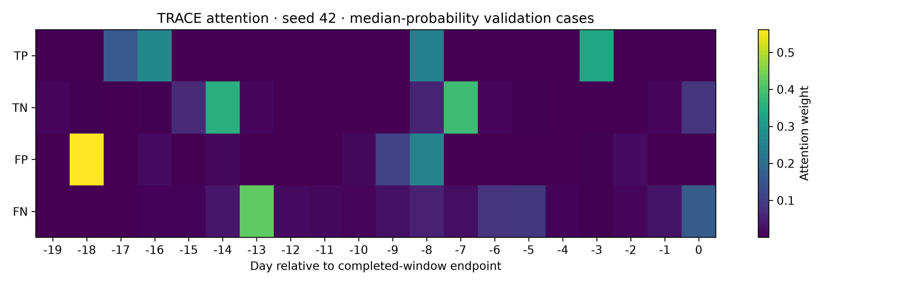
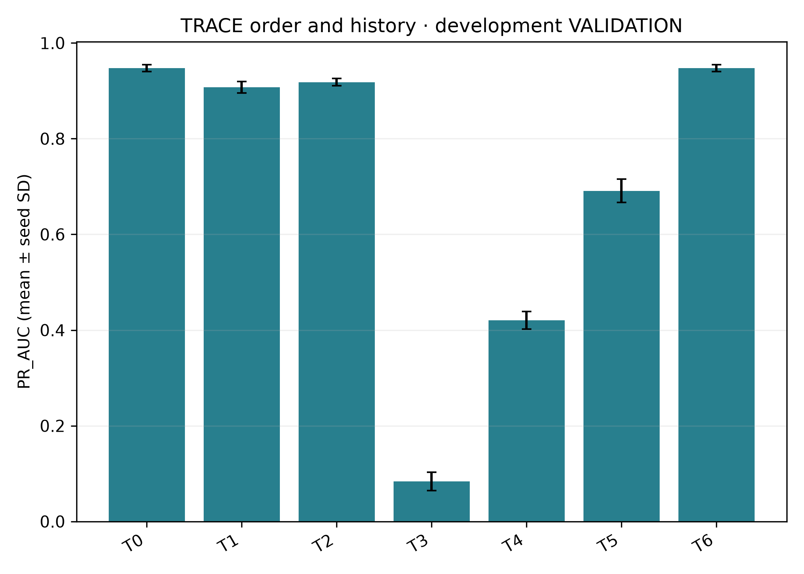
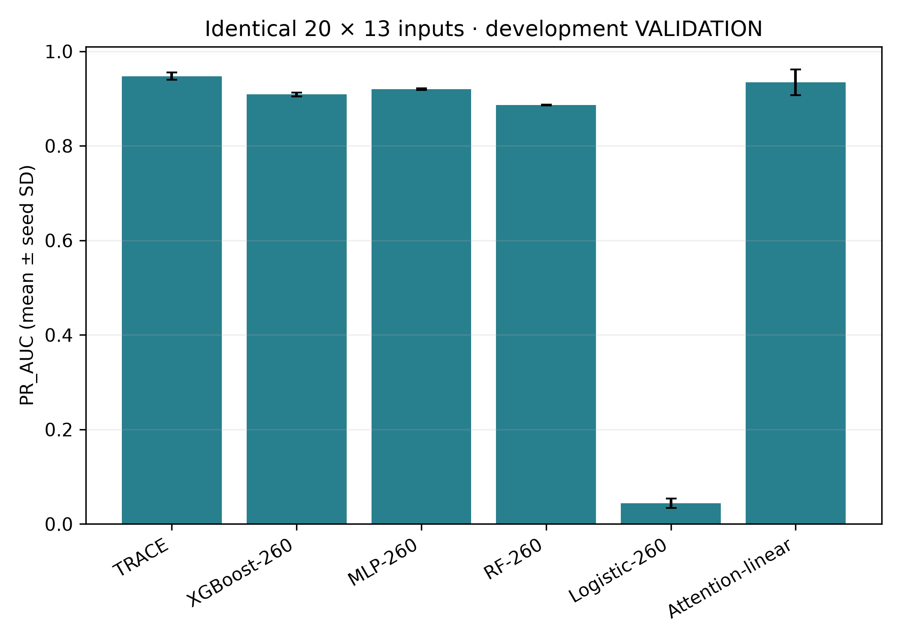
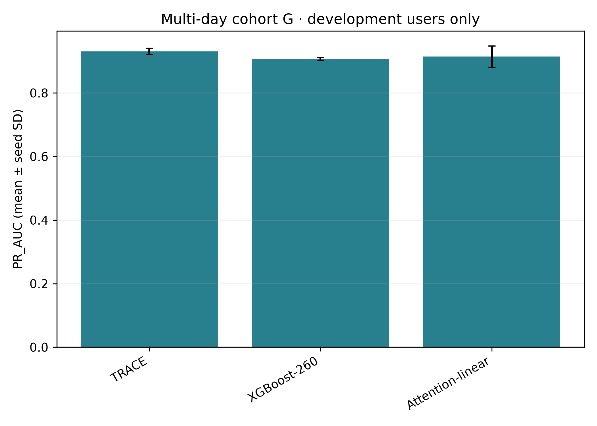
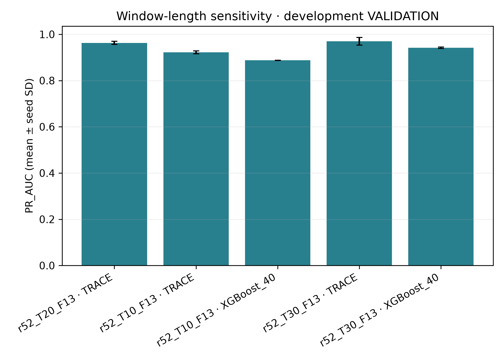
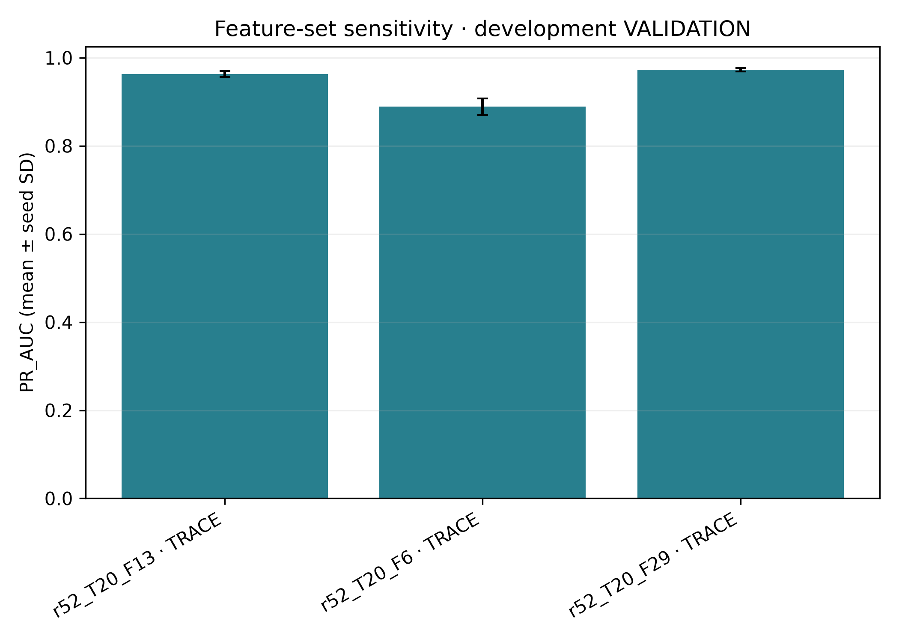
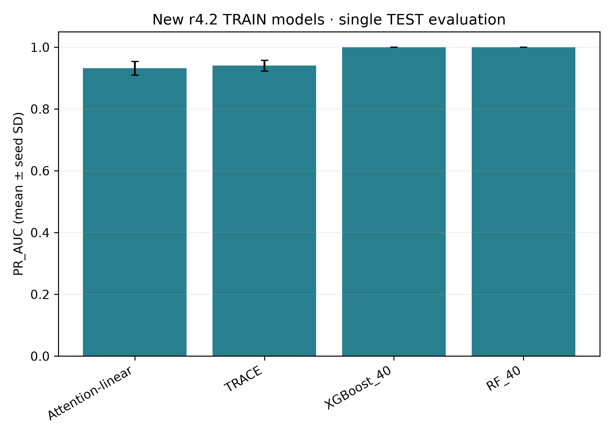
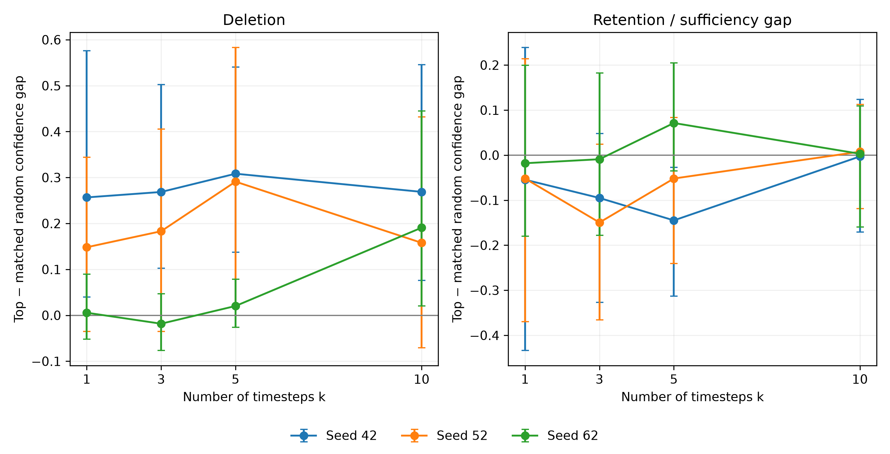

# Phase 6: final-model re-runs (exploratory)

Completed UTC: 2026-10-22T10:13:33.238952+00:00

Training: 57/57 runs succeeded. All outcomes, including any failures, dependency skips or timeouts, are retained. TRACE means TA2/F11, with task + 0.5 teacher-logit MSE + 0.5 route KL. No tuning.

## Amendment 4

`## Amendment 4: final-model re-runs (exploratory)` was the first Phase6 mutation, appended to `holdout/PREREGISTRATION_R2_HOLDOUT.md` at 2026-10-22T08:07:12.6588409Z, before preparation, fitting or inference. It contains Parts I and T and the entire approved prompt verbatim.

SHA-256 of the preregistration bytes through Amendment 4 before its receipt: `1152334b1a702a3084b1a16b0dd0545ef05fc38003b8945f23bafd242ba32542`. The preceding 14211 bytes retain SHA-256 `1c3b65854f364eeee13bbbe0d5e76ade6835a1e3d02e51d927cb1c15f65943d6`. Receipt: [AMENDMENT4_RECEIPT.json](AMENDMENT4_RECEIPT.json).

## Boundaries and interpretation

- Phase 5B was superseded and not run separately.
- Strict HOLDOUT exclusion restricts every r5.2 Phase6 analysis to 1500 development users and 48000 original 20-day VALIDATION windows (473 positives). Historical all-user TRACE mean AP 0.942842 is context only. Existing frozen all-user checkpoints/scalers/TRAIN medians are reused as requested, so historical training included the later HOLDOUT users; Phase6 never reads their activity or scores for analysis and never fits on them.
- The full historical multi-day cohort has 613 positives, 26 users/answer-file incidents and 63272 negatives. Its allowed development-only subset has 384 positives from 16 users/answer-file incidents and 47527 negatives. The full cohort was not evaluated because it contains excluded HOLDOUT users.
- The manuscript 484-window/151-user explanation cohort belongs to r4.2, as previously established in Phase3. I4 follows the existing actual r5.2 deterministic 25th/50th/75th percentile TP/TN/FP/FN case protocol per seed. The requested heatmap uses seed42 median cases only. Interventions use the existing masked-softmax helper, which zeros excluded timestep vectors and removes them from attention while retaining chronological positions. This is more specific than the manuscript shorthand of zero replacement with attention recomputation.
- Attention CIs are exploratory, sequence-weighted user-cluster intervals on the selected deterministic cases. The small, outcome-selected case sample limits population inference. Top-minus-random deletion >0 means larger confidence loss; retention-gap <0 means better sufficiency than random. These are model-relative input interventions, not causal employee-behaviour explanations.
- New 10-day and 30-day models have their own completed-window labels and within-period endpoints; validation populations differ. Their AP differences cannot isolate window length from cohort/label prevalence. T1 reports the matched development-only 20-day TRACE alongside the original all-user checkpoint restricted to development validation; T2 gives paired contrasts against both 13-feature references, explicitly disclosing the historical training-membership difference.
- Preparation initially hit the old 20-day-only summary shape guard, before any training started. The 40-feature aggregation equations were copied with only the allowed timestep length generalized, and exact T20 equality was verified on synthetic inputs. No hyperparameter changed. Inference preparation initially hit a NumPy private-header API mismatch, before inference; it was corrected to the supported public reader. Neither preparation failure evaluated r4.2 TEST or triggered a model retry.
- F6_PRIMITIVES and F29 use the existing revision_v0.2 feature definitions. Only selected development-user slices of the existing raw daily F29 caches were materialized. All 13 shared channels exactly matched the filtered authoritative daily table. Daily TRAIN-only median imputation and population standardization were refitted per configuration; no extra missingness indicator columns were added (matching the realized study schema).
- All single runs have a 7200-second limit. Only this task’s child process can be stopped on timeout. GPU allocator usage is capped at 35%, CPU numerical libraries and tree models use two threads, neural forward passes pause cooperatively, and no other chat, window, process or repository is managed.
- Checkpoint selection maximizes VALIDATION AP; thresholds maximize VALIDATION F1 using the frozen Phase2 candidate rule. All validation results are selection-set results, not independent test claims. r4.2 TEST is the sole newly evaluated TEST partition; the old r5.2 TEST partition remained sealed.

## Main observations

On development-only r5.2 VALIDATION, reversing or shuffling TRACE inputs lowered mean-seed AP: reversed minus original -0.040069 [-0.097583, -0.006817]; fixed shuffle minus original -0.029503 [-0.068548, -0.007495]. Brackets give paired user-cluster 95% intervals. Partial-history results and all seedwise outcomes appear below.

With identical 20 × 13 information, TRACE minus XGBoost-260 mean AP was +0.038879 [0.008460, 0.089644]. TRACE versus attention–linear AP has an interval spanning zero; this does not establish equivalence.

Against the matched development-only 13-feature TRACE, the 6-feature AP difference was -0.074147 [-0.157793, -0.027589] and the 29-feature difference was +0.009474 [-0.026222, 0.052656]. The 29-feature comparison with the original all-user checkpoint uses a different training population and is separately tabulated; it should not replace the matched comparison.

On the single r4.2 TEST evaluation, TRACE mean AP was 0.940172, while XGBoost-40 and RF-40 each had mean AP 1.000000. TRACE minus XGBoost-40 AP was -0.059828 [-0.196423, 0.000000]. The complete F1, precision, recall and paired intervals are retained below. These outcomes were not used to alter any model, threshold or configuration.

## Training log

| model | config | seed | status | epochs | best_epoch | validation_AP | duration_seconds | threshold |
|---|---|---|---|---|---|---|---|---|
| Attention-linear prerequisite | r52_T10_F13 | 42 | ok | 12 | 8 | 0.9126803 | 118.29672 | 0.95 |
| Attention-linear prerequisite | r52_T10_F13 | 52 | ok | 11 | 7 | 0.91324539 | 130.15314 | 0.99 |
| Attention-linear prerequisite | r52_T10_F13 | 62 | ok | 10 | 6 | 0.92305883 | 117.54358 | 0.99 |
| T-OPT | r52_T10_F13 | 42 | ok | 5 | 1 | 0.89376525 | 68.075225 | 0.62 |
| T-OPT | r52_T10_F13 | 52 | ok | 6 | 2 | 0.90209412 | 80.858988 | 0.73 |
| T-OPT | r52_T10_F13 | 62 | ok | 15 | 12 | 0.92463697 | 207.11486 | 0.8 |
| TRACE | r52_T10_F13 | 42 | ok | 15 | 13 | 0.91739737 | 339.68655 | 0.7 |
| TRACE | r52_T10_F13 | 52 | ok | 14 | 10 | 0.92044195 | 310.62061 | 0.92 |
| TRACE | r52_T10_F13 | 62 | ok | 15 | 11 | 0.92856437 | 276.8886 | 0.72 |
| XGBoost_40 | r52_T10_F13 | 42 | ok | 300 | 300 | 0.88823098 | 12.440296 | 0.53 |
| XGBoost_40 | r52_T10_F13 | 52 | ok | 300 | 300 | 0.88726549 | 13.454003 | 0.16 |
| XGBoost_40 | r52_T10_F13 | 62 | ok | 300 | 300 | 0.88760588 | 18.02833 | 0.52 |
| Attention-linear prerequisite | r52_T30_F13 | 42 | ok | 12 | 8 | 0.98964142 | 116.06591 | 0.35 |
| Attention-linear prerequisite | r52_T30_F13 | 52 | ok | 8 | 4 | 0.94582238 | 103.7801 | 0.9595977 |
| Attention-linear prerequisite | r52_T30_F13 | 62 | ok | 9 | 5 | 0.95264597 | 92.65333 | 0.98 |
| T-OPT | r52_T30_F13 | 42 | ok | 5 | 1 | 0.98633509 | 66.003645 | 0.45 |
| T-OPT | r52_T30_F13 | 52 | ok | 9 | 5 | 0.94892884 | 115.47864 | 0.7 |
| T-OPT | r52_T30_F13 | 62 | ok | 9 | 5 | 0.95135962 | 102.85585 | 0.85 |
| TRACE | r52_T30_F13 | 42 | ok | 9 | 5 | 0.98844394 | 172.47136 | 0.31 |
| TRACE | r52_T30_F13 | 52 | ok | 9 | 5 | 0.95937669 | 183.31806 | 0.39 |
| TRACE | r52_T30_F13 | 62 | ok | 11 | 7 | 0.96079268 | 247.52336 | 0.84 |
| XGBoost_40 | r52_T30_F13 | 42 | ok | 300 | 300 | 0.94263509 | 17.398532 | 0.4 |
| XGBoost_40 | r52_T30_F13 | 52 | ok | 300 | 300 | 0.94491738 | 16.521619 | 0.51 |
| XGBoost_40 | r52_T30_F13 | 62 | ok | 300 | 300 | 0.93848567 | 16.982454 | 0.54 |
| Attention-linear prerequisite | r52_T20_F6 | 42 | ok | 13 | 9 | 0.86128111 | 129.59288 | 0.87 |
| Attention-linear prerequisite | r52_T20_F6 | 52 | ok | 15 | 13 | 0.89035789 | 155.7564 | 0.65 |
| Attention-linear prerequisite | r52_T20_F6 | 62 | ok | 15 | 13 | 0.89138037 | 168.40061 | 0.28 |
| T-OPT | r52_T20_F6 | 42 | ok | 5 | 1 | 0.84354297 | 70.251193 | 0.59 |
| T-OPT | r52_T20_F6 | 52 | ok | 5 | 1 | 0.858883 | 70.910085 | 0.62 |
| T-OPT | r52_T20_F6 | 62 | ok | 5 | 1 | 0.87785143 | 72.469462 | 0.43 |
| TRACE | r52_T20_F6 | 42 | ok | 15 | 13 | 0.86723465 | 303.45799 | 0.41 |
| TRACE | r52_T20_F6 | 52 | ok | 15 | 13 | 0.89677855 | 294.48107 | 0.43 |
| TRACE | r52_T20_F6 | 62 | ok | 12 | 8 | 0.90255504 | 248.26999 | 0.42 |
| Attention-linear prerequisite | r52_T20_F29 | 42 | ok | 5 | 1 | 0.95225629 | 90.053067 | 0.92 |
| Attention-linear prerequisite | r52_T20_F29 | 52 | ok | 6 | 2 | 0.95507823 | 65.334502 | 0.87 |
| Attention-linear prerequisite | r52_T20_F29 | 62 | ok | 9 | 5 | 0.95665822 | 92.266032 | 0.82 |
| T-OPT | r52_T20_F29 | 42 | ok | 8 | 4 | 0.97032522 | 104.29814 | 0.72 |
| T-OPT | r52_T20_F29 | 52 | ok | 10 | 6 | 0.95917324 | 129.59844 | 0.65 |
| T-OPT | r52_T20_F29 | 62 | ok | 6 | 2 | 0.94860495 | 81.034583 | 0.61 |
| TRACE | r52_T20_F29 | 42 | ok | 9 | 5 | 0.97657375 | 182.50045 | 0.57 |
| TRACE | r52_T20_F29 | 52 | ok | 15 | 13 | 0.97200579 | 306.48946 | 0.47 |
| TRACE | r52_T20_F29 | 62 | ok | 15 | 15 | 0.9688513 | 289.62565 | 0.73 |
| Attention-linear prerequisite | r42_T20_F13 | 42 | ok | 8 | 4 | 0.82390248 | 53.964145 | 0.88 |
| Attention-linear prerequisite | r42_T20_F13 | 52 | ok | 9 | 5 | 0.79086563 | 59.215078 | 0.84 |
| Attention-linear prerequisite | r42_T20_F13 | 62 | ok | 8 | 4 | 0.82533375 | 53.268923 | 0.78 |
| T-OPT | r42_T20_F13 | 42 | ok | 8 | 4 | 0.82485545 | 62.429987 | 0.73 |
| T-OPT | r42_T20_F13 | 52 | ok | 6 | 2 | 0.83435747 | 48.736574 | 0.67 |
| T-OPT | r42_T20_F13 | 62 | ok | 11 | 7 | 0.84996012 | 92.028406 | 0.72 |
| TRACE | r42_T20_F13 | 42 | ok | 15 | 14 | 0.81030147 | 190.96547 | 0.65 |
| TRACE | r42_T20_F13 | 52 | ok | 5 | 1 | 0.83414715 | 57.445606 | 0.72 |
| TRACE | r42_T20_F13 | 62 | ok | 7 | 3 | 0.85054829 | 79.491948 | 0.68 |
| XGBoost_40 | r42_T20_F13 | 42 | ok | 300 | 300 | 0.97387228 | 10.994717 | 0.61 |
| XGBoost_40 | r42_T20_F13 | 52 | ok | 300 | 300 | 0.97867628 | 10.652692 | 0.4 |
| XGBoost_40 | r42_T20_F13 | 62 | ok | 300 | 300 | 0.97548784 | 10.697285 | 0.7 |
| RF_40 | r42_T20_F13 | 42 | ok | 200 | 200 | 0.98014921 | 46.862306 | 0.23 |
| RF_40 | r42_T20_F13 | 52 | ok | 200 | 200 | 0.98171622 | 46.575335 | 0.26 |
| RF_40 | r42_T20_F13 | 62 | ok | 200 | 200 | 0.97947207 | 46.866017 | 0.23 |

For XGBoost and RF, `epochs` and `best_epoch` record the fixed boosting-round/tree counts (300 and 200 respectively); they are not neural epochs or a checkpoint search. Neural rows record actual epochs and validation-selected best epochs.

All configuration parameters, epoch histories, checkpoint hashes and durations are in [TRAINING_RESULTS_PHASE6.json](TRAINING_RESULTS_PHASE6.json); the compact log is [TRAINING_LOG_PHASE6.csv](TRAINING_LOG_PHASE6.csv). Each new configuration trained three independent attention–linear prerequisites and three matched T-OPT teachers before its three TRACE seeds. The teacher-logit target is the equal mean of that configuration’s three teachers, and the route target is its matched-seed teacher. The r4.2 attention–linear reference reuses the new attention–linear prerequisite checkpoint, selected on r4.2 VALIDATION.

## Part I1: order and partial history

| model | seed | condition | history_days | windows | positive_windows | PR_AUC | F1 | precision | recall | threshold |
|---|---|---|---|---|---|---|---|---|---|---|
| TRACE | 42 | T0 | 20 | 48000 | 473 | 0.94720888 | 0.93495039 | 0.97695853 | 0.89640592 | 0.79 |
| TRACE | 42 | T1 | 20 | 48000 | 473 | 0.89386434 | 0.87064117 | 0.93028846 | 0.81818182 | 0.79 |
| TRACE | 42 | T2 | 20 | 48000 | 473 | 0.91642701 | 0.88176796 | 0.92361111 | 0.8435518 | 0.79 |
| TRACE | 42 | T3 | 1 | 48000 | 473 | 0.065055731 | 0.054878049 | 0.032674466 | 0.17124736 | 0.79 |
| TRACE | 42 | T4 | 5 | 48000 | 473 | 0.40384089 | 0.1268675 | 0.071745152 | 0.54756871 | 0.79 |
| TRACE | 42 | T5 | 10 | 48000 | 473 | 0.66652793 | 0.31799544 | 0.20267131 | 0.73784355 | 0.79 |
| TRACE | 42 | T6 | 20 | 48000 | 473 | 0.94720888 | 0.93495039 | 0.97695853 | 0.89640592 | 0.79 |
| TRACE | 52 | T0 | 20 | 48000 | 473 | 0.94040641 | 0.91314031 | 0.96470588 | 0.86680761 | 0.74 |
| TRACE | 52 | T1 | 20 | 48000 | 473 | 0.9166226 | 0.87665198 | 0.91494253 | 0.84143763 | 0.74 |
| TRACE | 52 | T2 | 20 | 48000 | 473 | 0.91135199 | 0.88535755 | 0.95588235 | 0.82452431 | 0.74 |
| TRACE | 52 | T3 | 1 | 48000 | 473 | 0.08284904 | 0.10480349 | 0.10835214 | 0.10147992 | 0.74 |
| TRACE | 52 | T4 | 5 | 48000 | 473 | 0.41778993 | 0.19036428 | 0.11682692 | 0.51374207 | 0.74 |
| TRACE | 52 | T5 | 10 | 48000 | 473 | 0.69112642 | 0.3812601 | 0.25578035 | 0.74841438 | 0.74 |
| TRACE | 52 | T6 | 20 | 48000 | 473 | 0.94040641 | 0.91314031 | 0.96470588 | 0.86680761 | 0.74 |
| TRACE | 62 | T0 | 20 | 48000 | 473 | 0.95507857 | 0.91711518 | 0.93421053 | 0.90063425 | 0.59 |
| TRACE | 62 | T1 | 20 | 48000 | 473 | 0.91200131 | 0.88937568 | 0.92272727 | 0.85835095 | 0.59 |
| TRACE | 62 | T2 | 20 | 48000 | 473 | 0.92640578 | 0.88162345 | 0.94444444 | 0.82663848 | 0.59 |
| TRACE | 62 | T3 | 1 | 48000 | 473 | 0.10314978 | 0.10457516 | 0.10786517 | 0.10147992 | 0.59 |
| TRACE | 62 | T4 | 5 | 48000 | 473 | 0.44050535 | 0.24317362 | 0.16076294 | 0.49894292 | 0.59 |
| TRACE | 62 | T5 | 10 | 48000 | 473 | 0.71506939 | 0.49291785 | 0.37060703 | 0.73572939 | 0.59 |
| TRACE | 62 | T6 | 20 | 48000 | 473 | 0.95507857 | 0.91711518 | 0.93421053 | 0.90063425 | 0.59 |
| XGBoost-260 | 42 | T0 | 20 | 48000 | 473 | 0.90480976 | 0.843292 | 0.90338164 | 0.79069767 | 0.58 |
| XGBoost-260 | 42 | T1 | 20 | 48000 | 473 | 0.86857864 | 0.81683732 | 0.88423645 | 0.7589852 | 0.58 |
| XGBoost-260 | 42 | T2 | 20 | 48000 | 473 | 0.86717359 | 0.79266896 | 0.865 | 0.73150106 | 0.58 |
| XGBoost-260 | 42 | T3 | 1 | 48000 | 473 | 0.079647179 | 0.0083682008 | 0.4 | 0.0042283298 | 0.58 |
| XGBoost-260 | 42 | T4 | 5 | 48000 | 473 | 0.05381565 | 0.1240942 | 0.078962536 | 0.28964059 | 0.58 |
| XGBoost-260 | 42 | T5 | 10 | 48000 | 473 | 0.26690471 | 0.27307482 | 0.18409426 | 0.52854123 | 0.58 |
| XGBoost-260 | 42 | T6 | 20 | 48000 | 473 | 0.90480976 | 0.843292 | 0.90338164 | 0.79069767 | 0.58 |
| XGBoost-260 | 52 | T0 | 20 | 48000 | 473 | 0.91332458 | 0.85423729 | 0.91747573 | 0.79915433 | 0.59 |
| XGBoost-260 | 52 | T1 | 20 | 48000 | 473 | 0.88051435 | 0.82191781 | 0.89330025 | 0.76109937 | 0.59 |
| XGBoost-260 | 52 | T2 | 20 | 48000 | 473 | 0.87246313 | 0.81590909 | 0.88206388 | 0.7589852 | 0.59 |
| XGBoost-260 | 52 | T3 | 1 | 48000 | 473 | 0.102721 | 0.11155378 | 0.96551724 | 0.059196617 | 0.59 |
| XGBoost-260 | 52 | T4 | 5 | 48000 | 473 | 0.062737674 | 0.14615708 | 0.091194969 | 0.36786469 | 0.59 |
| XGBoost-260 | 52 | T5 | 10 | 48000 | 473 | 0.25734257 | 0.24594852 | 0.15876923 | 0.54545455 | 0.59 |
| XGBoost-260 | 52 | T6 | 20 | 48000 | 473 | 0.91332458 | 0.85423729 | 0.91747573 | 0.79915433 | 0.59 |
| XGBoost-260 | 62 | T0 | 20 | 48000 | 473 | 0.90792217 | 0.86114101 | 0.87719298 | 0.84566596 | 0.5 |
| XGBoost-260 | 62 | T1 | 20 | 48000 | 473 | 0.87760733 | 0.82826087 | 0.85234899 | 0.80549683 | 0.5 |
| XGBoost-260 | 62 | T2 | 20 | 48000 | 473 | 0.87336147 | 0.8092613 | 0.84562212 | 0.77589852 | 0.5 |
| XGBoost-260 | 62 | T3 | 1 | 48000 | 473 | 0.098047643 | 0.11881188 | 0.9375 | 0.063424947 | 0.5 |
| XGBoost-260 | 62 | T4 | 5 | 48000 | 473 | 0.0565855 | 0.15568369 | 0.096675192 | 0.39957717 | 0.5 |
| XGBoost-260 | 62 | T5 | 10 | 48000 | 473 | 0.23959984 | 0.23969401 | 0.15 | 0.5961945 | 0.5 |
| XGBoost-260 | 62 | T6 | 20 | 48000 | 473 | 0.90792217 | 0.86114101 | 0.87719298 | 0.84566596 | 0.5 |
| MLP-260 | 42 | T0 | 20 | 48000 | 473 | 0.92148195 | 0.86872999 | 0.87715517 | 0.86046512 | 0.94 |
| MLP-260 | 42 | T1 | 20 | 48000 | 473 | 0.90488587 | 0.86363636 | 0.88470067 | 0.8435518 | 0.94 |
| MLP-260 | 42 | T2 | 20 | 48000 | 473 | 0.86837924 | 0.8 | 0.80952381 | 0.79069767 | 0.94 |
| MLP-260 | 42 | T3 | 1 | 48000 | 473 | 0.11089546 | 0.090592334 | 0.067567568 | 0.13742072 | 0.94 |
| MLP-260 | 42 | T4 | 5 | 48000 | 473 | 0.073091769 | 0.11852522 | 0.066362715 | 0.55391121 | 0.94 |
| MLP-260 | 42 | T5 | 10 | 48000 | 473 | 0.15718768 | 0.19693166 | 0.11343188 | 0.74630021 | 0.94 |
| MLP-260 | 42 | T6 | 20 | 48000 | 473 | 0.92148195 | 0.86872999 | 0.87715517 | 0.86046512 | 0.94 |
| MLP-260 | 52 | T0 | 20 | 48000 | 473 | 0.92106724 | 0.86440678 | 0.86624204 | 0.86257928 | 0.91 |
| MLP-260 | 52 | T1 | 20 | 48000 | 473 | 0.89479457 | 0.84673098 | 0.85869565 | 0.83509514 | 0.91 |
| MLP-260 | 52 | T2 | 20 | 48000 | 473 | 0.86836617 | 0.83535912 | 0.875 | 0.79915433 | 0.91 |
| MLP-260 | 52 | T3 | 1 | 48000 | 473 | 0.10364025 | 0.1383855 | 0.31343284 | 0.088794926 | 0.91 |
| MLP-260 | 52 | T4 | 5 | 48000 | 473 | 0.077009289 | 0.11391586 | 0.063431043 | 0.55813953 | 0.91 |
| MLP-260 | 52 | T5 | 10 | 48000 | 473 | 0.18966557 | 0.18817204 | 0.10779181 | 0.73995772 | 0.91 |
| MLP-260 | 52 | T6 | 20 | 48000 | 473 | 0.92106724 | 0.86440678 | 0.86624204 | 0.86257928 | 0.91 |
| MLP-260 | 62 | T0 | 20 | 48000 | 473 | 0.91746811 | 0.84791667 | 0.83572895 | 0.86046512 | 0.86 |
| MLP-260 | 62 | T1 | 20 | 48000 | 473 | 0.89271257 | 0.81960375 | 0.80864198 | 0.83086681 | 0.86 |
| MLP-260 | 62 | T2 | 20 | 48000 | 473 | 0.85108106 | 0.77661795 | 0.76701031 | 0.78646934 | 0.86 |
| MLP-260 | 62 | T3 | 1 | 48000 | 473 | 0.10337995 | 0.12817089 | 0.17391304 | 0.10147992 | 0.86 |
| MLP-260 | 62 | T4 | 5 | 48000 | 473 | 0.080537728 | 0.11746175 | 0.065726517 | 0.55179704 | 0.86 |
| MLP-260 | 62 | T5 | 10 | 48000 | 473 | 0.19410776 | 0.19019397 | 0.10898425 | 0.74630021 | 0.86 |
| MLP-260 | 62 | T6 | 20 | 48000 | 473 | 0.91746811 | 0.84791667 | 0.83572895 | 0.86046512 | 0.86 |

T0 is original, T1 reversed, T2 the single fixed seed2026 permutation, T3/T4/T5 retain the most recent 1/5/10 days with earlier timesteps filled by frozen original TRAIN medians, and T6 is the identical 20-day original reference. Frozen thresholds are reused. Clean predictions are taken from saved frozen predictions; a fresh-forward parity check precedes interventions.

| model | seed | max_abs_probability_error | tolerance |
|---|---|---|---|
| TRACE | 42 | 4.6317933e-09 | 0.0005 |
| TRACE | 52 | 7.0812482e-09 | 0.0005 |
| TRACE | 62 | 4.7431815e-09 | 0.0005 |
| XGBoost-260 | 42 | 0 | 0.0005 |
| XGBoost-260 | 52 | 0 | 0.0005 |
| XGBoost-260 | 62 | 0 | 0.0005 |
| MLP-260 | 42 | 7.4505806e-07 | 0.0005 |
| MLP-260 | 52 | 6.8545341e-07 | 0.0005 |
| MLP-260 | 62 | 8.3446503e-07 | 0.0005 |

Paired user-cluster percentile 95% intervals use 2000 draws, seed42. The same user multiplicities are paired across conditions and fixed model seeds; `mean_three` is the mean of the three per-seed metrics, not AP of averaged scores. Single-class draws are reported in the valid replicate count.

| comparison | seed | metric | estimate | ci95_low | ci95_high | valid_bootstrap_replicates | attempted_replicates | bootstrap_seed | cluster |
|---|---|---|---|---|---|---|---|---|---|
| TRACE T1 minus original/20 days | mean_three | PR_AUC | -0.040068536 | -0.097582848 | -0.006817059 | 2000 | 2000 | 42 | user |
| TRACE T1 minus original/20 days | 42 | PR_AUC | -0.053344543 | -0.13252133 | -0.010033069 | 2000 | 2000 | 42 | user |
| TRACE T1 minus original/20 days | 52 | PR_AUC | -0.023783802 | -0.054262788 | -0.0039979703 | 2000 | 2000 | 42 | user |
| TRACE T1 minus original/20 days | 62 | PR_AUC | -0.043077263 | -0.11764334 | 0.00030976097 | 2000 | 2000 | 42 | user |
| TRACE T1 minus original/20 days | mean_three | F1 | -0.04284568 | -0.10096374 | -0.0073455501 | 2000 | 2000 | 42 | user |
| TRACE T1 minus original/20 days | 42 | F1 | -0.064309216 | -0.1429109 | -0.016279564 | 2000 | 2000 | 42 | user |
| TRACE T1 minus original/20 days | 52 | F1 | -0.036488329 | -0.091307177 | -0.0056335986 | 2000 | 2000 | 42 | user |
| TRACE T1 minus original/20 days | 62 | F1 | -0.027739493 | -0.093080824 | 0.019327014 | 2000 | 2000 | 42 | user |
| TRACE T2 minus original/20 days | mean_three | PR_AUC | -0.029503026 | -0.068547963 | -0.0074951209 | 2000 | 2000 | 42 | user |
| TRACE T2 minus original/20 days | 42 | PR_AUC | -0.030781875 | -0.08199119 | -0.00530898 | 2000 | 2000 | 42 | user |
| TRACE T2 minus original/20 days | 52 | PR_AUC | -0.029054414 | -0.063900119 | -0.0085747835 | 2000 | 2000 | 42 | user |
| TRACE T2 minus original/20 days | 62 | PR_AUC | -0.028672788 | -0.07080075 | -0.0045303807 | 2000 | 2000 | 42 | user |
| TRACE T2 minus original/20 days | mean_three | F1 | -0.038818974 | -0.086339082 | -0.0082218364 | 2000 | 2000 | 42 | user |
| TRACE T2 minus original/20 days | 42 | F1 | -0.05318243 | -0.11264206 | -0.021153486 | 2000 | 2000 | 42 | user |
| TRACE T2 minus original/20 days | 52 | F1 | -0.027782764 | -0.076483142 | 0.0078773059 | 2000 | 2000 | 42 | user |
| TRACE T2 minus original/20 days | 62 | F1 | -0.035491728 | -0.091626018 | 0.011647148 | 2000 | 2000 | 42 | user |
| TRACE T3 minus original/20 days | mean_three | PR_AUC | -0.86387977 | -0.92271354 | -0.79089276 | 2000 | 2000 | 42 | user |
| TRACE T3 minus original/20 days | 42 | PR_AUC | -0.88215315 | -0.94594799 | -0.79871745 | 2000 | 2000 | 42 | user |
| TRACE T3 minus original/20 days | 52 | PR_AUC | -0.85755737 | -0.92572351 | -0.76469688 | 2000 | 2000 | 42 | user |
| TRACE T3 minus original/20 days | 62 | PR_AUC | -0.85192879 | -0.90059631 | -0.79103211 | 2000 | 2000 | 42 | user |
| TRACE T3 minus original/20 days | mean_three | F1 | -0.83364972 | -0.90429889 | -0.7384593 | 2000 | 2000 | 42 | user |
| TRACE T3 minus original/20 days | 42 | F1 | -0.88007234 | -0.95422775 | -0.77197779 | 2000 | 2000 | 42 | user |
| TRACE T3 minus original/20 days | 52 | F1 | -0.80833682 | -0.89104589 | -0.6999264 | 2000 | 2000 | 42 | user |
| TRACE T3 minus original/20 days | 62 | F1 | -0.81254001 | -0.88013176 | -0.73215962 | 2000 | 2000 | 42 | user |
| TRACE T4 minus original/20 days | mean_three | PR_AUC | -0.52685256 | -0.648063 | -0.42800138 | 2000 | 2000 | 42 | user |
| TRACE T4 minus original/20 days | 42 | PR_AUC | -0.54336799 | -0.68520437 | -0.44227157 | 2000 | 2000 | 42 | user |
| TRACE T4 minus original/20 days | 52 | PR_AUC | -0.52261648 | -0.64460537 | -0.42096306 | 2000 | 2000 | 42 | user |
| TRACE T4 minus original/20 days | 62 | PR_AUC | -0.51457322 | -0.63434737 | -0.41802835 | 2000 | 2000 | 42 | user |
| TRACE T4 minus original/20 days | mean_three | F1 | -0.73493349 | -0.83770274 | -0.63347713 | 2000 | 2000 | 42 | user |
| TRACE T4 minus original/20 days | 42 | F1 | -0.80808289 | -0.89792576 | -0.70791034 | 2000 | 2000 | 42 | user |
| TRACE T4 minus original/20 days | 52 | F1 | -0.72277603 | -0.83748171 | -0.60535911 | 2000 | 2000 | 42 | user |
| TRACE T4 minus original/20 days | 62 | F1 | -0.67394156 | -0.78100137 | -0.57227557 | 2000 | 2000 | 42 | user |
| TRACE T5 minus original/20 days | mean_three | PR_AUC | -0.2566567 | -0.35067715 | -0.18287918 | 2000 | 2000 | 42 | user |
| TRACE T5 minus original/20 days | 42 | PR_AUC | -0.28068095 | -0.39305695 | -0.19833322 | 2000 | 2000 | 42 | user |
| TRACE T5 minus original/20 days | 52 | PR_AUC | -0.24927998 | -0.34887447 | -0.1648642 | 2000 | 2000 | 42 | user |
| TRACE T5 minus original/20 days | 62 | PR_AUC | -0.24000918 | -0.32985644 | -0.16334455 | 2000 | 2000 | 42 | user |
| TRACE T5 minus original/20 days | mean_three | F1 | -0.52434416 | -0.66490738 | -0.41484612 | 2000 | 2000 | 42 | user |
| TRACE T5 minus original/20 days | 42 | F1 | -0.61695494 | -0.74831841 | -0.50553422 | 2000 | 2000 | 42 | user |
| TRACE T5 minus original/20 days | 52 | F1 | -0.53188021 | -0.68603975 | -0.40895287 | 2000 | 2000 | 42 | user |
| TRACE T5 minus original/20 days | 62 | F1 | -0.42419733 | -0.56874415 | -0.31442356 | 2000 | 2000 | 42 | user |
| TRACE T6 minus original/20 days | mean_three | PR_AUC | 0 | 0 | 0 | 2000 | 2000 | 42 | user |
| TRACE T6 minus original/20 days | 42 | PR_AUC | 0 | 0 | 0 | 2000 | 2000 | 42 | user |
| TRACE T6 minus original/20 days | 52 | PR_AUC | 0 | 0 | 0 | 2000 | 2000 | 42 | user |
| TRACE T6 minus original/20 days | 62 | PR_AUC | 0 | 0 | 0 | 2000 | 2000 | 42 | user |
| TRACE T6 minus original/20 days | mean_three | F1 | 0 | 0 | 0 | 2000 | 2000 | 42 | user |
| TRACE T6 minus original/20 days | 42 | F1 | 0 | 0 | 0 | 2000 | 2000 | 42 | user |
| TRACE T6 minus original/20 days | 52 | F1 | 0 | 0 | 0 | 2000 | 2000 | 42 | user |
| TRACE T6 minus original/20 days | 62 | F1 | 0 | 0 | 0 | 2000 | 2000 | 42 | user |

## Part I2: identical information

| model | seed | windows | positive_windows | PR_AUC | F1 | precision | recall | threshold |
|---|---|---|---|---|---|---|---|---|
| TRACE | 42 | 48000 | 473 | 0.94720888 | 0.93495039 | 0.97695853 | 0.89640592 | 0.79 |
| TRACE | 52 | 48000 | 473 | 0.94040641 | 0.91314031 | 0.96470588 | 0.86680761 | 0.74 |
| TRACE | 62 | 48000 | 473 | 0.95507857 | 0.91711518 | 0.93421053 | 0.90063425 | 0.59 |
| XGBoost-260 | 42 | 48000 | 473 | 0.90480976 | 0.843292 | 0.90338164 | 0.79069767 | 0.58 |
| XGBoost-260 | 52 | 48000 | 473 | 0.91332458 | 0.85423729 | 0.91747573 | 0.79915433 | 0.59 |
| XGBoost-260 | 62 | 48000 | 473 | 0.90792217 | 0.86114101 | 0.87719298 | 0.84566596 | 0.5 |
| MLP-260 | 42 | 48000 | 473 | 0.92148195 | 0.86872999 | 0.87715517 | 0.86046512 | 0.94 |
| MLP-260 | 52 | 48000 | 473 | 0.92106724 | 0.86440678 | 0.86624204 | 0.86257928 | 0.91 |
| MLP-260 | 62 | 48000 | 473 | 0.91746811 | 0.84791667 | 0.83572895 | 0.86046512 | 0.86 |
| RF-260 | 42 | 48000 | 473 | 0.88710132 | 0.875 | 0.96675192 | 0.79915433 | 0.41 |
| RF-260 | 52 | 48000 | 473 | 0.88521872 | 0.86916951 | 0.9408867 | 0.80761099 | 0.39 |
| RF-260 | 62 | 48000 | 473 | 0.88732326 | 0.87243736 | 0.94567901 | 0.80972516 | 0.39 |
| Logistic-260 | 42 | 48000 | 473 | 0.037963634 | 0.096115461 | 0.051821192 | 0.66173362 | 0.7 |
| Logistic-260 | 52 | 48000 | 473 | 0.05547047 | 0.13519471 | 0.08181414 | 0.38900634 | 0.99 |
| Logistic-260 | 62 | 48000 | 473 | 0.038508081 | 0.10380977 | 0.059045957 | 0.42917548 | 0.99 |
| Attention-linear | 42 | 48000 | 473 | 0.9414489 | 0.93069307 | 0.97018349 | 0.89429175 | 0.95 |
| Attention-linear | 52 | 48000 | 473 | 0.90437472 | 0.89786756 | 0.9569378 | 0.84566596 | 0.96 |
| Attention-linear | 62 | 48000 | 473 | 0.95748457 | 0.88771186 | 0.8895966 | 0.8858351 | 0.94 |

| comparison | seed | metric | estimate | ci95_low | ci95_high | valid_bootstrap_replicates | attempted_replicates | bootstrap_seed | cluster |
|---|---|---|---|---|---|---|---|---|---|
| TRACE minus XGBoost-260 | 42 | PR_AUC | 0.042399126 | -0.01356419 | 0.12161128 | 2000 | 2000 | 42 | user |
| TRACE minus XGBoost-260 | 42 | F1 | 0.09165839 | 0.031574228 | 0.16698807 | 2000 | 2000 | 42 | user |
| TRACE minus XGBoost-260 | 52 | PR_AUC | 0.027081828 | 0.007117495 | 0.061002674 | 2000 | 2000 | 42 | user |
| TRACE minus XGBoost-260 | 52 | F1 | 0.058903024 | 0.010085426 | 0.12414497 | 2000 | 2000 | 42 | user |
| TRACE minus XGBoost-260 | 62 | PR_AUC | 0.047156401 | 0.011773285 | 0.10344522 | 2000 | 2000 | 42 | user |
| TRACE minus XGBoost-260 | 62 | F1 | 0.055974166 | 0.0062287447 | 0.11986941 | 2000 | 2000 | 42 | user |
| TRACE minus MLP-260 | 42 | PR_AUC | 0.02572693 | 0.00022864358 | 0.075204802 | 2000 | 2000 | 42 | user |
| TRACE minus MLP-260 | 42 | F1 | 0.066220397 | 0.027992699 | 0.12848977 | 2000 | 2000 | 42 | user |
| TRACE minus MLP-260 | 52 | PR_AUC | 0.019339168 | -0.032952555 | 0.079308096 | 2000 | 2000 | 42 | user |
| TRACE minus MLP-260 | 52 | F1 | 0.048733532 | 0.011528897 | 0.10453463 | 2000 | 2000 | 42 | user |
| TRACE minus MLP-260 | 62 | PR_AUC | 0.037610456 | 0.0050179895 | 0.092807692 | 2000 | 2000 | 42 | user |
| TRACE minus MLP-260 | 62 | F1 | 0.069198511 | 0.030338076 | 0.12964811 | 2000 | 2000 | 42 | user |
| TRACE minus RF-260 | 42 | PR_AUC | 0.060107564 | 0.010243827 | 0.14401903 | 2000 | 2000 | 42 | user |
| TRACE minus RF-260 | 42 | F1 | 0.059950386 | 0.0076974404 | 0.15121343 | 2000 | 2000 | 42 | user |
| TRACE minus RF-260 | 52 | PR_AUC | 0.055187686 | 0.0066178456 | 0.13820758 | 2000 | 2000 | 42 | user |
| TRACE minus RF-260 | 52 | F1 | 0.043970801 | 0.011894236 | 0.10475544 | 2000 | 2000 | 42 | user |
| TRACE minus RF-260 | 62 | PR_AUC | 0.067755311 | 0.0035928239 | 0.16347971 | 2000 | 2000 | 42 | user |
| TRACE minus RF-260 | 62 | F1 | 0.04467782 | -0.0066600751 | 0.12442123 | 2000 | 2000 | 42 | user |
| TRACE minus Logistic-260 | 42 | PR_AUC | 0.90924525 | 0.81696755 | 0.97370943 | 2000 | 2000 | 42 | user |
| TRACE minus Logistic-260 | 42 | F1 | 0.83883492 | 0.7358463 | 0.92260489 | 2000 | 2000 | 42 | user |
| TRACE minus Logistic-260 | 52 | PR_AUC | 0.88493594 | 0.78844317 | 0.96012943 | 2000 | 2000 | 42 | user |
| TRACE minus Logistic-260 | 52 | F1 | 0.7779456 | 0.66658128 | 0.88334116 | 2000 | 2000 | 42 | user |
| TRACE minus Logistic-260 | 62 | PR_AUC | 0.91657049 | 0.84423037 | 0.96936811 | 2000 | 2000 | 42 | user |
| TRACE minus Logistic-260 | 62 | F1 | 0.81330541 | 0.71527075 | 0.8940297 | 2000 | 2000 | 42 | user |
| TRACE minus Attention-linear | 42 | PR_AUC | 0.0057599844 | -0.0056569126 | 0.02402432 | 2000 | 2000 | 42 | user |
| TRACE minus Attention-linear | 42 | F1 | 0.0042573166 | -0.0021100748 | 0.013281963 | 2000 | 2000 | 42 | user |
| TRACE minus Attention-linear | 52 | PR_AUC | 0.036031681 | 0.00015188624 | 0.097001199 | 2000 | 2000 | 42 | user |
| TRACE minus Attention-linear | 52 | F1 | 0.015272747 | -0.0065841467 | 0.05144929 | 2000 | 2000 | 42 | user |
| TRACE minus Attention-linear | 62 | PR_AUC | -0.0024059998 | -0.01794816 | 0.012656495 | 2000 | 2000 | 42 | user |
| TRACE minus Attention-linear | 62 | F1 | 0.029403313 | 0.0038108844 | 0.067278887 | 2000 | 2000 | 42 | user |
| TRACE minus XGBoost-260 | mean_three | PR_AUC | 0.038879118 | 0.0084598798 | 0.089644212 | 2000 | 2000 | 42 | user |
| TRACE minus XGBoost-260 | mean_three | F1 | 0.068845193 | 0.023189145 | 0.12963318 | 2000 | 2000 | 42 | user |
| TRACE minus MLP-260 | mean_three | PR_AUC | 0.027558851 | 0.0019722604 | 0.067912445 | 2000 | 2000 | 42 | user |
| TRACE minus MLP-260 | mean_three | F1 | 0.061384147 | 0.029836131 | 0.11376656 | 2000 | 2000 | 42 | user |
| TRACE minus RF-260 | mean_three | PR_AUC | 0.061016854 | 0.0078978674 | 0.14355396 | 2000 | 2000 | 42 | user |
| TRACE minus RF-260 | mean_three | F1 | 0.049533002 | 0.0066648805 | 0.12461109 | 2000 | 2000 | 42 | user |
| TRACE minus Logistic-260 | mean_three | PR_AUC | 0.90358389 | 0.8230987 | 0.9665639 | 2000 | 2000 | 42 | user |
| TRACE minus Logistic-260 | mean_three | F1 | 0.81002865 | 0.71226632 | 0.89864858 | 2000 | 2000 | 42 | user |
| TRACE minus Attention-linear | mean_three | PR_AUC | 0.013128555 | -0.0021426681 | 0.0395983 | 2000 | 2000 | 42 | user |
| TRACE minus Attention-linear | mean_three | F1 | 0.016311126 | 0.0031315432 | 0.035863084 | 2000 | 2000 | 42 | user |

## Part I3: multi-day cohort

| model | seed | cohort | users | positive_users | windows | positive_windows | PR_AUC | F1 | precision | recall | threshold |
|---|---|---|---|---|---|---|---|---|---|---|---|
| TRACE | 42 | multi-day G restricted to DEVELOPMENT | 1500 | 16 | 47911 | 384 | 0.92961939 | 0.92054795 | 0.97109827 | 0.875 | 0.79 |
| TRACE | 52 | multi-day G restricted to DEVELOPMENT | 1500 | 16 | 47911 | 384 | 0.9217708 | 0.89473684 | 0.9556213 | 0.84114583 | 0.74 |
| TRACE | 62 | multi-day G restricted to DEVELOPMENT | 1500 | 16 | 47911 | 384 | 0.94088235 | 0.89893617 | 0.91847826 | 0.88020833 | 0.59 |
| XGBoost-260 | 42 | multi-day G restricted to DEVELOPMENT | 1500 | 16 | 47911 | 384 | 0.90535428 | 0.86174497 | 0.88919668 | 0.8359375 | 0.58 |
| XGBoost-260 | 52 | multi-day G restricted to DEVELOPMENT | 1500 | 16 | 47911 | 384 | 0.91208073 | 0.86720867 | 0.9039548 | 0.83333333 | 0.59 |
| XGBoost-260 | 62 | multi-day G restricted to DEVELOPMENT | 1500 | 16 | 47911 | 384 | 0.90475693 | 0.85416667 | 0.85416667 | 0.85416667 | 0.5 |
| Attention-linear | 42 | multi-day G restricted to DEVELOPMENT | 1500 | 16 | 47911 | 384 | 0.92229828 | 0.91530055 | 0.96264368 | 0.87239583 | 0.95 |
| Attention-linear | 52 | multi-day G restricted to DEVELOPMENT | 1500 | 16 | 47911 | 384 | 0.8778715 | 0.87552448 | 0.94561934 | 0.81510417 | 0.96 |
| Attention-linear | 62 | multi-day G restricted to DEVELOPMENT | 1500 | 16 | 47911 | 384 | 0.94305483 | 0.86458333 | 0.86458333 | 0.86458333 | 0.94 |

All models use their frozen predictions, with the identical allowed cohort G. Multi-day means at least two malicious calendar days within a completed 20-day window; all allowed benign validation windows are included as negatives. One answer-file incident per positive user is inherited from the frozen historical cohort definition.

## Part I4: TRACE attention

| seed | category | percentile | row | user | probability | threshold |
|---|---|---|---|---|---|---|
| 42 | TP | 25 | 7263 | U_2ce8c56226 | 0.97704434 | 0.79 |
| 42 | TP | 50 | 23112 | U_efd31cd71f | 0.97742153 | 0.79 |
| 42 | TP | 75 | 24016 | U_fb735dd67f | 0.97750427 | 0.79 |
| 42 | TN | 25 | 22639 | U_8dabe9e347 | 0.019810671 | 0.79 |
| 42 | TN | 50 | 27427 | U_620352e3b2 | 0.019818293 | 0.79 |
| 42 | TN | 75 | 16985 | U_71d8ba588e | 0.019867872 | 0.79 |
| 42 | FP | 25 | 23776 | U_9be31dda7f | 0.88178774 | 0.79 |
| 42 | FP | 50 | 16581 | U_45f794b565 | 0.89349645 | 0.79 |
| 42 | FP | 75 | 24578 | U_ad7f144bd0 | 0.96453596 | 0.79 |
| 42 | FN | 25 | 11809 | U_e55a62da5d | 0.062041325 | 0.79 |
| 42 | FN | 50 | 11834 | U_e55a62da5d | 0.13140101 | 0.79 |
| 42 | FN | 75 | 11833 | U_e55a62da5d | 0.21399286 | 0.79 |
| 52 | TP | 25 | 24031 | U_fb735dd67f | 0.98502751 | 0.74 |
| 52 | TP | 50 | 17445 | U_b00c6ecd7c | 0.9851262 | 0.74 |
| 52 | TP | 75 | 23125 | U_efd31cd71f | 0.98513754 | 0.74 |
| 52 | TN | 25 | 41433 | U_1d45b494cd | 0.019809976 | 0.74 |
| 52 | TN | 50 | 32139 | U_8fd938547b | 0.019812407 | 0.74 |
| 52 | TN | 75 | 16045 | U_abebf53e6b | 0.01996025 | 0.74 |
| 52 | FP | 25 | 14146 | U_2ad244bf84 | 0.92870949 | 0.74 |
| 52 | FP | 50 | 14145 | U_2ad244bf84 | 0.95446197 | 0.74 |
| 52 | FP | 75 | 19295 | U_115731dac6 | 0.97081605 | 0.74 |
| 52 | FN | 25 | 11809 | U_e55a62da5d | 0.043690383 | 0.74 |
| 52 | FN | 50 | 43569 | U_43555e4a64 | 0.099305164 | 0.74 |
| 52 | FN | 75 | 11829 | U_e55a62da5d | 0.45136197 | 0.74 |
| 62 | TP | 25 | 14160 | U_2ad244bf84 | 0.98487702 | 0.59 |
| 62 | TP | 50 | 21319 | U_ce27d81e9d | 0.98503115 | 0.59 |
| 62 | TP | 75 | 24024 | U_fb735dd67f | 0.98505202 | 0.59 |
| 62 | TN | 25 | 46556 | U_ced851a620 | 0.019818937 | 0.59 |
| 62 | TN | 50 | 41715 | U_ba8abe7ca6 | 0.019823434 | 0.59 |
| 62 | TN | 75 | 16975 | U_71d8ba588e | 0.019888013 | 0.59 |
| 62 | FP | 25 | 19294 | U_115731dac6 | 0.95787483 | 0.59 |
| 62 | FP | 50 | 14149 | U_2ad244bf84 | 0.97352148 | 0.59 |
| 62 | FP | 75 | 23943 | U_e8436cc51c | 0.97972534 | 0.59 |
| 62 | FN | 25 | 43556 | U_43555e4a64 | 0.072611609 | 0.59 |
| 62 | FN | 50 | 11831 | U_e55a62da5d | 0.16580176 | 0.59 |
| 62 | FN | 75 | 43557 | U_43555e4a64 | 0.28805731 | 0.59 |

| seed | k | intervention | cases | users | estimate | ci95_low | ci95_high | valid_bootstrap_replicates | attempted_replicates | bootstrap_seed | cluster |
|---|---|---|---|---|---|---|---|---|---|---|---|
| 42 | 1 | delete | 12 | 10 | 0.25668741 | 0.039598883 | 0.57588721 | 2000 | 2000 | 42 | user |
| 42 | 1 | retain | 12 | 10 | -0.054511253 | -0.43368777 | 0.23902336 | 2000 | 2000 | 42 | user |
| 42 | 3 | delete | 12 | 10 | 0.26852589 | 0.10215317 | 0.5023016 | 2000 | 2000 | 42 | user |
| 42 | 3 | retain | 12 | 10 | -0.095096627 | -0.32685659 | 0.047714042 | 2000 | 2000 | 42 | user |
| 42 | 5 | delete | 12 | 10 | 0.30829882 | 0.13755357 | 0.54019969 | 2000 | 2000 | 42 | user |
| 42 | 5 | retain | 12 | 10 | -0.14488734 | -0.3133832 | -0.027162625 | 2000 | 2000 | 42 | user |
| 42 | 10 | delete | 12 | 10 | 0.26875615 | 0.076027209 | 0.54588286 | 2000 | 2000 | 42 | user |
| 42 | 10 | retain | 12 | 10 | -0.0029416505 | -0.17095122 | 0.12399601 | 2000 | 2000 | 42 | user |
| 52 | 1 | delete | 12 | 10 | 0.14813313 | -0.035349718 | 0.34379853 | 2000 | 2000 | 42 | user |
| 52 | 1 | retain | 12 | 10 | -0.051924911 | -0.36977272 | 0.21384015 | 2000 | 2000 | 42 | user |
| 52 | 3 | delete | 12 | 10 | 0.18302617 | -0.034994786 | 0.40525892 | 2000 | 2000 | 42 | user |
| 52 | 3 | retain | 12 | 10 | -0.14956114 | -0.36589367 | 0.024153142 | 2000 | 2000 | 42 | user |
| 52 | 5 | delete | 12 | 10 | 0.29101157 | 0.019846043 | 0.5831246 | 2000 | 2000 | 42 | user |
| 52 | 5 | retain | 12 | 10 | -0.051931906 | -0.24069829 | 0.083452538 | 2000 | 2000 | 42 | user |
| 52 | 10 | delete | 12 | 10 | 0.15780955 | -0.070420627 | 0.4320132 | 2000 | 2000 | 42 | user |
| 52 | 10 | retain | 12 | 10 | 0.0076555137 | -0.11841337 | 0.11246521 | 2000 | 2000 | 42 | user |
| 62 | 1 | delete | 12 | 10 | 0.0056097683 | -0.051952671 | 0.089513365 | 2000 | 2000 | 42 | user |
| 62 | 1 | retain | 12 | 10 | -0.017965752 | -0.17994023 | 0.19941931 | 2000 | 2000 | 42 | user |
| 62 | 3 | delete | 12 | 10 | -0.018341581 | -0.076576003 | 0.046677274 | 2000 | 2000 | 42 | user |
| 62 | 3 | retain | 12 | 10 | -0.0090815783 | -0.17826417 | 0.18242761 | 2000 | 2000 | 42 | user |
| 62 | 5 | delete | 12 | 10 | 0.020249293 | -0.025958708 | 0.07827398 | 2000 | 2000 | 42 | user |
| 62 | 5 | retain | 12 | 10 | 0.071337395 | -0.034896337 | 0.20450438 | 2000 | 2000 | 42 | user |
| 62 | 10 | delete | 12 | 10 | 0.19070412 | 0.020561407 | 0.44517175 | 2000 | 2000 | 42 | user |
| 62 | 10 | retain | 12 | 10 | 0.0029861043 | -0.15937232 | 0.10930493 | 2000 | 2000 | 42 | user |

All individual interventions and matched-control means are in [I4_ATTENTION_EFFECTS.csv](I4_ATTENTION_EFFECTS.csv). Each selected case and k has 25 matched random controls for deletion and another 25 for retention. Only pseudonyms and row indices are public; raw CERT IDs stay in the private input metadata.

## Parts T1/T2: validation design-choice results

| part | config | model | seed | reference | windows | positive_windows | PR_AUC | F1 | precision | recall | threshold |
|---|---|---|---|---|---|---|---|---|---|---|---|
| reference | r52_T20_F13 | TRACE | 42 | matched development-only original Phase2 | 48000 | 473 | 0.95725462 | 0.89542484 | 0.92359551 | 0.86892178 | 0.56 |
| reference | r52_T20_F13 | TRACE | 52 | matched development-only original Phase2 | 48000 | 473 | 0.96187549 | 0.93319415 | 0.92164948 | 0.94503171 | 0.56 |
| reference | r52_T20_F13 | TRACE | 62 | matched development-only original Phase2 | 48000 | 473 | 0.96987871 | 0.92537313 | 0.93333333 | 0.91754757 | 0.38 |
| reference | r52_T20_F13 | TRACE | 42 | original all-user checkpoint on development VALIDATION | 48000 | 473 | 0.94720888 | 0.93495039 | 0.97695853 | 0.89640592 | 0.79 |
| reference | r52_T20_F13 | TRACE | 52 | original all-user checkpoint on development VALIDATION | 48000 | 473 | 0.94040641 | 0.91314031 | 0.96470588 | 0.86680761 | 0.74 |
| reference | r52_T20_F13 | TRACE | 62 | original all-user checkpoint on development VALIDATION | 48000 | 473 | 0.95507857 | 0.91711518 | 0.93421053 | 0.90063425 | 0.59 |
| T1 | r52_T10_F13 | TRACE | 42 | new development TRAIN fit | 63000 | 493 | 0.91739737 | 0.86169154 | 0.84570312 | 0.87829615 | 0.7 |
| T1 | r52_T10_F13 | TRACE | 52 | new development TRAIN fit | 63000 | 493 | 0.92044195 | 0.86031042 | 0.94865526 | 0.78701826 | 0.92 |
| T1 | r52_T10_F13 | TRACE | 62 | new development TRAIN fit | 63000 | 493 | 0.92856437 | 0.86141575 | 0.84705882 | 0.87626775 | 0.72 |
| T1 | r52_T10_F13 | XGBoost_40 | 42 | new development TRAIN fit | 63000 | 493 | 0.88823098 | 0.86681716 | 0.97709924 | 0.77890467 | 0.53 |
| T1 | r52_T10_F13 | XGBoost_40 | 52 | new development TRAIN fit | 63000 | 493 | 0.88726549 | 0.8671024 | 0.93647059 | 0.80730223 | 0.16 |
| T1 | r52_T10_F13 | XGBoost_40 | 62 | new development TRAIN fit | 63000 | 493 | 0.88760588 | 0.86674132 | 0.9675 | 0.78498986 | 0.52 |
| T1 | r52_T30_F13 | TRACE | 42 | new development TRAIN fit | 33000 | 364 | 0.98844394 | 0.96994536 | 0.96467391 | 0.97527473 | 0.31 |
| T1 | r52_T30_F13 | TRACE | 52 | new development TRAIN fit | 33000 | 364 | 0.95937669 | 0.90581717 | 0.91340782 | 0.89835165 | 0.39 |
| T1 | r52_T30_F13 | TRACE | 62 | new development TRAIN fit | 33000 | 364 | 0.96079268 | 0.89583333 | 0.97727273 | 0.82692308 | 0.84 |
| T1 | r52_T30_F13 | XGBoost_40 | 42 | new development TRAIN fit | 33000 | 364 | 0.94263509 | 0.89614243 | 0.97419355 | 0.82967033 | 0.4 |
| T1 | r52_T30_F13 | XGBoost_40 | 52 | new development TRAIN fit | 33000 | 364 | 0.94491738 | 0.88822653 | 0.97068404 | 0.81868132 | 0.51 |
| T1 | r52_T30_F13 | XGBoost_40 | 62 | new development TRAIN fit | 33000 | 364 | 0.93848567 | 0.88288288 | 0.97350993 | 0.80769231 | 0.54 |
| T2 | r52_T20_F6 | TRACE | 42 | new development TRAIN fit | 48000 | 473 | 0.86723465 | 0.81111111 | 0.85480094 | 0.77167019 | 0.41 |
| T2 | r52_T20_F6 | TRACE | 52 | new development TRAIN fit | 48000 | 473 | 0.89677855 | 0.8518112 | 0.88584475 | 0.82029598 | 0.43 |
| T2 | r52_T20_F6 | TRACE | 62 | new development TRAIN fit | 48000 | 473 | 0.90255504 | 0.85393258 | 0.91127098 | 0.80338266 | 0.42 |
| T2 | r52_T20_F29 | TRACE | 42 | new development TRAIN fit | 48000 | 473 | 0.97657375 | 0.93868922 | 0.93868922 | 0.93868922 | 0.57 |
| T2 | r52_T20_F29 | TRACE | 52 | new development TRAIN fit | 48000 | 473 | 0.97200579 | 0.95512821 | 0.96544276 | 0.94503171 | 0.47 |
| T2 | r52_T20_F29 | TRACE | 62 | new development TRAIN fit | 48000 | 473 | 0.9688513 | 0.9380531 | 0.9837587 | 0.89640592 | 0.73 |
| T3_validation | r42_T20_F13 | Attention-linear | 42 | new r4.2 TRAIN fit | 31000 | 252 | 0.82390248 | 0.82261209 | 0.80842912 | 0.83730159 | 0.88 |
| T3_validation | r42_T20_F13 | Attention-linear | 52 | new r4.2 TRAIN fit | 31000 | 252 | 0.79086563 | 0.80632411 | 0.80314961 | 0.80952381 | 0.84 |
| T3_validation | r42_T20_F13 | Attention-linear | 62 | new r4.2 TRAIN fit | 31000 | 252 | 0.82533375 | 0.74860335 | 0.70526316 | 0.79761905 | 0.78 |
| T3_validation | r42_T20_F13 | TRACE | 42 | new r4.2 TRAIN fit | 31000 | 252 | 0.81030147 | 0.77842004 | 0.75655431 | 0.8015873 | 0.65 |
| T3_validation | r42_T20_F13 | TRACE | 52 | new r4.2 TRAIN fit | 31000 | 252 | 0.83414715 | 0.83298969 | 0.86695279 | 0.8015873 | 0.72 |
| T3_validation | r42_T20_F13 | TRACE | 62 | new r4.2 TRAIN fit | 31000 | 252 | 0.85054829 | 0.7804878 | 0.74021352 | 0.82539683 | 0.68 |
| T3_validation | r42_T20_F13 | XGBoost_40 | 42 | new r4.2 TRAIN fit | 31000 | 252 | 0.97387228 | 0.93248945 | 0.9954955 | 0.87698413 | 0.61 |
| T3_validation | r42_T20_F13 | XGBoost_40 | 52 | new r4.2 TRAIN fit | 31000 | 252 | 0.97867628 | 0.93670886 | 1 | 0.88095238 | 0.4 |
| T3_validation | r42_T20_F13 | XGBoost_40 | 62 | new r4.2 TRAIN fit | 31000 | 252 | 0.97548784 | 0.93670886 | 1 | 0.88095238 | 0.7 |
| T3_validation | r42_T20_F13 | RF_40 | 42 | new r4.2 TRAIN fit | 31000 | 252 | 0.98014921 | 0.94390716 | 0.92075472 | 0.96825397 | 0.23 |
| T3_validation | r42_T20_F13 | RF_40 | 52 | new r4.2 TRAIN fit | 31000 | 252 | 0.98171622 | 0.95275591 | 0.9453125 | 0.96031746 | 0.26 |
| T3_validation | r42_T20_F13 | RF_40 | 62 | new r4.2 TRAIN fit | 31000 | 252 | 0.97947207 | 0.93846154 | 0.91044776 | 0.96825397 | 0.23 |

### T2 paired feature-set contrasts

| comparison | seed | metric | estimate | ci95_low | ci95_high | valid_bootstrap_replicates | attempted_replicates | bootstrap_seed | cluster |
|---|---|---|---|---|---|---|---|---|---|
| r52_T20_F6 TRACE minus matched development 13-feature | 42 | PR_AUC | -0.090019963 | -0.20301609 | -0.020351121 | 2000 | 2000 | 42 | user |
| r52_T20_F6 TRACE minus original all-user 13-feature | 42 | PR_AUC | -0.07997423 | -0.19929041 | 0.0039406941 | 2000 | 2000 | 42 | user |
| r52_T20_F6 TRACE minus matched development 13-feature | 52 | PR_AUC | -0.065096936 | -0.14299556 | -0.017739296 | 2000 | 2000 | 42 | user |
| r52_T20_F6 TRACE minus original all-user 13-feature | 52 | PR_AUC | -0.043627854 | -0.1075583 | -0.0010804924 | 2000 | 2000 | 42 | user |
| r52_T20_F6 TRACE minus matched development 13-feature | 62 | PR_AUC | -0.067323676 | -0.14911659 | -0.015920368 | 2000 | 2000 | 42 | user |
| r52_T20_F6 TRACE minus original all-user 13-feature | 62 | PR_AUC | -0.052523534 | -0.1141021 | -0.015107136 | 2000 | 2000 | 42 | user |
| r52_T20_F29 TRACE minus matched development 13-feature | 42 | PR_AUC | 0.019319138 | -0.007093937 | 0.070434844 | 2000 | 2000 | 42 | user |
| r52_T20_F29 TRACE minus original all-user 13-feature | 42 | PR_AUC | 0.029364871 | -0.0085655985 | 0.10657479 | 2000 | 2000 | 42 | user |
| r52_T20_F29 TRACE minus matched development 13-feature | 52 | PR_AUC | 0.010130301 | -0.038000803 | 0.066622408 | 2000 | 2000 | 42 | user |
| r52_T20_F29 TRACE minus original all-user 13-feature | 52 | PR_AUC | 0.031599384 | -0.00022476608 | 0.092390145 | 2000 | 2000 | 42 | user |
| r52_T20_F29 TRACE minus matched development 13-feature | 62 | PR_AUC | -0.0010274167 | -0.037925151 | 0.031236507 | 2000 | 2000 | 42 | user |
| r52_T20_F29 TRACE minus original all-user 13-feature | 62 | PR_AUC | 0.013772725 | -0.014555875 | 0.057808171 | 2000 | 2000 | 42 | user |
| r52_T20_F6 TRACE minus matched development 13-feature | mean_three | PR_AUC | -0.074146858 | -0.15779261 | -0.027588931 | 2000 | 2000 | 42 | user |
| r52_T20_F6 TRACE minus original all-user 13-feature | mean_three | PR_AUC | -0.05870854 | -0.12229841 | -0.024370321 | 2000 | 2000 | 42 | user |
| r52_T20_F29 TRACE minus matched development 13-feature | mean_three | PR_AUC | 0.0094740077 | -0.026222165 | 0.05265604 | 2000 | 2000 | 42 | user |
| r52_T20_F29 TRACE minus original all-user 13-feature | mean_three | PR_AUC | 0.024912326 | 0.00016730224 | 0.078408046 | 2000 | 2000 | 42 | user |

## Part T3: r4.2 independent TEST

The saved TEST cohort has 32,000 windows from 1,000 users, including 84 positive windows from only 6 positive users. This small positive-cluster count limits generalisation. AP contrasts retain 1994 of 2000 bootstrap draws, omitting draws with no positive windows; F1, precision and recall use zero-division=0 when a denominator is zero. All bootstrap draw/valid counts remain in the tables. [Post-scoring cohort context](POSTSCORING_COHORT_CONTEXT.json).

| model | seed | windows | positive_windows | PR_AUC | F1 | precision | recall | threshold |
|---|---|---|---|---|---|---|---|---|
| Attention-linear | 42 | 32000 | 84 | 0.95338422 | 0.70940171 | 0.55333333 | 0.98809524 | 0.88 |
| Attention-linear | 52 | 32000 | 84 | 0.93268464 | 0.60805861 | 0.43915344 | 0.98809524 | 0.84 |
| Attention-linear | 62 | 32000 | 84 | 0.90941289 | 0.54482759 | 0.38349515 | 0.94047619 | 0.78 |
| TRACE | 42 | 32000 | 84 | 0.94156842 | 0.58245614 | 0.41293532 | 0.98809524 | 0.65 |
| TRACE | 52 | 32000 | 84 | 0.92243322 | 0.65 | 0.5 | 0.92857143 | 0.72 |
| TRACE | 62 | 32000 | 84 | 0.95651467 | 0.56849315 | 0.39903846 | 0.98809524 | 0.68 |
| XGBoost_40 | 42 | 32000 | 84 | 1 | 0.98245614 | 0.96551724 | 1 | 0.61 |
| XGBoost_40 | 52 | 32000 | 84 | 1 | 0.96 | 0.92307692 | 1 | 0.4 |
| XGBoost_40 | 62 | 32000 | 84 | 1 | 1 | 1 | 1 | 0.7 |
| RF_40 | 42 | 32000 | 84 | 1 | 0.88888889 | 0.8 | 1 | 0.23 |
| RF_40 | 52 | 32000 | 84 | 1 | 0.92307692 | 0.85714286 | 1 | 0.26 |
| RF_40 | 62 | 32000 | 84 | 1 | 0.89361702 | 0.80769231 | 1 | 0.23 |

| comparison | seed | metric | estimate | ci95_low | ci95_high | valid_bootstrap_replicates | attempted_replicates | bootstrap_seed | cluster | seeds |
|---|---|---|---|---|---|---|---|---|---|---|
| TRACE minus XGBoost_40 | 42 | PR_AUC | -0.058431581 | -0.18564282 | 0 | 1994 | 2000 | 42 | user |  |
| TRACE minus XGBoost_40 | 52 | PR_AUC | -0.077566784 | -0.28321481 | 0 | 1994 | 2000 | 42 | user |  |
| TRACE minus XGBoost_40 | 62 | PR_AUC | -0.04348533 | -0.15781328 | 0 | 1994 | 2000 | 42 | user |  |
| TRACE minus XGBoost_40 | mean_available_seeds | PR_AUC | -0.059827898 | -0.19642258 | 0 | 1994 | 2000 | 42 | user | [42, 52, 62] |
| TRACE minus XGBoost_40 | 42 | F1 | -0.4 | -0.6766487 | -0.19724606 | 2000 | 2000 | 42 | user |  |
| TRACE minus XGBoost_40 | 52 | F1 | -0.31 | -0.57961039 | -0.124051 | 2000 | 2000 | 42 | user |  |
| TRACE minus XGBoost_40 | 62 | F1 | -0.43150685 | -0.7530452 | -0.20796393 | 2000 | 2000 | 42 | user |  |
| TRACE minus XGBoost_40 | mean_available_seeds | F1 | -0.38050228 | -0.6614648 | -0.18618443 | 2000 | 2000 | 42 | user | [42, 52, 62] |
| TRACE minus XGBoost_40 | 42 | precision | -0.55258192 | -0.76698988 | -0.318575 | 2000 | 2000 | 42 | user |  |
| TRACE minus XGBoost_40 | 52 | precision | -0.42307692 | -0.67643019 | -0.17282169 | 2000 | 2000 | 42 | user |  |
| TRACE minus XGBoost_40 | 62 | precision | -0.60096154 | -0.85848389 | -0.33987912 | 2000 | 2000 | 42 | user |  |
| TRACE minus XGBoost_40 | mean_available_seeds | precision | -0.52554013 | -0.75258029 | -0.29363396 | 2000 | 2000 | 42 | user | [42, 52, 62] |
| TRACE minus XGBoost_40 | 42 | recall | -0.011904762 | -0.036144578 | 0 | 2000 | 2000 | 42 | user |  |
| TRACE minus XGBoost_40 | 52 | recall | -0.071428571 | -0.21686747 | 0 | 2000 | 2000 | 42 | user |  |
| TRACE minus XGBoost_40 | 62 | recall | -0.011904762 | -0.036144578 | 0 | 2000 | 2000 | 42 | user |  |
| TRACE minus XGBoost_40 | mean_available_seeds | recall | -0.031746032 | -0.096385542 | 0 | 2000 | 2000 | 42 | user | [42, 52, 62] |
| TRACE minus Attention-linear | 42 | PR_AUC | -0.011815803 | -0.080461613 | 0.08825533 | 1994 | 2000 | 42 | user |  |
| TRACE minus Attention-linear | 52 | PR_AUC | -0.010251423 | -0.060606959 | 0.034971484 | 1994 | 2000 | 42 | user |  |
| TRACE minus Attention-linear | 62 | PR_AUC | 0.04710178 | -0.03508183 | 0.16495467 | 1994 | 2000 | 42 | user |  |
| TRACE minus Attention-linear | mean_available_seeds | PR_AUC | 0.0083448514 | -0.024379438 | 0.064190989 | 1994 | 2000 | 42 | user | [42, 52, 62] |
| TRACE minus Attention-linear | 42 | F1 | -0.12694557 | -0.21530329 | -0.033311669 | 2000 | 2000 | 42 | user |  |
| TRACE minus Attention-linear | 52 | F1 | 0.041941392 | -0.023343451 | 0.11055299 | 2000 | 2000 | 42 | user |  |
| TRACE minus Attention-linear | 62 | F1 | 0.023665564 | -0.024942806 | 0.073568549 | 2000 | 2000 | 42 | user |  |
| TRACE minus Attention-linear | mean_available_seeds | F1 | -0.020446204 | -0.051290445 | 0.011605119 | 2000 | 2000 | 42 | user | [42, 52, 62] |
| TRACE minus Attention-linear | 42 | precision | -0.14039801 | -0.23534327 | -0.036721579 | 2000 | 2000 | 42 | user |  |
| TRACE minus Attention-linear | 52 | precision | 0.060846561 | 0.0079147374 | 0.12322004 | 2000 | 2000 | 42 | user |  |
| TRACE minus Attention-linear | 62 | precision | 0.015543316 | -0.023635632 | 0.060656118 | 2000 | 2000 | 42 | user |  |
| TRACE minus Attention-linear | mean_available_seeds | precision | -0.021336044 | -0.052231864 | 0.015502503 | 2000 | 2000 | 42 | user | [42, 52, 62] |
| TRACE minus Attention-linear | 42 | recall | 0 | 0 | 0 | 2000 | 2000 | 42 | user |  |
| TRACE minus Attention-linear | 52 | recall | -0.05952381 | -0.18072289 | 0 | 2000 | 2000 | 42 | user |  |
| TRACE minus Attention-linear | 62 | recall | 0.047619048 | 0 | 0.14457831 | 2000 | 2000 | 42 | user |  |
| TRACE minus Attention-linear | mean_available_seeds | recall | -0.003968254 | -0.012048193 | 0 | 2000 | 2000 | 42 | user | [42, 52, 62] |

The new r4.2 models, thresholds and their hashes were frozen in [T3_MODELS_FROZEN_BEFORE_TEST.json](T3_MODELS_FROZEN_BEFORE_TEST.json) before opening the r4.2 TEST metadata/activity. The original chronological partition boundaries and TRAIN-fitted scaler were preserved; one exclusive campaign sentinel prevents repeated TEST scoring. All twelve model/seed configurations were evaluated once if training succeeded. Cohort details: [T3_TEST_COHORT_RECEIPT.json](T3_TEST_COHORT_RECEIPT.json).

## Figures and source data

[300 dpi PNG](I4_ATTENTION_HEATMAP.png) · [data CSV](I4_ATTENTION_HEATMAP_data.csv)

[300 dpi PNG](I1_TRACE_ORDER_HISTORY.png) · [data CSV](I1_TRACE_ORDER_HISTORY_data.csv)

[300 dpi PNG](I2_SAME_INFORMATION.png) · [data CSV](I2_SAME_INFORMATION_data.csv)

[300 dpi PNG](I3_MULTI_DAY.png) · [data CSV](I3_MULTI_DAY_data.csv)

[300 dpi PNG](T1_WINDOW_LENGTH.png) · [data CSV](T1_WINDOW_LENGTH_data.csv)

[300 dpi PNG](T2_FEATURE_SETS.png) · [data CSV](T2_FEATURE_SETS_data.csv)

[300 dpi PNG](T3_R42_TEST.png) · [data CSV](T3_R42_TEST_data.csv)

[300 dpi PNG](I4_ATTENTION_EFFECT_CIS.png) · [data CSV](I4_ATTENTION_EFFECT_CIS_data.csv)

## Skips and deviations

All 57 scheduled training runs and all scoring runs on the permitted cohorts succeeded; no run failed or timed out. The full historical all-user validation and 613-positive multi-day cohorts were not evaluated because they include prohibited HOLDOUT users. The allowed development-only cohorts and the actual r5.2 attention case protocol were used as disclosed above. No separate Phase 5B was run.

## Evidence and verification

[PHASE6_RESULTS.json](PHASE6_RESULTS.json) contains all result tables, full training histories, protocols, checkpoint hashes, cohort manifests and deviations. [FINAL_VERIFICATION.json](FINAL_VERIFICATION.json) records integrity checks. Existing model/checkpoint hashes are verified; the preregistration prefix and Amendment 4 receipt are checked. All public identifiers are pseudonyms. Figures have matching data CSVs and at least 300 dpi metadata.

Additional integrity receipts: [frozen-baseline row alignment](FROZEN_BASELINE_ROW_ALIGNMENT_VERIFIED.json), [r4.2 TRAIN/VALIDATION label parity](R42_TRAIN_VALIDATION_LABEL_PARITY.json), [F29 cache provenance](F29_CACHE_PROVENANCE_VERIFIED.json), [development reference checkpoint hashes](DEVELOPMENT_REFERENCE_MODELS_VERIFIED.json), and [CPU model/mask preflight parity](CPU_PREFLIGHT_PARITY.json). Reproducibility scripts are in `reproducibility_code/`. Final presentation QA is recorded in [EDITORIAL_QA_RECEIPT.json](EDITORIAL_QA_RECEIPT.json).

PHASE6_COMPLETE
