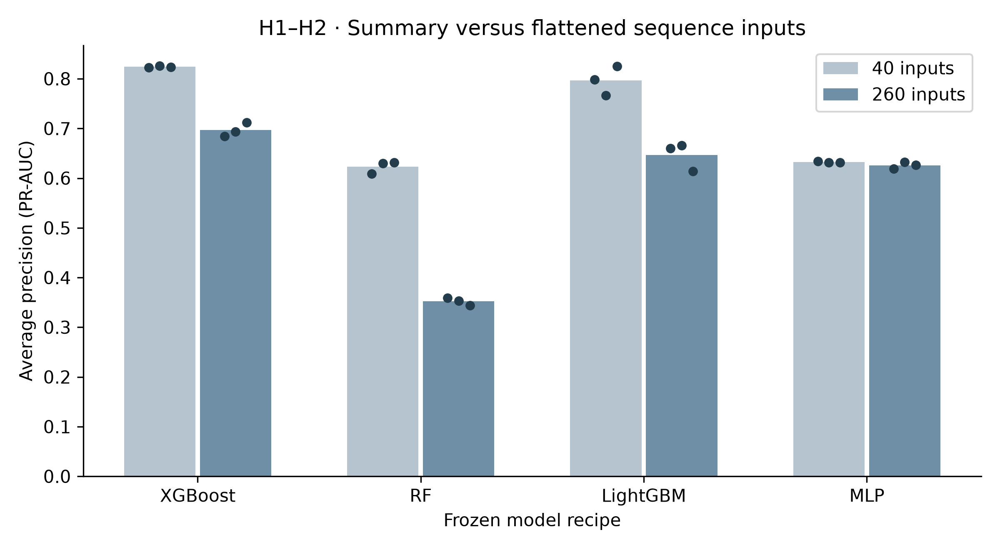
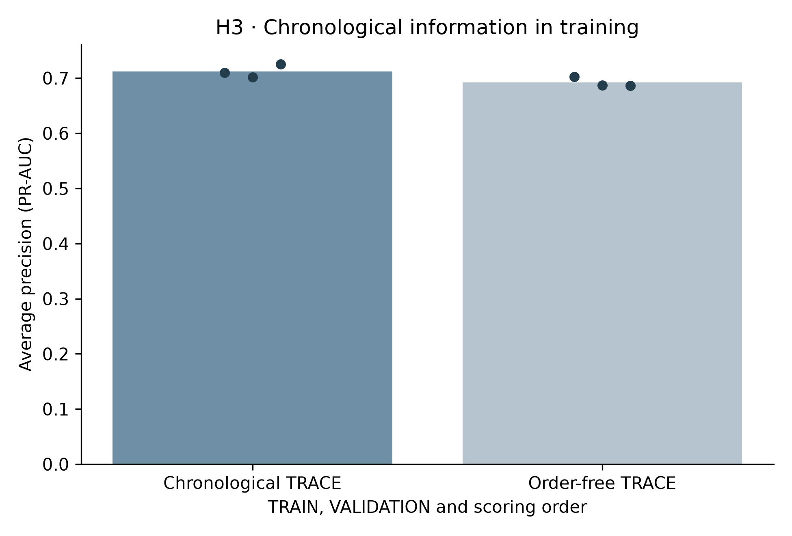
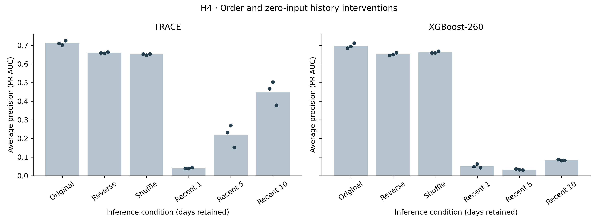
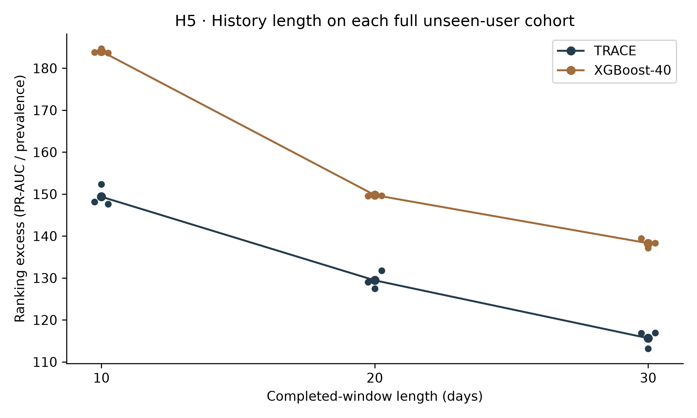
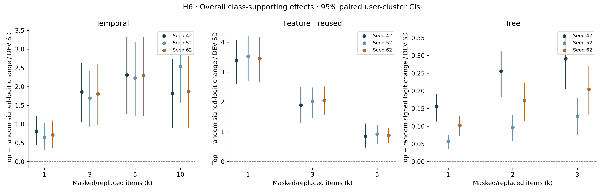

# Phase 6B: representation value on 500 unseen users

Completed 2026-10-22T12:41:28.828759+00:00. TRACE = TA2/F11. Evaluation uses the frozen 500-user HOLDOUT cohort in TRAIN + VALIDATION periods only. r5.2 TEST remains sealed. All three seeds (42/52/62), all views and all outcomes are retained.

## Observed representation-value findings

Training-time order removal: chronological TRACE minus order-free TRACE has mean AP difference 0.02021, 95% CI [-0.01088, 0.05945] on pooled completed windows. The CI decision is comparable. This comparison does not establish a distinct benefit from learning chronological order on these unseen users.

The same frozen TRACE is sensitive to inference inputs: reversal changes AP by -0.05220, fixed shuffle by -0.06070, and retaining only the most recent 10 days by -0.26321; each primary-view unadjusted 95% CI is below zero. These are order/history sensitivity results. Because the interventions change the input distribution seen during training, they alone do not establish chronological semantic value, and they do not override the comparable training-time order-removal result.

Within the same tree recipes, flattened 260-input versions rank below their 40-summary versions by the primary-view unadjusted CIs. The MLP input-width comparison is comparable. These results do not support a general benefit from retaining all flattened daily coordinates. History-length results also depend on changing prevalence and completed-window labels: full-cohort AP/prevalence decreases from 10 to 30 days for both families, while the paired end-day contrasts answer a different, explicitly matched question.

The overall class-supporting normalized explanation effects favour top-ranked over random interventions at each reported level and seed by their unadjusted CIs. Tree replacement is an additive-readout check whose ranking advantage is partly imposed by construction. All findings remain exploratory: the declared finite-bootstrap p-value resolution prevents Holm rejection in these families, and comparability is not an equivalence conclusion.

## Amendment 5 and scoring boundary

Amendment 5 was appended before Phase 6B scoring, UTC 2026-10-22T11:37:35.9827764Z. Its SHA-256 is `c4d82ec9ba726877bd436a744b3ec9dc38e67d3b189790327ec2931568a8b3b2` over 29906 bytes before its receipt. The preserved prior prefix is 19979 bytes, SHA-256 `5c6d6df2ecb33da9a5dd55b711de7150a5079e80020b88256ba0162647d9ad8c`. The pre-scoring temporal clarification SHA-256 is `5b932a5ec7fec60d8984dfa31a061a09563491204946140c05b4aafc6bd0c0f2`. The complete appended amendment, both receipts and the preserved prefix are in [the preregistration](../holdout/PREREGISTRATION_R2_HOLDOUT.md). [Machine-readable receipt](AMENDMENT5_RECEIPT.json).

Fitting uses only the frozen 1,500 development users in TRAIN. Checkpoints and thresholds use their VALIDATION only. The 500 held-out users supply evaluation values and user-cluster resamples only. They never supply fitting, selection, scaling, references, logit spreads or thresholds. Original Phase 4 clean predictions are reused without another clean evaluation pass. New model/condition passes have exclusive receipts. H6 separately extracts the necessary explanation intermediates on the pre-existing frozen 2,344-window cohort.

### Complete frozen Amendment 5 record

## Amendment 5: representation-value tests on unseen users (exploratory)

Authorisation: Qasim approved the complete CHATGPT_PHASE6B_PROMPT.md on 22 October 2026 and requested execution at 19:32 (+08). Phase 6B supersedes earlier pending work. This amendment is written and hash-receipted before any Phase 6B scoring. TRACE means TA2/F11. This is exploratory representation-value analysis, not model selection.

Boundaries: r5.2 TEST remains sealed. Development means exactly the frozen 1,500 development users; fitting is TRAIN-only and checkpoint/threshold selection is development VALIDATION-only. The 500 HOLDOUT users never define training, selection, scaling, references, normalisation, thresholds, hyperparameters or stopping. Their permitted evaluation periods are TRAIN (2010-01-02 through 2011-02-18) and VALIDATION (2011-02-19 through 2011-04-10). Reuse the Phase 4 original scores/checkpoints unchanged, without repeating original-condition inference. Each new model/condition/seed receives one exclusive scoring receipt and one prediction pass. Predeclared explanation interventions constitute the authorised explanation experiment. All outcomes, failures, ineligible cases and timeouts are retained. No existing repository changes or pushes. Public identifiers are pseudonyms only.

Frozen recipes: seeds 42/52/62. TRACE uses its own matched AL precursor and T-OPT teacher for each seed, then task + 0.5 three-teacher logit MSE + 0.5 matched-teacher route KL, exactly the Phase 2/4 recipe, with development-VALIDATION checkpoint selection and frozen development thresholds. Tree and MLP hyperparameters are exactly the Phase 4 counterparts. No tuning. Existing Phase 6 T10/T30 development-only trained checkpoints/scalers may be reused after verifying identical construction, frozen recipe, development population, hashes and no prior HOLDOUT scoring; otherwise run the specified frozen training. Any individual run exceeding 120 minutes is stopped and marked TIMEOUT, continuing dependent-independent work. Use at most two numerical CPU threads, one GPU training/inference child at a time, a 35% per-process GPU allocator cap and cooperative pauses; never stop or alter another chat's processes.

H1: train XGBoost-260, RF-260 and LightGBM-260 using flattened standardized 20 x 13 sequences, with their -40 recipes, all three seeds. Reuse Phase 4 -40 models/scores and TRACE. Contrasts: XGBoost-260 minus XGBoost-40; RF-260 minus RF-40; LightGBM-260 minus LightGBM-40; TRACE minus XGBoost-260; TRACE minus RF-260.

H2: train MLP-40 on the identical 40 summaries using the Phase 4 MLP hidden layers, Adam, weighted BCE, batch size, patience, clipping and epoch limit; only the input width changes. Reuse Phase 4 flattened MLP-260. Contrast: MLP-260 minus MLP-40.

H3: construct order-free copies of TRAIN, VALIDATION and HOLDOUT. Window i uses numpy.default_rng(numpy.random.SeedSequence([42, i])).permutation(20), where i is the zero-based row index in its original split tensor (TRAIN, VALIDATION, or pooled Phase 4 HOLDOUT). This identical deterministic function is used for every training and scoring split and all model seeds; permutation never depends on labels or scores. Train own precursors, teachers and TRACE on these copies, with frozen recipes. Contrast: original TRACE minus order-free TRACE.

H4: reuse original Phase 4 TRACE scores and the new H1 XGBoost-260 original scores. For each, score reversed days, one fixed permutation from numpy.default_rng(2026).permutation(20) shared by every window/seed, and most recent 1, 5, 10 days, zeroing every earlier day in standardized model-input space. These five contrasts for each of two models are reversed minus original, fixed_shuffle minus original, recent1 minus original, recent5 minus original, recent10 minus original. Original is not rescored. Zero input here is explicit, differing from any older median-filled sensitivity analysis.

H5: T10 and T30 completed-window datasets use the Phase 6 T1 construction, per-period completed windows, label=max daily label, median imputation and a scaler fitted on development-user TRAIN only. Train/reuse identically frozen own-teacher TRACE and XGBoost-40 at each length and score each once on HOLDOUT. Report each full cohort's AP, prevalence, AP/prevalence (the requested ranking excess), counts and insider recall. Contrasts: TRACE-30 minus TRACE-20; TRACE-10 minus TRACE-20; XGBoost-40-30 minus XGBoost-40-20; XGBoost-40-10 minus XGBoost-40-20. For paired inference, intersect the two cohorts on exact (pseudonym, period, end-date) keys within each view, with no duplicate key. Each length retains its own completed-window or endpoint label; differing labels and match counts are disclosed. Full-cohort ranking ratios are descriptive, not substituted for matched pairs. For offset0, intersect windows satisfying their own length-specific offset0 rule.

Views for every model: pooled_completed; train_completed; validation_completed; pooled_offset0 (starts 0,T,2T within period); pooled_endpoint (same completed-window inputs with actual final-day label). Fixed thresholds always come from the corresponding development VALIDATION and are never changed by view or HOLDOUT. Report insider detections at threshold on pooled completed-window positives, numerator and denominator 25, for every new model/seed and condition.

H1-H5 inference: all 21 listed base contrasts, each of five views, each of PR-AUC (average precision) and F1 at the frozen threshold, each seed and the arithmetic mean of the three seed metrics, form ONE exploratory Holm family (21 x 5 x 2 x 4 = 840 planned tests). Mean-seed contrasts average metrics, not probabilities. Any unavailable planned test is retained as unavailable and conservatively assigned p=1 for Holm family counting. Paired bootstrap samples all 500 user clusters with replacement, 2,000 replicates, numpy default_rng(42), identical user multiplicities on both sides and across seeds; windows retain their cluster multiplicity. H5 uses its matched end-days. CIs are percentile 95%, excluding undefined no-positive replicates and reporting their count. Two-sided raw p=min(1, 2*min((1+n(delta<=0))/(1+Bvalid),(1+n(delta>=0))/(1+Bvalid))). CI decision is above if lower bound>0, below if upper bound<0, otherwise comparable. Separately report Holm-adjusted p and above/below only when adjusted p<0.05 and estimate has that sign; otherwise comparable. No adjusted p is described as a simultaneous CI.

H6: reuse exactly the Phase 4 explanation selection artifact: all 1,172 malicious and 1,172 benign windows, sampled once with seed 20261022; no resampling of the cohort. Reuse development-only references and validation-only logit population SD from the Phase 4 reference manifest. New references for each of eight ODST tree outputs are their development TRAIN means, never HOLDOUT. Positive/negative local eligibility excludes zero contributions, uses stable index ordering on ties and excludes, counts and reports windows with fewer than k same-sign eligible items. Reference-centred tree contribution is (tree output minus its development TRAIN mean)/8; replacement sets the selected raw tree outputs to these means before their fixed mean aggregation. Tree k=1,2,3; uniform same-sign random k-subsets, 25 draws per eligible window, allowing repeated subsets with multiplicity, without replacement within each subset. New random masks derive from seed 42, model seed, level, k and sign with a recorded deterministic generator.

Temporal H6 uses k=1,3,5,10 attention-ranked days and 25 uniform size-matched random day subsets, the existing Phase 6 I4 encoded-state masked-softmax protocol: zero invalid encoded states, retain positions/chronology, mask their attention logits before softmax; do not re-encode a shorter sequence. Compute class-supporting signed original-minus-masked logit (positive direction for malicious, negative for benign), with strict positive change for directional accuracy. Feature H6 reuses the existing TA2 feature intervention arrays and IG results at k=1,3,5, both signs and derived class-supporting sign, without running IG or its interventions again. Those inherited arrays used 200 random controls; this pre-existing difference from 25 for new levels is disclosed, not recomputed.

H6 effects: for each level, k, model seed, malicious/benign/overall stratum, report top-minus-random normalized signed-logit change and directional-accuracy difference with paired whole-user cluster percentile CIs, 2,000 replicates, seed 42, retaining all windows per sampled user and finite eligible pairs only. Tree and inherited feature include positive, negative and class-supporting directions; temporal uses class-supporting direction. Normalisation uses the frozen development VALIDATION logit SD for the exact Phase 4 TRACE seed. For tree/feature class-supporting analyses choose positive for malicious and negative for benign before aggregation. No eligible-case replacement/padding. Holm is applied separately within each of temporal, feature and tree, across every k, sign, stratum, seed and the two top-minus-random effect metrics; no cross-level pooling. Raw p and CI/Holm decisions use the same rule above. Primary explanation figure shows overall class-supporting normalized signed-logit top-minus-random effects; all other effects remain in CSV and report.

Deliverables: phase6b/CHATGPT_PHASE6B_REPORT.md, PHASE6B_RESULTS.json, complete training log, one table per H, all 840 contrasts with Holm, explanation contrast tables per level, 300-dpi figures (a) -40 versus -260, (b) TRACE versus order-free, (c) AP by intervention, (d) AP/prevalence by history length, (e) three-level explanation effects, with their CSV source data beside them; explicit skips/deviations and hashes. The report ends PHASE6B_COMPLETE only after all successful, failed, skipped and timed-out outcomes have been accounted for and deliverables verified.

Amendment 5 SHA-256 receipt (UTC 2026-10-22T11:37:35.9827764Z): c4d82ec9ba726877bd436a744b3ec9dc38e67d3b189790327ec2931568a8b3b2 (entire preregistration through Amendment 5, before this receipt). Previous prefix: 19979 bytes, SHA-256 5c6d6df2ecb33da9a5dd55b711de7150a5079e80020b88256ba0162647d9ad8c. No Phase 6B scoring preceded this receipt.

Amendment 5 pre-scoring implementation clarification: direct inspection of the existing Phase 6 I4 helper (objective3_attention_faithfulness.forward_with_timestep_mask) establishes that it zeros invalid INPUT timesteps before running the original fixed-length LSTM, then masks invalid attention energies before softmax. The preceding phrase "encoded-state ... zero invalid encoded states" is a drafting error. The exact existing helper is authoritative and will be called unchanged: zero invalid standardized input timesteps, re-encode the same full-length sequence, masked-softmax attention, no sequence shortening. All contrasts, families, references, controls and decisions remain as above. This clarification is appended before any Phase 6B target scoring or intervention.

Amendment 5 clarification SHA-256 receipt: 5b932a5ec7fec60d8984dfa31a061a09563491204946140c05b4aafc6bd0c0f2 (entire file before this receipt). UTC 2026-10-22T11:40:17.5231894Z.

## Training log

New runs: 21/21 successful. Reused H5 target models: 12; their 12 AL/T-OPT prerequisites are also logged. Every child has a 120-minute timeout. One GPU child runs at a time, with a 35% allocator cap, two numerical CPU threads and cooperative pauses. No other chat’s process is controlled. All checkpoints are hash-frozen in [MODELS_FROZEN_PHASE6B.json](MODELS_FROZEN_PHASE6B.json).

| Model / role | Seed | Training source | Status | Epochs | Selected epoch | DEV VALID AP | Seconds | Frozen threshold |
| --- | --- | --- | --- | --- | --- | --- | --- | --- |
| order-free AL_PRECURSOR | 42 | Phase 6B new training | ok | 12 | 8 | 0.96547 | 116.67925 | 0.76000 |
| order-free AL_PRECURSOR | 52 | Phase 6B new training | ok | 15 | 11 | 0.96897 | 141.63398 | 0.81169 |
| order-free AL_PRECURSOR | 62 | Phase 6B new training | ok | 8 | 4 | 0.91378 | 79.61996 | 0.94000 |
| order-free T-OPT | 42 | Phase 6B new training | ok | 5 | 1 | 0.96874 | 57.51669 | 0.55000 |
| order-free T-OPT | 52 | Phase 6B new training | ok | 8 | 4 | 0.97395 | 90.32269 | 0.58000 |
| order-free T-OPT | 62 | Phase 6B new training | ok | 5 | 1 | 0.92143 | 65.19354 | 0.63000 |
| order-free TA2 | 42 | Phase 6B new training | ok | 8 | 4 | 0.97236 | 159.62271 | 0.65000 |
| order-free TA2 | 52 | Phase 6B new training | ok | 15 | 12 | 0.97939 | 285.26489 | 0.51000 |
| order-free TA2 | 62 | Phase 6B new training | ok | 10 | 6 | 0.92231 | 173.07399 | 0.80000 |
| XGBoost-260 | 42 | Phase 6B new training | ok | 300 | 300 | 0.89767 | 50.55831 | 0.39000 |
| XGBoost-260 | 52 | Phase 6B new training | ok | 300 | 300 | 0.89979 | 51.30711 | 0.50000 |
| XGBoost-260 | 62 | Phase 6B new training | ok | 300 | 300 | 0.91012 | 47.90921 | 0.42000 |
| RF-260 | 42 | Phase 6B new training | ok | 200 | 200 | 0.90062 | 334.78213 | 0.39000 |
| RF-260 | 52 | Phase 6B new training | ok | 200 | 200 | 0.89937 | 330.12610 | 0.38000 |
| RF-260 | 62 | Phase 6B new training | ok | 200 | 200 | 0.89838 | 327.00951 | 0.39000 |
| LightGBM-260 | 42 | Phase 6B new training | ok | 300 | 300 | 0.88626 | 35.72316 | 0.78786 |
| LightGBM-260 | 52 | Phase 6B new training | ok | 300 | 300 | 0.88443 | 35.78189 | 0.69991 |
| LightGBM-260 | 62 | Phase 6B new training | ok | 300 | 300 | 0.88874 | 36.36358 | 0.82704 |
| MLP-40 | 42 | Phase 6B new training | ok | 9 | 5 | 0.93578 | 80.57735 | 0.83952 |
| MLP-40 | 52 | Phase 6B new training | ok | 6 | 2 | 0.91848 | 53.87321 | 0.86769 |
| MLP-40 | 62 | Phase 6B new training | ok | 10 | 6 | 0.94551 | 87.36409 | 0.80476 |
| TRACE-10 | 42 | Verified Phase 6 reuse | ok | 15 | 13 | 0.91740 | 339.68655 | 0.70000 |
| TRACE-10 | 52 | Verified Phase 6 reuse | ok | 14 | 10 | 0.92044 | 310.62061 | 0.92000 |
| TRACE-10 | 62 | Verified Phase 6 reuse | ok | 15 | 11 | 0.92856 | 276.88860 | 0.72000 |
| XGBoost-40-10 | 42 | Verified Phase 6 reuse | ok | 300 | 300 | 0.88823 | 12.44030 | 0.53000 |
| XGBoost-40-10 | 52 | Verified Phase 6 reuse | ok | 300 | 300 | 0.88727 | 13.45400 | 0.16000 |
| XGBoost-40-10 | 62 | Verified Phase 6 reuse | ok | 300 | 300 | 0.88761 | 18.02833 | 0.52000 |
| TRACE-30 | 42 | Verified Phase 6 reuse | ok | 9 | 5 | 0.98844 | 172.47136 | 0.31000 |
| TRACE-30 | 52 | Verified Phase 6 reuse | ok | 9 | 5 | 0.95938 | 183.31806 | 0.39000 |
| TRACE-30 | 62 | Verified Phase 6 reuse | ok | 11 | 7 | 0.96079 | 247.52336 | 0.84000 |
| XGBoost-40-30 | 42 | Verified Phase 6 reuse | ok | 300 | 300 | 0.94264 | 17.39853 | 0.40000 |
| XGBoost-40-30 | 52 | Verified Phase 6 reuse | ok | 300 | 300 | 0.94492 | 16.52162 | 0.51000 |
| XGBoost-40-30 | 62 | Verified Phase 6 reuse | ok | 300 | 300 | 0.93849 | 16.98245 | 0.54000 |
| T10 own AL_PRECURSOR | 42 | Phase 6 prerequisite reuse | ok | 12 | 8 | 0.91268 | 118.29672 | 0.95000 |
| T10 own AL_PRECURSOR | 52 | Phase 6 prerequisite reuse | ok | 11 | 7 | 0.91325 | 130.15314 | 0.99000 |
| T10 own AL_PRECURSOR | 62 | Phase 6 prerequisite reuse | ok | 10 | 6 | 0.92306 | 117.54358 | 0.99000 |
| T10 own T-OPT | 42 | Phase 6 prerequisite reuse | ok | 5 | 1 | 0.89377 | 68.07523 | 0.62000 |
| T10 own T-OPT | 52 | Phase 6 prerequisite reuse | ok | 6 | 2 | 0.90209 | 80.85899 | 0.73000 |
| T10 own T-OPT | 62 | Phase 6 prerequisite reuse | ok | 15 | 12 | 0.92464 | 207.11486 | 0.80000 |
| T30 own AL_PRECURSOR | 42 | Phase 6 prerequisite reuse | ok | 12 | 8 | 0.98964 | 116.06591 | 0.35000 |
| T30 own AL_PRECURSOR | 52 | Phase 6 prerequisite reuse | ok | 8 | 4 | 0.94582 | 103.78010 | 0.95960 |
| T30 own AL_PRECURSOR | 62 | Phase 6 prerequisite reuse | ok | 9 | 5 | 0.95265 | 92.65333 | 0.98000 |
| T30 own T-OPT | 42 | Phase 6 prerequisite reuse | ok | 5 | 1 | 0.98634 | 66.00364 | 0.45000 |
| T30 own T-OPT | 52 | Phase 6 prerequisite reuse | ok | 9 | 5 | 0.94893 | 115.47864 | 0.70000 |
| T30 own T-OPT | 62 | Phase 6 prerequisite reuse | ok | 9 | 5 | 0.95136 | 102.85585 | 0.85000 |

Exact checkpoint paths and hashes appear in [COMPLETE_TRAINING_LOG.csv](COMPLETE_TRAINING_LOG.csv). The original Phase 4 checkpoints remain unchanged.

## H1: same tree model, two inputs

| Model | Condition | Windows | Positive | Prevalence | Mean AP | Mean F1 | Detected /25 (42/52/62) |
| --- | --- | --- | --- | --- | --- | --- | --- |
| TRACE | original | 213000 | 1172 | 0.00550 | 0.71220 | 0.47787 | 24/24/24 |
| XGBoost-40 | original | 213000 | 1172 | 0.00550 | 0.82400 | 0.74705 | 22/23/24 |
| RF-40 | original | 213000 | 1172 | 0.00550 | 0.62320 | 0.49794 | 20/20/24 |
| LightGBM-40 | original | 213000 | 1172 | 0.00550 | 0.79669 | 0.67399 | 24/22/24 |
| XGBoost-260 | original | 213000 | 1172 | 0.00550 | 0.69653 | 0.47555 | 24/24/24 |
| RF-260 | original | 213000 | 1172 | 0.00550 | 0.35188 | 0.47797 | 22/22/22 |
| LightGBM-260 | original | 213000 | 1172 | 0.00550 | 0.64666 | 0.56092 | 24/25/25 |

[Figure a CSV](figure_a_40_vs_260.csv). Bars are arithmetic seed means; dots are individual seeds.

## H2: same MLP, two inputs

| Model | Condition | Windows | Positive | Prevalence | Mean AP | Mean F1 | Detected /25 (42/52/62) |
| --- | --- | --- | --- | --- | --- | --- | --- |
| MLP-260 | original | 213000 | 1172 | 0.00550 | 0.62587 | 0.47891 | 23/24/25 |
| MLP-40 | original | 213000 | 1172 | 0.00550 | 0.63249 | 0.46254 | 21/21/23 |

Only input width changes. The hidden layers, dropout, weighted BCE, Adam, batch size, clipping, early stopping and validation threshold rule follow Phase 4.

## H3: training-time order removal

| Model | Condition | Windows | Positive | Prevalence | Mean AP | Mean F1 | Detected /25 (42/52/62) |
| --- | --- | --- | --- | --- | --- | --- | --- |
| TRACE | original | 213000 | 1172 | 0.00550 | 0.71220 | 0.47787 | 24/24/24 |
| TRACE-orderfree | original | 213000 | 1172 | 0.00550 | 0.69199 | 0.46370 | 25/24/24 |

Per-window order is fixed by SeedSequence([42, original split row index]); the same function is used in TRAIN, VALIDATION and HOLDOUT. The order-free TRACE has its own independently trained precursors and teachers.

[Figure b CSV](figure_b_orderfree.csv).

## H4: inference-time order and history interventions

| Model | Condition | Windows | Positive | Prevalence | Mean AP | Mean F1 | Detected /25 (42/52/62) |
| --- | --- | --- | --- | --- | --- | --- | --- |
| TRACE | original | 213000 | 1172 | 0.00550 | 0.71220 | 0.47787 | 24/24/24 |
| XGBoost-260 | original | 213000 | 1172 | 0.00550 | 0.69653 | 0.47555 | 24/24/24 |
| TRACE | reversed | 213000 | 1172 | 0.00550 | 0.66000 | 0.46437 | 23/23/23 |
| TRACE | fixed_shuffle | 213000 | 1172 | 0.00550 | 0.65150 | 0.46128 | 23/23/23 |
| TRACE | recent1 | 213000 | 1172 | 0.00550 | 0.04031 | 0.05415 | 10/25/14 |
| TRACE | recent5 | 213000 | 1172 | 0.00550 | 0.21754 | 0.18178 | 21/25/22 |
| TRACE | recent10 | 213000 | 1172 | 0.00550 | 0.44899 | 0.28086 | 25/25/25 |
| XGBoost-260 | reversed | 213000 | 1172 | 0.00550 | 0.65173 | 0.45803 | 24/24/25 |
| XGBoost-260 | fixed_shuffle | 213000 | 1172 | 0.00550 | 0.66212 | 0.44347 | 24/24/25 |
| XGBoost-260 | recent1 | 213000 | 1172 | 0.00550 | 0.05201 | 0.10004 | 11/10/10 |
| XGBoost-260 | recent5 | 213000 | 1172 | 0.00550 | 0.03295 | 0.06825 | 25/24/25 |
| XGBoost-260 | recent10 | 213000 | 1172 | 0.00550 | 0.08369 | 0.10196 | 25/25/25 |

The fixed shuffle is default_rng(2026).permutation(20). Recent-day conditions zero all earlier standardized input timesteps and retain the original model and threshold.

[Figure c CSV](figure_c_interventions.csv).

## H5: history length on unseen users

| Model | Condition | Windows | Positive | Prevalence | Mean AP | Mean F1 | Detected /25 (42/52/62) | Mean AP / prevalence |
| --- | --- | --- | --- | --- | --- | --- | --- | --- |
| TRACE | original | 213000 | 1172 | 0.00550 | 0.71220 | 0.47787 | 24/24/24 | 129.43576 |
| XGBoost-40 | original | 213000 | 1172 | 0.00550 | 0.82400 | 0.74705 | 22/23/24 | 149.75481 |
| TRACE-10 | original | 223000 | 1013 | 0.00454 | 0.67850 | 0.49971 | 24/24/24 | 149.36437 |
| XGBoost-40-10 | original | 223000 | 1013 | 0.00454 | 0.83598 | 0.75984 | 25/25/25 | 184.03027 |
| TRACE-30 | original | 203000 | 1264 | 0.00623 | 0.72013 | 0.53664 | 24/24/24 | 115.65369 |
| XGBoost-40-30 | original | 203000 | 1264 | 0.00623 | 0.86107 | 0.79902 | 24/24/24 | 138.28909 |

The descriptive rows above use each full cohort. Paired contrasts below use exact one-to-one matches on (user pseudonym, evaluation period, end-date), restricted to each length’s own view. Completed-window labels retain their own span; endpoint labels are the shared final-day label. All 500 user clusters are sampled with the same multiplicities on both sides, including clusters without matching positive windows.

| Contrast | View | Matched windows | Matched users | Different labels |
| --- | --- | --- | --- | --- |
| TRACE-30 original minus TRACE original | pooled_completed | 203000 | 500 | 182 |
| TRACE-30 original minus TRACE original | train_completed | 192000 | 500 | 147 |
| TRACE-30 original minus TRACE original | validation_completed | 11000 | 500 | 35 |
| TRACE-30 original minus TRACE original | pooled_offset0 | 3000 | 500 | 2 |
| TRACE-30 original minus TRACE original | pooled_endpoint | 203000 | 500 | 0 |
| TRACE-10 original minus TRACE original | pooled_completed | 213000 | 500 | 240 |
| TRACE-10 original minus TRACE original | train_completed | 197000 | 500 | 187 |
| TRACE-10 original minus TRACE original | validation_completed | 16000 | 500 | 53 |
| TRACE-10 original minus TRACE original | pooled_offset0 | 11000 | 500 | 10 |
| TRACE-10 original minus TRACE original | pooled_endpoint | 213000 | 500 | 0 |
| XGBoost-40-30 original minus XGBoost-40 original | pooled_completed | 203000 | 500 | 182 |
| XGBoost-40-30 original minus XGBoost-40 original | train_completed | 192000 | 500 | 147 |
| XGBoost-40-30 original minus XGBoost-40 original | validation_completed | 11000 | 500 | 35 |
| XGBoost-40-30 original minus XGBoost-40 original | pooled_offset0 | 3000 | 500 | 2 |
| XGBoost-40-30 original minus XGBoost-40 original | pooled_endpoint | 203000 | 500 | 0 |
| XGBoost-40-10 original minus XGBoost-40 original | pooled_completed | 213000 | 500 | 240 |
| XGBoost-40-10 original minus XGBoost-40 original | train_completed | 197000 | 500 | 187 |
| XGBoost-40-10 original minus XGBoost-40 original | validation_completed | 16000 | 500 | 53 |
| XGBoost-40-10 original minus XGBoost-40 original | pooled_offset0 | 11000 | 500 | 10 |
| XGBoost-40-10 original minus XGBoost-40 original | pooled_endpoint | 213000 | 500 | 0 |

[Figure d CSV](figure_d_history_ranking_excess.csv). Ranking excess here means AP divided by prevalence.

## H6: three-level explanation effects

The exact Phase 4 selection contains all 1,172 malicious windows plus 1,172 sampled benign windows from 448 users; seed 20261022. Temporal k=1/3/5/10 uses the unchanged Phase 6 I4 full-length zero-input and masked-softmax helper. Feature k=1/3/5 reuses Phase 4 IG interventions. Tree k=1/2/3 replaces reference-centred tree outputs at the canonical mean readout with development TRAIN means. New temporal/tree controls use 25 draws; inherited feature controls use 200. Logit change is divided by the exact Phase 4 per-seed development VALIDATION logit population SD. Strictly positive signed changes pass directional accuracy. Insufficient same-sign items are excluded and counted, never padded.

The table reports class-supporting effects (positive for malicious, negative for benign). Each effect is top minus random. All positive/negative effects, eligibility counts, p-values and Holm corrections are in the three full level CSVs and the JSON. Each level is a separate Holm family; no cross-level multiplicity is pooled.

| Level | Seed | k | Stratum | Eligible | Normalized logit gap [95% CI] | Accuracy gap [95% CI] | Raw p (logit) | Holm p (logit) |
| --- | --- | --- | --- | --- | --- | --- | --- | --- |
| temporal | 42 | 1 | overall | 2344 | 0.80508 [0.43300, 1.21141] | 0.09860 [0.04604, 0.15000] | 0.00100 | 0.07196 |
| temporal | 42 | 1 | malicious | 1172 | 1.61342 [0.93580, 2.54793] | 0.03823 [-0.05470, 0.13689] | 0.00100 | 0.07196 |
| temporal | 42 | 1 | benign | 1172 | -0.00326 [-0.01121, 0.00328] | 0.15898 [0.13112, 0.18585] | 0.37781 | 1.00000 |
| temporal | 42 | 3 | overall | 2344 | 1.85942 [1.04822, 2.63850] | 0.11160 [0.06438, 0.15764] | 0.00100 | 0.07196 |
| temporal | 42 | 3 | malicious | 1172 | 3.72150 [2.25518, 5.34305] | 0.14966 [0.06337, 0.24738] | 0.00100 | 0.07196 |
| temporal | 42 | 3 | benign | 1172 | -0.00266 [-0.01927, 0.01485] | 0.07355 [0.04152, 0.10329] | 0.71664 | 1.00000 |
| temporal | 42 | 5 | overall | 2344 | 2.30889 [1.26012, 3.31885] | 0.14568 [0.08878, 0.19858] | 0.00100 | 0.07196 |
| temporal | 42 | 5 | malicious | 1172 | 4.56632 [2.74158, 6.61805] | 0.23775 [0.13838, 0.34622] | 0.00100 | 0.07196 |
| temporal | 42 | 5 | benign | 1172 | 0.05146 [0.02554, 0.07571] | 0.05362 [0.02946, 0.07651] | 0.00100 | 0.07196 |
| temporal | 42 | 10 | overall | 2344 | 1.82386 [0.89906, 2.73229] | 0.11416 [0.05333, 0.17242] | 0.00100 | 0.07196 |
| temporal | 42 | 10 | malicious | 1172 | 3.64757 [1.96802, 5.45411] | 0.16833 [0.05657, 0.28532] | 0.00100 | 0.07196 |
| temporal | 42 | 10 | benign | 1172 | 0.00015 [-0.04692, 0.04959] | 0.06000 [0.04745, 0.07355] | 0.99650 | 1.00000 |
| temporal | 52 | 1 | overall | 2344 | 0.64987 [0.31593, 1.04042] | 0.04355 [0.00396, 0.08588] | 0.00100 | 0.07196 |
| temporal | 52 | 1 | malicious | 1172 | 1.31646 [0.69842, 2.14080] | 0.02573 [-0.04451, 0.10834] | 0.00100 | 0.07196 |
| temporal | 52 | 1 | benign | 1172 | -0.01671 [-0.03894, 0.00043] | 0.06137 [0.03829, 0.08297] | 0.06297 | 0.75562 |
| temporal | 52 | 3 | overall | 2344 | 1.69181 [0.92413, 2.41657] | 0.14092 [0.08733, 0.19227] | 0.00100 | 0.07196 |
| temporal | 52 | 3 | malicious | 1172 | 3.38581 [2.03199, 4.87160] | 0.22860 [0.13084, 0.33210] | 0.00100 | 0.07196 |
| temporal | 52 | 3 | benign | 1172 | -0.00220 [-0.02588, 0.01939] | 0.05324 [0.03787, 0.06838] | 0.85857 | 1.00000 |
| temporal | 52 | 5 | overall | 2344 | 2.22940 [1.21816, 3.18990] | 0.17824 [0.11380, 0.23362] | 0.00100 | 0.07196 |
| temporal | 52 | 5 | malicious | 1172 | 4.40809 [2.70425, 6.30020] | 0.32491 [0.21701, 0.42673] | 0.00100 | 0.07196 |
| temporal | 52 | 5 | benign | 1172 | 0.05070 [0.00320, 0.09805] | 0.03157 [0.02007, 0.04294] | 0.04198 | 0.60770 |
| temporal | 52 | 10 | overall | 2344 | 2.54053 [1.55306, 3.36070] | 0.22343 [0.15044, 0.28348] | 0.00100 | 0.07196 |
| temporal | 52 | 10 | malicious | 1172 | 4.94568 [3.28628, 6.23693] | 0.43973 [0.34548, 0.52325] | 0.00100 | 0.07196 |
| temporal | 52 | 10 | benign | 1172 | 0.13539 [0.01042, 0.25433] | 0.00713 [-0.00396, 0.01806] | 0.03798 | 0.60770 |
| temporal | 62 | 1 | overall | 2344 | 0.71153 [0.35061, 1.09648] | -0.14198 [-0.22795, -0.06933] | 0.00100 | 0.07196 |
| temporal | 62 | 1 | malicious | 1172 | 1.43386 [0.77577, 2.26749] | 0.14737 [0.03257, 0.26344] | 0.00100 | 0.07196 |
| temporal | 62 | 1 | benign | 1172 | -0.01080 [-0.03414, 0.00729] | -0.43133 [-0.46815, -0.39276] | 0.30885 | 1.00000 |
| temporal | 62 | 3 | overall | 2344 | 1.80915 [0.96760, 2.58947] | -0.03027 [-0.10920, 0.04171] | 0.00100 | 0.07196 |
| temporal | 62 | 3 | malicious | 1172 | 3.61551 [2.12729, 5.20840] | 0.19778 [0.07892, 0.32156] | 0.00100 | 0.07196 |
| temporal | 62 | 3 | benign | 1172 | 0.00279 [-0.02005, 0.02641] | -0.25833 [-0.29778, -0.21853] | 0.80260 | 1.00000 |
| temporal | 62 | 5 | overall | 2344 | 2.29524 [1.21370, 3.33588] | 0.03532 [-0.03373, 0.10241] | 0.00100 | 0.07196 |
| temporal | 62 | 5 | malicious | 1172 | 4.55263 [2.63002, 6.59043] | 0.16246 [0.04100, 0.29074] | 0.00100 | 0.07196 |
| temporal | 62 | 5 | benign | 1172 | 0.03785 [0.01129, 0.06365] | -0.09181 [-0.12337, -0.06129] | 0.00700 | 0.13293 |
| temporal | 62 | 10 | overall | 2344 | 1.87452 [0.91094, 2.81135] | 0.09022 [0.04279, 0.13882] | 0.00100 | 0.07196 |
| temporal | 62 | 10 | malicious | 1172 | 3.69099 [1.87280, 5.57465] | 0.10082 [0.00643, 0.19546] | 0.00100 | 0.07196 |
| temporal | 62 | 10 | benign | 1172 | 0.05805 [0.00322, 0.11456] | 0.07962 [0.06502, 0.09610] | 0.03998 | 0.60770 |
| feature | 42 | 1 | overall | 2337 | 3.37993 [2.60606, 4.08809] | 0.15735 [0.13126, 0.18597] | 0.00100 | 0.16192 |
| feature | 42 | 1 | malicious | 1172 | 5.43657 [4.24921, 6.58407] | 0.17213 [0.12414, 0.22477] | 0.00100 | 0.16192 |
| feature | 42 | 1 | benign | 1165 | 1.31094 [1.02872, 1.61606] | 0.14248 [0.12368, 0.15964] | 0.00100 | 0.16192 |
| feature | 42 | 3 | overall | 2288 | 1.88780 [1.29584, 2.49766] | 0.04817 [0.03306, 0.06595] | 0.00100 | 0.16192 |
| feature | 42 | 3 | malicious | 1172 | 2.98691 [1.96836, 4.13185] | 0.05372 [0.02711, 0.08670] | 0.00100 | 0.16192 |
| feature | 42 | 3 | benign | 1116 | 0.73355 [0.57666, 0.90988] | 0.04235 [0.03358, 0.05123] | 0.00100 | 0.16192 |
| feature | 42 | 5 | overall | 2141 | 0.85289 [0.47209, 1.27650] | 0.01142 [0.00584, 0.01761] | 0.00100 | 0.16192 |
| feature | 42 | 5 | malicious | 1169 | 1.36865 [0.73046, 2.10750] | 0.01490 [0.00564, 0.02604] | 0.00100 | 0.16192 |
| feature | 42 | 5 | benign | 972 | 0.23259 [0.16105, 0.31474] | 0.00724 [0.00362, 0.01183] | 0.00100 | 0.16192 |
| feature | 52 | 1 | overall | 2343 | 3.52622 [2.69901, 4.21944] | 0.15390 [0.12489, 0.17879] | 0.00100 | 0.16192 |
| feature | 52 | 1 | malicious | 1172 | 5.85312 [4.68882, 6.81727] | 0.22999 [0.19775, 0.26152] | 0.00100 | 0.16192 |
| feature | 52 | 1 | benign | 1171 | 1.19732 [0.91649, 1.50002] | 0.07775 [0.05685, 0.09834] | 0.00100 | 0.16192 |
| feature | 52 | 3 | overall | 2330 | 2.00873 [1.47232, 2.47980] | 0.05902 [0.04314, 0.07456] | 0.00100 | 0.16192 |
| feature | 52 | 3 | malicious | 1172 | 3.43200 [2.64574, 4.16559] | 0.09012 [0.06651, 0.11369] | 0.00100 | 0.16192 |
| feature | 52 | 3 | benign | 1158 | 0.56826 [0.41980, 0.72098] | 0.02754 [0.01603, 0.03878] | 0.00100 | 0.16192 |
| feature | 52 | 5 | overall | 2271 | 0.91890 [0.60279, 1.23232] | 0.01940 [-0.00062, 0.03503] | 0.00100 | 0.16192 |
| feature | 52 | 5 | malicious | 1148 | 1.68728 [1.20557, 2.16439] | 0.03613 [-0.00468, 0.06428] | 0.00100 | 0.16192 |
| feature | 52 | 5 | benign | 1123 | 0.13342 [0.08560, 0.18474] | 0.00229 [-0.00170, 0.00657] | 0.00100 | 0.16192 |
| feature | 62 | 1 | overall | 2343 | 3.45183 [2.67358, 4.17300] | 0.25195 [0.22824, 0.28394] | 0.00100 | 0.16192 |
| feature | 62 | 1 | malicious | 1172 | 5.52765 [4.28985, 6.62524] | 0.16512 [0.13622, 0.19369] | 0.00100 | 0.16192 |
| feature | 62 | 1 | benign | 1171 | 1.37423 [1.06886, 1.70654] | 0.33886 [0.31629, 0.35991] | 0.00100 | 0.16192 |
| feature | 62 | 3 | overall | 2310 | 2.05798 [1.56478, 2.51602] | 0.10263 [0.08442, 0.12573] | 0.00100 | 0.16192 |
| feature | 62 | 3 | malicious | 1172 | 3.15813 [2.35646, 4.00821] | 0.03912 [0.01633, 0.05973] | 0.00100 | 0.16192 |
| feature | 62 | 3 | benign | 1138 | 0.92495 [0.72276, 1.13457] | 0.16803 [0.15148, 0.18502] | 0.00100 | 0.16192 |
| feature | 62 | 5 | overall | 2070 | 0.87902 [0.63633, 1.12610] | 0.02057 [0.01531, 0.02640] | 0.00100 | 0.16192 |
| feature | 62 | 5 | malicious | 1130 | 1.24892 [0.84238, 1.73819] | 0.01737 [0.00985, 0.02650] | 0.00100 | 0.16192 |
| feature | 62 | 5 | benign | 940 | 0.43436 [0.31488, 0.55862] | 0.02441 [0.01783, 0.03187] | 0.00100 | 0.16192 |
| tree | 42 | 1 | overall | 2277 | 0.15672 [0.11335, 0.19029] | 0.00000 [0.00000, 0.00000] | 0.00100 | 0.16192 |
| tree | 42 | 1 | malicious | 1117 | 0.31593 [0.27756, 0.34330] | 0.00000 [0.00000, 0.00000] | 0.00100 | 0.16192 |
| tree | 42 | 1 | benign | 1160 | 0.00341 [0.00331, 0.00351] | 0.00000 [0.00000, 0.00000] | 0.00100 | 0.16192 |
| tree | 42 | 2 | overall | 2252 | 0.25574 [0.18158, 0.31158] | 0.00000 [0.00000, 0.00000] | 0.00100 | 0.16192 |
| tree | 42 | 2 | malicious | 1093 | 0.52097 [0.46622, 0.56426] | 0.00000 [0.00000, 0.00000] | 0.00100 | 0.16192 |
| tree | 42 | 2 | benign | 1159 | 0.00561 [0.00549, 0.00574] | 0.00000 [0.00000, 0.00000] | 0.00100 | 0.16192 |
| tree | 42 | 3 | overall | 2234 | 0.29077 [0.20586, 0.35632] | 0.00000 [0.00000, 0.00000] | 0.00100 | 0.16192 |
| tree | 42 | 3 | malicious | 1080 | 0.59427 [0.52845, 0.64626] | 0.00000 [0.00000, 0.00000] | 0.00100 | 0.16192 |
| tree | 42 | 3 | benign | 1154 | 0.00673 [0.00664, 0.00684] | 0.00000 [0.00000, 0.00000] | 0.00100 | 0.16192 |
| tree | 52 | 1 | overall | 2287 | 0.05625 [0.03536, 0.07485] | 0.00000 [0.00000, 0.00000] | 0.00100 | 0.16192 |
| tree | 52 | 1 | malicious | 1126 | 0.10837 [0.07642, 0.14242] | 0.00000 [0.00000, 0.00000] | 0.00100 | 0.16192 |
| tree | 52 | 1 | benign | 1161 | 0.00571 [0.00561, 0.00581] | 0.00000 [0.00000, 0.00000] | 0.00100 | 0.16192 |
| tree | 52 | 2 | overall | 2236 | 0.09620 [0.05824, 0.13198] | 0.00000 [0.00000, 0.00000] | 0.00100 | 0.16192 |
| tree | 52 | 2 | malicious | 1082 | 0.19118 [0.13054, 0.25591] | 0.00000 [0.00000, 0.00000] | 0.00100 | 0.16192 |
| tree | 52 | 2 | benign | 1154 | 0.00715 [0.00702, 0.00728] | 0.00000 [0.00000, 0.00000] | 0.00100 | 0.16192 |
| tree | 52 | 3 | overall | 2220 | 0.12798 [0.07478, 0.17949] | 0.00000 [0.00000, 0.00000] | 0.00100 | 0.16192 |
| tree | 52 | 3 | malicious | 1072 | 0.25633 [0.17104, 0.34885] | 0.00000 [0.00000, 0.00000] | 0.00100 | 0.16192 |
| tree | 52 | 3 | benign | 1148 | 0.00812 [0.00800, 0.00825] | 0.00000 [0.00000, 0.00000] | 0.00100 | 0.16192 |
| tree | 62 | 1 | overall | 2271 | 0.10261 [0.07176, 0.13012] | 0.00000 [0.00000, 0.00000] | 0.00100 | 0.16192 |
| tree | 62 | 1 | malicious | 1109 | 0.20457 [0.17056, 0.23844] | 0.00000 [0.00000, 0.00000] | 0.00100 | 0.16192 |
| tree | 62 | 1 | benign | 1162 | 0.00531 [0.00522, 0.00539] | 0.00000 [0.00000, 0.00000] | 0.00100 | 0.16192 |
| tree | 62 | 2 | overall | 2240 | 0.17209 [0.11526, 0.22277] | 0.00000 [0.00000, 0.00000] | 0.00100 | 0.16192 |
| tree | 62 | 2 | malicious | 1080 | 0.34808 [0.28349, 0.41391] | 0.00000 [0.00000, 0.00000] | 0.00100 | 0.16192 |
| tree | 62 | 2 | benign | 1160 | 0.00825 [0.00812, 0.00837] | 0.00000 [0.00000, 0.00000] | 0.00100 | 0.16192 |
| tree | 62 | 3 | overall | 2206 | 0.20448 [0.13198, 0.27025] | 0.00000 [0.00000, 0.00000] | 0.00100 | 0.16192 |
| tree | 62 | 3 | malicious | 1051 | 0.41795 [0.32804, 0.50995] | 0.00000 [0.00000, 0.00000] | 0.00100 | 0.16192 |
| tree | 62 | 3 | benign | 1155 | 0.01023 [0.01008, 0.01037] | 0.00000 [0.00000, 0.00000] | 0.00100 | 0.16192 |

[Figure e CSV](figure_e_three_level_explanation.csv). Separate panels have labelled axes; intervals are unadjusted paired user-cluster 95% CIs. Tree effects are constrained by their additive readout and magnitude-ranked intervention, so their positive values cannot independently establish causal explanatory value.

Level family sizes: {'temporal': 72, 'feature': 162, 'tree': 162}. [Temporal full effects](H6_TEMPORAL_CONTRASTS_HOLM.csv); [feature full effects](H6_FEATURE_CONTRASTS_HOLM.csv); [tree full effects](H6_TREE_CONTRASTS_HOLM.csv). Inherited feature numerical parity was checked on 108 estimate/CI combinations. The same finite-bootstrap resolution limit applies here: the smallest possible first Holm step is about 0.072 for temporal and 0.162 for feature/tree. Consequently, these preregistered families also cannot attain adjusted p<0.05 with this add-one two-sided formula and 2,000 draws. CI directions remain exploratory, and comparability is not an equivalence finding.

## Paired representation results on pooled completed windows

These are the planned three-seed mean AP contrasts on the primary view; H5 uses the declared matched end-days. Above/below/comparable describes the unadjusted 95% CI. Formal adjusted decisions and the finite-bootstrap resolution limit are reported separately. Cross-model TRACE contrasts are contextual; the representation tests compare the same recipe under different inputs or interventions.

| H | Contrast | Mean AP delta | 95% CI | CI direction | Raw p | Holm p |
| --- | --- | --- | --- | --- | --- | --- |
| H1 | XGBoost-260 original minus XGBoost-40 original | -0.12747 | [-0.26668, -0.00419] | below | 0.04398 | 1.00000 |
| H1 | RF-260 original minus RF-40 original | -0.27132 | [-0.38369, -0.11775] | below | 0.00100 | 0.83958 |
| H1 | LightGBM-260 original minus LightGBM-40 original | -0.15002 | [-0.24960, -0.05313] | below | 0.00400 | 1.00000 |
| H1 | TRACE original minus XGBoost-260 original | 0.01567 | [-0.12737, 0.16260] | comparable | 0.85057 | 1.00000 |
| H1 | TRACE original minus RF-260 original | 0.36032 | [0.19631, 0.44694] | above | 0.00100 | 0.83958 |
| H2 | MLP-260 original minus MLP-40 original | -0.00662 | [-0.04998, 0.03792] | comparable | 0.67666 | 1.00000 |
| H3 | TRACE original minus TRACE-orderfree original | 0.02021 | [-0.01088, 0.05945] | comparable | 0.18991 | 1.00000 |
| H4 | TRACE reversed minus TRACE original | -0.05220 | [-0.10529, -0.01498] | below | 0.00800 | 1.00000 |
| H4 | TRACE fixed_shuffle minus TRACE original | -0.06070 | [-0.11565, -0.02713] | below | 0.00100 | 0.83958 |
| H4 | TRACE recent1 minus TRACE original | -0.67189 | [-0.79417, -0.50498] | below | 0.00100 | 0.83958 |
| H4 | TRACE recent5 minus TRACE original | -0.49466 | [-0.60767, -0.35593] | below | 0.00100 | 0.83958 |
| H4 | TRACE recent10 minus TRACE original | -0.26321 | [-0.36650, -0.17394] | below | 0.00100 | 0.83958 |
| H4 | XGBoost-260 reversed minus XGBoost-260 original | -0.04480 | [-0.09780, -0.00515] | below | 0.01999 | 1.00000 |
| H4 | XGBoost-260 fixed_shuffle minus XGBoost-260 original | -0.03441 | [-0.09612, 0.01759] | comparable | 0.20990 | 1.00000 |
| H4 | XGBoost-260 recent1 minus XGBoost-260 original | -0.64452 | [-0.77994, -0.45800] | below | 0.00100 | 0.83958 |
| H4 | XGBoost-260 recent5 minus XGBoost-260 original | -0.66358 | [-0.80083, -0.47553] | below | 0.00100 | 0.83958 |
| H4 | XGBoost-260 recent10 minus XGBoost-260 original | -0.61283 | [-0.75202, -0.42437] | below | 0.00100 | 0.83958 |
| H5 | TRACE-30 original minus TRACE original | 0.02580 | [-0.02246, 0.08015] | comparable | 0.33183 | 1.00000 |
| H5 | TRACE-10 original minus TRACE original | -0.05748 | [-0.11271, -0.01549] | below | 0.00800 | 1.00000 |
| H5 | XGBoost-40-30 original minus XGBoost-40 original | 0.04280 | [0.00670, 0.08095] | above | 0.01799 | 1.00000 |
| H5 | XGBoost-40-10 original minus XGBoost-40 original | 0.00438 | [-0.02853, 0.04518] | comparable | 0.80660 | 1.00000 |

## Full H1–H5 contrast table and Holm correction

All 840 planned tests form one exploratory Holm family: 21 contrasts × 5 views × 2 metrics × (three seeds plus their arithmetic mean). Bootstrap: 2,000 paired user-cluster replicates, seed 42. The three-seed mean averages metrics, not probabilities. Raw p is twice the smaller sign-tail proportion with an add-one correction. CI decisions are above when the lower bound exceeds zero, below when the upper bound is below zero, otherwise comparable. Holm decisions additionally require adjusted p<0.05. Undefined no-positive replicates are omitted and their valid counts are reported. Missing planned outcomes remain in the family with p=1.

With 2,000 replicates and the preregistered add-one two-sided p-value, the smallest attainable raw p is 2/2001 (about 0.001). Across 840 tests, the smallest possible first Holm step is about 0.840, so this finite bootstrap cannot yield a Holm rejection in H1–H5. CI directions remain descriptive exploratory evidence. Adjusted comparability here must not be interpreted as statistical equivalence or proof of no effect. This resolution limit is reported without changing the frozen family or adding resamples after scoring.

| H | Contrast | View | Metric | Seed | Delta | 95% CI | Valid B | Raw p | Holm p | CI decision | Holm decision |
| --- | --- | --- | --- | --- | --- | --- | --- | --- | --- | --- | --- |
| H1 | XGBoost-260 original minus XGBoost-40 original | pooled_completed | PR_AUC | 42 | -0.13816 | [-0.27983, -0.00635] | 2000 | 0.03898 | 1.00000 | below | comparable |
| H1 | XGBoost-260 original minus XGBoost-40 original | pooled_completed | PR_AUC | 52 | -0.13237 | [-0.27630, -0.00785] | 2000 | 0.04098 | 1.00000 | below | comparable |
| H1 | XGBoost-260 original minus XGBoost-40 original | pooled_completed | PR_AUC | 62 | -0.11190 | [-0.24764, 0.00763] | 2000 | 0.06597 | 1.00000 | comparable | comparable |
| H1 | XGBoost-260 original minus XGBoost-40 original | pooled_completed | PR_AUC | mean_three | -0.12747 | [-0.26668, -0.00419] | 2000 | 0.04398 | 1.00000 | below | comparable |
| H1 | XGBoost-260 original minus XGBoost-40 original | pooled_completed | F1 | 42 | -0.35520 | [-0.48881, -0.20361] | 2000 | 0.00100 | 0.83958 | below | comparable |
| H1 | XGBoost-260 original minus XGBoost-40 original | pooled_completed | F1 | 52 | -0.29069 | [-0.41868, -0.14761] | 2000 | 0.00100 | 0.83958 | below | comparable |
| H1 | XGBoost-260 original minus XGBoost-40 original | pooled_completed | F1 | 62 | -0.16862 | [-0.31061, -0.02618] | 2000 | 0.01899 | 1.00000 | below | comparable |
| H1 | XGBoost-260 original minus XGBoost-40 original | pooled_completed | F1 | mean_three | -0.27150 | [-0.39889, -0.13538] | 2000 | 0.00100 | 0.83958 | below | comparable |
| H1 | XGBoost-260 original minus XGBoost-40 original | train_completed | PR_AUC | 42 | -0.17598 | [-0.33268, -0.05261] | 2000 | 0.00600 | 1.00000 | below | comparable |
| H1 | XGBoost-260 original minus XGBoost-40 original | train_completed | PR_AUC | 52 | -0.17306 | [-0.32746, -0.05087] | 2000 | 0.00900 | 1.00000 | below | comparable |
| H1 | XGBoost-260 original minus XGBoost-40 original | train_completed | PR_AUC | 62 | -0.14500 | [-0.28985, -0.03297] | 2000 | 0.01099 | 1.00000 | below | comparable |
| H1 | XGBoost-260 original minus XGBoost-40 original | train_completed | PR_AUC | mean_three | -0.16468 | [-0.31665, -0.04682] | 2000 | 0.00900 | 1.00000 | below | comparable |
| H1 | XGBoost-260 original minus XGBoost-40 original | train_completed | F1 | 42 | -0.38280 | [-0.52543, -0.21573] | 2000 | 0.00100 | 0.83958 | below | comparable |
| H1 | XGBoost-260 original minus XGBoost-40 original | train_completed | F1 | 52 | -0.31397 | [-0.44869, -0.15785] | 2000 | 0.00100 | 0.83958 | below | comparable |
| H1 | XGBoost-260 original minus XGBoost-40 original | train_completed | F1 | 62 | -0.18292 | [-0.33117, -0.03629] | 2000 | 0.01199 | 1.00000 | below | comparable |
| H1 | XGBoost-260 original minus XGBoost-40 original | train_completed | F1 | mean_three | -0.29323 | [-0.42420, -0.14436] | 2000 | 0.00100 | 0.83958 | below | comparable |
| H1 | XGBoost-260 original minus XGBoost-40 original | validation_completed | PR_AUC | 42 | 0.02084 | [-0.20256, 0.28509] | 2000 | 0.92254 | 1.00000 | comparable | comparable |
| H1 | XGBoost-260 original minus XGBoost-40 original | validation_completed | PR_AUC | 52 | 0.02538 | [-0.19426, 0.29420] | 2000 | 0.90355 | 1.00000 | comparable | comparable |
| H1 | XGBoost-260 original minus XGBoost-40 original | validation_completed | PR_AUC | 62 | 0.02925 | [-0.16605, 0.27992] | 2000 | 0.85657 | 1.00000 | comparable | comparable |
| H1 | XGBoost-260 original minus XGBoost-40 original | validation_completed | PR_AUC | mean_three | 0.02515 | [-0.18627, 0.28735] | 2000 | 0.89655 | 1.00000 | comparable | comparable |
| H1 | XGBoost-260 original minus XGBoost-40 original | validation_completed | F1 | 42 | -0.08172 | [-0.29461, 0.12328] | 2000 | 0.42579 | 1.00000 | comparable | comparable |
| H1 | XGBoost-260 original minus XGBoost-40 original | validation_completed | F1 | 52 | -0.07012 | [-0.26768, 0.14189] | 2000 | 0.46577 | 1.00000 | comparable | comparable |
| H1 | XGBoost-260 original minus XGBoost-40 original | validation_completed | F1 | 62 | 0.01701 | [-0.15388, 0.23480] | 2000 | 0.86857 | 1.00000 | comparable | comparable |
| H1 | XGBoost-260 original minus XGBoost-40 original | validation_completed | F1 | mean_three | -0.04494 | [-0.23336, 0.16843] | 2000 | 0.64468 | 1.00000 | comparable | comparable |
| H1 | XGBoost-260 original minus XGBoost-40 original | pooled_offset0 | PR_AUC | 42 | -0.15716 | [-0.32847, 0.00462] | 2000 | 0.06297 | 1.00000 | comparable | comparable |
| H1 | XGBoost-260 original minus XGBoost-40 original | pooled_offset0 | PR_AUC | 52 | -0.14378 | [-0.31349, 0.02070] | 2000 | 0.09895 | 1.00000 | comparable | comparable |
| H1 | XGBoost-260 original minus XGBoost-40 original | pooled_offset0 | PR_AUC | 62 | -0.09840 | [-0.25316, 0.05469] | 2000 | 0.21889 | 1.00000 | comparable | comparable |
| H1 | XGBoost-260 original minus XGBoost-40 original | pooled_offset0 | PR_AUC | mean_three | -0.13311 | [-0.29617, 0.02435] | 2000 | 0.11894 | 1.00000 | comparable | comparable |
| H1 | XGBoost-260 original minus XGBoost-40 original | pooled_offset0 | F1 | 42 | -0.33802 | [-0.49554, -0.15675] | 2000 | 0.00100 | 0.83958 | below | comparable |
| H1 | XGBoost-260 original minus XGBoost-40 original | pooled_offset0 | F1 | 52 | -0.31638 | [-0.46999, -0.13723] | 2000 | 0.00100 | 0.83958 | below | comparable |
| H1 | XGBoost-260 original minus XGBoost-40 original | pooled_offset0 | F1 | 62 | -0.17114 | [-0.30966, -0.02632] | 2000 | 0.01899 | 1.00000 | below | comparable |
| H1 | XGBoost-260 original minus XGBoost-40 original | pooled_offset0 | F1 | mean_three | -0.27518 | [-0.41454, -0.11450] | 2000 | 0.00100 | 0.83958 | below | comparable |
| H1 | XGBoost-260 original minus XGBoost-40 original | pooled_endpoint | PR_AUC | 42 | -0.03079 | [-0.10105, 0.03909] | 2000 | 0.44578 | 1.00000 | comparable | comparable |
| H1 | XGBoost-260 original minus XGBoost-40 original | pooled_endpoint | PR_AUC | 52 | -0.03691 | [-0.10703, 0.03717] | 2000 | 0.36982 | 1.00000 | comparable | comparable |
| H1 | XGBoost-260 original minus XGBoost-40 original | pooled_endpoint | PR_AUC | 62 | -0.03440 | [-0.09868, 0.03559] | 2000 | 0.38381 | 1.00000 | comparable | comparable |
| H1 | XGBoost-260 original minus XGBoost-40 original | pooled_endpoint | PR_AUC | mean_three | -0.03404 | [-0.09976, 0.03522] | 2000 | 0.39480 | 1.00000 | comparable | comparable |
| H1 | XGBoost-260 original minus XGBoost-40 original | pooled_endpoint | F1 | 42 | -0.21126 | [-0.29925, -0.11947] | 2000 | 0.00100 | 0.83958 | below | comparable |
| H1 | XGBoost-260 original minus XGBoost-40 original | pooled_endpoint | F1 | 52 | -0.17587 | [-0.26640, -0.08907] | 2000 | 0.00100 | 0.83958 | below | comparable |
| H1 | XGBoost-260 original minus XGBoost-40 original | pooled_endpoint | F1 | 62 | -0.08383 | [-0.17084, -0.01332] | 2000 | 0.00900 | 1.00000 | below | comparable |
| H1 | XGBoost-260 original minus XGBoost-40 original | pooled_endpoint | F1 | mean_three | -0.15699 | [-0.23818, -0.07719] | 2000 | 0.00100 | 0.83958 | below | comparable |
| H1 | RF-260 original minus RF-40 original | pooled_completed | PR_AUC | 42 | -0.24958 | [-0.36518, -0.09873] | 2000 | 0.00100 | 0.83958 | below | comparable |
| H1 | RF-260 original minus RF-40 original | pooled_completed | PR_AUC | 52 | -0.27676 | [-0.38976, -0.11923] | 2000 | 0.00100 | 0.83958 | below | comparable |
| H1 | RF-260 original minus RF-40 original | pooled_completed | PR_AUC | 62 | -0.28761 | [-0.39705, -0.13291] | 2000 | 0.00100 | 0.83958 | below | comparable |
| H1 | RF-260 original minus RF-40 original | pooled_completed | PR_AUC | mean_three | -0.27132 | [-0.38369, -0.11775] | 2000 | 0.00100 | 0.83958 | below | comparable |
| H1 | RF-260 original minus RF-40 original | pooled_completed | F1 | 42 | -0.06551 | [-0.14823, -0.01380] | 2000 | 0.00800 | 1.00000 | below | comparable |
| H1 | RF-260 original minus RF-40 original | pooled_completed | F1 | 52 | -0.07369 | [-0.15494, -0.02201] | 2000 | 0.00600 | 1.00000 | below | comparable |
| H1 | RF-260 original minus RF-40 original | pooled_completed | F1 | 62 | 0.07927 | [-0.00010, 0.19488] | 2000 | 0.05197 | 1.00000 | comparable | comparable |
| H1 | RF-260 original minus RF-40 original | pooled_completed | F1 | mean_three | -0.01998 | [-0.08329, 0.03936] | 2000 | 0.47376 | 1.00000 | comparable | comparable |
| H1 | RF-260 original minus RF-40 original | train_completed | PR_AUC | 42 | -0.24891 | [-0.36919, -0.09565] | 2000 | 0.00200 | 1.00000 | below | comparable |
| H1 | RF-260 original minus RF-40 original | train_completed | PR_AUC | 52 | -0.26631 | [-0.38741, -0.11388] | 2000 | 0.00200 | 1.00000 | below | comparable |
| H1 | RF-260 original minus RF-40 original | train_completed | PR_AUC | 62 | -0.27778 | [-0.39928, -0.12865] | 2000 | 0.00200 | 1.00000 | below | comparable |
| H1 | RF-260 original minus RF-40 original | train_completed | PR_AUC | mean_three | -0.26433 | [-0.38606, -0.11469] | 2000 | 0.00200 | 1.00000 | below | comparable |
| H1 | RF-260 original minus RF-40 original | train_completed | F1 | 42 | -0.06848 | [-0.16660, -0.01248] | 2000 | 0.01299 | 1.00000 | below | comparable |
| H1 | RF-260 original minus RF-40 original | train_completed | F1 | 52 | -0.07227 | [-0.16396, -0.01764] | 2000 | 0.01099 | 1.00000 | below | comparable |
| H1 | RF-260 original minus RF-40 original | train_completed | F1 | 62 | 0.08003 | [0.00326, 0.20169] | 2000 | 0.03998 | 1.00000 | above | comparable |
| H1 | RF-260 original minus RF-40 original | train_completed | F1 | mean_three | -0.02024 | [-0.08877, 0.03963] | 2000 | 0.48676 | 1.00000 | comparable | comparable |
| H1 | RF-260 original minus RF-40 original | validation_completed | PR_AUC | 42 | -0.01341 | [-0.22712, 0.19296] | 2000 | 0.83458 | 1.00000 | comparable | comparable |
| H1 | RF-260 original minus RF-40 original | validation_completed | PR_AUC | 52 | -0.02582 | [-0.22811, 0.16281] | 2000 | 0.72364 | 1.00000 | comparable | comparable |
| H1 | RF-260 original minus RF-40 original | validation_completed | PR_AUC | 62 | -0.01946 | [-0.24025, 0.18532] | 2000 | 0.77461 | 1.00000 | comparable | comparable |
| H1 | RF-260 original minus RF-40 original | validation_completed | PR_AUC | mean_three | -0.01956 | [-0.22946, 0.18073] | 2000 | 0.77361 | 1.00000 | comparable | comparable |
| H1 | RF-260 original minus RF-40 original | validation_completed | F1 | 42 | -0.00729 | [-0.06061, 0.05089] | 2000 | 0.76662 | 1.00000 | comparable | comparable |
| H1 | RF-260 original minus RF-40 original | validation_completed | F1 | 52 | -0.02848 | [-0.11943, 0.04960] | 2000 | 0.44678 | 1.00000 | comparable | comparable |
| H1 | RF-260 original minus RF-40 original | validation_completed | F1 | 62 | 0.02703 | [-0.18537, 0.24018] | 2000 | 0.77561 | 1.00000 | comparable | comparable |
| H1 | RF-260 original minus RF-40 original | validation_completed | F1 | mean_three | -0.00291 | [-0.10622, 0.09479] | 2000 | 0.95852 | 1.00000 | comparable | comparable |
| H1 | RF-260 original minus RF-40 original | pooled_offset0 | PR_AUC | 42 | -0.17866 | [-0.30659, 0.00343] | 2000 | 0.05297 | 1.00000 | comparable | comparable |
| H1 | RF-260 original minus RF-40 original | pooled_offset0 | PR_AUC | 52 | -0.20504 | [-0.34105, -0.02673] | 2000 | 0.02499 | 1.00000 | below | comparable |
| H1 | RF-260 original minus RF-40 original | pooled_offset0 | PR_AUC | 62 | -0.23295 | [-0.35497, -0.02915] | 2000 | 0.02599 | 1.00000 | below | comparable |
| H1 | RF-260 original minus RF-40 original | pooled_offset0 | PR_AUC | mean_three | -0.20555 | [-0.33324, -0.01759] | 2000 | 0.02799 | 1.00000 | below | comparable |
| H1 | RF-260 original minus RF-40 original | pooled_offset0 | F1 | 42 | -0.05634 | [-0.14390, 0.01393] | 2000 | 0.10995 | 1.00000 | comparable | comparable |
| H1 | RF-260 original minus RF-40 original | pooled_offset0 | F1 | 52 | -0.05891 | [-0.14080, 0.01164] | 2000 | 0.10695 | 1.00000 | comparable | comparable |
| H1 | RF-260 original minus RF-40 original | pooled_offset0 | F1 | 62 | 0.09585 | [0.00939, 0.22446] | 2000 | 0.03298 | 1.00000 | above | comparable |
| H1 | RF-260 original minus RF-40 original | pooled_offset0 | F1 | mean_three | -0.00647 | [-0.07214, 0.06729] | 2000 | 0.84958 | 1.00000 | comparable | comparable |
| H1 | RF-260 original minus RF-40 original | pooled_endpoint | PR_AUC | 42 | -0.01900 | [-0.04719, 0.01917] | 2000 | 0.28286 | 1.00000 | comparable | comparable |
| H1 | RF-260 original minus RF-40 original | pooled_endpoint | PR_AUC | 52 | -0.01564 | [-0.04581, 0.02072] | 2000 | 0.35582 | 1.00000 | comparable | comparable |
| H1 | RF-260 original minus RF-40 original | pooled_endpoint | PR_AUC | 62 | -0.01960 | [-0.05233, 0.02139] | 2000 | 0.26987 | 1.00000 | comparable | comparable |
| H1 | RF-260 original minus RF-40 original | pooled_endpoint | PR_AUC | mean_three | -0.01808 | [-0.04611, 0.01873] | 2000 | 0.28886 | 1.00000 | comparable | comparable |
| H1 | RF-260 original minus RF-40 original | pooled_endpoint | F1 | 42 | -0.03364 | [-0.07884, -0.00769] | 2000 | 0.00700 | 1.00000 | below | comparable |
| H1 | RF-260 original minus RF-40 original | pooled_endpoint | F1 | 52 | -0.03723 | [-0.08051, -0.00843] | 2000 | 0.00800 | 1.00000 | below | comparable |
| H1 | RF-260 original minus RF-40 original | pooled_endpoint | F1 | 62 | 0.03655 | [0.00331, 0.07782] | 2000 | 0.03298 | 1.00000 | above | comparable |
| H1 | RF-260 original minus RF-40 original | pooled_endpoint | F1 | mean_three | -0.01144 | [-0.04468, 0.01672] | 2000 | 0.40780 | 1.00000 | comparable | comparable |
| H1 | LightGBM-260 original minus LightGBM-40 original | pooled_completed | PR_AUC | 42 | -0.13800 | [-0.24632, -0.02637] | 2000 | 0.01499 | 1.00000 | below | comparable |
| H1 | LightGBM-260 original minus LightGBM-40 original | pooled_completed | PR_AUC | 52 | -0.10070 | [-0.19417, -0.01936] | 2000 | 0.01899 | 1.00000 | below | comparable |
| H1 | LightGBM-260 original minus LightGBM-40 original | pooled_completed | PR_AUC | 62 | -0.21137 | [-0.32836, -0.09338] | 2000 | 0.00200 | 1.00000 | below | comparable |
| H1 | LightGBM-260 original minus LightGBM-40 original | pooled_completed | PR_AUC | mean_three | -0.15002 | [-0.24960, -0.05313] | 2000 | 0.00400 | 1.00000 | below | comparable |
| H1 | LightGBM-260 original minus LightGBM-40 original | pooled_completed | F1 | 42 | 0.03149 | [-0.06784, 0.11691] | 2000 | 0.55772 | 1.00000 | comparable | comparable |
| H1 | LightGBM-260 original minus LightGBM-40 original | pooled_completed | F1 | 52 | -0.21319 | [-0.33373, -0.10529] | 2000 | 0.00100 | 0.83958 | below | comparable |
| H1 | LightGBM-260 original minus LightGBM-40 original | pooled_completed | F1 | 62 | -0.15750 | [-0.26205, -0.05885] | 2000 | 0.00100 | 0.83958 | below | comparable |
| H1 | LightGBM-260 original minus LightGBM-40 original | pooled_completed | F1 | mean_three | -0.11307 | [-0.20182, -0.03963] | 2000 | 0.00300 | 1.00000 | below | comparable |
| H1 | LightGBM-260 original minus LightGBM-40 original | train_completed | PR_AUC | 42 | -0.15782 | [-0.26170, -0.06487] | 2000 | 0.00200 | 1.00000 | below | comparable |
| H1 | LightGBM-260 original minus LightGBM-40 original | train_completed | PR_AUC | 52 | -0.13232 | [-0.23736, -0.05153] | 2000 | 0.00100 | 0.83958 | below | comparable |
| H1 | LightGBM-260 original minus LightGBM-40 original | train_completed | PR_AUC | 62 | -0.23528 | [-0.33811, -0.13008] | 2000 | 0.00100 | 0.83958 | below | comparable |
| H1 | LightGBM-260 original minus LightGBM-40 original | train_completed | PR_AUC | mean_three | -0.17514 | [-0.26927, -0.09048] | 2000 | 0.00100 | 0.83958 | below | comparable |
| H1 | LightGBM-260 original minus LightGBM-40 original | train_completed | F1 | 42 | 0.02671 | [-0.07199, 0.11615] | 2000 | 0.62569 | 1.00000 | comparable | comparable |
| H1 | LightGBM-260 original minus LightGBM-40 original | train_completed | F1 | 52 | -0.25749 | [-0.39117, -0.14130] | 2000 | 0.00100 | 0.83958 | below | comparable |
| H1 | LightGBM-260 original minus LightGBM-40 original | train_completed | F1 | 62 | -0.17367 | [-0.27726, -0.08069] | 2000 | 0.00100 | 0.83958 | below | comparable |
| H1 | LightGBM-260 original minus LightGBM-40 original | train_completed | F1 | mean_three | -0.13482 | [-0.22734, -0.06403] | 2000 | 0.00100 | 0.83958 | below | comparable |
| H1 | LightGBM-260 original minus LightGBM-40 original | validation_completed | PR_AUC | 42 | 0.00582 | [-0.28171, 0.28360] | 2000 | 0.98551 | 1.00000 | comparable | comparable |
| H1 | LightGBM-260 original minus LightGBM-40 original | validation_completed | PR_AUC | 52 | 0.04324 | [-0.14632, 0.29596] | 2000 | 0.78161 | 1.00000 | comparable | comparable |
| H1 | LightGBM-260 original minus LightGBM-40 original | validation_completed | PR_AUC | 62 | -0.02933 | [-0.29303, 0.22284] | 2000 | 0.78961 | 1.00000 | comparable | comparable |
| H1 | LightGBM-260 original minus LightGBM-40 original | validation_completed | PR_AUC | mean_three | 0.00658 | [-0.23476, 0.26606] | 2000 | 0.98851 | 1.00000 | comparable | comparable |
| H1 | LightGBM-260 original minus LightGBM-40 original | validation_completed | F1 | 42 | 0.02463 | [-0.19107, 0.27248] | 2000 | 0.79960 | 1.00000 | comparable | comparable |
| H1 | LightGBM-260 original minus LightGBM-40 original | validation_completed | F1 | 52 | 0.04517 | [-0.06868, 0.22293] | 2000 | 0.50475 | 1.00000 | comparable | comparable |
| H1 | LightGBM-260 original minus LightGBM-40 original | validation_completed | F1 | 62 | -0.06574 | [-0.26564, 0.15720] | 2000 | 0.51574 | 1.00000 | comparable | comparable |
| H1 | LightGBM-260 original minus LightGBM-40 original | validation_completed | F1 | mean_three | 0.00136 | [-0.14910, 0.19011] | 2000 | 0.98751 | 1.00000 | comparable | comparable |
| H1 | LightGBM-260 original minus LightGBM-40 original | pooled_offset0 | PR_AUC | 42 | -0.11790 | [-0.24698, 0.01822] | 2000 | 0.08196 | 1.00000 | comparable | comparable |
| H1 | LightGBM-260 original minus LightGBM-40 original | pooled_offset0 | PR_AUC | 52 | -0.04057 | [-0.12938, 0.05513] | 2000 | 0.35882 | 1.00000 | comparable | comparable |
| H1 | LightGBM-260 original minus LightGBM-40 original | pooled_offset0 | PR_AUC | 62 | -0.19613 | [-0.34675, -0.02249] | 2000 | 0.03098 | 1.00000 | below | comparable |
| H1 | LightGBM-260 original minus LightGBM-40 original | pooled_offset0 | PR_AUC | mean_three | -0.11820 | [-0.22822, 0.00470] | 2000 | 0.06797 | 1.00000 | comparable | comparable |
| H1 | LightGBM-260 original minus LightGBM-40 original | pooled_offset0 | F1 | 42 | 0.03676 | [-0.07255, 0.12736] | 2000 | 0.57271 | 1.00000 | comparable | comparable |
| H1 | LightGBM-260 original minus LightGBM-40 original | pooled_offset0 | F1 | 52 | -0.17087 | [-0.30719, -0.04611] | 2000 | 0.00800 | 1.00000 | below | comparable |
| H1 | LightGBM-260 original minus LightGBM-40 original | pooled_offset0 | F1 | 62 | -0.14844 | [-0.26584, -0.04499] | 2000 | 0.00600 | 1.00000 | below | comparable |
| H1 | LightGBM-260 original minus LightGBM-40 original | pooled_offset0 | F1 | mean_three | -0.09418 | [-0.18218, -0.02197] | 2000 | 0.01199 | 1.00000 | below | comparable |
| H1 | LightGBM-260 original minus LightGBM-40 original | pooled_endpoint | PR_AUC | 42 | -0.02334 | [-0.11559, 0.09236] | 2000 | 0.66467 | 1.00000 | comparable | comparable |
| H1 | LightGBM-260 original minus LightGBM-40 original | pooled_endpoint | PR_AUC | 52 | -0.00421 | [-0.10408, 0.09849] | 2000 | 0.94153 | 1.00000 | comparable | comparable |
| H1 | LightGBM-260 original minus LightGBM-40 original | pooled_endpoint | PR_AUC | 62 | -0.05733 | [-0.13232, 0.02643] | 2000 | 0.17391 | 1.00000 | comparable | comparable |
| H1 | LightGBM-260 original minus LightGBM-40 original | pooled_endpoint | PR_AUC | mean_three | -0.02829 | [-0.11377, 0.07092] | 2000 | 0.54273 | 1.00000 | comparable | comparable |
| H1 | LightGBM-260 original minus LightGBM-40 original | pooled_endpoint | F1 | 42 | 0.00126 | [-0.07172, 0.06340] | 2000 | 0.98051 | 1.00000 | comparable | comparable |
| H1 | LightGBM-260 original minus LightGBM-40 original | pooled_endpoint | F1 | 52 | -0.13670 | [-0.22479, -0.06341] | 2000 | 0.00100 | 0.83958 | below | comparable |
| H1 | LightGBM-260 original minus LightGBM-40 original | pooled_endpoint | F1 | 62 | -0.08712 | [-0.16971, -0.01194] | 2000 | 0.02299 | 1.00000 | below | comparable |
| H1 | LightGBM-260 original minus LightGBM-40 original | pooled_endpoint | F1 | mean_three | -0.07419 | [-0.14036, -0.02341] | 2000 | 0.00200 | 1.00000 | below | comparable |
| H1 | TRACE original minus XGBoost-260 original | pooled_completed | PR_AUC | 42 | 0.02539 | [-0.13173, 0.18984] | 2000 | 0.74763 | 1.00000 | comparable | comparable |
| H1 | TRACE original minus XGBoost-260 original | pooled_completed | PR_AUC | 52 | 0.00805 | [-0.12848, 0.15129] | 2000 | 0.95452 | 1.00000 | comparable | comparable |
| H1 | TRACE original minus XGBoost-260 original | pooled_completed | PR_AUC | 62 | 0.01358 | [-0.12420, 0.14714] | 2000 | 0.84958 | 1.00000 | comparable | comparable |
| H1 | TRACE original minus XGBoost-260 original | pooled_completed | PR_AUC | mean_three | 0.01567 | [-0.12737, 0.16260] | 2000 | 0.85057 | 1.00000 | comparable | comparable |
| H1 | TRACE original minus XGBoost-260 original | pooled_completed | F1 | 42 | 0.03365 | [-0.05527, 0.17221] | 2000 | 0.57071 | 1.00000 | comparable | comparable |
| H1 | TRACE original minus XGBoost-260 original | pooled_completed | F1 | 52 | -0.03581 | [-0.13264, 0.09147] | 2000 | 0.51974 | 1.00000 | comparable | comparable |
| H1 | TRACE original minus XGBoost-260 original | pooled_completed | F1 | 62 | 0.00913 | [-0.07247, 0.12434] | 2000 | 0.92954 | 1.00000 | comparable | comparable |
| H1 | TRACE original minus XGBoost-260 original | pooled_completed | F1 | mean_three | 0.00232 | [-0.08505, 0.12702] | 2000 | 0.97351 | 1.00000 | comparable | comparable |
| H1 | TRACE original minus XGBoost-260 original | train_completed | PR_AUC | 42 | 0.02269 | [-0.18063, 0.23533] | 2000 | 0.83358 | 1.00000 | comparable | comparable |
| H1 | TRACE original minus XGBoost-260 original | train_completed | PR_AUC | 52 | 0.00210 | [-0.18780, 0.19993] | 2000 | 0.99650 | 1.00000 | comparable | comparable |
| H1 | TRACE original minus XGBoost-260 original | train_completed | PR_AUC | 62 | 0.00236 | [-0.18631, 0.18876] | 2000 | 0.98751 | 1.00000 | comparable | comparable |
| H1 | TRACE original minus XGBoost-260 original | train_completed | PR_AUC | mean_three | 0.00905 | [-0.17967, 0.20449] | 2000 | 0.92854 | 1.00000 | comparable | comparable |
| H1 | TRACE original minus XGBoost-260 original | train_completed | F1 | 42 | 0.03182 | [-0.05922, 0.17700] | 2000 | 0.58371 | 1.00000 | comparable | comparable |
| H1 | TRACE original minus XGBoost-260 original | train_completed | F1 | 52 | -0.03503 | [-0.13343, 0.09788] | 2000 | 0.51974 | 1.00000 | comparable | comparable |
| H1 | TRACE original minus XGBoost-260 original | train_completed | F1 | 62 | 0.00803 | [-0.07605, 0.12635] | 2000 | 0.93353 | 1.00000 | comparable | comparable |
| H1 | TRACE original minus XGBoost-260 original | train_completed | F1 | mean_three | 0.00161 | [-0.08755, 0.12900] | 2000 | 0.97851 | 1.00000 | comparable | comparable |
| H1 | TRACE original minus XGBoost-260 original | validation_completed | PR_AUC | 42 | -0.03192 | [-0.16014, 0.07181] | 2000 | 0.61069 | 1.00000 | comparable | comparable |
| H1 | TRACE original minus XGBoost-260 original | validation_completed | PR_AUC | 52 | -0.03471 | [-0.15430, 0.05760] | 2000 | 0.55872 | 1.00000 | comparable | comparable |
| H1 | TRACE original minus XGBoost-260 original | validation_completed | PR_AUC | 62 | -0.03551 | [-0.17248, 0.05945] | 2000 | 0.72164 | 1.00000 | comparable | comparable |
| H1 | TRACE original minus XGBoost-260 original | validation_completed | PR_AUC | mean_three | -0.03405 | [-0.16163, 0.06162] | 2000 | 0.61669 | 1.00000 | comparable | comparable |
| H1 | TRACE original minus XGBoost-260 original | validation_completed | F1 | 42 | 0.03674 | [-0.06738, 0.15879] | 2000 | 0.54973 | 1.00000 | comparable | comparable |
| H1 | TRACE original minus XGBoost-260 original | validation_completed | F1 | 52 | -0.00056 | [-0.12629, 0.12077] | 2000 | 0.89755 | 1.00000 | comparable | comparable |
| H1 | TRACE original minus XGBoost-260 original | validation_completed | F1 | 62 | 0.01496 | [-0.09532, 0.13112] | 2000 | 0.87156 | 1.00000 | comparable | comparable |
| H1 | TRACE original minus XGBoost-260 original | validation_completed | F1 | mean_three | 0.01705 | [-0.08427, 0.12672] | 2000 | 0.83758 | 1.00000 | comparable | comparable |
| H1 | TRACE original minus XGBoost-260 original | pooled_offset0 | PR_AUC | 42 | 0.04288 | [-0.12151, 0.21417] | 2000 | 0.59170 | 1.00000 | comparable | comparable |
| H1 | TRACE original minus XGBoost-260 original | pooled_offset0 | PR_AUC | 52 | 0.02989 | [-0.12698, 0.19481] | 2000 | 0.74263 | 1.00000 | comparable | comparable |
| H1 | TRACE original minus XGBoost-260 original | pooled_offset0 | PR_AUC | 62 | 0.00420 | [-0.15383, 0.15458] | 2000 | 0.99650 | 1.00000 | comparable | comparable |
| H1 | TRACE original minus XGBoost-260 original | pooled_offset0 | PR_AUC | mean_three | 0.02566 | [-0.12685, 0.17962] | 2000 | 0.76962 | 1.00000 | comparable | comparable |
| H1 | TRACE original minus XGBoost-260 original | pooled_offset0 | F1 | 42 | 0.02890 | [-0.07951, 0.19055] | 2000 | 0.67966 | 1.00000 | comparable | comparable |
| H1 | TRACE original minus XGBoost-260 original | pooled_offset0 | F1 | 52 | -0.02541 | [-0.11793, 0.08905] | 2000 | 0.57171 | 1.00000 | comparable | comparable |
| H1 | TRACE original minus XGBoost-260 original | pooled_offset0 | F1 | 62 | -0.01429 | [-0.09802, 0.09255] | 2000 | 0.70865 | 1.00000 | comparable | comparable |
| H1 | TRACE original minus XGBoost-260 original | pooled_offset0 | F1 | mean_three | -0.00360 | [-0.08805, 0.11462] | 2000 | 0.88656 | 1.00000 | comparable | comparable |
| H1 | TRACE original minus XGBoost-260 original | pooled_endpoint | PR_AUC | 42 | -0.07199 | [-0.14925, -0.00067] | 2000 | 0.04898 | 1.00000 | below | comparable |
| H1 | TRACE original minus XGBoost-260 original | pooled_endpoint | PR_AUC | 52 | -0.07004 | [-0.13932, -0.01243] | 2000 | 0.01799 | 1.00000 | below | comparable |
| H1 | TRACE original minus XGBoost-260 original | pooled_endpoint | PR_AUC | 62 | -0.06667 | [-0.15556, -0.00470] | 2000 | 0.03598 | 1.00000 | below | comparable |
| H1 | TRACE original minus XGBoost-260 original | pooled_endpoint | PR_AUC | mean_three | -0.06957 | [-0.14807, -0.00790] | 2000 | 0.03098 | 1.00000 | below | comparable |
| H1 | TRACE original minus XGBoost-260 original | pooled_endpoint | F1 | 42 | 0.00079 | [-0.04021, 0.05454] | 2000 | 0.99050 | 1.00000 | comparable | comparable |
| H1 | TRACE original minus XGBoost-260 original | pooled_endpoint | F1 | 52 | -0.02664 | [-0.07683, 0.02430] | 2000 | 0.28686 | 1.00000 | comparable | comparable |
| H1 | TRACE original minus XGBoost-260 original | pooled_endpoint | F1 | 62 | -0.00857 | [-0.05049, 0.03803] | 2000 | 0.63968 | 1.00000 | comparable | comparable |
| H1 | TRACE original minus XGBoost-260 original | pooled_endpoint | F1 | mean_three | -0.01147 | [-0.05521, 0.03739] | 2000 | 0.58971 | 1.00000 | comparable | comparable |
| H1 | TRACE original minus RF-260 original | pooled_completed | PR_AUC | 42 | 0.35107 | [0.17891, 0.45338] | 2000 | 0.00100 | 0.83958 | above | comparable |
| H1 | TRACE original minus RF-260 original | pooled_completed | PR_AUC | 52 | 0.34841 | [0.17736, 0.43301] | 2000 | 0.00100 | 0.83958 | above | comparable |
| H1 | TRACE original minus RF-260 original | pooled_completed | PR_AUC | 62 | 0.38147 | [0.21844, 0.46626] | 2000 | 0.00100 | 0.83958 | above | comparable |
| H1 | TRACE original minus RF-260 original | pooled_completed | PR_AUC | mean_three | 0.36032 | [0.19631, 0.44694] | 2000 | 0.00100 | 0.83958 | above | comparable |
| H1 | TRACE original minus RF-260 original | pooled_completed | F1 | 42 | 0.01139 | [-0.10253, 0.13251] | 2000 | 0.75262 | 1.00000 | comparable | comparable |
| H1 | TRACE original minus RF-260 original | pooled_completed | F1 | 52 | -0.00794 | [-0.11104, 0.08882] | 2000 | 0.91054 | 1.00000 | comparable | comparable |
| H1 | TRACE original minus RF-260 original | pooled_completed | F1 | 62 | -0.00373 | [-0.11770, 0.10282] | 2000 | 0.98151 | 1.00000 | comparable | comparable |
| H1 | TRACE original minus RF-260 original | pooled_completed | F1 | mean_three | -0.00009 | [-0.10914, 0.10458] | 2000 | 0.93753 | 1.00000 | comparable | comparable |
| H1 | TRACE original minus RF-260 original | train_completed | PR_AUC | 42 | 0.34131 | [0.15283, 0.46682] | 2000 | 0.00200 | 1.00000 | above | comparable |
| H1 | TRACE original minus RF-260 original | train_completed | PR_AUC | 52 | 0.33260 | [0.14526, 0.44623] | 2000 | 0.00100 | 0.83958 | above | comparable |
| H1 | TRACE original minus RF-260 original | train_completed | PR_AUC | 62 | 0.36393 | [0.17837, 0.47678] | 2000 | 0.00100 | 0.83958 | above | comparable |
| H1 | TRACE original minus RF-260 original | train_completed | PR_AUC | mean_three | 0.34594 | [0.16280, 0.46096] | 2000 | 0.00100 | 0.83958 | above | comparable |
| H1 | TRACE original minus RF-260 original | train_completed | F1 | 42 | 0.00927 | [-0.11110, 0.14563] | 2000 | 0.81159 | 1.00000 | comparable | comparable |
| H1 | TRACE original minus RF-260 original | train_completed | F1 | 52 | -0.00812 | [-0.11997, 0.10426] | 2000 | 0.86257 | 1.00000 | comparable | comparable |
| H1 | TRACE original minus RF-260 original | train_completed | F1 | 62 | -0.00844 | [-0.13294, 0.11344] | 2000 | 0.87956 | 1.00000 | comparable | comparable |
| H1 | TRACE original minus RF-260 original | train_completed | F1 | mean_three | -0.00243 | [-0.12008, 0.11915] | 2000 | 0.96952 | 1.00000 | comparable | comparable |
| H1 | TRACE original minus RF-260 original | validation_completed | PR_AUC | 42 | 0.01305 | [-0.03907, 0.11141] | 2000 | 0.64868 | 1.00000 | comparable | comparable |
| H1 | TRACE original minus RF-260 original | validation_completed | PR_AUC | 52 | 0.00835 | [-0.05699, 0.10421] | 2000 | 0.76362 | 1.00000 | comparable | comparable |
| H1 | TRACE original minus RF-260 original | validation_completed | PR_AUC | 62 | 0.02267 | [-0.04997, 0.14423] | 2000 | 0.55772 | 1.00000 | comparable | comparable |
| H1 | TRACE original minus RF-260 original | validation_completed | PR_AUC | mean_three | 0.01469 | [-0.04733, 0.11701] | 2000 | 0.64568 | 1.00000 | comparable | comparable |
| H1 | TRACE original minus RF-260 original | validation_completed | F1 | 42 | 0.03367 | [-0.11763, 0.19515] | 2000 | 0.60170 | 1.00000 | comparable | comparable |
| H1 | TRACE original minus RF-260 original | validation_completed | F1 | 52 | 0.01255 | [-0.13834, 0.17417] | 2000 | 0.85357 | 1.00000 | comparable | comparable |
| H1 | TRACE original minus RF-260 original | validation_completed | F1 | 62 | 0.04015 | [-0.13167, 0.25056] | 2000 | 0.69165 | 1.00000 | comparable | comparable |
| H1 | TRACE original minus RF-260 original | validation_completed | F1 | mean_three | 0.02879 | [-0.12454, 0.20162] | 2000 | 0.70565 | 1.00000 | comparable | comparable |
| H1 | TRACE original minus RF-260 original | pooled_offset0 | PR_AUC | 42 | 0.30649 | [0.13380, 0.43236] | 2000 | 0.00400 | 1.00000 | above | comparable |
| H1 | TRACE original minus RF-260 original | pooled_offset0 | PR_AUC | 52 | 0.31536 | [0.14139, 0.42998] | 2000 | 0.00400 | 1.00000 | above | comparable |
| H1 | TRACE original minus RF-260 original | pooled_offset0 | PR_AUC | 62 | 0.35886 | [0.15769, 0.46849] | 2000 | 0.00500 | 1.00000 | above | comparable |
| H1 | TRACE original minus RF-260 original | pooled_offset0 | PR_AUC | mean_three | 0.32690 | [0.14667, 0.43544] | 2000 | 0.00500 | 1.00000 | above | comparable |
| H1 | TRACE original minus RF-260 original | pooled_offset0 | F1 | 42 | 0.00657 | [-0.13140, 0.14701] | 2000 | 0.85957 | 1.00000 | comparable | comparable |
| H1 | TRACE original minus RF-260 original | pooled_offset0 | F1 | 52 | -0.01179 | [-0.13723, 0.09344] | 2000 | 0.87456 | 1.00000 | comparable | comparable |
| H1 | TRACE original minus RF-260 original | pooled_offset0 | F1 | 62 | -0.00854 | [-0.12561, 0.10033] | 2000 | 0.92554 | 1.00000 | comparable | comparable |
| H1 | TRACE original minus RF-260 original | pooled_offset0 | F1 | mean_three | -0.00459 | [-0.12764, 0.10855] | 2000 | 0.98251 | 1.00000 | comparable | comparable |
| H1 | TRACE original minus RF-260 original | pooled_endpoint | PR_AUC | 42 | 0.01338 | [-0.03632, 0.05699] | 2000 | 0.52474 | 1.00000 | comparable | comparable |
| H1 | TRACE original minus RF-260 original | pooled_endpoint | PR_AUC | 52 | 0.00297 | [-0.04228, 0.03787] | 2000 | 0.82759 | 1.00000 | comparable | comparable |
| H1 | TRACE original minus RF-260 original | pooled_endpoint | PR_AUC | 62 | 0.01017 | [-0.04390, 0.04646] | 2000 | 0.66767 | 1.00000 | comparable | comparable |
| H1 | TRACE original minus RF-260 original | pooled_endpoint | PR_AUC | mean_three | 0.00884 | [-0.03880, 0.04589] | 2000 | 0.63468 | 1.00000 | comparable | comparable |
| H1 | TRACE original minus RF-260 original | pooled_endpoint | F1 | 42 | -0.01685 | [-0.05744, 0.01593] | 2000 | 0.43678 | 1.00000 | comparable | comparable |
| H1 | TRACE original minus RF-260 original | pooled_endpoint | F1 | 52 | -0.02036 | [-0.05687, 0.00648] | 2000 | 0.16492 | 1.00000 | comparable | comparable |
| H1 | TRACE original minus RF-260 original | pooled_endpoint | F1 | 62 | -0.02194 | [-0.06253, 0.00575] | 2000 | 0.15692 | 1.00000 | comparable | comparable |
| H1 | TRACE original minus RF-260 original | pooled_endpoint | F1 | mean_three | -0.01972 | [-0.05917, 0.00789] | 2000 | 0.23588 | 1.00000 | comparable | comparable |
| H2 | MLP-260 original minus MLP-40 original | pooled_completed | PR_AUC | 42 | -0.01490 | [-0.07397, 0.04691] | 2000 | 0.61769 | 1.00000 | comparable | comparable |
| H2 | MLP-260 original minus MLP-40 original | pooled_completed | PR_AUC | 52 | 0.00064 | [-0.05104, 0.05172] | 2000 | 0.91154 | 1.00000 | comparable | comparable |
| H2 | MLP-260 original minus MLP-40 original | pooled_completed | PR_AUC | 62 | -0.00560 | [-0.05128, 0.03442] | 2000 | 0.63368 | 1.00000 | comparable | comparable |
| H2 | MLP-260 original minus MLP-40 original | pooled_completed | PR_AUC | mean_three | -0.00662 | [-0.04998, 0.03792] | 2000 | 0.67666 | 1.00000 | comparable | comparable |
| H2 | MLP-260 original minus MLP-40 original | pooled_completed | F1 | 42 | -0.00938 | [-0.06758, 0.02529] | 2000 | 0.62869 | 1.00000 | comparable | comparable |
| H2 | MLP-260 original minus MLP-40 original | pooled_completed | F1 | 52 | 0.03098 | [-0.01545, 0.07255] | 2000 | 0.14593 | 1.00000 | comparable | comparable |
| H2 | MLP-260 original minus MLP-40 original | pooled_completed | F1 | 62 | 0.02750 | [-0.03003, 0.11346] | 2000 | 0.48876 | 1.00000 | comparable | comparable |
| H2 | MLP-260 original minus MLP-40 original | pooled_completed | F1 | mean_three | 0.01637 | [-0.02338, 0.05167] | 2000 | 0.34483 | 1.00000 | comparable | comparable |
| H2 | MLP-260 original minus MLP-40 original | train_completed | PR_AUC | 42 | -0.02561 | [-0.09679, 0.05432] | 2000 | 0.49175 | 1.00000 | comparable | comparable |
| H2 | MLP-260 original minus MLP-40 original | train_completed | PR_AUC | 52 | -0.00862 | [-0.08750, 0.06247] | 2000 | 0.72564 | 1.00000 | comparable | comparable |
| H2 | MLP-260 original minus MLP-40 original | train_completed | PR_AUC | 62 | -0.00615 | [-0.06227, 0.03972] | 2000 | 0.63968 | 1.00000 | comparable | comparable |
| H2 | MLP-260 original minus MLP-40 original | train_completed | PR_AUC | mean_three | -0.01346 | [-0.07182, 0.04470] | 2000 | 0.56172 | 1.00000 | comparable | comparable |
| H2 | MLP-260 original minus MLP-40 original | train_completed | F1 | 42 | -0.00246 | [-0.06006, 0.04011] | 2000 | 0.89355 | 1.00000 | comparable | comparable |
| H2 | MLP-260 original minus MLP-40 original | train_completed | F1 | 52 | 0.03486 | [-0.01487, 0.08488] | 2000 | 0.13093 | 1.00000 | comparable | comparable |
| H2 | MLP-260 original minus MLP-40 original | train_completed | F1 | 62 | 0.03297 | [-0.02470, 0.12563] | 2000 | 0.37181 | 1.00000 | comparable | comparable |
| H2 | MLP-260 original minus MLP-40 original | train_completed | F1 | mean_three | 0.02179 | [-0.02081, 0.06376] | 2000 | 0.25187 | 1.00000 | comparable | comparable |
| H2 | MLP-260 original minus MLP-40 original | validation_completed | PR_AUC | 42 | -0.00716 | [-0.05801, 0.02686] | 2000 | 0.68266 | 1.00000 | comparable | comparable |
| H2 | MLP-260 original minus MLP-40 original | validation_completed | PR_AUC | 52 | -0.03922 | [-0.09866, -0.00535] | 2000 | 0.00800 | 1.00000 | below | comparable |
| H2 | MLP-260 original minus MLP-40 original | validation_completed | PR_AUC | 62 | 0.00097 | [-0.09229, 0.09195] | 2000 | 0.91154 | 1.00000 | comparable | comparable |
| H2 | MLP-260 original minus MLP-40 original | validation_completed | PR_AUC | mean_three | -0.01514 | [-0.06524, 0.01899] | 2000 | 0.38681 | 1.00000 | comparable | comparable |
| H2 | MLP-260 original minus MLP-40 original | validation_completed | F1 | 42 | -0.06206 | [-0.17195, 0.00049] | 2000 | 0.05197 | 1.00000 | comparable | comparable |
| H2 | MLP-260 original minus MLP-40 original | validation_completed | F1 | 52 | -0.03333 | [-0.13820, 0.03275] | 2000 | 0.36182 | 1.00000 | comparable | comparable |
| H2 | MLP-260 original minus MLP-40 original | validation_completed | F1 | 62 | -0.03049 | [-0.11280, 0.02891] | 2000 | 0.34883 | 1.00000 | comparable | comparable |
| H2 | MLP-260 original minus MLP-40 original | validation_completed | F1 | mean_three | -0.04196 | [-0.13523, 0.01163] | 2000 | 0.14493 | 1.00000 | comparable | comparable |
| H2 | MLP-260 original minus MLP-40 original | pooled_offset0 | PR_AUC | 42 | -0.01999 | [-0.10943, 0.05310] | 2000 | 0.62669 | 1.00000 | comparable | comparable |
| H2 | MLP-260 original minus MLP-40 original | pooled_offset0 | PR_AUC | 52 | -0.00370 | [-0.06667, 0.04576] | 2000 | 0.87756 | 1.00000 | comparable | comparable |
| H2 | MLP-260 original minus MLP-40 original | pooled_offset0 | PR_AUC | 62 | 0.03386 | [-0.04841, 0.11055] | 2000 | 0.42479 | 1.00000 | comparable | comparable |
| H2 | MLP-260 original minus MLP-40 original | pooled_offset0 | PR_AUC | mean_three | 0.00339 | [-0.04717, 0.04072] | 2000 | 0.87156 | 1.00000 | comparable | comparable |
| H2 | MLP-260 original minus MLP-40 original | pooled_offset0 | F1 | 42 | -0.03520 | [-0.10782, 0.00211] | 2000 | 0.07496 | 1.00000 | comparable | comparable |
| H2 | MLP-260 original minus MLP-40 original | pooled_offset0 | F1 | 52 | 0.01705 | [-0.06545, 0.07135] | 2000 | 0.60970 | 1.00000 | comparable | comparable |
| H2 | MLP-260 original minus MLP-40 original | pooled_offset0 | F1 | 62 | 0.02915 | [-0.04044, 0.10981] | 2000 | 0.45977 | 1.00000 | comparable | comparable |
| H2 | MLP-260 original minus MLP-40 original | pooled_offset0 | F1 | mean_three | 0.00367 | [-0.05153, 0.03785] | 2000 | 0.85557 | 1.00000 | comparable | comparable |
| H2 | MLP-260 original minus MLP-40 original | pooled_endpoint | PR_AUC | 42 | -0.00689 | [-0.02938, 0.02702] | 2000 | 0.70465 | 1.00000 | comparable | comparable |
| H2 | MLP-260 original minus MLP-40 original | pooled_endpoint | PR_AUC | 52 | 0.00982 | [-0.01217, 0.04395] | 2000 | 0.33883 | 1.00000 | comparable | comparable |
| H2 | MLP-260 original minus MLP-40 original | pooled_endpoint | PR_AUC | 62 | -0.01608 | [-0.03735, -0.00052] | 2000 | 0.04498 | 1.00000 | below | comparable |
| H2 | MLP-260 original minus MLP-40 original | pooled_endpoint | PR_AUC | mean_three | -0.00438 | [-0.01839, 0.01637] | 2000 | 0.65567 | 1.00000 | comparable | comparable |
| H2 | MLP-260 original minus MLP-40 original | pooled_endpoint | F1 | 42 | -0.01618 | [-0.03819, -0.00172] | 2000 | 0.03298 | 1.00000 | below | comparable |
| H2 | MLP-260 original minus MLP-40 original | pooled_endpoint | F1 | 52 | 0.00309 | [-0.01546, 0.02219] | 2000 | 0.72964 | 1.00000 | comparable | comparable |
| H2 | MLP-260 original minus MLP-40 original | pooled_endpoint | F1 | 62 | 0.00587 | [-0.02028, 0.04069] | 2000 | 0.80260 | 1.00000 | comparable | comparable |
| H2 | MLP-260 original minus MLP-40 original | pooled_endpoint | F1 | mean_three | -0.00241 | [-0.01908, 0.01089] | 2000 | 0.69465 | 1.00000 | comparable | comparable |
| H3 | TRACE original minus TRACE-orderfree original | pooled_completed | PR_AUC | 42 | 0.00737 | [-0.03016, 0.05203] | 2000 | 0.62569 | 1.00000 | comparable | comparable |
| H3 | TRACE original minus TRACE-orderfree original | pooled_completed | PR_AUC | 52 | 0.01434 | [-0.04599, 0.07911] | 2000 | 0.76562 | 1.00000 | comparable | comparable |
| H3 | TRACE original minus TRACE-orderfree original | pooled_completed | PR_AUC | 62 | 0.03893 | [-0.01438, 0.11743] | 2000 | 0.13893 | 1.00000 | comparable | comparable |
| H3 | TRACE original minus TRACE-orderfree original | pooled_completed | PR_AUC | mean_three | 0.02021 | [-0.01088, 0.05945] | 2000 | 0.18991 | 1.00000 | comparable | comparable |
| H3 | TRACE original minus TRACE-orderfree original | pooled_completed | F1 | 42 | 0.03308 | [0.00594, 0.08101] | 2000 | 0.02099 | 1.00000 | above | comparable |
| H3 | TRACE original minus TRACE-orderfree original | pooled_completed | F1 | 52 | 0.04663 | [-0.00149, 0.10848] | 2000 | 0.05697 | 1.00000 | comparable | comparable |
| H3 | TRACE original minus TRACE-orderfree original | pooled_completed | F1 | 62 | -0.03719 | [-0.09056, 0.00073] | 2000 | 0.06197 | 1.00000 | comparable | comparable |
| H3 | TRACE original minus TRACE-orderfree original | pooled_completed | F1 | mean_three | 0.01417 | [-0.00724, 0.04379] | 2000 | 0.21889 | 1.00000 | comparable | comparable |
| H3 | TRACE original minus TRACE-orderfree original | train_completed | PR_AUC | 42 | 0.02338 | [-0.02288, 0.08420] | 2000 | 0.28286 | 1.00000 | comparable | comparable |
| H3 | TRACE original minus TRACE-orderfree original | train_completed | PR_AUC | 52 | 0.03567 | [-0.04516, 0.12218] | 2000 | 0.47176 | 1.00000 | comparable | comparable |
| H3 | TRACE original minus TRACE-orderfree original | train_completed | PR_AUC | 62 | 0.05585 | [-0.01472, 0.15286] | 2000 | 0.10795 | 1.00000 | comparable | comparable |
| H3 | TRACE original minus TRACE-orderfree original | train_completed | PR_AUC | mean_three | 0.03830 | [-0.00294, 0.08752] | 2000 | 0.06397 | 1.00000 | comparable | comparable |
| H3 | TRACE original minus TRACE-orderfree original | train_completed | F1 | 42 | 0.03161 | [0.00485, 0.08300] | 2000 | 0.02199 | 1.00000 | above | comparable |
| H3 | TRACE original minus TRACE-orderfree original | train_completed | F1 | 52 | 0.04419 | [-0.00101, 0.10649] | 2000 | 0.05797 | 1.00000 | comparable | comparable |
| H3 | TRACE original minus TRACE-orderfree original | train_completed | F1 | 62 | -0.03485 | [-0.08800, 0.00330] | 2000 | 0.08896 | 1.00000 | comparable | comparable |
| H3 | TRACE original minus TRACE-orderfree original | train_completed | F1 | mean_three | 0.01365 | [-0.00822, 0.04643] | 2000 | 0.24788 | 1.00000 | comparable | comparable |
| H3 | TRACE original minus TRACE-orderfree original | validation_completed | PR_AUC | 42 | -0.00310 | [-0.04795, 0.02742] | 2000 | 0.84758 | 1.00000 | comparable | comparable |
| H3 | TRACE original minus TRACE-orderfree original | validation_completed | PR_AUC | 52 | -0.01200 | [-0.04730, 0.00986] | 2000 | 0.24088 | 1.00000 | comparable | comparable |
| H3 | TRACE original minus TRACE-orderfree original | validation_completed | PR_AUC | 62 | 0.02274 | [0.00246, 0.07051] | 2000 | 0.01699 | 1.00000 | above | comparable |
| H3 | TRACE original minus TRACE-orderfree original | validation_completed | PR_AUC | mean_three | 0.00255 | [-0.01724, 0.02391] | 2000 | 0.75362 | 1.00000 | comparable | comparable |
| H3 | TRACE original minus TRACE-orderfree original | validation_completed | F1 | 42 | 0.02886 | [-0.04545, 0.10752] | 2000 | 0.39080 | 1.00000 | comparable | comparable |
| H3 | TRACE original minus TRACE-orderfree original | validation_completed | F1 | 52 | 0.03498 | [-0.04017, 0.12093] | 2000 | 0.37981 | 1.00000 | comparable | comparable |
| H3 | TRACE original minus TRACE-orderfree original | validation_completed | F1 | 62 | -0.03574 | [-0.12071, 0.02062] | 2000 | 0.20390 | 1.00000 | comparable | comparable |
| H3 | TRACE original minus TRACE-orderfree original | validation_completed | F1 | mean_three | 0.00937 | [-0.02566, 0.04420] | 2000 | 0.59770 | 1.00000 | comparable | comparable |
| H3 | TRACE original minus TRACE-orderfree original | pooled_offset0 | PR_AUC | 42 | -0.01395 | [-0.08759, 0.06339] | 2000 | 0.83158 | 1.00000 | comparable | comparable |
| H3 | TRACE original minus TRACE-orderfree original | pooled_offset0 | PR_AUC | 52 | 0.04439 | [-0.03400, 0.12833] | 2000 | 0.31384 | 1.00000 | comparable | comparable |
| H3 | TRACE original minus TRACE-orderfree original | pooled_offset0 | PR_AUC | 62 | -0.00853 | [-0.09644, 0.07088] | 2000 | 0.88256 | 1.00000 | comparable | comparable |
| H3 | TRACE original minus TRACE-orderfree original | pooled_offset0 | PR_AUC | mean_three | 0.00730 | [-0.03251, 0.05717] | 2000 | 0.71264 | 1.00000 | comparable | comparable |
| H3 | TRACE original minus TRACE-orderfree original | pooled_offset0 | F1 | 42 | 0.04120 | [0.00190, 0.11256] | 2000 | 0.03798 | 1.00000 | above | comparable |
| H3 | TRACE original minus TRACE-orderfree original | pooled_offset0 | F1 | 52 | 0.03787 | [-0.03442, 0.11197] | 2000 | 0.31584 | 1.00000 | comparable | comparable |
| H3 | TRACE original minus TRACE-orderfree original | pooled_offset0 | F1 | 62 | -0.04964 | [-0.10697, -0.00526] | 2000 | 0.02799 | 1.00000 | below | comparable |
| H3 | TRACE original minus TRACE-orderfree original | pooled_offset0 | F1 | mean_three | 0.00981 | [-0.02325, 0.05253] | 2000 | 0.61069 | 1.00000 | comparable | comparable |
| H3 | TRACE original minus TRACE-orderfree original | pooled_endpoint | PR_AUC | 42 | 0.01305 | [-0.00448, 0.03929] | 2000 | 0.13893 | 1.00000 | comparable | comparable |
| H3 | TRACE original minus TRACE-orderfree original | pooled_endpoint | PR_AUC | 52 | 0.01067 | [-0.01258, 0.03219] | 2000 | 0.40380 | 1.00000 | comparable | comparable |
| H3 | TRACE original minus TRACE-orderfree original | pooled_endpoint | PR_AUC | 62 | 0.01412 | [-0.00761, 0.03464] | 2000 | 0.20390 | 1.00000 | comparable | comparable |
| H3 | TRACE original minus TRACE-orderfree original | pooled_endpoint | PR_AUC | mean_three | 0.01261 | [0.00204, 0.02448] | 2000 | 0.02299 | 1.00000 | above | comparable |
| H3 | TRACE original minus TRACE-orderfree original | pooled_endpoint | F1 | 42 | 0.01493 | [0.00467, 0.03427] | 2000 | 0.00200 | 1.00000 | above | comparable |
| H3 | TRACE original minus TRACE-orderfree original | pooled_endpoint | F1 | 52 | 0.02158 | [0.00448, 0.04077] | 2000 | 0.01699 | 1.00000 | above | comparable |
| H3 | TRACE original minus TRACE-orderfree original | pooled_endpoint | F1 | 62 | -0.01588 | [-0.03255, -0.00087] | 2000 | 0.03598 | 1.00000 | below | comparable |
| H3 | TRACE original minus TRACE-orderfree original | pooled_endpoint | F1 | mean_three | 0.00688 | [-0.00049, 0.01851] | 2000 | 0.06997 | 1.00000 | comparable | comparable |
| H4 | TRACE reversed minus TRACE original | pooled_completed | PR_AUC | 42 | -0.05080 | [-0.10631, -0.00896] | 2000 | 0.02099 | 1.00000 | below | comparable |
| H4 | TRACE reversed minus TRACE original | pooled_completed | PR_AUC | 52 | -0.04405 | [-0.09299, -0.00595] | 2000 | 0.02099 | 1.00000 | below | comparable |
| H4 | TRACE reversed minus TRACE original | pooled_completed | PR_AUC | 62 | -0.06176 | [-0.13098, -0.01244] | 2000 | 0.01399 | 1.00000 | below | comparable |
| H4 | TRACE reversed minus TRACE original | pooled_completed | PR_AUC | mean_three | -0.05220 | [-0.10529, -0.01498] | 2000 | 0.00800 | 1.00000 | below | comparable |
| H4 | TRACE reversed minus TRACE original | pooled_completed | F1 | 42 | -0.01489 | [-0.04311, 0.00661] | 2000 | 0.18691 | 1.00000 | comparable | comparable |
| H4 | TRACE reversed minus TRACE original | pooled_completed | F1 | 52 | -0.01343 | [-0.03249, 0.00364] | 2000 | 0.10995 | 1.00000 | comparable | comparable |
| H4 | TRACE reversed minus TRACE original | pooled_completed | F1 | 62 | -0.01220 | [-0.03594, 0.00934] | 2000 | 0.22989 | 1.00000 | comparable | comparable |
| H4 | TRACE reversed minus TRACE original | pooled_completed | F1 | mean_three | -0.01351 | [-0.03428, 0.00386] | 2000 | 0.11694 | 1.00000 | comparable | comparable |
| H4 | TRACE reversed minus TRACE original | train_completed | PR_AUC | 42 | -0.05996 | [-0.12839, -0.00712] | 2000 | 0.02799 | 1.00000 | below | comparable |
| H4 | TRACE reversed minus TRACE original | train_completed | PR_AUC | 52 | -0.05901 | [-0.11941, -0.01280] | 2000 | 0.01299 | 1.00000 | below | comparable |
| H4 | TRACE reversed minus TRACE original | train_completed | PR_AUC | 62 | -0.08269 | [-0.17285, -0.01878] | 2000 | 0.01499 | 1.00000 | below | comparable |
| H4 | TRACE reversed minus TRACE original | train_completed | PR_AUC | mean_three | -0.06722 | [-0.13598, -0.01954] | 2000 | 0.01000 | 1.00000 | below | comparable |
| H4 | TRACE reversed minus TRACE original | train_completed | F1 | 42 | -0.01617 | [-0.05336, 0.00851] | 2000 | 0.21789 | 1.00000 | comparable | comparable |
| H4 | TRACE reversed minus TRACE original | train_completed | F1 | 52 | -0.01377 | [-0.03445, 0.00096] | 2000 | 0.06997 | 1.00000 | comparable | comparable |
| H4 | TRACE reversed minus TRACE original | train_completed | F1 | 62 | -0.01496 | [-0.04298, 0.00778] | 2000 | 0.16492 | 1.00000 | comparable | comparable |
| H4 | TRACE reversed minus TRACE original | train_completed | F1 | mean_three | -0.01497 | [-0.04155, 0.00332] | 2000 | 0.10195 | 1.00000 | comparable | comparable |
| H4 | TRACE reversed minus TRACE original | validation_completed | PR_AUC | 42 | -0.01497 | [-0.05972, 0.01904] | 2000 | 0.44478 | 1.00000 | comparable | comparable |
| H4 | TRACE reversed minus TRACE original | validation_completed | PR_AUC | 52 | -0.02278 | [-0.06968, 0.00495] | 2000 | 0.13693 | 1.00000 | comparable | comparable |
| H4 | TRACE reversed minus TRACE original | validation_completed | PR_AUC | 62 | -0.01923 | [-0.06112, 0.00789] | 2000 | 0.27086 | 1.00000 | comparable | comparable |
| H4 | TRACE reversed minus TRACE original | validation_completed | PR_AUC | mean_three | -0.01899 | [-0.06085, 0.00469] | 2000 | 0.21589 | 1.00000 | comparable | comparable |
| H4 | TRACE reversed minus TRACE original | validation_completed | F1 | 42 | -0.00565 | [-0.06833, 0.07467] | 2000 | 0.80560 | 1.00000 | comparable | comparable |
| H4 | TRACE reversed minus TRACE original | validation_completed | F1 | 52 | -0.02009 | [-0.10564, 0.04715] | 2000 | 0.56272 | 1.00000 | comparable | comparable |
| H4 | TRACE reversed minus TRACE original | validation_completed | F1 | 62 | 0.00704 | [-0.04457, 0.05920] | 2000 | 0.77761 | 1.00000 | comparable | comparable |
| H4 | TRACE reversed minus TRACE original | validation_completed | F1 | mean_three | -0.00623 | [-0.06133, 0.04186] | 2000 | 0.79260 | 1.00000 | comparable | comparable |
| H4 | TRACE reversed minus TRACE original | pooled_offset0 | PR_AUC | 42 | -0.02089 | [-0.09914, 0.05840] | 2000 | 0.51374 | 1.00000 | comparable | comparable |
| H4 | TRACE reversed minus TRACE original | pooled_offset0 | PR_AUC | 52 | -0.04877 | [-0.12868, 0.01219] | 2000 | 0.11494 | 1.00000 | comparable | comparable |
| H4 | TRACE reversed minus TRACE original | pooled_offset0 | PR_AUC | 62 | -0.04252 | [-0.11460, 0.01511] | 2000 | 0.17191 | 1.00000 | comparable | comparable |
| H4 | TRACE reversed minus TRACE original | pooled_offset0 | PR_AUC | mean_three | -0.03739 | [-0.09667, 0.01113] | 2000 | 0.14193 | 1.00000 | comparable | comparable |
| H4 | TRACE reversed minus TRACE original | pooled_offset0 | F1 | 42 | -0.03232 | [-0.08898, -0.00046] | 2000 | 0.04698 | 1.00000 | below | comparable |
| H4 | TRACE reversed minus TRACE original | pooled_offset0 | F1 | 52 | -0.00794 | [-0.05008, 0.04900] | 2000 | 0.72364 | 1.00000 | comparable | comparable |
| H4 | TRACE reversed minus TRACE original | pooled_offset0 | F1 | 62 | 0.01670 | [-0.02247, 0.06265] | 2000 | 0.43378 | 1.00000 | comparable | comparable |
| H4 | TRACE reversed minus TRACE original | pooled_offset0 | F1 | mean_three | -0.00785 | [-0.03612, 0.01736] | 2000 | 0.51474 | 1.00000 | comparable | comparable |
| H4 | TRACE reversed minus TRACE original | pooled_endpoint | PR_AUC | 42 | -0.03206 | [-0.06472, -0.01553] | 2000 | 0.00100 | 0.83958 | below | comparable |
| H4 | TRACE reversed minus TRACE original | pooled_endpoint | PR_AUC | 52 | -0.01535 | [-0.03285, -0.00259] | 2000 | 0.02499 | 1.00000 | below | comparable |
| H4 | TRACE reversed minus TRACE original | pooled_endpoint | PR_AUC | 62 | -0.01816 | [-0.03118, -0.00272] | 2000 | 0.02599 | 1.00000 | below | comparable |
| H4 | TRACE reversed minus TRACE original | pooled_endpoint | PR_AUC | mean_three | -0.02185 | [-0.03889, -0.01007] | 2000 | 0.00200 | 1.00000 | below | comparable |
| H4 | TRACE reversed minus TRACE original | pooled_endpoint | F1 | 42 | -0.00147 | [-0.01288, 0.00631] | 2000 | 0.75162 | 1.00000 | comparable | comparable |
| H4 | TRACE reversed minus TRACE original | pooled_endpoint | F1 | 52 | -0.00450 | [-0.01461, 0.00251] | 2000 | 0.21689 | 1.00000 | comparable | comparable |
| H4 | TRACE reversed minus TRACE original | pooled_endpoint | F1 | 62 | -0.00402 | [-0.01533, 0.00420] | 2000 | 0.34483 | 1.00000 | comparable | comparable |
| H4 | TRACE reversed minus TRACE original | pooled_endpoint | F1 | mean_three | -0.00333 | [-0.01372, 0.00353] | 2000 | 0.38981 | 1.00000 | comparable | comparable |
| H4 | TRACE fixed_shuffle minus TRACE original | pooled_completed | PR_AUC | 42 | -0.05684 | [-0.10988, -0.02448] | 2000 | 0.00100 | 0.83958 | below | comparable |
| H4 | TRACE fixed_shuffle minus TRACE original | pooled_completed | PR_AUC | 52 | -0.05398 | [-0.10230, -0.02158] | 2000 | 0.00100 | 0.83958 | below | comparable |
| H4 | TRACE fixed_shuffle minus TRACE original | pooled_completed | PR_AUC | 62 | -0.07128 | [-0.13951, -0.02746] | 2000 | 0.00100 | 0.83958 | below | comparable |
| H4 | TRACE fixed_shuffle minus TRACE original | pooled_completed | PR_AUC | mean_three | -0.06070 | [-0.11565, -0.02713] | 2000 | 0.00100 | 0.83958 | below | comparable |
| H4 | TRACE fixed_shuffle minus TRACE original | pooled_completed | F1 | 42 | -0.01697 | [-0.03855, -0.00187] | 2000 | 0.03498 | 1.00000 | below | comparable |
| H4 | TRACE fixed_shuffle minus TRACE original | pooled_completed | F1 | 52 | -0.02097 | [-0.04650, -0.00330] | 2000 | 0.02299 | 1.00000 | below | comparable |
| H4 | TRACE fixed_shuffle minus TRACE original | pooled_completed | F1 | 62 | -0.01184 | [-0.03730, 0.00844] | 2000 | 0.26587 | 1.00000 | comparable | comparable |
| H4 | TRACE fixed_shuffle minus TRACE original | pooled_completed | F1 | mean_three | -0.01660 | [-0.03786, -0.00097] | 2000 | 0.03398 | 1.00000 | below | comparable |
| H4 | TRACE fixed_shuffle minus TRACE original | train_completed | PR_AUC | 42 | -0.06739 | [-0.13649, -0.02575] | 2000 | 0.00100 | 0.83958 | below | comparable |
| H4 | TRACE fixed_shuffle minus TRACE original | train_completed | PR_AUC | 52 | -0.06581 | [-0.12757, -0.02485] | 2000 | 0.00200 | 1.00000 | below | comparable |
| H4 | TRACE fixed_shuffle minus TRACE original | train_completed | PR_AUC | 62 | -0.09149 | [-0.18436, -0.03317] | 2000 | 0.00200 | 1.00000 | below | comparable |
| H4 | TRACE fixed_shuffle minus TRACE original | train_completed | PR_AUC | mean_three | -0.07490 | [-0.14619, -0.03026] | 2000 | 0.00100 | 0.83958 | below | comparable |
| H4 | TRACE fixed_shuffle minus TRACE original | train_completed | F1 | 42 | -0.01630 | [-0.04201, -0.00077] | 2000 | 0.04498 | 1.00000 | below | comparable |
| H4 | TRACE fixed_shuffle minus TRACE original | train_completed | F1 | 52 | -0.02161 | [-0.05113, -0.00293] | 2000 | 0.02499 | 1.00000 | below | comparable |
| H4 | TRACE fixed_shuffle minus TRACE original | train_completed | F1 | 62 | -0.01274 | [-0.04364, 0.00837] | 2000 | 0.26087 | 1.00000 | comparable | comparable |
| H4 | TRACE fixed_shuffle minus TRACE original | train_completed | F1 | mean_three | -0.01688 | [-0.04332, -0.00003] | 2000 | 0.04998 | 1.00000 | below | comparable |
| H4 | TRACE fixed_shuffle minus TRACE original | validation_completed | PR_AUC | 42 | -0.01634 | [-0.05529, 0.00375] | 2000 | 0.12294 | 1.00000 | comparable | comparable |
| H4 | TRACE fixed_shuffle minus TRACE original | validation_completed | PR_AUC | 52 | -0.02199 | [-0.07818, 0.00048] | 2000 | 0.07196 | 1.00000 | comparable | comparable |
| H4 | TRACE fixed_shuffle minus TRACE original | validation_completed | PR_AUC | 62 | -0.02195 | [-0.05882, -0.00260] | 2000 | 0.01399 | 1.00000 | below | comparable |
| H4 | TRACE fixed_shuffle minus TRACE original | validation_completed | PR_AUC | mean_three | -0.02010 | [-0.05876, -0.00093] | 2000 | 0.03298 | 1.00000 | below | comparable |
| H4 | TRACE fixed_shuffle minus TRACE original | validation_completed | F1 | 42 | -0.01371 | [-0.06598, 0.04765] | 2000 | 0.53973 | 1.00000 | comparable | comparable |
| H4 | TRACE fixed_shuffle minus TRACE original | validation_completed | F1 | 52 | -0.01577 | [-0.08191, 0.04109] | 2000 | 0.51974 | 1.00000 | comparable | comparable |
| H4 | TRACE fixed_shuffle minus TRACE original | validation_completed | F1 | 62 | -0.01075 | [-0.07235, 0.04134] | 2000 | 0.66767 | 1.00000 | comparable | comparable |
| H4 | TRACE fixed_shuffle minus TRACE original | validation_completed | F1 | mean_three | -0.01341 | [-0.06466, 0.03232] | 2000 | 0.51274 | 1.00000 | comparable | comparable |
| H4 | TRACE fixed_shuffle minus TRACE original | pooled_offset0 | PR_AUC | 42 | -0.08132 | [-0.17587, -0.00085] | 2000 | 0.04798 | 1.00000 | below | comparable |
| H4 | TRACE fixed_shuffle minus TRACE original | pooled_offset0 | PR_AUC | 52 | -0.08828 | [-0.17962, -0.02880] | 2000 | 0.00100 | 0.83958 | below | comparable |
| H4 | TRACE fixed_shuffle minus TRACE original | pooled_offset0 | PR_AUC | 62 | -0.11277 | [-0.21438, -0.03535] | 2000 | 0.00500 | 1.00000 | below | comparable |
| H4 | TRACE fixed_shuffle minus TRACE original | pooled_offset0 | PR_AUC | mean_three | -0.09412 | [-0.17636, -0.03676] | 2000 | 0.00100 | 0.83958 | below | comparable |
| H4 | TRACE fixed_shuffle minus TRACE original | pooled_offset0 | F1 | 42 | -0.06255 | [-0.13766, -0.02270] | 2000 | 0.00100 | 0.83958 | below | comparable |
| H4 | TRACE fixed_shuffle minus TRACE original | pooled_offset0 | F1 | 52 | -0.03414 | [-0.08733, 0.00737] | 2000 | 0.10495 | 1.00000 | comparable | comparable |
| H4 | TRACE fixed_shuffle minus TRACE original | pooled_offset0 | F1 | 62 | -0.04850 | [-0.10913, -0.00713] | 2000 | 0.02799 | 1.00000 | below | comparable |
| H4 | TRACE fixed_shuffle minus TRACE original | pooled_offset0 | F1 | mean_three | -0.04840 | [-0.10078, -0.01766] | 2000 | 0.00200 | 1.00000 | below | comparable |
| H4 | TRACE fixed_shuffle minus TRACE original | pooled_endpoint | PR_AUC | 42 | -0.00215 | [-0.02598, 0.02020] | 2000 | 0.88356 | 1.00000 | comparable | comparable |
| H4 | TRACE fixed_shuffle minus TRACE original | pooled_endpoint | PR_AUC | 52 | 0.00511 | [-0.00268, 0.01513] | 2000 | 0.17791 | 1.00000 | comparable | comparable |
| H4 | TRACE fixed_shuffle minus TRACE original | pooled_endpoint | PR_AUC | 62 | -0.00027 | [-0.01045, 0.01396] | 2000 | 0.79460 | 1.00000 | comparable | comparable |
| H4 | TRACE fixed_shuffle minus TRACE original | pooled_endpoint | PR_AUC | mean_three | 0.00090 | [-0.01015, 0.01360] | 2000 | 0.76762 | 1.00000 | comparable | comparable |
| H4 | TRACE fixed_shuffle minus TRACE original | pooled_endpoint | F1 | 42 | 0.00184 | [-0.00427, 0.00976] | 2000 | 0.54973 | 1.00000 | comparable | comparable |
| H4 | TRACE fixed_shuffle minus TRACE original | pooled_endpoint | F1 | 52 | -0.00180 | [-0.00947, 0.00432] | 2000 | 0.58871 | 1.00000 | comparable | comparable |
| H4 | TRACE fixed_shuffle minus TRACE original | pooled_endpoint | F1 | 62 | 0.00319 | [-0.00255, 0.00995] | 2000 | 0.23288 | 1.00000 | comparable | comparable |
| H4 | TRACE fixed_shuffle minus TRACE original | pooled_endpoint | F1 | mean_three | 0.00108 | [-0.00352, 0.00618] | 2000 | 0.61969 | 1.00000 | comparable | comparable |
| H4 | TRACE recent1 minus TRACE original | pooled_completed | PR_AUC | 42 | -0.67074 | [-0.79215, -0.50817] | 2000 | 0.00100 | 0.83958 | below | comparable |
| H4 | TRACE recent1 minus TRACE original | pooled_completed | PR_AUC | 52 | -0.66319 | [-0.79354, -0.47618] | 2000 | 0.00100 | 0.83958 | below | comparable |
| H4 | TRACE recent1 minus TRACE original | pooled_completed | PR_AUC | 62 | -0.68175 | [-0.80020, -0.52027] | 2000 | 0.00100 | 0.83958 | below | comparable |
| H4 | TRACE recent1 minus TRACE original | pooled_completed | PR_AUC | mean_three | -0.67189 | [-0.79417, -0.50498] | 2000 | 0.00100 | 0.83958 | below | comparable |
| H4 | TRACE recent1 minus TRACE original | pooled_completed | F1 | 42 | -0.43818 | [-0.60963, -0.31284] | 2000 | 0.00100 | 0.83958 | below | comparable |
| H4 | TRACE recent1 minus TRACE original | pooled_completed | F1 | 52 | -0.45860 | [-0.60794, -0.33694] | 2000 | 0.00100 | 0.83958 | below | comparable |
| H4 | TRACE recent1 minus TRACE original | pooled_completed | F1 | 62 | -0.37440 | [-0.51649, -0.25399] | 2000 | 0.00100 | 0.83958 | below | comparable |
| H4 | TRACE recent1 minus TRACE original | pooled_completed | F1 | mean_three | -0.42373 | [-0.57493, -0.30537] | 2000 | 0.00100 | 0.83958 | below | comparable |
| H4 | TRACE recent1 minus TRACE original | train_completed | PR_AUC | 42 | -0.62020 | [-0.77111, -0.42625] | 2000 | 0.00100 | 0.83958 | below | comparable |
| H4 | TRACE recent1 minus TRACE original | train_completed | PR_AUC | 52 | -0.60056 | [-0.76727, -0.38242] | 2000 | 0.00100 | 0.83958 | below | comparable |
| H4 | TRACE recent1 minus TRACE original | train_completed | PR_AUC | 62 | -0.62326 | [-0.77469, -0.42639] | 2000 | 0.00100 | 0.83958 | below | comparable |
| H4 | TRACE recent1 minus TRACE original | train_completed | PR_AUC | mean_three | -0.61467 | [-0.76809, -0.41447] | 2000 | 0.00100 | 0.83958 | below | comparable |
| H4 | TRACE recent1 minus TRACE original | train_completed | F1 | 42 | -0.39583 | [-0.56756, -0.26803] | 2000 | 0.00100 | 0.83958 | below | comparable |
| H4 | TRACE recent1 minus TRACE original | train_completed | F1 | 52 | -0.40865 | [-0.56359, -0.28641] | 2000 | 0.00100 | 0.83958 | below | comparable |
| H4 | TRACE recent1 minus TRACE original | train_completed | F1 | 62 | -0.33368 | [-0.47885, -0.21014] | 2000 | 0.00100 | 0.83958 | below | comparable |
| H4 | TRACE recent1 minus TRACE original | train_completed | F1 | mean_three | -0.37939 | [-0.53559, -0.25855] | 2000 | 0.00100 | 0.83958 | below | comparable |
| H4 | TRACE recent1 minus TRACE original | validation_completed | PR_AUC | 42 | -0.77838 | [-0.91351, -0.58208] | 2000 | 0.00100 | 0.83958 | below | comparable |
| H4 | TRACE recent1 minus TRACE original | validation_completed | PR_AUC | 52 | -0.80447 | [-0.93627, -0.57935] | 2000 | 0.00100 | 0.83958 | below | comparable |
| H4 | TRACE recent1 minus TRACE original | validation_completed | PR_AUC | 62 | -0.80818 | [-0.94055, -0.60071] | 2000 | 0.00100 | 0.83958 | below | comparable |
| H4 | TRACE recent1 minus TRACE original | validation_completed | PR_AUC | mean_three | -0.79701 | [-0.92571, -0.59269] | 2000 | 0.00100 | 0.83958 | below | comparable |
| H4 | TRACE recent1 minus TRACE original | validation_completed | F1 | 42 | -0.71845 | [-0.83015, -0.56522] | 2000 | 0.00100 | 0.83958 | below | comparable |
| H4 | TRACE recent1 minus TRACE original | validation_completed | F1 | 52 | -0.79748 | [-0.90744, -0.61020] | 2000 | 0.00100 | 0.83958 | below | comparable |
| H4 | TRACE recent1 minus TRACE original | validation_completed | F1 | 62 | -0.68066 | [-0.78692, -0.52798] | 2000 | 0.00100 | 0.83958 | below | comparable |
| H4 | TRACE recent1 minus TRACE original | validation_completed | F1 | mean_three | -0.73220 | [-0.82903, -0.58149] | 2000 | 0.00100 | 0.83958 | below | comparable |
| H4 | TRACE recent1 minus TRACE original | pooled_offset0 | PR_AUC | 42 | -0.66022 | [-0.80285, -0.49203] | 2000 | 0.00100 | 0.83958 | below | comparable |
| H4 | TRACE recent1 minus TRACE original | pooled_offset0 | PR_AUC | 52 | -0.68821 | [-0.82694, -0.50237] | 2000 | 0.00100 | 0.83958 | below | comparable |
| H4 | TRACE recent1 minus TRACE original | pooled_offset0 | PR_AUC | 62 | -0.69273 | [-0.81190, -0.51747] | 2000 | 0.00100 | 0.83958 | below | comparable |
| H4 | TRACE recent1 minus TRACE original | pooled_offset0 | PR_AUC | mean_three | -0.68039 | [-0.80730, -0.51318] | 2000 | 0.00100 | 0.83958 | below | comparable |
| H4 | TRACE recent1 minus TRACE original | pooled_offset0 | F1 | 42 | -0.46383 | [-0.65017, -0.32723] | 2000 | 0.00100 | 0.83958 | below | comparable |
| H4 | TRACE recent1 minus TRACE original | pooled_offset0 | F1 | 52 | -0.46861 | [-0.61421, -0.34901] | 2000 | 0.00100 | 0.83958 | below | comparable |
| H4 | TRACE recent1 minus TRACE original | pooled_offset0 | F1 | 62 | -0.39969 | [-0.55675, -0.25955] | 2000 | 0.00100 | 0.83958 | below | comparable |
| H4 | TRACE recent1 minus TRACE original | pooled_offset0 | F1 | mean_three | -0.44405 | [-0.60000, -0.31787] | 2000 | 0.00100 | 0.83958 | below | comparable |
| H4 | TRACE recent1 minus TRACE original | pooled_endpoint | PR_AUC | 42 | 0.01380 | [-0.07150, 0.18069] | 2000 | 0.85757 | 1.00000 | comparable | comparable |
| H4 | TRACE recent1 minus TRACE original | pooled_endpoint | PR_AUC | 52 | -0.02099 | [-0.07198, 0.16624] | 2000 | 0.68766 | 1.00000 | comparable | comparable |
| H4 | TRACE recent1 minus TRACE original | pooled_endpoint | PR_AUC | 62 | 0.00617 | [-0.06365, 0.19681] | 2000 | 0.85857 | 1.00000 | comparable | comparable |
| H4 | TRACE recent1 minus TRACE original | pooled_endpoint | PR_AUC | mean_three | -0.00034 | [-0.06525, 0.17313] | 2000 | 0.97751 | 1.00000 | comparable | comparable |
| H4 | TRACE recent1 minus TRACE original | pooled_endpoint | F1 | 42 | -0.08849 | [-0.14026, -0.02356] | 2000 | 0.01099 | 1.00000 | below | comparable |
| H4 | TRACE recent1 minus TRACE original | pooled_endpoint | F1 | 52 | -0.14130 | [-0.17830, -0.10028] | 2000 | 0.00100 | 0.83958 | below | comparable |
| H4 | TRACE recent1 minus TRACE original | pooled_endpoint | F1 | 62 | 0.03461 | [-0.06179, 0.19896] | 2000 | 0.60170 | 1.00000 | comparable | comparable |
| H4 | TRACE recent1 minus TRACE original | pooled_endpoint | F1 | mean_three | -0.06506 | [-0.11423, 0.00717] | 2000 | 0.07296 | 1.00000 | comparable | comparable |
| H4 | TRACE recent5 minus TRACE original | pooled_completed | PR_AUC | 42 | -0.47799 | [-0.59069, -0.35592] | 2000 | 0.00100 | 0.83958 | below | comparable |
| H4 | TRACE recent5 minus TRACE original | pooled_completed | PR_AUC | 52 | -0.43212 | [-0.54853, -0.29704] | 2000 | 0.00100 | 0.83958 | below | comparable |
| H4 | TRACE recent5 minus TRACE original | pooled_completed | PR_AUC | 62 | -0.57387 | [-0.70682, -0.39018] | 2000 | 0.00100 | 0.83958 | below | comparable |
| H4 | TRACE recent5 minus TRACE original | pooled_completed | PR_AUC | mean_three | -0.49466 | [-0.60767, -0.35593] | 2000 | 0.00100 | 0.83958 | below | comparable |
| H4 | TRACE recent5 minus TRACE original | pooled_completed | F1 | 42 | -0.24532 | [-0.41550, -0.12062] | 2000 | 0.00100 | 0.83958 | below | comparable |
| H4 | TRACE recent5 minus TRACE original | pooled_completed | F1 | 52 | -0.45638 | [-0.60668, -0.33591] | 2000 | 0.00100 | 0.83958 | below | comparable |
| H4 | TRACE recent5 minus TRACE original | pooled_completed | F1 | 62 | -0.18658 | [-0.33388, -0.07418] | 2000 | 0.00100 | 0.83958 | below | comparable |
| H4 | TRACE recent5 minus TRACE original | pooled_completed | F1 | mean_three | -0.29609 | [-0.44044, -0.18781] | 2000 | 0.00100 | 0.83958 | below | comparable |
| H4 | TRACE recent5 minus TRACE original | train_completed | PR_AUC | 42 | -0.47604 | [-0.60866, -0.33461] | 2000 | 0.00100 | 0.83958 | below | comparable |
| H4 | TRACE recent5 minus TRACE original | train_completed | PR_AUC | 52 | -0.41774 | [-0.54669, -0.26697] | 2000 | 0.00100 | 0.83958 | below | comparable |
| H4 | TRACE recent5 minus TRACE original | train_completed | PR_AUC | 62 | -0.53592 | [-0.68542, -0.34375] | 2000 | 0.00100 | 0.83958 | below | comparable |
| H4 | TRACE recent5 minus TRACE original | train_completed | PR_AUC | mean_three | -0.47657 | [-0.60701, -0.31577] | 2000 | 0.00100 | 0.83958 | below | comparable |
| H4 | TRACE recent5 minus TRACE original | train_completed | F1 | 42 | -0.22404 | [-0.40355, -0.09801] | 2000 | 0.00100 | 0.83958 | below | comparable |
| H4 | TRACE recent5 minus TRACE original | train_completed | F1 | 52 | -0.40647 | [-0.56169, -0.28472] | 2000 | 0.00100 | 0.83958 | below | comparable |
| H4 | TRACE recent5 minus TRACE original | train_completed | F1 | 62 | -0.15757 | [-0.30569, -0.04491] | 2000 | 0.00500 | 1.00000 | below | comparable |
| H4 | TRACE recent5 minus TRACE original | train_completed | F1 | mean_three | -0.26269 | [-0.41112, -0.15247] | 2000 | 0.00100 | 0.83958 | below | comparable |
| H4 | TRACE recent5 minus TRACE original | validation_completed | PR_AUC | 42 | -0.46410 | [-0.66847, -0.32900] | 2000 | 0.00100 | 0.83958 | below | comparable |
| H4 | TRACE recent5 minus TRACE original | validation_completed | PR_AUC | 52 | -0.45186 | [-0.65056, -0.30963] | 2000 | 0.00100 | 0.83958 | below | comparable |
| H4 | TRACE recent5 minus TRACE original | validation_completed | PR_AUC | 62 | -0.55246 | [-0.80099, -0.35855] | 2000 | 0.00100 | 0.83958 | below | comparable |
| H4 | TRACE recent5 minus TRACE original | validation_completed | PR_AUC | mean_three | -0.48947 | [-0.69942, -0.33650] | 2000 | 0.00100 | 0.83958 | below | comparable |
| H4 | TRACE recent5 minus TRACE original | validation_completed | F1 | 42 | -0.39564 | [-0.58994, -0.25133] | 2000 | 0.00100 | 0.83958 | below | comparable |
| H4 | TRACE recent5 minus TRACE original | validation_completed | F1 | 52 | -0.79523 | [-0.90307, -0.60935] | 2000 | 0.00100 | 0.83958 | below | comparable |
| H4 | TRACE recent5 minus TRACE original | validation_completed | F1 | 62 | -0.38066 | [-0.54411, -0.24271] | 2000 | 0.00100 | 0.83958 | below | comparable |
| H4 | TRACE recent5 minus TRACE original | validation_completed | F1 | mean_three | -0.52384 | [-0.64964, -0.40685] | 2000 | 0.00100 | 0.83958 | below | comparable |
| H4 | TRACE recent5 minus TRACE original | pooled_offset0 | PR_AUC | 42 | -0.44755 | [-0.62378, -0.25971] | 2000 | 0.00100 | 0.83958 | below | comparable |
| H4 | TRACE recent5 minus TRACE original | pooled_offset0 | PR_AUC | 52 | -0.40537 | [-0.57813, -0.23259] | 2000 | 0.00100 | 0.83958 | below | comparable |
| H4 | TRACE recent5 minus TRACE original | pooled_offset0 | PR_AUC | 62 | -0.55834 | [-0.70688, -0.32884] | 2000 | 0.00100 | 0.83958 | below | comparable |
| H4 | TRACE recent5 minus TRACE original | pooled_offset0 | PR_AUC | mean_three | -0.47042 | [-0.62707, -0.28220] | 2000 | 0.00100 | 0.83958 | below | comparable |
| H4 | TRACE recent5 minus TRACE original | pooled_offset0 | F1 | 42 | -0.22496 | [-0.43838, -0.05971] | 2000 | 0.01399 | 1.00000 | below | comparable |
| H4 | TRACE recent5 minus TRACE original | pooled_offset0 | F1 | 52 | -0.46706 | [-0.61242, -0.34790] | 2000 | 0.00100 | 0.83958 | below | comparable |
| H4 | TRACE recent5 minus TRACE original | pooled_offset0 | F1 | 62 | -0.17220 | [-0.34575, -0.02643] | 2000 | 0.01799 | 1.00000 | below | comparable |
| H4 | TRACE recent5 minus TRACE original | pooled_offset0 | F1 | mean_three | -0.28807 | [-0.44675, -0.16450] | 2000 | 0.00100 | 0.83958 | below | comparable |
| H4 | TRACE recent5 minus TRACE original | pooled_endpoint | PR_AUC | 42 | -0.02738 | [-0.06964, 0.02884] | 2000 | 0.26887 | 1.00000 | comparable | comparable |
| H4 | TRACE recent5 minus TRACE original | pooled_endpoint | PR_AUC | 52 | -0.01828 | [-0.05623, 0.03048] | 2000 | 0.46777 | 1.00000 | comparable | comparable |
| H4 | TRACE recent5 minus TRACE original | pooled_endpoint | PR_AUC | 62 | -0.05022 | [-0.08689, 0.02204] | 2000 | 0.14593 | 1.00000 | comparable | comparable |
| H4 | TRACE recent5 minus TRACE original | pooled_endpoint | PR_AUC | mean_three | -0.03196 | [-0.06593, 0.02144] | 2000 | 0.22089 | 1.00000 | comparable | comparable |
| H4 | TRACE recent5 minus TRACE original | pooled_endpoint | F1 | 42 | -0.05601 | [-0.10594, 0.00219] | 2000 | 0.05997 | 1.00000 | comparable | comparable |
| H4 | TRACE recent5 minus TRACE original | pooled_endpoint | F1 | 52 | -0.14032 | [-0.17760, -0.09976] | 2000 | 0.00100 | 0.83958 | below | comparable |
| H4 | TRACE recent5 minus TRACE original | pooled_endpoint | F1 | 62 | -0.02246 | [-0.07021, 0.03986] | 2000 | 0.45377 | 1.00000 | comparable | comparable |
| H4 | TRACE recent5 minus TRACE original | pooled_endpoint | F1 | mean_three | -0.07293 | [-0.11172, -0.02684] | 2000 | 0.00200 | 1.00000 | below | comparable |
| H4 | TRACE recent10 minus TRACE original | pooled_completed | PR_AUC | 42 | -0.24362 | [-0.33628, -0.17193] | 2000 | 0.00100 | 0.83958 | below | comparable |
| H4 | TRACE recent10 minus TRACE original | pooled_completed | PR_AUC | 52 | -0.19927 | [-0.28290, -0.13334] | 2000 | 0.00100 | 0.83958 | below | comparable |
| H4 | TRACE recent10 minus TRACE original | pooled_completed | PR_AUC | 62 | -0.34674 | [-0.49035, -0.19074] | 2000 | 0.00100 | 0.83958 | below | comparable |
| H4 | TRACE recent10 minus TRACE original | pooled_completed | PR_AUC | mean_three | -0.26321 | [-0.36650, -0.17394] | 2000 | 0.00100 | 0.83958 | below | comparable |
| H4 | TRACE recent10 minus TRACE original | pooled_completed | F1 | 42 | -0.35753 | [-0.53904, -0.23689] | 2000 | 0.00100 | 0.83958 | below | comparable |
| H4 | TRACE recent10 minus TRACE original | pooled_completed | F1 | 52 | -0.12342 | [-0.22870, -0.05465] | 2000 | 0.00100 | 0.83958 | below | comparable |
| H4 | TRACE recent10 minus TRACE original | pooled_completed | F1 | 62 | -0.11009 | [-0.22675, -0.02973] | 2000 | 0.00200 | 1.00000 | below | comparable |
| H4 | TRACE recent10 minus TRACE original | pooled_completed | F1 | mean_three | -0.19702 | [-0.31694, -0.11900] | 2000 | 0.00100 | 0.83958 | below | comparable |
| H4 | TRACE recent10 minus TRACE original | train_completed | PR_AUC | 42 | -0.24790 | [-0.35790, -0.16399] | 2000 | 0.00100 | 0.83958 | below | comparable |
| H4 | TRACE recent10 minus TRACE original | train_completed | PR_AUC | 52 | -0.20425 | [-0.30807, -0.12675] | 2000 | 0.00100 | 0.83958 | below | comparable |
| H4 | TRACE recent10 minus TRACE original | train_completed | PR_AUC | 62 | -0.36750 | [-0.51568, -0.18360] | 2000 | 0.00100 | 0.83958 | below | comparable |
| H4 | TRACE recent10 minus TRACE original | train_completed | PR_AUC | mean_three | -0.27322 | [-0.38545, -0.16659] | 2000 | 0.00100 | 0.83958 | below | comparable |
| H4 | TRACE recent10 minus TRACE original | train_completed | F1 | 42 | -0.31209 | [-0.49548, -0.19895] | 2000 | 0.00100 | 0.83958 | below | comparable |
| H4 | TRACE recent10 minus TRACE original | train_completed | F1 | 52 | -0.10918 | [-0.21833, -0.04426] | 2000 | 0.00100 | 0.83958 | below | comparable |
| H4 | TRACE recent10 minus TRACE original | train_completed | F1 | 62 | -0.09300 | [-0.21130, -0.01162] | 2000 | 0.01699 | 1.00000 | below | comparable |
| H4 | TRACE recent10 minus TRACE original | train_completed | F1 | mean_three | -0.17142 | [-0.29614, -0.09641] | 2000 | 0.00100 | 0.83958 | below | comparable |
| H4 | TRACE recent10 minus TRACE original | validation_completed | PR_AUC | 42 | -0.25236 | [-0.47255, -0.11654] | 2000 | 0.00100 | 0.83958 | below | comparable |
| H4 | TRACE recent10 minus TRACE original | validation_completed | PR_AUC | 52 | -0.20958 | [-0.39504, -0.09657] | 2000 | 0.00200 | 1.00000 | below | comparable |
| H4 | TRACE recent10 minus TRACE original | validation_completed | PR_AUC | 62 | -0.24230 | [-0.48126, -0.10293] | 2000 | 0.00100 | 0.83958 | below | comparable |
| H4 | TRACE recent10 minus TRACE original | validation_completed | PR_AUC | mean_three | -0.23475 | [-0.44421, -0.10682] | 2000 | 0.00100 | 0.83958 | below | comparable |
| H4 | TRACE recent10 minus TRACE original | validation_completed | F1 | 42 | -0.67166 | [-0.80406, -0.52280] | 2000 | 0.00100 | 0.83958 | below | comparable |
| H4 | TRACE recent10 minus TRACE original | validation_completed | F1 | 52 | -0.19062 | [-0.34441, -0.09037] | 2000 | 0.00200 | 1.00000 | below | comparable |
| H4 | TRACE recent10 minus TRACE original | validation_completed | F1 | 62 | -0.18737 | [-0.35894, -0.06516] | 2000 | 0.00300 | 1.00000 | below | comparable |
| H4 | TRACE recent10 minus TRACE original | validation_completed | F1 | mean_three | -0.34988 | [-0.47694, -0.24974] | 2000 | 0.00100 | 0.83958 | below | comparable |
| H4 | TRACE recent10 minus TRACE original | pooled_offset0 | PR_AUC | 42 | -0.19930 | [-0.32736, -0.09133] | 2000 | 0.00100 | 0.83958 | below | comparable |
| H4 | TRACE recent10 minus TRACE original | pooled_offset0 | PR_AUC | 52 | -0.15883 | [-0.28621, -0.06840] | 2000 | 0.00200 | 1.00000 | below | comparable |
| H4 | TRACE recent10 minus TRACE original | pooled_offset0 | PR_AUC | 62 | -0.34958 | [-0.50750, -0.15744] | 2000 | 0.00100 | 0.83958 | below | comparable |
| H4 | TRACE recent10 minus TRACE original | pooled_offset0 | PR_AUC | mean_three | -0.23591 | [-0.36011, -0.12135] | 2000 | 0.00100 | 0.83958 | below | comparable |
| H4 | TRACE recent10 minus TRACE original | pooled_offset0 | F1 | 42 | -0.36485 | [-0.55998, -0.23672] | 2000 | 0.00100 | 0.83958 | below | comparable |
| H4 | TRACE recent10 minus TRACE original | pooled_offset0 | F1 | 52 | -0.09907 | [-0.20694, -0.01875] | 2000 | 0.01599 | 1.00000 | below | comparable |
| H4 | TRACE recent10 minus TRACE original | pooled_offset0 | F1 | 62 | -0.07500 | [-0.20157, 0.02441] | 2000 | 0.15492 | 1.00000 | comparable | comparable |
| H4 | TRACE recent10 minus TRACE original | pooled_offset0 | F1 | mean_three | -0.17964 | [-0.30221, -0.10067] | 2000 | 0.00100 | 0.83958 | below | comparable |
| H4 | TRACE recent10 minus TRACE original | pooled_endpoint | PR_AUC | 42 | -0.01510 | [-0.04105, 0.00998] | 2000 | 0.18891 | 1.00000 | comparable | comparable |
| H4 | TRACE recent10 minus TRACE original | pooled_endpoint | PR_AUC | 52 | 0.00169 | [-0.02362, 0.02422] | 2000 | 0.94753 | 1.00000 | comparable | comparable |
| H4 | TRACE recent10 minus TRACE original | pooled_endpoint | PR_AUC | 62 | -0.01739 | [-0.05544, 0.03177] | 2000 | 0.50475 | 1.00000 | comparable | comparable |
| H4 | TRACE recent10 minus TRACE original | pooled_endpoint | PR_AUC | mean_three | -0.01027 | [-0.03681, 0.01738] | 2000 | 0.47776 | 1.00000 | comparable | comparable |
| H4 | TRACE recent10 minus TRACE original | pooled_endpoint | F1 | 42 | -0.10980 | [-0.15602, -0.07259] | 2000 | 0.00100 | 0.83958 | below | comparable |
| H4 | TRACE recent10 minus TRACE original | pooled_endpoint | F1 | 52 | -0.02490 | [-0.05748, 0.00196] | 2000 | 0.08696 | 1.00000 | comparable | comparable |
| H4 | TRACE recent10 minus TRACE original | pooled_endpoint | F1 | 62 | -0.00843 | [-0.04662, 0.03208] | 2000 | 0.71864 | 1.00000 | comparable | comparable |
| H4 | TRACE recent10 minus TRACE original | pooled_endpoint | F1 | mean_three | -0.04771 | [-0.07932, -0.02171] | 2000 | 0.00100 | 0.83958 | below | comparable |
| H4 | XGBoost-260 reversed minus XGBoost-260 original | pooled_completed | PR_AUC | 42 | -0.03929 | [-0.09179, 0.00121] | 2000 | 0.05597 | 1.00000 | comparable | comparable |
| H4 | XGBoost-260 reversed minus XGBoost-260 original | pooled_completed | PR_AUC | 52 | -0.04360 | [-0.10014, -0.00126] | 2000 | 0.04398 | 1.00000 | below | comparable |
| H4 | XGBoost-260 reversed minus XGBoost-260 original | pooled_completed | PR_AUC | 62 | -0.05152 | [-0.10638, -0.01432] | 2000 | 0.00700 | 1.00000 | below | comparable |
| H4 | XGBoost-260 reversed minus XGBoost-260 original | pooled_completed | PR_AUC | mean_three | -0.04480 | [-0.09780, -0.00515] | 2000 | 0.01999 | 1.00000 | below | comparable |
| H4 | XGBoost-260 reversed minus XGBoost-260 original | pooled_completed | F1 | 42 | -0.01801 | [-0.04383, 0.00258] | 2000 | 0.08996 | 1.00000 | comparable | comparable |
| H4 | XGBoost-260 reversed minus XGBoost-260 original | pooled_completed | F1 | 52 | -0.02089 | [-0.04860, 0.00294] | 2000 | 0.08296 | 1.00000 | comparable | comparable |
| H4 | XGBoost-260 reversed minus XGBoost-260 original | pooled_completed | F1 | 62 | -0.01365 | [-0.03924, 0.00780] | 2000 | 0.21789 | 1.00000 | comparable | comparable |
| H4 | XGBoost-260 reversed minus XGBoost-260 original | pooled_completed | F1 | mean_three | -0.01752 | [-0.04272, 0.00343] | 2000 | 0.09495 | 1.00000 | comparable | comparable |
| H4 | XGBoost-260 reversed minus XGBoost-260 original | train_completed | PR_AUC | 42 | -0.05115 | [-0.12043, 0.00072] | 2000 | 0.05397 | 1.00000 | comparable | comparable |
| H4 | XGBoost-260 reversed minus XGBoost-260 original | train_completed | PR_AUC | 52 | -0.05491 | [-0.13001, 0.00331] | 2000 | 0.06197 | 1.00000 | comparable | comparable |
| H4 | XGBoost-260 reversed minus XGBoost-260 original | train_completed | PR_AUC | 62 | -0.06686 | [-0.13821, -0.01794] | 2000 | 0.00700 | 1.00000 | below | comparable |
| H4 | XGBoost-260 reversed minus XGBoost-260 original | train_completed | PR_AUC | mean_three | -0.05764 | [-0.12716, -0.00536] | 2000 | 0.02399 | 1.00000 | below | comparable |
| H4 | XGBoost-260 reversed minus XGBoost-260 original | train_completed | F1 | 42 | -0.02223 | [-0.05187, 0.00018] | 2000 | 0.05397 | 1.00000 | comparable | comparable |
| H4 | XGBoost-260 reversed minus XGBoost-260 original | train_completed | F1 | 52 | -0.02507 | [-0.05868, 0.00134] | 2000 | 0.06297 | 1.00000 | comparable | comparable |
| H4 | XGBoost-260 reversed minus XGBoost-260 original | train_completed | F1 | 62 | -0.01656 | [-0.04816, 0.00817] | 2000 | 0.19290 | 1.00000 | comparable | comparable |
| H4 | XGBoost-260 reversed minus XGBoost-260 original | train_completed | F1 | mean_three | -0.02129 | [-0.05171, 0.00160] | 2000 | 0.06997 | 1.00000 | comparable | comparable |
| H4 | XGBoost-260 reversed minus XGBoost-260 original | validation_completed | PR_AUC | 42 | -0.00548 | [-0.03330, 0.01673] | 2000 | 0.55972 | 1.00000 | comparable | comparable |
| H4 | XGBoost-260 reversed minus XGBoost-260 original | validation_completed | PR_AUC | 52 | -0.00705 | [-0.03437, 0.01073] | 2000 | 0.41179 | 1.00000 | comparable | comparable |
| H4 | XGBoost-260 reversed minus XGBoost-260 original | validation_completed | PR_AUC | 62 | -0.01590 | [-0.05323, 0.00357] | 2000 | 0.13993 | 1.00000 | comparable | comparable |
| H4 | XGBoost-260 reversed minus XGBoost-260 original | validation_completed | PR_AUC | mean_three | -0.00948 | [-0.03787, 0.00729] | 2000 | 0.25987 | 1.00000 | comparable | comparable |
| H4 | XGBoost-260 reversed minus XGBoost-260 original | validation_completed | F1 | 42 | -0.00080 | [-0.04933, 0.04953] | 2000 | 0.96152 | 1.00000 | comparable | comparable |
| H4 | XGBoost-260 reversed minus XGBoost-260 original | validation_completed | F1 | 52 | -0.00765 | [-0.05105, 0.03794] | 2000 | 0.71764 | 1.00000 | comparable | comparable |
| H4 | XGBoost-260 reversed minus XGBoost-260 original | validation_completed | F1 | 62 | -0.00637 | [-0.06245, 0.03538] | 2000 | 0.86457 | 1.00000 | comparable | comparable |
| H4 | XGBoost-260 reversed minus XGBoost-260 original | validation_completed | F1 | mean_three | -0.00494 | [-0.05116, 0.03532] | 2000 | 0.88056 | 1.00000 | comparable | comparable |
| H4 | XGBoost-260 reversed minus XGBoost-260 original | pooled_offset0 | PR_AUC | 42 | -0.01940 | [-0.09104, 0.03717] | 2000 | 0.50575 | 1.00000 | comparable | comparable |
| H4 | XGBoost-260 reversed minus XGBoost-260 original | pooled_offset0 | PR_AUC | 52 | -0.05258 | [-0.13992, 0.01147] | 2000 | 0.10995 | 1.00000 | comparable | comparable |
| H4 | XGBoost-260 reversed minus XGBoost-260 original | pooled_offset0 | PR_AUC | 62 | -0.09037 | [-0.19331, -0.02291] | 2000 | 0.00700 | 1.00000 | below | comparable |
| H4 | XGBoost-260 reversed minus XGBoost-260 original | pooled_offset0 | PR_AUC | mean_three | -0.05412 | [-0.13828, 0.00347] | 2000 | 0.06397 | 1.00000 | comparable | comparable |
| H4 | XGBoost-260 reversed minus XGBoost-260 original | pooled_offset0 | F1 | 42 | -0.04532 | [-0.09841, 0.00392] | 2000 | 0.07696 | 1.00000 | comparable | comparable |
| H4 | XGBoost-260 reversed minus XGBoost-260 original | pooled_offset0 | F1 | 52 | 0.01143 | [-0.05181, 0.06749] | 2000 | 0.70965 | 1.00000 | comparable | comparable |
| H4 | XGBoost-260 reversed minus XGBoost-260 original | pooled_offset0 | F1 | 62 | -0.04369 | [-0.11077, 0.01551] | 2000 | 0.16092 | 1.00000 | comparable | comparable |
| H4 | XGBoost-260 reversed minus XGBoost-260 original | pooled_offset0 | F1 | mean_three | -0.02586 | [-0.07273, 0.01461] | 2000 | 0.21989 | 1.00000 | comparable | comparable |
| H4 | XGBoost-260 reversed minus XGBoost-260 original | pooled_endpoint | PR_AUC | 42 | -0.01433 | [-0.04114, 0.01259] | 2000 | 0.29185 | 1.00000 | comparable | comparable |
| H4 | XGBoost-260 reversed minus XGBoost-260 original | pooled_endpoint | PR_AUC | 52 | -0.00256 | [-0.02846, 0.02177] | 2000 | 0.84058 | 1.00000 | comparable | comparable |
| H4 | XGBoost-260 reversed minus XGBoost-260 original | pooled_endpoint | PR_AUC | 62 | -0.01637 | [-0.04907, -0.00084] | 2000 | 0.04298 | 1.00000 | below | comparable |
| H4 | XGBoost-260 reversed minus XGBoost-260 original | pooled_endpoint | PR_AUC | mean_three | -0.01109 | [-0.03604, 0.00745] | 2000 | 0.23388 | 1.00000 | comparable | comparable |
| H4 | XGBoost-260 reversed minus XGBoost-260 original | pooled_endpoint | F1 | 42 | -0.00463 | [-0.01646, 0.00433] | 2000 | 0.34983 | 1.00000 | comparable | comparable |
| H4 | XGBoost-260 reversed minus XGBoost-260 original | pooled_endpoint | F1 | 52 | 0.00121 | [-0.01149, 0.01316] | 2000 | 0.77861 | 1.00000 | comparable | comparable |
| H4 | XGBoost-260 reversed minus XGBoost-260 original | pooled_endpoint | F1 | 62 | -0.00485 | [-0.01494, 0.00297] | 2000 | 0.25587 | 1.00000 | comparable | comparable |
| H4 | XGBoost-260 reversed minus XGBoost-260 original | pooled_endpoint | F1 | mean_three | -0.00276 | [-0.01380, 0.00601] | 2000 | 0.59270 | 1.00000 | comparable | comparable |
| H4 | XGBoost-260 fixed_shuffle minus XGBoost-260 original | pooled_completed | PR_AUC | 42 | -0.02566 | [-0.09034, 0.03186] | 2000 | 0.37881 | 1.00000 | comparable | comparable |
| H4 | XGBoost-260 fixed_shuffle minus XGBoost-260 original | pooled_completed | PR_AUC | 52 | -0.03362 | [-0.09587, 0.01961] | 2000 | 0.22289 | 1.00000 | comparable | comparable |
| H4 | XGBoost-260 fixed_shuffle minus XGBoost-260 original | pooled_completed | PR_AUC | 62 | -0.04395 | [-0.10435, 0.00702] | 2000 | 0.09895 | 1.00000 | comparable | comparable |
| H4 | XGBoost-260 fixed_shuffle minus XGBoost-260 original | pooled_completed | PR_AUC | mean_three | -0.03441 | [-0.09612, 0.01759] | 2000 | 0.20990 | 1.00000 | comparable | comparable |
| H4 | XGBoost-260 fixed_shuffle minus XGBoost-260 original | pooled_completed | F1 | 42 | -0.03759 | [-0.08611, -0.00083] | 2000 | 0.04498 | 1.00000 | below | comparable |
| H4 | XGBoost-260 fixed_shuffle minus XGBoost-260 original | pooled_completed | F1 | 52 | -0.03463 | [-0.07826, 0.00037] | 2000 | 0.05297 | 1.00000 | comparable | comparable |
| H4 | XGBoost-260 fixed_shuffle minus XGBoost-260 original | pooled_completed | F1 | 62 | -0.02401 | [-0.06250, 0.00825] | 2000 | 0.13693 | 1.00000 | comparable | comparable |
| H4 | XGBoost-260 fixed_shuffle minus XGBoost-260 original | pooled_completed | F1 | mean_three | -0.03208 | [-0.07283, 0.00053] | 2000 | 0.05697 | 1.00000 | comparable | comparable |
| H4 | XGBoost-260 fixed_shuffle minus XGBoost-260 original | train_completed | PR_AUC | 42 | -0.03301 | [-0.11845, 0.03960] | 2000 | 0.37581 | 1.00000 | comparable | comparable |
| H4 | XGBoost-260 fixed_shuffle minus XGBoost-260 original | train_completed | PR_AUC | 52 | -0.03792 | [-0.12115, 0.03004] | 2000 | 0.29785 | 1.00000 | comparable | comparable |
| H4 | XGBoost-260 fixed_shuffle minus XGBoost-260 original | train_completed | PR_AUC | 62 | -0.05429 | [-0.13278, 0.01435] | 2000 | 0.13093 | 1.00000 | comparable | comparable |
| H4 | XGBoost-260 fixed_shuffle minus XGBoost-260 original | train_completed | PR_AUC | mean_three | -0.04174 | [-0.12330, 0.02632] | 2000 | 0.25487 | 1.00000 | comparable | comparable |
| H4 | XGBoost-260 fixed_shuffle minus XGBoost-260 original | train_completed | F1 | 42 | -0.04523 | [-0.09765, -0.00923] | 2000 | 0.01099 | 1.00000 | below | comparable |
| H4 | XGBoost-260 fixed_shuffle minus XGBoost-260 original | train_completed | F1 | 52 | -0.04153 | [-0.09148, -0.00260] | 2000 | 0.03498 | 1.00000 | below | comparable |
| H4 | XGBoost-260 fixed_shuffle minus XGBoost-260 original | train_completed | F1 | 62 | -0.02917 | [-0.07262, 0.00441] | 2000 | 0.09095 | 1.00000 | comparable | comparable |
| H4 | XGBoost-260 fixed_shuffle minus XGBoost-260 original | train_completed | F1 | mean_three | -0.03864 | [-0.08518, -0.00469] | 2000 | 0.03298 | 1.00000 | below | comparable |
| H4 | XGBoost-260 fixed_shuffle minus XGBoost-260 original | validation_completed | PR_AUC | 42 | 0.02718 | [-0.02114, 0.10076] | 2000 | 0.36082 | 1.00000 | comparable | comparable |
| H4 | XGBoost-260 fixed_shuffle minus XGBoost-260 original | validation_completed | PR_AUC | 52 | 0.01222 | [-0.02373, 0.05545] | 2000 | 0.54773 | 1.00000 | comparable | comparable |
| H4 | XGBoost-260 fixed_shuffle minus XGBoost-260 original | validation_completed | PR_AUC | 62 | 0.00639 | [-0.01751, 0.03490] | 2000 | 0.71164 | 1.00000 | comparable | comparable |
| H4 | XGBoost-260 fixed_shuffle minus XGBoost-260 original | validation_completed | PR_AUC | mean_three | 0.01527 | [-0.01952, 0.06219] | 2000 | 0.46177 | 1.00000 | comparable | comparable |
| H4 | XGBoost-260 fixed_shuffle minus XGBoost-260 original | validation_completed | F1 | 42 | 0.03429 | [-0.05437, 0.12979] | 2000 | 0.44678 | 1.00000 | comparable | comparable |
| H4 | XGBoost-260 fixed_shuffle minus XGBoost-260 original | validation_completed | F1 | 52 | 0.02750 | [-0.03840, 0.09485] | 2000 | 0.38281 | 1.00000 | comparable | comparable |
| H4 | XGBoost-260 fixed_shuffle minus XGBoost-260 original | validation_completed | F1 | 62 | 0.01997 | [-0.04637, 0.07485] | 2000 | 0.48076 | 1.00000 | comparable | comparable |
| H4 | XGBoost-260 fixed_shuffle minus XGBoost-260 original | validation_completed | F1 | mean_three | 0.02725 | [-0.04237, 0.09556] | 2000 | 0.39980 | 1.00000 | comparable | comparable |
| H4 | XGBoost-260 fixed_shuffle minus XGBoost-260 original | pooled_offset0 | PR_AUC | 42 | -0.01887 | [-0.10207, 0.04636] | 2000 | 0.52774 | 1.00000 | comparable | comparable |
| H4 | XGBoost-260 fixed_shuffle minus XGBoost-260 original | pooled_offset0 | PR_AUC | 52 | -0.04559 | [-0.13200, 0.01584] | 2000 | 0.16092 | 1.00000 | comparable | comparable |
| H4 | XGBoost-260 fixed_shuffle minus XGBoost-260 original | pooled_offset0 | PR_AUC | 62 | -0.07566 | [-0.16675, -0.01852] | 2000 | 0.00700 | 1.00000 | below | comparable |
| H4 | XGBoost-260 fixed_shuffle minus XGBoost-260 original | pooled_offset0 | PR_AUC | mean_three | -0.04671 | [-0.12799, 0.01178] | 2000 | 0.10695 | 1.00000 | comparable | comparable |
| H4 | XGBoost-260 fixed_shuffle minus XGBoost-260 original | pooled_offset0 | F1 | 42 | -0.13092 | [-0.21065, -0.07457] | 2000 | 0.00100 | 0.83958 | below | comparable |
| H4 | XGBoost-260 fixed_shuffle minus XGBoost-260 original | pooled_offset0 | F1 | 52 | -0.07993 | [-0.17261, -0.02535] | 2000 | 0.00200 | 1.00000 | below | comparable |
| H4 | XGBoost-260 fixed_shuffle minus XGBoost-260 original | pooled_offset0 | F1 | 62 | -0.11317 | [-0.18558, -0.06331] | 2000 | 0.00100 | 0.83958 | below | comparable |
| H4 | XGBoost-260 fixed_shuffle minus XGBoost-260 original | pooled_offset0 | F1 | mean_three | -0.10801 | [-0.17954, -0.06250] | 2000 | 0.00100 | 0.83958 | below | comparable |
| H4 | XGBoost-260 fixed_shuffle minus XGBoost-260 original | pooled_endpoint | PR_AUC | 42 | 0.00750 | [-0.02360, 0.03758] | 2000 | 0.60370 | 1.00000 | comparable | comparable |
| H4 | XGBoost-260 fixed_shuffle minus XGBoost-260 original | pooled_endpoint | PR_AUC | 52 | 0.01517 | [-0.00948, 0.03945] | 2000 | 0.20890 | 1.00000 | comparable | comparable |
| H4 | XGBoost-260 fixed_shuffle minus XGBoost-260 original | pooled_endpoint | PR_AUC | 62 | 0.00047 | [-0.03078, 0.02762] | 2000 | 0.97051 | 1.00000 | comparable | comparable |
| H4 | XGBoost-260 fixed_shuffle minus XGBoost-260 original | pooled_endpoint | PR_AUC | mean_three | 0.00772 | [-0.01953, 0.03068] | 2000 | 0.49475 | 1.00000 | comparable | comparable |
| H4 | XGBoost-260 fixed_shuffle minus XGBoost-260 original | pooled_endpoint | F1 | 42 | -0.00776 | [-0.02821, 0.00836] | 2000 | 0.34183 | 1.00000 | comparable | comparable |
| H4 | XGBoost-260 fixed_shuffle minus XGBoost-260 original | pooled_endpoint | F1 | 52 | -0.00624 | [-0.02495, 0.00851] | 2000 | 0.39080 | 1.00000 | comparable | comparable |
| H4 | XGBoost-260 fixed_shuffle minus XGBoost-260 original | pooled_endpoint | F1 | 62 | -0.00572 | [-0.02414, 0.00934] | 2000 | 0.44078 | 1.00000 | comparable | comparable |
| H4 | XGBoost-260 fixed_shuffle minus XGBoost-260 original | pooled_endpoint | F1 | mean_three | -0.00658 | [-0.02429, 0.00795] | 2000 | 0.36182 | 1.00000 | comparable | comparable |
| H4 | XGBoost-260 recent1 minus XGBoost-260 original | pooled_completed | PR_AUC | 42 | -0.63531 | [-0.77782, -0.43874] | 2000 | 0.00100 | 0.83958 | below | comparable |
| H4 | XGBoost-260 recent1 minus XGBoost-260 original | pooled_completed | PR_AUC | 52 | -0.62975 | [-0.76174, -0.44947] | 2000 | 0.00100 | 0.83958 | below | comparable |
| H4 | XGBoost-260 recent1 minus XGBoost-260 original | pooled_completed | PR_AUC | 62 | -0.66850 | [-0.80127, -0.48758] | 2000 | 0.00100 | 0.83958 | below | comparable |
| H4 | XGBoost-260 recent1 minus XGBoost-260 original | pooled_completed | PR_AUC | mean_three | -0.64452 | [-0.77994, -0.45800] | 2000 | 0.00100 | 0.83958 | below | comparable |
| H4 | XGBoost-260 recent1 minus XGBoost-260 original | pooled_completed | F1 | 42 | -0.34763 | [-0.48213, -0.22861] | 2000 | 0.00100 | 0.83958 | below | comparable |
| H4 | XGBoost-260 recent1 minus XGBoost-260 original | pooled_completed | F1 | 52 | -0.40643 | [-0.53614, -0.28954] | 2000 | 0.00100 | 0.83958 | below | comparable |
| H4 | XGBoost-260 recent1 minus XGBoost-260 original | pooled_completed | F1 | 62 | -0.37247 | [-0.50093, -0.26184] | 2000 | 0.00100 | 0.83958 | below | comparable |
| H4 | XGBoost-260 recent1 minus XGBoost-260 original | pooled_completed | F1 | mean_three | -0.37551 | [-0.50546, -0.26352] | 2000 | 0.00100 | 0.83958 | below | comparable |
| H4 | XGBoost-260 recent1 minus XGBoost-260 original | train_completed | PR_AUC | 42 | -0.57862 | [-0.75905, -0.33107] | 2000 | 0.00100 | 0.83958 | below | comparable |
| H4 | XGBoost-260 recent1 minus XGBoost-260 original | train_completed | PR_AUC | 52 | -0.57736 | [-0.74668, -0.34123] | 2000 | 0.00100 | 0.83958 | below | comparable |
| H4 | XGBoost-260 recent1 minus XGBoost-260 original | train_completed | PR_AUC | 62 | -0.61751 | [-0.78149, -0.38264] | 2000 | 0.00100 | 0.83958 | below | comparable |
| H4 | XGBoost-260 recent1 minus XGBoost-260 original | train_completed | PR_AUC | mean_three | -0.59116 | [-0.75947, -0.34917] | 2000 | 0.00100 | 0.83958 | below | comparable |
| H4 | XGBoost-260 recent1 minus XGBoost-260 original | train_completed | F1 | 42 | -0.31209 | [-0.44904, -0.17806] | 2000 | 0.00100 | 0.83958 | below | comparable |
| H4 | XGBoost-260 recent1 minus XGBoost-260 original | train_completed | F1 | 52 | -0.37356 | [-0.50461, -0.24755] | 2000 | 0.00100 | 0.83958 | below | comparable |
| H4 | XGBoost-260 recent1 minus XGBoost-260 original | train_completed | F1 | 62 | -0.33667 | [-0.46594, -0.21421] | 2000 | 0.00100 | 0.83958 | below | comparable |
| H4 | XGBoost-260 recent1 minus XGBoost-260 original | train_completed | F1 | mean_three | -0.34078 | [-0.47147, -0.21261] | 2000 | 0.00100 | 0.83958 | below | comparable |
| H4 | XGBoost-260 recent1 minus XGBoost-260 original | validation_completed | PR_AUC | 42 | -0.82676 | [-0.90944, -0.70235] | 2000 | 0.00100 | 0.83958 | below | comparable |
| H4 | XGBoost-260 recent1 minus XGBoost-260 original | validation_completed | PR_AUC | 52 | -0.80374 | [-0.89865, -0.68199] | 2000 | 0.00100 | 0.83958 | below | comparable |
| H4 | XGBoost-260 recent1 minus XGBoost-260 original | validation_completed | PR_AUC | 62 | -0.83463 | [-0.91033, -0.72850] | 2000 | 0.00100 | 0.83958 | below | comparable |
| H4 | XGBoost-260 recent1 minus XGBoost-260 original | validation_completed | PR_AUC | mean_three | -0.82171 | [-0.90512, -0.70330] | 2000 | 0.00100 | 0.83958 | below | comparable |
| H4 | XGBoost-260 recent1 minus XGBoost-260 original | validation_completed | F1 | 42 | -0.63983 | [-0.77153, -0.47653] | 2000 | 0.00100 | 0.83958 | below | comparable |
| H4 | XGBoost-260 recent1 minus XGBoost-260 original | validation_completed | F1 | 52 | -0.65826 | [-0.78753, -0.50502] | 2000 | 0.00100 | 0.83958 | below | comparable |
| H4 | XGBoost-260 recent1 minus XGBoost-260 original | validation_completed | F1 | 62 | -0.66570 | [-0.78094, -0.52184] | 2000 | 0.00100 | 0.83958 | below | comparable |
| H4 | XGBoost-260 recent1 minus XGBoost-260 original | validation_completed | F1 | mean_three | -0.65460 | [-0.78035, -0.50626] | 2000 | 0.00100 | 0.83958 | below | comparable |
| H4 | XGBoost-260 recent1 minus XGBoost-260 original | pooled_offset0 | PR_AUC | 42 | -0.62837 | [-0.80180, -0.41245] | 2000 | 0.00100 | 0.83958 | below | comparable |
| H4 | XGBoost-260 recent1 minus XGBoost-260 original | pooled_offset0 | PR_AUC | 52 | -0.63173 | [-0.80002, -0.42890] | 2000 | 0.00100 | 0.83958 | below | comparable |
| H4 | XGBoost-260 recent1 minus XGBoost-260 original | pooled_offset0 | PR_AUC | 62 | -0.68116 | [-0.84148, -0.48454] | 2000 | 0.00100 | 0.83958 | below | comparable |
| H4 | XGBoost-260 recent1 minus XGBoost-260 original | pooled_offset0 | PR_AUC | mean_three | -0.64709 | [-0.81243, -0.44625] | 2000 | 0.00100 | 0.83958 | below | comparable |
| H4 | XGBoost-260 recent1 minus XGBoost-260 original | pooled_offset0 | F1 | 42 | -0.40446 | [-0.56148, -0.26981] | 2000 | 0.00100 | 0.83958 | below | comparable |
| H4 | XGBoost-260 recent1 minus XGBoost-260 original | pooled_offset0 | F1 | 52 | -0.41934 | [-0.57367, -0.28229] | 2000 | 0.00100 | 0.83958 | below | comparable |
| H4 | XGBoost-260 recent1 minus XGBoost-260 original | pooled_offset0 | F1 | 62 | -0.42105 | [-0.56990, -0.29746] | 2000 | 0.00100 | 0.83958 | below | comparable |
| H4 | XGBoost-260 recent1 minus XGBoost-260 original | pooled_offset0 | F1 | mean_three | -0.41495 | [-0.56333, -0.28336] | 2000 | 0.00100 | 0.83958 | below | comparable |
| H4 | XGBoost-260 recent1 minus XGBoost-260 original | pooled_endpoint | PR_AUC | 42 | -0.04077 | [-0.17709, 0.14688] | 2000 | 0.65267 | 1.00000 | comparable | comparable |
| H4 | XGBoost-260 recent1 minus XGBoost-260 original | pooled_endpoint | PR_AUC | 52 | 0.02366 | [-0.13584, 0.22492] | 2000 | 0.77761 | 1.00000 | comparable | comparable |
| H4 | XGBoost-260 recent1 minus XGBoost-260 original | pooled_endpoint | PR_AUC | 62 | -0.05704 | [-0.18576, 0.11797] | 2000 | 0.47576 | 1.00000 | comparable | comparable |
| H4 | XGBoost-260 recent1 minus XGBoost-260 original | pooled_endpoint | PR_AUC | mean_three | -0.02472 | [-0.16023, 0.16171] | 2000 | 0.78261 | 1.00000 | comparable | comparable |
| H4 | XGBoost-260 recent1 minus XGBoost-260 original | pooled_endpoint | F1 | 42 | 0.10314 | [-0.04286, 0.26491] | 2000 | 0.17791 | 1.00000 | comparable | comparable |
| H4 | XGBoost-260 recent1 minus XGBoost-260 original | pooled_endpoint | F1 | 52 | 0.11105 | [-0.05445, 0.30353] | 2000 | 0.21489 | 1.00000 | comparable | comparable |
| H4 | XGBoost-260 recent1 minus XGBoost-260 original | pooled_endpoint | F1 | 62 | 0.06313 | [-0.06838, 0.21668] | 2000 | 0.40080 | 1.00000 | comparable | comparable |
| H4 | XGBoost-260 recent1 minus XGBoost-260 original | pooled_endpoint | F1 | mean_three | 0.09244 | [-0.05107, 0.25869] | 2000 | 0.23788 | 1.00000 | comparable | comparable |
| H4 | XGBoost-260 recent5 minus XGBoost-260 original | pooled_completed | PR_AUC | 42 | -0.64878 | [-0.79125, -0.45134] | 2000 | 0.00100 | 0.83958 | below | comparable |
| H4 | XGBoost-260 recent5 minus XGBoost-260 original | pooled_completed | PR_AUC | 52 | -0.66122 | [-0.79923, -0.46914] | 2000 | 0.00100 | 0.83958 | below | comparable |
| H4 | XGBoost-260 recent5 minus XGBoost-260 original | pooled_completed | PR_AUC | 62 | -0.68073 | [-0.80857, -0.50428] | 2000 | 0.00100 | 0.83958 | below | comparable |
| H4 | XGBoost-260 recent5 minus XGBoost-260 original | pooled_completed | PR_AUC | mean_three | -0.66358 | [-0.80083, -0.47553] | 2000 | 0.00100 | 0.83958 | below | comparable |
| H4 | XGBoost-260 recent5 minus XGBoost-260 original | pooled_completed | F1 | 42 | -0.38116 | [-0.51113, -0.27064] | 2000 | 0.00100 | 0.83958 | below | comparable |
| H4 | XGBoost-260 recent5 minus XGBoost-260 original | pooled_completed | F1 | 52 | -0.44130 | [-0.57744, -0.32218] | 2000 | 0.00100 | 0.83958 | below | comparable |
| H4 | XGBoost-260 recent5 minus XGBoost-260 original | pooled_completed | F1 | 62 | -0.39944 | [-0.53318, -0.29000] | 2000 | 0.00100 | 0.83958 | below | comparable |
| H4 | XGBoost-260 recent5 minus XGBoost-260 original | pooled_completed | F1 | mean_three | -0.40730 | [-0.53624, -0.29661] | 2000 | 0.00100 | 0.83958 | below | comparable |
| H4 | XGBoost-260 recent5 minus XGBoost-260 original | train_completed | PR_AUC | 42 | -0.59417 | [-0.77211, -0.34484] | 2000 | 0.00100 | 0.83958 | below | comparable |
| H4 | XGBoost-260 recent5 minus XGBoost-260 original | train_completed | PR_AUC | 52 | -0.60460 | [-0.77547, -0.35907] | 2000 | 0.00100 | 0.83958 | below | comparable |
| H4 | XGBoost-260 recent5 minus XGBoost-260 original | train_completed | PR_AUC | 62 | -0.62954 | [-0.79067, -0.40208] | 2000 | 0.00100 | 0.83958 | below | comparable |
| H4 | XGBoost-260 recent5 minus XGBoost-260 original | train_completed | PR_AUC | mean_three | -0.60943 | [-0.77769, -0.36637] | 2000 | 0.00100 | 0.83958 | below | comparable |
| H4 | XGBoost-260 recent5 minus XGBoost-260 original | train_completed | F1 | 42 | -0.34036 | [-0.46727, -0.22597] | 2000 | 0.00100 | 0.83958 | below | comparable |
| H4 | XGBoost-260 recent5 minus XGBoost-260 original | train_completed | F1 | 52 | -0.39904 | [-0.53542, -0.27422] | 2000 | 0.00100 | 0.83958 | below | comparable |
| H4 | XGBoost-260 recent5 minus XGBoost-260 original | train_completed | F1 | 62 | -0.35620 | [-0.48419, -0.24759] | 2000 | 0.00100 | 0.83958 | below | comparable |
| H4 | XGBoost-260 recent5 minus XGBoost-260 original | train_completed | F1 | mean_three | -0.36520 | [-0.49664, -0.25090] | 2000 | 0.00100 | 0.83958 | below | comparable |
| H4 | XGBoost-260 recent5 minus XGBoost-260 original | validation_completed | PR_AUC | 42 | -0.82293 | [-0.92047, -0.69016] | 2000 | 0.00100 | 0.83958 | below | comparable |
| H4 | XGBoost-260 recent5 minus XGBoost-260 original | validation_completed | PR_AUC | 52 | -0.83916 | [-0.93577, -0.70182] | 2000 | 0.00100 | 0.83958 | below | comparable |
| H4 | XGBoost-260 recent5 minus XGBoost-260 original | validation_completed | PR_AUC | 62 | -0.85658 | [-0.93675, -0.74217] | 2000 | 0.00100 | 0.83958 | below | comparable |
| H4 | XGBoost-260 recent5 minus XGBoost-260 original | validation_completed | PR_AUC | mean_three | -0.83956 | [-0.92986, -0.71325] | 2000 | 0.00100 | 0.83958 | below | comparable |
| H4 | XGBoost-260 recent5 minus XGBoost-260 original | validation_completed | F1 | 42 | -0.63822 | [-0.77701, -0.48175] | 2000 | 0.00100 | 0.83958 | below | comparable |
| H4 | XGBoost-260 recent5 minus XGBoost-260 original | validation_completed | F1 | 52 | -0.67049 | [-0.80910, -0.51989] | 2000 | 0.00100 | 0.83958 | below | comparable |
| H4 | XGBoost-260 recent5 minus XGBoost-260 original | validation_completed | F1 | 62 | -0.66653 | [-0.79385, -0.53348] | 2000 | 0.00100 | 0.83958 | below | comparable |
| H4 | XGBoost-260 recent5 minus XGBoost-260 original | validation_completed | F1 | mean_three | -0.65842 | [-0.78830, -0.51308] | 2000 | 0.00100 | 0.83958 | below | comparable |
| H4 | XGBoost-260 recent5 minus XGBoost-260 original | pooled_offset0 | PR_AUC | 42 | -0.63061 | [-0.79037, -0.43711] | 2000 | 0.00100 | 0.83958 | below | comparable |
| H4 | XGBoost-260 recent5 minus XGBoost-260 original | pooled_offset0 | PR_AUC | 52 | -0.64991 | [-0.81109, -0.45900] | 2000 | 0.00100 | 0.83958 | below | comparable |
| H4 | XGBoost-260 recent5 minus XGBoost-260 original | pooled_offset0 | PR_AUC | 62 | -0.69406 | [-0.84302, -0.51528] | 2000 | 0.00100 | 0.83958 | below | comparable |
| H4 | XGBoost-260 recent5 minus XGBoost-260 original | pooled_offset0 | PR_AUC | mean_three | -0.65819 | [-0.81247, -0.46980] | 2000 | 0.00100 | 0.83958 | below | comparable |
| H4 | XGBoost-260 recent5 minus XGBoost-260 original | pooled_offset0 | F1 | 42 | -0.40257 | [-0.53495, -0.29002] | 2000 | 0.00100 | 0.83958 | below | comparable |
| H4 | XGBoost-260 recent5 minus XGBoost-260 original | pooled_offset0 | F1 | 52 | -0.42799 | [-0.56816, -0.30896] | 2000 | 0.00100 | 0.83958 | below | comparable |
| H4 | XGBoost-260 recent5 minus XGBoost-260 original | pooled_offset0 | F1 | 62 | -0.42547 | [-0.56298, -0.31966] | 2000 | 0.00100 | 0.83958 | below | comparable |
| H4 | XGBoost-260 recent5 minus XGBoost-260 original | pooled_offset0 | F1 | mean_three | -0.41867 | [-0.55116, -0.31074] | 2000 | 0.00100 | 0.83958 | below | comparable |
| H4 | XGBoost-260 recent5 minus XGBoost-260 original | pooled_endpoint | PR_AUC | 42 | -0.16368 | [-0.24297, -0.08896] | 2000 | 0.00100 | 0.83958 | below | comparable |
| H4 | XGBoost-260 recent5 minus XGBoost-260 original | pooled_endpoint | PR_AUC | 52 | -0.15401 | [-0.23490, -0.07953] | 2000 | 0.00100 | 0.83958 | below | comparable |
| H4 | XGBoost-260 recent5 minus XGBoost-260 original | pooled_endpoint | PR_AUC | 62 | -0.15941 | [-0.24568, -0.08803] | 2000 | 0.00100 | 0.83958 | below | comparable |
| H4 | XGBoost-260 recent5 minus XGBoost-260 original | pooled_endpoint | PR_AUC | mean_three | -0.15903 | [-0.24118, -0.08684] | 2000 | 0.00100 | 0.83958 | below | comparable |
| H4 | XGBoost-260 recent5 minus XGBoost-260 original | pooled_endpoint | F1 | 42 | -0.12192 | [-0.17237, -0.07227] | 2000 | 0.00100 | 0.83958 | below | comparable |
| H4 | XGBoost-260 recent5 minus XGBoost-260 original | pooled_endpoint | F1 | 52 | -0.14903 | [-0.20714, -0.09174] | 2000 | 0.00100 | 0.83958 | below | comparable |
| H4 | XGBoost-260 recent5 minus XGBoost-260 original | pooled_endpoint | F1 | 62 | -0.12745 | [-0.17716, -0.08088] | 2000 | 0.00100 | 0.83958 | below | comparable |
| H4 | XGBoost-260 recent5 minus XGBoost-260 original | pooled_endpoint | F1 | mean_three | -0.13280 | [-0.18517, -0.08116] | 2000 | 0.00100 | 0.83958 | below | comparable |
| H4 | XGBoost-260 recent10 minus XGBoost-260 original | pooled_completed | PR_AUC | 42 | -0.59708 | [-0.74119, -0.40276] | 2000 | 0.00100 | 0.83958 | below | comparable |
| H4 | XGBoost-260 recent10 minus XGBoost-260 original | pooled_completed | PR_AUC | 52 | -0.61213 | [-0.75488, -0.41982] | 2000 | 0.00100 | 0.83958 | below | comparable |
| H4 | XGBoost-260 recent10 minus XGBoost-260 original | pooled_completed | PR_AUC | 62 | -0.62929 | [-0.76396, -0.44883] | 2000 | 0.00100 | 0.83958 | below | comparable |
| H4 | XGBoost-260 recent10 minus XGBoost-260 original | pooled_completed | PR_AUC | mean_three | -0.61283 | [-0.75202, -0.42437] | 2000 | 0.00100 | 0.83958 | below | comparable |
| H4 | XGBoost-260 recent10 minus XGBoost-260 original | pooled_completed | F1 | 42 | -0.35102 | [-0.47907, -0.24750] | 2000 | 0.00100 | 0.83958 | below | comparable |
| H4 | XGBoost-260 recent10 minus XGBoost-260 original | pooled_completed | F1 | 52 | -0.40690 | [-0.53577, -0.29740] | 2000 | 0.00100 | 0.83958 | below | comparable |
| H4 | XGBoost-260 recent10 minus XGBoost-260 original | pooled_completed | F1 | 62 | -0.36286 | [-0.49503, -0.25618] | 2000 | 0.00100 | 0.83958 | below | comparable |
| H4 | XGBoost-260 recent10 minus XGBoost-260 original | pooled_completed | F1 | mean_three | -0.37359 | [-0.50050, -0.26717] | 2000 | 0.00100 | 0.83958 | below | comparable |
| H4 | XGBoost-260 recent10 minus XGBoost-260 original | train_completed | PR_AUC | 42 | -0.55932 | [-0.73784, -0.31359] | 2000 | 0.00100 | 0.83958 | below | comparable |
| H4 | XGBoost-260 recent10 minus XGBoost-260 original | train_completed | PR_AUC | 52 | -0.56733 | [-0.74149, -0.31598] | 2000 | 0.00100 | 0.83958 | below | comparable |
| H4 | XGBoost-260 recent10 minus XGBoost-260 original | train_completed | PR_AUC | 62 | -0.58957 | [-0.75471, -0.35150] | 2000 | 0.00100 | 0.83958 | below | comparable |
| H4 | XGBoost-260 recent10 minus XGBoost-260 original | train_completed | PR_AUC | mean_three | -0.57207 | [-0.74374, -0.32709] | 2000 | 0.00100 | 0.83958 | below | comparable |
| H4 | XGBoost-260 recent10 minus XGBoost-260 original | train_completed | F1 | 42 | -0.31343 | [-0.43988, -0.20920] | 2000 | 0.00100 | 0.83958 | below | comparable |
| H4 | XGBoost-260 recent10 minus XGBoost-260 original | train_completed | F1 | 52 | -0.36958 | [-0.50121, -0.25608] | 2000 | 0.00100 | 0.83958 | below | comparable |
| H4 | XGBoost-260 recent10 minus XGBoost-260 original | train_completed | F1 | 62 | -0.32304 | [-0.45321, -0.21937] | 2000 | 0.00100 | 0.83958 | below | comparable |
| H4 | XGBoost-260 recent10 minus XGBoost-260 original | train_completed | F1 | mean_three | -0.33535 | [-0.46259, -0.23072] | 2000 | 0.00100 | 0.83958 | below | comparable |
| H4 | XGBoost-260 recent10 minus XGBoost-260 original | validation_completed | PR_AUC | 42 | -0.63653 | [-0.80592, -0.46644] | 2000 | 0.00100 | 0.83958 | below | comparable |
| H4 | XGBoost-260 recent10 minus XGBoost-260 original | validation_completed | PR_AUC | 52 | -0.66382 | [-0.82875, -0.48409] | 2000 | 0.00100 | 0.83958 | below | comparable |
| H4 | XGBoost-260 recent10 minus XGBoost-260 original | validation_completed | PR_AUC | 62 | -0.68090 | [-0.83288, -0.50369] | 2000 | 0.00100 | 0.83958 | below | comparable |
| H4 | XGBoost-260 recent10 minus XGBoost-260 original | validation_completed | PR_AUC | mean_three | -0.66042 | [-0.82189, -0.48798] | 2000 | 0.00100 | 0.83958 | below | comparable |
| H4 | XGBoost-260 recent10 minus XGBoost-260 original | validation_completed | F1 | 42 | -0.57135 | [-0.72114, -0.42062] | 2000 | 0.00100 | 0.83958 | below | comparable |
| H4 | XGBoost-260 recent10 minus XGBoost-260 original | validation_completed | F1 | 52 | -0.58732 | [-0.73832, -0.44406] | 2000 | 0.00100 | 0.83958 | below | comparable |
| H4 | XGBoost-260 recent10 minus XGBoost-260 original | validation_completed | F1 | 62 | -0.59218 | [-0.73247, -0.46099] | 2000 | 0.00100 | 0.83958 | below | comparable |
| H4 | XGBoost-260 recent10 minus XGBoost-260 original | validation_completed | F1 | mean_three | -0.58362 | [-0.72753, -0.44377] | 2000 | 0.00100 | 0.83958 | below | comparable |
| H4 | XGBoost-260 recent10 minus XGBoost-260 original | pooled_offset0 | PR_AUC | 42 | -0.56237 | [-0.73500, -0.35570] | 2000 | 0.00100 | 0.83958 | below | comparable |
| H4 | XGBoost-260 recent10 minus XGBoost-260 original | pooled_offset0 | PR_AUC | 52 | -0.59966 | [-0.76478, -0.38395] | 2000 | 0.00100 | 0.83958 | below | comparable |
| H4 | XGBoost-260 recent10 minus XGBoost-260 original | pooled_offset0 | PR_AUC | 62 | -0.63869 | [-0.78911, -0.45493] | 2000 | 0.00100 | 0.83958 | below | comparable |
| H4 | XGBoost-260 recent10 minus XGBoost-260 original | pooled_offset0 | PR_AUC | mean_three | -0.60024 | [-0.76356, -0.40021] | 2000 | 0.00100 | 0.83958 | below | comparable |
| H4 | XGBoost-260 recent10 minus XGBoost-260 original | pooled_offset0 | F1 | 42 | -0.37215 | [-0.50365, -0.26396] | 2000 | 0.00100 | 0.83958 | below | comparable |
| H4 | XGBoost-260 recent10 minus XGBoost-260 original | pooled_offset0 | F1 | 52 | -0.39344 | [-0.53335, -0.28140] | 2000 | 0.00100 | 0.83958 | below | comparable |
| H4 | XGBoost-260 recent10 minus XGBoost-260 original | pooled_offset0 | F1 | 62 | -0.38301 | [-0.52515, -0.27282] | 2000 | 0.00100 | 0.83958 | below | comparable |
| H4 | XGBoost-260 recent10 minus XGBoost-260 original | pooled_offset0 | F1 | mean_three | -0.38287 | [-0.51623, -0.27432] | 2000 | 0.00100 | 0.83958 | below | comparable |
| H4 | XGBoost-260 recent10 minus XGBoost-260 original | pooled_endpoint | PR_AUC | 42 | -0.13647 | [-0.21942, -0.05486] | 2000 | 0.00200 | 1.00000 | below | comparable |
| H4 | XGBoost-260 recent10 minus XGBoost-260 original | pooled_endpoint | PR_AUC | 52 | -0.12406 | [-0.21980, -0.02843] | 2000 | 0.01799 | 1.00000 | below | comparable |
| H4 | XGBoost-260 recent10 minus XGBoost-260 original | pooled_endpoint | PR_AUC | 62 | -0.13768 | [-0.23245, -0.05363] | 2000 | 0.00300 | 1.00000 | below | comparable |
| H4 | XGBoost-260 recent10 minus XGBoost-260 original | pooled_endpoint | PR_AUC | mean_three | -0.13274 | [-0.22320, -0.04661] | 2000 | 0.00600 | 1.00000 | below | comparable |
| H4 | XGBoost-260 recent10 minus XGBoost-260 original | pooled_endpoint | F1 | 42 | -0.11436 | [-0.16393, -0.06984] | 2000 | 0.00100 | 0.83958 | below | comparable |
| H4 | XGBoost-260 recent10 minus XGBoost-260 original | pooled_endpoint | F1 | 52 | -0.14000 | [-0.19132, -0.08944] | 2000 | 0.00100 | 0.83958 | below | comparable |
| H4 | XGBoost-260 recent10 minus XGBoost-260 original | pooled_endpoint | F1 | 62 | -0.11993 | [-0.16809, -0.07673] | 2000 | 0.00100 | 0.83958 | below | comparable |
| H4 | XGBoost-260 recent10 minus XGBoost-260 original | pooled_endpoint | F1 | mean_three | -0.12476 | [-0.17441, -0.07904] | 2000 | 0.00100 | 0.83958 | below | comparable |
| H5 | TRACE-30 original minus TRACE original | pooled_completed | PR_AUC | 42 | 0.03504 | [-0.03339, 0.10544] | 2000 | 0.33183 | 1.00000 | comparable | comparable |
| H5 | TRACE-30 original minus TRACE original | pooled_completed | PR_AUC | 52 | 0.01920 | [-0.04531, 0.08421] | 2000 | 0.51674 | 1.00000 | comparable | comparable |
| H5 | TRACE-30 original minus TRACE original | pooled_completed | PR_AUC | 62 | 0.02318 | [-0.02344, 0.08180] | 2000 | 0.42579 | 1.00000 | comparable | comparable |
| H5 | TRACE-30 original minus TRACE original | pooled_completed | PR_AUC | mean_three | 0.02580 | [-0.02246, 0.08015] | 2000 | 0.33183 | 1.00000 | comparable | comparable |
| H5 | TRACE-30 original minus TRACE original | pooled_completed | F1 | 42 | 0.02912 | [-0.02337, 0.06826] | 2000 | 0.24888 | 1.00000 | comparable | comparable |
| H5 | TRACE-30 original minus TRACE original | pooled_completed | F1 | 52 | -0.00554 | [-0.05252, 0.03435] | 2000 | 0.75162 | 1.00000 | comparable | comparable |
| H5 | TRACE-30 original minus TRACE original | pooled_completed | F1 | 62 | 0.18313 | [0.09799, 0.26555] | 2000 | 0.00100 | 0.83958 | above | comparable |
| H5 | TRACE-30 original minus TRACE original | pooled_completed | F1 | mean_three | 0.06890 | [0.02226, 0.10543] | 2000 | 0.00900 | 1.00000 | above | comparable |
| H5 | TRACE-30 original minus TRACE original | train_completed | PR_AUC | 42 | 0.02580 | [-0.05892, 0.10820] | 2000 | 0.56472 | 1.00000 | comparable | comparable |
| H5 | TRACE-30 original minus TRACE original | train_completed | PR_AUC | 52 | 0.01484 | [-0.06852, 0.10082] | 2000 | 0.67466 | 1.00000 | comparable | comparable |
| H5 | TRACE-30 original minus TRACE original | train_completed | PR_AUC | 62 | 0.01454 | [-0.04031, 0.07858] | 2000 | 0.72864 | 1.00000 | comparable | comparable |
| H5 | TRACE-30 original minus TRACE original | train_completed | PR_AUC | mean_three | 0.01839 | [-0.04219, 0.08157] | 2000 | 0.55972 | 1.00000 | comparable | comparable |
| H5 | TRACE-30 original minus TRACE original | train_completed | F1 | 42 | 0.02042 | [-0.03513, 0.05814] | 2000 | 0.41879 | 1.00000 | comparable | comparable |
| H5 | TRACE-30 original minus TRACE original | train_completed | F1 | 52 | -0.00652 | [-0.05281, 0.03284] | 2000 | 0.70565 | 1.00000 | comparable | comparable |
| H5 | TRACE-30 original minus TRACE original | train_completed | F1 | 62 | 0.17900 | [0.09415, 0.26233] | 2000 | 0.00100 | 0.83958 | above | comparable |
| H5 | TRACE-30 original minus TRACE original | train_completed | F1 | mean_three | 0.06430 | [0.01887, 0.10038] | 2000 | 0.01399 | 1.00000 | above | comparable |
| H5 | TRACE-30 original minus TRACE original | validation_completed | PR_AUC | 42 | 0.05568 | [-0.00042, 0.16654] | 1998 | 0.09905 | 1.00000 | comparable | comparable |
| H5 | TRACE-30 original minus TRACE original | validation_completed | PR_AUC | 52 | 0.00844 | [-0.03553, 0.06785] | 1998 | 0.79740 | 1.00000 | comparable | comparable |
| H5 | TRACE-30 original minus TRACE original | validation_completed | PR_AUC | 62 | 0.04072 | [-0.01538, 0.14323] | 1998 | 0.37919 | 1.00000 | comparable | comparable |
| H5 | TRACE-30 original minus TRACE original | validation_completed | PR_AUC | mean_three | 0.03495 | [-0.00311, 0.11147] | 1998 | 0.13807 | 1.00000 | comparable | comparable |
| H5 | TRACE-30 original minus TRACE original | validation_completed | F1 | 42 | 0.09259 | [0.00907, 0.24133] | 2000 | 0.02799 | 1.00000 | above | comparable |
| H5 | TRACE-30 original minus TRACE original | validation_completed | F1 | 52 | -0.02249 | [-0.12304, 0.06696] | 2000 | 0.63968 | 1.00000 | comparable | comparable |
| H5 | TRACE-30 original minus TRACE original | validation_completed | F1 | 62 | 0.07736 | [-0.01388, 0.23514] | 2000 | 0.09995 | 1.00000 | comparable | comparable |
| H5 | TRACE-30 original minus TRACE original | validation_completed | F1 | mean_three | 0.04916 | [-0.01149, 0.15378] | 2000 | 0.11294 | 1.00000 | comparable | comparable |
| H5 | TRACE-30 original minus TRACE original | pooled_offset0 | PR_AUC | 42 | 0.19661 | [-0.10972, 0.38241] | 2000 | 0.27186 | 1.00000 | comparable | comparable |
| H5 | TRACE-30 original minus TRACE original | pooled_offset0 | PR_AUC | 52 | 0.20666 | [-0.07578, 0.40912] | 2000 | 0.15492 | 1.00000 | comparable | comparable |
| H5 | TRACE-30 original minus TRACE original | pooled_offset0 | PR_AUC | 62 | 0.16505 | [-0.03111, 0.32688] | 2000 | 0.09795 | 1.00000 | comparable | comparable |
| H5 | TRACE-30 original minus TRACE original | pooled_offset0 | PR_AUC | mean_three | 0.18944 | [-0.04268, 0.32640] | 2000 | 0.11194 | 1.00000 | comparable | comparable |
| H5 | TRACE-30 original minus TRACE original | pooled_offset0 | F1 | 42 | 0.01716 | [-0.06859, 0.08711] | 2000 | 0.73963 | 1.00000 | comparable | comparable |
| H5 | TRACE-30 original minus TRACE original | pooled_offset0 | F1 | 52 | 0.07273 | [-0.02237, 0.19708] | 2000 | 0.15592 | 1.00000 | comparable | comparable |
| H5 | TRACE-30 original minus TRACE original | pooled_offset0 | F1 | 62 | 0.30667 | [0.12696, 0.44163] | 2000 | 0.00700 | 1.00000 | above | comparable |
| H5 | TRACE-30 original minus TRACE original | pooled_offset0 | F1 | mean_three | 0.13218 | [0.04835, 0.20112] | 2000 | 0.00600 | 1.00000 | above | comparable |
| H5 | TRACE-30 original minus TRACE original | pooled_endpoint | PR_AUC | 42 | -0.02091 | [-0.05403, -0.00559] | 2000 | 0.00900 | 1.00000 | below | comparable |
| H5 | TRACE-30 original minus TRACE original | pooled_endpoint | PR_AUC | 52 | -0.00890 | [-0.02864, 0.00963] | 2000 | 0.27386 | 1.00000 | comparable | comparable |
| H5 | TRACE-30 original minus TRACE original | pooled_endpoint | PR_AUC | 62 | -0.01995 | [-0.03875, 0.00045] | 2000 | 0.05697 | 1.00000 | comparable | comparable |
| H5 | TRACE-30 original minus TRACE original | pooled_endpoint | PR_AUC | mean_three | -0.01659 | [-0.02962, -0.00673] | 2000 | 0.00300 | 1.00000 | below | comparable |
| H5 | TRACE-30 original minus TRACE original | pooled_endpoint | F1 | 42 | -0.00579 | [-0.02751, 0.00678] | 2000 | 0.39980 | 1.00000 | comparable | comparable |
| H5 | TRACE-30 original minus TRACE original | pooled_endpoint | F1 | 52 | -0.02600 | [-0.04257, -0.01361] | 2000 | 0.00100 | 0.83958 | below | comparable |
| H5 | TRACE-30 original minus TRACE original | pooled_endpoint | F1 | 62 | 0.01743 | [-0.02183, 0.05597] | 2000 | 0.46077 | 1.00000 | comparable | comparable |
| H5 | TRACE-30 original minus TRACE original | pooled_endpoint | F1 | mean_three | -0.00479 | [-0.02549, 0.01204] | 2000 | 0.52174 | 1.00000 | comparable | comparable |
| H5 | TRACE-10 original minus TRACE original | pooled_completed | PR_AUC | 42 | -0.06227 | [-0.13605, -0.00752] | 2000 | 0.03098 | 1.00000 | below | comparable |
| H5 | TRACE-10 original minus TRACE original | pooled_completed | PR_AUC | 52 | -0.03174 | [-0.08169, 0.00870] | 2000 | 0.09995 | 1.00000 | comparable | comparable |
| H5 | TRACE-10 original minus TRACE original | pooled_completed | PR_AUC | 62 | -0.07841 | [-0.15068, -0.02852] | 2000 | 0.00300 | 1.00000 | below | comparable |
| H5 | TRACE-10 original minus TRACE original | pooled_completed | PR_AUC | mean_three | -0.05748 | [-0.11271, -0.01549] | 2000 | 0.00800 | 1.00000 | below | comparable |
| H5 | TRACE-10 original minus TRACE original | pooled_completed | F1 | 42 | -0.06264 | [-0.09913, -0.03791] | 2000 | 0.00100 | 0.83958 | below | comparable |
| H5 | TRACE-10 original minus TRACE original | pooled_completed | F1 | 52 | 0.15953 | [0.05058, 0.25135] | 2000 | 0.00400 | 1.00000 | above | comparable |
| H5 | TRACE-10 original minus TRACE original | pooled_completed | F1 | 62 | -0.07813 | [-0.12721, -0.04638] | 2000 | 0.00100 | 0.83958 | below | comparable |
| H5 | TRACE-10 original minus TRACE original | pooled_completed | F1 | mean_three | 0.00625 | [-0.04183, 0.04421] | 2000 | 0.91454 | 1.00000 | comparable | comparable |
| H5 | TRACE-10 original minus TRACE original | train_completed | PR_AUC | 42 | -0.08905 | [-0.17241, -0.02897] | 2000 | 0.00600 | 1.00000 | below | comparable |
| H5 | TRACE-10 original minus TRACE original | train_completed | PR_AUC | 52 | -0.04579 | [-0.11542, -0.00096] | 2000 | 0.04998 | 1.00000 | below | comparable |
| H5 | TRACE-10 original minus TRACE original | train_completed | PR_AUC | 62 | -0.09017 | [-0.18523, -0.03082] | 2000 | 0.00500 | 1.00000 | below | comparable |
| H5 | TRACE-10 original minus TRACE original | train_completed | PR_AUC | mean_three | -0.07500 | [-0.14557, -0.02869] | 2000 | 0.00400 | 1.00000 | below | comparable |
| H5 | TRACE-10 original minus TRACE original | train_completed | F1 | 42 | -0.06349 | [-0.10954, -0.03546] | 2000 | 0.00100 | 0.83958 | below | comparable |
| H5 | TRACE-10 original minus TRACE original | train_completed | F1 | 52 | 0.13660 | [0.01009, 0.24334] | 2000 | 0.03298 | 1.00000 | above | comparable |
| H5 | TRACE-10 original minus TRACE original | train_completed | F1 | 62 | -0.07207 | [-0.12362, -0.04055] | 2000 | 0.00100 | 0.83958 | below | comparable |
| H5 | TRACE-10 original minus TRACE original | train_completed | F1 | mean_three | 0.00035 | [-0.05571, 0.04287] | 2000 | 0.86857 | 1.00000 | comparable | comparable |
| H5 | TRACE-10 original minus TRACE original | validation_completed | PR_AUC | 42 | -0.00481 | [-0.06964, 0.06004] | 1998 | 0.86043 | 1.00000 | comparable | comparable |
| H5 | TRACE-10 original minus TRACE original | validation_completed | PR_AUC | 52 | -0.02148 | [-0.08656, 0.02051] | 1998 | 0.52426 | 1.00000 | comparable | comparable |
| H5 | TRACE-10 original minus TRACE original | validation_completed | PR_AUC | 62 | -0.03516 | [-0.11961, -0.00100] | 1998 | 0.04002 | 1.00000 | below | comparable |
| H5 | TRACE-10 original minus TRACE original | validation_completed | PR_AUC | mean_three | -0.02048 | [-0.08721, 0.01665] | 1998 | 0.38919 | 1.00000 | comparable | comparable |
| H5 | TRACE-10 original minus TRACE original | validation_completed | F1 | 42 | -0.01858 | [-0.11495, 0.04232] | 2000 | 0.58671 | 1.00000 | comparable | comparable |
| H5 | TRACE-10 original minus TRACE original | validation_completed | F1 | 52 | 0.04849 | [-0.02230, 0.14683] | 2000 | 0.18391 | 1.00000 | comparable | comparable |
| H5 | TRACE-10 original minus TRACE original | validation_completed | F1 | 62 | -0.08195 | [-0.21189, -0.00176] | 2000 | 0.04598 | 1.00000 | below | comparable |
| H5 | TRACE-10 original minus TRACE original | validation_completed | F1 | mean_three | -0.01735 | [-0.08967, 0.02520] | 2000 | 0.45077 | 1.00000 | comparable | comparable |
| H5 | TRACE-10 original minus TRACE original | pooled_offset0 | PR_AUC | 42 | -0.02197 | [-0.11715, 0.04368] | 2000 | 0.44978 | 1.00000 | comparable | comparable |
| H5 | TRACE-10 original minus TRACE original | pooled_offset0 | PR_AUC | 52 | 0.02055 | [-0.05738, 0.08687] | 2000 | 0.61869 | 1.00000 | comparable | comparable |
| H5 | TRACE-10 original minus TRACE original | pooled_offset0 | PR_AUC | 62 | -0.06298 | [-0.14951, 0.00103] | 2000 | 0.05497 | 1.00000 | comparable | comparable |
| H5 | TRACE-10 original minus TRACE original | pooled_offset0 | PR_AUC | mean_three | -0.02147 | [-0.09172, 0.02706] | 2000 | 0.37181 | 1.00000 | comparable | comparable |
| H5 | TRACE-10 original minus TRACE original | pooled_offset0 | F1 | 42 | -0.05398 | [-0.11766, -0.00856] | 2000 | 0.02399 | 1.00000 | below | comparable |
| H5 | TRACE-10 original minus TRACE original | pooled_offset0 | F1 | 52 | 0.21002 | [0.07917, 0.31982] | 2000 | 0.00200 | 1.00000 | above | comparable |
| H5 | TRACE-10 original minus TRACE original | pooled_offset0 | F1 | 62 | -0.07596 | [-0.14950, -0.01658] | 2000 | 0.01399 | 1.00000 | below | comparable |
| H5 | TRACE-10 original minus TRACE original | pooled_offset0 | F1 | mean_three | 0.02669 | [-0.03441, 0.07804] | 2000 | 0.41179 | 1.00000 | comparable | comparable |
| H5 | TRACE-10 original minus TRACE original | pooled_endpoint | PR_AUC | 42 | 0.00790 | [-0.01568, 0.02714] | 2000 | 0.49675 | 1.00000 | comparable | comparable |
| H5 | TRACE-10 original minus TRACE original | pooled_endpoint | PR_AUC | 52 | 0.00582 | [-0.01064, 0.01559] | 2000 | 0.46377 | 1.00000 | comparable | comparable |
| H5 | TRACE-10 original minus TRACE original | pooled_endpoint | PR_AUC | 62 | 0.00123 | [-0.01452, 0.01699] | 2000 | 0.82559 | 1.00000 | comparable | comparable |
| H5 | TRACE-10 original minus TRACE original | pooled_endpoint | PR_AUC | mean_three | 0.00498 | [-0.00956, 0.01496] | 2000 | 0.48176 | 1.00000 | comparable | comparable |
| H5 | TRACE-10 original minus TRACE original | pooled_endpoint | F1 | 42 | 0.00789 | [-0.00194, 0.01804] | 2000 | 0.10595 | 1.00000 | comparable | comparable |
| H5 | TRACE-10 original minus TRACE original | pooled_endpoint | F1 | 52 | 0.07282 | [0.02677, 0.11647] | 2000 | 0.00500 | 1.00000 | above | comparable |
| H5 | TRACE-10 original minus TRACE original | pooled_endpoint | F1 | 62 | 0.00067 | [-0.01378, 0.01386] | 2000 | 0.84458 | 1.00000 | comparable | comparable |
| H5 | TRACE-10 original minus TRACE original | pooled_endpoint | F1 | mean_three | 0.02713 | [0.01088, 0.04247] | 2000 | 0.00300 | 1.00000 | above | comparable |
| H5 | XGBoost-40-30 original minus XGBoost-40 original | pooled_completed | PR_AUC | 42 | 0.05108 | [0.00987, 0.09507] | 2000 | 0.01000 | 1.00000 | above | comparable |
| H5 | XGBoost-40-30 original minus XGBoost-40 original | pooled_completed | PR_AUC | 52 | 0.03341 | [0.00071, 0.06569] | 2000 | 0.04198 | 1.00000 | above | comparable |
| H5 | XGBoost-40-30 original minus XGBoost-40 original | pooled_completed | PR_AUC | 62 | 0.04392 | [0.00346, 0.08356] | 2000 | 0.03098 | 1.00000 | above | comparable |
| H5 | XGBoost-40-30 original minus XGBoost-40 original | pooled_completed | PR_AUC | mean_three | 0.04280 | [0.00670, 0.08095] | 2000 | 0.01799 | 1.00000 | above | comparable |
| H5 | XGBoost-40-30 original minus XGBoost-40 original | pooled_completed | F1 | 42 | -0.01220 | [-0.06778, 0.05687] | 2000 | 0.83858 | 1.00000 | comparable | comparable |
| H5 | XGBoost-40-30 original minus XGBoost-40 original | pooled_completed | F1 | 52 | 0.01181 | [-0.05284, 0.09432] | 2000 | 0.77461 | 1.00000 | comparable | comparable |
| H5 | XGBoost-40-30 original minus XGBoost-40 original | pooled_completed | F1 | 62 | 0.17512 | [0.04344, 0.30586] | 2000 | 0.00200 | 1.00000 | above | comparable |
| H5 | XGBoost-40-30 original minus XGBoost-40 original | pooled_completed | F1 | mean_three | 0.05825 | [-0.00811, 0.14334] | 2000 | 0.10595 | 1.00000 | comparable | comparable |
| H5 | XGBoost-40-30 original minus XGBoost-40 original | train_completed | PR_AUC | 42 | 0.05714 | [0.00782, 0.10761] | 2000 | 0.02399 | 1.00000 | above | comparable |
| H5 | XGBoost-40-30 original minus XGBoost-40 original | train_completed | PR_AUC | 52 | 0.03406 | [-0.00469, 0.07051] | 2000 | 0.09395 | 1.00000 | comparable | comparable |
| H5 | XGBoost-40-30 original minus XGBoost-40 original | train_completed | PR_AUC | 62 | 0.04752 | [-0.00019, 0.09150] | 2000 | 0.05497 | 1.00000 | comparable | comparable |
| H5 | XGBoost-40-30 original minus XGBoost-40 original | train_completed | PR_AUC | mean_three | 0.04624 | [0.00409, 0.08783] | 2000 | 0.03498 | 1.00000 | above | comparable |
| H5 | XGBoost-40-30 original minus XGBoost-40 original | train_completed | F1 | 42 | -0.01367 | [-0.06395, 0.05859] | 2000 | 0.81559 | 1.00000 | comparable | comparable |
| H5 | XGBoost-40-30 original minus XGBoost-40 original | train_completed | F1 | 52 | 0.01206 | [-0.05214, 0.09715] | 2000 | 0.79160 | 1.00000 | comparable | comparable |
| H5 | XGBoost-40-30 original minus XGBoost-40 original | train_completed | F1 | 62 | 0.18174 | [0.04202, 0.31739] | 2000 | 0.00500 | 1.00000 | above | comparable |
| H5 | XGBoost-40-30 original minus XGBoost-40 original | train_completed | F1 | mean_three | 0.06004 | [-0.00535, 0.14823] | 2000 | 0.09495 | 1.00000 | comparable | comparable |
| H5 | XGBoost-40-30 original minus XGBoost-40 original | validation_completed | PR_AUC | 42 | 0.01509 | [-0.02298, 0.08561] | 1998 | 0.65833 | 1.00000 | comparable | comparable |
| H5 | XGBoost-40-30 original minus XGBoost-40 original | validation_completed | PR_AUC | 52 | 0.01353 | [-0.01502, 0.07712] | 1998 | 0.61231 | 1.00000 | comparable | comparable |
| H5 | XGBoost-40-30 original minus XGBoost-40 original | validation_completed | PR_AUC | 62 | 0.00756 | [-0.02007, 0.06470] | 1998 | 0.80740 | 1.00000 | comparable | comparable |
| H5 | XGBoost-40-30 original minus XGBoost-40 original | validation_completed | PR_AUC | mean_three | 0.01206 | [-0.01598, 0.07408] | 1998 | 0.70035 | 1.00000 | comparable | comparable |
| H5 | XGBoost-40-30 original minus XGBoost-40 original | validation_completed | F1 | 42 | -0.00064 | [-0.12787, 0.11396] | 2000 | 0.94553 | 1.00000 | comparable | comparable |
| H5 | XGBoost-40-30 original minus XGBoost-40 original | validation_completed | F1 | 52 | 0.00369 | [-0.08180, 0.09410] | 2000 | 0.89855 | 1.00000 | comparable | comparable |
| H5 | XGBoost-40-30 original minus XGBoost-40 original | validation_completed | F1 | 62 | 0.08819 | [-0.00013, 0.24074] | 2000 | 0.05297 | 1.00000 | comparable | comparable |
| H5 | XGBoost-40-30 original minus XGBoost-40 original | validation_completed | F1 | mean_three | 0.03041 | [-0.04383, 0.13808] | 2000 | 0.45477 | 1.00000 | comparable | comparable |
| H5 | XGBoost-40-30 original minus XGBoost-40 original | pooled_offset0 | PR_AUC | 42 | 0.04451 | [-0.19644, 0.24671] | 2000 | 0.77461 | 1.00000 | comparable | comparable |
| H5 | XGBoost-40-30 original minus XGBoost-40 original | pooled_offset0 | PR_AUC | 52 | 0.06465 | [-0.14123, 0.26413] | 2000 | 0.61469 | 1.00000 | comparable | comparable |
| H5 | XGBoost-40-30 original minus XGBoost-40 original | pooled_offset0 | PR_AUC | 62 | 0.09603 | [-0.07304, 0.28828] | 2000 | 0.30685 | 1.00000 | comparable | comparable |
| H5 | XGBoost-40-30 original minus XGBoost-40 original | pooled_offset0 | PR_AUC | mean_three | 0.06840 | [-0.12226, 0.26180] | 2000 | 0.57471 | 1.00000 | comparable | comparable |
| H5 | XGBoost-40-30 original minus XGBoost-40 original | pooled_offset0 | F1 | 42 | -0.10136 | [-0.29843, 0.10000] | 2000 | 0.38781 | 1.00000 | comparable | comparable |
| H5 | XGBoost-40-30 original minus XGBoost-40 original | pooled_offset0 | F1 | 52 | 0.02746 | [-0.12994, 0.19051] | 2000 | 0.77461 | 1.00000 | comparable | comparable |
| H5 | XGBoost-40-30 original minus XGBoost-40 original | pooled_offset0 | F1 | 62 | 0.16000 | [-0.05556, 0.37433] | 2000 | 0.18991 | 1.00000 | comparable | comparable |
| H5 | XGBoost-40-30 original minus XGBoost-40 original | pooled_offset0 | F1 | mean_three | 0.02870 | [-0.12352, 0.19194] | 2000 | 0.75662 | 1.00000 | comparable | comparable |
| H5 | XGBoost-40-30 original minus XGBoost-40 original | pooled_endpoint | PR_AUC | 42 | -0.04124 | [-0.06273, -0.02167] | 2000 | 0.00200 | 1.00000 | below | comparable |
| H5 | XGBoost-40-30 original minus XGBoost-40 original | pooled_endpoint | PR_AUC | 52 | -0.04005 | [-0.05714, -0.02346] | 2000 | 0.00200 | 1.00000 | below | comparable |
| H5 | XGBoost-40-30 original minus XGBoost-40 original | pooled_endpoint | PR_AUC | 62 | -0.03399 | [-0.05369, -0.01305] | 2000 | 0.00100 | 0.83958 | below | comparable |
| H5 | XGBoost-40-30 original minus XGBoost-40 original | pooled_endpoint | PR_AUC | mean_three | -0.03843 | [-0.05503, -0.02275] | 2000 | 0.00200 | 1.00000 | below | comparable |
| H5 | XGBoost-40-30 original minus XGBoost-40 original | pooled_endpoint | F1 | 42 | -0.08474 | [-0.15768, -0.01718] | 2000 | 0.00400 | 1.00000 | below | comparable |
| H5 | XGBoost-40-30 original minus XGBoost-40 original | pooled_endpoint | F1 | 52 | -0.04313 | [-0.09471, 0.01125] | 2000 | 0.12494 | 1.00000 | comparable | comparable |
| H5 | XGBoost-40-30 original minus XGBoost-40 original | pooled_endpoint | F1 | 62 | 0.06979 | [-0.01146, 0.13887] | 2000 | 0.10195 | 1.00000 | comparable | comparable |
| H5 | XGBoost-40-30 original minus XGBoost-40 original | pooled_endpoint | F1 | mean_three | -0.01936 | [-0.06863, 0.03440] | 2000 | 0.43378 | 1.00000 | comparable | comparable |
| H5 | XGBoost-40-10 original minus XGBoost-40 original | pooled_completed | PR_AUC | 42 | 0.00511 | [-0.02795, 0.04589] | 2000 | 0.75162 | 1.00000 | comparable | comparable |
| H5 | XGBoost-40-10 original minus XGBoost-40 original | pooled_completed | PR_AUC | 52 | 0.00497 | [-0.02866, 0.04726] | 2000 | 0.78961 | 1.00000 | comparable | comparable |
| H5 | XGBoost-40-10 original minus XGBoost-40 original | pooled_completed | PR_AUC | 62 | 0.00305 | [-0.03512, 0.04627] | 2000 | 0.88556 | 1.00000 | comparable | comparable |
| H5 | XGBoost-40-10 original minus XGBoost-40 original | pooled_completed | PR_AUC | mean_three | 0.00438 | [-0.02853, 0.04518] | 2000 | 0.80660 | 1.00000 | comparable | comparable |
| H5 | XGBoost-40-10 original minus XGBoost-40 original | pooled_completed | F1 | 42 | -0.03301 | [-0.12656, 0.03880] | 2000 | 0.60570 | 1.00000 | comparable | comparable |
| H5 | XGBoost-40-10 original minus XGBoost-40 original | pooled_completed | F1 | 52 | -0.08401 | [-0.17893, 0.01446] | 2000 | 0.11494 | 1.00000 | comparable | comparable |
| H5 | XGBoost-40-10 original minus XGBoost-40 original | pooled_completed | F1 | 62 | 0.13334 | [0.05636, 0.21855] | 2000 | 0.00100 | 0.83958 | above | comparable |
| H5 | XGBoost-40-10 original minus XGBoost-40 original | pooled_completed | F1 | mean_three | 0.00544 | [-0.06572, 0.07124] | 2000 | 0.80460 | 1.00000 | comparable | comparable |
| H5 | XGBoost-40-10 original minus XGBoost-40 original | train_completed | PR_AUC | 42 | 0.00251 | [-0.03506, 0.05055] | 2000 | 0.86257 | 1.00000 | comparable | comparable |
| H5 | XGBoost-40-10 original minus XGBoost-40 original | train_completed | PR_AUC | 52 | -0.00083 | [-0.03651, 0.04665] | 2000 | 0.94753 | 1.00000 | comparable | comparable |
| H5 | XGBoost-40-10 original minus XGBoost-40 original | train_completed | PR_AUC | 62 | 0.00091 | [-0.04242, 0.05207] | 2000 | 0.98551 | 1.00000 | comparable | comparable |
| H5 | XGBoost-40-10 original minus XGBoost-40 original | train_completed | PR_AUC | mean_three | 0.00086 | [-0.03633, 0.04813] | 2000 | 0.96552 | 1.00000 | comparable | comparable |
| H5 | XGBoost-40-10 original minus XGBoost-40 original | train_completed | F1 | 42 | -0.04424 | [-0.15725, 0.04718] | 2000 | 0.53573 | 1.00000 | comparable | comparable |
| H5 | XGBoost-40-10 original minus XGBoost-40 original | train_completed | F1 | 52 | -0.09453 | [-0.19935, 0.01894] | 2000 | 0.12794 | 1.00000 | comparable | comparable |
| H5 | XGBoost-40-10 original minus XGBoost-40 original | train_completed | F1 | 62 | 0.14005 | [0.04882, 0.23932] | 2000 | 0.00300 | 1.00000 | above | comparable |
| H5 | XGBoost-40-10 original minus XGBoost-40 original | train_completed | F1 | mean_three | 0.00043 | [-0.08150, 0.08191] | 2000 | 0.92554 | 1.00000 | comparable | comparable |
| H5 | XGBoost-40-10 original minus XGBoost-40 original | validation_completed | PR_AUC | 42 | 0.02138 | [-0.02188, 0.06779] | 1998 | 0.49125 | 1.00000 | comparable | comparable |
| H5 | XGBoost-40-10 original minus XGBoost-40 original | validation_completed | PR_AUC | 52 | 0.03579 | [-0.01761, 0.10985] | 1998 | 0.46123 | 1.00000 | comparable | comparable |
| H5 | XGBoost-40-10 original minus XGBoost-40 original | validation_completed | PR_AUC | 62 | 0.01352 | [-0.04435, 0.05697] | 1998 | 0.66833 | 1.00000 | comparable | comparable |
| H5 | XGBoost-40-10 original minus XGBoost-40 original | validation_completed | PR_AUC | mean_three | 0.02357 | [-0.02717, 0.07690] | 1998 | 0.50825 | 1.00000 | comparable | comparable |
| H5 | XGBoost-40-10 original minus XGBoost-40 original | validation_completed | F1 | 42 | 0.01883 | [-0.03303, 0.07656] | 2000 | 0.46377 | 1.00000 | comparable | comparable |
| H5 | XGBoost-40-10 original minus XGBoost-40 original | validation_completed | F1 | 52 | -0.01959 | [-0.10473, 0.01531] | 2000 | 0.38181 | 1.00000 | comparable | comparable |
| H5 | XGBoost-40-10 original minus XGBoost-40 original | validation_completed | F1 | 62 | 0.08155 | [-0.00991, 0.20222] | 2000 | 0.08096 | 1.00000 | comparable | comparable |
| H5 | XGBoost-40-10 original minus XGBoost-40 original | validation_completed | F1 | mean_three | 0.02693 | [-0.02808, 0.08294] | 2000 | 0.27286 | 1.00000 | comparable | comparable |
| H5 | XGBoost-40-10 original minus XGBoost-40 original | pooled_offset0 | PR_AUC | 42 | -0.00232 | [-0.06641, 0.05572] | 2000 | 0.97951 | 1.00000 | comparable | comparable |
| H5 | XGBoost-40-10 original minus XGBoost-40 original | pooled_offset0 | PR_AUC | 52 | 0.00041 | [-0.05114, 0.04870] | 2000 | 0.96652 | 1.00000 | comparable | comparable |
| H5 | XGBoost-40-10 original minus XGBoost-40 original | pooled_offset0 | PR_AUC | 62 | -0.00788 | [-0.07006, 0.04963] | 2000 | 0.84258 | 1.00000 | comparable | comparable |
| H5 | XGBoost-40-10 original minus XGBoost-40 original | pooled_offset0 | PR_AUC | mean_three | -0.00326 | [-0.06014, 0.04856] | 2000 | 0.94453 | 1.00000 | comparable | comparable |
| H5 | XGBoost-40-10 original minus XGBoost-40 original | pooled_offset0 | F1 | 42 | -0.05220 | [-0.17893, 0.04502] | 2000 | 0.45377 | 1.00000 | comparable | comparable |
| H5 | XGBoost-40-10 original minus XGBoost-40 original | pooled_offset0 | F1 | 52 | -0.09099 | [-0.23677, 0.04325] | 2000 | 0.29585 | 1.00000 | comparable | comparable |
| H5 | XGBoost-40-10 original minus XGBoost-40 original | pooled_offset0 | F1 | 62 | 0.10244 | [0.01850, 0.19934] | 2000 | 0.01899 | 1.00000 | above | comparable |
| H5 | XGBoost-40-10 original minus XGBoost-40 original | pooled_offset0 | F1 | mean_three | -0.01358 | [-0.12424, 0.07536] | 2000 | 0.94453 | 1.00000 | comparable | comparable |
| H5 | XGBoost-40-10 original minus XGBoost-40 original | pooled_endpoint | PR_AUC | 42 | 0.05520 | [0.02538, 0.09208] | 2000 | 0.00100 | 0.83958 | above | comparable |
| H5 | XGBoost-40-10 original minus XGBoost-40 original | pooled_endpoint | PR_AUC | 52 | 0.06234 | [0.03631, 0.09737] | 2000 | 0.00100 | 0.83958 | above | comparable |
| H5 | XGBoost-40-10 original minus XGBoost-40 original | pooled_endpoint | PR_AUC | 62 | 0.05999 | [0.02619, 0.09956] | 2000 | 0.00100 | 0.83958 | above | comparable |
| H5 | XGBoost-40-10 original minus XGBoost-40 original | pooled_endpoint | PR_AUC | mean_three | 0.05918 | [0.03208, 0.09478] | 2000 | 0.00100 | 0.83958 | above | comparable |
| H5 | XGBoost-40-10 original minus XGBoost-40 original | pooled_endpoint | F1 | 42 | 0.03259 | [-0.02662, 0.08871] | 2000 | 0.26387 | 1.00000 | comparable | comparable |
| H5 | XGBoost-40-10 original minus XGBoost-40 original | pooled_endpoint | F1 | 52 | -0.00874 | [-0.05944, 0.05710] | 2000 | 0.89655 | 1.00000 | comparable | comparable |
| H5 | XGBoost-40-10 original minus XGBoost-40 original | pooled_endpoint | F1 | 62 | 0.15522 | [0.09643, 0.22629] | 2000 | 0.00100 | 0.83958 | above | comparable |
| H5 | XGBoost-40-10 original minus XGBoost-40 original | pooled_endpoint | F1 | mean_three | 0.05969 | [0.01154, 0.11450] | 2000 | 0.01399 | 1.00000 | above | comparable |

[Full-precision contrast CSV](H1_H5_FULL_CONTRASTS_HOLM.csv). [All model/condition/seed/view metrics](ALL_MODEL_VIEWS.csv). [Insider recall](INSIDER_RECALL.csv). Insider detections are counted at each frozen development threshold among the same 25 insiders; pseudonyms only appear in the detailed JSON.

## Skips, failures and deviations

No training, scoring or explanation run was skipped, failed or timed out.

- H5 reuses the already completed Phase 6 T10/T30 development-only training, including all own AL/T-OPT teachers. The construction, frozen scalers, population, recipes and checkpoint hashes were verified before target scoring; these models had not previously scored these 500 HOLDOUT users. No duplicate fitting was done.
- The Amendment 5 temporal drafting error was corrected and hash-receipted before scoring. The unchanged Phase 6 helper zeros invalid standardized INPUT timesteps, re-encodes the full-length sequence, and applies masked-softmax attention. It does not mask a precomputed hidden-state tensor.
- Feature H6 is reused without running IG or interventions again. It retains its pre-existing 200 random controls; temporal and tree use the requested 25. Identical inherited positive/negative feature estimates and CIs were checked from saved arrays.
- H4 earlier days are zeroed in standardized input space, as explicitly requested. This differs from the median-filled partial-history sensitivity analysis in Phase 6.
- H5 full-cohort ranking excess is AP/prevalence, as defined in this prompt. AP minus prevalence is separately labelled in the CSV and is never substituted for that ratio.
- H5 paired comparisons retain each history length’s own completed-window label on matching end-days; endpoints have the same daily label. Label disagreements and exact intersections are reported.
- For H6 trees, reference-centred contributions are intervened at the final canonical mean readout. Earlier-layer outputs are not propagated again through later layers. Positive/negative same-sign replacement and magnitude ranking impose directional and magnitude constraints by construction; this is a readout faithfulness check, not independent evidence of behavioural causality.
- The Holm family contains all planned seedwise and mean-seed AP/F1 contrasts across all five views (840 tests). The 95% CIs are unadjusted percentile intervals; adjusted p-values do not turn these into simultaneous confidence intervals.
- The initial final-audit date reduction was incompatible with NumPy string arrays. Dates were explicitly converted to datetime64[D], and the report/audit were regenerated from cached results. No training, prediction or intervention was repeated for this repair.

## Verification and files

The final audit verifies amendment prefix/receipts, frozen checkpoint hashes, prediction hashes and exclusive receipts, the 840-test family and separate H6 families, exact inherited feature parity, permitted period boundaries, pseudonym-only public identifiers, all five 300-dpi figures and paired CSVs, and the report completion marker. [Machine-readable results](PHASE6B_RESULTS.json). [Final audit](FINAL_AUDIT.json).

Scope: these exploratory results concern the specified CERT r5.2 unseen users and completed-window protocol. They do not open r5.2 TEST and do not establish performance outside this cohort.

PHASE6B_COMPLETE
