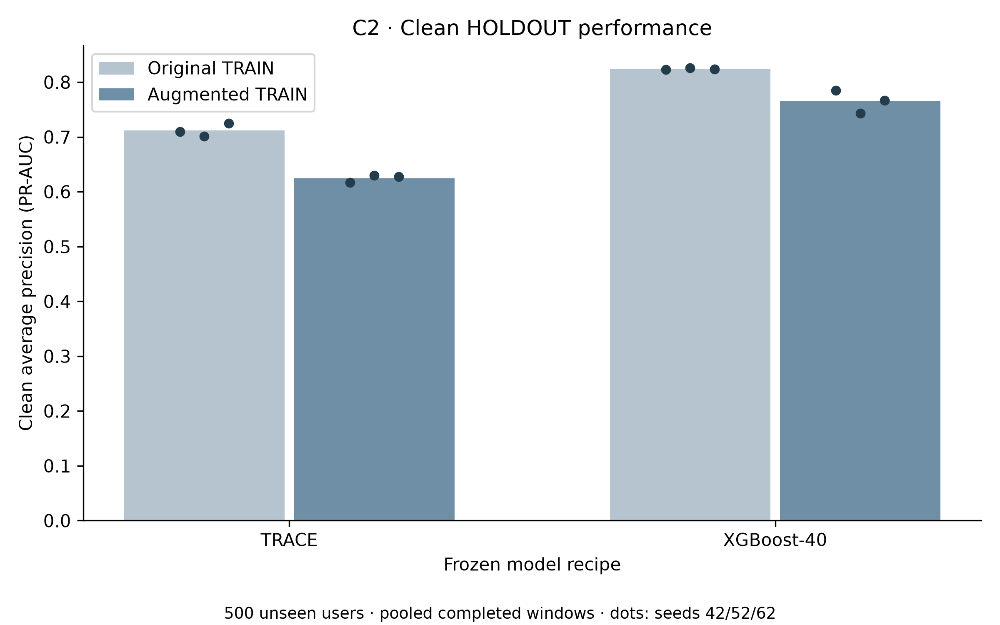
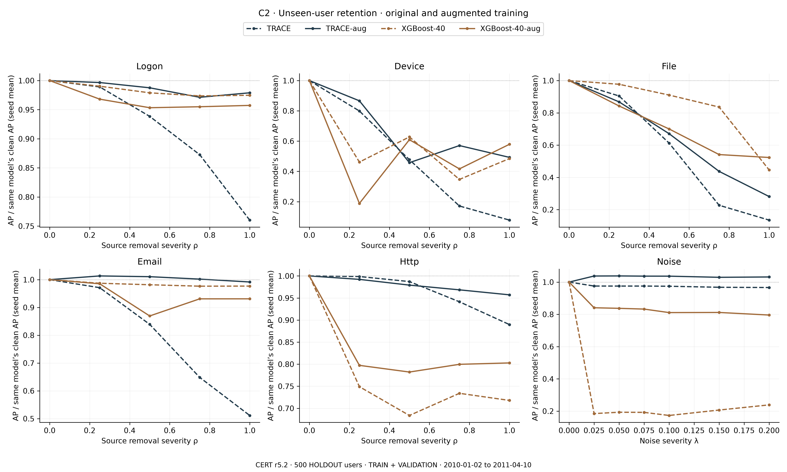

# Phase 6C: overnight tests on 500 unseen users

Completed 2026-10-22T14:17:48.006716+00:00. All results are exploratory. r5.2 TEST remains sealed; the 500 HOLDOUT users supply evaluation only.

## Findings

C1 reanalysed the same 1,236 tests using B=50,000 rather than B=2,000, without new scoring or changes to any point estimate, contrast, metric, view, eligibility rule or family. The family summary below shows every change in adjusted decision.

TRACE-aug minus TRACE: clean AP delta -0.08750, 95% CI [-0.17324, -0.01448]. Clean preservation under the predeclared -0.03 rule: not demonstrated.
XGBoost-40-aug minus XGBoost-40: clean AP delta -0.05893, 95% CI [-0.11865, -0.01219]. Clean preservation under the predeclared -0.03 rule: not demonstrated.

Robustness must be read together with preservation. The AURC table and all 23 corrected contrasts below report positive, negative and comparable outcomes. A zero-difference Holm p-value is not a test of the -0.03 preservation margin; comparability is not equivalence.

## Amendment 6 and boundary

Amendment 6 SHA-256: `e09c661f1c20d3e4032b4f3a07783081479b8e833a590854e332878653f2ebc8` over 42986 bytes before its receipt; UTC 2026-10-22T13:00:31.0983447Z. The previous 31207-byte prefix is preserved with SHA-256 `ba085b9000da3e4e55078dc0deac94976fe1fd9b7ecaa272682e012e6755dbee`. [Receipt](AMENDMENT6_RECEIPT.json). [Preregistration](../holdout/PREREGISTRATION_R2_HOLDOUT.md).

## Amendment 6: overnight tests (exploratory)

Authorisation: Qasim approved CHATGPT_PHASE6C_PROMPT.md on 22 October 2026 at 20:54 (+08): "lets run more test over night". This amendment and its SHA-256 receipt precede all Phase 6C scoring. The two prespecified blocks answer open questions; they do not select favourable outcomes.

Boundaries and resources: r5.2 TEST remains sealed. The frozen 500 HOLDOUT users never supply training, checkpoint selection, scaling, references, normalisation, thresholds, hyperparameters or stopping decisions. Training uses only the frozen 1,500 development users in TRAIN; checkpoint and threshold selection use their clean VALIDATION only. Evaluation uses the exact Phase 4 pooled TRAIN+VALIDATION cohort, 213,000 20-day windows, 1,172 positives, and its train_completed, validation_completed, pooled_offset0 and pooled_endpoint views. All original clean/degraded predictions and all Phase 6B explanation effects are reused without inference. Each new augmented model is scored once per seed on clean HOLDOUT and once per predeclared degradation condition, with an exclusive receipt; no original model is rescored. Seeds are 42/52/62. Public outputs use pseudonyms only. No existing repository is modified and nothing is pushed. One GPU training/inference child at a time, 35% per-process allocator cap, two numerical CPU threads per process and cooperative pauses; do not control other chats' processes. CPU-only C1 analysis may run alongside GPU C2 training. Every individual computational child run has a 120-minute timeout; TIMEOUT and dependent skips are retained and work continues. C1 is split into bounded analysis chunks and has the separate six-hour campaign budget below.

C1: reanalyse exactly the Phase 6B H1-H5 family of 840 tests and the H6 temporal (72), feature (162) and tree (162) families, with no added, removed, redefined or relabelled test. All existing contrast keys, views, metrics, seedwise versus arithmetic mean-seed definitions, matched end-day subsets and length-specific labels, eligibility rules, development references, logit spreads and directional signs remain unchanged. No new model scoring or intervention is permitted in C1. The 21 H1-H5 base contrasts remain: XGBoost-260 minus XGBoost-40; RF-260 minus RF-40; LightGBM-260 minus LightGBM-40; TRACE minus XGBoost-260; TRACE minus RF-260; MLP-260 minus MLP-40; TRACE minus order-free TRACE; reversed/fixed_shuffle/recent1/recent5/recent10 minus original for each of TRACE and XGBoost-260; TRACE-30 minus TRACE-20; TRACE-10 minus TRACE-20; XGBoost-40-30 minus XGBoost-40-20; XGBoost-40-10 minus XGBoost-40-20. Each retains five views, AP and frozen-threshold F1, and three seeds plus their arithmetic metric mean (840 tests). H6 retains temporal k=1/3/5/10, class-supporting sign; feature k=1/3/5 and tree k=1/2/3, positive/negative/class-supporting signs; all three seeds and malicious/benign/overall strata; normalized signed-logit top-minus-random and directional-accuracy top-minus-random effects. Inherited feature controls remain 200; temporal/tree remain 25. The exact Phase 6B mask helper and tree-readout intervention definitions are unchanged.

C1 resampling: target B=50,000 paired whole-user cluster replicates, seed 42. Preserve the exact Phase 6B random streams: integer-sampling user multiplicities for H1-H5 (all 500 users) and multinomial resampling in batches of 100 within each H6 stratum. The existing B=2,000 prefix may be reused after identity/hash/numerical verification; extend the same streams, not independent reseeding. Complete common replicate blocks across all four families, checkpointing each complete prefix. If 50,000 cannot be completed within six hours of C1 execution, report the largest fully completed common prefix that fits; computational stopping is based solely on elapsed time, never p-values or results. Default increment 2,000; a smaller final increment may be used based only on measured block runtime and remaining budget. Report attempted and valid B per test. The six-hour limit governs the C1 campaign; each chunk remains under the 120-minute child limit. Report B=2,000 and final-B raw p, Holm p, Holm decision, 95% CI and CI direction side by side for all 1,236 tests. Point estimates remain exactly those of Phase 6B.

C1 decision and multiplicity are unchanged: two-sided raw p=min(1,2*min((1+n(delta<=0))/(1+Bvalid),(1+n(delta>=0))/(1+Bvalid))); omit undefined replicates and report their number. Percentile 95% CI: above if lower>0, below if upper<0, otherwise comparable. Holm separately over all 840 H1-H5 tests, all 72 temporal tests, all 162 feature tests and all 162 tree tests. Missing planned tests remain present with p=1. Holm above/below requires adjusted p<0.05 and matching estimate sign; otherwise comparable. CIs are unadjusted and comparability is not equivalence. No family is changed in response to significance.

C2: robustness-oriented TRAIN-only augmentation, with no tuning. For each TRAIN window independently, source dropout occurs with probability 0.3, choosing uniformly one of logon/device/file/email/http. Use the exact Phase 5 apply_missing_source_condition at severity 1 in the frozen development-scaled coordinates: remove the source count and source activity flag by raw-zero absence mapped to -mean/scale, recompute total_events and is_active_day from remaining source counts, and zero duration only if the day becomes inactive, retaining its residual span otherwise. This is the Phase 5 source-channel ablation, not literal all-channel numerical-zero masking, and does not reconstruct raw activity timestamps. Independently, noise occurs with probability 0.3 per window, choosing uniformly from the six positive Phase 5 grid levels [0.025,0.050,0.075,0.100,0.150,0.200]. Apply the exact Phase 5 gaussian_noise_continuous to the seven continuous/count variables (indices 0-6): Gaussian SD=level*max(abs(standardized value),0.001), clip noise to +/-level*that scale, then clamp the resulting continuous standardized coordinates to >=0, leaving binary flags untouched. The inherited coordinate-space clipping and its validity limit are disclosed, not silently corrected. Apply source dropout first, then noise; event probabilities are independent, so both may occur. Validation and clean held-out inputs are never augmented; predeclared degradation is applied only to separate evaluation copies.

C2 augmentation randomness: independent NumPy generator SeedSequence([42, model_seed, stage_code]), with stage_code 0 for AL precursor, 1 for T-OPT, 2 for TRACE student and 3 for the XGBoost training copy. Neural augmentation is freshly sampled for each TRAIN mini-batch, in the existing shuffled TRAIN loader order; the T-OPT data-aware initialization uses an augmented TRAIN batch. Augmentation randomness never changes labels and does not use HOLDOUT or VALIDATION statistics. It is separate from the frozen model/dropout/shuffle RNG. For XGBoost, process original TRAIN window order in fixed batches of 1,024, build exactly one augmented copy and its 40 summaries per training window, keeping N=591,000 unchanged.

C2 models: TRACE-aug has its own three augmented AL precursors and own three augmented frozen-node T-OPT teachers, then augmented TRACE students. All architecture, Adam parameter groups, learning rates, class weighting, batch size 1,024, clipping 1, maximum 15 epochs, patience 4, checkpoint AP criterion and development-only threshold grid remain the frozen Phase 2/4 recipe. The precursor scheduler and exact inherited RNG/validation-loader conventions are retained. The only training differences are the declared augmentation and the necessary online teacher evaluation on the SAME augmented input: task + 0.5 MSE to the equal mean of all three frozen augmented-teacher logits + 0.5 route KL to the matched-seed frozen augmented teacher. Teacher ensemble targets cannot come from a cache of clean inputs. XGBoost-40-aug retains the exact Phase 4 XGBoost-40 hyperparameters and threshold rule; only its TRAIN input summaries change. Every checkpoint and threshold is selected using clean development VALIDATION, then frozen and hashed before HOLDOUT inference. No original model is retrained.

C2 evaluation: score each of the six new model-seeds once on clean HOLDOUT. Run the exact Phase 5 degradation conditions on them: per source severities 0/0.25/0.50/0.75/1 and noise 0/0.025/0.050/0.075/0.100/0.150/0.200. Severity zero always reuses that model's single clean prediction array. Use the unchanged Phase 5 perturbation realization seed 101 and its fixed condition-derived seed; require equality to the saved Phase 5 perturbed-tensor SHA-256 receipt for each of the 26 nonzero conditions. All original TRACE/XGBoost-40 clean and degraded scores are reused unchanged. No original scoring is repeated. For every model/seed/condition report PR-AUC and frozen-threshold metrics in all five Phase 4 views. Also report detected insiders out of 25 and non-insiders flagged out of 475 at the frozen threshold, both clean and per degradation condition, without threshold changes.

C2 AURC: exactly Phase 5 normalized trapezoidal area under AP(severity)/that model's clean AP, divided by maximum severity (1 for sources, 0.2 for noise). Compute per source and noise, plus the arithmetic mean of the five source AURCs (source_mean). In bootstrap replicates, both degraded AP and the model's clean AP are recomputed under the SAME user multiplicities before taking retention/AURC; there is no fixed-denominator shortcut. Undefined denominators/replicates are excluded and their counts reported. Seed aggregation averages the three seedwise metrics/AURCs, never predictions.

C2 prespecified formal contrasts are on the primary pooled_completed view and the arithmetic mean of three seed metrics, following the Phase 5 robustness contrast convention. One C2 Holm family has exactly 23 tests: (1) clean AP TRACE-aug minus TRACE; (2) clean AP XGBoost-40-aug minus XGBoost-40; and for EACH of logon/device/file/email/http/source_mean/noise AURC, (3) TRACE-aug minus TRACE, (4) XGBoost-40-aug minus XGBoost-40, (5) TRACE-aug minus XGBoost-40-aug (21 AURC tests). All 23 contrasts use 2,000 paired whole-user cluster replicates, seed 42, over the same 500 users. Raw two-sided p, percentile CI and Holm decision use the formula/rules above. All seedwise and other-view metrics are descriptive and do not create additional formal contrasts. Nothing is removed from the C2 family. Report every sign, null, failure and ineligible outcome.

C2 clean preservation is a separate predeclared margin rule: a model "preserves clean performance" only if the lower bound of its clean AP difference 95% CI is strictly above -0.03. Otherwise preservation is not demonstrated; this does not automatically prove a loss. The Holm p-values test zero differences and must not be presented as tests of the -0.03 margin. Report clean preservation separately from each AURC direction and adjusted decision, including endpoints that fail to improve. Robustness evidence at an endpoint requires its AURC delta CI above zero and Holm p<0.05; if clean preservation is not demonstrated, do not claim improved robustness without clean-performance cost.

Deliverables: phase6c/CHATGPT_PHASE6C_REPORT.md with this amendment and hash, complete training log, the full side-by-side C1 table and unchanged-family verification, C2 clean/retention/AURC/operational tables and all 23 corrected contrasts, 300-dpi retention curves per source/noise and clean-AP figure with CSVs alongside, explicit skips/deviations, and PHASE6C_RESULTS.json. Retain hashes, computational timing/budget receipts and all failures/timeouts. End with PHASE6C_COMPLETE only after the outputs and final audit are verified.

Amendment 6 SHA-256 receipt (UTC 2026-10-22T13:00:31.0983447Z): e09c661f1c20d3e4032b4f3a07783081479b8e833a590854e332878653f2ebc8 (entire preregistration through Amendment 6, before this receipt; 42986 bytes). Previous prefix: 31207 bytes, SHA-256 ba085b9000da3e4e55078dc0deac94976fe1fd9b7ecaa272682e012e6755dbee. No Phase 6C scoring preceded this receipt.

The same 1,500 development users supply TRAIN fitting and clean VALIDATION selection/thresholds. The held-out users never supply fitting, scaling, references, thresholds or selection. New model clean predictions are generated once per seed; severity-zero curves reuse them. Each of 26 nonzero degradations has a single predeclared evaluation pass per new model/seed. All original predictions are reused unchanged.

## Training log

| Model / role | Seed | Status | Epochs | Selected epoch | Clean DEV VALID AP | Seconds | Frozen threshold |
| --- | --- | --- | --- | --- | --- | --- | --- |
| AL_PRECURSOR | 42 | ok | 15 | 12 | 0.96217 | 170.88183 | 0.45000 |
| AL_PRECURSOR | 52 | ok | 15 | 12 | 0.94139 | 176.34387 | 0.30213 |
| AL_PRECURSOR | 62 | ok | 15 | 11 | 0.94483 | 179.64565 | 0.50000 |
| T-OPT | 42 | ok | 9 | 5 | 0.95816 | 126.50632 | 0.57000 |
| T-OPT | 52 | ok | 13 | 9 | 0.95462 | 170.94730 | 0.18000 |
| T-OPT | 62 | ok | 7 | 3 | 0.95210 | 95.38535 | 0.64000 |
| TRACE-aug | 42 | ok | 15 | 15 | 0.96464 | 348.06929 | 0.29000 |
| TRACE-aug | 52 | ok | 8 | 4 | 0.96028 | 179.39336 | 0.26000 |
| TRACE-aug | 62 | ok | 8 | 4 | 0.95952 | 190.84823 | 0.21000 |
| XGBoost-40-aug | 42 | ok | 300 | 300 | 0.87469 | 21.92818 | 0.13000 |
| XGBoost-40-aug | 52 | ok | 300 | 300 | 0.91271 | 21.85052 | 0.08000 |
| XGBoost-40-aug | 62 | ok | 300 | 300 | 0.89798 | 20.95687 | 0.12000 |

[Complete training log with checkpoint hashes](COMPLETE_TRAINING_LOG.csv). The own augmented AL precursors and frozen-node T-OPT teachers precede TRACE-aug. Clean VALIDATION selects checkpoints. XGBoost uses exactly one augmented TRAIN copy per original window, N=591,000, aggregated to 40 summaries. All new checkpoints and thresholds are frozen before target inference. One GPU child at a time, 35% allocator cap and cooperative pauses; numerical work uses two CPU threads per process. CPU-only C1 may overlap training. No other chat process is controlled.

## C1: bootstrap resolution

| Unchanged family | Tests | Old B | New B | Old above | Old below | New above | New below | Changed labels |
| --- | --- | --- | --- | --- | --- | --- | --- | --- |
| H1_H5 | 840 | 2000 | 50000 | 0 | 0 | 2 | 165 | 167 |
| temporal | 72 | 2000 | 50000 | 0 | 0 | 47 | 4 | 51 |
| feature | 162 | 2000 | 50000 | 0 | 0 | 130 | 1 | 131 |
| tree | 162 | 2000 | 50000 | 0 | 0 | 79 | 0 | 79 |

All four families use the same completed common B=50000. H1-H5 retains paired integer-draw multiplicities on all 500 users. H6 retains the original multinomial, 100-replicate cadence within each stratum. The verified original prefix is in [C1_PREFIX_VERIFICATION.json](C1_PREFIX_VERIFICATION.json); timing, six-hour budget and any partial-tail exclusion are in [C1_RESULTS.json](C1_RESULTS.json). Each computational chunk has a 120-minute timeout.

Raw p is twice the smaller sign-tail proportion with add-one correction; only finite replicates enter the denominator. Percentile CIs remain unadjusted. Holm correction stays separate for H1-H5 (840), temporal (72), feature (162) and tree (162). Above/below requires adjusted p<0.05 and the corresponding estimate sign; all other adjusted decisions are comparable. No tests are dropped or added.

## C2: clean performance and preservation

| Model | Seed | Clean AP | F1 | Precision | Recall |
| --- | --- | --- | --- | --- | --- |
| TRACE | 42 | 0.71004 | 0.48741 | 0.34571 | 0.82594 |
| TRACE | 52 | 0.70143 | 0.46925 | 0.32759 | 0.82679 |
| TRACE | 62 | 0.72513 | 0.47696 | 0.33459 | 0.83020 |
| XGBoost-40 | 42 | 0.82281 | 0.80896 | 0.87106 | 0.75512 |
| XGBoost-40 | 52 | 0.82575 | 0.79575 | 0.82765 | 0.76621 |
| XGBoost-40 | 62 | 0.82345 | 0.63645 | 0.51735 | 0.82679 |
| TRACE-aug | 42 | 0.61714 | 0.43977 | 0.30405 | 0.79437 |
| TRACE-aug | 52 | 0.62954 | 0.43177 | 0.29381 | 0.81399 |
| TRACE-aug | 62 | 0.62742 | 0.45082 | 0.31013 | 0.82509 |
| XGBoost-40-aug | 42 | 0.78512 | 0.67107 | 0.58892 | 0.77986 |
| XGBoost-40-aug | 52 | 0.74349 | 0.53357 | 0.41228 | 0.75597 |
| XGBoost-40-aug | 62 | 0.76661 | 0.58446 | 0.47706 | 0.75427 |
| TRACE | mean_three | 0.71220 | 0.47787 | 0.33596 | 0.82765 |
| TRACE-aug | mean_three | 0.62470 | 0.44079 | 0.30266 | 0.81115 |
| XGBoost-40 | mean_three | 0.82400 | 0.74705 | 0.73869 | 0.78271 |
| XGBoost-40-aug | mean_three | 0.76507 | 0.59637 | 0.49276 | 0.76337 |

| Preservation contrast | AP delta | 95% lower | 95% upper | Lower > -0.03 | Raw p vs zero | Holm p vs zero |
| --- | --- | --- | --- | --- | --- | --- |
| TRACE-aug minus TRACE | -0.08750 | -0.17324 | -0.01448 | False | 0.01399 | 0.18191 |
| XGBoost-40-aug minus XGBoost-40 | -0.05893 | -0.11865 | -0.01219 | False | 0.01399 | 0.18191 |

[Figure b CSV](figure_b_clean_PR_AUC.csv). Bars are arithmetic seed means; dots are seeds 42/52/62.

## C2: retention and AURC

For each source, retention is degraded AP divided by that model’s clean AP; source AURC is normalized trapezoidal area over severity 0–1. Noise uses the full Phase 5 grid and normalization over 0–0.2. source_mean averages the five source AURCs. Values above one are retained. Every degraded tensor exactly matches its Phase 5 SHA-256 receipt, so models share the realized perturbation.

| Model | Seed | Endpoint | Normalized retention AURC |
| --- | --- | --- | --- |
| TRACE | 42 | logon | 0.95278 |
| TRACE | 42 | device | 0.48160 |
| TRACE | 42 | file | 0.58661 |
| TRACE | 42 | email | 0.74925 |
| TRACE | 42 | http | 0.95420 |
| TRACE | 42 | noise | 1.01558 |
| TRACE | 42 | source_mean | 0.74489 |
| TRACE | 52 | logon | 0.87996 |
| TRACE | 52 | device | 0.52965 |
| TRACE | 52 | file | 0.56771 |
| TRACE | 52 | email | 0.81445 |
| TRACE | 52 | http | 0.95838 |
| TRACE | 52 | noise | 0.90925 |
| TRACE | 52 | source_mean | 0.75003 |
| TRACE | 62 | logon | 0.92763 |
| TRACE | 62 | device | 0.47895 |
| TRACE | 62 | file | 0.57971 |
| TRACE | 62 | email | 0.84702 |
| TRACE | 62 | http | 0.99155 |
| TRACE | 62 | noise | 0.99624 |
| TRACE | 62 | source_mean | 0.76497 |
| XGBoost-40 | 42 | logon | 0.98481 |
| XGBoost-40 | 42 | device | 0.53508 |
| XGBoost-40 | 42 | file | 0.86321 |
| XGBoost-40 | 42 | email | 0.98298 |
| XGBoost-40 | 42 | http | 0.75112 |
| XGBoost-40 | 42 | noise | 0.24625 |
| XGBoost-40 | 42 | source_mean | 0.82344 |
| XGBoost-40 | 52 | logon | 0.98124 |
| XGBoost-40 | 52 | device | 0.53959 |
| XGBoost-40 | 52 | file | 0.85304 |
| XGBoost-40 | 52 | email | 0.98183 |
| XGBoost-40 | 52 | http | 0.74719 |
| XGBoost-40 | 52 | noise | 0.25481 |
| XGBoost-40 | 52 | source_mean | 0.82058 |
| XGBoost-40 | 62 | logon | 0.98172 |
| XGBoost-40 | 62 | device | 0.55928 |
| XGBoost-40 | 62 | file | 0.86855 |
| XGBoost-40 | 62 | email | 0.98543 |
| XGBoost-40 | 62 | http | 0.77085 |
| XGBoost-40 | 62 | noise | 0.24156 |
| XGBoost-40 | 62 | source_mean | 0.83317 |
| TRACE-aug | 42 | logon | 0.98524 |
| TRACE-aug | 42 | device | 0.70031 |
| TRACE-aug | 42 | file | 0.68093 |
| TRACE-aug | 42 | email | 1.01320 |
| TRACE-aug | 42 | http | 0.97790 |
| TRACE-aug | 42 | noise | 1.03954 |
| TRACE-aug | 42 | source_mean | 0.87151 |
| TRACE-aug | 52 | logon | 0.96961 |
| TRACE-aug | 52 | device | 0.66137 |
| TRACE-aug | 52 | file | 0.65273 |
| TRACE-aug | 52 | email | 0.99753 |
| TRACE-aug | 52 | http | 1.00162 |
| TRACE-aug | 52 | noise | 1.03506 |
| TRACE-aug | 52 | source_mean | 0.85657 |
| TRACE-aug | 62 | logon | 1.00392 |
| TRACE-aug | 62 | device | 0.61908 |
| TRACE-aug | 62 | file | 0.62897 |
| TRACE-aug | 62 | email | 1.00561 |
| TRACE-aug | 62 | http | 0.95930 |
| TRACE-aug | 62 | noise | 1.02249 |
| TRACE-aug | 62 | source_mean | 0.84337 |
| XGBoost-40-aug | 42 | logon | 0.95960 |
| XGBoost-40-aug | 42 | device | 0.51669 |
| XGBoost-40-aug | 42 | file | 0.70593 |
| XGBoost-40-aug | 42 | email | 0.91840 |
| XGBoost-40-aug | 42 | http | 0.78175 |
| XGBoost-40-aug | 42 | noise | 0.81501 |
| XGBoost-40-aug | 42 | source_mean | 0.77647 |
| XGBoost-40-aug | 52 | logon | 0.96745 |
| XGBoost-40-aug | 52 | device | 0.49696 |
| XGBoost-40-aug | 52 | file | 0.69320 |
| XGBoost-40-aug | 52 | email | 0.95712 |
| XGBoost-40-aug | 52 | http | 0.83638 |
| XGBoost-40-aug | 52 | noise | 0.84666 |
| XGBoost-40-aug | 52 | source_mean | 0.79022 |
| XGBoost-40-aug | 62 | logon | 0.96433 |
| XGBoost-40-aug | 62 | device | 0.48940 |
| XGBoost-40-aug | 62 | file | 0.73525 |
| XGBoost-40-aug | 62 | email | 0.93771 |
| XGBoost-40-aug | 62 | http | 0.84225 |
| XGBoost-40-aug | 62 | noise | 0.83056 |
| XGBoost-40-aug | 62 | source_mean | 0.79379 |
| TRACE | mean_three | device | 0.49673 |
| TRACE | mean_three | email | 0.80357 |
| TRACE | mean_three | file | 0.57801 |
| TRACE | mean_three | http | 0.96804 |
| TRACE | mean_three | logon | 0.92013 |
| TRACE | mean_three | noise | 0.97369 |
| TRACE | mean_three | source_mean | 0.75330 |
| TRACE-aug | mean_three | device | 0.66025 |
| TRACE-aug | mean_three | email | 1.00545 |
| TRACE-aug | mean_three | file | 0.65421 |
| TRACE-aug | mean_three | http | 0.97960 |
| TRACE-aug | mean_three | logon | 0.98625 |
| TRACE-aug | mean_three | noise | 1.03236 |
| TRACE-aug | mean_three | source_mean | 0.85715 |
| XGBoost-40 | mean_three | device | 0.54465 |
| XGBoost-40 | mean_three | email | 0.98341 |
| XGBoost-40 | mean_three | file | 0.86160 |
| XGBoost-40 | mean_three | http | 0.75639 |
| XGBoost-40 | mean_three | logon | 0.98259 |
| XGBoost-40 | mean_three | noise | 0.24754 |
| XGBoost-40 | mean_three | source_mean | 0.82573 |
| XGBoost-40-aug | mean_three | device | 0.50102 |
| XGBoost-40-aug | mean_three | email | 0.93774 |
| XGBoost-40-aug | mean_three | file | 0.71146 |
| XGBoost-40-aug | mean_three | http | 0.82013 |
| XGBoost-40-aug | mean_three | logon | 0.96380 |
| XGBoost-40-aug | mean_three | noise | 0.83074 |
| XGBoost-40-aug | mean_three | source_mean | 0.78683 |

[All figure a source data](figure_a_retention_all_sources.csv). Individual source/noise CSVs are beside this figure. [All five-view retention curves](C2_RETENTION_CURVES.csv); [all AURCs](C2_AURC.csv).

## C2: all prespecified contrasts

The single C2 Holm family comprises exactly 23 pooled-view three-seed mean contrasts. All use 2,000 paired whole-user replicates, seed 42. The clean preservation rule uses its declared 95% CI lower bound > -0.03. Robustness evidence at an endpoint requires its AURC CI above zero and Holm p<0.05; the clean preservation result remains a separate requirement for any claim without clean-performance cost.

| Contrast | Endpoint | Delta | 95% CI | Raw p | Holm p | CI direction | Adjusted decision |
| --- | --- | --- | --- | --- | --- | --- | --- |
| TRACE-aug minus TRACE | clean | -0.08750 | [-0.17324, -0.01448] | 0.01399 | 0.18191 | below | comparable |
| XGBoost-40-aug minus XGBoost-40 | clean | -0.05893 | [-0.11865, -0.01219] | 0.01399 | 0.18191 | below | comparable |
| TRACE-aug minus TRACE | logon | 0.06613 | [0.01223, 0.12292] | 0.01999 | 0.21989 | above | comparable |
| XGBoost-40-aug minus XGBoost-40 | logon | -0.01879 | [-0.07139, 0.02262] | 0.37681 | 1.00000 | comparable | comparable |
| TRACE-aug minus XGBoost-40-aug | logon | 0.02246 | [-0.03382, 0.08305] | 0.41179 | 1.00000 | comparable | comparable |
| TRACE-aug minus TRACE | device | 0.16352 | [0.07190, 0.25182] | 0.00200 | 0.03598 | above | above |
| XGBoost-40-aug minus XGBoost-40 | device | -0.04364 | [-0.15228, 0.08387] | 0.60370 | 1.00000 | comparable | comparable |
| TRACE-aug minus XGBoost-40-aug | device | 0.15924 | [0.03140, 0.27336] | 0.00900 | 0.12594 | above | comparable |
| TRACE-aug minus TRACE | file | 0.07620 | [0.00266, 0.16771] | 0.04398 | 0.35182 | above | comparable |
| XGBoost-40-aug minus XGBoost-40 | file | -0.15014 | [-0.26858, -0.04454] | 0.00300 | 0.04798 | below | below |
| TRACE-aug minus XGBoost-40-aug | file | -0.05725 | [-0.19074, 0.11438] | 0.52574 | 1.00000 | comparable | comparable |
| TRACE-aug minus TRACE | email | 0.20187 | [0.13220, 0.28932] | 0.00100 | 0.02299 | above | above |
| XGBoost-40-aug minus XGBoost-40 | email | -0.04567 | [-0.11093, 0.00868] | 0.12994 | 0.90955 | comparable | comparable |
| TRACE-aug minus XGBoost-40-aug | email | 0.06770 | [0.00529, 0.13632] | 0.02199 | 0.21989 | above | comparable |
| TRACE-aug minus TRACE | http | 0.01156 | [-0.03679, 0.06293] | 0.52774 | 1.00000 | comparable | comparable |
| XGBoost-40-aug minus XGBoost-40 | http | 0.06374 | [0.01221, 0.14199] | 0.02499 | 0.22489 | above | comparable |
| TRACE-aug minus XGBoost-40-aug | http | 0.15948 | [0.06929, 0.25390] | 0.00200 | 0.03598 | above | above |
| TRACE-aug minus TRACE | source_mean | 0.10386 | [0.06652, 0.14621] | 0.00100 | 0.02299 | above | above |
| XGBoost-40-aug minus XGBoost-40 | source_mean | -0.03890 | [-0.08663, 0.01318] | 0.17191 | 1.00000 | comparable | comparable |
| TRACE-aug minus XGBoost-40-aug | source_mean | 0.07032 | [0.03086, 0.11384] | 0.00100 | 0.02299 | above | above |
| TRACE-aug minus TRACE | noise | 0.05867 | [0.02123, 0.10915] | 0.00300 | 0.04798 | above | above |
| XGBoost-40-aug minus XGBoost-40 | noise | 0.58320 | [0.39784, 0.76438] | 0.00100 | 0.02299 | above | above |
| TRACE-aug minus XGBoost-40-aug | noise | 0.20162 | [0.08723, 0.34884] | 0.00100 | 0.02299 | above | above |

[Full-precision C2 contrasts](C2_CONTRASTS_HOLM.csv). [All model/condition/seed/view metrics](C2_ALL_MODEL_VIEW_METRICS.csv).

## C2: insiders and non-insiders at frozen thresholds

| Model | Seed | Insiders detected /25 | Non-insiders flagged /475 | Frozen threshold |
| --- | --- | --- | --- | --- |
| TRACE | 42 | 24 | 23 | 0.56000 |
| TRACE | 52 | 24 | 27 | 0.56000 |
| TRACE | 62 | 24 | 28 | 0.38000 |
| XGBoost-40 | 42 | 22 | 6 | 0.64000 |
| XGBoost-40 | 52 | 23 | 8 | 0.51000 |
| XGBoost-40 | 62 | 24 | 22 | 0.06000 |
| TRACE-aug | 42 | 24 | 29 | 0.29000 |
| TRACE-aug | 52 | 24 | 33 | 0.26000 |
| TRACE-aug | 62 | 25 | 37 | 0.21000 |
| XGBoost-40-aug | 42 | 24 | 27 | 0.13000 |
| XGBoost-40-aug | 52 | 24 | 33 | 0.08000 |
| XGBoost-40-aug | 62 | 24 | 28 | 0.12000 |

An insider is detected if any positive completed window exceeds its frozen threshold. A non-insider is flagged if any of their windows exceeds it. These are whole-evaluation-period user counts, not daily false-positive rates. The same counts are reported for every degradation condition in [C2_OPERATIONAL_COUNTS.csv](C2_OPERATIONAL_COUNTS.csv); detailed JSON uses pseudonyms only.

## C1: complete side-by-side table

[Full-precision C1 CSV](C1_FULL_SIDE_BY_SIDE.csv). The table contains every original test with the unchanged point estimate. Each valid-B count is preserved in CSV/JSON; undefined replicates are omitted from its p-value and percentile CI.

| Family | Unchanged test | Estimate | Old raw p | New raw p | Old Holm p | New Holm p | Old decision | New decision | Old 95% CI | New 95% CI |
| --- | --- | --- | --- | --- | --- | --- | --- | --- | --- | --- |
| H1_H5 | XGBoost-260 original minus XGBoost-40 original · pooled_completed · PR_AUC · seed 42 | -0.13816 | 0.03898 | 0.03884 | 1.00000 | 1.00000 | comparable | comparable | [-0.27983, -0.00635] | [-0.28399, -0.00701] |
| H1_H5 | XGBoost-260 original minus XGBoost-40 original · pooled_completed · PR_AUC · seed 52 | -0.13237 | 0.04098 | 0.04412 | 1.00000 | 1.00000 | comparable | comparable | [-0.27630, -0.00785] | [-0.27548, -0.00352] |
| H1_H5 | XGBoost-260 original minus XGBoost-40 original · pooled_completed · PR_AUC · seed 62 | -0.11190 | 0.06597 | 0.07304 | 1.00000 | 1.00000 | comparable | comparable | [-0.24764, 0.00763] | [-0.24603, 0.01134] |
| H1_H5 | XGBoost-260 original minus XGBoost-40 original · pooled_completed · PR_AUC · seed mean_three | -0.12747 | 0.04398 | 0.04912 | 1.00000 | 1.00000 | comparable | comparable | [-0.26668, -0.00419] | [-0.26797, -0.00037] |
| H1_H5 | XGBoost-260 original minus XGBoost-40 original · pooled_completed · F1 · seed 42 | -0.35520 | 0.00100 | 0.00008 | 0.83958 | 0.05384 | comparable | comparable | [-0.48881, -0.20361] | [-0.48514, -0.20277] |
| H1_H5 | XGBoost-260 original minus XGBoost-40 original · pooled_completed · F1 · seed 52 | -0.29069 | 0.00100 | 0.00024 | 0.83958 | 0.14736 | comparable | comparable | [-0.41868, -0.14761] | [-0.41284, -0.14908] |
| H1_H5 | XGBoost-260 original minus XGBoost-40 original · pooled_completed · F1 · seed 62 | -0.16862 | 0.01899 | 0.01872 | 1.00000 | 1.00000 | comparable | comparable | [-0.31061, -0.02618] | [-0.30584, -0.02934] |
| H1_H5 | XGBoost-260 original minus XGBoost-40 original · pooled_completed · F1 · seed mean_three | -0.27150 | 0.00100 | 0.00040 | 0.83958 | 0.24000 | comparable | comparable | [-0.39889, -0.13538] | [-0.38884, -0.13383] |
| H1_H5 | XGBoost-260 original minus XGBoost-40 original · train_completed · PR_AUC · seed 42 | -0.17598 | 0.00600 | 0.00452 | 1.00000 | 1.00000 | comparable | comparable | [-0.33268, -0.05261] | [-0.33800, -0.05130] |
| H1_H5 | XGBoost-260 original minus XGBoost-40 original · train_completed · PR_AUC · seed 52 | -0.17306 | 0.00900 | 0.00344 | 1.00000 | 1.00000 | comparable | comparable | [-0.32746, -0.05087] | [-0.33768, -0.05160] |
| H1_H5 | XGBoost-260 original minus XGBoost-40 original · train_completed · PR_AUC · seed 62 | -0.14500 | 0.01099 | 0.01068 | 1.00000 | 1.00000 | comparable | comparable | [-0.28985, -0.03297] | [-0.29698, -0.03309] |
| H1_H5 | XGBoost-260 original minus XGBoost-40 original · train_completed · PR_AUC · seed mean_three | -0.16468 | 0.00900 | 0.00480 | 1.00000 | 1.00000 | comparable | comparable | [-0.31665, -0.04682] | [-0.32373, -0.04608] |
| H1_H5 | XGBoost-260 original minus XGBoost-40 original · train_completed · F1 · seed 42 | -0.38280 | 0.00100 | 0.00004 | 0.83958 | 0.03360 | comparable | below | [-0.52543, -0.21573] | [-0.52030, -0.21707] |
| H1_H5 | XGBoost-260 original minus XGBoost-40 original · train_completed · F1 · seed 52 | -0.31397 | 0.00100 | 0.00024 | 0.83958 | 0.14736 | comparable | comparable | [-0.44869, -0.15785] | [-0.44673, -0.15881] |
| H1_H5 | XGBoost-260 original minus XGBoost-40 original · train_completed · F1 · seed 62 | -0.18292 | 0.01199 | 0.01224 | 1.00000 | 1.00000 | comparable | comparable | [-0.33117, -0.03629] | [-0.32782, -0.04040] |
| H1_H5 | XGBoost-260 original minus XGBoost-40 original · train_completed · F1 · seed mean_three | -0.29323 | 0.00100 | 0.00028 | 0.83958 | 0.17080 | comparable | comparable | [-0.42420, -0.14436] | [-0.41615, -0.14705] |
| H1_H5 | XGBoost-260 original minus XGBoost-40 original · validation_completed · PR_AUC · seed 42 | 0.02084 | 0.92254 | 0.94006 | 1.00000 | 1.00000 | comparable | comparable | [-0.20256, 0.28509] | [-0.21003, 0.28925] |
| H1_H5 | XGBoost-260 original minus XGBoost-40 original · validation_completed · PR_AUC · seed 52 | 0.02538 | 0.90355 | 0.92482 | 1.00000 | 1.00000 | comparable | comparable | [-0.19426, 0.29420] | [-0.19818, 0.29620] |
| H1_H5 | XGBoost-260 original minus XGBoost-40 original · validation_completed · PR_AUC · seed 62 | 0.02925 | 0.85657 | 0.88158 | 1.00000 | 1.00000 | comparable | comparable | [-0.16605, 0.27992] | [-0.17134, 0.27812] |
| H1_H5 | XGBoost-260 original minus XGBoost-40 original · validation_completed · PR_AUC · seed mean_three | 0.02515 | 0.89655 | 0.91570 | 1.00000 | 1.00000 | comparable | comparable | [-0.18627, 0.28735] | [-0.19265, 0.28757] |
| H1_H5 | XGBoost-260 original minus XGBoost-40 original · validation_completed · F1 · seed 42 | -0.08172 | 0.42579 | 0.41859 | 1.00000 | 1.00000 | comparable | comparable | [-0.29461, 0.12328] | [-0.30482, 0.13718] |
| H1_H5 | XGBoost-260 original minus XGBoost-40 original · validation_completed · F1 · seed 52 | -0.07012 | 0.46577 | 0.46539 | 1.00000 | 1.00000 | comparable | comparable | [-0.26768, 0.14189] | [-0.27445, 0.14894] |
| H1_H5 | XGBoost-260 original minus XGBoost-40 original · validation_completed · F1 · seed 62 | 0.01701 | 0.86857 | 0.87726 | 1.00000 | 1.00000 | comparable | comparable | [-0.15388, 0.23480] | [-0.16318, 0.24054] |
| H1_H5 | XGBoost-260 original minus XGBoost-40 original · validation_completed · F1 · seed mean_three | -0.04494 | 0.64468 | 0.62459 | 1.00000 | 1.00000 | comparable | comparable | [-0.23336, 0.16843] | [-0.24036, 0.17192] |
| H1_H5 | XGBoost-260 original minus XGBoost-40 original · pooled_offset0 · PR_AUC · seed 42 | -0.15716 | 0.06297 | 0.06188 | 1.00000 | 1.00000 | comparable | comparable | [-0.32847, 0.00462] | [-0.32901, 0.00770] |
| H1_H5 | XGBoost-260 original minus XGBoost-40 original · pooled_offset0 · PR_AUC · seed 52 | -0.14378 | 0.09895 | 0.09404 | 1.00000 | 1.00000 | comparable | comparable | [-0.31349, 0.02070] | [-0.31678, 0.02405] |
| H1_H5 | XGBoost-260 original minus XGBoost-40 original · pooled_offset0 · PR_AUC · seed 62 | -0.09840 | 0.21889 | 0.22508 | 1.00000 | 1.00000 | comparable | comparable | [-0.25316, 0.05469] | [-0.25664, 0.05801] |
| H1_H5 | XGBoost-260 original minus XGBoost-40 original · pooled_offset0 · PR_AUC · seed mean_three | -0.13311 | 0.11894 | 0.10756 | 1.00000 | 1.00000 | comparable | comparable | [-0.29617, 0.02435] | [-0.29900, 0.02855] |
| H1_H5 | XGBoost-260 original minus XGBoost-40 original · pooled_offset0 · F1 · seed 42 | -0.33802 | 0.00100 | 0.00032 | 0.83958 | 0.19360 | comparable | comparable | [-0.49554, -0.15675] | [-0.49610, -0.16230] |
| H1_H5 | XGBoost-260 original minus XGBoost-40 original · pooled_offset0 · F1 · seed 52 | -0.31638 | 0.00100 | 0.00064 | 0.83958 | 0.37631 | comparable | comparable | [-0.46999, -0.13723] | [-0.46894, -0.13965] |
| H1_H5 | XGBoost-260 original minus XGBoost-40 original · pooled_offset0 · F1 · seed 62 | -0.17114 | 0.01899 | 0.01944 | 1.00000 | 1.00000 | comparable | comparable | [-0.30966, -0.02632] | [-0.30685, -0.02835] |
| H1_H5 | XGBoost-260 original minus XGBoost-40 original · pooled_offset0 · F1 · seed mean_three | -0.27518 | 0.00100 | 0.00096 | 0.83958 | 0.55007 | comparable | comparable | [-0.41454, -0.11450] | [-0.41136, -0.11691] |
| H1_H5 | XGBoost-260 original minus XGBoost-40 original · pooled_endpoint · PR_AUC · seed 42 | -0.03079 | 0.44578 | 0.43391 | 1.00000 | 1.00000 | comparable | comparable | [-0.10105, 0.03909] | [-0.10219, 0.04031] |
| H1_H5 | XGBoost-260 original minus XGBoost-40 original · pooled_endpoint · PR_AUC · seed 52 | -0.03691 | 0.36982 | 0.35415 | 1.00000 | 1.00000 | comparable | comparable | [-0.10703, 0.03717] | [-0.10818, 0.03643] |
| H1_H5 | XGBoost-260 original minus XGBoost-40 original · pooled_endpoint · PR_AUC · seed 62 | -0.03440 | 0.38381 | 0.38215 | 1.00000 | 1.00000 | comparable | comparable | [-0.09868, 0.03559] | [-0.10320, 0.03726] |
| H1_H5 | XGBoost-260 original minus XGBoost-40 original · pooled_endpoint · PR_AUC · seed mean_three | -0.03404 | 0.39480 | 0.38567 | 1.00000 | 1.00000 | comparable | comparable | [-0.09976, 0.03522] | [-0.10359, 0.03656] |
| H1_H5 | XGBoost-260 original minus XGBoost-40 original · pooled_endpoint · F1 · seed 42 | -0.21126 | 0.00100 | 0.00004 | 0.83958 | 0.03360 | comparable | below | [-0.29925, -0.11947] | [-0.29469, -0.12006] |
| H1_H5 | XGBoost-260 original minus XGBoost-40 original · pooled_endpoint · F1 · seed 52 | -0.17587 | 0.00100 | 0.00012 | 0.83958 | 0.07824 | comparable | comparable | [-0.26640, -0.08907] | [-0.26082, -0.08900] |
| H1_H5 | XGBoost-260 original minus XGBoost-40 original · pooled_endpoint · F1 · seed 62 | -0.08383 | 0.00900 | 0.01404 | 1.00000 | 1.00000 | comparable | comparable | [-0.17084, -0.01332] | [-0.16624, -0.01505] |
| H1_H5 | XGBoost-260 original minus XGBoost-40 original · pooled_endpoint · F1 · seed mean_three | -0.15699 | 0.00100 | 0.00016 | 0.83958 | 0.09968 | comparable | comparable | [-0.23818, -0.07719] | [-0.23373, -0.07787] |
| H1_H5 | RF-260 original minus RF-40 original · pooled_completed · PR_AUC · seed 42 | -0.24958 | 0.00100 | 0.00108 | 0.83958 | 0.61775 | comparable | comparable | [-0.36518, -0.09873] | [-0.36887, -0.09031] |
| H1_H5 | RF-260 original minus RF-40 original · pooled_completed · PR_AUC · seed 52 | -0.27676 | 0.00100 | 0.00064 | 0.83958 | 0.37631 | comparable | comparable | [-0.38976, -0.11923] | [-0.39385, -0.10814] |
| H1_H5 | RF-260 original minus RF-40 original · pooled_completed · PR_AUC · seed 62 | -0.28761 | 0.00100 | 0.00032 | 0.83958 | 0.19360 | comparable | comparable | [-0.39705, -0.13291] | [-0.40344, -0.12557] |
| H1_H5 | RF-260 original minus RF-40 original · pooled_completed · PR_AUC · seed mean_three | -0.27132 | 0.00100 | 0.00056 | 0.83958 | 0.33151 | comparable | comparable | [-0.38369, -0.11775] | [-0.38833, -0.10841] |
| H1_H5 | RF-260 original minus RF-40 original · pooled_completed · F1 · seed 42 | -0.06551 | 0.00800 | 0.00708 | 1.00000 | 1.00000 | comparable | comparable | [-0.14823, -0.01380] | [-0.14385, -0.01483] |
| H1_H5 | RF-260 original minus RF-40 original · pooled_completed · F1 · seed 52 | -0.07369 | 0.00600 | 0.00224 | 1.00000 | 1.00000 | comparable | comparable | [-0.15494, -0.02201] | [-0.15138, -0.02071] |
| H1_H5 | RF-260 original minus RF-40 original · pooled_completed · F1 · seed 62 | 0.07927 | 0.05197 | 0.03788 | 1.00000 | 1.00000 | comparable | comparable | [-0.00010, 0.19488] | [0.00408, 0.19344] |
| H1_H5 | RF-260 original minus RF-40 original · pooled_completed · F1 · seed mean_three | -0.01998 | 0.47376 | 0.49355 | 1.00000 | 1.00000 | comparable | comparable | [-0.08329, 0.03936] | [-0.08337, 0.03805] |
| H1_H5 | RF-260 original minus RF-40 original · train_completed · PR_AUC · seed 42 | -0.24891 | 0.00200 | 0.00088 | 1.00000 | 0.50863 | comparable | comparable | [-0.36919, -0.09565] | [-0.37078, -0.09209] |
| H1_H5 | RF-260 original minus RF-40 original · train_completed · PR_AUC · seed 52 | -0.26631 | 0.00200 | 0.00068 | 1.00000 | 0.39711 | comparable | comparable | [-0.38741, -0.11388] | [-0.38827, -0.10588] |
| H1_H5 | RF-260 original minus RF-40 original · train_completed · PR_AUC · seed 62 | -0.27778 | 0.00200 | 0.00028 | 1.00000 | 0.17080 | comparable | comparable | [-0.39928, -0.12865] | [-0.39951, -0.12364] |
| H1_H5 | RF-260 original minus RF-40 original · train_completed · PR_AUC · seed mean_three | -0.26433 | 0.00200 | 0.00056 | 1.00000 | 0.33151 | comparable | comparable | [-0.38606, -0.11469] | [-0.38576, -0.10754] |
| H1_H5 | RF-260 original minus RF-40 original · train_completed · F1 · seed 42 | -0.06848 | 0.01299 | 0.01116 | 1.00000 | 1.00000 | comparable | comparable | [-0.16660, -0.01248] | [-0.15966, -0.01367] |
| H1_H5 | RF-260 original minus RF-40 original · train_completed · F1 · seed 52 | -0.07227 | 0.01099 | 0.00824 | 1.00000 | 1.00000 | comparable | comparable | [-0.16396, -0.01764] | [-0.16089, -0.01628] |
| H1_H5 | RF-260 original minus RF-40 original · train_completed · F1 · seed 62 | 0.08003 | 0.03998 | 0.03864 | 1.00000 | 1.00000 | comparable | comparable | [0.00326, 0.20169] | [0.00430, 0.20000] |
| H1_H5 | RF-260 original minus RF-40 original · train_completed · F1 · seed mean_three | -0.02024 | 0.48676 | 0.49559 | 1.00000 | 1.00000 | comparable | comparable | [-0.08877, 0.03963] | [-0.08880, 0.03902] |
| H1_H5 | RF-260 original minus RF-40 original · validation_completed · PR_AUC · seed 42 | -0.01341 | 0.83458 | 0.83018 | 1.00000 | 1.00000 | comparable | comparable | [-0.22712, 0.19296] | [-0.22470, 0.19542] |
| H1_H5 | RF-260 original minus RF-40 original · validation_completed · PR_AUC · seed 52 | -0.02582 | 0.72364 | 0.73185 | 1.00000 | 1.00000 | comparable | comparable | [-0.22811, 0.16281] | [-0.23121, 0.16572] |
| H1_H5 | RF-260 original minus RF-40 original · validation_completed · PR_AUC · seed 62 | -0.01946 | 0.77461 | 0.77798 | 1.00000 | 1.00000 | comparable | comparable | [-0.24025, 0.18532] | [-0.23822, 0.18840] |
| H1_H5 | RF-260 original minus RF-40 original · validation_completed · PR_AUC · seed mean_three | -0.01956 | 0.77361 | 0.77998 | 1.00000 | 1.00000 | comparable | comparable | [-0.22946, 0.18073] | [-0.23087, 0.18316] |
| H1_H5 | RF-260 original minus RF-40 original · validation_completed · F1 · seed 42 | -0.00729 | 0.76662 | 0.76614 | 1.00000 | 1.00000 | comparable | comparable | [-0.06061, 0.05089] | [-0.06070, 0.04800] |
| H1_H5 | RF-260 original minus RF-40 original · validation_completed · F1 · seed 52 | -0.02848 | 0.44678 | 0.46775 | 1.00000 | 1.00000 | comparable | comparable | [-0.11943, 0.04960] | [-0.12205, 0.04658] |
| H1_H5 | RF-260 original minus RF-40 original · validation_completed · F1 · seed 62 | 0.02703 | 0.77561 | 0.73367 | 1.00000 | 1.00000 | comparable | comparable | [-0.18537, 0.24018] | [-0.18403, 0.23569] |
| H1_H5 | RF-260 original minus RF-40 original · validation_completed · F1 · seed mean_three | -0.00291 | 0.95852 | 0.99638 | 1.00000 | 1.00000 | comparable | comparable | [-0.10622, 0.09479] | [-0.10683, 0.09499] |
| H1_H5 | RF-260 original minus RF-40 original · pooled_offset0 · PR_AUC · seed 42 | -0.17866 | 0.05297 | 0.05004 | 1.00000 | 1.00000 | comparable | comparable | [-0.30659, 0.00343] | [-0.31408, -0.00001] |
| H1_H5 | RF-260 original minus RF-40 original · pooled_offset0 · PR_AUC · seed 52 | -0.20504 | 0.02499 | 0.02456 | 1.00000 | 1.00000 | comparable | comparable | [-0.34105, -0.02673] | [-0.34737, -0.02343] |
| H1_H5 | RF-260 original minus RF-40 original · pooled_offset0 · PR_AUC · seed 62 | -0.23295 | 0.02599 | 0.02580 | 1.00000 | 1.00000 | comparable | comparable | [-0.35497, -0.02915] | [-0.36275, -0.02823] |
| H1_H5 | RF-260 original minus RF-40 original · pooled_offset0 · PR_AUC · seed mean_three | -0.20555 | 0.02799 | 0.02948 | 1.00000 | 1.00000 | comparable | comparable | [-0.33324, -0.01759] | [-0.34019, -0.01764] |
| H1_H5 | RF-260 original minus RF-40 original · pooled_offset0 · F1 · seed 42 | -0.05634 | 0.10995 | 0.12012 | 1.00000 | 1.00000 | comparable | comparable | [-0.14390, 0.01393] | [-0.14495, 0.01447] |
| H1_H5 | RF-260 original minus RF-40 original · pooled_offset0 · F1 · seed 52 | -0.05891 | 0.10695 | 0.09960 | 1.00000 | 1.00000 | comparable | comparable | [-0.14080, 0.01164] | [-0.14464, 0.00995] |
| H1_H5 | RF-260 original minus RF-40 original · pooled_offset0 · F1 · seed 62 | 0.09585 | 0.03298 | 0.02420 | 1.00000 | 1.00000 | comparable | comparable | [0.00939, 0.22446] | [0.01079, 0.22229] |
| H1_H5 | RF-260 original minus RF-40 original · pooled_offset0 · F1 · seed mean_three | -0.00647 | 0.84958 | 0.85950 | 1.00000 | 1.00000 | comparable | comparable | [-0.07214, 0.06729] | [-0.07392, 0.06379] |
| H1_H5 | RF-260 original minus RF-40 original · pooled_endpoint · PR_AUC · seed 42 | -0.01900 | 0.28286 | 0.29947 | 1.00000 | 1.00000 | comparable | comparable | [-0.04719, 0.01917] | [-0.04760, 0.02008] |
| H1_H5 | RF-260 original minus RF-40 original · pooled_endpoint · PR_AUC · seed 52 | -0.01564 | 0.35582 | 0.38295 | 1.00000 | 1.00000 | comparable | comparable | [-0.04581, 0.02072] | [-0.04627, 0.02265] |
| H1_H5 | RF-260 original minus RF-40 original · pooled_endpoint · PR_AUC · seed 62 | -0.01960 | 0.26987 | 0.28551 | 1.00000 | 1.00000 | comparable | comparable | [-0.05233, 0.02139] | [-0.05197, 0.02172] |
| H1_H5 | RF-260 original minus RF-40 original · pooled_endpoint · PR_AUC · seed mean_three | -0.01808 | 0.28886 | 0.30423 | 1.00000 | 1.00000 | comparable | comparable | [-0.04611, 0.01873] | [-0.04715, 0.02012] |
| H1_H5 | RF-260 original minus RF-40 original · pooled_endpoint · F1 · seed 42 | -0.03364 | 0.00700 | 0.00600 | 1.00000 | 1.00000 | comparable | comparable | [-0.07884, -0.00769] | [-0.07773, -0.00823] |
| H1_H5 | RF-260 original minus RF-40 original · pooled_endpoint · F1 · seed 52 | -0.03723 | 0.00800 | 0.00732 | 1.00000 | 1.00000 | comparable | comparable | [-0.08051, -0.00843] | [-0.08126, -0.00927] |
| H1_H5 | RF-260 original minus RF-40 original · pooled_endpoint · F1 · seed 62 | 0.03655 | 0.03298 | 0.02668 | 1.00000 | 1.00000 | comparable | comparable | [0.00331, 0.07782] | [0.00398, 0.07771] |
| H1_H5 | RF-260 original minus RF-40 original · pooled_endpoint · F1 · seed mean_three | -0.01144 | 0.40780 | 0.39959 | 1.00000 | 1.00000 | comparable | comparable | [-0.04468, 0.01672] | [-0.04511, 0.01510] |
| H1_H5 | LightGBM-260 original minus LightGBM-40 original · pooled_completed · PR_AUC · seed 42 | -0.13800 | 0.01499 | 0.01600 | 1.00000 | 1.00000 | comparable | comparable | [-0.24632, -0.02637] | [-0.25415, -0.02622] |
| H1_H5 | LightGBM-260 original minus LightGBM-40 original · pooled_completed · PR_AUC · seed 52 | -0.10070 | 0.01899 | 0.02008 | 1.00000 | 1.00000 | comparable | comparable | [-0.19417, -0.01936] | [-0.19975, -0.01596] |
| H1_H5 | LightGBM-260 original minus LightGBM-40 original · pooled_completed · PR_AUC · seed 62 | -0.21137 | 0.00200 | 0.00052 | 1.00000 | 0.30939 | comparable | comparable | [-0.32836, -0.09338] | [-0.33395, -0.09288] |
| H1_H5 | LightGBM-260 original minus LightGBM-40 original · pooled_completed · PR_AUC · seed mean_three | -0.15002 | 0.00400 | 0.00392 | 1.00000 | 1.00000 | comparable | comparable | [-0.24960, -0.05313] | [-0.25715, -0.05005] |
| H1_H5 | LightGBM-260 original minus LightGBM-40 original · pooled_completed · F1 · seed 42 | 0.03149 | 0.55772 | 0.53863 | 1.00000 | 1.00000 | comparable | comparable | [-0.06784, 0.11691] | [-0.06746, 0.12083] |
| H1_H5 | LightGBM-260 original minus LightGBM-40 original · pooled_completed · F1 · seed 52 | -0.21319 | 0.00100 | 0.00020 | 0.83958 | 0.12340 | comparable | comparable | [-0.33373, -0.10529] | [-0.33204, -0.10729] |
| H1_H5 | LightGBM-260 original minus LightGBM-40 original · pooled_completed · F1 · seed 62 | -0.15750 | 0.00100 | 0.00196 | 0.83958 | 1.00000 | comparable | comparable | [-0.26205, -0.05885] | [-0.26198, -0.05886] |
| H1_H5 | LightGBM-260 original minus LightGBM-40 original · pooled_completed · F1 · seed mean_three | -0.11307 | 0.00300 | 0.00380 | 1.00000 | 1.00000 | comparable | comparable | [-0.20182, -0.03963] | [-0.19693, -0.03848] |
| H1_H5 | LightGBM-260 original minus LightGBM-40 original · train_completed · PR_AUC · seed 42 | -0.15782 | 0.00200 | 0.00108 | 1.00000 | 0.61775 | comparable | comparable | [-0.26170, -0.06487] | [-0.26565, -0.06014] |
| H1_H5 | LightGBM-260 original minus LightGBM-40 original · train_completed · PR_AUC · seed 52 | -0.13232 | 0.00100 | 0.00052 | 0.83958 | 0.30939 | comparable | comparable | [-0.23736, -0.05153] | [-0.24274, -0.05084] |
| H1_H5 | LightGBM-260 original minus LightGBM-40 original · train_completed · PR_AUC · seed 62 | -0.23528 | 0.00100 | 0.00004 | 0.83958 | 0.03360 | comparable | below | [-0.33811, -0.13008] | [-0.34274, -0.12905] |
| H1_H5 | LightGBM-260 original minus LightGBM-40 original · train_completed · PR_AUC · seed mean_three | -0.17514 | 0.00100 | 0.00008 | 0.83958 | 0.05384 | comparable | comparable | [-0.26927, -0.09048] | [-0.27732, -0.08817] |
| H1_H5 | LightGBM-260 original minus LightGBM-40 original · train_completed · F1 · seed 42 | 0.02671 | 0.62569 | 0.60907 | 1.00000 | 1.00000 | comparable | comparable | [-0.07199, 0.11615] | [-0.07043, 0.11747] |
| H1_H5 | LightGBM-260 original minus LightGBM-40 original · train_completed · F1 · seed 52 | -0.25749 | 0.00100 | 0.00004 | 0.83958 | 0.03360 | comparable | below | [-0.39117, -0.14130] | [-0.39112, -0.14182] |
| H1_H5 | LightGBM-260 original minus LightGBM-40 original · train_completed · F1 · seed 62 | -0.17367 | 0.00100 | 0.00052 | 0.83958 | 0.30939 | comparable | comparable | [-0.27726, -0.08069] | [-0.27481, -0.08117] |
| H1_H5 | LightGBM-260 original minus LightGBM-40 original · train_completed · F1 · seed mean_three | -0.13482 | 0.00100 | 0.00064 | 0.83958 | 0.37631 | comparable | comparable | [-0.22734, -0.06403] | [-0.21935, -0.06403] |
| H1_H5 | LightGBM-260 original minus LightGBM-40 original · validation_completed · PR_AUC · seed 42 | 0.00582 | 0.98551 | 0.99174 | 1.00000 | 1.00000 | comparable | comparable | [-0.28171, 0.28360] | [-0.28128, 0.29602] |
| H1_H5 | LightGBM-260 original minus LightGBM-40 original · validation_completed · PR_AUC · seed 52 | 0.04324 | 0.78161 | 0.80110 | 1.00000 | 1.00000 | comparable | comparable | [-0.14632, 0.29596] | [-0.15038, 0.29557] |
| H1_H5 | LightGBM-260 original minus LightGBM-40 original · validation_completed · PR_AUC · seed 62 | -0.02933 | 0.78961 | 0.76550 | 1.00000 | 1.00000 | comparable | comparable | [-0.29303, 0.22284] | [-0.29544, 0.23347] |
| H1_H5 | LightGBM-260 original minus LightGBM-40 original · validation_completed · PR_AUC · seed mean_three | 0.00658 | 0.98851 | 0.96526 | 1.00000 | 1.00000 | comparable | comparable | [-0.23476, 0.26606] | [-0.23866, 0.27177] |
| H1_H5 | LightGBM-260 original minus LightGBM-40 original · validation_completed · F1 · seed 42 | 0.02463 | 0.79960 | 0.79578 | 1.00000 | 1.00000 | comparable | comparable | [-0.19107, 0.27248] | [-0.20448, 0.26596] |
| H1_H5 | LightGBM-260 original minus LightGBM-40 original · validation_completed · F1 · seed 52 | 0.04517 | 0.50475 | 0.51335 | 1.00000 | 1.00000 | comparable | comparable | [-0.06868, 0.22293] | [-0.06874, 0.21436] |
| H1_H5 | LightGBM-260 original minus LightGBM-40 original · validation_completed · F1 · seed 62 | -0.06574 | 0.51574 | 0.51315 | 1.00000 | 1.00000 | comparable | comparable | [-0.26564, 0.15720] | [-0.27026, 0.15755] |
| H1_H5 | LightGBM-260 original minus LightGBM-40 original · validation_completed · F1 · seed mean_three | 0.00136 | 0.98751 | 0.99330 | 1.00000 | 1.00000 | comparable | comparable | [-0.14910, 0.19011] | [-0.15690, 0.18994] |
| H1_H5 | LightGBM-260 original minus LightGBM-40 original · pooled_offset0 · PR_AUC · seed 42 | -0.11790 | 0.08196 | 0.08748 | 1.00000 | 1.00000 | comparable | comparable | [-0.24698, 0.01822] | [-0.25400, 0.01810] |
| H1_H5 | LightGBM-260 original minus LightGBM-40 original · pooled_offset0 · PR_AUC · seed 52 | -0.04057 | 0.35882 | 0.37015 | 1.00000 | 1.00000 | comparable | comparable | [-0.12938, 0.05513] | [-0.13468, 0.05680] |
| H1_H5 | LightGBM-260 original minus LightGBM-40 original · pooled_offset0 · PR_AUC · seed 62 | -0.19613 | 0.03098 | 0.02832 | 1.00000 | 1.00000 | comparable | comparable | [-0.34675, -0.02249] | [-0.35625, -0.02035] |
| H1_H5 | LightGBM-260 original minus LightGBM-40 original · pooled_offset0 · PR_AUC · seed mean_three | -0.11820 | 0.06797 | 0.06724 | 1.00000 | 1.00000 | comparable | comparable | [-0.22822, 0.00470] | [-0.23510, 0.00862] |
| H1_H5 | LightGBM-260 original minus LightGBM-40 original · pooled_offset0 · F1 · seed 42 | 0.03676 | 0.57271 | 0.51131 | 1.00000 | 1.00000 | comparable | comparable | [-0.07255, 0.12736] | [-0.07294, 0.12738] |
| H1_H5 | LightGBM-260 original minus LightGBM-40 original · pooled_offset0 · F1 · seed 52 | -0.17087 | 0.00800 | 0.00716 | 1.00000 | 1.00000 | comparable | comparable | [-0.30719, -0.04611] | [-0.30000, -0.04804] |
| H1_H5 | LightGBM-260 original minus LightGBM-40 original · pooled_offset0 · F1 · seed 62 | -0.14844 | 0.00600 | 0.00660 | 1.00000 | 1.00000 | comparable | comparable | [-0.26584, -0.04499] | [-0.26321, -0.04259] |
| H1_H5 | LightGBM-260 original minus LightGBM-40 original · pooled_offset0 · F1 · seed mean_three | -0.09418 | 0.01199 | 0.01644 | 1.00000 | 1.00000 | comparable | comparable | [-0.18218, -0.02197] | [-0.17992, -0.01825] |
| H1_H5 | LightGBM-260 original minus LightGBM-40 original · pooled_endpoint · PR_AUC · seed 42 | -0.02334 | 0.66467 | 0.67059 | 1.00000 | 1.00000 | comparable | comparable | [-0.11559, 0.09236] | [-0.11916, 0.08972] |
| H1_H5 | LightGBM-260 original minus LightGBM-40 original · pooled_endpoint · PR_AUC · seed 52 | -0.00421 | 0.94153 | 0.94246 | 1.00000 | 1.00000 | comparable | comparable | [-0.10408, 0.09849] | [-0.10846, 0.09651] |
| H1_H5 | LightGBM-260 original minus LightGBM-40 original · pooled_endpoint · PR_AUC · seed 62 | -0.05733 | 0.17391 | 0.16556 | 1.00000 | 1.00000 | comparable | comparable | [-0.13232, 0.02643] | [-0.13785, 0.02535] |
| H1_H5 | LightGBM-260 original minus LightGBM-40 original · pooled_endpoint · PR_AUC · seed mean_three | -0.02829 | 0.54273 | 0.55615 | 1.00000 | 1.00000 | comparable | comparable | [-0.11377, 0.07092] | [-0.11930, 0.06701] |
| H1_H5 | LightGBM-260 original minus LightGBM-40 original · pooled_endpoint · F1 · seed 42 | 0.00126 | 0.98051 | 0.99926 | 1.00000 | 1.00000 | comparable | comparable | [-0.07172, 0.06340] | [-0.07233, 0.06514] |
| H1_H5 | LightGBM-260 original minus LightGBM-40 original · pooled_endpoint · F1 · seed 52 | -0.13670 | 0.00100 | 0.00004 | 0.83958 | 0.03360 | comparable | below | [-0.22479, -0.06341] | [-0.22464, -0.06450] |
| H1_H5 | LightGBM-260 original minus LightGBM-40 original · pooled_endpoint · F1 · seed 62 | -0.08712 | 0.02299 | 0.01832 | 1.00000 | 1.00000 | comparable | comparable | [-0.16971, -0.01194] | [-0.16969, -0.01437] |
| H1_H5 | LightGBM-260 original minus LightGBM-40 original · pooled_endpoint · F1 · seed mean_three | -0.07419 | 0.00200 | 0.00244 | 1.00000 | 1.00000 | comparable | comparable | [-0.14036, -0.02341] | [-0.13807, -0.02431] |
| H1_H5 | TRACE original minus XGBoost-260 original · pooled_completed · PR_AUC · seed 42 | 0.02539 | 0.74763 | 0.74939 | 1.00000 | 1.00000 | comparable | comparable | [-0.13173, 0.18984] | [-0.12695, 0.18543] |
| H1_H5 | TRACE original minus XGBoost-260 original · pooled_completed · PR_AUC · seed 52 | 0.00805 | 0.95452 | 0.94338 | 1.00000 | 1.00000 | comparable | comparable | [-0.12848, 0.15129] | [-0.13402, 0.14714] |
| H1_H5 | TRACE original minus XGBoost-260 original · pooled_completed · PR_AUC · seed 62 | 0.01358 | 0.84958 | 0.85502 | 1.00000 | 1.00000 | comparable | comparable | [-0.12420, 0.14714] | [-0.12045, 0.14476] |
| H1_H5 | TRACE original minus XGBoost-260 original · pooled_completed · PR_AUC · seed mean_three | 0.01567 | 0.85057 | 0.84274 | 1.00000 | 1.00000 | comparable | comparable | [-0.12737, 0.16260] | [-0.12429, 0.15736] |
| H1_H5 | TRACE original minus XGBoost-260 original · pooled_completed · F1 · seed 42 | 0.03365 | 0.57071 | 0.52967 | 1.00000 | 1.00000 | comparable | comparable | [-0.05527, 0.17221] | [-0.05612, 0.17146] |
| H1_H5 | TRACE original minus XGBoost-260 original · pooled_completed · F1 · seed 52 | -0.03581 | 0.51974 | 0.51519 | 1.00000 | 1.00000 | comparable | comparable | [-0.13264, 0.09147] | [-0.13811, 0.08953] |
| H1_H5 | TRACE original minus XGBoost-260 original · pooled_completed · F1 · seed 62 | 0.00913 | 0.92954 | 0.89118 | 1.00000 | 1.00000 | comparable | comparable | [-0.07247, 0.12434] | [-0.07204, 0.12634] |
| H1_H5 | TRACE original minus XGBoost-260 original · pooled_completed · F1 · seed mean_three | 0.00232 | 0.97351 | 0.99710 | 1.00000 | 1.00000 | comparable | comparable | [-0.08505, 0.12702] | [-0.08617, 0.12695] |
| H1_H5 | TRACE original minus XGBoost-260 original · train_completed · PR_AUC · seed 42 | 0.02269 | 0.83358 | 0.81914 | 1.00000 | 1.00000 | comparable | comparable | [-0.18063, 0.23533] | [-0.17533, 0.23864] |
| H1_H5 | TRACE original minus XGBoost-260 original · train_completed · PR_AUC · seed 52 | 0.00210 | 0.99650 | 0.99710 | 1.00000 | 1.00000 | comparable | comparable | [-0.18780, 0.19993] | [-0.18768, 0.19540] |
| H1_H5 | TRACE original minus XGBoost-260 original · train_completed · PR_AUC · seed 62 | 0.00236 | 0.98751 | 0.97422 | 1.00000 | 1.00000 | comparable | comparable | [-0.18631, 0.18876] | [-0.18007, 0.18914] |
| H1_H5 | TRACE original minus XGBoost-260 original · train_completed · PR_AUC · seed mean_three | 0.00905 | 0.92854 | 0.92814 | 1.00000 | 1.00000 | comparable | comparable | [-0.17967, 0.20449] | [-0.17817, 0.20450] |
| H1_H5 | TRACE original minus XGBoost-260 original · train_completed · F1 · seed 42 | 0.03182 | 0.58371 | 0.55791 | 1.00000 | 1.00000 | comparable | comparable | [-0.05922, 0.17700] | [-0.06055, 0.17550] |
| H1_H5 | TRACE original minus XGBoost-260 original · train_completed · F1 · seed 52 | -0.03503 | 0.51974 | 0.53143 | 1.00000 | 1.00000 | comparable | comparable | [-0.13343, 0.09788] | [-0.14044, 0.09292] |
| H1_H5 | TRACE original minus XGBoost-260 original · train_completed · F1 · seed 62 | 0.00803 | 0.93353 | 0.90258 | 1.00000 | 1.00000 | comparable | comparable | [-0.07605, 0.12635] | [-0.07592, 0.12773] |
| H1_H5 | TRACE original minus XGBoost-260 original · train_completed · F1 · seed mean_three | 0.00161 | 0.97851 | 0.99750 | 1.00000 | 1.00000 | comparable | comparable | [-0.08755, 0.12900] | [-0.08959, 0.12946] |
| H1_H5 | TRACE original minus XGBoost-260 original · validation_completed · PR_AUC · seed 42 | -0.03192 | 0.61069 | 0.63225 | 1.00000 | 1.00000 | comparable | comparable | [-0.16014, 0.07181] | [-0.15262, 0.07478] |
| H1_H5 | TRACE original minus XGBoost-260 original · validation_completed · PR_AUC · seed 52 | -0.03471 | 0.55872 | 0.59197 | 1.00000 | 1.00000 | comparable | comparable | [-0.15430, 0.05760] | [-0.15014, 0.05831] |
| H1_H5 | TRACE original minus XGBoost-260 original · validation_completed · PR_AUC · seed 62 | -0.03551 | 0.72164 | 0.75482 | 1.00000 | 1.00000 | comparable | comparable | [-0.17248, 0.05945] | [-0.17173, 0.06180] |
| H1_H5 | TRACE original minus XGBoost-260 original · validation_completed · PR_AUC · seed mean_three | -0.03405 | 0.61669 | 0.64693 | 1.00000 | 1.00000 | comparable | comparable | [-0.16163, 0.06162] | [-0.15644, 0.06317] |
| H1_H5 | TRACE original minus XGBoost-260 original · validation_completed · F1 · seed 42 | 0.03674 | 0.54973 | 0.53895 | 1.00000 | 1.00000 | comparable | comparable | [-0.06738, 0.15879] | [-0.06618, 0.16682] |
| H1_H5 | TRACE original minus XGBoost-260 original · validation_completed · F1 · seed 52 | -0.00056 | 0.89755 | 0.94858 | 1.00000 | 1.00000 | comparable | comparable | [-0.12629, 0.12077] | [-0.12380, 0.12684] |
| H1_H5 | TRACE original minus XGBoost-260 original · validation_completed · F1 · seed 62 | 0.01496 | 0.87156 | 0.84802 | 1.00000 | 1.00000 | comparable | comparable | [-0.09532, 0.13112] | [-0.09239, 0.13305] |
| H1_H5 | TRACE original minus XGBoost-260 original · validation_completed · F1 · seed mean_three | 0.01705 | 0.83758 | 0.81498 | 1.00000 | 1.00000 | comparable | comparable | [-0.08427, 0.12672] | [-0.08584, 0.13658] |
| H1_H5 | TRACE original minus XGBoost-260 original · pooled_offset0 · PR_AUC · seed 42 | 0.04288 | 0.59170 | 0.57635 | 1.00000 | 1.00000 | comparable | comparable | [-0.12151, 0.21417] | [-0.11317, 0.20720] |
| H1_H5 | TRACE original minus XGBoost-260 original · pooled_offset0 · PR_AUC · seed 52 | 0.02989 | 0.74263 | 0.73827 | 1.00000 | 1.00000 | comparable | comparable | [-0.12698, 0.19481] | [-0.12827, 0.18819] |
| H1_H5 | TRACE original minus XGBoost-260 original · pooled_offset0 · PR_AUC · seed 62 | 0.00420 | 0.99650 | 0.99930 | 1.00000 | 1.00000 | comparable | comparable | [-0.15383, 0.15458] | [-0.14275, 0.14528] |
| H1_H5 | TRACE original minus XGBoost-260 original · pooled_offset0 · PR_AUC · seed mean_three | 0.02566 | 0.76962 | 0.75466 | 1.00000 | 1.00000 | comparable | comparable | [-0.12685, 0.17962] | [-0.11930, 0.17400] |
| H1_H5 | TRACE original minus XGBoost-260 original · pooled_offset0 · F1 · seed 42 | 0.02890 | 0.67966 | 0.63735 | 1.00000 | 1.00000 | comparable | comparable | [-0.07951, 0.19055] | [-0.07814, 0.18861] |
| H1_H5 | TRACE original minus XGBoost-260 original · pooled_offset0 · F1 · seed 52 | -0.02541 | 0.57171 | 0.59755 | 1.00000 | 1.00000 | comparable | comparable | [-0.11793, 0.08905] | [-0.12010, 0.09168] |
| H1_H5 | TRACE original minus XGBoost-260 original · pooled_offset0 · F1 · seed 62 | -0.01429 | 0.70865 | 0.74131 | 1.00000 | 1.00000 | comparable | comparable | [-0.09802, 0.09255] | [-0.09895, 0.09835] |
| H1_H5 | TRACE original minus XGBoost-260 original · pooled_offset0 · F1 · seed mean_three | -0.00360 | 0.88656 | 0.91290 | 1.00000 | 1.00000 | comparable | comparable | [-0.08805, 0.11462] | [-0.08990, 0.12008] |
| H1_H5 | TRACE original minus XGBoost-260 original · pooled_endpoint · PR_AUC · seed 42 | -0.07199 | 0.04898 | 0.04020 | 1.00000 | 1.00000 | comparable | comparable | [-0.14925, -0.00067] | [-0.14593, -0.00337] |
| H1_H5 | TRACE original minus XGBoost-260 original · pooled_endpoint · PR_AUC · seed 52 | -0.07004 | 0.01799 | 0.01748 | 1.00000 | 1.00000 | comparable | comparable | [-0.13932, -0.01243] | [-0.13931, -0.01280] |
| H1_H5 | TRACE original minus XGBoost-260 original · pooled_endpoint · PR_AUC · seed 62 | -0.06667 | 0.03598 | 0.02800 | 1.00000 | 1.00000 | comparable | comparable | [-0.15556, -0.00470] | [-0.15042, -0.00696] |
| H1_H5 | TRACE original minus XGBoost-260 original · pooled_endpoint · PR_AUC · seed mean_three | -0.06957 | 0.03098 | 0.02300 | 1.00000 | 1.00000 | comparable | comparable | [-0.14807, -0.00790] | [-0.14407, -0.00978] |
| H1_H5 | TRACE original minus XGBoost-260 original · pooled_endpoint · F1 · seed 42 | 0.00079 | 0.99050 | 0.96578 | 1.00000 | 1.00000 | comparable | comparable | [-0.04021, 0.05454] | [-0.04185, 0.05187] |
| H1_H5 | TRACE original minus XGBoost-260 original · pooled_endpoint · F1 · seed 52 | -0.02664 | 0.28686 | 0.29391 | 1.00000 | 1.00000 | comparable | comparable | [-0.07683, 0.02430] | [-0.07756, 0.02404] |
| H1_H5 | TRACE original minus XGBoost-260 original · pooled_endpoint · F1 · seed 62 | -0.00857 | 0.63968 | 0.67539 | 1.00000 | 1.00000 | comparable | comparable | [-0.05049, 0.03803] | [-0.04956, 0.03585] |
| H1_H5 | TRACE original minus XGBoost-260 original · pooled_endpoint · F1 · seed mean_three | -0.01147 | 0.58971 | 0.61391 | 1.00000 | 1.00000 | comparable | comparable | [-0.05521, 0.03739] | [-0.05568, 0.03657] |
| H1_H5 | TRACE original minus RF-260 original · pooled_completed · PR_AUC · seed 42 | 0.35107 | 0.00100 | 0.00016 | 0.83958 | 0.09968 | comparable | comparable | [0.17891, 0.45338] | [0.18017, 0.45134] |
| H1_H5 | TRACE original minus RF-260 original · pooled_completed · PR_AUC · seed 52 | 0.34841 | 0.00100 | 0.00012 | 0.83958 | 0.07824 | comparable | comparable | [0.17736, 0.43301] | [0.17519, 0.43453] |
| H1_H5 | TRACE original minus RF-260 original · pooled_completed · PR_AUC · seed 62 | 0.38147 | 0.00100 | 0.00016 | 0.83958 | 0.09968 | comparable | comparable | [0.21844, 0.46626] | [0.21846, 0.46688] |
| H1_H5 | TRACE original minus RF-260 original · pooled_completed · PR_AUC · seed mean_three | 0.36032 | 0.00100 | 0.00012 | 0.83958 | 0.07824 | comparable | comparable | [0.19631, 0.44694] | [0.19352, 0.44798] |
| H1_H5 | TRACE original minus RF-260 original · pooled_completed · F1 · seed 42 | 0.01139 | 0.75262 | 0.76862 | 1.00000 | 1.00000 | comparable | comparable | [-0.10253, 0.13251] | [-0.10667, 0.12398] |
| H1_H5 | TRACE original minus RF-260 original · pooled_completed · F1 · seed 52 | -0.00794 | 0.91054 | 0.89310 | 1.00000 | 1.00000 | comparable | comparable | [-0.11104, 0.08882] | [-0.11639, 0.08599] |
| H1_H5 | TRACE original minus RF-260 original · pooled_completed · F1 · seed 62 | -0.00373 | 0.98151 | 0.97806 | 1.00000 | 1.00000 | comparable | comparable | [-0.11770, 0.10282] | [-0.12173, 0.10024] |
| H1_H5 | TRACE original minus RF-260 original · pooled_completed · F1 · seed mean_three | -0.00009 | 0.93753 | 0.95078 | 1.00000 | 1.00000 | comparable | comparable | [-0.10914, 0.10458] | [-0.11378, 0.10208] |
| H1_H5 | TRACE original minus RF-260 original · train_completed · PR_AUC · seed 42 | 0.34131 | 0.00200 | 0.00080 | 1.00000 | 0.46479 | comparable | comparable | [0.15283, 0.46682] | [0.15200, 0.46586] |
| H1_H5 | TRACE original minus RF-260 original · train_completed · PR_AUC · seed 52 | 0.33260 | 0.00100 | 0.00044 | 0.83958 | 0.26311 | comparable | comparable | [0.14526, 0.44623] | [0.14389, 0.44481] |
| H1_H5 | TRACE original minus RF-260 original · train_completed · PR_AUC · seed 62 | 0.36393 | 0.00100 | 0.00024 | 0.83958 | 0.14736 | comparable | comparable | [0.17837, 0.47678] | [0.17972, 0.47683] |
| H1_H5 | TRACE original minus RF-260 original · train_completed · PR_AUC · seed mean_three | 0.34594 | 0.00100 | 0.00032 | 0.83958 | 0.19360 | comparable | comparable | [0.16280, 0.46096] | [0.16258, 0.45970] |
| H1_H5 | TRACE original minus RF-260 original · train_completed · F1 · seed 42 | 0.00927 | 0.81159 | 0.81906 | 1.00000 | 1.00000 | comparable | comparable | [-0.11110, 0.14563] | [-0.11097, 0.13697] |
| H1_H5 | TRACE original minus RF-260 original · train_completed · F1 · seed 52 | -0.00812 | 0.86257 | 0.86066 | 1.00000 | 1.00000 | comparable | comparable | [-0.11997, 0.10426] | [-0.12048, 0.09676] |
| H1_H5 | TRACE original minus RF-260 original · train_completed · F1 · seed 62 | -0.00844 | 0.87956 | 0.88170 | 1.00000 | 1.00000 | comparable | comparable | [-0.13294, 0.11344] | [-0.13003, 0.10552] |
| H1_H5 | TRACE original minus RF-260 original · train_completed · F1 · seed mean_three | -0.00243 | 0.96952 | 0.97486 | 1.00000 | 1.00000 | comparable | comparable | [-0.12008, 0.11915] | [-0.11942, 0.11180] |
| H1_H5 | TRACE original minus RF-260 original · validation_completed · PR_AUC · seed 42 | 0.01305 | 0.64868 | 0.65609 | 1.00000 | 1.00000 | comparable | comparable | [-0.03907, 0.11141] | [-0.04183, 0.10925] |
| H1_H5 | TRACE original minus RF-260 original · validation_completed · PR_AUC · seed 52 | 0.00835 | 0.76362 | 0.76602 | 1.00000 | 1.00000 | comparable | comparable | [-0.05699, 0.10421] | [-0.05920, 0.10034] |
| H1_H5 | TRACE original minus RF-260 original · validation_completed · PR_AUC · seed 62 | 0.02267 | 0.55772 | 0.55825 | 1.00000 | 1.00000 | comparable | comparable | [-0.04997, 0.14423] | [-0.05050, 0.14043] |
| H1_H5 | TRACE original minus RF-260 original · validation_completed · PR_AUC · seed mean_three | 0.01469 | 0.64568 | 0.64369 | 1.00000 | 1.00000 | comparable | comparable | [-0.04733, 0.11701] | [-0.04948, 0.11311] |
| H1_H5 | TRACE original minus RF-260 original · validation_completed · F1 · seed 42 | 0.03367 | 0.60170 | 0.63899 | 1.00000 | 1.00000 | comparable | comparable | [-0.11763, 0.19515] | [-0.12093, 0.19551] |
| H1_H5 | TRACE original minus RF-260 original · validation_completed · F1 · seed 52 | 0.01255 | 0.85357 | 0.87358 | 1.00000 | 1.00000 | comparable | comparable | [-0.13834, 0.17417] | [-0.13702, 0.16395] |
| H1_H5 | TRACE original minus RF-260 original · validation_completed · F1 · seed 62 | 0.04015 | 0.69165 | 0.69043 | 1.00000 | 1.00000 | comparable | comparable | [-0.13167, 0.25056] | [-0.13250, 0.24336] |
| H1_H5 | TRACE original minus RF-260 original · validation_completed · F1 · seed mean_three | 0.02879 | 0.70565 | 0.71963 | 1.00000 | 1.00000 | comparable | comparable | [-0.12454, 0.20162] | [-0.12472, 0.19643] |
| H1_H5 | TRACE original minus RF-260 original · pooled_offset0 · PR_AUC · seed 42 | 0.30649 | 0.00400 | 0.00156 | 1.00000 | 0.87826 | comparable | comparable | [0.13380, 0.43236] | [0.12646, 0.42514] |
| H1_H5 | TRACE original minus RF-260 original · pooled_offset0 · PR_AUC · seed 52 | 0.31536 | 0.00400 | 0.00088 | 1.00000 | 0.50863 | comparable | comparable | [0.14139, 0.42998] | [0.13688, 0.43198] |
| H1_H5 | TRACE original minus RF-260 original · pooled_offset0 · PR_AUC · seed 62 | 0.35886 | 0.00500 | 0.00152 | 1.00000 | 0.85726 | comparable | comparable | [0.15769, 0.46849] | [0.15667, 0.46480] |
| H1_H5 | TRACE original minus RF-260 original · pooled_offset0 · PR_AUC · seed mean_three | 0.32690 | 0.00500 | 0.00108 | 1.00000 | 0.61775 | comparable | comparable | [0.14667, 0.43544] | [0.14816, 0.43308] |
| H1_H5 | TRACE original minus RF-260 original · pooled_offset0 · F1 · seed 42 | 0.00657 | 0.85957 | 0.85494 | 1.00000 | 1.00000 | comparable | comparable | [-0.13140, 0.14701] | [-0.13352, 0.13811] |
| H1_H5 | TRACE original minus RF-260 original · pooled_offset0 · F1 · seed 52 | -0.01179 | 0.87456 | 0.85366 | 1.00000 | 1.00000 | comparable | comparable | [-0.13723, 0.09344] | [-0.14122, 0.09071] |
| H1_H5 | TRACE original minus RF-260 original · pooled_offset0 · F1 · seed 62 | -0.00854 | 0.92554 | 0.91234 | 1.00000 | 1.00000 | comparable | comparable | [-0.12561, 0.10033] | [-0.13100, 0.09585] |
| H1_H5 | TRACE original minus RF-260 original · pooled_offset0 · F1 · seed mean_three | -0.00459 | 0.98251 | 0.98190 | 1.00000 | 1.00000 | comparable | comparable | [-0.12764, 0.10855] | [-0.13210, 0.10436] |
| H1_H5 | TRACE original minus RF-260 original · pooled_endpoint · PR_AUC · seed 42 | 0.01338 | 0.52474 | 0.52679 | 1.00000 | 1.00000 | comparable | comparable | [-0.03632, 0.05699] | [-0.03675, 0.05745] |
| H1_H5 | TRACE original minus RF-260 original · pooled_endpoint · PR_AUC · seed 52 | 0.00297 | 0.82759 | 0.85794 | 1.00000 | 1.00000 | comparable | comparable | [-0.04228, 0.03787] | [-0.04271, 0.03788] |
| H1_H5 | TRACE original minus RF-260 original · pooled_endpoint · PR_AUC · seed 62 | 0.01017 | 0.66767 | 0.67691 | 1.00000 | 1.00000 | comparable | comparable | [-0.04390, 0.04646] | [-0.04373, 0.04518] |
| H1_H5 | TRACE original minus RF-260 original · pooled_endpoint · PR_AUC · seed mean_three | 0.00884 | 0.63468 | 0.65803 | 1.00000 | 1.00000 | comparable | comparable | [-0.03880, 0.04589] | [-0.03978, 0.04493] |
| H1_H5 | TRACE original minus RF-260 original · pooled_endpoint · F1 · seed 42 | -0.01685 | 0.43678 | 0.42731 | 1.00000 | 1.00000 | comparable | comparable | [-0.05744, 0.01593] | [-0.05656, 0.01441] |
| H1_H5 | TRACE original minus RF-260 original · pooled_endpoint · F1 · seed 52 | -0.02036 | 0.16492 | 0.15912 | 1.00000 | 1.00000 | comparable | comparable | [-0.05687, 0.00648] | [-0.05665, 0.00553] |
| H1_H5 | TRACE original minus RF-260 original · pooled_endpoint · F1 · seed 62 | -0.02194 | 0.15692 | 0.15184 | 1.00000 | 1.00000 | comparable | comparable | [-0.06253, 0.00575] | [-0.06124, 0.00509] |
| H1_H5 | TRACE original minus RF-260 original · pooled_endpoint · F1 · seed mean_three | -0.01972 | 0.23588 | 0.21720 | 1.00000 | 1.00000 | comparable | comparable | [-0.05917, 0.00789] | [-0.05763, 0.00717] |
| H1_H5 | MLP-260 original minus MLP-40 original · pooled_completed · PR_AUC · seed 42 | -0.01490 | 0.61769 | 0.59251 | 1.00000 | 1.00000 | comparable | comparable | [-0.07397, 0.04691] | [-0.07251, 0.04555] |
| H1_H5 | MLP-260 original minus MLP-40 original · pooled_completed · PR_AUC · seed 52 | 0.00064 | 0.91154 | 0.90874 | 1.00000 | 1.00000 | comparable | comparable | [-0.05104, 0.05172] | [-0.05274, 0.04931] |
| H1_H5 | MLP-260 original minus MLP-40 original · pooled_completed · PR_AUC · seed 62 | -0.00560 | 0.63368 | 0.63663 | 1.00000 | 1.00000 | comparable | comparable | [-0.05128, 0.03442] | [-0.05158, 0.03253] |
| H1_H5 | MLP-260 original minus MLP-40 original · pooled_completed · PR_AUC · seed mean_three | -0.00662 | 0.67666 | 0.64911 | 1.00000 | 1.00000 | comparable | comparable | [-0.04998, 0.03792] | [-0.05036, 0.03634] |
| H1_H5 | MLP-260 original minus MLP-40 original · pooled_completed · F1 · seed 42 | -0.00938 | 0.62869 | 0.63407 | 1.00000 | 1.00000 | comparable | comparable | [-0.06758, 0.02529] | [-0.06459, 0.02579] |
| H1_H5 | MLP-260 original minus MLP-40 original · pooled_completed · F1 · seed 52 | 0.03098 | 0.14593 | 0.14388 | 1.00000 | 1.00000 | comparable | comparable | [-0.01545, 0.07255] | [-0.01284, 0.07017] |
| H1_H5 | MLP-260 original minus MLP-40 original · pooled_completed · F1 · seed 62 | 0.02750 | 0.48876 | 0.50343 | 1.00000 | 1.00000 | comparable | comparable | [-0.03003, 0.11346] | [-0.02843, 0.11101] |
| H1_H5 | MLP-260 original minus MLP-40 original · pooled_completed · F1 · seed mean_three | 0.01637 | 0.34483 | 0.38035 | 1.00000 | 1.00000 | comparable | comparable | [-0.02338, 0.05167] | [-0.02279, 0.05116] |
| H1_H5 | MLP-260 original minus MLP-40 original · train_completed · PR_AUC · seed 42 | -0.02561 | 0.49175 | 0.47883 | 1.00000 | 1.00000 | comparable | comparable | [-0.09679, 0.05432] | [-0.09969, 0.05032] |
| H1_H5 | MLP-260 original minus MLP-40 original · train_completed · PR_AUC · seed 52 | -0.00862 | 0.72564 | 0.70223 | 1.00000 | 1.00000 | comparable | comparable | [-0.08750, 0.06247] | [-0.08627, 0.06078] |
| H1_H5 | MLP-260 original minus MLP-40 original · train_completed · PR_AUC · seed 62 | -0.00615 | 0.63968 | 0.63351 | 1.00000 | 1.00000 | comparable | comparable | [-0.06227, 0.03972] | [-0.06309, 0.03968] |
| H1_H5 | MLP-260 original minus MLP-40 original · train_completed · PR_AUC · seed mean_three | -0.01346 | 0.56172 | 0.53255 | 1.00000 | 1.00000 | comparable | comparable | [-0.07182, 0.04470] | [-0.07236, 0.04293] |
| H1_H5 | MLP-260 original minus MLP-40 original · train_completed · F1 · seed 42 | -0.00246 | 0.89355 | 0.88322 | 1.00000 | 1.00000 | comparable | comparable | [-0.06006, 0.04011] | [-0.05996, 0.04005] |
| H1_H5 | MLP-260 original minus MLP-40 original · train_completed · F1 · seed 52 | 0.03486 | 0.13093 | 0.13384 | 1.00000 | 1.00000 | comparable | comparable | [-0.01487, 0.08488] | [-0.01269, 0.08315] |
| H1_H5 | MLP-260 original minus MLP-40 original · train_completed · F1 · seed 62 | 0.03297 | 0.37181 | 0.39603 | 1.00000 | 1.00000 | comparable | comparable | [-0.02470, 0.12563] | [-0.02420, 0.12146] |
| H1_H5 | MLP-260 original minus MLP-40 original · train_completed · F1 · seed mean_three | 0.02179 | 0.25187 | 0.28031 | 1.00000 | 1.00000 | comparable | comparable | [-0.02081, 0.06376] | [-0.01935, 0.06361] |
| H1_H5 | MLP-260 original minus MLP-40 original · validation_completed · PR_AUC · seed 42 | -0.00716 | 0.68266 | 0.71165 | 1.00000 | 1.00000 | comparable | comparable | [-0.05801, 0.02686] | [-0.05842, 0.02804] |
| H1_H5 | MLP-260 original minus MLP-40 original · validation_completed · PR_AUC · seed 52 | -0.03922 | 0.00800 | 0.00680 | 1.00000 | 1.00000 | comparable | comparable | [-0.09866, -0.00535] | [-0.09528, -0.00447] |
| H1_H5 | MLP-260 original minus MLP-40 original · validation_completed · PR_AUC · seed 62 | 0.00097 | 0.91154 | 0.92874 | 1.00000 | 1.00000 | comparable | comparable | [-0.09229, 0.09195] | [-0.08890, 0.09342] |
| H1_H5 | MLP-260 original minus MLP-40 original · validation_completed · PR_AUC · seed mean_three | -0.01514 | 0.38681 | 0.41453 | 1.00000 | 1.00000 | comparable | comparable | [-0.06524, 0.01899] | [-0.06520, 0.01892] |
| H1_H5 | MLP-260 original minus MLP-40 original · validation_completed · F1 · seed 42 | -0.06206 | 0.05197 | 0.06132 | 1.00000 | 1.00000 | comparable | comparable | [-0.17195, 0.00049] | [-0.17123, 0.00214] |
| H1_H5 | MLP-260 original minus MLP-40 original · validation_completed · F1 · seed 52 | -0.03333 | 0.36182 | 0.35575 | 1.00000 | 1.00000 | comparable | comparable | [-0.13820, 0.03275] | [-0.13595, 0.03009] |
| H1_H5 | MLP-260 original minus MLP-40 original · validation_completed · F1 · seed 62 | -0.03049 | 0.34883 | 0.34587 | 1.00000 | 1.00000 | comparable | comparable | [-0.11280, 0.02891] | [-0.11026, 0.03131] |
| H1_H5 | MLP-260 original minus MLP-40 original · validation_completed · F1 · seed mean_three | -0.04196 | 0.14493 | 0.14624 | 1.00000 | 1.00000 | comparable | comparable | [-0.13523, 0.01163] | [-0.13050, 0.01179] |
| H1_H5 | MLP-260 original minus MLP-40 original · pooled_offset0 · PR_AUC · seed 42 | -0.01999 | 0.62669 | 0.64063 | 1.00000 | 1.00000 | comparable | comparable | [-0.10943, 0.05310] | [-0.10703, 0.05285] |
| H1_H5 | MLP-260 original minus MLP-40 original · pooled_offset0 · PR_AUC · seed 52 | -0.00370 | 0.87756 | 0.87710 | 1.00000 | 1.00000 | comparable | comparable | [-0.06667, 0.04576] | [-0.06505, 0.04557] |
| H1_H5 | MLP-260 original minus MLP-40 original · pooled_offset0 · PR_AUC · seed 62 | 0.03386 | 0.42479 | 0.39959 | 1.00000 | 1.00000 | comparable | comparable | [-0.04841, 0.11055] | [-0.04344, 0.10369] |
| H1_H5 | MLP-260 original minus MLP-40 original · pooled_offset0 · PR_AUC · seed mean_three | 0.00339 | 0.87156 | 0.89614 | 1.00000 | 1.00000 | comparable | comparable | [-0.04717, 0.04072] | [-0.04528, 0.04063] |
| H1_H5 | MLP-260 original minus MLP-40 original · pooled_offset0 · F1 · seed 42 | -0.03520 | 0.07496 | 0.08192 | 1.00000 | 1.00000 | comparable | comparable | [-0.10782, 0.00211] | [-0.10429, 0.00317] |
| H1_H5 | MLP-260 original minus MLP-40 original · pooled_offset0 · F1 · seed 52 | 0.01705 | 0.60970 | 0.61287 | 1.00000 | 1.00000 | comparable | comparable | [-0.06545, 0.07135] | [-0.06026, 0.07019] |
| H1_H5 | MLP-260 original minus MLP-40 original · pooled_offset0 · F1 · seed 62 | 0.02915 | 0.45977 | 0.45487 | 1.00000 | 1.00000 | comparable | comparable | [-0.04044, 0.10981] | [-0.04147, 0.10926] |
| H1_H5 | MLP-260 original minus MLP-40 original · pooled_offset0 · F1 · seed mean_three | 0.00367 | 0.85557 | 0.88166 | 1.00000 | 1.00000 | comparable | comparable | [-0.05153, 0.03785] | [-0.04933, 0.03858] |
| H1_H5 | MLP-260 original minus MLP-40 original · pooled_endpoint · PR_AUC · seed 42 | -0.00689 | 0.70465 | 0.71283 | 1.00000 | 1.00000 | comparable | comparable | [-0.02938, 0.02702] | [-0.02984, 0.02697] |
| H1_H5 | MLP-260 original minus MLP-40 original · pooled_endpoint · PR_AUC · seed 52 | 0.00982 | 0.33883 | 0.31731 | 1.00000 | 1.00000 | comparable | comparable | [-0.01217, 0.04395] | [-0.01239, 0.04565] |
| H1_H5 | MLP-260 original minus MLP-40 original · pooled_endpoint · PR_AUC · seed 62 | -0.01608 | 0.04498 | 0.03568 | 1.00000 | 1.00000 | comparable | comparable | [-0.03735, -0.00052] | [-0.03774, -0.00141] |
| H1_H5 | MLP-260 original minus MLP-40 original · pooled_endpoint · PR_AUC · seed mean_three | -0.00438 | 0.65567 | 0.65091 | 1.00000 | 1.00000 | comparable | comparable | [-0.01839, 0.01637] | [-0.01917, 0.01603] |
| H1_H5 | MLP-260 original minus MLP-40 original · pooled_endpoint · F1 · seed 42 | -0.01618 | 0.03298 | 0.03464 | 1.00000 | 1.00000 | comparable | comparable | [-0.03819, -0.00172] | [-0.03733, -0.00108] |
| H1_H5 | MLP-260 original minus MLP-40 original · pooled_endpoint · F1 · seed 52 | 0.00309 | 0.72964 | 0.74511 | 1.00000 | 1.00000 | comparable | comparable | [-0.01546, 0.02219] | [-0.01520, 0.02061] |
| H1_H5 | MLP-260 original minus MLP-40 original · pooled_endpoint · F1 · seed 62 | 0.00587 | 0.80260 | 0.79362 | 1.00000 | 1.00000 | comparable | comparable | [-0.02028, 0.04069] | [-0.02009, 0.03871] |
| H1_H5 | MLP-260 original minus MLP-40 original · pooled_endpoint · F1 · seed mean_three | -0.00241 | 0.69465 | 0.67755 | 1.00000 | 1.00000 | comparable | comparable | [-0.01908, 0.01089] | [-0.01874, 0.01161] |
| H1_H5 | TRACE original minus TRACE-orderfree original · pooled_completed · PR_AUC · seed 42 | 0.00737 | 0.62569 | 0.63763 | 1.00000 | 1.00000 | comparable | comparable | [-0.03016, 0.05203] | [-0.03095, 0.05072] |
| H1_H5 | TRACE original minus TRACE-orderfree original · pooled_completed · PR_AUC · seed 52 | 0.01434 | 0.76562 | 0.75478 | 1.00000 | 1.00000 | comparable | comparable | [-0.04599, 0.07911] | [-0.04737, 0.07878] |
| H1_H5 | TRACE original minus TRACE-orderfree original · pooled_completed · PR_AUC · seed 62 | 0.03893 | 0.13893 | 0.14944 | 1.00000 | 1.00000 | comparable | comparable | [-0.01438, 0.11743] | [-0.01451, 0.11268] |
| H1_H5 | TRACE original minus TRACE-orderfree original · pooled_completed · PR_AUC · seed mean_three | 0.02021 | 0.18991 | 0.19520 | 1.00000 | 1.00000 | comparable | comparable | [-0.01088, 0.05945] | [-0.01081, 0.05844] |
| H1_H5 | TRACE original minus TRACE-orderfree original · pooled_completed · F1 · seed 42 | 0.03308 | 0.02099 | 0.01704 | 1.00000 | 1.00000 | comparable | comparable | [0.00594, 0.08101] | [0.00544, 0.07838] |
| H1_H5 | TRACE original minus TRACE-orderfree original · pooled_completed · F1 · seed 52 | 0.04663 | 0.05697 | 0.06060 | 1.00000 | 1.00000 | comparable | comparable | [-0.00149, 0.10848] | [-0.00195, 0.10583] |
| H1_H5 | TRACE original minus TRACE-orderfree original · pooled_completed · F1 · seed 62 | -0.03719 | 0.06197 | 0.06196 | 1.00000 | 1.00000 | comparable | comparable | [-0.09056, 0.00073] | [-0.09113, 0.00133] |
| H1_H5 | TRACE original minus TRACE-orderfree original · pooled_completed · F1 · seed mean_three | 0.01417 | 0.21889 | 0.21380 | 1.00000 | 1.00000 | comparable | comparable | [-0.00724, 0.04379] | [-0.00662, 0.04424] |
| H1_H5 | TRACE original minus TRACE-orderfree original · train_completed · PR_AUC · seed 42 | 0.02338 | 0.28286 | 0.29495 | 1.00000 | 1.00000 | comparable | comparable | [-0.02288, 0.08420] | [-0.02378, 0.08417] |
| H1_H5 | TRACE original minus TRACE-orderfree original · train_completed · PR_AUC · seed 52 | 0.03567 | 0.47176 | 0.45675 | 1.00000 | 1.00000 | comparable | comparable | [-0.04516, 0.12218] | [-0.04593, 0.11923] |
| H1_H5 | TRACE original minus TRACE-orderfree original · train_completed · PR_AUC · seed 62 | 0.05585 | 0.10795 | 0.11772 | 1.00000 | 1.00000 | comparable | comparable | [-0.01472, 0.15286] | [-0.01489, 0.15142] |
| H1_H5 | TRACE original minus TRACE-orderfree original · train_completed · PR_AUC · seed mean_three | 0.03830 | 0.06397 | 0.06108 | 1.00000 | 1.00000 | comparable | comparable | [-0.00294, 0.08752] | [-0.00182, 0.08978] |
| H1_H5 | TRACE original minus TRACE-orderfree original · train_completed · F1 · seed 42 | 0.03161 | 0.02199 | 0.02120 | 1.00000 | 1.00000 | comparable | comparable | [0.00485, 0.08300] | [0.00437, 0.08067] |
| H1_H5 | TRACE original minus TRACE-orderfree original · train_completed · F1 · seed 52 | 0.04419 | 0.05797 | 0.05996 | 1.00000 | 1.00000 | comparable | comparable | [-0.00101, 0.10649] | [-0.00185, 0.10409] |
| H1_H5 | TRACE original minus TRACE-orderfree original · train_completed · F1 · seed 62 | -0.03485 | 0.08896 | 0.07540 | 1.00000 | 1.00000 | comparable | comparable | [-0.08800, 0.00330] | [-0.08711, 0.00299] |
| H1_H5 | TRACE original minus TRACE-orderfree original · train_completed · F1 · seed mean_three | 0.01365 | 0.24788 | 0.24780 | 1.00000 | 1.00000 | comparable | comparable | [-0.00822, 0.04643] | [-0.00784, 0.04634] |
| H1_H5 | TRACE original minus TRACE-orderfree original · validation_completed · PR_AUC · seed 42 | -0.00310 | 0.84758 | 0.86890 | 1.00000 | 1.00000 | comparable | comparable | [-0.04795, 0.02742] | [-0.04703, 0.02826] |
| H1_H5 | TRACE original minus TRACE-orderfree original · validation_completed · PR_AUC · seed 52 | -0.01200 | 0.24088 | 0.25381 | 1.00000 | 1.00000 | comparable | comparable | [-0.04730, 0.00986] | [-0.04517, 0.00948] |
| H1_H5 | TRACE original minus TRACE-orderfree original · validation_completed · PR_AUC · seed 62 | 0.02274 | 0.01699 | 0.01520 | 1.00000 | 1.00000 | comparable | comparable | [0.00246, 0.07051] | [0.00197, 0.06663] |
| H1_H5 | TRACE original minus TRACE-orderfree original · validation_completed · PR_AUC · seed mean_three | 0.00255 | 0.75362 | 0.74513 | 1.00000 | 1.00000 | comparable | comparable | [-0.01724, 0.02391] | [-0.01647, 0.02327] |
| H1_H5 | TRACE original minus TRACE-orderfree original · validation_completed · F1 · seed 42 | 0.02886 | 0.39080 | 0.42555 | 1.00000 | 1.00000 | comparable | comparable | [-0.04545, 0.10752] | [-0.04222, 0.10571] |
| H1_H5 | TRACE original minus TRACE-orderfree original · validation_completed · F1 · seed 52 | 0.03498 | 0.37981 | 0.36815 | 1.00000 | 1.00000 | comparable | comparable | [-0.04017, 0.12093] | [-0.03986, 0.12053] |
| H1_H5 | TRACE original minus TRACE-orderfree original · validation_completed · F1 · seed 62 | -0.03574 | 0.20390 | 0.22816 | 1.00000 | 1.00000 | comparable | comparable | [-0.12071, 0.02062] | [-0.12147, 0.01836] |
| H1_H5 | TRACE original minus TRACE-orderfree original · validation_completed · F1 · seed mean_three | 0.00937 | 0.59770 | 0.61187 | 1.00000 | 1.00000 | comparable | comparable | [-0.02566, 0.04420] | [-0.02562, 0.04383] |
| H1_H5 | TRACE original minus TRACE-orderfree original · pooled_offset0 · PR_AUC · seed 42 | -0.01395 | 0.83158 | 0.81694 | 1.00000 | 1.00000 | comparable | comparable | [-0.08759, 0.06339] | [-0.08570, 0.06772] |
| H1_H5 | TRACE original minus TRACE-orderfree original · pooled_offset0 · PR_AUC · seed 52 | 0.04439 | 0.31384 | 0.32395 | 1.00000 | 1.00000 | comparable | comparable | [-0.03400, 0.12833] | [-0.03633, 0.13372] |
| H1_H5 | TRACE original minus TRACE-orderfree original · pooled_offset0 · PR_AUC · seed 62 | -0.00853 | 0.88256 | 0.87198 | 1.00000 | 1.00000 | comparable | comparable | [-0.09644, 0.07088] | [-0.09076, 0.07134] |
| H1_H5 | TRACE original minus TRACE-orderfree original · pooled_offset0 · PR_AUC · seed mean_three | 0.00730 | 0.71264 | 0.72111 | 1.00000 | 1.00000 | comparable | comparable | [-0.03251, 0.05717] | [-0.03297, 0.05828] |
| H1_H5 | TRACE original minus TRACE-orderfree original · pooled_offset0 · F1 · seed 42 | 0.04120 | 0.03798 | 0.03876 | 1.00000 | 1.00000 | comparable | comparable | [0.00190, 0.11256] | [0.00183, 0.11028] |
| H1_H5 | TRACE original minus TRACE-orderfree original · pooled_offset0 · F1 · seed 52 | 0.03787 | 0.31584 | 0.31651 | 1.00000 | 1.00000 | comparable | comparable | [-0.03442, 0.11197] | [-0.03955, 0.11156] |
| H1_H5 | TRACE original minus TRACE-orderfree original · pooled_offset0 · F1 · seed 62 | -0.04964 | 0.02799 | 0.02632 | 1.00000 | 1.00000 | comparable | comparable | [-0.10697, -0.00526] | [-0.10650, -0.00552] |
| H1_H5 | TRACE original minus TRACE-orderfree original · pooled_offset0 · F1 · seed mean_three | 0.00981 | 0.61069 | 0.60839 | 1.00000 | 1.00000 | comparable | comparable | [-0.02325, 0.05253] | [-0.02393, 0.05318] |
| H1_H5 | TRACE original minus TRACE-orderfree original · pooled_endpoint · PR_AUC · seed 42 | 0.01305 | 0.13893 | 0.12804 | 1.00000 | 1.00000 | comparable | comparable | [-0.00448, 0.03929] | [-0.00407, 0.03892] |
| H1_H5 | TRACE original minus TRACE-orderfree original · pooled_endpoint · PR_AUC · seed 52 | 0.01067 | 0.40380 | 0.41355 | 1.00000 | 1.00000 | comparable | comparable | [-0.01258, 0.03219] | [-0.01267, 0.03218] |
| H1_H5 | TRACE original minus TRACE-orderfree original · pooled_endpoint · PR_AUC · seed 62 | 0.01412 | 0.20390 | 0.19388 | 1.00000 | 1.00000 | comparable | comparable | [-0.00761, 0.03464] | [-0.00705, 0.03498] |
| H1_H5 | TRACE original minus TRACE-orderfree original · pooled_endpoint · PR_AUC · seed mean_three | 0.01261 | 0.02299 | 0.01800 | 1.00000 | 1.00000 | comparable | comparable | [0.00204, 0.02448] | [0.00227, 0.02377] |
| H1_H5 | TRACE original minus TRACE-orderfree original · pooled_endpoint · F1 · seed 42 | 0.01493 | 0.00200 | 0.00172 | 1.00000 | 0.96662 | comparable | comparable | [0.00467, 0.03427] | [0.00476, 0.03253] |
| H1_H5 | TRACE original minus TRACE-orderfree original · pooled_endpoint · F1 · seed 52 | 0.02158 | 0.01699 | 0.01564 | 1.00000 | 1.00000 | comparable | comparable | [0.00448, 0.04077] | [0.00430, 0.04101] |
| H1_H5 | TRACE original minus TRACE-orderfree original · pooled_endpoint · F1 · seed 62 | -0.01588 | 0.03598 | 0.03544 | 1.00000 | 1.00000 | comparable | comparable | [-0.03255, -0.00087] | [-0.03244, -0.00089] |
| H1_H5 | TRACE original minus TRACE-orderfree original · pooled_endpoint · F1 · seed mean_three | 0.00688 | 0.06997 | 0.07840 | 1.00000 | 1.00000 | comparable | comparable | [-0.00049, 0.01851] | [-0.00061, 0.01865] |
| H1_H5 | TRACE reversed minus TRACE original · pooled_completed · PR_AUC · seed 42 | -0.05080 | 0.02099 | 0.01852 | 1.00000 | 1.00000 | comparable | comparable | [-0.10631, -0.00896] | [-0.10461, -0.00771] |
| H1_H5 | TRACE reversed minus TRACE original · pooled_completed · PR_AUC · seed 52 | -0.04405 | 0.02099 | 0.02392 | 1.00000 | 1.00000 | comparable | comparable | [-0.09299, -0.00595] | [-0.09260, -0.00528] |
| H1_H5 | TRACE reversed minus TRACE original · pooled_completed · PR_AUC · seed 62 | -0.06176 | 0.01399 | 0.01292 | 1.00000 | 1.00000 | comparable | comparable | [-0.13098, -0.01244] | [-0.12661, -0.01117] |
| H1_H5 | TRACE reversed minus TRACE original · pooled_completed · PR_AUC · seed mean_three | -0.05220 | 0.00800 | 0.00816 | 1.00000 | 1.00000 | comparable | comparable | [-0.10529, -0.01498] | [-0.10294, -0.01257] |
| H1_H5 | TRACE reversed minus TRACE original · pooled_completed · F1 · seed 42 | -0.01489 | 0.18691 | 0.19584 | 1.00000 | 1.00000 | comparable | comparable | [-0.04311, 0.00661] | [-0.04144, 0.00740] |
| H1_H5 | TRACE reversed minus TRACE original · pooled_completed · F1 · seed 52 | -0.01343 | 0.10995 | 0.11892 | 1.00000 | 1.00000 | comparable | comparable | [-0.03249, 0.00364] | [-0.03177, 0.00366] |
| H1_H5 | TRACE reversed minus TRACE original · pooled_completed · F1 · seed 62 | -0.01220 | 0.22989 | 0.25079 | 1.00000 | 1.00000 | comparable | comparable | [-0.03594, 0.00934] | [-0.03513, 0.00963] |
| H1_H5 | TRACE reversed minus TRACE original · pooled_completed · F1 · seed mean_three | -0.01351 | 0.11694 | 0.12932 | 1.00000 | 1.00000 | comparable | comparable | [-0.03428, 0.00386] | [-0.03331, 0.00407] |
| H1_H5 | TRACE reversed minus TRACE original · train_completed · PR_AUC · seed 42 | -0.05996 | 0.02799 | 0.02848 | 1.00000 | 1.00000 | comparable | comparable | [-0.12839, -0.00712] | [-0.12986, -0.00620] |
| H1_H5 | TRACE reversed minus TRACE original · train_completed · PR_AUC · seed 52 | -0.05901 | 0.01299 | 0.01208 | 1.00000 | 1.00000 | comparable | comparable | [-0.11941, -0.01280] | [-0.11986, -0.01170] |
| H1_H5 | TRACE reversed minus TRACE original · train_completed · PR_AUC · seed 62 | -0.08269 | 0.01499 | 0.01404 | 1.00000 | 1.00000 | comparable | comparable | [-0.17285, -0.01878] | [-0.17049, -0.01477] |
| H1_H5 | TRACE reversed minus TRACE original · train_completed · PR_AUC · seed mean_three | -0.06722 | 0.01000 | 0.00788 | 1.00000 | 1.00000 | comparable | comparable | [-0.13598, -0.01954] | [-0.13368, -0.01697] |
| H1_H5 | TRACE reversed minus TRACE original · train_completed · F1 · seed 42 | -0.01617 | 0.21789 | 0.23388 | 1.00000 | 1.00000 | comparable | comparable | [-0.05336, 0.00851] | [-0.05050, 0.00934] |
| H1_H5 | TRACE reversed minus TRACE original · train_completed · F1 · seed 52 | -0.01377 | 0.06997 | 0.07748 | 1.00000 | 1.00000 | comparable | comparable | [-0.03445, 0.00096] | [-0.03412, 0.00157] |
| H1_H5 | TRACE reversed minus TRACE original · train_completed · F1 · seed 62 | -0.01496 | 0.16492 | 0.18996 | 1.00000 | 1.00000 | comparable | comparable | [-0.04298, 0.00778] | [-0.04227, 0.00750] |
| H1_H5 | TRACE reversed minus TRACE original · train_completed · F1 · seed mean_three | -0.01497 | 0.10195 | 0.11464 | 1.00000 | 1.00000 | comparable | comparable | [-0.04155, 0.00332] | [-0.03929, 0.00340] |
| H1_H5 | TRACE reversed minus TRACE original · validation_completed · PR_AUC · seed 42 | -0.01497 | 0.44478 | 0.44685 | 1.00000 | 1.00000 | comparable | comparable | [-0.05972, 0.01904] | [-0.05791, 0.01966] |
| H1_H5 | TRACE reversed minus TRACE original · validation_completed · PR_AUC · seed 52 | -0.02278 | 0.13693 | 0.13924 | 1.00000 | 1.00000 | comparable | comparable | [-0.06968, 0.00495] | [-0.06596, 0.00622] |
| H1_H5 | TRACE reversed minus TRACE original · validation_completed · PR_AUC · seed 62 | -0.01923 | 0.27086 | 0.27001 | 1.00000 | 1.00000 | comparable | comparable | [-0.06112, 0.00789] | [-0.05865, 0.00792] |
| H1_H5 | TRACE reversed minus TRACE original · validation_completed · PR_AUC · seed mean_three | -0.01899 | 0.21589 | 0.22532 | 1.00000 | 1.00000 | comparable | comparable | [-0.06085, 0.00469] | [-0.05787, 0.00504] |
| H1_H5 | TRACE reversed minus TRACE original · validation_completed · F1 · seed 42 | -0.00565 | 0.80560 | 0.81966 | 1.00000 | 1.00000 | comparable | comparable | [-0.06833, 0.07467] | [-0.06355, 0.06957] |
| H1_H5 | TRACE reversed minus TRACE original · validation_completed · F1 · seed 52 | -0.02009 | 0.56272 | 0.57911 | 1.00000 | 1.00000 | comparable | comparable | [-0.10564, 0.04715] | [-0.10180, 0.04599] |
| H1_H5 | TRACE reversed minus TRACE original · validation_completed · F1 · seed 62 | 0.00704 | 0.77761 | 0.77986 | 1.00000 | 1.00000 | comparable | comparable | [-0.04457, 0.05920] | [-0.04154, 0.05770] |
| H1_H5 | TRACE reversed minus TRACE original · validation_completed · F1 · seed mean_three | -0.00623 | 0.79260 | 0.79730 | 1.00000 | 1.00000 | comparable | comparable | [-0.06133, 0.04186] | [-0.05695, 0.03986] |
| H1_H5 | TRACE reversed minus TRACE original · pooled_offset0 · PR_AUC · seed 42 | -0.02089 | 0.51374 | 0.55059 | 1.00000 | 1.00000 | comparable | comparable | [-0.09914, 0.05840] | [-0.10223, 0.05831] |
| H1_H5 | TRACE reversed minus TRACE original · pooled_offset0 · PR_AUC · seed 52 | -0.04877 | 0.11494 | 0.12620 | 1.00000 | 1.00000 | comparable | comparable | [-0.12868, 0.01219] | [-0.12885, 0.01375] |
| H1_H5 | TRACE reversed minus TRACE original · pooled_offset0 · PR_AUC · seed 62 | -0.04252 | 0.17191 | 0.18284 | 1.00000 | 1.00000 | comparable | comparable | [-0.11460, 0.01511] | [-0.11316, 0.01676] |
| H1_H5 | TRACE reversed minus TRACE original · pooled_offset0 · PR_AUC · seed mean_three | -0.03739 | 0.14193 | 0.16132 | 1.00000 | 1.00000 | comparable | comparable | [-0.09667, 0.01113] | [-0.09768, 0.01507] |
| H1_H5 | TRACE reversed minus TRACE original · pooled_offset0 · F1 · seed 42 | -0.03232 | 0.04698 | 0.04208 | 1.00000 | 1.00000 | comparable | comparable | [-0.08898, -0.00046] | [-0.08574, -0.00111] |
| H1_H5 | TRACE reversed minus TRACE original · pooled_offset0 · F1 · seed 52 | -0.00794 | 0.72364 | 0.71355 | 1.00000 | 1.00000 | comparable | comparable | [-0.05008, 0.04900] | [-0.05169, 0.05204] |
| H1_H5 | TRACE reversed minus TRACE original · pooled_offset0 · F1 · seed 62 | 0.01670 | 0.43378 | 0.41255 | 1.00000 | 1.00000 | comparable | comparable | [-0.02247, 0.06265] | [-0.02343, 0.06232] |
| H1_H5 | TRACE reversed minus TRACE original · pooled_offset0 · F1 · seed mean_three | -0.00785 | 0.51474 | 0.51863 | 1.00000 | 1.00000 | comparable | comparable | [-0.03612, 0.01736] | [-0.03547, 0.01868] |
| H1_H5 | TRACE reversed minus TRACE original · pooled_endpoint · PR_AUC · seed 42 | -0.03206 | 0.00100 | 0.00008 | 0.83958 | 0.05384 | comparable | comparable | [-0.06472, -0.01553] | [-0.06471, -0.01605] |
| H1_H5 | TRACE reversed minus TRACE original · pooled_endpoint · PR_AUC · seed 52 | -0.01535 | 0.02499 | 0.01948 | 1.00000 | 1.00000 | comparable | comparable | [-0.03285, -0.00259] | [-0.03288, -0.00325] |
| H1_H5 | TRACE reversed minus TRACE original · pooled_endpoint · PR_AUC · seed 62 | -0.01816 | 0.02599 | 0.01792 | 1.00000 | 1.00000 | comparable | comparable | [-0.03118, -0.00272] | [-0.03266, -0.00366] |
| H1_H5 | TRACE reversed minus TRACE original · pooled_endpoint · PR_AUC · seed mean_three | -0.02185 | 0.00200 | 0.00092 | 1.00000 | 0.52899 | comparable | comparable | [-0.03889, -0.01007] | [-0.03927, -0.01002] |
| H1_H5 | TRACE reversed minus TRACE original · pooled_endpoint · F1 · seed 42 | -0.00147 | 0.75162 | 0.77438 | 1.00000 | 1.00000 | comparable | comparable | [-0.01288, 0.00631] | [-0.01258, 0.00652] |
| H1_H5 | TRACE reversed minus TRACE original · pooled_endpoint · F1 · seed 52 | -0.00450 | 0.21689 | 0.23388 | 1.00000 | 1.00000 | comparable | comparable | [-0.01461, 0.00251] | [-0.01436, 0.00256] |
| H1_H5 | TRACE reversed minus TRACE original · pooled_endpoint · F1 · seed 62 | -0.00402 | 0.34483 | 0.37367 | 1.00000 | 1.00000 | comparable | comparable | [-0.01533, 0.00420] | [-0.01592, 0.00434] |
| H1_H5 | TRACE reversed minus TRACE original · pooled_endpoint · F1 · seed mean_three | -0.00333 | 0.38981 | 0.39203 | 1.00000 | 1.00000 | comparable | comparable | [-0.01372, 0.00353] | [-0.01346, 0.00370] |
| H1_H5 | TRACE fixed_shuffle minus TRACE original · pooled_completed · PR_AUC · seed 42 | -0.05684 | 0.00100 | 0.00032 | 0.83958 | 0.19360 | comparable | comparable | [-0.10988, -0.02448] | [-0.10567, -0.02401] |
| H1_H5 | TRACE fixed_shuffle minus TRACE original · pooled_completed · PR_AUC · seed 52 | -0.05398 | 0.00100 | 0.00048 | 0.83958 | 0.28655 | comparable | comparable | [-0.10230, -0.02158] | [-0.10214, -0.02112] |
| H1_H5 | TRACE fixed_shuffle minus TRACE original · pooled_completed · PR_AUC · seed 62 | -0.07128 | 0.00100 | 0.00028 | 0.83958 | 0.17080 | comparable | comparable | [-0.13951, -0.02746] | [-0.13745, -0.02710] |
| H1_H5 | TRACE fixed_shuffle minus TRACE original · pooled_completed · PR_AUC · seed mean_three | -0.06070 | 0.00100 | 0.00008 | 0.83958 | 0.05384 | comparable | comparable | [-0.11565, -0.02713] | [-0.11228, -0.02657] |
| H1_H5 | TRACE fixed_shuffle minus TRACE original · pooled_completed · F1 · seed 42 | -0.01697 | 0.03498 | 0.03392 | 1.00000 | 1.00000 | comparable | comparable | [-0.03855, -0.00187] | [-0.03768, -0.00142] |
| H1_H5 | TRACE fixed_shuffle minus TRACE original · pooled_completed · F1 · seed 52 | -0.02097 | 0.02299 | 0.02624 | 1.00000 | 1.00000 | comparable | comparable | [-0.04650, -0.00330] | [-0.04533, -0.00251] |
| H1_H5 | TRACE fixed_shuffle minus TRACE original · pooled_completed · F1 · seed 62 | -0.01184 | 0.26587 | 0.26019 | 1.00000 | 1.00000 | comparable | comparable | [-0.03730, 0.00844] | [-0.03619, 0.00924] |
| H1_H5 | TRACE fixed_shuffle minus TRACE original · pooled_completed · F1 · seed mean_three | -0.01660 | 0.03398 | 0.04264 | 1.00000 | 1.00000 | comparable | comparable | [-0.03786, -0.00097] | [-0.03734, -0.00055] |
| H1_H5 | TRACE fixed_shuffle minus TRACE original · train_completed · PR_AUC · seed 42 | -0.06739 | 0.00100 | 0.00080 | 0.83958 | 0.46479 | comparable | comparable | [-0.13649, -0.02575] | [-0.13578, -0.02425] |
| H1_H5 | TRACE fixed_shuffle minus TRACE original · train_completed · PR_AUC · seed 52 | -0.06581 | 0.00200 | 0.00132 | 1.00000 | 0.74975 | comparable | comparable | [-0.12757, -0.02485] | [-0.12941, -0.02346] |
| H1_H5 | TRACE fixed_shuffle minus TRACE original · train_completed · PR_AUC · seed 62 | -0.09149 | 0.00200 | 0.00084 | 1.00000 | 0.48635 | comparable | comparable | [-0.18436, -0.03317] | [-0.18736, -0.03173] |
| H1_H5 | TRACE fixed_shuffle minus TRACE original · train_completed · PR_AUC · seed mean_three | -0.07490 | 0.00100 | 0.00028 | 0.83958 | 0.17080 | comparable | comparable | [-0.14619, -0.03026] | [-0.14811, -0.02941] |
| H1_H5 | TRACE fixed_shuffle minus TRACE original · train_completed · F1 · seed 42 | -0.01630 | 0.04498 | 0.04400 | 1.00000 | 1.00000 | comparable | comparable | [-0.04201, -0.00077] | [-0.04041, -0.00041] |
| H1_H5 | TRACE fixed_shuffle minus TRACE original · train_completed · F1 · seed 52 | -0.02161 | 0.02499 | 0.02472 | 1.00000 | 1.00000 | comparable | comparable | [-0.05113, -0.00293] | [-0.04988, -0.00256] |
| H1_H5 | TRACE fixed_shuffle minus TRACE original · train_completed · F1 · seed 62 | -0.01274 | 0.26087 | 0.25459 | 1.00000 | 1.00000 | comparable | comparable | [-0.04364, 0.00837] | [-0.04286, 0.00866] |
| H1_H5 | TRACE fixed_shuffle minus TRACE original · train_completed · F1 · seed mean_three | -0.01688 | 0.04998 | 0.05108 | 1.00000 | 1.00000 | comparable | comparable | [-0.04332, -0.00003] | [-0.04222, 0.00008] |
| H1_H5 | TRACE fixed_shuffle minus TRACE original · validation_completed · PR_AUC · seed 42 | -0.01634 | 0.12294 | 0.12600 | 1.00000 | 1.00000 | comparable | comparable | [-0.05529, 0.00375] | [-0.05073, 0.00343] |
| H1_H5 | TRACE fixed_shuffle minus TRACE original · validation_completed · PR_AUC · seed 52 | -0.02199 | 0.07196 | 0.08048 | 1.00000 | 1.00000 | comparable | comparable | [-0.07818, 0.00048] | [-0.07665, 0.00106] |
| H1_H5 | TRACE fixed_shuffle minus TRACE original · validation_completed · PR_AUC · seed 62 | -0.02195 | 0.01399 | 0.01516 | 1.00000 | 1.00000 | comparable | comparable | [-0.05882, -0.00260] | [-0.05703, -0.00220] |
| H1_H5 | TRACE fixed_shuffle minus TRACE original · validation_completed · PR_AUC · seed mean_three | -0.02010 | 0.03298 | 0.04208 | 1.00000 | 1.00000 | comparable | comparable | [-0.05876, -0.00093] | [-0.05588, -0.00042] |
| H1_H5 | TRACE fixed_shuffle minus TRACE original · validation_completed · F1 · seed 42 | -0.01371 | 0.53973 | 0.55455 | 1.00000 | 1.00000 | comparable | comparable | [-0.06598, 0.04765] | [-0.06217, 0.04625] |
| H1_H5 | TRACE fixed_shuffle minus TRACE original · validation_completed · F1 · seed 52 | -0.01577 | 0.51974 | 0.55211 | 1.00000 | 1.00000 | comparable | comparable | [-0.08191, 0.04109] | [-0.08063, 0.04349] |
| H1_H5 | TRACE fixed_shuffle minus TRACE original · validation_completed · F1 · seed 62 | -0.01075 | 0.66767 | 0.67787 | 1.00000 | 1.00000 | comparable | comparable | [-0.07235, 0.04134] | [-0.06985, 0.03989] |
| H1_H5 | TRACE fixed_shuffle minus TRACE original · validation_completed · F1 · seed mean_three | -0.01341 | 0.51274 | 0.51855 | 1.00000 | 1.00000 | comparable | comparable | [-0.06466, 0.03232] | [-0.06097, 0.03308] |
| H1_H5 | TRACE fixed_shuffle minus TRACE original · pooled_offset0 · PR_AUC · seed 42 | -0.08132 | 0.04798 | 0.04088 | 1.00000 | 1.00000 | comparable | comparable | [-0.17587, -0.00085] | [-0.17645, -0.00411] |
| H1_H5 | TRACE fixed_shuffle minus TRACE original · pooled_offset0 · PR_AUC · seed 52 | -0.08828 | 0.00100 | 0.00304 | 0.83958 | 1.00000 | comparable | comparable | [-0.17962, -0.02880] | [-0.17595, -0.02860] |
| H1_H5 | TRACE fixed_shuffle minus TRACE original · pooled_offset0 · PR_AUC · seed 62 | -0.11277 | 0.00500 | 0.00400 | 1.00000 | 1.00000 | comparable | comparable | [-0.21438, -0.03535] | [-0.21414, -0.03445] |
| H1_H5 | TRACE fixed_shuffle minus TRACE original · pooled_offset0 · PR_AUC · seed mean_three | -0.09412 | 0.00100 | 0.00120 | 0.83958 | 0.68279 | comparable | comparable | [-0.17636, -0.03676] | [-0.17540, -0.03591] |
| H1_H5 | TRACE fixed_shuffle minus TRACE original · pooled_offset0 · F1 · seed 42 | -0.06255 | 0.00100 | 0.00040 | 0.83958 | 0.24000 | comparable | comparable | [-0.13766, -0.02270] | [-0.13636, -0.02320] |
| H1_H5 | TRACE fixed_shuffle minus TRACE original · pooled_offset0 · F1 · seed 52 | -0.03414 | 0.10495 | 0.10120 | 1.00000 | 1.00000 | comparable | comparable | [-0.08733, 0.00737] | [-0.08876, 0.00659] |
| H1_H5 | TRACE fixed_shuffle minus TRACE original · pooled_offset0 · F1 · seed 62 | -0.04850 | 0.02799 | 0.02548 | 1.00000 | 1.00000 | comparable | comparable | [-0.10913, -0.00713] | [-0.10642, -0.00657] |
| H1_H5 | TRACE fixed_shuffle minus TRACE original · pooled_offset0 · F1 · seed mean_three | -0.04840 | 0.00200 | 0.00088 | 1.00000 | 0.50863 | comparable | comparable | [-0.10078, -0.01766] | [-0.10096, -0.01747] |
| H1_H5 | TRACE fixed_shuffle minus TRACE original · pooled_endpoint · PR_AUC · seed 42 | -0.00215 | 0.88356 | 0.88090 | 1.00000 | 1.00000 | comparable | comparable | [-0.02598, 0.02020] | [-0.02669, 0.01995] |
| H1_H5 | TRACE fixed_shuffle minus TRACE original · pooled_endpoint · PR_AUC · seed 52 | 0.00511 | 0.17791 | 0.16220 | 1.00000 | 1.00000 | comparable | comparable | [-0.00268, 0.01513] | [-0.00257, 0.01494] |
| H1_H5 | TRACE fixed_shuffle minus TRACE original · pooled_endpoint · PR_AUC · seed 62 | -0.00027 | 0.79460 | 0.79134 | 1.00000 | 1.00000 | comparable | comparable | [-0.01045, 0.01396] | [-0.01060, 0.01382] |
| H1_H5 | TRACE fixed_shuffle minus TRACE original · pooled_endpoint · PR_AUC · seed mean_three | 0.00090 | 0.76762 | 0.74671 | 1.00000 | 1.00000 | comparable | comparable | [-0.01015, 0.01360] | [-0.00995, 0.01367] |
| H1_H5 | TRACE fixed_shuffle minus TRACE original · pooled_endpoint · F1 · seed 42 | 0.00184 | 0.54973 | 0.54555 | 1.00000 | 1.00000 | comparable | comparable | [-0.00427, 0.00976] | [-0.00433, 0.00977] |
| H1_H5 | TRACE fixed_shuffle minus TRACE original · pooled_endpoint · F1 · seed 52 | -0.00180 | 0.58871 | 0.57983 | 1.00000 | 1.00000 | comparable | comparable | [-0.00947, 0.00432] | [-0.00919, 0.00424] |
| H1_H5 | TRACE fixed_shuffle minus TRACE original · pooled_endpoint · F1 · seed 62 | 0.00319 | 0.23288 | 0.23372 | 1.00000 | 1.00000 | comparable | comparable | [-0.00255, 0.00995] | [-0.00230, 0.00984] |
| H1_H5 | TRACE fixed_shuffle minus TRACE original · pooled_endpoint · F1 · seed mean_three | 0.00108 | 0.61969 | 0.61307 | 1.00000 | 1.00000 | comparable | comparable | [-0.00352, 0.00618] | [-0.00347, 0.00632] |
| H1_H5 | TRACE recent1 minus TRACE original · pooled_completed · PR_AUC · seed 42 | -0.67074 | 0.00100 | 0.00004 | 0.83958 | 0.03360 | comparable | below | [-0.79215, -0.50817] | [-0.79323, -0.51779] |
| H1_H5 | TRACE recent1 minus TRACE original · pooled_completed · PR_AUC · seed 52 | -0.66319 | 0.00100 | 0.00004 | 0.83958 | 0.03360 | comparable | below | [-0.79354, -0.47618] | [-0.79808, -0.48664] |
| H1_H5 | TRACE recent1 minus TRACE original · pooled_completed · PR_AUC · seed 62 | -0.68175 | 0.00100 | 0.00004 | 0.83958 | 0.03360 | comparable | below | [-0.80020, -0.52027] | [-0.80051, -0.52851] |
| H1_H5 | TRACE recent1 minus TRACE original · pooled_completed · PR_AUC · seed mean_three | -0.67189 | 0.00100 | 0.00004 | 0.83958 | 0.03360 | comparable | below | [-0.79417, -0.50498] | [-0.79516, -0.51431] |
| H1_H5 | TRACE recent1 minus TRACE original · pooled_completed · F1 · seed 42 | -0.43818 | 0.00100 | 0.00004 | 0.83958 | 0.03360 | comparable | below | [-0.60963, -0.31284] | [-0.59869, -0.31254] |
| H1_H5 | TRACE recent1 minus TRACE original · pooled_completed · F1 · seed 52 | -0.45860 | 0.00100 | 0.00004 | 0.83958 | 0.03360 | comparable | below | [-0.60794, -0.33694] | [-0.60079, -0.34050] |
| H1_H5 | TRACE recent1 minus TRACE original · pooled_completed · F1 · seed 62 | -0.37440 | 0.00100 | 0.00004 | 0.83958 | 0.03360 | comparable | below | [-0.51649, -0.25399] | [-0.51314, -0.25480] |
| H1_H5 | TRACE recent1 minus TRACE original · pooled_completed · F1 · seed mean_three | -0.42373 | 0.00100 | 0.00004 | 0.83958 | 0.03360 | comparable | below | [-0.57493, -0.30537] | [-0.56818, -0.30630] |
| H1_H5 | TRACE recent1 minus TRACE original · train_completed · PR_AUC · seed 42 | -0.62020 | 0.00100 | 0.00004 | 0.83958 | 0.03360 | comparable | below | [-0.77111, -0.42625] | [-0.76742, -0.43221] |
| H1_H5 | TRACE recent1 minus TRACE original · train_completed · PR_AUC · seed 52 | -0.60056 | 0.00100 | 0.00004 | 0.83958 | 0.03360 | comparable | below | [-0.76727, -0.38242] | [-0.76727, -0.38805] |
| H1_H5 | TRACE recent1 minus TRACE original · train_completed · PR_AUC · seed 62 | -0.62326 | 0.00100 | 0.00004 | 0.83958 | 0.03360 | comparable | below | [-0.77469, -0.42639] | [-0.77121, -0.43412] |
| H1_H5 | TRACE recent1 minus TRACE original · train_completed · PR_AUC · seed mean_three | -0.61467 | 0.00100 | 0.00004 | 0.83958 | 0.03360 | comparable | below | [-0.76809, -0.41447] | [-0.76555, -0.42193] |
| H1_H5 | TRACE recent1 minus TRACE original · train_completed · F1 · seed 42 | -0.39583 | 0.00100 | 0.00004 | 0.83958 | 0.03360 | comparable | below | [-0.56756, -0.26803] | [-0.55843, -0.26686] |
| H1_H5 | TRACE recent1 minus TRACE original · train_completed · F1 · seed 52 | -0.40865 | 0.00100 | 0.00004 | 0.83958 | 0.03360 | comparable | below | [-0.56359, -0.28641] | [-0.55175, -0.28852] |
| H1_H5 | TRACE recent1 minus TRACE original · train_completed · F1 · seed 62 | -0.33368 | 0.00100 | 0.00004 | 0.83958 | 0.03360 | comparable | below | [-0.47885, -0.21014] | [-0.47473, -0.20547] |
| H1_H5 | TRACE recent1 minus TRACE original · train_completed · F1 · seed mean_three | -0.37939 | 0.00100 | 0.00004 | 0.83958 | 0.03360 | comparable | below | [-0.53559, -0.25855] | [-0.52517, -0.25643] |
| H1_H5 | TRACE recent1 minus TRACE original · validation_completed · PR_AUC · seed 42 | -0.77838 | 0.00100 | 0.00004 | 0.83958 | 0.03360 | comparable | below | [-0.91351, -0.58208] | [-0.90875, -0.58590] |
| H1_H5 | TRACE recent1 minus TRACE original · validation_completed · PR_AUC · seed 52 | -0.80447 | 0.00100 | 0.00004 | 0.83958 | 0.03360 | comparable | below | [-0.93627, -0.57935] | [-0.93664, -0.57811] |
| H1_H5 | TRACE recent1 minus TRACE original · validation_completed · PR_AUC · seed 62 | -0.80818 | 0.00100 | 0.00004 | 0.83958 | 0.03360 | comparable | below | [-0.94055, -0.60071] | [-0.93955, -0.60352] |
| H1_H5 | TRACE recent1 minus TRACE original · validation_completed · PR_AUC · seed mean_three | -0.79701 | 0.00100 | 0.00004 | 0.83958 | 0.03360 | comparable | below | [-0.92571, -0.59269] | [-0.92461, -0.59071] |
| H1_H5 | TRACE recent1 minus TRACE original · validation_completed · F1 · seed 42 | -0.71845 | 0.00100 | 0.00012 | 0.83958 | 0.07824 | comparable | comparable | [-0.83015, -0.56522] | [-0.83467, -0.56116] |
| H1_H5 | TRACE recent1 minus TRACE original · validation_completed · F1 · seed 52 | -0.79748 | 0.00100 | 0.00012 | 0.83958 | 0.07824 | comparable | comparable | [-0.90744, -0.61020] | [-0.90867, -0.60547] |
| H1_H5 | TRACE recent1 minus TRACE original · validation_completed · F1 · seed 62 | -0.68066 | 0.00100 | 0.00012 | 0.83958 | 0.07824 | comparable | comparable | [-0.78692, -0.52798] | [-0.78437, -0.52801] |
| H1_H5 | TRACE recent1 minus TRACE original · validation_completed · F1 · seed mean_three | -0.73220 | 0.00100 | 0.00012 | 0.83958 | 0.07824 | comparable | comparable | [-0.82903, -0.58149] | [-0.82806, -0.57565] |
| H1_H5 | TRACE recent1 minus TRACE original · pooled_offset0 · PR_AUC · seed 42 | -0.66022 | 0.00100 | 0.00004 | 0.83958 | 0.03360 | comparable | below | [-0.80285, -0.49203] | [-0.80458, -0.49709] |
| H1_H5 | TRACE recent1 minus TRACE original · pooled_offset0 · PR_AUC · seed 52 | -0.68821 | 0.00100 | 0.00004 | 0.83958 | 0.03360 | comparable | below | [-0.82694, -0.50237] | [-0.82611, -0.50312] |
| H1_H5 | TRACE recent1 minus TRACE original · pooled_offset0 · PR_AUC · seed 62 | -0.69273 | 0.00100 | 0.00004 | 0.83958 | 0.03360 | comparable | below | [-0.81190, -0.51747] | [-0.81344, -0.53042] |
| H1_H5 | TRACE recent1 minus TRACE original · pooled_offset0 · PR_AUC · seed mean_three | -0.68039 | 0.00100 | 0.00004 | 0.83958 | 0.03360 | comparable | below | [-0.80730, -0.51318] | [-0.80711, -0.51881] |
| H1_H5 | TRACE recent1 minus TRACE original · pooled_offset0 · F1 · seed 42 | -0.46383 | 0.00100 | 0.00004 | 0.83958 | 0.03360 | comparable | below | [-0.65017, -0.32723] | [-0.64520, -0.32585] |
| H1_H5 | TRACE recent1 minus TRACE original · pooled_offset0 · F1 · seed 52 | -0.46861 | 0.00100 | 0.00004 | 0.83958 | 0.03360 | comparable | below | [-0.61421, -0.34901] | [-0.60889, -0.34941] |
| H1_H5 | TRACE recent1 minus TRACE original · pooled_offset0 · F1 · seed 62 | -0.39969 | 0.00100 | 0.00004 | 0.83958 | 0.03360 | comparable | below | [-0.55675, -0.25955] | [-0.55684, -0.26496] |
| H1_H5 | TRACE recent1 minus TRACE original · pooled_offset0 · F1 · seed mean_three | -0.44405 | 0.00100 | 0.00004 | 0.83958 | 0.03360 | comparable | below | [-0.60000, -0.31787] | [-0.59748, -0.31876] |
| H1_H5 | TRACE recent1 minus TRACE original · pooled_endpoint · PR_AUC · seed 42 | 0.01380 | 0.85757 | 0.81086 | 1.00000 | 1.00000 | comparable | comparable | [-0.07150, 0.18069] | [-0.07384, 0.18358] |
| H1_H5 | TRACE recent1 minus TRACE original · pooled_endpoint · PR_AUC · seed 52 | -0.02099 | 0.68766 | 0.71927 | 1.00000 | 1.00000 | comparable | comparable | [-0.07198, 0.16624] | [-0.07116, 0.16994] |
| H1_H5 | TRACE recent1 minus TRACE original · pooled_endpoint · PR_AUC · seed 62 | 0.00617 | 0.85857 | 0.82258 | 1.00000 | 1.00000 | comparable | comparable | [-0.06365, 0.19681] | [-0.06413, 0.20235] |
| H1_H5 | TRACE recent1 minus TRACE original · pooled_endpoint · PR_AUC · seed mean_three | -0.00034 | 0.97751 | 0.93306 | 1.00000 | 1.00000 | comparable | comparable | [-0.06525, 0.17313] | [-0.06652, 0.17749] |
| H1_H5 | TRACE recent1 minus TRACE original · pooled_endpoint · F1 · seed 42 | -0.08849 | 0.01099 | 0.01276 | 1.00000 | 1.00000 | comparable | comparable | [-0.14026, -0.02356] | [-0.14007, -0.02383] |
| H1_H5 | TRACE recent1 minus TRACE original · pooled_endpoint · F1 · seed 52 | -0.14130 | 0.00100 | 0.00004 | 0.83958 | 0.03360 | comparable | below | [-0.17830, -0.10028] | [-0.17728, -0.10085] |
| H1_H5 | TRACE recent1 minus TRACE original · pooled_endpoint · F1 · seed 62 | 0.03461 | 0.60170 | 0.54731 | 1.00000 | 1.00000 | comparable | comparable | [-0.06179, 0.19896] | [-0.06455, 0.20645] |
| H1_H5 | TRACE recent1 minus TRACE original · pooled_endpoint · F1 · seed mean_three | -0.06506 | 0.07296 | 0.07496 | 1.00000 | 1.00000 | comparable | comparable | [-0.11423, 0.00717] | [-0.11587, 0.00777] |
| H1_H5 | TRACE recent5 minus TRACE original · pooled_completed · PR_AUC · seed 42 | -0.47799 | 0.00100 | 0.00004 | 0.83958 | 0.03360 | comparable | below | [-0.59069, -0.35592] | [-0.58531, -0.35191] |
| H1_H5 | TRACE recent5 minus TRACE original · pooled_completed · PR_AUC · seed 52 | -0.43212 | 0.00100 | 0.00004 | 0.83958 | 0.03360 | comparable | below | [-0.54853, -0.29704] | [-0.54331, -0.29578] |
| H1_H5 | TRACE recent5 minus TRACE original · pooled_completed · PR_AUC · seed 62 | -0.57387 | 0.00100 | 0.00004 | 0.83958 | 0.03360 | comparable | below | [-0.70682, -0.39018] | [-0.70043, -0.39034] |
| H1_H5 | TRACE recent5 minus TRACE original · pooled_completed · PR_AUC · seed mean_three | -0.49466 | 0.00100 | 0.00004 | 0.83958 | 0.03360 | comparable | below | [-0.60767, -0.35593] | [-0.60392, -0.35194] |
| H1_H5 | TRACE recent5 minus TRACE original · pooled_completed · F1 · seed 42 | -0.24532 | 0.00100 | 0.00020 | 0.83958 | 0.12340 | comparable | comparable | [-0.41550, -0.12062] | [-0.41018, -0.11369] |
| H1_H5 | TRACE recent5 minus TRACE original · pooled_completed · F1 · seed 52 | -0.45638 | 0.00100 | 0.00004 | 0.83958 | 0.03360 | comparable | below | [-0.60668, -0.33591] | [-0.59851, -0.33878] |
| H1_H5 | TRACE recent5 minus TRACE original · pooled_completed · F1 · seed 62 | -0.18658 | 0.00100 | 0.00136 | 0.83958 | 0.77110 | comparable | comparable | [-0.33388, -0.07418] | [-0.33097, -0.06730] |
| H1_H5 | TRACE recent5 minus TRACE original · pooled_completed · F1 · seed mean_three | -0.29609 | 0.00100 | 0.00004 | 0.83958 | 0.03360 | comparable | below | [-0.44044, -0.18781] | [-0.43638, -0.18409] |
| H1_H5 | TRACE recent5 minus TRACE original · train_completed · PR_AUC · seed 42 | -0.47604 | 0.00100 | 0.00004 | 0.83958 | 0.03360 | comparable | below | [-0.60866, -0.33461] | [-0.60094, -0.32615] |
| H1_H5 | TRACE recent5 minus TRACE original · train_completed · PR_AUC · seed 52 | -0.41774 | 0.00100 | 0.00004 | 0.83958 | 0.03360 | comparable | below | [-0.54669, -0.26697] | [-0.54457, -0.26185] |
| H1_H5 | TRACE recent5 minus TRACE original · train_completed · PR_AUC · seed 62 | -0.53592 | 0.00100 | 0.00004 | 0.83958 | 0.03360 | comparable | below | [-0.68542, -0.34375] | [-0.67986, -0.34388] |
| H1_H5 | TRACE recent5 minus TRACE original · train_completed · PR_AUC · seed mean_three | -0.47657 | 0.00100 | 0.00004 | 0.83958 | 0.03360 | comparable | below | [-0.60701, -0.31577] | [-0.60131, -0.31628] |
| H1_H5 | TRACE recent5 minus TRACE original · train_completed · F1 · seed 42 | -0.22404 | 0.00100 | 0.00060 | 0.83958 | 0.35339 | comparable | comparable | [-0.40355, -0.09801] | [-0.38977, -0.09311] |
| H1_H5 | TRACE recent5 minus TRACE original · train_completed · F1 · seed 52 | -0.40647 | 0.00100 | 0.00004 | 0.83958 | 0.03360 | comparable | below | [-0.56169, -0.28472] | [-0.54955, -0.28710] |
| H1_H5 | TRACE recent5 minus TRACE original · train_completed · F1 · seed 62 | -0.15757 | 0.00500 | 0.00948 | 1.00000 | 1.00000 | comparable | comparable | [-0.30569, -0.04491] | [-0.30241, -0.03759] |
| H1_H5 | TRACE recent5 minus TRACE original · train_completed · F1 · seed mean_three | -0.26269 | 0.00100 | 0.00004 | 0.83958 | 0.03360 | comparable | below | [-0.41112, -0.15247] | [-0.40309, -0.15021] |
| H1_H5 | TRACE recent5 minus TRACE original · validation_completed · PR_AUC · seed 42 | -0.46410 | 0.00100 | 0.00004 | 0.83958 | 0.03360 | comparable | below | [-0.66847, -0.32900] | [-0.65209, -0.32882] |
| H1_H5 | TRACE recent5 minus TRACE original · validation_completed · PR_AUC · seed 52 | -0.45186 | 0.00100 | 0.00004 | 0.83958 | 0.03360 | comparable | below | [-0.65056, -0.30963] | [-0.63066, -0.30572] |
| H1_H5 | TRACE recent5 minus TRACE original · validation_completed · PR_AUC · seed 62 | -0.55246 | 0.00100 | 0.00004 | 0.83958 | 0.03360 | comparable | below | [-0.80099, -0.35855] | [-0.78077, -0.36322] |
| H1_H5 | TRACE recent5 minus TRACE original · validation_completed · PR_AUC · seed mean_three | -0.48947 | 0.00100 | 0.00004 | 0.83958 | 0.03360 | comparable | below | [-0.69942, -0.33650] | [-0.68207, -0.33662] |
| H1_H5 | TRACE recent5 minus TRACE original · validation_completed · F1 · seed 42 | -0.39564 | 0.00100 | 0.00012 | 0.83958 | 0.07824 | comparable | comparable | [-0.58994, -0.25133] | [-0.58664, -0.24477] |
| H1_H5 | TRACE recent5 minus TRACE original · validation_completed · F1 · seed 52 | -0.79523 | 0.00100 | 0.00012 | 0.83958 | 0.07824 | comparable | comparable | [-0.90307, -0.60935] | [-0.90408, -0.60671] |
| H1_H5 | TRACE recent5 minus TRACE original · validation_completed · F1 · seed 62 | -0.38066 | 0.00100 | 0.00012 | 0.83958 | 0.07824 | comparable | comparable | [-0.54411, -0.24271] | [-0.54551, -0.24035] |
| H1_H5 | TRACE recent5 minus TRACE original · validation_completed · F1 · seed mean_three | -0.52384 | 0.00100 | 0.00012 | 0.83958 | 0.07824 | comparable | comparable | [-0.64964, -0.40685] | [-0.64794, -0.40450] |
| H1_H5 | TRACE recent5 minus TRACE original · pooled_offset0 · PR_AUC · seed 42 | -0.44755 | 0.00100 | 0.00004 | 0.83958 | 0.03360 | comparable | below | [-0.62378, -0.25971] | [-0.62180, -0.25701] |
| H1_H5 | TRACE recent5 minus TRACE original · pooled_offset0 · PR_AUC · seed 52 | -0.40537 | 0.00100 | 0.00004 | 0.83958 | 0.03360 | comparable | below | [-0.57813, -0.23259] | [-0.57381, -0.22081] |
| H1_H5 | TRACE recent5 minus TRACE original · pooled_offset0 · PR_AUC · seed 62 | -0.55834 | 0.00100 | 0.00004 | 0.83958 | 0.03360 | comparable | below | [-0.70688, -0.32884] | [-0.69728, -0.31619] |
| H1_H5 | TRACE recent5 minus TRACE original · pooled_offset0 · PR_AUC · seed mean_three | -0.47042 | 0.00100 | 0.00004 | 0.83958 | 0.03360 | comparable | below | [-0.62707, -0.28220] | [-0.62124, -0.27365] |
| H1_H5 | TRACE recent5 minus TRACE original · pooled_offset0 · F1 · seed 42 | -0.22496 | 0.01399 | 0.01448 | 1.00000 | 1.00000 | comparable | comparable | [-0.43838, -0.05971] | [-0.42979, -0.04729] |
| H1_H5 | TRACE recent5 minus TRACE original · pooled_offset0 · F1 · seed 52 | -0.46706 | 0.00100 | 0.00004 | 0.83958 | 0.03360 | comparable | below | [-0.61242, -0.34790] | [-0.60727, -0.34836] |
| H1_H5 | TRACE recent5 minus TRACE original · pooled_offset0 · F1 · seed 62 | -0.17220 | 0.01799 | 0.02684 | 1.00000 | 1.00000 | comparable | comparable | [-0.34575, -0.02643] | [-0.33983, -0.01909] |
| H1_H5 | TRACE recent5 minus TRACE original · pooled_offset0 · F1 · seed mean_three | -0.28807 | 0.00100 | 0.00004 | 0.83958 | 0.03360 | comparable | below | [-0.44675, -0.16450] | [-0.44192, -0.15824] |
| H1_H5 | TRACE recent5 minus TRACE original · pooled_endpoint · PR_AUC · seed 42 | -0.02738 | 0.26887 | 0.26827 | 1.00000 | 1.00000 | comparable | comparable | [-0.06964, 0.02884] | [-0.07102, 0.02550] |
| H1_H5 | TRACE recent5 minus TRACE original · pooled_endpoint · PR_AUC · seed 52 | -0.01828 | 0.46777 | 0.48291 | 1.00000 | 1.00000 | comparable | comparable | [-0.05623, 0.03048] | [-0.05613, 0.03099] |
| H1_H5 | TRACE recent5 minus TRACE original · pooled_endpoint · PR_AUC · seed 62 | -0.05022 | 0.14593 | 0.14264 | 1.00000 | 1.00000 | comparable | comparable | [-0.08689, 0.02204] | [-0.08743, 0.02167] |
| H1_H5 | TRACE recent5 minus TRACE original · pooled_endpoint · PR_AUC · seed mean_three | -0.03196 | 0.22089 | 0.20780 | 1.00000 | 1.00000 | comparable | comparable | [-0.06593, 0.02144] | [-0.06704, 0.01985] |
| H1_H5 | TRACE recent5 minus TRACE original · pooled_endpoint · F1 · seed 42 | -0.05601 | 0.05997 | 0.06460 | 1.00000 | 1.00000 | comparable | comparable | [-0.10594, 0.00219] | [-0.10728, 0.00338] |
| H1_H5 | TRACE recent5 minus TRACE original · pooled_endpoint · F1 · seed 52 | -0.14032 | 0.00100 | 0.00004 | 0.83958 | 0.03360 | comparable | below | [-0.17760, -0.09976] | [-0.17623, -0.10015] |
| H1_H5 | TRACE recent5 minus TRACE original · pooled_endpoint · F1 · seed 62 | -0.02246 | 0.45377 | 0.48087 | 1.00000 | 1.00000 | comparable | comparable | [-0.07021, 0.03986] | [-0.07099, 0.04041] |
| H1_H5 | TRACE recent5 minus TRACE original · pooled_endpoint · F1 · seed mean_three | -0.07293 | 0.00200 | 0.00192 | 1.00000 | 1.00000 | comparable | comparable | [-0.11172, -0.02684] | [-0.11263, -0.02667] |
| H1_H5 | TRACE recent10 minus TRACE original · pooled_completed · PR_AUC · seed 42 | -0.24362 | 0.00100 | 0.00004 | 0.83958 | 0.03360 | comparable | below | [-0.33628, -0.17193] | [-0.33724, -0.16712] |
| H1_H5 | TRACE recent10 minus TRACE original · pooled_completed · PR_AUC · seed 52 | -0.19927 | 0.00100 | 0.00004 | 0.83958 | 0.03360 | comparable | below | [-0.28290, -0.13334] | [-0.28083, -0.12922] |
| H1_H5 | TRACE recent10 minus TRACE original · pooled_completed · PR_AUC · seed 62 | -0.34674 | 0.00100 | 0.00004 | 0.83958 | 0.03360 | comparable | below | [-0.49035, -0.19074] | [-0.48545, -0.18244] |
| H1_H5 | TRACE recent10 minus TRACE original · pooled_completed · PR_AUC · seed mean_three | -0.26321 | 0.00100 | 0.00004 | 0.83958 | 0.03360 | comparable | below | [-0.36650, -0.17394] | [-0.36274, -0.16607] |
| H1_H5 | TRACE recent10 minus TRACE original · pooled_completed · F1 · seed 42 | -0.35753 | 0.00100 | 0.00004 | 0.83958 | 0.03360 | comparable | below | [-0.53904, -0.23689] | [-0.52374, -0.24210] |
| H1_H5 | TRACE recent10 minus TRACE original · pooled_completed · F1 · seed 52 | -0.12342 | 0.00100 | 0.00004 | 0.83958 | 0.03360 | comparable | below | [-0.22870, -0.05465] | [-0.22781, -0.05320] |
| H1_H5 | TRACE recent10 minus TRACE original · pooled_completed · F1 · seed 62 | -0.11009 | 0.00200 | 0.00532 | 1.00000 | 1.00000 | comparable | comparable | [-0.22675, -0.02973] | [-0.22689, -0.02457] |
| H1_H5 | TRACE recent10 minus TRACE original · pooled_completed · F1 · seed mean_three | -0.19702 | 0.00100 | 0.00004 | 0.83958 | 0.03360 | comparable | below | [-0.31694, -0.11900] | [-0.31509, -0.11726] |
| H1_H5 | TRACE recent10 minus TRACE original · train_completed · PR_AUC · seed 42 | -0.24790 | 0.00100 | 0.00004 | 0.83958 | 0.03360 | comparable | below | [-0.35790, -0.16399] | [-0.35813, -0.15899] |
| H1_H5 | TRACE recent10 minus TRACE original · train_completed · PR_AUC · seed 52 | -0.20425 | 0.00100 | 0.00004 | 0.83958 | 0.03360 | comparable | below | [-0.30807, -0.12675] | [-0.30252, -0.12342] |
| H1_H5 | TRACE recent10 minus TRACE original · train_completed · PR_AUC · seed 62 | -0.36750 | 0.00100 | 0.00004 | 0.83958 | 0.03360 | comparable | below | [-0.51568, -0.18360] | [-0.51146, -0.17593] |
| H1_H5 | TRACE recent10 minus TRACE original · train_completed · PR_AUC · seed mean_three | -0.27322 | 0.00100 | 0.00004 | 0.83958 | 0.03360 | comparable | below | [-0.38545, -0.16659] | [-0.38337, -0.16050] |
| H1_H5 | TRACE recent10 minus TRACE original · train_completed · F1 · seed 42 | -0.31209 | 0.00100 | 0.00004 | 0.83958 | 0.03360 | comparable | below | [-0.49548, -0.19895] | [-0.47967, -0.19970] |
| H1_H5 | TRACE recent10 minus TRACE original · train_completed · F1 · seed 52 | -0.10918 | 0.00100 | 0.00004 | 0.83958 | 0.03360 | comparable | below | [-0.21833, -0.04426] | [-0.21445, -0.04162] |
| H1_H5 | TRACE recent10 minus TRACE original · train_completed · F1 · seed 62 | -0.09300 | 0.01699 | 0.02608 | 1.00000 | 1.00000 | comparable | comparable | [-0.21130, -0.01162] | [-0.21038, -0.00901] |
| H1_H5 | TRACE recent10 minus TRACE original · train_completed · F1 · seed mean_three | -0.17142 | 0.00100 | 0.00004 | 0.83958 | 0.03360 | comparable | below | [-0.29614, -0.09641] | [-0.29038, -0.09323] |
| H1_H5 | TRACE recent10 minus TRACE original · validation_completed · PR_AUC · seed 42 | -0.25236 | 0.00100 | 0.00008 | 0.83958 | 0.05384 | comparable | comparable | [-0.47255, -0.11654] | [-0.46236, -0.11218] |
| H1_H5 | TRACE recent10 minus TRACE original · validation_completed · PR_AUC · seed 52 | -0.20958 | 0.00200 | 0.00016 | 1.00000 | 0.09968 | comparable | comparable | [-0.39504, -0.09657] | [-0.37756, -0.09491] |
| H1_H5 | TRACE recent10 minus TRACE original · validation_completed · PR_AUC · seed 62 | -0.24230 | 0.00100 | 0.00008 | 0.83958 | 0.05384 | comparable | comparable | [-0.48126, -0.10293] | [-0.46045, -0.10091] |
| H1_H5 | TRACE recent10 minus TRACE original · validation_completed · PR_AUC · seed mean_three | -0.23475 | 0.00100 | 0.00004 | 0.83958 | 0.03360 | comparable | below | [-0.44421, -0.10682] | [-0.42982, -0.10487] |
| H1_H5 | TRACE recent10 minus TRACE original · validation_completed · F1 · seed 42 | -0.67166 | 0.00100 | 0.00012 | 0.83958 | 0.07824 | comparable | comparable | [-0.80406, -0.52280] | [-0.80344, -0.52255] |
| H1_H5 | TRACE recent10 minus TRACE original · validation_completed · F1 · seed 52 | -0.19062 | 0.00200 | 0.00020 | 1.00000 | 0.12340 | comparable | comparable | [-0.34441, -0.09037] | [-0.33617, -0.09058] |
| H1_H5 | TRACE recent10 minus TRACE original · validation_completed · F1 · seed 62 | -0.18737 | 0.00300 | 0.00272 | 1.00000 | 1.00000 | comparable | comparable | [-0.35894, -0.06516] | [-0.35891, -0.06263] |
| H1_H5 | TRACE recent10 minus TRACE original · validation_completed · F1 · seed mean_three | -0.34988 | 0.00100 | 0.00012 | 0.83958 | 0.07824 | comparable | comparable | [-0.47694, -0.24974] | [-0.47973, -0.25073] |
| H1_H5 | TRACE recent10 minus TRACE original · pooled_offset0 · PR_AUC · seed 42 | -0.19930 | 0.00100 | 0.00036 | 0.83958 | 0.21636 | comparable | comparable | [-0.32736, -0.09133] | [-0.33117, -0.08778] |
| H1_H5 | TRACE recent10 minus TRACE original · pooled_offset0 · PR_AUC · seed 52 | -0.15883 | 0.00200 | 0.00076 | 1.00000 | 0.44307 | comparable | comparable | [-0.28621, -0.06840] | [-0.28132, -0.06248] |
| H1_H5 | TRACE recent10 minus TRACE original · pooled_offset0 · PR_AUC · seed 62 | -0.34958 | 0.00100 | 0.00008 | 0.83958 | 0.05384 | comparable | comparable | [-0.50750, -0.15744] | [-0.50440, -0.14553] |
| H1_H5 | TRACE recent10 minus TRACE original · pooled_offset0 · PR_AUC · seed mean_three | -0.23591 | 0.00100 | 0.00008 | 0.83958 | 0.05384 | comparable | comparable | [-0.36011, -0.12135] | [-0.35881, -0.11447] |
| H1_H5 | TRACE recent10 minus TRACE original · pooled_offset0 · F1 · seed 42 | -0.36485 | 0.00100 | 0.00004 | 0.83958 | 0.03360 | comparable | below | [-0.55998, -0.23672] | [-0.54782, -0.24154] |
| H1_H5 | TRACE recent10 minus TRACE original · pooled_offset0 · F1 · seed 52 | -0.09907 | 0.01599 | 0.01504 | 1.00000 | 1.00000 | comparable | comparable | [-0.20694, -0.01875] | [-0.20697, -0.01665] |
| H1_H5 | TRACE recent10 minus TRACE original · pooled_offset0 · F1 · seed 62 | -0.07500 | 0.15492 | 0.17368 | 1.00000 | 1.00000 | comparable | comparable | [-0.20157, 0.02441] | [-0.19812, 0.02869] |
| H1_H5 | TRACE recent10 minus TRACE original · pooled_offset0 · F1 · seed mean_three | -0.17964 | 0.00100 | 0.00004 | 0.83958 | 0.03360 | comparable | below | [-0.30221, -0.10067] | [-0.30061, -0.09706] |
| H1_H5 | TRACE recent10 minus TRACE original · pooled_endpoint · PR_AUC · seed 42 | -0.01510 | 0.18891 | 0.19264 | 1.00000 | 1.00000 | comparable | comparable | [-0.04105, 0.00998] | [-0.04240, 0.00839] |
| H1_H5 | TRACE recent10 minus TRACE original · pooled_endpoint · PR_AUC · seed 52 | 0.00169 | 0.94753 | 0.91110 | 1.00000 | 1.00000 | comparable | comparable | [-0.02362, 0.02422] | [-0.02390, 0.02415] |
| H1_H5 | TRACE recent10 minus TRACE original · pooled_endpoint · PR_AUC · seed 62 | -0.01739 | 0.50475 | 0.51095 | 1.00000 | 1.00000 | comparable | comparable | [-0.05544, 0.03177] | [-0.05389, 0.02962] |
| H1_H5 | TRACE recent10 minus TRACE original · pooled_endpoint · PR_AUC · seed mean_three | -0.01027 | 0.47776 | 0.48171 | 1.00000 | 1.00000 | comparable | comparable | [-0.03681, 0.01738] | [-0.03697, 0.01581] |
| H1_H5 | TRACE recent10 minus TRACE original · pooled_endpoint · F1 · seed 42 | -0.10980 | 0.00100 | 0.00004 | 0.83958 | 0.03360 | comparable | below | [-0.15602, -0.07259] | [-0.15366, -0.07234] |
| H1_H5 | TRACE recent10 minus TRACE original · pooled_endpoint · F1 · seed 52 | -0.02490 | 0.08696 | 0.08088 | 1.00000 | 1.00000 | comparable | comparable | [-0.05748, 0.00196] | [-0.05675, 0.00234] |
| H1_H5 | TRACE recent10 minus TRACE original · pooled_endpoint · F1 · seed 62 | -0.00843 | 0.71864 | 0.74591 | 1.00000 | 1.00000 | comparable | comparable | [-0.04662, 0.03208] | [-0.04713, 0.03220] |
| H1_H5 | TRACE recent10 minus TRACE original · pooled_endpoint · F1 · seed mean_three | -0.04771 | 0.00100 | 0.00012 | 0.83958 | 0.07824 | comparable | comparable | [-0.07932, -0.02171] | [-0.07944, -0.02104] |
| H1_H5 | XGBoost-260 reversed minus XGBoost-260 original · pooled_completed · PR_AUC · seed 42 | -0.03929 | 0.05597 | 0.06464 | 1.00000 | 1.00000 | comparable | comparable | [-0.09179, 0.00121] | [-0.09217, 0.00213] |
| H1_H5 | XGBoost-260 reversed minus XGBoost-260 original · pooled_completed · PR_AUC · seed 52 | -0.04360 | 0.04398 | 0.05056 | 1.00000 | 1.00000 | comparable | comparable | [-0.10014, -0.00126] | [-0.09892, 0.00006] |
| H1_H5 | XGBoost-260 reversed minus XGBoost-260 original · pooled_completed · PR_AUC · seed 62 | -0.05152 | 0.00700 | 0.00740 | 1.00000 | 1.00000 | comparable | comparable | [-0.10638, -0.01432] | [-0.10343, -0.01224] |
| H1_H5 | XGBoost-260 reversed minus XGBoost-260 original · pooled_completed · PR_AUC · seed mean_three | -0.04480 | 0.01999 | 0.02752 | 1.00000 | 1.00000 | comparable | comparable | [-0.09780, -0.00515] | [-0.09757, -0.00419] |
| H1_H5 | XGBoost-260 reversed minus XGBoost-260 original · pooled_completed · F1 · seed 42 | -0.01801 | 0.08996 | 0.09552 | 1.00000 | 1.00000 | comparable | comparable | [-0.04383, 0.00258] | [-0.04315, 0.00307] |
| H1_H5 | XGBoost-260 reversed minus XGBoost-260 original · pooled_completed · F1 · seed 52 | -0.02089 | 0.08296 | 0.09052 | 1.00000 | 1.00000 | comparable | comparable | [-0.04860, 0.00294] | [-0.04759, 0.00335] |
| H1_H5 | XGBoost-260 reversed minus XGBoost-260 original · pooled_completed · F1 · seed 62 | -0.01365 | 0.21789 | 0.23748 | 1.00000 | 1.00000 | comparable | comparable | [-0.03924, 0.00780] | [-0.03869, 0.00846] |
| H1_H5 | XGBoost-260 reversed minus XGBoost-260 original · pooled_completed · F1 · seed mean_three | -0.01752 | 0.09495 | 0.10460 | 1.00000 | 1.00000 | comparable | comparable | [-0.04272, 0.00343] | [-0.04201, 0.00371] |
| H1_H5 | XGBoost-260 reversed minus XGBoost-260 original · train_completed · PR_AUC · seed 42 | -0.05115 | 0.05397 | 0.05732 | 1.00000 | 1.00000 | comparable | comparable | [-0.12043, 0.00072] | [-0.12122, 0.00143] |
| H1_H5 | XGBoost-260 reversed minus XGBoost-260 original · train_completed · PR_AUC · seed 52 | -0.05491 | 0.06197 | 0.06180 | 1.00000 | 1.00000 | comparable | comparable | [-0.13001, 0.00331] | [-0.12769, 0.00235] |
| H1_H5 | XGBoost-260 reversed minus XGBoost-260 original · train_completed · PR_AUC · seed 62 | -0.06686 | 0.00700 | 0.00628 | 1.00000 | 1.00000 | comparable | comparable | [-0.13821, -0.01794] | [-0.13484, -0.01666] |
| H1_H5 | XGBoost-260 reversed minus XGBoost-260 original · train_completed · PR_AUC · seed mean_three | -0.05764 | 0.02399 | 0.02792 | 1.00000 | 1.00000 | comparable | comparable | [-0.12716, -0.00536] | [-0.12668, -0.00521] |
| H1_H5 | XGBoost-260 reversed minus XGBoost-260 original · train_completed · F1 · seed 42 | -0.02223 | 0.05397 | 0.05988 | 1.00000 | 1.00000 | comparable | comparable | [-0.05187, 0.00018] | [-0.05258, 0.00080] |
| H1_H5 | XGBoost-260 reversed minus XGBoost-260 original · train_completed · F1 · seed 52 | -0.02507 | 0.06297 | 0.06584 | 1.00000 | 1.00000 | comparable | comparable | [-0.05868, 0.00134] | [-0.05729, 0.00150] |
| H1_H5 | XGBoost-260 reversed minus XGBoost-260 original · train_completed · F1 · seed 62 | -0.01656 | 0.19290 | 0.20432 | 1.00000 | 1.00000 | comparable | comparable | [-0.04816, 0.00817] | [-0.04654, 0.00857] |
| H1_H5 | XGBoost-260 reversed minus XGBoost-260 original · train_completed · F1 · seed mean_three | -0.02129 | 0.06997 | 0.07868 | 1.00000 | 1.00000 | comparable | comparable | [-0.05171, 0.00160] | [-0.05088, 0.00227] |
| H1_H5 | XGBoost-260 reversed minus XGBoost-260 original · validation_completed · PR_AUC · seed 42 | -0.00548 | 0.55972 | 0.51697 | 1.00000 | 1.00000 | comparable | comparable | [-0.03330, 0.01673] | [-0.03279, 0.01585] |
| H1_H5 | XGBoost-260 reversed minus XGBoost-260 original · validation_completed · PR_AUC · seed 52 | -0.00705 | 0.41179 | 0.39393 | 1.00000 | 1.00000 | comparable | comparable | [-0.03437, 0.01073] | [-0.03434, 0.00987] |
| H1_H5 | XGBoost-260 reversed minus XGBoost-260 original · validation_completed · PR_AUC · seed 62 | -0.01590 | 0.13993 | 0.12784 | 1.00000 | 1.00000 | comparable | comparable | [-0.05323, 0.00357] | [-0.04975, 0.00371] |
| H1_H5 | XGBoost-260 reversed minus XGBoost-260 original · validation_completed · PR_AUC · seed mean_three | -0.00948 | 0.25987 | 0.24688 | 1.00000 | 1.00000 | comparable | comparable | [-0.03787, 0.00729] | [-0.03642, 0.00660] |
| H1_H5 | XGBoost-260 reversed minus XGBoost-260 original · validation_completed · F1 · seed 42 | -0.00080 | 0.96152 | 0.98538 | 1.00000 | 1.00000 | comparable | comparable | [-0.04933, 0.04953] | [-0.05036, 0.04990] |
| H1_H5 | XGBoost-260 reversed minus XGBoost-260 original · validation_completed · F1 · seed 52 | -0.00765 | 0.71764 | 0.68119 | 1.00000 | 1.00000 | comparable | comparable | [-0.05105, 0.03794] | [-0.04953, 0.03639] |
| H1_H5 | XGBoost-260 reversed minus XGBoost-260 original · validation_completed · F1 · seed 62 | -0.00637 | 0.86457 | 0.82802 | 1.00000 | 1.00000 | comparable | comparable | [-0.06245, 0.03538] | [-0.06244, 0.03492] |
| H1_H5 | XGBoost-260 reversed minus XGBoost-260 original · validation_completed · F1 · seed mean_three | -0.00494 | 0.88056 | 0.83850 | 1.00000 | 1.00000 | comparable | comparable | [-0.05116, 0.03532] | [-0.04991, 0.03423] |
| H1_H5 | XGBoost-260 reversed minus XGBoost-260 original · pooled_offset0 · PR_AUC · seed 42 | -0.01940 | 0.50575 | 0.54811 | 1.00000 | 1.00000 | comparable | comparable | [-0.09104, 0.03717] | [-0.09057, 0.03837] |
| H1_H5 | XGBoost-260 reversed minus XGBoost-260 original · pooled_offset0 · PR_AUC · seed 52 | -0.05258 | 0.10995 | 0.13300 | 1.00000 | 1.00000 | comparable | comparable | [-0.13992, 0.01147] | [-0.13583, 0.01513] |
| H1_H5 | XGBoost-260 reversed minus XGBoost-260 original · pooled_offset0 · PR_AUC · seed 62 | -0.09037 | 0.00700 | 0.00612 | 1.00000 | 1.00000 | comparable | comparable | [-0.19331, -0.02291] | [-0.18533, -0.02217] |
| H1_H5 | XGBoost-260 reversed minus XGBoost-260 original · pooled_offset0 · PR_AUC · seed mean_three | -0.05412 | 0.06397 | 0.07696 | 1.00000 | 1.00000 | comparable | comparable | [-0.13828, 0.00347] | [-0.13153, 0.00536] |
| H1_H5 | XGBoost-260 reversed minus XGBoost-260 original · pooled_offset0 · F1 · seed 42 | -0.04532 | 0.07696 | 0.07828 | 1.00000 | 1.00000 | comparable | comparable | [-0.09841, 0.00392] | [-0.09862, 0.00540] |
| H1_H5 | XGBoost-260 reversed minus XGBoost-260 original · pooled_offset0 · F1 · seed 52 | 0.01143 | 0.70965 | 0.68963 | 1.00000 | 1.00000 | comparable | comparable | [-0.05181, 0.06749] | [-0.04888, 0.06999] |
| H1_H5 | XGBoost-260 reversed minus XGBoost-260 original · pooled_offset0 · F1 · seed 62 | -0.04369 | 0.16092 | 0.15316 | 1.00000 | 1.00000 | comparable | comparable | [-0.11077, 0.01551] | [-0.10824, 0.01548] |
| H1_H5 | XGBoost-260 reversed minus XGBoost-260 original · pooled_offset0 · F1 · seed mean_three | -0.02586 | 0.21989 | 0.21908 | 1.00000 | 1.00000 | comparable | comparable | [-0.07273, 0.01461] | [-0.07124, 0.01559] |
| H1_H5 | XGBoost-260 reversed minus XGBoost-260 original · pooled_endpoint · PR_AUC · seed 42 | -0.01433 | 0.29185 | 0.26819 | 1.00000 | 1.00000 | comparable | comparable | [-0.04114, 0.01259] | [-0.04173, 0.01243] |
| H1_H5 | XGBoost-260 reversed minus XGBoost-260 original · pooled_endpoint · PR_AUC · seed 52 | -0.00256 | 0.84058 | 0.86870 | 1.00000 | 1.00000 | comparable | comparable | [-0.02846, 0.02177] | [-0.02843, 0.02058] |
| H1_H5 | XGBoost-260 reversed minus XGBoost-260 original · pooled_endpoint · PR_AUC · seed 62 | -0.01637 | 0.04298 | 0.04984 | 1.00000 | 1.00000 | comparable | comparable | [-0.04907, -0.00084] | [-0.04678, -0.00001] |
| H1_H5 | XGBoost-260 reversed minus XGBoost-260 original · pooled_endpoint · PR_AUC · seed mean_three | -0.01109 | 0.23388 | 0.23384 | 1.00000 | 1.00000 | comparable | comparable | [-0.03604, 0.00745] | [-0.03601, 0.00718] |
| H1_H5 | XGBoost-260 reversed minus XGBoost-260 original · pooled_endpoint · F1 · seed 42 | -0.00463 | 0.34983 | 0.35403 | 1.00000 | 1.00000 | comparable | comparable | [-0.01646, 0.00433] | [-0.01604, 0.00424] |
| H1_H5 | XGBoost-260 reversed minus XGBoost-260 original · pooled_endpoint · F1 · seed 52 | 0.00121 | 0.77861 | 0.77994 | 1.00000 | 1.00000 | comparable | comparable | [-0.01149, 0.01316] | [-0.01186, 0.01288] |
| H1_H5 | XGBoost-260 reversed minus XGBoost-260 original · pooled_endpoint · F1 · seed 62 | -0.00485 | 0.25587 | 0.25871 | 1.00000 | 1.00000 | comparable | comparable | [-0.01494, 0.00297] | [-0.01513, 0.00288] |
| H1_H5 | XGBoost-260 reversed minus XGBoost-260 original · pooled_endpoint · F1 · seed mean_three | -0.00276 | 0.59270 | 0.61099 | 1.00000 | 1.00000 | comparable | comparable | [-0.01380, 0.00601] | [-0.01358, 0.00577] |
| H1_H5 | XGBoost-260 fixed_shuffle minus XGBoost-260 original · pooled_completed · PR_AUC · seed 42 | -0.02566 | 0.37881 | 0.36879 | 1.00000 | 1.00000 | comparable | comparable | [-0.09034, 0.03186] | [-0.09096, 0.03177] |
| H1_H5 | XGBoost-260 fixed_shuffle minus XGBoost-260 original · pooled_completed · PR_AUC · seed 52 | -0.03362 | 0.22289 | 0.20824 | 1.00000 | 1.00000 | comparable | comparable | [-0.09587, 0.01961] | [-0.09555, 0.01941] |
| H1_H5 | XGBoost-260 fixed_shuffle minus XGBoost-260 original · pooled_completed · PR_AUC · seed 62 | -0.04395 | 0.09895 | 0.09564 | 1.00000 | 1.00000 | comparable | comparable | [-0.10435, 0.00702] | [-0.10436, 0.00792] |
| H1_H5 | XGBoost-260 fixed_shuffle minus XGBoost-260 original · pooled_completed · PR_AUC · seed mean_three | -0.03441 | 0.20990 | 0.20024 | 1.00000 | 1.00000 | comparable | comparable | [-0.09612, 0.01759] | [-0.09601, 0.01859] |
| H1_H5 | XGBoost-260 fixed_shuffle minus XGBoost-260 original · pooled_completed · F1 · seed 42 | -0.03759 | 0.04498 | 0.04512 | 1.00000 | 1.00000 | comparable | comparable | [-0.08611, -0.00083] | [-0.08588, -0.00084] |
| H1_H5 | XGBoost-260 fixed_shuffle minus XGBoost-260 original · pooled_completed · F1 · seed 52 | -0.03463 | 0.05297 | 0.05112 | 1.00000 | 1.00000 | comparable | comparable | [-0.07826, 0.00037] | [-0.07917, 0.00016] |
| H1_H5 | XGBoost-260 fixed_shuffle minus XGBoost-260 original · pooled_completed · F1 · seed 62 | -0.02401 | 0.13693 | 0.13288 | 1.00000 | 1.00000 | comparable | comparable | [-0.06250, 0.00825] | [-0.06451, 0.00716] |
| H1_H5 | XGBoost-260 fixed_shuffle minus XGBoost-260 original · pooled_completed · F1 · seed mean_three | -0.03208 | 0.05697 | 0.05248 | 1.00000 | 1.00000 | comparable | comparable | [-0.07283, 0.00053] | [-0.07460, 0.00038] |
| H1_H5 | XGBoost-260 fixed_shuffle minus XGBoost-260 original · train_completed · PR_AUC · seed 42 | -0.03301 | 0.37581 | 0.37827 | 1.00000 | 1.00000 | comparable | comparable | [-0.11845, 0.03960] | [-0.12148, 0.04059] |
| H1_H5 | XGBoost-260 fixed_shuffle minus XGBoost-260 original · train_completed · PR_AUC · seed 52 | -0.03792 | 0.29785 | 0.28503 | 1.00000 | 1.00000 | comparable | comparable | [-0.12115, 0.03004] | [-0.12045, 0.03149] |
| H1_H5 | XGBoost-260 fixed_shuffle minus XGBoost-260 original · train_completed · PR_AUC · seed 62 | -0.05429 | 0.13093 | 0.12628 | 1.00000 | 1.00000 | comparable | comparable | [-0.13278, 0.01435] | [-0.13485, 0.01508] |
| H1_H5 | XGBoost-260 fixed_shuffle minus XGBoost-260 original · train_completed · PR_AUC · seed mean_three | -0.04174 | 0.25487 | 0.24308 | 1.00000 | 1.00000 | comparable | comparable | [-0.12330, 0.02632] | [-0.12440, 0.02771] |
| H1_H5 | XGBoost-260 fixed_shuffle minus XGBoost-260 original · train_completed · F1 · seed 42 | -0.04523 | 0.01099 | 0.01392 | 1.00000 | 1.00000 | comparable | comparable | [-0.09765, -0.00923] | [-0.09806, -0.00843] |
| H1_H5 | XGBoost-260 fixed_shuffle minus XGBoost-260 original · train_completed · F1 · seed 52 | -0.04153 | 0.03498 | 0.03564 | 1.00000 | 1.00000 | comparable | comparable | [-0.09148, -0.00260] | [-0.09423, -0.00268] |
| H1_H5 | XGBoost-260 fixed_shuffle minus XGBoost-260 original · train_completed · F1 · seed 62 | -0.02917 | 0.09095 | 0.08832 | 1.00000 | 1.00000 | comparable | comparable | [-0.07262, 0.00441] | [-0.07538, 0.00437] |
| H1_H5 | XGBoost-260 fixed_shuffle minus XGBoost-260 original · train_completed · F1 · seed mean_three | -0.03864 | 0.03298 | 0.02832 | 1.00000 | 1.00000 | comparable | comparable | [-0.08518, -0.00469] | [-0.08769, -0.00382] |
| H1_H5 | XGBoost-260 fixed_shuffle minus XGBoost-260 original · validation_completed · PR_AUC · seed 42 | 0.02718 | 0.36082 | 0.36689 | 1.00000 | 1.00000 | comparable | comparable | [-0.02114, 0.10076] | [-0.02040, 0.10106] |
| H1_H5 | XGBoost-260 fixed_shuffle minus XGBoost-260 original · validation_completed · PR_AUC · seed 52 | 0.01222 | 0.54773 | 0.54837 | 1.00000 | 1.00000 | comparable | comparable | [-0.02373, 0.05545] | [-0.02346, 0.05411] |
| H1_H5 | XGBoost-260 fixed_shuffle minus XGBoost-260 original · validation_completed · PR_AUC · seed 62 | 0.00639 | 0.71164 | 0.69669 | 1.00000 | 1.00000 | comparable | comparable | [-0.01751, 0.03490] | [-0.01717, 0.03524] |
| H1_H5 | XGBoost-260 fixed_shuffle minus XGBoost-260 original · validation_completed · PR_AUC · seed mean_three | 0.01527 | 0.46177 | 0.46349 | 1.00000 | 1.00000 | comparable | comparable | [-0.01952, 0.06219] | [-0.01892, 0.06182] |
| H1_H5 | XGBoost-260 fixed_shuffle minus XGBoost-260 original · validation_completed · F1 · seed 42 | 0.03429 | 0.44678 | 0.43915 | 1.00000 | 1.00000 | comparable | comparable | [-0.05437, 0.12979] | [-0.05153, 0.12998] |
| H1_H5 | XGBoost-260 fixed_shuffle minus XGBoost-260 original · validation_completed · F1 · seed 52 | 0.02750 | 0.38281 | 0.39207 | 1.00000 | 1.00000 | comparable | comparable | [-0.03840, 0.09485] | [-0.03729, 0.09701] |
| H1_H5 | XGBoost-260 fixed_shuffle minus XGBoost-260 original · validation_completed · F1 · seed 62 | 0.01997 | 0.48076 | 0.48299 | 1.00000 | 1.00000 | comparable | comparable | [-0.04637, 0.07485] | [-0.04509, 0.07674] |
| H1_H5 | XGBoost-260 fixed_shuffle minus XGBoost-260 original · validation_completed · F1 · seed mean_three | 0.02725 | 0.39980 | 0.41663 | 1.00000 | 1.00000 | comparable | comparable | [-0.04237, 0.09556] | [-0.03957, 0.09846] |
| H1_H5 | XGBoost-260 fixed_shuffle minus XGBoost-260 original · pooled_offset0 · PR_AUC · seed 42 | -0.01887 | 0.52774 | 0.54391 | 1.00000 | 1.00000 | comparable | comparable | [-0.10207, 0.04636] | [-0.10324, 0.05169] |
| H1_H5 | XGBoost-260 fixed_shuffle minus XGBoost-260 original · pooled_offset0 · PR_AUC · seed 52 | -0.04559 | 0.16092 | 0.17180 | 1.00000 | 1.00000 | comparable | comparable | [-0.13200, 0.01584] | [-0.13405, 0.02030] |
| H1_H5 | XGBoost-260 fixed_shuffle minus XGBoost-260 original · pooled_offset0 · PR_AUC · seed 62 | -0.07566 | 0.00700 | 0.00888 | 1.00000 | 1.00000 | comparable | comparable | [-0.16675, -0.01852] | [-0.16427, -0.01732] |
| H1_H5 | XGBoost-260 fixed_shuffle minus XGBoost-260 original · pooled_offset0 · PR_AUC · seed mean_three | -0.04671 | 0.10695 | 0.12020 | 1.00000 | 1.00000 | comparable | comparable | [-0.12799, 0.01178] | [-0.12784, 0.01280] |
| H1_H5 | XGBoost-260 fixed_shuffle minus XGBoost-260 original · pooled_offset0 · F1 · seed 42 | -0.13092 | 0.00100 | 0.00004 | 0.83958 | 0.03360 | comparable | below | [-0.21065, -0.07457] | [-0.21071, -0.07205] |
| H1_H5 | XGBoost-260 fixed_shuffle minus XGBoost-260 original · pooled_offset0 · F1 · seed 52 | -0.07993 | 0.00200 | 0.00276 | 1.00000 | 1.00000 | comparable | comparable | [-0.17261, -0.02535] | [-0.16803, -0.02474] |
| H1_H5 | XGBoost-260 fixed_shuffle minus XGBoost-260 original · pooled_offset0 · F1 · seed 62 | -0.11317 | 0.00100 | 0.00004 | 0.83958 | 0.03360 | comparable | below | [-0.18558, -0.06331] | [-0.18492, -0.06194] |
| H1_H5 | XGBoost-260 fixed_shuffle minus XGBoost-260 original · pooled_offset0 · F1 · seed mean_three | -0.10801 | 0.00100 | 0.00004 | 0.83958 | 0.03360 | comparable | below | [-0.17954, -0.06250] | [-0.17805, -0.06182] |
| H1_H5 | XGBoost-260 fixed_shuffle minus XGBoost-260 original · pooled_endpoint · PR_AUC · seed 42 | 0.00750 | 0.60370 | 0.57919 | 1.00000 | 1.00000 | comparable | comparable | [-0.02360, 0.03758] | [-0.02237, 0.03706] |
| H1_H5 | XGBoost-260 fixed_shuffle minus XGBoost-260 original · pooled_endpoint · PR_AUC · seed 52 | 0.01517 | 0.20890 | 0.17504 | 1.00000 | 1.00000 | comparable | comparable | [-0.00948, 0.03945] | [-0.00783, 0.03877] |
| H1_H5 | XGBoost-260 fixed_shuffle minus XGBoost-260 original · pooled_endpoint · PR_AUC · seed 62 | 0.00047 | 0.97051 | 0.95790 | 1.00000 | 1.00000 | comparable | comparable | [-0.03078, 0.02762] | [-0.02906, 0.02488] |
| H1_H5 | XGBoost-260 fixed_shuffle minus XGBoost-260 original · pooled_endpoint · PR_AUC · seed mean_three | 0.00772 | 0.49475 | 0.47535 | 1.00000 | 1.00000 | comparable | comparable | [-0.01953, 0.03068] | [-0.01790, 0.02951] |
| H1_H5 | XGBoost-260 fixed_shuffle minus XGBoost-260 original · pooled_endpoint · F1 · seed 42 | -0.00776 | 0.34183 | 0.34731 | 1.00000 | 1.00000 | comparable | comparable | [-0.02821, 0.00836] | [-0.02812, 0.00819] |
| H1_H5 | XGBoost-260 fixed_shuffle minus XGBoost-260 original · pooled_endpoint · F1 · seed 52 | -0.00624 | 0.39080 | 0.39763 | 1.00000 | 1.00000 | comparable | comparable | [-0.02495, 0.00851] | [-0.02477, 0.00782] |
| H1_H5 | XGBoost-260 fixed_shuffle minus XGBoost-260 original · pooled_endpoint · F1 · seed 62 | -0.00572 | 0.44078 | 0.44631 | 1.00000 | 1.00000 | comparable | comparable | [-0.02414, 0.00934] | [-0.02453, 0.00848] |
| H1_H5 | XGBoost-260 fixed_shuffle minus XGBoost-260 original · pooled_endpoint · F1 · seed mean_three | -0.00658 | 0.36182 | 0.36691 | 1.00000 | 1.00000 | comparable | comparable | [-0.02429, 0.00795] | [-0.02503, 0.00721] |
| H1_H5 | XGBoost-260 recent1 minus XGBoost-260 original · pooled_completed · PR_AUC · seed 42 | -0.63531 | 0.00100 | 0.00004 | 0.83958 | 0.03360 | comparable | below | [-0.77782, -0.43874] | [-0.78277, -0.44310] |
| H1_H5 | XGBoost-260 recent1 minus XGBoost-260 original · pooled_completed · PR_AUC · seed 52 | -0.62975 | 0.00100 | 0.00004 | 0.83958 | 0.03360 | comparable | below | [-0.76174, -0.44947] | [-0.76545, -0.45226] |
| H1_H5 | XGBoost-260 recent1 minus XGBoost-260 original · pooled_completed · PR_AUC · seed 62 | -0.66850 | 0.00100 | 0.00004 | 0.83958 | 0.03360 | comparable | below | [-0.80127, -0.48758] | [-0.80321, -0.49362] |
| H1_H5 | XGBoost-260 recent1 minus XGBoost-260 original · pooled_completed · PR_AUC · seed mean_three | -0.64452 | 0.00100 | 0.00004 | 0.83958 | 0.03360 | comparable | below | [-0.77994, -0.45800] | [-0.78311, -0.46319] |
| H1_H5 | XGBoost-260 recent1 minus XGBoost-260 original · pooled_completed · F1 · seed 42 | -0.34763 | 0.00100 | 0.00008 | 0.83958 | 0.05384 | comparable | comparable | [-0.48213, -0.22861] | [-0.47822, -0.22395] |
| H1_H5 | XGBoost-260 recent1 minus XGBoost-260 original · pooled_completed · F1 · seed 52 | -0.40643 | 0.00100 | 0.00004 | 0.83958 | 0.03360 | comparable | below | [-0.53614, -0.28954] | [-0.53183, -0.28598] |
| H1_H5 | XGBoost-260 recent1 minus XGBoost-260 original · pooled_completed · F1 · seed 62 | -0.37247 | 0.00100 | 0.00004 | 0.83958 | 0.03360 | comparable | below | [-0.50093, -0.26184] | [-0.50039, -0.25683] |
| H1_H5 | XGBoost-260 recent1 minus XGBoost-260 original · pooled_completed · F1 · seed mean_three | -0.37551 | 0.00100 | 0.00004 | 0.83958 | 0.03360 | comparable | below | [-0.50546, -0.26352] | [-0.50225, -0.25654] |
| H1_H5 | XGBoost-260 recent1 minus XGBoost-260 original · train_completed · PR_AUC · seed 42 | -0.57862 | 0.00100 | 0.00008 | 0.83958 | 0.05384 | comparable | comparable | [-0.75905, -0.33107] | [-0.76919, -0.32888] |
| H1_H5 | XGBoost-260 recent1 minus XGBoost-260 original · train_completed · PR_AUC · seed 52 | -0.57736 | 0.00100 | 0.00008 | 0.83958 | 0.05384 | comparable | comparable | [-0.74668, -0.34123] | [-0.75455, -0.34109] |
| H1_H5 | XGBoost-260 recent1 minus XGBoost-260 original · train_completed · PR_AUC · seed 62 | -0.61751 | 0.00100 | 0.00004 | 0.83958 | 0.03360 | comparable | below | [-0.78149, -0.38264] | [-0.79110, -0.38624] |
| H1_H5 | XGBoost-260 recent1 minus XGBoost-260 original · train_completed · PR_AUC · seed mean_three | -0.59116 | 0.00100 | 0.00008 | 0.83958 | 0.05384 | comparable | comparable | [-0.75947, -0.34917] | [-0.77056, -0.35235] |
| H1_H5 | XGBoost-260 recent1 minus XGBoost-260 original · train_completed · F1 · seed 42 | -0.31209 | 0.00100 | 0.00012 | 0.83958 | 0.07824 | comparable | comparable | [-0.44904, -0.17806] | [-0.44652, -0.18158] |
| H1_H5 | XGBoost-260 recent1 minus XGBoost-260 original · train_completed · F1 · seed 52 | -0.37356 | 0.00100 | 0.00004 | 0.83958 | 0.03360 | comparable | below | [-0.50461, -0.24755] | [-0.50313, -0.24813] |
| H1_H5 | XGBoost-260 recent1 minus XGBoost-260 original · train_completed · F1 · seed 62 | -0.33667 | 0.00100 | 0.00004 | 0.83958 | 0.03360 | comparable | below | [-0.46594, -0.21421] | [-0.46490, -0.21702] |
| H1_H5 | XGBoost-260 recent1 minus XGBoost-260 original · train_completed · F1 · seed mean_three | -0.34078 | 0.00100 | 0.00008 | 0.83958 | 0.05384 | comparable | comparable | [-0.47147, -0.21261] | [-0.47033, -0.21706] |
| H1_H5 | XGBoost-260 recent1 minus XGBoost-260 original · validation_completed · PR_AUC · seed 42 | -0.82676 | 0.00100 | 0.00004 | 0.83958 | 0.03360 | comparable | below | [-0.90944, -0.70235] | [-0.90652, -0.69526] |
| H1_H5 | XGBoost-260 recent1 minus XGBoost-260 original · validation_completed · PR_AUC · seed 52 | -0.80374 | 0.00100 | 0.00004 | 0.83958 | 0.03360 | comparable | below | [-0.89865, -0.68199] | [-0.89240, -0.67586] |
| H1_H5 | XGBoost-260 recent1 minus XGBoost-260 original · validation_completed · PR_AUC · seed 62 | -0.83463 | 0.00100 | 0.00004 | 0.83958 | 0.03360 | comparable | below | [-0.91033, -0.72850] | [-0.90790, -0.72063] |
| H1_H5 | XGBoost-260 recent1 minus XGBoost-260 original · validation_completed · PR_AUC · seed mean_three | -0.82171 | 0.00100 | 0.00004 | 0.83958 | 0.03360 | comparable | below | [-0.90512, -0.70330] | [-0.90116, -0.69842] |
| H1_H5 | XGBoost-260 recent1 minus XGBoost-260 original · validation_completed · F1 · seed 42 | -0.63983 | 0.00100 | 0.00012 | 0.83958 | 0.07824 | comparable | comparable | [-0.77153, -0.47653] | [-0.76316, -0.46538] |
| H1_H5 | XGBoost-260 recent1 minus XGBoost-260 original · validation_completed · F1 · seed 52 | -0.65826 | 0.00100 | 0.00012 | 0.83958 | 0.07824 | comparable | comparable | [-0.78753, -0.50502] | [-0.77814, -0.49459] |
| H1_H5 | XGBoost-260 recent1 minus XGBoost-260 original · validation_completed · F1 · seed 62 | -0.66570 | 0.00100 | 0.00012 | 0.83958 | 0.07824 | comparable | comparable | [-0.78094, -0.52184] | [-0.77288, -0.51438] |
| H1_H5 | XGBoost-260 recent1 minus XGBoost-260 original · validation_completed · F1 · seed mean_three | -0.65460 | 0.00100 | 0.00012 | 0.83958 | 0.07824 | comparable | comparable | [-0.78035, -0.50626] | [-0.76989, -0.49314] |
| H1_H5 | XGBoost-260 recent1 minus XGBoost-260 original · pooled_offset0 · PR_AUC · seed 42 | -0.62837 | 0.00100 | 0.00004 | 0.83958 | 0.03360 | comparable | below | [-0.80180, -0.41245] | [-0.80380, -0.41214] |
| H1_H5 | XGBoost-260 recent1 minus XGBoost-260 original · pooled_offset0 · PR_AUC · seed 52 | -0.63173 | 0.00100 | 0.00004 | 0.83958 | 0.03360 | comparable | below | [-0.80002, -0.42890] | [-0.80126, -0.43155] |
| H1_H5 | XGBoost-260 recent1 minus XGBoost-260 original · pooled_offset0 · PR_AUC · seed 62 | -0.68116 | 0.00100 | 0.00004 | 0.83958 | 0.03360 | comparable | below | [-0.84148, -0.48454] | [-0.84282, -0.48358] |
| H1_H5 | XGBoost-260 recent1 minus XGBoost-260 original · pooled_offset0 · PR_AUC · seed mean_three | -0.64709 | 0.00100 | 0.00004 | 0.83958 | 0.03360 | comparable | below | [-0.81243, -0.44625] | [-0.81422, -0.44353] |
| H1_H5 | XGBoost-260 recent1 minus XGBoost-260 original · pooled_offset0 · F1 · seed 42 | -0.40446 | 0.00100 | 0.00004 | 0.83958 | 0.03360 | comparable | below | [-0.56148, -0.26981] | [-0.55117, -0.26495] |
| H1_H5 | XGBoost-260 recent1 minus XGBoost-260 original · pooled_offset0 · F1 · seed 52 | -0.41934 | 0.00100 | 0.00004 | 0.83958 | 0.03360 | comparable | below | [-0.57367, -0.28229] | [-0.57148, -0.27906] |
| H1_H5 | XGBoost-260 recent1 minus XGBoost-260 original · pooled_offset0 · F1 · seed 62 | -0.42105 | 0.00100 | 0.00004 | 0.83958 | 0.03360 | comparable | below | [-0.56990, -0.29746] | [-0.56692, -0.29047] |
| H1_H5 | XGBoost-260 recent1 minus XGBoost-260 original · pooled_offset0 · F1 · seed mean_three | -0.41495 | 0.00100 | 0.00004 | 0.83958 | 0.03360 | comparable | below | [-0.56333, -0.28336] | [-0.56077, -0.27931] |
| H1_H5 | XGBoost-260 recent1 minus XGBoost-260 original · pooled_endpoint · PR_AUC · seed 42 | -0.04077 | 0.65267 | 0.65311 | 1.00000 | 1.00000 | comparable | comparable | [-0.17709, 0.14688] | [-0.17767, 0.14063] |
| H1_H5 | XGBoost-260 recent1 minus XGBoost-260 original · pooled_endpoint · PR_AUC · seed 52 | 0.02366 | 0.77761 | 0.75054 | 1.00000 | 1.00000 | comparable | comparable | [-0.13584, 0.22492] | [-0.13198, 0.22386] |
| H1_H5 | XGBoost-260 recent1 minus XGBoost-260 original · pooled_endpoint · PR_AUC · seed 62 | -0.05704 | 0.47576 | 0.47659 | 1.00000 | 1.00000 | comparable | comparable | [-0.18576, 0.11797] | [-0.18645, 0.10962] |
| H1_H5 | XGBoost-260 recent1 minus XGBoost-260 original · pooled_endpoint · PR_AUC · seed mean_three | -0.02472 | 0.78261 | 0.79358 | 1.00000 | 1.00000 | comparable | comparable | [-0.16023, 0.16171] | [-0.16301, 0.15287] |
| H1_H5 | XGBoost-260 recent1 minus XGBoost-260 original · pooled_endpoint · F1 · seed 42 | 0.10314 | 0.17791 | 0.17772 | 1.00000 | 1.00000 | comparable | comparable | [-0.04286, 0.26491] | [-0.04091, 0.26360] |
| H1_H5 | XGBoost-260 recent1 minus XGBoost-260 original · pooled_endpoint · F1 · seed 52 | 0.11105 | 0.21489 | 0.21316 | 1.00000 | 1.00000 | comparable | comparable | [-0.05445, 0.30353] | [-0.05685, 0.30404] |
| H1_H5 | XGBoost-260 recent1 minus XGBoost-260 original · pooled_endpoint · F1 · seed 62 | 0.06313 | 0.40080 | 0.38807 | 1.00000 | 1.00000 | comparable | comparable | [-0.06838, 0.21668] | [-0.06930, 0.21490] |
| H1_H5 | XGBoost-260 recent1 minus XGBoost-260 original · pooled_endpoint · F1 · seed mean_three | 0.09244 | 0.23788 | 0.23576 | 1.00000 | 1.00000 | comparable | comparable | [-0.05107, 0.25869] | [-0.05322, 0.25623] |
| H1_H5 | XGBoost-260 recent5 minus XGBoost-260 original · pooled_completed · PR_AUC · seed 42 | -0.64878 | 0.00100 | 0.00004 | 0.83958 | 0.03360 | comparable | below | [-0.79125, -0.45134] | [-0.79458, -0.45289] |
| H1_H5 | XGBoost-260 recent5 minus XGBoost-260 original · pooled_completed · PR_AUC · seed 52 | -0.66122 | 0.00100 | 0.00004 | 0.83958 | 0.03360 | comparable | below | [-0.79923, -0.46914] | [-0.80286, -0.47154] |
| H1_H5 | XGBoost-260 recent5 minus XGBoost-260 original · pooled_completed · PR_AUC · seed 62 | -0.68073 | 0.00100 | 0.00004 | 0.83958 | 0.03360 | comparable | below | [-0.80857, -0.50428] | [-0.81206, -0.50619] |
| H1_H5 | XGBoost-260 recent5 minus XGBoost-260 original · pooled_completed · PR_AUC · seed mean_three | -0.66358 | 0.00100 | 0.00004 | 0.83958 | 0.03360 | comparable | below | [-0.80083, -0.47553] | [-0.80259, -0.47714] |
| H1_H5 | XGBoost-260 recent5 minus XGBoost-260 original · pooled_completed · F1 · seed 42 | -0.38116 | 0.00100 | 0.00004 | 0.83958 | 0.03360 | comparable | below | [-0.51113, -0.27064] | [-0.50899, -0.26747] |
| H1_H5 | XGBoost-260 recent5 minus XGBoost-260 original · pooled_completed · F1 · seed 52 | -0.44130 | 0.00100 | 0.00004 | 0.83958 | 0.03360 | comparable | below | [-0.57744, -0.32218] | [-0.57667, -0.31864] |
| H1_H5 | XGBoost-260 recent5 minus XGBoost-260 original · pooled_completed · F1 · seed 62 | -0.39944 | 0.00100 | 0.00004 | 0.83958 | 0.03360 | comparable | below | [-0.53318, -0.29000] | [-0.53125, -0.28634] |
| H1_H5 | XGBoost-260 recent5 minus XGBoost-260 original · pooled_completed · F1 · seed mean_three | -0.40730 | 0.00100 | 0.00004 | 0.83958 | 0.03360 | comparable | below | [-0.53624, -0.29661] | [-0.53749, -0.29171] |
| H1_H5 | XGBoost-260 recent5 minus XGBoost-260 original · train_completed · PR_AUC · seed 42 | -0.59417 | 0.00100 | 0.00004 | 0.83958 | 0.03360 | comparable | below | [-0.77211, -0.34484] | [-0.78037, -0.33918] |
| H1_H5 | XGBoost-260 recent5 minus XGBoost-260 original · train_completed · PR_AUC · seed 52 | -0.60460 | 0.00100 | 0.00004 | 0.83958 | 0.03360 | comparable | below | [-0.77547, -0.35907] | [-0.78532, -0.35511] |
| H1_H5 | XGBoost-260 recent5 minus XGBoost-260 original · train_completed · PR_AUC · seed 62 | -0.62954 | 0.00100 | 0.00004 | 0.83958 | 0.03360 | comparable | below | [-0.79067, -0.40208] | [-0.79645, -0.39767] |
| H1_H5 | XGBoost-260 recent5 minus XGBoost-260 original · train_completed · PR_AUC · seed mean_three | -0.60943 | 0.00100 | 0.00004 | 0.83958 | 0.03360 | comparable | below | [-0.77769, -0.36637] | [-0.78697, -0.36426] |
| H1_H5 | XGBoost-260 recent5 minus XGBoost-260 original · train_completed · F1 · seed 42 | -0.34036 | 0.00100 | 0.00004 | 0.83958 | 0.03360 | comparable | below | [-0.46727, -0.22597] | [-0.46522, -0.22554] |
| H1_H5 | XGBoost-260 recent5 minus XGBoost-260 original · train_completed · F1 · seed 52 | -0.39904 | 0.00100 | 0.00004 | 0.83958 | 0.03360 | comparable | below | [-0.53542, -0.27422] | [-0.53390, -0.27321] |
| H1_H5 | XGBoost-260 recent5 minus XGBoost-260 original · train_completed · F1 · seed 62 | -0.35620 | 0.00100 | 0.00004 | 0.83958 | 0.03360 | comparable | below | [-0.48419, -0.24759] | [-0.48474, -0.24157] |
| H1_H5 | XGBoost-260 recent5 minus XGBoost-260 original · train_completed · F1 · seed mean_three | -0.36520 | 0.00100 | 0.00004 | 0.83958 | 0.03360 | comparable | below | [-0.49664, -0.25090] | [-0.49345, -0.24781] |
| H1_H5 | XGBoost-260 recent5 minus XGBoost-260 original · validation_completed · PR_AUC · seed 42 | -0.82293 | 0.00100 | 0.00004 | 0.83958 | 0.03360 | comparable | below | [-0.92047, -0.69016] | [-0.91982, -0.68538] |
| H1_H5 | XGBoost-260 recent5 minus XGBoost-260 original · validation_completed · PR_AUC · seed 52 | -0.83916 | 0.00100 | 0.00004 | 0.83958 | 0.03360 | comparable | below | [-0.93577, -0.70182] | [-0.93545, -0.69735] |
| H1_H5 | XGBoost-260 recent5 minus XGBoost-260 original · validation_completed · PR_AUC · seed 62 | -0.85658 | 0.00100 | 0.00004 | 0.83958 | 0.03360 | comparable | below | [-0.93675, -0.74217] | [-0.93669, -0.73521] |
| H1_H5 | XGBoost-260 recent5 minus XGBoost-260 original · validation_completed · PR_AUC · seed mean_three | -0.83956 | 0.00100 | 0.00004 | 0.83958 | 0.03360 | comparable | below | [-0.92986, -0.71325] | [-0.93023, -0.70678] |
| H1_H5 | XGBoost-260 recent5 minus XGBoost-260 original · validation_completed · F1 · seed 42 | -0.63822 | 0.00100 | 0.00012 | 0.83958 | 0.07824 | comparable | comparable | [-0.77701, -0.48175] | [-0.77531, -0.48111] |
| H1_H5 | XGBoost-260 recent5 minus XGBoost-260 original · validation_completed · F1 · seed 52 | -0.67049 | 0.00100 | 0.00012 | 0.83958 | 0.07824 | comparable | comparable | [-0.80910, -0.51989] | [-0.80634, -0.51601] |
| H1_H5 | XGBoost-260 recent5 minus XGBoost-260 original · validation_completed · F1 · seed 62 | -0.66653 | 0.00100 | 0.00012 | 0.83958 | 0.07824 | comparable | comparable | [-0.79385, -0.53348] | [-0.79044, -0.52832] |
| H1_H5 | XGBoost-260 recent5 minus XGBoost-260 original · validation_completed · F1 · seed mean_three | -0.65842 | 0.00100 | 0.00012 | 0.83958 | 0.07824 | comparable | comparable | [-0.78830, -0.51308] | [-0.78833, -0.51005] |
| H1_H5 | XGBoost-260 recent5 minus XGBoost-260 original · pooled_offset0 · PR_AUC · seed 42 | -0.63061 | 0.00100 | 0.00004 | 0.83958 | 0.03360 | comparable | below | [-0.79037, -0.43711] | [-0.79142, -0.43005] |
| H1_H5 | XGBoost-260 recent5 minus XGBoost-260 original · pooled_offset0 · PR_AUC · seed 52 | -0.64991 | 0.00100 | 0.00004 | 0.83958 | 0.03360 | comparable | below | [-0.81109, -0.45900] | [-0.81060, -0.45378] |
| H1_H5 | XGBoost-260 recent5 minus XGBoost-260 original · pooled_offset0 · PR_AUC · seed 62 | -0.69406 | 0.00100 | 0.00004 | 0.83958 | 0.03360 | comparable | below | [-0.84302, -0.51528] | [-0.84372, -0.51365] |
| H1_H5 | XGBoost-260 recent5 minus XGBoost-260 original · pooled_offset0 · PR_AUC · seed mean_three | -0.65819 | 0.00100 | 0.00004 | 0.83958 | 0.03360 | comparable | below | [-0.81247, -0.46980] | [-0.81399, -0.46713] |
| H1_H5 | XGBoost-260 recent5 minus XGBoost-260 original · pooled_offset0 · F1 · seed 42 | -0.40257 | 0.00100 | 0.00004 | 0.83958 | 0.03360 | comparable | below | [-0.53495, -0.29002] | [-0.53287, -0.28360] |
| H1_H5 | XGBoost-260 recent5 minus XGBoost-260 original · pooled_offset0 · F1 · seed 52 | -0.42799 | 0.00100 | 0.00004 | 0.83958 | 0.03360 | comparable | below | [-0.56816, -0.30896] | [-0.56911, -0.30443] |
| H1_H5 | XGBoost-260 recent5 minus XGBoost-260 original · pooled_offset0 · F1 · seed 62 | -0.42547 | 0.00100 | 0.00004 | 0.83958 | 0.03360 | comparable | below | [-0.56298, -0.31966] | [-0.55901, -0.31618] |
| H1_H5 | XGBoost-260 recent5 minus XGBoost-260 original · pooled_offset0 · F1 · seed mean_three | -0.41867 | 0.00100 | 0.00004 | 0.83958 | 0.03360 | comparable | below | [-0.55116, -0.31074] | [-0.54974, -0.30371] |
| H1_H5 | XGBoost-260 recent5 minus XGBoost-260 original · pooled_endpoint · PR_AUC · seed 42 | -0.16368 | 0.00100 | 0.00008 | 0.83958 | 0.05384 | comparable | comparable | [-0.24297, -0.08896] | [-0.24213, -0.08994] |
| H1_H5 | XGBoost-260 recent5 minus XGBoost-260 original · pooled_endpoint · PR_AUC · seed 52 | -0.15401 | 0.00100 | 0.00016 | 0.83958 | 0.09968 | comparable | comparable | [-0.23490, -0.07953] | [-0.23398, -0.08008] |
| H1_H5 | XGBoost-260 recent5 minus XGBoost-260 original · pooled_endpoint · PR_AUC · seed 62 | -0.15941 | 0.00100 | 0.00012 | 0.83958 | 0.07824 | comparable | comparable | [-0.24568, -0.08803] | [-0.24285, -0.08798] |
| H1_H5 | XGBoost-260 recent5 minus XGBoost-260 original · pooled_endpoint · PR_AUC · seed mean_three | -0.15903 | 0.00100 | 0.00012 | 0.83958 | 0.07824 | comparable | comparable | [-0.24118, -0.08684] | [-0.23852, -0.08653] |
| H1_H5 | XGBoost-260 recent5 minus XGBoost-260 original · pooled_endpoint · F1 · seed 42 | -0.12192 | 0.00100 | 0.00004 | 0.83958 | 0.03360 | comparable | below | [-0.17237, -0.07227] | [-0.17143, -0.07300] |
| H1_H5 | XGBoost-260 recent5 minus XGBoost-260 original · pooled_endpoint · F1 · seed 52 | -0.14903 | 0.00100 | 0.00004 | 0.83958 | 0.03360 | comparable | below | [-0.20714, -0.09174] | [-0.20409, -0.09407] |
| H1_H5 | XGBoost-260 recent5 minus XGBoost-260 original · pooled_endpoint · F1 · seed 62 | -0.12745 | 0.00100 | 0.00004 | 0.83958 | 0.03360 | comparable | below | [-0.17716, -0.08088] | [-0.17587, -0.08119] |
| H1_H5 | XGBoost-260 recent5 minus XGBoost-260 original · pooled_endpoint · F1 · seed mean_three | -0.13280 | 0.00100 | 0.00004 | 0.83958 | 0.03360 | comparable | below | [-0.18517, -0.08116] | [-0.18308, -0.08347] |
| H1_H5 | XGBoost-260 recent10 minus XGBoost-260 original · pooled_completed · PR_AUC · seed 42 | -0.59708 | 0.00100 | 0.00004 | 0.83958 | 0.03360 | comparable | below | [-0.74119, -0.40276] | [-0.74277, -0.40303] |
| H1_H5 | XGBoost-260 recent10 minus XGBoost-260 original · pooled_completed · PR_AUC · seed 52 | -0.61213 | 0.00100 | 0.00004 | 0.83958 | 0.03360 | comparable | below | [-0.75488, -0.41982] | [-0.75747, -0.41526] |
| H1_H5 | XGBoost-260 recent10 minus XGBoost-260 original · pooled_completed · PR_AUC · seed 62 | -0.62929 | 0.00100 | 0.00004 | 0.83958 | 0.03360 | comparable | below | [-0.76396, -0.44883] | [-0.76483, -0.44294] |
| H1_H5 | XGBoost-260 recent10 minus XGBoost-260 original · pooled_completed · PR_AUC · seed mean_three | -0.61283 | 0.00100 | 0.00004 | 0.83958 | 0.03360 | comparable | below | [-0.75202, -0.42437] | [-0.75481, -0.42114] |
| H1_H5 | XGBoost-260 recent10 minus XGBoost-260 original · pooled_completed · F1 · seed 42 | -0.35102 | 0.00100 | 0.00004 | 0.83958 | 0.03360 | comparable | below | [-0.47907, -0.24750] | [-0.47994, -0.24204] |
| H1_H5 | XGBoost-260 recent10 minus XGBoost-260 original · pooled_completed · F1 · seed 52 | -0.40690 | 0.00100 | 0.00004 | 0.83958 | 0.03360 | comparable | below | [-0.53577, -0.29740] | [-0.54015, -0.29150] |
| H1_H5 | XGBoost-260 recent10 minus XGBoost-260 original · pooled_completed · F1 · seed 62 | -0.36286 | 0.00100 | 0.00004 | 0.83958 | 0.03360 | comparable | below | [-0.49503, -0.25618] | [-0.49584, -0.25323] |
| H1_H5 | XGBoost-260 recent10 minus XGBoost-260 original · pooled_completed · F1 · seed mean_three | -0.37359 | 0.00100 | 0.00004 | 0.83958 | 0.03360 | comparable | below | [-0.50050, -0.26717] | [-0.50456, -0.26319] |
| H1_H5 | XGBoost-260 recent10 minus XGBoost-260 original · train_completed · PR_AUC · seed 42 | -0.55932 | 0.00100 | 0.00008 | 0.83958 | 0.05384 | comparable | comparable | [-0.73784, -0.31359] | [-0.74444, -0.30757] |
| H1_H5 | XGBoost-260 recent10 minus XGBoost-260 original · train_completed · PR_AUC · seed 52 | -0.56733 | 0.00100 | 0.00008 | 0.83958 | 0.05384 | comparable | comparable | [-0.74149, -0.31598] | [-0.75181, -0.31026] |
| H1_H5 | XGBoost-260 recent10 minus XGBoost-260 original · train_completed · PR_AUC · seed 62 | -0.58957 | 0.00100 | 0.00004 | 0.83958 | 0.03360 | comparable | below | [-0.75471, -0.35150] | [-0.76160, -0.34502] |
| H1_H5 | XGBoost-260 recent10 minus XGBoost-260 original · train_completed · PR_AUC · seed mean_three | -0.57207 | 0.00100 | 0.00008 | 0.83958 | 0.05384 | comparable | comparable | [-0.74374, -0.32709] | [-0.75187, -0.32141] |
| H1_H5 | XGBoost-260 recent10 minus XGBoost-260 original · train_completed · F1 · seed 42 | -0.31343 | 0.00100 | 0.00004 | 0.83958 | 0.03360 | comparable | below | [-0.43988, -0.20920] | [-0.43814, -0.20611] |
| H1_H5 | XGBoost-260 recent10 minus XGBoost-260 original · train_completed · F1 · seed 52 | -0.36958 | 0.00100 | 0.00004 | 0.83958 | 0.03360 | comparable | below | [-0.50121, -0.25608] | [-0.50228, -0.25344] |
| H1_H5 | XGBoost-260 recent10 minus XGBoost-260 original · train_completed · F1 · seed 62 | -0.32304 | 0.00100 | 0.00004 | 0.83958 | 0.03360 | comparable | below | [-0.45321, -0.21937] | [-0.45218, -0.21503] |
| H1_H5 | XGBoost-260 recent10 minus XGBoost-260 original · train_completed · F1 · seed mean_three | -0.33535 | 0.00100 | 0.00004 | 0.83958 | 0.03360 | comparable | below | [-0.46259, -0.23072] | [-0.46304, -0.22579] |
| H1_H5 | XGBoost-260 recent10 minus XGBoost-260 original · validation_completed · PR_AUC · seed 42 | -0.63653 | 0.00100 | 0.00004 | 0.83958 | 0.03360 | comparable | below | [-0.80592, -0.46644] | [-0.79797, -0.46345] |
| H1_H5 | XGBoost-260 recent10 minus XGBoost-260 original · validation_completed · PR_AUC · seed 52 | -0.66382 | 0.00100 | 0.00004 | 0.83958 | 0.03360 | comparable | below | [-0.82875, -0.48409] | [-0.82200, -0.48154] |
| H1_H5 | XGBoost-260 recent10 minus XGBoost-260 original · validation_completed · PR_AUC · seed 62 | -0.68090 | 0.00100 | 0.00004 | 0.83958 | 0.03360 | comparable | below | [-0.83288, -0.50369] | [-0.82754, -0.49969] |
| H1_H5 | XGBoost-260 recent10 minus XGBoost-260 original · validation_completed · PR_AUC · seed mean_three | -0.66042 | 0.00100 | 0.00004 | 0.83958 | 0.03360 | comparable | below | [-0.82189, -0.48798] | [-0.81491, -0.48267] |
| H1_H5 | XGBoost-260 recent10 minus XGBoost-260 original · validation_completed · F1 · seed 42 | -0.57135 | 0.00100 | 0.00012 | 0.83958 | 0.07824 | comparable | comparable | [-0.72114, -0.42062] | [-0.71972, -0.42045] |
| H1_H5 | XGBoost-260 recent10 minus XGBoost-260 original · validation_completed · F1 · seed 52 | -0.58732 | 0.00100 | 0.00012 | 0.83958 | 0.07824 | comparable | comparable | [-0.73832, -0.44406] | [-0.73549, -0.44517] |
| H1_H5 | XGBoost-260 recent10 minus XGBoost-260 original · validation_completed · F1 · seed 62 | -0.59218 | 0.00100 | 0.00012 | 0.83958 | 0.07824 | comparable | comparable | [-0.73247, -0.46099] | [-0.72906, -0.45855] |
| H1_H5 | XGBoost-260 recent10 minus XGBoost-260 original · validation_completed · F1 · seed mean_three | -0.58362 | 0.00100 | 0.00012 | 0.83958 | 0.07824 | comparable | comparable | [-0.72753, -0.44377] | [-0.72630, -0.44318] |
| H1_H5 | XGBoost-260 recent10 minus XGBoost-260 original · pooled_offset0 · PR_AUC · seed 42 | -0.56237 | 0.00100 | 0.00004 | 0.83958 | 0.03360 | comparable | below | [-0.73500, -0.35570] | [-0.73198, -0.35326] |
| H1_H5 | XGBoost-260 recent10 minus XGBoost-260 original · pooled_offset0 · PR_AUC · seed 52 | -0.59966 | 0.00100 | 0.00004 | 0.83958 | 0.03360 | comparable | below | [-0.76478, -0.38395] | [-0.76281, -0.37581] |
| H1_H5 | XGBoost-260 recent10 minus XGBoost-260 original · pooled_offset0 · PR_AUC · seed 62 | -0.63869 | 0.00100 | 0.00004 | 0.83958 | 0.03360 | comparable | below | [-0.78911, -0.45493] | [-0.78748, -0.45048] |
| H1_H5 | XGBoost-260 recent10 minus XGBoost-260 original · pooled_offset0 · PR_AUC · seed mean_three | -0.60024 | 0.00100 | 0.00004 | 0.83958 | 0.03360 | comparable | below | [-0.76356, -0.40021] | [-0.75872, -0.39480] |
| H1_H5 | XGBoost-260 recent10 minus XGBoost-260 original · pooled_offset0 · F1 · seed 42 | -0.37215 | 0.00100 | 0.00004 | 0.83958 | 0.03360 | comparable | below | [-0.50365, -0.26396] | [-0.50251, -0.25935] |
| H1_H5 | XGBoost-260 recent10 minus XGBoost-260 original · pooled_offset0 · F1 · seed 52 | -0.39344 | 0.00100 | 0.00004 | 0.83958 | 0.03360 | comparable | below | [-0.53335, -0.28140] | [-0.53402, -0.27514] |
| H1_H5 | XGBoost-260 recent10 minus XGBoost-260 original · pooled_offset0 · F1 · seed 62 | -0.38301 | 0.00100 | 0.00004 | 0.83958 | 0.03360 | comparable | below | [-0.52515, -0.27282] | [-0.52472, -0.26991] |
| H1_H5 | XGBoost-260 recent10 minus XGBoost-260 original · pooled_offset0 · F1 · seed mean_three | -0.38287 | 0.00100 | 0.00004 | 0.83958 | 0.03360 | comparable | below | [-0.51623, -0.27432] | [-0.51805, -0.27031] |
| H1_H5 | XGBoost-260 recent10 minus XGBoost-260 original · pooled_endpoint · PR_AUC · seed 42 | -0.13647 | 0.00200 | 0.00064 | 1.00000 | 0.37631 | comparable | comparable | [-0.21942, -0.05486] | [-0.21673, -0.05551] |
| H1_H5 | XGBoost-260 recent10 minus XGBoost-260 original · pooled_endpoint · PR_AUC · seed 52 | -0.12406 | 0.01799 | 0.01792 | 1.00000 | 1.00000 | comparable | comparable | [-0.21980, -0.02843] | [-0.21669, -0.02434] |
| H1_H5 | XGBoost-260 recent10 minus XGBoost-260 original · pooled_endpoint · PR_AUC · seed 62 | -0.13768 | 0.00300 | 0.00188 | 1.00000 | 1.00000 | comparable | comparable | [-0.23245, -0.05363] | [-0.22783, -0.05371] |
| H1_H5 | XGBoost-260 recent10 minus XGBoost-260 original · pooled_endpoint · PR_AUC · seed mean_three | -0.13274 | 0.00600 | 0.00412 | 1.00000 | 1.00000 | comparable | comparable | [-0.22320, -0.04661] | [-0.21981, -0.04523] |
| H1_H5 | XGBoost-260 recent10 minus XGBoost-260 original · pooled_endpoint · F1 · seed 42 | -0.11436 | 0.00100 | 0.00004 | 0.83958 | 0.03360 | comparable | below | [-0.16393, -0.06984] | [-0.16166, -0.07012] |
| H1_H5 | XGBoost-260 recent10 minus XGBoost-260 original · pooled_endpoint · F1 · seed 52 | -0.14000 | 0.00100 | 0.00004 | 0.83958 | 0.03360 | comparable | below | [-0.19132, -0.08944] | [-0.19138, -0.09048] |
| H1_H5 | XGBoost-260 recent10 minus XGBoost-260 original · pooled_endpoint · F1 · seed 62 | -0.11993 | 0.00100 | 0.00004 | 0.83958 | 0.03360 | comparable | below | [-0.16809, -0.07673] | [-0.16703, -0.07683] |
| H1_H5 | XGBoost-260 recent10 minus XGBoost-260 original · pooled_endpoint · F1 · seed mean_three | -0.12476 | 0.00100 | 0.00004 | 0.83958 | 0.03360 | comparable | below | [-0.17441, -0.07904] | [-0.17254, -0.07974] |
| H1_H5 | TRACE-30 original minus TRACE original · pooled_completed · PR_AUC · seed 42 | 0.03504 | 0.33183 | 0.30671 | 1.00000 | 1.00000 | comparable | comparable | [-0.03339, 0.10544] | [-0.03393, 0.09997] |
| H1_H5 | TRACE-30 original minus TRACE original · pooled_completed · PR_AUC · seed 52 | 0.01920 | 0.51674 | 0.50755 | 1.00000 | 1.00000 | comparable | comparable | [-0.04531, 0.08421] | [-0.04413, 0.08352] |
| H1_H5 | TRACE-30 original minus TRACE original · pooled_completed · PR_AUC · seed 62 | 0.02318 | 0.42579 | 0.43483 | 1.00000 | 1.00000 | comparable | comparable | [-0.02344, 0.08180] | [-0.02483, 0.07938] |
| H1_H5 | TRACE-30 original minus TRACE original · pooled_completed · PR_AUC · seed mean_three | 0.02580 | 0.33183 | 0.30503 | 1.00000 | 1.00000 | comparable | comparable | [-0.02246, 0.08015] | [-0.02397, 0.07699] |
| H1_H5 | TRACE-30 original minus TRACE original · pooled_completed · F1 · seed 42 | 0.02912 | 0.24888 | 0.23000 | 1.00000 | 1.00000 | comparable | comparable | [-0.02337, 0.06826] | [-0.02270, 0.06800] |
| H1_H5 | TRACE-30 original minus TRACE original · pooled_completed · F1 · seed 52 | -0.00554 | 0.75162 | 0.76490 | 1.00000 | 1.00000 | comparable | comparable | [-0.05252, 0.03435] | [-0.05000, 0.03314] |
| H1_H5 | TRACE-30 original minus TRACE original · pooled_completed · F1 · seed 62 | 0.18313 | 0.00100 | 0.00008 | 0.83958 | 0.05384 | comparable | comparable | [0.09799, 0.26555] | [0.09727, 0.26622] |
| H1_H5 | TRACE-30 original minus TRACE original · pooled_completed · F1 · seed mean_three | 0.06890 | 0.00900 | 0.00696 | 1.00000 | 1.00000 | comparable | comparable | [0.02226, 0.10543] | [0.02254, 0.10585] |
| H1_H5 | TRACE-30 original minus TRACE original · train_completed · PR_AUC · seed 42 | 0.02580 | 0.56472 | 0.53583 | 1.00000 | 1.00000 | comparable | comparable | [-0.05892, 0.10820] | [-0.06133, 0.10382] |
| H1_H5 | TRACE-30 original minus TRACE original · train_completed · PR_AUC · seed 52 | 0.01484 | 0.67466 | 0.65719 | 1.00000 | 1.00000 | comparable | comparable | [-0.06852, 0.10082] | [-0.06627, 0.09732] |
| H1_H5 | TRACE-30 original minus TRACE original · train_completed · PR_AUC · seed 62 | 0.01454 | 0.72864 | 0.73719 | 1.00000 | 1.00000 | comparable | comparable | [-0.04031, 0.07858] | [-0.04165, 0.07707] |
| H1_H5 | TRACE-30 original minus TRACE original · train_completed · PR_AUC · seed mean_three | 0.01839 | 0.55972 | 0.54355 | 1.00000 | 1.00000 | comparable | comparable | [-0.04219, 0.08157] | [-0.04370, 0.07931] |
| H1_H5 | TRACE-30 original minus TRACE original · train_completed · F1 · seed 42 | 0.02042 | 0.41879 | 0.38799 | 1.00000 | 1.00000 | comparable | comparable | [-0.03513, 0.05814] | [-0.03387, 0.05926] |
| H1_H5 | TRACE-30 original minus TRACE original · train_completed · F1 · seed 52 | -0.00652 | 0.70565 | 0.71655 | 1.00000 | 1.00000 | comparable | comparable | [-0.05281, 0.03284] | [-0.04977, 0.03181] |
| H1_H5 | TRACE-30 original minus TRACE original · train_completed · F1 · seed 62 | 0.17900 | 0.00100 | 0.00008 | 0.83958 | 0.05384 | comparable | comparable | [0.09415, 0.26233] | [0.09634, 0.26231] |
| H1_H5 | TRACE-30 original minus TRACE original · train_completed · F1 · seed mean_three | 0.06430 | 0.01399 | 0.00932 | 1.00000 | 1.00000 | comparable | comparable | [0.01887, 0.10038] | [0.01943, 0.10096] |
| H1_H5 | TRACE-30 original minus TRACE original · validation_completed · PR_AUC · seed 42 | 0.05568 | 0.09905 | 0.11317 | 1.00000 | 1.00000 | comparable | comparable | [-0.00042, 0.16654] | [-0.00052, 0.15283] |
| H1_H5 | TRACE-30 original minus TRACE original · validation_completed · PR_AUC · seed 52 | 0.00844 | 0.79740 | 0.79244 | 1.00000 | 1.00000 | comparable | comparable | [-0.03553, 0.06785] | [-0.03560, 0.06121] |
| H1_H5 | TRACE-30 original minus TRACE original · validation_completed · PR_AUC · seed 62 | 0.04072 | 0.37919 | 0.39764 | 1.00000 | 1.00000 | comparable | comparable | [-0.01538, 0.14323] | [-0.01780, 0.14221] |
| H1_H5 | TRACE-30 original minus TRACE original · validation_completed · PR_AUC · seed mean_three | 0.03495 | 0.13807 | 0.14453 | 1.00000 | 1.00000 | comparable | comparable | [-0.00311, 0.11147] | [-0.00304, 0.10701] |
| H1_H5 | TRACE-30 original minus TRACE original · validation_completed · F1 · seed 42 | 0.09259 | 0.02799 | 0.03272 | 1.00000 | 1.00000 | comparable | comparable | [0.00907, 0.24133] | [0.00579, 0.23224] |
| H1_H5 | TRACE-30 original minus TRACE original · validation_completed · F1 · seed 52 | -0.02249 | 0.63968 | 0.64051 | 1.00000 | 1.00000 | comparable | comparable | [-0.12304, 0.06696] | [-0.12308, 0.07034] |
| H1_H5 | TRACE-30 original minus TRACE original · validation_completed · F1 · seed 62 | 0.07736 | 0.09995 | 0.09452 | 1.00000 | 1.00000 | comparable | comparable | [-0.01388, 0.23514] | [-0.01167, 0.22903] |
| H1_H5 | TRACE-30 original minus TRACE original · validation_completed · F1 · seed mean_three | 0.04916 | 0.11294 | 0.11536 | 1.00000 | 1.00000 | comparable | comparable | [-0.01149, 0.15378] | [-0.01111, 0.14608] |
| H1_H5 | TRACE-30 original minus TRACE original · pooled_offset0 · PR_AUC · seed 42 | 0.19661 | 0.27186 | 0.25341 | 1.00000 | 1.00000 | comparable | comparable | [-0.10972, 0.38241] | [-0.09640, 0.37519] |
| H1_H5 | TRACE-30 original minus TRACE original · pooled_offset0 · PR_AUC · seed 52 | 0.20666 | 0.15492 | 0.14180 | 1.00000 | 1.00000 | comparable | comparable | [-0.07578, 0.40912] | [-0.06927, 0.40465] |
| H1_H5 | TRACE-30 original minus TRACE original · pooled_offset0 · PR_AUC · seed 62 | 0.16505 | 0.09795 | 0.09144 | 1.00000 | 1.00000 | comparable | comparable | [-0.03111, 0.32688] | [-0.02545, 0.31976] |
| H1_H5 | TRACE-30 original minus TRACE original · pooled_offset0 · PR_AUC · seed mean_three | 0.18944 | 0.11194 | 0.10000 | 1.00000 | 1.00000 | comparable | comparable | [-0.04268, 0.32640] | [-0.03093, 0.32526] |
| H1_H5 | TRACE-30 original minus TRACE original · pooled_offset0 · F1 · seed 42 | 0.01716 | 0.73963 | 0.76194 | 1.00000 | 1.00000 | comparable | comparable | [-0.06859, 0.08711] | [-0.06154, 0.08740] |
| H1_H5 | TRACE-30 original minus TRACE original · pooled_offset0 · F1 · seed 52 | 0.07273 | 0.15592 | 0.14596 | 1.00000 | 1.00000 | comparable | comparable | [-0.02237, 0.19708] | [-0.02049, 0.20421] |
| H1_H5 | TRACE-30 original minus TRACE original · pooled_offset0 · F1 · seed 62 | 0.30667 | 0.00700 | 0.00508 | 1.00000 | 1.00000 | comparable | comparable | [0.12696, 0.44163] | [0.12174, 0.44416] |
| H1_H5 | TRACE-30 original minus TRACE original · pooled_offset0 · F1 · seed mean_three | 0.13218 | 0.00600 | 0.00364 | 1.00000 | 1.00000 | comparable | comparable | [0.04835, 0.20112] | [0.05198, 0.20110] |
| H1_H5 | TRACE-30 original minus TRACE original · pooled_endpoint · PR_AUC · seed 42 | -0.02091 | 0.00900 | 0.00456 | 1.00000 | 1.00000 | comparable | comparable | [-0.05403, -0.00559] | [-0.05401, -0.00594] |
| H1_H5 | TRACE-30 original minus TRACE original · pooled_endpoint · PR_AUC · seed 52 | -0.00890 | 0.27386 | 0.30767 | 1.00000 | 1.00000 | comparable | comparable | [-0.02864, 0.00963] | [-0.02675, 0.01027] |
| H1_H5 | TRACE-30 original minus TRACE original · pooled_endpoint · PR_AUC · seed 62 | -0.01995 | 0.05697 | 0.05344 | 1.00000 | 1.00000 | comparable | comparable | [-0.03875, 0.00045] | [-0.03788, 0.00034] |
| H1_H5 | TRACE-30 original minus TRACE original · pooled_endpoint · PR_AUC · seed mean_three | -0.01659 | 0.00300 | 0.00328 | 1.00000 | 1.00000 | comparable | comparable | [-0.02962, -0.00673] | [-0.02962, -0.00664] |
| H1_H5 | TRACE-30 original minus TRACE original · pooled_endpoint · F1 · seed 42 | -0.00579 | 0.39980 | 0.39639 | 1.00000 | 1.00000 | comparable | comparable | [-0.02751, 0.00678] | [-0.02624, 0.00690] |
| H1_H5 | TRACE-30 original minus TRACE original · pooled_endpoint · F1 · seed 52 | -0.02600 | 0.00100 | 0.00008 | 0.83958 | 0.05384 | comparable | comparable | [-0.04257, -0.01361] | [-0.04219, -0.01383] |
| H1_H5 | TRACE-30 original minus TRACE original · pooled_endpoint · F1 · seed 62 | 0.01743 | 0.46077 | 0.44787 | 1.00000 | 1.00000 | comparable | comparable | [-0.02183, 0.05597] | [-0.02158, 0.05689] |
| H1_H5 | TRACE-30 original minus TRACE original · pooled_endpoint · F1 · seed mean_three | -0.00479 | 0.52174 | 0.54743 | 1.00000 | 1.00000 | comparable | comparable | [-0.02549, 0.01204] | [-0.02535, 0.01249] |
| H1_H5 | TRACE-10 original minus TRACE original · pooled_completed · PR_AUC · seed 42 | -0.06227 | 0.03098 | 0.03560 | 1.00000 | 1.00000 | comparable | comparable | [-0.13605, -0.00752] | [-0.13481, -0.00431] |
| H1_H5 | TRACE-10 original minus TRACE original · pooled_completed · PR_AUC · seed 52 | -0.03174 | 0.09995 | 0.11440 | 1.00000 | 1.00000 | comparable | comparable | [-0.08169, 0.00870] | [-0.08103, 0.00770] |
| H1_H5 | TRACE-10 original minus TRACE original · pooled_completed · PR_AUC · seed 62 | -0.07841 | 0.00300 | 0.00136 | 1.00000 | 0.77110 | comparable | comparable | [-0.15068, -0.02852] | [-0.15177, -0.02814] |
| H1_H5 | TRACE-10 original minus TRACE original · pooled_completed · PR_AUC · seed mean_three | -0.05748 | 0.00800 | 0.00812 | 1.00000 | 1.00000 | comparable | comparable | [-0.11271, -0.01549] | [-0.11458, -0.01474] |
| H1_H5 | TRACE-10 original minus TRACE original · pooled_completed · F1 · seed 42 | -0.06264 | 0.00100 | 0.00004 | 0.83958 | 0.03360 | comparable | below | [-0.09913, -0.03791] | [-0.09784, -0.03576] |
| H1_H5 | TRACE-10 original minus TRACE original · pooled_completed · F1 · seed 52 | 0.15953 | 0.00400 | 0.00328 | 1.00000 | 1.00000 | comparable | comparable | [0.05058, 0.25135] | [0.04925, 0.25904] |
| H1_H5 | TRACE-10 original minus TRACE original · pooled_completed · F1 · seed 62 | -0.07813 | 0.00100 | 0.00004 | 0.83958 | 0.03360 | comparable | below | [-0.12721, -0.04638] | [-0.12370, -0.04729] |
| H1_H5 | TRACE-10 original minus TRACE original · pooled_completed · F1 · seed mean_three | 0.00625 | 0.91454 | 0.88442 | 1.00000 | 1.00000 | comparable | comparable | [-0.04183, 0.04421] | [-0.04141, 0.04712] |
| H1_H5 | TRACE-10 original minus TRACE original · train_completed · PR_AUC · seed 42 | -0.08905 | 0.00600 | 0.00604 | 1.00000 | 1.00000 | comparable | comparable | [-0.17241, -0.02897] | [-0.17588, -0.02478] |
| H1_H5 | TRACE-10 original minus TRACE original · train_completed · PR_AUC · seed 52 | -0.04579 | 0.04998 | 0.04452 | 1.00000 | 1.00000 | comparable | comparable | [-0.11542, -0.00096] | [-0.11405, -0.00112] |
| H1_H5 | TRACE-10 original minus TRACE original · train_completed · PR_AUC · seed 62 | -0.09017 | 0.00500 | 0.00396 | 1.00000 | 1.00000 | comparable | comparable | [-0.18523, -0.03082] | [-0.18887, -0.02827] |
| H1_H5 | TRACE-10 original minus TRACE original · train_completed · PR_AUC · seed mean_three | -0.07500 | 0.00400 | 0.00252 | 1.00000 | 1.00000 | comparable | comparable | [-0.14557, -0.02869] | [-0.14940, -0.02664] |
| H1_H5 | TRACE-10 original minus TRACE original · train_completed · F1 · seed 42 | -0.06349 | 0.00100 | 0.00004 | 0.83958 | 0.03360 | comparable | below | [-0.10954, -0.03546] | [-0.10904, -0.03391] |
| H1_H5 | TRACE-10 original minus TRACE original · train_completed · F1 · seed 52 | 0.13660 | 0.03298 | 0.03248 | 1.00000 | 1.00000 | comparable | comparable | [0.01009, 0.24334] | [0.01030, 0.25134] |
| H1_H5 | TRACE-10 original minus TRACE original · train_completed · F1 · seed 62 | -0.07207 | 0.00100 | 0.00004 | 0.83958 | 0.03360 | comparable | below | [-0.12362, -0.04055] | [-0.12241, -0.04047] |
| H1_H5 | TRACE-10 original minus TRACE original · train_completed · F1 · seed mean_three | 0.00035 | 0.86857 | 0.86890 | 1.00000 | 1.00000 | comparable | comparable | [-0.05571, 0.04287] | [-0.05435, 0.04591] |
| H1_H5 | TRACE-10 original minus TRACE original · validation_completed · PR_AUC · seed 42 | -0.00481 | 0.86043 | 0.85197 | 1.00000 | 1.00000 | comparable | comparable | [-0.06964, 0.06004] | [-0.06954, 0.05947] |
| H1_H5 | TRACE-10 original minus TRACE original · validation_completed · PR_AUC · seed 52 | -0.02148 | 0.52426 | 0.55022 | 1.00000 | 1.00000 | comparable | comparable | [-0.08656, 0.02051] | [-0.08623, 0.02256] |
| H1_H5 | TRACE-10 original minus TRACE original · validation_completed · PR_AUC · seed 62 | -0.03516 | 0.04002 | 0.04040 | 1.00000 | 1.00000 | comparable | comparable | [-0.11961, -0.00100] | [-0.11758, -0.00057] |
| H1_H5 | TRACE-10 original minus TRACE original · validation_completed · PR_AUC · seed mean_three | -0.02048 | 0.38919 | 0.41056 | 1.00000 | 1.00000 | comparable | comparable | [-0.08721, 0.01665] | [-0.08550, 0.01892] |
| H1_H5 | TRACE-10 original minus TRACE original · validation_completed · F1 · seed 42 | -0.01858 | 0.58671 | 0.55499 | 1.00000 | 1.00000 | comparable | comparable | [-0.11495, 0.04232] | [-0.10462, 0.04314] |
| H1_H5 | TRACE-10 original minus TRACE original · validation_completed · F1 · seed 52 | 0.04849 | 0.18391 | 0.17368 | 1.00000 | 1.00000 | comparable | comparable | [-0.02230, 0.14683] | [-0.02310, 0.15017] |
| H1_H5 | TRACE-10 original minus TRACE original · validation_completed · F1 · seed 62 | -0.08195 | 0.04598 | 0.05216 | 1.00000 | 1.00000 | comparable | comparable | [-0.21189, -0.00176] | [-0.20557, 0.00055] |
| H1_H5 | TRACE-10 original minus TRACE original · validation_completed · F1 · seed mean_three | -0.01735 | 0.45077 | 0.45539 | 1.00000 | 1.00000 | comparable | comparable | [-0.08967, 0.02520] | [-0.08274, 0.02530] |
| H1_H5 | TRACE-10 original minus TRACE original · pooled_offset0 · PR_AUC · seed 42 | -0.02197 | 0.44978 | 0.48927 | 1.00000 | 1.00000 | comparable | comparable | [-0.11715, 0.04368] | [-0.11633, 0.04866] |
| H1_H5 | TRACE-10 original minus TRACE original · pooled_offset0 · PR_AUC · seed 52 | 0.02055 | 0.61869 | 0.61835 | 1.00000 | 1.00000 | comparable | comparable | [-0.05738, 0.08687] | [-0.05771, 0.08898] |
| H1_H5 | TRACE-10 original minus TRACE original · pooled_offset0 · PR_AUC · seed 62 | -0.06298 | 0.05497 | 0.06440 | 1.00000 | 1.00000 | comparable | comparable | [-0.14951, 0.00103] | [-0.14985, 0.00342] |
| H1_H5 | TRACE-10 original minus TRACE original · pooled_offset0 · PR_AUC · seed mean_three | -0.02147 | 0.37181 | 0.40623 | 1.00000 | 1.00000 | comparable | comparable | [-0.09172, 0.02706] | [-0.09222, 0.03036] |
| H1_H5 | TRACE-10 original minus TRACE original · pooled_offset0 · F1 · seed 42 | -0.05398 | 0.02399 | 0.02176 | 1.00000 | 1.00000 | comparable | comparable | [-0.11766, -0.00856] | [-0.11367, -0.00829] |
| H1_H5 | TRACE-10 original minus TRACE original · pooled_offset0 · F1 · seed 52 | 0.21002 | 0.00200 | 0.00264 | 1.00000 | 1.00000 | comparable | comparable | [0.07917, 0.31982] | [0.08006, 0.32132] |
| H1_H5 | TRACE-10 original minus TRACE original · pooled_offset0 · F1 · seed 62 | -0.07596 | 0.01399 | 0.00884 | 1.00000 | 1.00000 | comparable | comparable | [-0.14950, -0.01658] | [-0.14659, -0.01939] |
| H1_H5 | TRACE-10 original minus TRACE original · pooled_offset0 · F1 · seed mean_three | 0.02669 | 0.41179 | 0.40043 | 1.00000 | 1.00000 | comparable | comparable | [-0.03441, 0.07804] | [-0.03360, 0.07808] |
| H1_H5 | TRACE-10 original minus TRACE original · pooled_endpoint · PR_AUC · seed 42 | 0.00790 | 0.49675 | 0.51571 | 1.00000 | 1.00000 | comparable | comparable | [-0.01568, 0.02714] | [-0.01668, 0.02641] |
| H1_H5 | TRACE-10 original minus TRACE original · pooled_endpoint · PR_AUC · seed 52 | 0.00582 | 0.46377 | 0.48835 | 1.00000 | 1.00000 | comparable | comparable | [-0.01064, 0.01559] | [-0.01008, 0.01532] |
| H1_H5 | TRACE-10 original minus TRACE original · pooled_endpoint · PR_AUC · seed 62 | 0.00123 | 0.82559 | 0.86602 | 1.00000 | 1.00000 | comparable | comparable | [-0.01452, 0.01699] | [-0.01450, 0.01638] |
| H1_H5 | TRACE-10 original minus TRACE original · pooled_endpoint · PR_AUC · seed mean_three | 0.00498 | 0.48176 | 0.49947 | 1.00000 | 1.00000 | comparable | comparable | [-0.00956, 0.01496] | [-0.00979, 0.01494] |
| H1_H5 | TRACE-10 original minus TRACE original · pooled_endpoint · F1 · seed 42 | 0.00789 | 0.10595 | 0.09928 | 1.00000 | 1.00000 | comparable | comparable | [-0.00194, 0.01804] | [-0.00195, 0.01804] |
| H1_H5 | TRACE-10 original minus TRACE original · pooled_endpoint · F1 · seed 52 | 0.07282 | 0.00500 | 0.00172 | 1.00000 | 0.96662 | comparable | comparable | [0.02677, 0.11647] | [0.02735, 0.11985] |
| H1_H5 | TRACE-10 original minus TRACE original · pooled_endpoint · F1 · seed 62 | 0.00067 | 0.84458 | 0.84226 | 1.00000 | 1.00000 | comparable | comparable | [-0.01378, 0.01386] | [-0.01296, 0.01334] |
| H1_H5 | TRACE-10 original minus TRACE original · pooled_endpoint · F1 · seed mean_three | 0.02713 | 0.00300 | 0.00140 | 1.00000 | 0.79098 | comparable | comparable | [0.01088, 0.04247] | [0.01095, 0.04367] |
| H1_H5 | XGBoost-40-30 original minus XGBoost-40 original · pooled_completed · PR_AUC · seed 42 | 0.05108 | 0.01000 | 0.00768 | 1.00000 | 1.00000 | comparable | comparable | [0.00987, 0.09507] | [0.01040, 0.09435] |
| H1_H5 | XGBoost-40-30 original minus XGBoost-40 original · pooled_completed · PR_AUC · seed 52 | 0.03341 | 0.04198 | 0.03472 | 1.00000 | 1.00000 | comparable | comparable | [0.00071, 0.06569] | [0.00186, 0.06647] |
| H1_H5 | XGBoost-40-30 original minus XGBoost-40 original · pooled_completed · PR_AUC · seed 62 | 0.04392 | 0.03098 | 0.03304 | 1.00000 | 1.00000 | comparable | comparable | [0.00346, 0.08356] | [0.00276, 0.08193] |
| H1_H5 | XGBoost-40-30 original minus XGBoost-40 original · pooled_completed · PR_AUC · seed mean_three | 0.04280 | 0.01799 | 0.01240 | 1.00000 | 1.00000 | comparable | comparable | [0.00670, 0.08095] | [0.00698, 0.07890] |
| H1_H5 | XGBoost-40-30 original minus XGBoost-40 original · pooled_completed · F1 · seed 42 | -0.01220 | 0.83858 | 0.87158 | 1.00000 | 1.00000 | comparable | comparable | [-0.06778, 0.05687] | [-0.06874, 0.05964] |
| H1_H5 | XGBoost-40-30 original minus XGBoost-40 original · pooled_completed · F1 · seed 52 | 0.01181 | 0.77461 | 0.77974 | 1.00000 | 1.00000 | comparable | comparable | [-0.05284, 0.09432] | [-0.05137, 0.09431] |
| H1_H5 | XGBoost-40-30 original minus XGBoost-40 original · pooled_completed · F1 · seed 62 | 0.17512 | 0.00200 | 0.00376 | 1.00000 | 1.00000 | comparable | comparable | [0.04344, 0.30586] | [0.04686, 0.30517] |
| H1_H5 | XGBoost-40-30 original minus XGBoost-40 original · pooled_completed · F1 · seed mean_three | 0.05825 | 0.10595 | 0.10152 | 1.00000 | 1.00000 | comparable | comparable | [-0.00811, 0.14334] | [-0.00838, 0.14452] |
| H1_H5 | XGBoost-40-30 original minus XGBoost-40 original · train_completed · PR_AUC · seed 42 | 0.05714 | 0.02399 | 0.01980 | 1.00000 | 1.00000 | comparable | comparable | [0.00782, 0.10761] | [0.00776, 0.10758] |
| H1_H5 | XGBoost-40-30 original minus XGBoost-40 original · train_completed · PR_AUC · seed 52 | 0.03406 | 0.09395 | 0.07744 | 1.00000 | 1.00000 | comparable | comparable | [-0.00469, 0.07051] | [-0.00322, 0.07102] |
| H1_H5 | XGBoost-40-30 original minus XGBoost-40 original · train_completed · PR_AUC · seed 62 | 0.04752 | 0.05497 | 0.05496 | 1.00000 | 1.00000 | comparable | comparable | [-0.00019, 0.09150] | [-0.00092, 0.09066] |
| H1_H5 | XGBoost-40-30 original minus XGBoost-40 original · train_completed · PR_AUC · seed mean_three | 0.04624 | 0.03498 | 0.02968 | 1.00000 | 1.00000 | comparable | comparable | [0.00409, 0.08783] | [0.00394, 0.08698] |
| H1_H5 | XGBoost-40-30 original minus XGBoost-40 original · train_completed · F1 · seed 42 | -0.01367 | 0.81559 | 0.84454 | 1.00000 | 1.00000 | comparable | comparable | [-0.06395, 0.05859] | [-0.06550, 0.05945] |
| H1_H5 | XGBoost-40-30 original minus XGBoost-40 original · train_completed · F1 · seed 52 | 0.01206 | 0.79160 | 0.78438 | 1.00000 | 1.00000 | comparable | comparable | [-0.05214, 0.09715] | [-0.05194, 0.09843] |
| H1_H5 | XGBoost-40-30 original minus XGBoost-40 original · train_completed · F1 · seed 62 | 0.18174 | 0.00500 | 0.00560 | 1.00000 | 1.00000 | comparable | comparable | [0.04202, 0.31739] | [0.04557, 0.31863] |
| H1_H5 | XGBoost-40-30 original minus XGBoost-40 original · train_completed · F1 · seed mean_three | 0.06004 | 0.09495 | 0.09016 | 1.00000 | 1.00000 | comparable | comparable | [-0.00535, 0.14823] | [-0.00685, 0.14815] |
| H1_H5 | XGBoost-40-30 original minus XGBoost-40 original · validation_completed · PR_AUC · seed 42 | 0.01509 | 0.65833 | 0.66799 | 1.00000 | 1.00000 | comparable | comparable | [-0.02298, 0.08561] | [-0.02231, 0.08170] |
| H1_H5 | XGBoost-40-30 original minus XGBoost-40 original · validation_completed · PR_AUC · seed 52 | 0.01353 | 0.61231 | 0.62846 | 1.00000 | 1.00000 | comparable | comparable | [-0.01502, 0.07712] | [-0.01602, 0.07293] |
| H1_H5 | XGBoost-40-30 original minus XGBoost-40 original · validation_completed · PR_AUC · seed 62 | 0.00756 | 0.80740 | 0.85029 | 1.00000 | 1.00000 | comparable | comparable | [-0.02007, 0.06470] | [-0.01919, 0.06080] |
| H1_H5 | XGBoost-40-30 original minus XGBoost-40 original · validation_completed · PR_AUC · seed mean_three | 0.01206 | 0.70035 | 0.71739 | 1.00000 | 1.00000 | comparable | comparable | [-0.01598, 0.07408] | [-0.01583, 0.07098] |
| H1_H5 | XGBoost-40-30 original minus XGBoost-40 original · validation_completed · F1 · seed 42 | -0.00064 | 0.94553 | 0.92650 | 1.00000 | 1.00000 | comparable | comparable | [-0.12787, 0.11396] | [-0.12389, 0.11340] |
| H1_H5 | XGBoost-40-30 original minus XGBoost-40 original · validation_completed · F1 · seed 52 | 0.00369 | 0.89855 | 0.89086 | 1.00000 | 1.00000 | comparable | comparable | [-0.08180, 0.09410] | [-0.07904, 0.09278] |
| H1_H5 | XGBoost-40-30 original minus XGBoost-40 original · validation_completed · F1 · seed 62 | 0.08819 | 0.05297 | 0.05252 | 1.00000 | 1.00000 | comparable | comparable | [-0.00013, 0.24074] | [0.00000, 0.24070] |
| H1_H5 | XGBoost-40-30 original minus XGBoost-40 original · validation_completed · F1 · seed mean_three | 0.03041 | 0.45477 | 0.43495 | 1.00000 | 1.00000 | comparable | comparable | [-0.04383, 0.13808] | [-0.04420, 0.13819] |
| H1_H5 | XGBoost-40-30 original minus XGBoost-40 original · pooled_offset0 · PR_AUC · seed 42 | 0.04451 | 0.77461 | 0.74133 | 1.00000 | 1.00000 | comparable | comparable | [-0.19644, 0.24671] | [-0.18007, 0.27229] |
| H1_H5 | XGBoost-40-30 original minus XGBoost-40 original · pooled_offset0 · PR_AUC · seed 52 | 0.06465 | 0.61469 | 0.59849 | 1.00000 | 1.00000 | comparable | comparable | [-0.14123, 0.26413] | [-0.13316, 0.28851] |
| H1_H5 | XGBoost-40-30 original minus XGBoost-40 original · pooled_offset0 · PR_AUC · seed 62 | 0.09603 | 0.30685 | 0.29085 | 1.00000 | 1.00000 | comparable | comparable | [-0.07304, 0.28828] | [-0.06250, 0.31400] |
| H1_H5 | XGBoost-40-30 original minus XGBoost-40 original · pooled_offset0 · PR_AUC · seed mean_three | 0.06840 | 0.57471 | 0.55289 | 1.00000 | 1.00000 | comparable | comparable | [-0.12226, 0.26180] | [-0.11272, 0.28599] |
| H1_H5 | XGBoost-40-30 original minus XGBoost-40 original · pooled_offset0 · F1 · seed 42 | -0.10136 | 0.38781 | 0.42415 | 1.00000 | 1.00000 | comparable | comparable | [-0.29843, 0.10000] | [-0.29714, 0.12353] |
| H1_H5 | XGBoost-40-30 original minus XGBoost-40 original · pooled_offset0 · F1 · seed 52 | 0.02746 | 0.77461 | 0.74275 | 1.00000 | 1.00000 | comparable | comparable | [-0.12994, 0.19051] | [-0.12000, 0.20635] |
| H1_H5 | XGBoost-40-30 original minus XGBoost-40 original · pooled_offset0 · F1 · seed 62 | 0.16000 | 0.18991 | 0.19084 | 1.00000 | 1.00000 | comparable | comparable | [-0.05556, 0.37433] | [-0.06667, 0.37942] |
| H1_H5 | XGBoost-40-30 original minus XGBoost-40 original · pooled_offset0 · F1 · seed mean_three | 0.02870 | 0.75662 | 0.72411 | 1.00000 | 1.00000 | comparable | comparable | [-0.12352, 0.19194] | [-0.11587, 0.20447] |
| H1_H5 | XGBoost-40-30 original minus XGBoost-40 original · pooled_endpoint · PR_AUC · seed 42 | -0.04124 | 0.00200 | 0.00024 | 1.00000 | 0.14736 | comparable | comparable | [-0.06273, -0.02167] | [-0.06275, -0.02148] |
| H1_H5 | XGBoost-40-30 original minus XGBoost-40 original · pooled_endpoint · PR_AUC · seed 52 | -0.04005 | 0.00200 | 0.00028 | 1.00000 | 0.17080 | comparable | comparable | [-0.05714, -0.02346] | [-0.05726, -0.02376] |
| H1_H5 | XGBoost-40-30 original minus XGBoost-40 original · pooled_endpoint · PR_AUC · seed 62 | -0.03399 | 0.00100 | 0.00288 | 0.83958 | 1.00000 | comparable | comparable | [-0.05369, -0.01305] | [-0.05334, -0.01258] |
| H1_H5 | XGBoost-40-30 original minus XGBoost-40 original · pooled_endpoint · PR_AUC · seed mean_three | -0.03843 | 0.00200 | 0.00016 | 1.00000 | 0.09968 | comparable | comparable | [-0.05503, -0.02275] | [-0.05516, -0.02219] |
| H1_H5 | XGBoost-40-30 original minus XGBoost-40 original · pooled_endpoint · F1 · seed 42 | -0.08474 | 0.00400 | 0.01044 | 1.00000 | 1.00000 | comparable | comparable | [-0.15768, -0.01718] | [-0.15820, -0.01477] |
| H1_H5 | XGBoost-40-30 original minus XGBoost-40 original · pooled_endpoint · F1 · seed 52 | -0.04313 | 0.12494 | 0.12400 | 1.00000 | 1.00000 | comparable | comparable | [-0.09471, 0.01125] | [-0.09365, 0.01195] |
| H1_H5 | XGBoost-40-30 original minus XGBoost-40 original · pooled_endpoint · F1 · seed 62 | 0.06979 | 0.10195 | 0.09172 | 1.00000 | 1.00000 | comparable | comparable | [-0.01146, 0.13887] | [-0.01037, 0.13884] |
| H1_H5 | XGBoost-40-30 original minus XGBoost-40 original · pooled_endpoint · F1 · seed mean_three | -0.01936 | 0.43378 | 0.47339 | 1.00000 | 1.00000 | comparable | comparable | [-0.06863, 0.03440] | [-0.06869, 0.03570] |
| H1_H5 | XGBoost-40-10 original minus XGBoost-40 original · pooled_completed · PR_AUC · seed 42 | 0.00511 | 0.75162 | 0.75154 | 1.00000 | 1.00000 | comparable | comparable | [-0.02795, 0.04589] | [-0.02961, 0.04453] |
| H1_H5 | XGBoost-40-10 original minus XGBoost-40 original · pooled_completed · PR_AUC · seed 52 | 0.00497 | 0.78961 | 0.79834 | 1.00000 | 1.00000 | comparable | comparable | [-0.02866, 0.04726] | [-0.02938, 0.04643] |
| H1_H5 | XGBoost-40-10 original minus XGBoost-40 original · pooled_completed · PR_AUC · seed 62 | 0.00305 | 0.88556 | 0.89642 | 1.00000 | 1.00000 | comparable | comparable | [-0.03512, 0.04627] | [-0.03655, 0.04589] |
| H1_H5 | XGBoost-40-10 original minus XGBoost-40 original · pooled_completed · PR_AUC · seed mean_three | 0.00438 | 0.80660 | 0.81154 | 1.00000 | 1.00000 | comparable | comparable | [-0.02853, 0.04518] | [-0.03033, 0.04415] |
| H1_H5 | XGBoost-40-10 original minus XGBoost-40 original · pooled_completed · F1 · seed 42 | -0.03301 | 0.60570 | 0.58539 | 1.00000 | 1.00000 | comparable | comparable | [-0.12656, 0.03880] | [-0.12647, 0.03867] |
| H1_H5 | XGBoost-40-10 original minus XGBoost-40 original · pooled_completed · F1 · seed 52 | -0.08401 | 0.11494 | 0.10792 | 1.00000 | 1.00000 | comparable | comparable | [-0.17893, 0.01446] | [-0.17753, 0.01327] |
| H1_H5 | XGBoost-40-10 original minus XGBoost-40 original · pooled_completed · F1 · seed 62 | 0.13334 | 0.00100 | 0.00056 | 0.83958 | 0.33151 | comparable | comparable | [0.05636, 0.21855] | [0.05391, 0.21870] |
| H1_H5 | XGBoost-40-10 original minus XGBoost-40 original · pooled_completed · F1 · seed mean_three | 0.00544 | 0.80460 | 0.82202 | 1.00000 | 1.00000 | comparable | comparable | [-0.06572, 0.07124] | [-0.06339, 0.07108] |
| H1_H5 | XGBoost-40-10 original minus XGBoost-40 original · train_completed · PR_AUC · seed 42 | 0.00251 | 0.86257 | 0.87942 | 1.00000 | 1.00000 | comparable | comparable | [-0.03506, 0.05055] | [-0.03650, 0.04989] |
| H1_H5 | XGBoost-40-10 original minus XGBoost-40 original · train_completed · PR_AUC · seed 52 | -0.00083 | 0.94753 | 0.95538 | 1.00000 | 1.00000 | comparable | comparable | [-0.03651, 0.04665] | [-0.03824, 0.04571] |
| H1_H5 | XGBoost-40-10 original minus XGBoost-40 original · train_completed · PR_AUC · seed 62 | 0.00091 | 0.98551 | 0.99738 | 1.00000 | 1.00000 | comparable | comparable | [-0.04242, 0.05207] | [-0.04392, 0.05180] |
| H1_H5 | XGBoost-40-10 original minus XGBoost-40 original · train_completed · PR_AUC · seed mean_three | 0.00086 | 0.96552 | 0.97186 | 1.00000 | 1.00000 | comparable | comparable | [-0.03633, 0.04813] | [-0.03786, 0.04737] |
| H1_H5 | XGBoost-40-10 original minus XGBoost-40 original · train_completed · F1 · seed 42 | -0.04424 | 0.53573 | 0.50243 | 1.00000 | 1.00000 | comparable | comparable | [-0.15725, 0.04718] | [-0.15578, 0.04580] |
| H1_H5 | XGBoost-40-10 original minus XGBoost-40 original · train_completed · F1 · seed 52 | -0.09453 | 0.12794 | 0.11776 | 1.00000 | 1.00000 | comparable | comparable | [-0.19935, 0.01894] | [-0.19931, 0.01854] |
| H1_H5 | XGBoost-40-10 original minus XGBoost-40 original · train_completed · F1 · seed 62 | 0.14005 | 0.00300 | 0.00092 | 1.00000 | 0.52899 | comparable | comparable | [0.04882, 0.23932] | [0.05194, 0.24004] |
| H1_H5 | XGBoost-40-10 original minus XGBoost-40 original · train_completed · F1 · seed mean_three | 0.00043 | 0.92554 | 0.93462 | 1.00000 | 1.00000 | comparable | comparable | [-0.08150, 0.08191] | [-0.08031, 0.08059] |
| H1_H5 | XGBoost-40-10 original minus XGBoost-40 original · validation_completed · PR_AUC · seed 42 | 0.02138 | 0.49125 | 0.51229 | 1.00000 | 1.00000 | comparable | comparable | [-0.02188, 0.06779] | [-0.02082, 0.06663] |
| H1_H5 | XGBoost-40-10 original minus XGBoost-40 original · validation_completed · PR_AUC · seed 52 | 0.03579 | 0.46123 | 0.46253 | 1.00000 | 1.00000 | comparable | comparable | [-0.01761, 0.10985] | [-0.01691, 0.10811] |
| H1_H5 | XGBoost-40-10 original minus XGBoost-40 original · validation_completed · PR_AUC · seed 62 | 0.01352 | 0.66833 | 0.71139 | 1.00000 | 1.00000 | comparable | comparable | [-0.04435, 0.05697] | [-0.04027, 0.05607] |
| H1_H5 | XGBoost-40-10 original minus XGBoost-40 original · validation_completed · PR_AUC · seed mean_three | 0.02357 | 0.50825 | 0.54009 | 1.00000 | 1.00000 | comparable | comparable | [-0.02717, 0.07690] | [-0.02420, 0.07547] |
| H1_H5 | XGBoost-40-10 original minus XGBoost-40 original · validation_completed · F1 · seed 42 | 0.01883 | 0.46377 | 0.47895 | 1.00000 | 1.00000 | comparable | comparable | [-0.03303, 0.07656] | [-0.03204, 0.07338] |
| H1_H5 | XGBoost-40-10 original minus XGBoost-40 original · validation_completed · F1 · seed 52 | -0.01959 | 0.38181 | 0.39067 | 1.00000 | 1.00000 | comparable | comparable | [-0.10473, 0.01531] | [-0.10171, 0.01718] |
| H1_H5 | XGBoost-40-10 original minus XGBoost-40 original · validation_completed · F1 · seed 62 | 0.08155 | 0.08096 | 0.06624 | 1.00000 | 1.00000 | comparable | comparable | [-0.00991, 0.20222] | [-0.00535, 0.19862] |
| H1_H5 | XGBoost-40-10 original minus XGBoost-40 original · validation_completed · F1 · seed mean_three | 0.02693 | 0.27286 | 0.27471 | 1.00000 | 1.00000 | comparable | comparable | [-0.02808, 0.08294] | [-0.02597, 0.08141] |
| H1_H5 | XGBoost-40-10 original minus XGBoost-40 original · pooled_offset0 · PR_AUC · seed 42 | -0.00232 | 0.97951 | 0.99142 | 1.00000 | 1.00000 | comparable | comparable | [-0.06641, 0.05572] | [-0.06610, 0.05632] |
| H1_H5 | XGBoost-40-10 original minus XGBoost-40 original · pooled_offset0 · PR_AUC · seed 52 | 0.00041 | 0.96652 | 0.95022 | 1.00000 | 1.00000 | comparable | comparable | [-0.05114, 0.04870] | [-0.05048, 0.04999] |
| H1_H5 | XGBoost-40-10 original minus XGBoost-40 original · pooled_offset0 · PR_AUC · seed 62 | -0.00788 | 0.84258 | 0.83790 | 1.00000 | 1.00000 | comparable | comparable | [-0.07006, 0.04963] | [-0.07171, 0.05056] |
| H1_H5 | XGBoost-40-10 original minus XGBoost-40 original · pooled_offset0 · PR_AUC · seed mean_three | -0.00326 | 0.94453 | 0.94614 | 1.00000 | 1.00000 | comparable | comparable | [-0.06014, 0.04856] | [-0.05972, 0.05066] |
| H1_H5 | XGBoost-40-10 original minus XGBoost-40 original · pooled_offset0 · F1 · seed 42 | -0.05220 | 0.45377 | 0.44571 | 1.00000 | 1.00000 | comparable | comparable | [-0.17893, 0.04502] | [-0.17926, 0.04630] |
| H1_H5 | XGBoost-40-10 original minus XGBoost-40 original · pooled_offset0 · F1 · seed 52 | -0.09099 | 0.29585 | 0.27403 | 1.00000 | 1.00000 | comparable | comparable | [-0.23677, 0.04325] | [-0.24012, 0.03894] |
| H1_H5 | XGBoost-40-10 original minus XGBoost-40 original · pooled_offset0 · F1 · seed 62 | 0.10244 | 0.01899 | 0.01536 | 1.00000 | 1.00000 | comparable | comparable | [0.01850, 0.19934] | [0.01743, 0.19936] |
| H1_H5 | XGBoost-40-10 original minus XGBoost-40 original · pooled_offset0 · F1 · seed mean_three | -0.01358 | 0.94453 | 0.91010 | 1.00000 | 1.00000 | comparable | comparable | [-0.12424, 0.07536] | [-0.12344, 0.07615] |
| H1_H5 | XGBoost-40-10 original minus XGBoost-40 original · pooled_endpoint · PR_AUC · seed 42 | 0.05520 | 0.00100 | 0.00048 | 0.83958 | 0.28655 | comparable | comparable | [0.02538, 0.09208] | [0.02633, 0.09158] |
| H1_H5 | XGBoost-40-10 original minus XGBoost-40 original · pooled_endpoint · PR_AUC · seed 52 | 0.06234 | 0.00100 | 0.00004 | 0.83958 | 0.03360 | comparable | above | [0.03631, 0.09737] | [0.03568, 0.09593] |
| H1_H5 | XGBoost-40-10 original minus XGBoost-40 original · pooled_endpoint · PR_AUC · seed 62 | 0.05999 | 0.00100 | 0.00076 | 0.83958 | 0.44307 | comparable | comparable | [0.02619, 0.09956] | [0.02633, 0.09731] |
| H1_H5 | XGBoost-40-10 original minus XGBoost-40 original · pooled_endpoint · PR_AUC · seed mean_three | 0.05918 | 0.00100 | 0.00008 | 0.83958 | 0.05384 | comparable | comparable | [0.03208, 0.09478] | [0.03117, 0.09365] |
| H1_H5 | XGBoost-40-10 original minus XGBoost-40 original · pooled_endpoint · F1 · seed 42 | 0.03259 | 0.26387 | 0.28183 | 1.00000 | 1.00000 | comparable | comparable | [-0.02662, 0.08871] | [-0.02803, 0.08924] |
| H1_H5 | XGBoost-40-10 original minus XGBoost-40 original · pooled_endpoint · F1 · seed 52 | -0.00874 | 0.89655 | 0.88102 | 1.00000 | 1.00000 | comparable | comparable | [-0.05944, 0.05710] | [-0.05744, 0.05846] |
| H1_H5 | XGBoost-40-10 original minus XGBoost-40 original · pooled_endpoint · F1 · seed 62 | 0.15522 | 0.00100 | 0.00004 | 0.83958 | 0.03360 | comparable | above | [0.09643, 0.22629] | [0.09628, 0.22435] |
| H1_H5 | XGBoost-40-10 original minus XGBoost-40 original · pooled_endpoint · F1 · seed mean_three | 0.05969 | 0.01399 | 0.01208 | 1.00000 | 1.00000 | comparable | comparable | [0.01154, 0.11450] | [0.01116, 0.11345] |
| temporal | temporal · seed 42 · k=1 · class_supporting · overall · normalized_change_gap_from_random | 0.80508 | 0.00100 | 0.00004 | 0.07196 | 0.00288 | comparable | above | [0.43300, 1.21141] | [0.42134, 1.22645] |
| temporal | temporal · seed 42 · k=1 · class_supporting · overall · directional_accuracy_gap_from_random | 0.09860 | 0.00100 | 0.00040 | 0.07196 | 0.00920 | comparable | above | [0.04604, 0.15000] | [0.04538, 0.15028] |
| temporal | temporal · seed 42 · k=1 · class_supporting · malicious · normalized_change_gap_from_random | 1.61342 | 0.00100 | 0.00004 | 0.07196 | 0.00288 | comparable | above | [0.93580, 2.54793] | [0.90521, 2.54811] |
| temporal | temporal · seed 42 · k=1 · class_supporting · malicious · directional_accuracy_gap_from_random | 0.03823 | 0.38581 | 0.40595 | 1.00000 | 1.00000 | comparable | comparable | [-0.05470, 0.13689] | [-0.05607, 0.13291] |
| temporal | temporal · seed 42 · k=1 · class_supporting · benign · normalized_change_gap_from_random | -0.00326 | 0.37781 | 0.39475 | 1.00000 | 1.00000 | comparable | comparable | [-0.01121, 0.00328] | [-0.01130, 0.00331] |
| temporal | temporal · seed 42 · k=1 · class_supporting · benign · directional_accuracy_gap_from_random | 0.15898 | 0.00100 | 0.00004 | 0.07196 | 0.00288 | comparable | above | [0.13112, 0.18585] | [0.13069, 0.18685] |
| temporal | temporal · seed 42 · k=3 · class_supporting · overall · normalized_change_gap_from_random | 1.85942 | 0.00100 | 0.00004 | 0.07196 | 0.00288 | comparable | above | [1.04822, 2.63850] | [1.01405, 2.69045] |
| temporal | temporal · seed 42 · k=3 · class_supporting · overall · directional_accuracy_gap_from_random | 0.11160 | 0.00100 | 0.00004 | 0.07196 | 0.00288 | comparable | above | [0.06438, 0.15764] | [0.06488, 0.15953] |
| temporal | temporal · seed 42 · k=3 · class_supporting · malicious · normalized_change_gap_from_random | 3.72150 | 0.00100 | 0.00004 | 0.07196 | 0.00288 | comparable | above | [2.25518, 5.34305] | [2.22430, 5.36323] |
| temporal | temporal · seed 42 · k=3 · class_supporting · malicious · directional_accuracy_gap_from_random | 0.14966 | 0.00200 | 0.00032 | 0.07196 | 0.00800 | comparable | above | [0.06337, 0.24738] | [0.06230, 0.24796] |
| temporal | temporal · seed 42 · k=3 · class_supporting · benign · normalized_change_gap_from_random | -0.00266 | 0.71664 | 0.73747 | 1.00000 | 1.00000 | comparable | comparable | [-0.01927, 0.01485] | [-0.01886, 0.01450] |
| temporal | temporal · seed 42 · k=3 · class_supporting · benign · directional_accuracy_gap_from_random | 0.07355 | 0.00100 | 0.00004 | 0.07196 | 0.00288 | comparable | above | [0.04152, 0.10329] | [0.04354, 0.10312] |
| temporal | temporal · seed 42 · k=5 · class_supporting · overall · normalized_change_gap_from_random | 2.30889 | 0.00100 | 0.00004 | 0.07196 | 0.00288 | comparable | above | [1.26012, 3.31885] | [1.23212, 3.38116] |
| temporal | temporal · seed 42 · k=5 · class_supporting · overall · directional_accuracy_gap_from_random | 0.14568 | 0.00100 | 0.00004 | 0.07196 | 0.00288 | comparable | above | [0.08878, 0.19858] | [0.08884, 0.20188] |
| temporal | temporal · seed 42 · k=5 · class_supporting · malicious · normalized_change_gap_from_random | 4.56632 | 0.00100 | 0.00004 | 0.07196 | 0.00288 | comparable | above | [2.74158, 6.61805] | [2.65616, 6.59197] |
| temporal | temporal · seed 42 · k=5 · class_supporting · malicious · directional_accuracy_gap_from_random | 0.23775 | 0.00100 | 0.00004 | 0.07196 | 0.00288 | comparable | above | [0.13838, 0.34622] | [0.13377, 0.34599] |
| temporal | temporal · seed 42 · k=5 · class_supporting · benign · normalized_change_gap_from_random | 0.05146 | 0.00100 | 0.00032 | 0.07196 | 0.00800 | comparable | above | [0.02554, 0.07571] | [0.02440, 0.07743] |
| temporal | temporal · seed 42 · k=5 · class_supporting · benign · directional_accuracy_gap_from_random | 0.05362 | 0.00100 | 0.00004 | 0.07196 | 0.00288 | comparable | above | [0.02946, 0.07651] | [0.02962, 0.07744] |
| temporal | temporal · seed 42 · k=10 · class_supporting · overall · normalized_change_gap_from_random | 1.82386 | 0.00100 | 0.00008 | 0.07196 | 0.00288 | comparable | above | [0.89906, 2.73229] | [0.86251, 2.76872] |
| temporal | temporal · seed 42 · k=10 · class_supporting · overall · directional_accuracy_gap_from_random | 0.11416 | 0.00100 | 0.00004 | 0.07196 | 0.00288 | comparable | above | [0.05333, 0.17242] | [0.05448, 0.17417] |
| temporal | temporal · seed 42 · k=10 · class_supporting · malicious · normalized_change_gap_from_random | 3.64757 | 0.00100 | 0.00004 | 0.07196 | 0.00288 | comparable | above | [1.96802, 5.45411] | [1.92128, 5.43046] |
| temporal | temporal · seed 42 · k=10 · class_supporting · malicious · directional_accuracy_gap_from_random | 0.16833 | 0.00100 | 0.00288 | 0.07196 | 0.06048 | comparable | comparable | [0.05657, 0.28532] | [0.05225, 0.28701] |
| temporal | temporal · seed 42 · k=10 · class_supporting · benign · normalized_change_gap_from_random | 0.00015 | 0.99650 | 0.99130 | 1.00000 | 1.00000 | comparable | comparable | [-0.04692, 0.04959] | [-0.04847, 0.04982] |
| temporal | temporal · seed 42 · k=10 · class_supporting · benign · directional_accuracy_gap_from_random | 0.06000 | 0.00100 | 0.00004 | 0.07196 | 0.00288 | comparable | above | [0.04745, 0.07355] | [0.04732, 0.07344] |
| temporal | temporal · seed 52 · k=1 · class_supporting · overall · normalized_change_gap_from_random | 0.64987 | 0.00100 | 0.00004 | 0.07196 | 0.00288 | comparable | above | [0.31593, 1.04042] | [0.30665, 1.04476] |
| temporal | temporal · seed 52 · k=1 · class_supporting · overall · directional_accuracy_gap_from_random | 0.04355 | 0.02599 | 0.02916 | 0.44178 | 0.49571 | comparable | comparable | [0.00396, 0.08588] | [0.00431, 0.08504] |
| temporal | temporal · seed 52 · k=1 · class_supporting · malicious · normalized_change_gap_from_random | 1.31646 | 0.00100 | 0.00004 | 0.07196 | 0.00288 | comparable | above | [0.69842, 2.14080] | [0.67845, 2.16727] |
| temporal | temporal · seed 52 · k=1 · class_supporting · malicious · directional_accuracy_gap_from_random | 0.02573 | 0.50075 | 0.51375 | 1.00000 | 1.00000 | comparable | comparable | [-0.04451, 0.10834] | [-0.04794, 0.10977] |
| temporal | temporal · seed 52 · k=1 · class_supporting · benign · normalized_change_gap_from_random | -0.01671 | 0.06297 | 0.06396 | 0.75562 | 0.76750 | comparable | comparable | [-0.03894, 0.00043] | [-0.03887, 0.00066] |
| temporal | temporal · seed 52 · k=1 · class_supporting · benign · directional_accuracy_gap_from_random | 0.06137 | 0.00100 | 0.00004 | 0.07196 | 0.00288 | comparable | above | [0.03829, 0.08297] | [0.03889, 0.08348] |
| temporal | temporal · seed 52 · k=3 · class_supporting · overall · normalized_change_gap_from_random | 1.69181 | 0.00100 | 0.00004 | 0.07196 | 0.00288 | comparable | above | [0.92413, 2.41657] | [0.91511, 2.46244] |
| temporal | temporal · seed 52 · k=3 · class_supporting · overall · directional_accuracy_gap_from_random | 0.14092 | 0.00100 | 0.00004 | 0.07196 | 0.00288 | comparable | above | [0.08733, 0.19227] | [0.08705, 0.19361] |
| temporal | temporal · seed 52 · k=3 · class_supporting · malicious · normalized_change_gap_from_random | 3.38581 | 0.00100 | 0.00004 | 0.07196 | 0.00288 | comparable | above | [2.03199, 4.87160] | [1.99274, 4.91105] |
| temporal | temporal · seed 52 · k=3 · class_supporting · malicious · directional_accuracy_gap_from_random | 0.22860 | 0.00100 | 0.00004 | 0.07196 | 0.00288 | comparable | above | [0.13084, 0.33210] | [0.12807, 0.33424] |
| temporal | temporal · seed 52 · k=3 · class_supporting · benign · normalized_change_gap_from_random | -0.00220 | 0.85857 | 0.86302 | 1.00000 | 1.00000 | comparable | comparable | [-0.02588, 0.01939] | [-0.02543, 0.01904] |
| temporal | temporal · seed 52 · k=3 · class_supporting · benign · directional_accuracy_gap_from_random | 0.05324 | 0.00100 | 0.00004 | 0.07196 | 0.00288 | comparable | above | [0.03787, 0.06838] | [0.03780, 0.06802] |
| temporal | temporal · seed 52 · k=5 · class_supporting · overall · normalized_change_gap_from_random | 2.22940 | 0.00100 | 0.00004 | 0.07196 | 0.00288 | comparable | above | [1.21816, 3.18990] | [1.20746, 3.24426] |
| temporal | temporal · seed 52 · k=5 · class_supporting · overall · directional_accuracy_gap_from_random | 0.17824 | 0.00100 | 0.00004 | 0.07196 | 0.00288 | comparable | above | [0.11380, 0.23362] | [0.11448, 0.23600] |
| temporal | temporal · seed 52 · k=5 · class_supporting · malicious · normalized_change_gap_from_random | 4.40809 | 0.00100 | 0.00004 | 0.07196 | 0.00288 | comparable | above | [2.70425, 6.30020] | [2.61998, 6.31202] |
| temporal | temporal · seed 52 · k=5 · class_supporting · malicious · directional_accuracy_gap_from_random | 0.32491 | 0.00100 | 0.00004 | 0.07196 | 0.00288 | comparable | above | [0.21701, 0.42673] | [0.21678, 0.42950] |
| temporal | temporal · seed 52 · k=5 · class_supporting · benign · normalized_change_gap_from_random | 0.05070 | 0.04198 | 0.03612 | 0.60770 | 0.54179 | comparable | comparable | [0.00320, 0.09805] | [0.00343, 0.09695] |
| temporal | temporal · seed 52 · k=5 · class_supporting · benign · directional_accuracy_gap_from_random | 0.03157 | 0.00100 | 0.00004 | 0.07196 | 0.00288 | comparable | above | [0.02007, 0.04294] | [0.02015, 0.04275] |
| temporal | temporal · seed 52 · k=10 · class_supporting · overall · normalized_change_gap_from_random | 2.54053 | 0.00100 | 0.00004 | 0.07196 | 0.00288 | comparable | above | [1.55306, 3.36070] | [1.53934, 3.39140] |
| temporal | temporal · seed 52 · k=10 · class_supporting · overall · directional_accuracy_gap_from_random | 0.22343 | 0.00100 | 0.00004 | 0.07196 | 0.00288 | comparable | above | [0.15044, 0.28348] | [0.14992, 0.28525] |
| temporal | temporal · seed 52 · k=10 · class_supporting · malicious · normalized_change_gap_from_random | 4.94568 | 0.00100 | 0.00004 | 0.07196 | 0.00288 | comparable | above | [3.28628, 6.23693] | [3.31765, 6.29306] |
| temporal | temporal · seed 52 · k=10 · class_supporting · malicious · directional_accuracy_gap_from_random | 0.43973 | 0.00100 | 0.00004 | 0.07196 | 0.00288 | comparable | above | [0.34548, 0.52325] | [0.34301, 0.52057] |
| temporal | temporal · seed 52 · k=10 · class_supporting · benign · normalized_change_gap_from_random | 0.13539 | 0.03798 | 0.04004 | 0.60770 | 0.56055 | comparable | comparable | [0.01042, 0.25433] | [0.00642, 0.25706] |
| temporal | temporal · seed 52 · k=10 · class_supporting · benign · directional_accuracy_gap_from_random | 0.00713 | 0.17691 | 0.19752 | 1.00000 | 1.00000 | comparable | comparable | [-0.00396, 0.01806] | [-0.00416, 0.01771] |
| temporal | temporal · seed 62 · k=1 · class_supporting · overall · normalized_change_gap_from_random | 0.71153 | 0.00100 | 0.00004 | 0.07196 | 0.00288 | comparable | above | [0.35061, 1.09648] | [0.34880, 1.11097] |
| temporal | temporal · seed 62 · k=1 · class_supporting · overall · directional_accuracy_gap_from_random | -0.14198 | 0.00100 | 0.00012 | 0.07196 | 0.00324 | comparable | below | [-0.22795, -0.06933] | [-0.23050, -0.06527] |
| temporal | temporal · seed 62 · k=1 · class_supporting · malicious · normalized_change_gap_from_random | 1.43386 | 0.00100 | 0.00004 | 0.07196 | 0.00288 | comparable | above | [0.77577, 2.26749] | [0.76495, 2.27599] |
| temporal | temporal · seed 62 · k=1 · class_supporting · malicious · directional_accuracy_gap_from_random | 0.14737 | 0.01000 | 0.01188 | 0.17991 | 0.21384 | comparable | comparable | [0.03257, 0.26344] | [0.03116, 0.26503] |
| temporal | temporal · seed 62 · k=1 · class_supporting · benign · normalized_change_gap_from_random | -0.01080 | 0.30885 | 0.29067 | 1.00000 | 1.00000 | comparable | comparable | [-0.03414, 0.00729] | [-0.03329, 0.00746] |
| temporal | temporal · seed 62 · k=1 · class_supporting · benign · directional_accuracy_gap_from_random | -0.43133 | 0.00100 | 0.00004 | 0.07196 | 0.00288 | comparable | below | [-0.46815, -0.39276] | [-0.46997, -0.39229] |
| temporal | temporal · seed 62 · k=3 · class_supporting · overall · normalized_change_gap_from_random | 1.80915 | 0.00100 | 0.00004 | 0.07196 | 0.00288 | comparable | above | [0.96760, 2.58947] | [0.96379, 2.64475] |
| temporal | temporal · seed 62 · k=3 · class_supporting · overall · directional_accuracy_gap_from_random | -0.03027 | 0.42479 | 0.42803 | 1.00000 | 1.00000 | comparable | comparable | [-0.10920, 0.04171] | [-0.11306, 0.04610] |
| temporal | temporal · seed 62 · k=3 · class_supporting · malicious · normalized_change_gap_from_random | 3.61551 | 0.00100 | 0.00004 | 0.07196 | 0.00288 | comparable | above | [2.12729, 5.20840] | [2.11508, 5.23161] |
| temporal | temporal · seed 62 · k=3 · class_supporting · malicious · directional_accuracy_gap_from_random | 0.19778 | 0.00100 | 0.00116 | 0.07196 | 0.02552 | comparable | above | [0.07892, 0.32156] | [0.07476, 0.32419] |
| temporal | temporal · seed 62 · k=3 · class_supporting · benign · normalized_change_gap_from_random | 0.00279 | 0.80260 | 0.79978 | 1.00000 | 1.00000 | comparable | comparable | [-0.02005, 0.02641] | [-0.02054, 0.02645] |
| temporal | temporal · seed 62 · k=3 · class_supporting · benign · directional_accuracy_gap_from_random | -0.25833 | 0.00100 | 0.00004 | 0.07196 | 0.00288 | comparable | below | [-0.29778, -0.21853] | [-0.29815, -0.21885] |
| temporal | temporal · seed 62 · k=5 · class_supporting · overall · normalized_change_gap_from_random | 2.29524 | 0.00100 | 0.00004 | 0.07196 | 0.00288 | comparable | above | [1.21370, 3.33588] | [1.19041, 3.39067] |
| temporal | temporal · seed 62 · k=5 · class_supporting · overall · directional_accuracy_gap_from_random | 0.03532 | 0.33983 | 0.33327 | 1.00000 | 1.00000 | comparable | comparable | [-0.03373, 0.10241] | [-0.03419, 0.10191] |
| temporal | temporal · seed 62 · k=5 · class_supporting · malicious · normalized_change_gap_from_random | 4.55263 | 0.00100 | 0.00004 | 0.07196 | 0.00288 | comparable | above | [2.63002, 6.59043] | [2.59110, 6.58998] |
| temporal | temporal · seed 62 · k=5 · class_supporting · malicious · directional_accuracy_gap_from_random | 0.16246 | 0.00500 | 0.00888 | 0.09995 | 0.16872 | comparable | comparable | [0.04100, 0.29074] | [0.03820, 0.28846] |
| temporal | temporal · seed 62 · k=5 · class_supporting · benign · normalized_change_gap_from_random | 0.03785 | 0.00700 | 0.00608 | 0.13293 | 0.12160 | comparable | comparable | [0.01129, 0.06365] | [0.01113, 0.06527] |
| temporal | temporal · seed 62 · k=5 · class_supporting · benign · directional_accuracy_gap_from_random | -0.09181 | 0.00100 | 0.00004 | 0.07196 | 0.00288 | comparable | below | [-0.12337, -0.06129] | [-0.12314, -0.06054] |
| temporal | temporal · seed 62 · k=10 · class_supporting · overall · normalized_change_gap_from_random | 1.87452 | 0.00100 | 0.00004 | 0.07196 | 0.00288 | comparable | above | [0.91094, 2.81135] | [0.87317, 2.87144] |
| temporal | temporal · seed 62 · k=10 · class_supporting · overall · directional_accuracy_gap_from_random | 0.09022 | 0.00100 | 0.00024 | 0.07196 | 0.00624 | comparable | above | [0.04279, 0.13882] | [0.04246, 0.13957] |
| temporal | temporal · seed 62 · k=10 · class_supporting · malicious · normalized_change_gap_from_random | 3.69099 | 0.00100 | 0.00004 | 0.07196 | 0.00288 | comparable | above | [1.87280, 5.57465] | [1.86186, 5.56068] |
| temporal | temporal · seed 62 · k=10 · class_supporting · malicious · directional_accuracy_gap_from_random | 0.10082 | 0.03798 | 0.04076 | 0.60770 | 0.56055 | comparable | comparable | [0.00643, 0.19546] | [0.00393, 0.19940] |
| temporal | temporal · seed 62 · k=10 · class_supporting · benign · normalized_change_gap_from_random | 0.05805 | 0.03998 | 0.03148 | 0.60770 | 0.50367 | comparable | comparable | [0.00322, 0.11456] | [0.00481, 0.11336] |
| temporal | temporal · seed 62 · k=10 · class_supporting · benign · directional_accuracy_gap_from_random | 0.07962 | 0.00100 | 0.00004 | 0.07196 | 0.00288 | comparable | above | [0.06502, 0.09610] | [0.06438, 0.09548] |
| feature | feature · seed 42 · k=1 · positive · overall · normalized_change_gap_from_random | 2.76625 | 0.00100 | 0.00004 | 0.16192 | 0.00648 | comparable | above | [1.87575, 3.55541] | [1.85663, 3.56983] |
| feature | feature · seed 42 · k=1 · positive · overall · directional_accuracy_gap_from_random | 0.09487 | 0.00100 | 0.00004 | 0.16192 | 0.00648 | comparable | above | [0.06200, 0.12751] | [0.06213, 0.12782] |
| feature | feature · seed 42 · k=1 · positive · malicious · normalized_change_gap_from_random | 5.43657 | 0.00100 | 0.00004 | 0.16192 | 0.00648 | comparable | above | [4.24921, 6.58407] | [4.26359, 6.62789] |
| feature | feature · seed 42 · k=1 · positive · malicious · directional_accuracy_gap_from_random | 0.17213 | 0.00100 | 0.00004 | 0.16192 | 0.00648 | comparable | above | [0.12414, 0.22477] | [0.12583, 0.22638] |
| feature | feature · seed 42 · k=1 · positive · benign · normalized_change_gap_from_random | 0.02097 | 0.42479 | 0.38079 | 1.00000 | 1.00000 | comparable | comparable | [-0.03047, 0.06391] | [-0.03141, 0.06450] |
| feature | feature · seed 42 · k=1 · positive · benign · directional_accuracy_gap_from_random | 0.01543 | 0.13293 | 0.15164 | 1.00000 | 1.00000 | comparable | comparable | [-0.00480, 0.03538] | [-0.00568, 0.03647] |
| feature | feature · seed 42 · k=1 · negative · overall · normalized_change_gap_from_random | 1.48075 | 0.00100 | 0.00004 | 0.16192 | 0.00648 | comparable | above | [1.06163, 1.99783] | [1.05183, 1.98191] |
| feature | feature · seed 42 · k=1 · negative · overall · directional_accuracy_gap_from_random | 0.10745 | 0.00100 | 0.00004 | 0.16192 | 0.00648 | comparable | above | [0.08221, 0.13573] | [0.08158, 0.13410] |
| feature | feature · seed 42 · k=1 · negative · malicious · normalized_change_gap_from_random | 1.65071 | 0.00100 | 0.00004 | 0.16192 | 0.00648 | comparable | above | [0.90807, 2.65720] | [0.87891, 2.61670] |
| feature | feature · seed 42 · k=1 · negative · malicious · directional_accuracy_gap_from_random | 0.07238 | 0.00500 | 0.00336 | 0.16192 | 0.09408 | comparable | comparable | [0.02485, 0.12109] | [0.02313, 0.12021] |
| feature | feature · seed 42 · k=1 · negative · benign · normalized_change_gap_from_random | 1.31094 | 0.00100 | 0.00004 | 0.16192 | 0.00648 | comparable | above | [1.02872, 1.61606] | [1.02401, 1.61010] |
| feature | feature · seed 42 · k=1 · negative · benign · directional_accuracy_gap_from_random | 0.14248 | 0.00100 | 0.00004 | 0.16192 | 0.00648 | comparable | above | [0.12368, 0.15964] | [0.12395, 0.16077] |
| feature | feature · seed 42 · k=1 · class_supporting · overall · normalized_change_gap_from_random | 3.37993 | 0.00100 | 0.00004 | 0.16192 | 0.00648 | comparable | above | [2.60606, 4.08809] | [2.58427, 4.10736] |
| feature | feature · seed 42 · k=1 · class_supporting · overall · directional_accuracy_gap_from_random | 0.15735 | 0.00100 | 0.00004 | 0.16192 | 0.00648 | comparable | above | [0.13126, 0.18597] | [0.13162, 0.18635] |
| feature | feature · seed 42 · k=1 · class_supporting · malicious · normalized_change_gap_from_random | 5.43657 | 0.00100 | 0.00004 | 0.16192 | 0.00648 | comparable | above | [4.24921, 6.58407] | [4.26359, 6.62789] |
| feature | feature · seed 42 · k=1 · class_supporting · malicious · directional_accuracy_gap_from_random | 0.17213 | 0.00100 | 0.00004 | 0.16192 | 0.00648 | comparable | above | [0.12414, 0.22477] | [0.12583, 0.22638] |
| feature | feature · seed 42 · k=1 · class_supporting · benign · normalized_change_gap_from_random | 1.31094 | 0.00100 | 0.00004 | 0.16192 | 0.00648 | comparable | above | [1.02872, 1.61606] | [1.02401, 1.61010] |
| feature | feature · seed 42 · k=1 · class_supporting · benign · directional_accuracy_gap_from_random | 0.14248 | 0.00100 | 0.00004 | 0.16192 | 0.00648 | comparable | above | [0.12368, 0.15964] | [0.12395, 0.16077] |
| feature | feature · seed 42 · k=3 · positive · overall · normalized_change_gap_from_random | 1.79740 | 0.00100 | 0.00004 | 0.16192 | 0.00648 | comparable | above | [1.08671, 2.51225] | [1.08096, 2.50728] |
| feature | feature · seed 42 · k=3 · positive · overall · directional_accuracy_gap_from_random | 0.04939 | 0.00100 | 0.00004 | 0.16192 | 0.00648 | comparable | above | [0.03038, 0.07019] | [0.03095, 0.07069] |
| feature | feature · seed 42 · k=3 · positive · malicious · normalized_change_gap_from_random | 2.98691 | 0.00100 | 0.00004 | 0.16192 | 0.00648 | comparable | above | [1.96836, 4.13185] | [1.95618, 4.13293] |
| feature | feature · seed 42 · k=3 · positive · malicious · directional_accuracy_gap_from_random | 0.05372 | 0.00100 | 0.00004 | 0.16192 | 0.00648 | comparable | above | [0.02711, 0.08670] | [0.02615, 0.08708] |
| feature | feature · seed 42 · k=3 · positive · benign · normalized_change_gap_from_random | 0.09934 | 0.00200 | 0.00148 | 0.16192 | 0.04884 | comparable | above | [0.04029, 0.15627] | [0.03984, 0.15868] |
| feature | feature · seed 42 · k=3 · positive · benign · directional_accuracy_gap_from_random | 0.04322 | 0.00100 | 0.00004 | 0.16192 | 0.00648 | comparable | above | [0.02447, 0.06253] | [0.02459, 0.06243] |
| feature | feature · seed 42 · k=3 · negative · overall · normalized_change_gap_from_random | 0.79379 | 0.00100 | 0.00004 | 0.16192 | 0.00648 | comparable | above | [0.58005, 1.04871] | [0.57492, 1.04906] |
| feature | feature · seed 42 · k=3 · negative · overall · directional_accuracy_gap_from_random | 0.03465 | 0.00100 | 0.00004 | 0.16192 | 0.00648 | comparable | above | [0.02210, 0.04805] | [0.02189, 0.04759] |
| feature | feature · seed 42 · k=3 · negative · malicious · normalized_change_gap_from_random | 0.85869 | 0.00100 | 0.00004 | 0.16192 | 0.00648 | comparable | above | [0.44669, 1.37921] | [0.44369, 1.36192] |
| feature | feature · seed 42 · k=3 · negative · malicious · directional_accuracy_gap_from_random | 0.02635 | 0.05797 | 0.06136 | 0.89555 | 0.84558 | comparable | comparable | [-0.00107, 0.05083] | [-0.00122, 0.05056] |
| feature | feature · seed 42 · k=3 · negative · benign · normalized_change_gap_from_random | 0.73355 | 0.00100 | 0.00004 | 0.16192 | 0.00648 | comparable | above | [0.57666, 0.90988] | [0.57083, 0.90524] |
| feature | feature · seed 42 · k=3 · negative · benign · directional_accuracy_gap_from_random | 0.04235 | 0.00100 | 0.00004 | 0.16192 | 0.00648 | comparable | above | [0.03358, 0.05123] | [0.03376, 0.05135] |
| feature | feature · seed 42 · k=3 · class_supporting · overall · normalized_change_gap_from_random | 1.88780 | 0.00100 | 0.00004 | 0.16192 | 0.00648 | comparable | above | [1.29584, 2.49766] | [1.28445, 2.50131] |
| feature | feature · seed 42 · k=3 · class_supporting · overall · directional_accuracy_gap_from_random | 0.04817 | 0.00100 | 0.00004 | 0.16192 | 0.00648 | comparable | above | [0.03306, 0.06595] | [0.03339, 0.06595] |
| feature | feature · seed 42 · k=3 · class_supporting · malicious · normalized_change_gap_from_random | 2.98691 | 0.00100 | 0.00004 | 0.16192 | 0.00648 | comparable | above | [1.96836, 4.13185] | [1.95618, 4.13293] |
| feature | feature · seed 42 · k=3 · class_supporting · malicious · directional_accuracy_gap_from_random | 0.05372 | 0.00100 | 0.00004 | 0.16192 | 0.00648 | comparable | above | [0.02711, 0.08670] | [0.02615, 0.08708] |
| feature | feature · seed 42 · k=3 · class_supporting · benign · normalized_change_gap_from_random | 0.73355 | 0.00100 | 0.00004 | 0.16192 | 0.00648 | comparable | above | [0.57666, 0.90988] | [0.57083, 0.90524] |
| feature | feature · seed 42 · k=3 · class_supporting · benign · directional_accuracy_gap_from_random | 0.04235 | 0.00100 | 0.00004 | 0.16192 | 0.00648 | comparable | above | [0.03358, 0.05123] | [0.03376, 0.05135] |
| feature | feature · seed 42 · k=5 · positive · overall · normalized_change_gap_from_random | 1.04665 | 0.00100 | 0.00004 | 0.16192 | 0.00648 | comparable | above | [0.54967, 1.59704] | [0.53600, 1.59085] |
| feature | feature · seed 42 · k=5 · positive · overall · directional_accuracy_gap_from_random | 0.03095 | 0.00100 | 0.00004 | 0.16192 | 0.00648 | comparable | above | [0.02019, 0.04375] | [0.02060, 0.04430] |
| feature | feature · seed 42 · k=5 · positive · malicious · normalized_change_gap_from_random | 1.36865 | 0.00100 | 0.00004 | 0.16192 | 0.00648 | comparable | above | [0.73046, 2.10750] | [0.72322, 2.10522] |
| feature | feature · seed 42 · k=5 · positive · malicious · directional_accuracy_gap_from_random | 0.01490 | 0.00100 | 0.00028 | 0.16192 | 0.01036 | comparable | above | [0.00564, 0.02604] | [0.00534, 0.02627] |
| feature | feature · seed 42 · k=5 · positive · benign · normalized_change_gap_from_random | 0.14396 | 0.00900 | 0.00472 | 0.20690 | 0.12272 | comparable | comparable | [0.04639, 0.23646] | [0.04570, 0.23613] |
| feature | feature · seed 42 · k=5 · positive · benign · directional_accuracy_gap_from_random | 0.07594 | 0.00100 | 0.00004 | 0.16192 | 0.00648 | comparable | above | [0.05256, 0.09973] | [0.05229, 0.10038] |
| feature | feature · seed 42 · k=5 · negative · overall · normalized_change_gap_from_random | 0.27005 | 0.00100 | 0.00004 | 0.16192 | 0.00648 | comparable | above | [0.19317, 0.34812] | [0.19505, 0.34651] |
| feature | feature · seed 42 · k=5 · negative · overall · directional_accuracy_gap_from_random | 0.01124 | 0.00100 | 0.00008 | 0.16192 | 0.00648 | comparable | above | [0.00521, 0.01765] | [0.00545, 0.01742] |
| feature | feature · seed 42 · k=5 · negative · malicious · normalized_change_gap_from_random | 0.31510 | 0.00100 | 0.00004 | 0.16192 | 0.00648 | comparable | above | [0.18326, 0.46111] | [0.18158, 0.45698] |
| feature | feature · seed 42 · k=5 · negative · malicious · directional_accuracy_gap_from_random | 0.01605 | 0.00800 | 0.00600 | 0.19990 | 0.15000 | comparable | comparable | [0.00490, 0.02698] | [0.00435, 0.02743] |
| feature | feature · seed 42 · k=5 · negative · benign · normalized_change_gap_from_random | 0.23259 | 0.00100 | 0.00004 | 0.16192 | 0.00648 | comparable | above | [0.16105, 0.31474] | [0.15900, 0.31245] |
| feature | feature · seed 42 · k=5 · negative · benign · directional_accuracy_gap_from_random | 0.00724 | 0.00100 | 0.00004 | 0.16192 | 0.00648 | comparable | above | [0.00362, 0.01183] | [0.00357, 0.01171] |
| feature | feature · seed 42 · k=5 · class_supporting · overall · normalized_change_gap_from_random | 0.85289 | 0.00100 | 0.00004 | 0.16192 | 0.00648 | comparable | above | [0.47209, 1.27650] | [0.46951, 1.26236] |
| feature | feature · seed 42 · k=5 · class_supporting · overall · directional_accuracy_gap_from_random | 0.01142 | 0.00100 | 0.00004 | 0.16192 | 0.00648 | comparable | above | [0.00584, 0.01761] | [0.00579, 0.01782] |
| feature | feature · seed 42 · k=5 · class_supporting · malicious · normalized_change_gap_from_random | 1.36865 | 0.00100 | 0.00004 | 0.16192 | 0.00648 | comparable | above | [0.73046, 2.10750] | [0.72322, 2.10522] |
| feature | feature · seed 42 · k=5 · class_supporting · malicious · directional_accuracy_gap_from_random | 0.01490 | 0.00100 | 0.00028 | 0.16192 | 0.01036 | comparable | above | [0.00564, 0.02604] | [0.00534, 0.02627] |
| feature | feature · seed 42 · k=5 · class_supporting · benign · normalized_change_gap_from_random | 0.23259 | 0.00100 | 0.00004 | 0.16192 | 0.00648 | comparable | above | [0.16105, 0.31474] | [0.15900, 0.31245] |
| feature | feature · seed 42 · k=5 · class_supporting · benign · directional_accuracy_gap_from_random | 0.00724 | 0.00100 | 0.00004 | 0.16192 | 0.00648 | comparable | above | [0.00362, 0.01183] | [0.00357, 0.01171] |
| feature | feature · seed 52 · k=1 · positive · overall · normalized_change_gap_from_random | 3.03050 | 0.00100 | 0.00004 | 0.16192 | 0.00648 | comparable | above | [2.08682, 3.80921] | [2.07322, 3.83135] |
| feature | feature · seed 52 · k=1 · positive · overall · directional_accuracy_gap_from_random | 0.12825 | 0.00100 | 0.00004 | 0.16192 | 0.00648 | comparable | above | [0.09152, 0.15583] | [0.09246, 0.15774] |
| feature | feature · seed 52 · k=1 · positive · malicious · normalized_change_gap_from_random | 5.85312 | 0.00100 | 0.00004 | 0.16192 | 0.00648 | comparable | above | [4.68882, 6.81727] | [4.74709, 6.86221] |
| feature | feature · seed 52 · k=1 · positive · malicious · directional_accuracy_gap_from_random | 0.22999 | 0.00100 | 0.00004 | 0.16192 | 0.00648 | comparable | above | [0.19775, 0.26152] | [0.19715, 0.26212] |
| feature | feature · seed 52 · k=1 · positive · benign · normalized_change_gap_from_random | 0.00662 | 0.74263 | 0.77518 | 1.00000 | 1.00000 | comparable | comparable | [-0.04977, 0.05967] | [-0.04808, 0.05649] |
| feature | feature · seed 52 · k=1 · positive · benign · directional_accuracy_gap_from_random | 0.01926 | 0.06397 | 0.05472 | 0.89555 | 0.82078 | comparable | comparable | [-0.00119, 0.03796] | [-0.00041, 0.03829] |
| feature | feature · seed 52 · k=1 · negative · overall · normalized_change_gap_from_random | 1.22247 | 0.00100 | 0.00004 | 0.16192 | 0.00648 | comparable | above | [0.74940, 1.82058] | [0.74298, 1.81665] |
| feature | feature · seed 52 · k=1 · negative · overall · directional_accuracy_gap_from_random | 0.05539 | 0.00100 | 0.00004 | 0.16192 | 0.00648 | comparable | above | [0.03582, 0.07761] | [0.03548, 0.07688] |
| feature | feature · seed 52 · k=1 · negative · malicious · normalized_change_gap_from_random | 1.24764 | 0.00100 | 0.00044 | 0.16192 | 0.01496 | comparable | above | [0.38982, 2.41553] | [0.37575, 2.40391] |
| feature | feature · seed 52 · k=1 · negative · malicious · directional_accuracy_gap_from_random | 0.03302 | 0.05597 | 0.04932 | 0.89555 | 0.78910 | comparable | comparable | [-0.00093, 0.06952] | [0.00011, 0.06861] |
| feature | feature · seed 52 · k=1 · negative · benign · normalized_change_gap_from_random | 1.19732 | 0.00100 | 0.00004 | 0.16192 | 0.00648 | comparable | above | [0.91649, 1.50002] | [0.91417, 1.49782] |
| feature | feature · seed 52 · k=1 · negative · benign · directional_accuracy_gap_from_random | 0.07775 | 0.00100 | 0.00004 | 0.16192 | 0.00648 | comparable | above | [0.05685, 0.09834] | [0.05693, 0.09742] |
| feature | feature · seed 52 · k=1 · class_supporting · overall · normalized_change_gap_from_random | 3.52622 | 0.00100 | 0.00004 | 0.16192 | 0.00648 | comparable | above | [2.69901, 4.21944] | [2.70221, 4.23428] |
| feature | feature · seed 52 · k=1 · class_supporting · overall · directional_accuracy_gap_from_random | 0.15390 | 0.00100 | 0.00004 | 0.16192 | 0.00648 | comparable | above | [0.12489, 0.17879] | [0.12488, 0.17931] |
| feature | feature · seed 52 · k=1 · class_supporting · malicious · normalized_change_gap_from_random | 5.85312 | 0.00100 | 0.00004 | 0.16192 | 0.00648 | comparable | above | [4.68882, 6.81727] | [4.74709, 6.86221] |
| feature | feature · seed 52 · k=1 · class_supporting · malicious · directional_accuracy_gap_from_random | 0.22999 | 0.00100 | 0.00004 | 0.16192 | 0.00648 | comparable | above | [0.19775, 0.26152] | [0.19715, 0.26212] |
| feature | feature · seed 52 · k=1 · class_supporting · benign · normalized_change_gap_from_random | 1.19732 | 0.00100 | 0.00004 | 0.16192 | 0.00648 | comparable | above | [0.91649, 1.50002] | [0.91417, 1.49782] |
| feature | feature · seed 52 · k=1 · class_supporting · benign · directional_accuracy_gap_from_random | 0.07775 | 0.00100 | 0.00004 | 0.16192 | 0.00648 | comparable | above | [0.05685, 0.09834] | [0.05693, 0.09742] |
| feature | feature · seed 52 · k=3 · positive · overall · normalized_change_gap_from_random | 2.58547 | 0.00100 | 0.00004 | 0.16192 | 0.00648 | comparable | above | [1.87673, 3.20662] | [1.86480, 3.21076] |
| feature | feature · seed 52 · k=3 · positive · overall · directional_accuracy_gap_from_random | 0.07479 | 0.00100 | 0.00004 | 0.16192 | 0.00648 | comparable | above | [0.05350, 0.09367] | [0.05307, 0.09456] |
| feature | feature · seed 52 · k=3 · positive · malicious · normalized_change_gap_from_random | 3.43200 | 0.00100 | 0.00004 | 0.16192 | 0.00648 | comparable | above | [2.64574, 4.16559] | [2.66420, 4.18122] |
| feature | feature · seed 52 · k=3 · positive · malicious · directional_accuracy_gap_from_random | 0.09012 | 0.00100 | 0.00004 | 0.16192 | 0.00648 | comparable | above | [0.06651, 0.11369] | [0.06546, 0.11398] |
| feature | feature · seed 52 · k=3 · positive · benign · normalized_change_gap_from_random | 0.17738 | 0.00100 | 0.00004 | 0.16192 | 0.00648 | comparable | above | [0.09954, 0.24971] | [0.10150, 0.25262] |
| feature | feature · seed 52 · k=3 · positive · benign · directional_accuracy_gap_from_random | 0.03119 | 0.02599 | 0.02468 | 0.49375 | 0.46891 | comparable | comparable | [0.00473, 0.05669] | [0.00446, 0.05615] |
| feature | feature · seed 52 · k=3 · negative · overall · normalized_change_gap_from_random | 0.60299 | 0.00100 | 0.00004 | 0.16192 | 0.00648 | comparable | above | [0.34745, 0.93593] | [0.34617, 0.93303] |
| feature | feature · seed 52 · k=3 · negative · overall · directional_accuracy_gap_from_random | 0.02525 | 0.00100 | 0.00004 | 0.16192 | 0.00648 | comparable | above | [0.01426, 0.03808] | [0.01432, 0.03757] |
| feature | feature · seed 52 · k=3 · negative · malicious · normalized_change_gap_from_random | 0.64184 | 0.00100 | 0.00156 | 0.16192 | 0.04992 | comparable | above | [0.13809, 1.32432] | [0.14363, 1.31718] |
| feature | feature · seed 52 · k=3 · negative · malicious · directional_accuracy_gap_from_random | 0.02270 | 0.01999 | 0.01404 | 0.41979 | 0.29483 | comparable | comparable | [0.00325, 0.04538] | [0.00357, 0.04599] |
| feature | feature · seed 52 · k=3 · negative · benign · normalized_change_gap_from_random | 0.56826 | 0.00100 | 0.00004 | 0.16192 | 0.00648 | comparable | above | [0.41980, 0.72098] | [0.42058, 0.72688] |
| feature | feature · seed 52 · k=3 · negative · benign · directional_accuracy_gap_from_random | 0.02754 | 0.00100 | 0.00004 | 0.16192 | 0.00648 | comparable | above | [0.01603, 0.03878] | [0.01594, 0.03914] |
| feature | feature · seed 52 · k=3 · class_supporting · overall · normalized_change_gap_from_random | 2.00873 | 0.00100 | 0.00004 | 0.16192 | 0.00648 | comparable | above | [1.47232, 2.47980] | [1.46262, 2.50137] |
| feature | feature · seed 52 · k=3 · class_supporting · overall · directional_accuracy_gap_from_random | 0.05902 | 0.00100 | 0.00004 | 0.16192 | 0.00648 | comparable | above | [0.04314, 0.07456] | [0.04253, 0.07462] |
| feature | feature · seed 52 · k=3 · class_supporting · malicious · normalized_change_gap_from_random | 3.43200 | 0.00100 | 0.00004 | 0.16192 | 0.00648 | comparable | above | [2.64574, 4.16559] | [2.66420, 4.18122] |
| feature | feature · seed 52 · k=3 · class_supporting · malicious · directional_accuracy_gap_from_random | 0.09012 | 0.00100 | 0.00004 | 0.16192 | 0.00648 | comparable | above | [0.06651, 0.11369] | [0.06546, 0.11398] |
| feature | feature · seed 52 · k=3 · class_supporting · benign · normalized_change_gap_from_random | 0.56826 | 0.00100 | 0.00004 | 0.16192 | 0.00648 | comparable | above | [0.41980, 0.72098] | [0.42058, 0.72688] |
| feature | feature · seed 52 · k=3 · class_supporting · benign · directional_accuracy_gap_from_random | 0.02754 | 0.00100 | 0.00004 | 0.16192 | 0.00648 | comparable | above | [0.01603, 0.03878] | [0.01594, 0.03914] |
| feature | feature · seed 52 · k=5 · positive · overall · normalized_change_gap_from_random | 1.41973 | 0.00100 | 0.00004 | 0.16192 | 0.00648 | comparable | above | [0.99756, 1.84936] | [0.97855, 1.84289] |
| feature | feature · seed 52 · k=5 · positive · overall · directional_accuracy_gap_from_random | 0.03539 | 0.03598 | 0.03544 | 0.61169 | 0.60247 | comparable | comparable | [0.00343, 0.05899] | [0.00289, 0.05924] |
| feature | feature · seed 52 · k=5 · positive · malicious · normalized_change_gap_from_random | 1.68728 | 0.00100 | 0.00004 | 0.16192 | 0.00648 | comparable | above | [1.20557, 2.16439] | [1.20599, 2.18327] |
| feature | feature · seed 52 · k=5 · positive · malicious · directional_accuracy_gap_from_random | 0.03613 | 0.07796 | 0.07112 | 0.93553 | 0.85342 | comparable | comparable | [-0.00468, 0.06428] | [-0.00356, 0.06426] |
| feature | feature · seed 52 · k=5 · positive · benign · normalized_change_gap_from_random | 0.24291 | 0.00100 | 0.00004 | 0.16192 | 0.00648 | comparable | above | [0.16209, 0.33890] | [0.15886, 0.33723] |
| feature | feature · seed 52 · k=5 · positive · benign · directional_accuracy_gap_from_random | 0.03215 | 0.02899 | 0.02520 | 0.52174 | 0.46891 | comparable | comparable | [0.00397, 0.05923] | [0.00429, 0.06035] |
| feature | feature · seed 52 · k=5 · negative · overall · normalized_change_gap_from_random | 0.16049 | 0.00100 | 0.00004 | 0.16192 | 0.00648 | comparable | above | [0.08034, 0.26241] | [0.08236, 0.25992] |
| feature | feature · seed 52 · k=5 · negative · overall · directional_accuracy_gap_from_random | 0.01045 | 0.00200 | 0.00292 | 0.16192 | 0.08468 | comparable | comparable | [0.00233, 0.02035] | [0.00232, 0.02094] |
| feature | feature · seed 52 · k=5 · negative · malicious · normalized_change_gap_from_random | 0.19952 | 0.00700 | 0.00660 | 0.18891 | 0.15840 | comparable | comparable | [0.02919, 0.42292] | [0.03147, 0.42451] |
| feature | feature · seed 52 · k=5 · negative · malicious · directional_accuracy_gap_from_random | 0.02221 | 0.00200 | 0.00028 | 0.16192 | 0.01036 | comparable | above | [0.00386, 0.04686] | [0.00386, 0.04876] |
| feature | feature · seed 52 · k=5 · negative · benign · normalized_change_gap_from_random | 0.13342 | 0.00100 | 0.00004 | 0.16192 | 0.00648 | comparable | above | [0.08560, 0.18474] | [0.08525, 0.18443] |
| feature | feature · seed 52 · k=5 · negative · benign · directional_accuracy_gap_from_random | 0.00229 | 0.25787 | 0.27003 | 1.00000 | 1.00000 | comparable | comparable | [-0.00170, 0.00657] | [-0.00191, 0.00631] |
| feature | feature · seed 52 · k=5 · class_supporting · overall · normalized_change_gap_from_random | 0.91890 | 0.00100 | 0.00004 | 0.16192 | 0.00648 | comparable | above | [0.60279, 1.23232] | [0.59520, 1.23080] |
| feature | feature · seed 52 · k=5 · class_supporting · overall · directional_accuracy_gap_from_random | 0.01940 | 0.05697 | 0.06040 | 0.89555 | 0.84558 | comparable | comparable | [-0.00062, 0.03503] | [-0.00095, 0.03524] |
| feature | feature · seed 52 · k=5 · class_supporting · malicious · normalized_change_gap_from_random | 1.68728 | 0.00100 | 0.00004 | 0.16192 | 0.00648 | comparable | above | [1.20557, 2.16439] | [1.20599, 2.18327] |
| feature | feature · seed 52 · k=5 · class_supporting · malicious · directional_accuracy_gap_from_random | 0.03613 | 0.07796 | 0.07112 | 0.93553 | 0.85342 | comparable | comparable | [-0.00468, 0.06428] | [-0.00356, 0.06426] |
| feature | feature · seed 52 · k=5 · class_supporting · benign · normalized_change_gap_from_random | 0.13342 | 0.00100 | 0.00004 | 0.16192 | 0.00648 | comparable | above | [0.08560, 0.18474] | [0.08525, 0.18443] |
| feature | feature · seed 52 · k=5 · class_supporting · benign · directional_accuracy_gap_from_random | 0.00229 | 0.25787 | 0.27003 | 1.00000 | 1.00000 | comparable | comparable | [-0.00170, 0.00657] | [-0.00191, 0.00631] |
| feature | feature · seed 62 · k=1 · positive · overall · normalized_change_gap_from_random | 2.78484 | 0.00100 | 0.00004 | 0.16192 | 0.00648 | comparable | above | [1.87121, 3.55899] | [1.85308, 3.60290] |
| feature | feature · seed 62 · k=1 · positive · overall · directional_accuracy_gap_from_random | 0.02434 | 0.23688 | 0.23480 | 1.00000 | 1.00000 | comparable | comparable | [-0.01594, 0.05548] | [-0.01769, 0.05717] |
| feature | feature · seed 62 · k=1 · positive · malicious · normalized_change_gap_from_random | 5.52765 | 0.00100 | 0.00004 | 0.16192 | 0.00648 | comparable | above | [4.28985, 6.62524] | [4.33138, 6.66225] |
| feature | feature · seed 62 · k=1 · positive · malicious · directional_accuracy_gap_from_random | 0.16512 | 0.00100 | 0.00004 | 0.16192 | 0.00648 | comparable | above | [0.13622, 0.19369] | [0.13739, 0.19410] |
| feature | feature · seed 62 · k=1 · positive · benign · normalized_change_gap_from_random | 0.03499 | 0.02399 | 0.02116 | 0.47976 | 0.42319 | comparable | comparable | [0.00449, 0.06720] | [0.00533, 0.06660] |
| feature | feature · seed 62 · k=1 · positive · benign · directional_accuracy_gap_from_random | -0.11679 | 0.00100 | 0.00004 | 0.16192 | 0.00648 | comparable | below | [-0.14818, -0.08393] | [-0.14883, -0.08524] |
| feature | feature · seed 62 · k=1 · negative · overall · normalized_change_gap_from_random | 1.54743 | 0.00100 | 0.00004 | 0.16192 | 0.00648 | comparable | above | [1.07515, 2.13293] | [1.06940, 2.12277] |
| feature | feature · seed 62 · k=1 · negative · overall · directional_accuracy_gap_from_random | 0.26141 | 0.00100 | 0.00004 | 0.16192 | 0.00648 | comparable | above | [0.23546, 0.29176] | [0.23443, 0.29117] |
| feature | feature · seed 62 · k=1 · negative · malicious · normalized_change_gap_from_random | 1.72079 | 0.00100 | 0.00004 | 0.16192 | 0.00648 | comparable | above | [0.88139, 2.89761] | [0.86404, 2.83522] |
| feature | feature · seed 62 · k=1 · negative · malicious · directional_accuracy_gap_from_random | 0.18390 | 0.00100 | 0.00004 | 0.16192 | 0.00648 | comparable | above | [0.13919, 0.22654] | [0.13838, 0.22646] |
| feature | feature · seed 62 · k=1 · negative · benign · normalized_change_gap_from_random | 1.37423 | 0.00100 | 0.00004 | 0.16192 | 0.00648 | comparable | above | [1.06886, 1.70654] | [1.06197, 1.69885] |
| feature | feature · seed 62 · k=1 · negative · benign · directional_accuracy_gap_from_random | 0.33886 | 0.00100 | 0.00004 | 0.16192 | 0.00648 | comparable | above | [0.31629, 0.35991] | [0.31694, 0.36028] |
| feature | feature · seed 62 · k=1 · class_supporting · overall · normalized_change_gap_from_random | 3.45183 | 0.00100 | 0.00004 | 0.16192 | 0.00648 | comparable | above | [2.67358, 4.17300] | [2.63336, 4.19108] |
| feature | feature · seed 62 · k=1 · class_supporting · overall · directional_accuracy_gap_from_random | 0.25195 | 0.00100 | 0.00004 | 0.16192 | 0.00648 | comparable | above | [0.22824, 0.28394] | [0.22668, 0.28224] |
| feature | feature · seed 62 · k=1 · class_supporting · malicious · normalized_change_gap_from_random | 5.52765 | 0.00100 | 0.00004 | 0.16192 | 0.00648 | comparable | above | [4.28985, 6.62524] | [4.33138, 6.66225] |
| feature | feature · seed 62 · k=1 · class_supporting · malicious · directional_accuracy_gap_from_random | 0.16512 | 0.00100 | 0.00004 | 0.16192 | 0.00648 | comparable | above | [0.13622, 0.19369] | [0.13739, 0.19410] |
| feature | feature · seed 62 · k=1 · class_supporting · benign · normalized_change_gap_from_random | 1.37423 | 0.00100 | 0.00004 | 0.16192 | 0.00648 | comparable | above | [1.06886, 1.70654] | [1.06197, 1.69885] |
| feature | feature · seed 62 · k=1 · class_supporting · benign · directional_accuracy_gap_from_random | 0.33886 | 0.00100 | 0.00004 | 0.16192 | 0.00648 | comparable | above | [0.31629, 0.35991] | [0.31694, 0.36028] |
| feature | feature · seed 62 · k=3 · positive · overall · normalized_change_gap_from_random | 1.75208 | 0.00100 | 0.00004 | 0.16192 | 0.00648 | comparable | above | [1.16696, 2.27091] | [1.14993, 2.30123] |
| feature | feature · seed 62 · k=3 · positive · overall · directional_accuracy_gap_from_random | 0.02298 | 0.00800 | 0.00868 | 0.19990 | 0.19964 | comparable | comparable | [0.00629, 0.03868] | [0.00599, 0.03878] |
| feature | feature · seed 62 · k=3 · positive · malicious · normalized_change_gap_from_random | 3.15813 | 0.00100 | 0.00004 | 0.16192 | 0.00648 | comparable | above | [2.35646, 4.00821] | [2.34223, 4.01257] |
| feature | feature · seed 62 · k=3 · positive · malicious · directional_accuracy_gap_from_random | 0.03912 | 0.00200 | 0.00180 | 0.16192 | 0.05580 | comparable | comparable | [0.01633, 0.05973] | [0.01613, 0.06032] |
| feature | feature · seed 62 · k=3 · positive · benign · normalized_change_gap_from_random | 0.00828 | 0.60170 | 0.56859 | 1.00000 | 1.00000 | comparable | comparable | [-0.02161, 0.03692] | [-0.02160, 0.03704] |
| feature | feature · seed 62 · k=3 · positive · benign · directional_accuracy_gap_from_random | 0.00296 | 0.85557 | 0.85046 | 1.00000 | 1.00000 | comparable | comparable | [-0.02421, 0.02992] | [-0.02430, 0.03164] |
| feature | feature · seed 62 · k=3 · negative · overall · normalized_change_gap_from_random | 0.86265 | 0.00100 | 0.00004 | 0.16192 | 0.00648 | comparable | above | [0.60458, 1.18439] | [0.60721, 1.17100] |
| feature | feature · seed 62 · k=3 · negative · overall · directional_accuracy_gap_from_random | 0.10412 | 0.00100 | 0.00004 | 0.16192 | 0.00648 | comparable | above | [0.08617, 0.12661] | [0.08572, 0.12605] |
| feature | feature · seed 62 · k=3 · negative · malicious · normalized_change_gap_from_random | 0.79867 | 0.00100 | 0.00004 | 0.16192 | 0.00648 | comparable | above | [0.35498, 1.38296] | [0.34030, 1.37633] |
| feature | feature · seed 62 · k=3 · negative · malicious · directional_accuracy_gap_from_random | 0.03847 | 0.00700 | 0.00436 | 0.18891 | 0.11772 | comparable | comparable | [0.01418, 0.06436] | [0.01213, 0.06317] |
| feature | feature · seed 62 · k=3 · negative · benign · normalized_change_gap_from_random | 0.92495 | 0.00100 | 0.00004 | 0.16192 | 0.00648 | comparable | above | [0.72276, 1.13457] | [0.72252, 1.13622] |
| feature | feature · seed 62 · k=3 · negative · benign · directional_accuracy_gap_from_random | 0.16803 | 0.00100 | 0.00004 | 0.16192 | 0.00648 | comparable | above | [0.15148, 0.18502] | [0.15124, 0.18514] |
| feature | feature · seed 62 · k=3 · class_supporting · overall · normalized_change_gap_from_random | 2.05798 | 0.00100 | 0.00004 | 0.16192 | 0.00648 | comparable | above | [1.56478, 2.51602] | [1.55476, 2.53702] |
| feature | feature · seed 62 · k=3 · class_supporting · overall · directional_accuracy_gap_from_random | 0.10263 | 0.00100 | 0.00004 | 0.16192 | 0.00648 | comparable | above | [0.08442, 0.12573] | [0.08343, 0.12522] |
| feature | feature · seed 62 · k=3 · class_supporting · malicious · normalized_change_gap_from_random | 3.15813 | 0.00100 | 0.00004 | 0.16192 | 0.00648 | comparable | above | [2.35646, 4.00821] | [2.34223, 4.01257] |
| feature | feature · seed 62 · k=3 · class_supporting · malicious · directional_accuracy_gap_from_random | 0.03912 | 0.00200 | 0.00180 | 0.16192 | 0.05580 | comparable | comparable | [0.01633, 0.05973] | [0.01613, 0.06032] |
| feature | feature · seed 62 · k=3 · class_supporting · benign · normalized_change_gap_from_random | 0.92495 | 0.00100 | 0.00004 | 0.16192 | 0.00648 | comparable | above | [0.72276, 1.13457] | [0.72252, 1.13622] |
| feature | feature · seed 62 · k=3 · class_supporting · benign · directional_accuracy_gap_from_random | 0.16803 | 0.00100 | 0.00004 | 0.16192 | 0.00648 | comparable | above | [0.15148, 0.18502] | [0.15124, 0.18514] |
| feature | feature · seed 62 · k=5 · positive · overall · normalized_change_gap_from_random | 0.92178 | 0.00100 | 0.00004 | 0.16192 | 0.00648 | comparable | above | [0.59323, 1.24909] | [0.58501, 1.25687] |
| feature | feature · seed 62 · k=5 · positive · overall · directional_accuracy_gap_from_random | 0.01726 | 0.00100 | 0.00004 | 0.16192 | 0.00648 | comparable | above | [0.01014, 0.02523] | [0.01027, 0.02506] |
| feature | feature · seed 62 · k=5 · positive · malicious · normalized_change_gap_from_random | 1.24892 | 0.00100 | 0.00004 | 0.16192 | 0.00648 | comparable | above | [0.84238, 1.73819] | [0.83116, 1.72410] |
| feature | feature · seed 62 · k=5 · positive · malicious · directional_accuracy_gap_from_random | 0.01737 | 0.00100 | 0.00004 | 0.16192 | 0.00648 | comparable | above | [0.00985, 0.02650] | [0.00999, 0.02636] |
| feature | feature · seed 62 · k=5 · positive · benign · normalized_change_gap_from_random | 0.03952 | 0.13993 | 0.12928 | 1.00000 | 1.00000 | comparable | comparable | [-0.01233, 0.09292] | [-0.01079, 0.09650] |
| feature | feature · seed 62 · k=5 · positive · benign · directional_accuracy_gap_from_random | 0.01696 | 0.01299 | 0.01220 | 0.28586 | 0.26839 | comparable | comparable | [0.00323, 0.03038] | [0.00349, 0.03053] |
| feature | feature · seed 62 · k=5 · negative · overall · normalized_change_gap_from_random | 0.36070 | 0.00100 | 0.00004 | 0.16192 | 0.00648 | comparable | above | [0.24719, 0.50043] | [0.24795, 0.49458] |
| feature | feature · seed 62 · k=5 · negative · overall · directional_accuracy_gap_from_random | 0.01517 | 0.00100 | 0.00004 | 0.16192 | 0.00648 | comparable | above | [0.00946, 0.02138] | [0.00950, 0.02129] |
| feature | feature · seed 62 · k=5 · negative · malicious · normalized_change_gap_from_random | 0.28462 | 0.00100 | 0.00004 | 0.16192 | 0.00648 | comparable | above | [0.10018, 0.50853] | [0.09901, 0.51448] |
| feature | feature · seed 62 · k=5 · negative · malicious · directional_accuracy_gap_from_random | 0.00562 | 0.24288 | 0.23836 | 1.00000 | 1.00000 | comparable | comparable | [-0.00437, 0.01400] | [-0.00416, 0.01419] |
| feature | feature · seed 62 · k=5 · negative · benign · normalized_change_gap_from_random | 0.43436 | 0.00100 | 0.00004 | 0.16192 | 0.00648 | comparable | above | [0.31488, 0.55862] | [0.31437, 0.56261] |
| feature | feature · seed 62 · k=5 · negative · benign · directional_accuracy_gap_from_random | 0.02441 | 0.00100 | 0.00004 | 0.16192 | 0.00648 | comparable | above | [0.01783, 0.03187] | [0.01795, 0.03159] |
| feature | feature · seed 62 · k=5 · class_supporting · overall · normalized_change_gap_from_random | 0.87902 | 0.00100 | 0.00004 | 0.16192 | 0.00648 | comparable | above | [0.63633, 1.12610] | [0.62801, 1.13382] |
| feature | feature · seed 62 · k=5 · class_supporting · overall · directional_accuracy_gap_from_random | 0.02057 | 0.00100 | 0.00004 | 0.16192 | 0.00648 | comparable | above | [0.01531, 0.02640] | [0.01538, 0.02661] |
| feature | feature · seed 62 · k=5 · class_supporting · malicious · normalized_change_gap_from_random | 1.24892 | 0.00100 | 0.00004 | 0.16192 | 0.00648 | comparable | above | [0.84238, 1.73819] | [0.83116, 1.72410] |
| feature | feature · seed 62 · k=5 · class_supporting · malicious · directional_accuracy_gap_from_random | 0.01737 | 0.00100 | 0.00004 | 0.16192 | 0.00648 | comparable | above | [0.00985, 0.02650] | [0.00999, 0.02636] |
| feature | feature · seed 62 · k=5 · class_supporting · benign · normalized_change_gap_from_random | 0.43436 | 0.00100 | 0.00004 | 0.16192 | 0.00648 | comparable | above | [0.31488, 0.55862] | [0.31437, 0.56261] |
| feature | feature · seed 62 · k=5 · class_supporting · benign · directional_accuracy_gap_from_random | 0.02441 | 0.00100 | 0.00004 | 0.16192 | 0.00648 | comparable | above | [0.01783, 0.03187] | [0.01795, 0.03159] |
| tree | tree · seed 42 · k=1 · positive · overall · normalized_change_gap_from_random | 0.30412 | 0.00100 | 0.00004 | 0.16192 | 0.00648 | comparable | above | [0.26784, 0.33000] | [0.26600, 0.33092] |
| tree | tree · seed 42 · k=1 · positive · overall · directional_accuracy_gap_from_random | 0.00000 | 1.00000 | 1.00000 | 1.00000 | 1.00000 | comparable | comparable | [0.00000, 0.00000] | [0.00000, 0.00000] |
| tree | tree · seed 42 · k=1 · positive · malicious · normalized_change_gap_from_random | 0.31593 | 0.00100 | 0.00004 | 0.16192 | 0.00648 | comparable | above | [0.27756, 0.34330] | [0.27854, 0.34359] |
| tree | tree · seed 42 · k=1 · positive · malicious · directional_accuracy_gap_from_random | 0.00000 | 1.00000 | 1.00000 | 1.00000 | 1.00000 | comparable | comparable | [0.00000, 0.00000] | [0.00000, 0.00000] |
| tree | tree · seed 42 · k=1 · positive · benign · normalized_change_gap_from_random | 0.08790 | 0.00100 | 0.00004 | 0.16192 | 0.00648 | comparable | above | [0.05063, 0.13030] | [0.05052, 0.13052] |
| tree | tree · seed 42 · k=1 · positive · benign · directional_accuracy_gap_from_random | 0.00000 | 1.00000 | 1.00000 | 1.00000 | 1.00000 | comparable | comparable | [0.00000, 0.00000] | [0.00000, 0.00000] |
| tree | tree · seed 42 · k=1 · negative · overall · normalized_change_gap_from_random | 0.00356 | 0.00100 | 0.00004 | 0.16192 | 0.00648 | comparable | above | [0.00339, 0.00372] | [0.00339, 0.00372] |
| tree | tree · seed 42 · k=1 · negative · overall · directional_accuracy_gap_from_random | 0.00000 | 1.00000 | 1.00000 | 1.00000 | 1.00000 | comparable | comparable | [0.00000, 0.00000] | [0.00000, 0.00000] |
| tree | tree · seed 42 · k=1 · negative · malicious · normalized_change_gap_from_random | 0.00457 | 0.00100 | 0.00004 | 0.16192 | 0.00648 | comparable | above | [0.00401, 0.00488] | [0.00402, 0.00489] |
| tree | tree · seed 42 · k=1 · negative · malicious · directional_accuracy_gap_from_random | 0.00000 | 1.00000 | 1.00000 | 1.00000 | 1.00000 | comparable | comparable | [0.00000, 0.00000] | [0.00000, 0.00000] |
| tree | tree · seed 42 · k=1 · negative · benign · normalized_change_gap_from_random | 0.00341 | 0.00100 | 0.00004 | 0.16192 | 0.00648 | comparable | above | [0.00331, 0.00351] | [0.00331, 0.00351] |
| tree | tree · seed 42 · k=1 · negative · benign · directional_accuracy_gap_from_random | 0.00000 | 1.00000 | 1.00000 | 1.00000 | 1.00000 | comparable | comparable | [0.00000, 0.00000] | [0.00000, 0.00000] |
| tree | tree · seed 42 · k=1 · class_supporting · overall · normalized_change_gap_from_random | 0.15672 | 0.00100 | 0.00004 | 0.16192 | 0.00648 | comparable | above | [0.11335, 0.19029] | [0.11254, 0.19195] |
| tree | tree · seed 42 · k=1 · class_supporting · overall · directional_accuracy_gap_from_random | 0.00000 | 1.00000 | 1.00000 | 1.00000 | 1.00000 | comparable | comparable | [0.00000, 0.00000] | [0.00000, 0.00000] |
| tree | tree · seed 42 · k=1 · class_supporting · malicious · normalized_change_gap_from_random | 0.31593 | 0.00100 | 0.00004 | 0.16192 | 0.00648 | comparable | above | [0.27756, 0.34330] | [0.27854, 0.34359] |
| tree | tree · seed 42 · k=1 · class_supporting · malicious · directional_accuracy_gap_from_random | 0.00000 | 1.00000 | 1.00000 | 1.00000 | 1.00000 | comparable | comparable | [0.00000, 0.00000] | [0.00000, 0.00000] |
| tree | tree · seed 42 · k=1 · class_supporting · benign · normalized_change_gap_from_random | 0.00341 | 0.00100 | 0.00004 | 0.16192 | 0.00648 | comparable | above | [0.00331, 0.00351] | [0.00331, 0.00351] |
| tree | tree · seed 42 · k=1 · class_supporting · benign · directional_accuracy_gap_from_random | 0.00000 | 1.00000 | 1.00000 | 1.00000 | 1.00000 | comparable | comparable | [0.00000, 0.00000] | [0.00000, 0.00000] |
| tree | tree · seed 42 · k=2 · positive · overall · normalized_change_gap_from_random | 0.51014 | 0.00100 | 0.00004 | 0.16192 | 0.00648 | comparable | above | [0.45468, 0.55474] | [0.45380, 0.55528] |
| tree | tree · seed 42 · k=2 · positive · overall · directional_accuracy_gap_from_random | 0.00000 | 1.00000 | 1.00000 | 1.00000 | 1.00000 | comparable | comparable | [0.00000, 0.00000] | [0.00000, 0.00000] |
| tree | tree · seed 42 · k=2 · positive · malicious · normalized_change_gap_from_random | 0.52097 | 0.00100 | 0.00004 | 0.16192 | 0.00648 | comparable | above | [0.46622, 0.56426] | [0.46588, 0.56586] |
| tree | tree · seed 42 · k=2 · positive · malicious · directional_accuracy_gap_from_random | 0.00000 | 1.00000 | 1.00000 | 1.00000 | 1.00000 | comparable | comparable | [0.00000, 0.00000] | [0.00000, 0.00000] |
| tree | tree · seed 42 · k=2 · positive · benign · normalized_change_gap_from_random | 0.19865 | 0.00100 | 0.00004 | 0.16192 | 0.00648 | comparable | above | [0.10277, 0.31721] | [0.10337, 0.32095] |
| tree | tree · seed 42 · k=2 · positive · benign · directional_accuracy_gap_from_random | 0.00000 | 1.00000 | 1.00000 | 1.00000 | 1.00000 | comparable | comparable | [0.00000, 0.00000] | [0.00000, 0.00000] |
| tree | tree · seed 42 · k=2 · negative · overall · normalized_change_gap_from_random | 0.00573 | 0.00100 | 0.00004 | 0.16192 | 0.00648 | comparable | above | [0.00553, 0.00595] | [0.00553, 0.00595] |
| tree | tree · seed 42 · k=2 · negative · overall · directional_accuracy_gap_from_random | 0.00000 | 1.00000 | 1.00000 | 1.00000 | 1.00000 | comparable | comparable | [0.00000, 0.00000] | [0.00000, 0.00000] |
| tree | tree · seed 42 · k=2 · negative · malicious · normalized_change_gap_from_random | 0.00662 | 0.00300 | 0.00220 | 0.24888 | 0.18260 | comparable | comparable | [0.00511, 0.00765] | [0.00506, 0.00768] |
| tree | tree · seed 42 · k=2 · negative · malicious · directional_accuracy_gap_from_random | 0.00000 | 1.00000 | 1.00000 | 1.00000 | 1.00000 | comparable | comparable | [0.00000, 0.00000] | [0.00000, 0.00000] |
| tree | tree · seed 42 · k=2 · negative · benign · normalized_change_gap_from_random | 0.00561 | 0.00100 | 0.00004 | 0.16192 | 0.00648 | comparable | above | [0.00549, 0.00574] | [0.00549, 0.00574] |
| tree | tree · seed 42 · k=2 · negative · benign · directional_accuracy_gap_from_random | 0.00000 | 1.00000 | 1.00000 | 1.00000 | 1.00000 | comparable | comparable | [0.00000, 0.00000] | [0.00000, 0.00000] |
| tree | tree · seed 42 · k=2 · class_supporting · overall · normalized_change_gap_from_random | 0.25574 | 0.00100 | 0.00004 | 0.16192 | 0.00648 | comparable | above | [0.18158, 0.31158] | [0.18231, 0.31407] |
| tree | tree · seed 42 · k=2 · class_supporting · overall · directional_accuracy_gap_from_random | 0.00000 | 1.00000 | 1.00000 | 1.00000 | 1.00000 | comparable | comparable | [0.00000, 0.00000] | [0.00000, 0.00000] |
| tree | tree · seed 42 · k=2 · class_supporting · malicious · normalized_change_gap_from_random | 0.52097 | 0.00100 | 0.00004 | 0.16192 | 0.00648 | comparable | above | [0.46622, 0.56426] | [0.46588, 0.56586] |
| tree | tree · seed 42 · k=2 · class_supporting · malicious · directional_accuracy_gap_from_random | 0.00000 | 1.00000 | 1.00000 | 1.00000 | 1.00000 | comparable | comparable | [0.00000, 0.00000] | [0.00000, 0.00000] |
| tree | tree · seed 42 · k=2 · class_supporting · benign · normalized_change_gap_from_random | 0.00561 | 0.00100 | 0.00004 | 0.16192 | 0.00648 | comparable | above | [0.00549, 0.00574] | [0.00549, 0.00574] |
| tree | tree · seed 42 · k=2 · class_supporting · benign · directional_accuracy_gap_from_random | 0.00000 | 1.00000 | 1.00000 | 1.00000 | 1.00000 | comparable | comparable | [0.00000, 0.00000] | [0.00000, 0.00000] |
| tree | tree · seed 42 · k=3 · positive · overall · normalized_change_gap_from_random | 0.58665 | 0.00100 | 0.00004 | 0.16192 | 0.00648 | comparable | above | [0.52104, 0.64048] | [0.52020, 0.64039] |
| tree | tree · seed 42 · k=3 · positive · overall · directional_accuracy_gap_from_random | 0.00000 | 1.00000 | 1.00000 | 1.00000 | 1.00000 | comparable | comparable | [0.00000, 0.00000] | [0.00000, 0.00000] |
| tree | tree · seed 42 · k=3 · positive · malicious · normalized_change_gap_from_random | 0.59427 | 0.00100 | 0.00004 | 0.16192 | 0.00648 | comparable | above | [0.52845, 0.64626] | [0.52806, 0.64715] |
| tree | tree · seed 42 · k=3 · positive · malicious · directional_accuracy_gap_from_random | 0.00000 | 1.00000 | 1.00000 | 1.00000 | 1.00000 | comparable | comparable | [0.00000, 0.00000] | [0.00000, 0.00000] |
| tree | tree · seed 42 · k=3 · positive · benign · normalized_change_gap_from_random | 0.29290 | 0.00100 | 0.00004 | 0.16192 | 0.00648 | comparable | above | [0.15952, 0.44096] | [0.15842, 0.44740] |
| tree | tree · seed 42 · k=3 · positive · benign · directional_accuracy_gap_from_random | 0.00000 | 1.00000 | 1.00000 | 1.00000 | 1.00000 | comparable | comparable | [0.00000, 0.00000] | [0.00000, 0.00000] |
| tree | tree · seed 42 · k=3 · negative · overall · normalized_change_gap_from_random | 0.00688 | 0.00100 | 0.00004 | 0.16192 | 0.00648 | comparable | above | [0.00668, 0.00710] | [0.00668, 0.00709] |
| tree | tree · seed 42 · k=3 · negative · overall · directional_accuracy_gap_from_random | 0.00000 | 1.00000 | 1.00000 | 1.00000 | 1.00000 | comparable | comparable | [0.00000, 0.00000] | [0.00000, 0.00000] |
| tree | tree · seed 42 · k=3 · negative · malicious · normalized_change_gap_from_random | 0.00820 | 0.00100 | 0.00004 | 0.16192 | 0.00648 | comparable | above | [0.00652, 0.00919] | [0.00647, 0.00923] |
| tree | tree · seed 42 · k=3 · negative · malicious · directional_accuracy_gap_from_random | 0.00000 | 1.00000 | 1.00000 | 1.00000 | 1.00000 | comparable | comparable | [0.00000, 0.00000] | [0.00000, 0.00000] |
| tree | tree · seed 42 · k=3 · negative · benign · normalized_change_gap_from_random | 0.00673 | 0.00100 | 0.00004 | 0.16192 | 0.00648 | comparable | above | [0.00664, 0.00684] | [0.00663, 0.00684] |
| tree | tree · seed 42 · k=3 · negative · benign · directional_accuracy_gap_from_random | 0.00000 | 1.00000 | 1.00000 | 1.00000 | 1.00000 | comparable | comparable | [0.00000, 0.00000] | [0.00000, 0.00000] |
| tree | tree · seed 42 · k=3 · class_supporting · overall · normalized_change_gap_from_random | 0.29077 | 0.00100 | 0.00004 | 0.16192 | 0.00648 | comparable | above | [0.20586, 0.35632] | [0.20551, 0.35872] |
| tree | tree · seed 42 · k=3 · class_supporting · overall · directional_accuracy_gap_from_random | 0.00000 | 1.00000 | 1.00000 | 1.00000 | 1.00000 | comparable | comparable | [0.00000, 0.00000] | [0.00000, 0.00000] |
| tree | tree · seed 42 · k=3 · class_supporting · malicious · normalized_change_gap_from_random | 0.59427 | 0.00100 | 0.00004 | 0.16192 | 0.00648 | comparable | above | [0.52845, 0.64626] | [0.52806, 0.64715] |
| tree | tree · seed 42 · k=3 · class_supporting · malicious · directional_accuracy_gap_from_random | 0.00000 | 1.00000 | 1.00000 | 1.00000 | 1.00000 | comparable | comparable | [0.00000, 0.00000] | [0.00000, 0.00000] |
| tree | tree · seed 42 · k=3 · class_supporting · benign · normalized_change_gap_from_random | 0.00673 | 0.00100 | 0.00004 | 0.16192 | 0.00648 | comparable | above | [0.00664, 0.00684] | [0.00663, 0.00684] |
| tree | tree · seed 42 · k=3 · class_supporting · benign · directional_accuracy_gap_from_random | 0.00000 | 1.00000 | 1.00000 | 1.00000 | 1.00000 | comparable | comparable | [0.00000, 0.00000] | [0.00000, 0.00000] |
| tree | tree · seed 52 · k=1 · positive · overall · normalized_change_gap_from_random | 0.10756 | 0.00100 | 0.00004 | 0.16192 | 0.00648 | comparable | above | [0.07497, 0.14003] | [0.07619, 0.14030] |
| tree | tree · seed 52 · k=1 · positive · overall · directional_accuracy_gap_from_random | 0.00000 | 1.00000 | 1.00000 | 1.00000 | 1.00000 | comparable | comparable | [0.00000, 0.00000] | [0.00000, 0.00000] |
| tree | tree · seed 52 · k=1 · positive · malicious · normalized_change_gap_from_random | 0.10837 | 0.00100 | 0.00004 | 0.16192 | 0.00648 | comparable | above | [0.07642, 0.14242] | [0.07591, 0.14319] |
| tree | tree · seed 52 · k=1 · positive · malicious · directional_accuracy_gap_from_random | 0.00000 | 1.00000 | 1.00000 | 1.00000 | 1.00000 | comparable | comparable | [0.00000, 0.00000] | [0.00000, 0.00000] |
| tree | tree · seed 52 · k=1 · positive · benign · normalized_change_gap_from_random | 0.09814 | 0.00100 | 0.00004 | 0.16192 | 0.00648 | comparable | above | [0.05555, 0.14588] | [0.05634, 0.14532] |
| tree | tree · seed 52 · k=1 · positive · benign · directional_accuracy_gap_from_random | 0.00000 | 1.00000 | 1.00000 | 1.00000 | 1.00000 | comparable | comparable | [0.00000, 0.00000] | [0.00000, 0.00000] |
| tree | tree · seed 52 · k=1 · negative · overall · normalized_change_gap_from_random | 0.00590 | 0.00100 | 0.00004 | 0.16192 | 0.00648 | comparable | above | [0.00561, 0.00621] | [0.00561, 0.00620] |
| tree | tree · seed 52 · k=1 · negative · overall · directional_accuracy_gap_from_random | 0.00000 | 1.00000 | 1.00000 | 1.00000 | 1.00000 | comparable | comparable | [0.00000, 0.00000] | [0.00000, 0.00000] |
| tree | tree · seed 52 · k=1 · negative · malicious · normalized_change_gap_from_random | 0.00728 | 0.00100 | 0.00004 | 0.16192 | 0.00648 | comparable | above | [0.00403, 0.00879] | [0.00403, 0.00880] |
| tree | tree · seed 52 · k=1 · negative · malicious · directional_accuracy_gap_from_random | 0.00000 | 1.00000 | 1.00000 | 1.00000 | 1.00000 | comparable | comparable | [0.00000, 0.00000] | [0.00000, 0.00000] |
| tree | tree · seed 52 · k=1 · negative · benign · normalized_change_gap_from_random | 0.00571 | 0.00100 | 0.00004 | 0.16192 | 0.00648 | comparable | above | [0.00561, 0.00581] | [0.00561, 0.00582] |
| tree | tree · seed 52 · k=1 · negative · benign · directional_accuracy_gap_from_random | 0.00000 | 1.00000 | 1.00000 | 1.00000 | 1.00000 | comparable | comparable | [0.00000, 0.00000] | [0.00000, 0.00000] |
| tree | tree · seed 52 · k=1 · class_supporting · overall · normalized_change_gap_from_random | 0.05625 | 0.00100 | 0.00004 | 0.16192 | 0.00648 | comparable | above | [0.03536, 0.07485] | [0.03607, 0.07548] |
| tree | tree · seed 52 · k=1 · class_supporting · overall · directional_accuracy_gap_from_random | 0.00000 | 1.00000 | 1.00000 | 1.00000 | 1.00000 | comparable | comparable | [0.00000, 0.00000] | [0.00000, 0.00000] |
| tree | tree · seed 52 · k=1 · class_supporting · malicious · normalized_change_gap_from_random | 0.10837 | 0.00100 | 0.00004 | 0.16192 | 0.00648 | comparable | above | [0.07642, 0.14242] | [0.07591, 0.14319] |
| tree | tree · seed 52 · k=1 · class_supporting · malicious · directional_accuracy_gap_from_random | 0.00000 | 1.00000 | 1.00000 | 1.00000 | 1.00000 | comparable | comparable | [0.00000, 0.00000] | [0.00000, 0.00000] |
| tree | tree · seed 52 · k=1 · class_supporting · benign · normalized_change_gap_from_random | 0.00571 | 0.00100 | 0.00004 | 0.16192 | 0.00648 | comparable | above | [0.00561, 0.00581] | [0.00561, 0.00582] |
| tree | tree · seed 52 · k=1 · class_supporting · benign · directional_accuracy_gap_from_random | 0.00000 | 1.00000 | 1.00000 | 1.00000 | 1.00000 | comparable | comparable | [0.00000, 0.00000] | [0.00000, 0.00000] |
| tree | tree · seed 52 · k=2 · positive · overall · normalized_change_gap_from_random | 0.19374 | 0.00100 | 0.00004 | 0.16192 | 0.00648 | comparable | above | [0.12903, 0.25854] | [0.13208, 0.25915] |
| tree | tree · seed 52 · k=2 · positive · overall · directional_accuracy_gap_from_random | 0.00000 | 1.00000 | 1.00000 | 1.00000 | 1.00000 | comparable | comparable | [0.00000, 0.00000] | [0.00000, 0.00000] |
| tree | tree · seed 52 · k=2 · positive · malicious · normalized_change_gap_from_random | 0.19118 | 0.00100 | 0.00004 | 0.16192 | 0.00648 | comparable | above | [0.13054, 0.25591] | [0.12942, 0.25707] |
| tree | tree · seed 52 · k=2 · positive · malicious · directional_accuracy_gap_from_random | 0.00000 | 1.00000 | 1.00000 | 1.00000 | 1.00000 | comparable | comparable | [0.00000, 0.00000] | [0.00000, 0.00000] |
| tree | tree · seed 52 · k=2 · positive · benign · normalized_change_gap_from_random | 0.25141 | 0.00100 | 0.00004 | 0.16192 | 0.00648 | comparable | above | [0.16376, 0.34649] | [0.16167, 0.34728] |
| tree | tree · seed 52 · k=2 · positive · benign · directional_accuracy_gap_from_random | 0.00000 | 1.00000 | 1.00000 | 1.00000 | 1.00000 | comparable | comparable | [0.00000, 0.00000] | [0.00000, 0.00000] |
| tree | tree · seed 52 · k=2 · negative · overall · normalized_change_gap_from_random | 0.00744 | 0.00100 | 0.00004 | 0.16192 | 0.00648 | comparable | above | [0.00706, 0.00784] | [0.00706, 0.00786] |
| tree | tree · seed 52 · k=2 · negative · overall · directional_accuracy_gap_from_random | 0.00000 | 1.00000 | 1.00000 | 1.00000 | 1.00000 | comparable | comparable | [0.00000, 0.00000] | [0.00000, 0.00000] |
| tree | tree · seed 52 · k=2 · negative · malicious · normalized_change_gap_from_random | 0.00972 | 0.00100 | 0.00004 | 0.16192 | 0.00648 | comparable | above | [0.00510, 0.01214] | [0.00510, 0.01199] |
| tree | tree · seed 52 · k=2 · negative · malicious · directional_accuracy_gap_from_random | 0.00000 | 1.00000 | 1.00000 | 1.00000 | 1.00000 | comparable | comparable | [0.00000, 0.00000] | [0.00000, 0.00000] |
| tree | tree · seed 52 · k=2 · negative · benign · normalized_change_gap_from_random | 0.00715 | 0.00100 | 0.00004 | 0.16192 | 0.00648 | comparable | above | [0.00702, 0.00728] | [0.00702, 0.00728] |
| tree | tree · seed 52 · k=2 · negative · benign · directional_accuracy_gap_from_random | 0.00000 | 1.00000 | 1.00000 | 1.00000 | 1.00000 | comparable | comparable | [0.00000, 0.00000] | [0.00000, 0.00000] |
| tree | tree · seed 52 · k=2 · class_supporting · overall · normalized_change_gap_from_random | 0.09620 | 0.00100 | 0.00004 | 0.16192 | 0.00648 | comparable | above | [0.05824, 0.13198] | [0.05899, 0.13274] |
| tree | tree · seed 52 · k=2 · class_supporting · overall · directional_accuracy_gap_from_random | 0.00000 | 1.00000 | 1.00000 | 1.00000 | 1.00000 | comparable | comparable | [0.00000, 0.00000] | [0.00000, 0.00000] |
| tree | tree · seed 52 · k=2 · class_supporting · malicious · normalized_change_gap_from_random | 0.19118 | 0.00100 | 0.00004 | 0.16192 | 0.00648 | comparable | above | [0.13054, 0.25591] | [0.12942, 0.25707] |
| tree | tree · seed 52 · k=2 · class_supporting · malicious · directional_accuracy_gap_from_random | 0.00000 | 1.00000 | 1.00000 | 1.00000 | 1.00000 | comparable | comparable | [0.00000, 0.00000] | [0.00000, 0.00000] |
| tree | tree · seed 52 · k=2 · class_supporting · benign · normalized_change_gap_from_random | 0.00715 | 0.00100 | 0.00004 | 0.16192 | 0.00648 | comparable | above | [0.00702, 0.00728] | [0.00702, 0.00728] |
| tree | tree · seed 52 · k=2 · class_supporting · benign · directional_accuracy_gap_from_random | 0.00000 | 1.00000 | 1.00000 | 1.00000 | 1.00000 | comparable | comparable | [0.00000, 0.00000] | [0.00000, 0.00000] |
| tree | tree · seed 52 · k=3 · positive · overall · normalized_change_gap_from_random | 0.25846 | 0.00100 | 0.00004 | 0.16192 | 0.00648 | comparable | above | [0.16706, 0.34790] | [0.17092, 0.34988] |
| tree | tree · seed 52 · k=3 · positive · overall · directional_accuracy_gap_from_random | 0.00000 | 1.00000 | 1.00000 | 1.00000 | 1.00000 | comparable | comparable | [0.00000, 0.00000] | [0.00000, 0.00000] |
| tree | tree · seed 52 · k=3 · positive · malicious · normalized_change_gap_from_random | 0.25633 | 0.00100 | 0.00004 | 0.16192 | 0.00648 | comparable | above | [0.17104, 0.34885] | [0.16881, 0.34867] |
| tree | tree · seed 52 · k=3 · positive · malicious · directional_accuracy_gap_from_random | 0.00000 | 1.00000 | 1.00000 | 1.00000 | 1.00000 | comparable | comparable | [0.00000, 0.00000] | [0.00000, 0.00000] |
| tree | tree · seed 52 · k=3 · positive · benign · normalized_change_gap_from_random | 0.31563 | 0.00100 | 0.00004 | 0.16192 | 0.00648 | comparable | above | [0.20736, 0.43970] | [0.20418, 0.43731] |
| tree | tree · seed 52 · k=3 · positive · benign · directional_accuracy_gap_from_random | 0.00000 | 1.00000 | 1.00000 | 1.00000 | 1.00000 | comparable | comparable | [0.00000, 0.00000] | [0.00000, 0.00000] |
| tree | tree · seed 52 · k=3 · negative · overall · normalized_change_gap_from_random | 0.00831 | 0.00100 | 0.00004 | 0.16192 | 0.00648 | comparable | above | [0.00802, 0.00861] | [0.00802, 0.00862] |
| tree | tree · seed 52 · k=3 · negative · overall · directional_accuracy_gap_from_random | 0.00000 | 1.00000 | 1.00000 | 1.00000 | 1.00000 | comparable | comparable | [0.00000, 0.00000] | [0.00000, 0.00000] |
| tree | tree · seed 52 · k=3 · negative · malicious · normalized_change_gap_from_random | 0.00984 | 0.00100 | 0.00004 | 0.16192 | 0.00648 | comparable | above | [0.00632, 0.01232] | [0.00663, 0.01230] |
| tree | tree · seed 52 · k=3 · negative · malicious · directional_accuracy_gap_from_random | 0.00000 | 1.00000 | 1.00000 | 1.00000 | 1.00000 | comparable | comparable | [0.00000, 0.00000] | [0.00000, 0.00000] |
| tree | tree · seed 52 · k=3 · negative · benign · normalized_change_gap_from_random | 0.00812 | 0.00100 | 0.00004 | 0.16192 | 0.00648 | comparable | above | [0.00800, 0.00825] | [0.00799, 0.00825] |
| tree | tree · seed 52 · k=3 · negative · benign · directional_accuracy_gap_from_random | 0.00000 | 1.00000 | 1.00000 | 1.00000 | 1.00000 | comparable | comparable | [0.00000, 0.00000] | [0.00000, 0.00000] |
| tree | tree · seed 52 · k=3 · class_supporting · overall · normalized_change_gap_from_random | 0.12798 | 0.00100 | 0.00004 | 0.16192 | 0.00648 | comparable | above | [0.07478, 0.17949] | [0.07594, 0.17946] |
| tree | tree · seed 52 · k=3 · class_supporting · overall · directional_accuracy_gap_from_random | 0.00000 | 1.00000 | 1.00000 | 1.00000 | 1.00000 | comparable | comparable | [0.00000, 0.00000] | [0.00000, 0.00000] |
| tree | tree · seed 52 · k=3 · class_supporting · malicious · normalized_change_gap_from_random | 0.25633 | 0.00100 | 0.00004 | 0.16192 | 0.00648 | comparable | above | [0.17104, 0.34885] | [0.16881, 0.34867] |
| tree | tree · seed 52 · k=3 · class_supporting · malicious · directional_accuracy_gap_from_random | 0.00000 | 1.00000 | 1.00000 | 1.00000 | 1.00000 | comparable | comparable | [0.00000, 0.00000] | [0.00000, 0.00000] |
| tree | tree · seed 52 · k=3 · class_supporting · benign · normalized_change_gap_from_random | 0.00812 | 0.00100 | 0.00004 | 0.16192 | 0.00648 | comparable | above | [0.00800, 0.00825] | [0.00799, 0.00825] |
| tree | tree · seed 52 · k=3 · class_supporting · benign · directional_accuracy_gap_from_random | 0.00000 | 1.00000 | 1.00000 | 1.00000 | 1.00000 | comparable | comparable | [0.00000, 0.00000] | [0.00000, 0.00000] |
| tree | tree · seed 62 · k=1 · positive · overall · normalized_change_gap_from_random | 0.19576 | 0.00100 | 0.00004 | 0.16192 | 0.00648 | comparable | above | [0.16086, 0.22819] | [0.16106, 0.22884] |
| tree | tree · seed 62 · k=1 · positive · overall · directional_accuracy_gap_from_random | 0.00000 | 1.00000 | 1.00000 | 1.00000 | 1.00000 | comparable | comparable | [0.00000, 0.00000] | [0.00000, 0.00000] |
| tree | tree · seed 62 · k=1 · positive · malicious · normalized_change_gap_from_random | 0.20457 | 0.00100 | 0.00004 | 0.16192 | 0.00648 | comparable | above | [0.17056, 0.23844] | [0.16982, 0.23862] |
| tree | tree · seed 62 · k=1 · positive · malicious · directional_accuracy_gap_from_random | 0.00000 | 1.00000 | 1.00000 | 1.00000 | 1.00000 | comparable | comparable | [0.00000, 0.00000] | [0.00000, 0.00000] |
| tree | tree · seed 62 · k=1 · positive · benign · normalized_change_gap_from_random | 0.07513 | 0.00100 | 0.00004 | 0.16192 | 0.00648 | comparable | above | [0.04332, 0.11574] | [0.04269, 0.11643] |
| tree | tree · seed 62 · k=1 · positive · benign · directional_accuracy_gap_from_random | 0.00000 | 1.00000 | 1.00000 | 1.00000 | 1.00000 | comparable | comparable | [0.00000, 0.00000] | [0.00000, 0.00000] |
| tree | tree · seed 62 · k=1 · negative · overall · normalized_change_gap_from_random | 0.00505 | 0.00100 | 0.00004 | 0.16192 | 0.00648 | comparable | above | [0.00487, 0.00524] | [0.00486, 0.00524] |
| tree | tree · seed 62 · k=1 · negative · overall · directional_accuracy_gap_from_random | 0.00000 | 1.00000 | 1.00000 | 1.00000 | 1.00000 | comparable | comparable | [0.00000, 0.00000] | [0.00000, 0.00000] |
| tree | tree · seed 62 · k=1 · negative · malicious · normalized_change_gap_from_random | 0.00352 | 0.00100 | 0.00020 | 0.16192 | 0.01680 | comparable | above | [0.00237, 0.00412] | [0.00235, 0.00411] |
| tree | tree · seed 62 · k=1 · negative · malicious · directional_accuracy_gap_from_random | 0.00000 | 1.00000 | 1.00000 | 1.00000 | 1.00000 | comparable | comparable | [0.00000, 0.00000] | [0.00000, 0.00000] |
| tree | tree · seed 62 · k=1 · negative · benign · normalized_change_gap_from_random | 0.00531 | 0.00100 | 0.00004 | 0.16192 | 0.00648 | comparable | above | [0.00522, 0.00539] | [0.00522, 0.00539] |
| tree | tree · seed 62 · k=1 · negative · benign · directional_accuracy_gap_from_random | 0.00000 | 1.00000 | 1.00000 | 1.00000 | 1.00000 | comparable | comparable | [0.00000, 0.00000] | [0.00000, 0.00000] |
| tree | tree · seed 62 · k=1 · class_supporting · overall · normalized_change_gap_from_random | 0.10261 | 0.00100 | 0.00004 | 0.16192 | 0.00648 | comparable | above | [0.07176, 0.13012] | [0.07140, 0.12986] |
| tree | tree · seed 62 · k=1 · class_supporting · overall · directional_accuracy_gap_from_random | 0.00000 | 1.00000 | 1.00000 | 1.00000 | 1.00000 | comparable | comparable | [0.00000, 0.00000] | [0.00000, 0.00000] |
| tree | tree · seed 62 · k=1 · class_supporting · malicious · normalized_change_gap_from_random | 0.20457 | 0.00100 | 0.00004 | 0.16192 | 0.00648 | comparable | above | [0.17056, 0.23844] | [0.16982, 0.23862] |
| tree | tree · seed 62 · k=1 · class_supporting · malicious · directional_accuracy_gap_from_random | 0.00000 | 1.00000 | 1.00000 | 1.00000 | 1.00000 | comparable | comparable | [0.00000, 0.00000] | [0.00000, 0.00000] |
| tree | tree · seed 62 · k=1 · class_supporting · benign · normalized_change_gap_from_random | 0.00531 | 0.00100 | 0.00004 | 0.16192 | 0.00648 | comparable | above | [0.00522, 0.00539] | [0.00522, 0.00539] |
| tree | tree · seed 62 · k=1 · class_supporting · benign · directional_accuracy_gap_from_random | 0.00000 | 1.00000 | 1.00000 | 1.00000 | 1.00000 | comparable | comparable | [0.00000, 0.00000] | [0.00000, 0.00000] |
| tree | tree · seed 62 · k=2 · positive · overall · normalized_change_gap_from_random | 0.33810 | 0.00100 | 0.00004 | 0.16192 | 0.00648 | comparable | above | [0.27008, 0.40462] | [0.27072, 0.40455] |
| tree | tree · seed 62 · k=2 · positive · overall · directional_accuracy_gap_from_random | 0.00000 | 1.00000 | 1.00000 | 1.00000 | 1.00000 | comparable | comparable | [0.00000, 0.00000] | [0.00000, 0.00000] |
| tree | tree · seed 62 · k=2 · positive · malicious · normalized_change_gap_from_random | 0.34808 | 0.00100 | 0.00004 | 0.16192 | 0.00648 | comparable | above | [0.28349, 0.41391] | [0.28077, 0.41463] |
| tree | tree · seed 62 · k=2 · positive · malicious · directional_accuracy_gap_from_random | 0.00000 | 1.00000 | 1.00000 | 1.00000 | 1.00000 | comparable | comparable | [0.00000, 0.00000] | [0.00000, 0.00000] |
| tree | tree · seed 62 · k=2 · positive · benign · normalized_change_gap_from_random | 0.14898 | 0.00100 | 0.00004 | 0.16192 | 0.00648 | comparable | above | [0.08286, 0.23933] | [0.08085, 0.23835] |
| tree | tree · seed 62 · k=2 · positive · benign · directional_accuracy_gap_from_random | 0.00000 | 1.00000 | 1.00000 | 1.00000 | 1.00000 | comparable | comparable | [0.00000, 0.00000] | [0.00000, 0.00000] |
| tree | tree · seed 62 · k=2 · negative · overall · normalized_change_gap_from_random | 0.00788 | 0.00100 | 0.00004 | 0.16192 | 0.00648 | comparable | above | [0.00755, 0.00820] | [0.00754, 0.00821] |
| tree | tree · seed 62 · k=2 · negative · overall · directional_accuracy_gap_from_random | 0.00000 | 1.00000 | 1.00000 | 1.00000 | 1.00000 | comparable | comparable | [0.00000, 0.00000] | [0.00000, 0.00000] |
| tree | tree · seed 62 · k=2 · negative · malicious · normalized_change_gap_from_random | 0.00546 | 0.00100 | 0.00004 | 0.16192 | 0.00648 | comparable | above | [0.00408, 0.00687] | [0.00409, 0.00692] |
| tree | tree · seed 62 · k=2 · negative · malicious · directional_accuracy_gap_from_random | 0.00000 | 1.00000 | 1.00000 | 1.00000 | 1.00000 | comparable | comparable | [0.00000, 0.00000] | [0.00000, 0.00000] |
| tree | tree · seed 62 · k=2 · negative · benign · normalized_change_gap_from_random | 0.00825 | 0.00100 | 0.00004 | 0.16192 | 0.00648 | comparable | above | [0.00812, 0.00837] | [0.00812, 0.00837] |
| tree | tree · seed 62 · k=2 · negative · benign · directional_accuracy_gap_from_random | 0.00000 | 1.00000 | 1.00000 | 1.00000 | 1.00000 | comparable | comparable | [0.00000, 0.00000] | [0.00000, 0.00000] |
| tree | tree · seed 62 · k=2 · class_supporting · overall · normalized_change_gap_from_random | 0.17209 | 0.00100 | 0.00004 | 0.16192 | 0.00648 | comparable | above | [0.11526, 0.22277] | [0.11558, 0.22266] |
| tree | tree · seed 62 · k=2 · class_supporting · overall · directional_accuracy_gap_from_random | 0.00000 | 1.00000 | 1.00000 | 1.00000 | 1.00000 | comparable | comparable | [0.00000, 0.00000] | [0.00000, 0.00000] |
| tree | tree · seed 62 · k=2 · class_supporting · malicious · normalized_change_gap_from_random | 0.34808 | 0.00100 | 0.00004 | 0.16192 | 0.00648 | comparable | above | [0.28349, 0.41391] | [0.28077, 0.41463] |
| tree | tree · seed 62 · k=2 · class_supporting · malicious · directional_accuracy_gap_from_random | 0.00000 | 1.00000 | 1.00000 | 1.00000 | 1.00000 | comparable | comparable | [0.00000, 0.00000] | [0.00000, 0.00000] |
| tree | tree · seed 62 · k=2 · class_supporting · benign · normalized_change_gap_from_random | 0.00825 | 0.00100 | 0.00004 | 0.16192 | 0.00648 | comparable | above | [0.00812, 0.00837] | [0.00812, 0.00837] |
| tree | tree · seed 62 · k=2 · class_supporting · benign · directional_accuracy_gap_from_random | 0.00000 | 1.00000 | 1.00000 | 1.00000 | 1.00000 | comparable | comparable | [0.00000, 0.00000] | [0.00000, 0.00000] |
| tree | tree · seed 62 · k=3 · positive · overall · normalized_change_gap_from_random | 0.41120 | 0.00100 | 0.00004 | 0.16192 | 0.00648 | comparable | above | [0.31612, 0.50397] | [0.31647, 0.50392] |
| tree | tree · seed 62 · k=3 · positive · overall · directional_accuracy_gap_from_random | 0.00000 | 1.00000 | 1.00000 | 1.00000 | 1.00000 | comparable | comparable | [0.00000, 0.00000] | [0.00000, 0.00000] |
| tree | tree · seed 62 · k=3 · positive · malicious · normalized_change_gap_from_random | 0.41795 | 0.00100 | 0.00004 | 0.16192 | 0.00648 | comparable | above | [0.32804, 0.50995] | [0.32432, 0.51068] |
| tree | tree · seed 62 · k=3 · positive · malicious · directional_accuracy_gap_from_random | 0.00000 | 1.00000 | 1.00000 | 1.00000 | 1.00000 | comparable | comparable | [0.00000, 0.00000] | [0.00000, 0.00000] |
| tree | tree · seed 62 · k=3 · positive · benign · normalized_change_gap_from_random | 0.23403 | 0.00100 | 0.00004 | 0.16192 | 0.00648 | comparable | above | [0.12078, 0.38893] | [0.11825, 0.38479] |
| tree | tree · seed 62 · k=3 · positive · benign · directional_accuracy_gap_from_random | 0.00000 | 1.00000 | 1.00000 | 1.00000 | 1.00000 | comparable | comparable | [0.00000, 0.00000] | [0.00000, 0.00000] |
| tree | tree · seed 62 · k=3 · negative · overall · normalized_change_gap_from_random | 0.00975 | 0.00100 | 0.00004 | 0.16192 | 0.00648 | comparable | above | [0.00930, 0.01015] | [0.00930, 0.01015] |
| tree | tree · seed 62 · k=3 · negative · overall · directional_accuracy_gap_from_random | 0.00000 | 1.00000 | 1.00000 | 1.00000 | 1.00000 | comparable | comparable | [0.00000, 0.00000] | [0.00000, 0.00000] |
| tree | tree · seed 62 · k=3 · negative · malicious · normalized_change_gap_from_random | 0.00625 | 0.00800 | 0.00676 | 0.65567 | 0.55435 | comparable | comparable | [0.00457, 0.00773] | [0.00460, 0.00772] |
| tree | tree · seed 62 · k=3 · negative · malicious · directional_accuracy_gap_from_random | 0.00000 | 1.00000 | 1.00000 | 1.00000 | 1.00000 | comparable | comparable | [0.00000, 0.00000] | [0.00000, 0.00000] |
| tree | tree · seed 62 · k=3 · negative · benign · normalized_change_gap_from_random | 0.01023 | 0.00100 | 0.00004 | 0.16192 | 0.00648 | comparable | above | [0.01008, 0.01037] | [0.01008, 0.01038] |
| tree | tree · seed 62 · k=3 · negative · benign · directional_accuracy_gap_from_random | 0.00000 | 1.00000 | 1.00000 | 1.00000 | 1.00000 | comparable | comparable | [0.00000, 0.00000] | [0.00000, 0.00000] |
| tree | tree · seed 62 · k=3 · class_supporting · overall · normalized_change_gap_from_random | 0.20448 | 0.00100 | 0.00004 | 0.16192 | 0.00648 | comparable | above | [0.13198, 0.27025] | [0.13272, 0.26994] |
| tree | tree · seed 62 · k=3 · class_supporting · overall · directional_accuracy_gap_from_random | 0.00000 | 1.00000 | 1.00000 | 1.00000 | 1.00000 | comparable | comparable | [0.00000, 0.00000] | [0.00000, 0.00000] |
| tree | tree · seed 62 · k=3 · class_supporting · malicious · normalized_change_gap_from_random | 0.41795 | 0.00100 | 0.00004 | 0.16192 | 0.00648 | comparable | above | [0.32804, 0.50995] | [0.32432, 0.51068] |
| tree | tree · seed 62 · k=3 · class_supporting · malicious · directional_accuracy_gap_from_random | 0.00000 | 1.00000 | 1.00000 | 1.00000 | 1.00000 | comparable | comparable | [0.00000, 0.00000] | [0.00000, 0.00000] |
| tree | tree · seed 62 · k=3 · class_supporting · benign · normalized_change_gap_from_random | 0.01023 | 0.00100 | 0.00004 | 0.16192 | 0.00648 | comparable | above | [0.01008, 0.01037] | [0.01008, 0.01038] |
| tree | tree · seed 62 · k=3 · class_supporting · benign · directional_accuracy_gap_from_random | 0.00000 | 1.00000 | 1.00000 | 1.00000 | 1.00000 | comparable | comparable | [0.00000, 0.00000] | [0.00000, 0.00000] |

## Skips, timeouts and deviations

No training, new scoring or C2 analysis run failed, timed out or was skipped.

- C1 initially detected a vectorized explanation-matrix multiplication that altered a near-zero sign-tail count through floating-point arithmetic. Before any bootstrap extension, the exact Phase 6B per-metric, 100-replicate calculation cadence was restored. All 1,236 original B=2,000 statistics were then reproduced, including raw p-values and decisions; no statistical definition or family changed.
- C1 reuses the verified B=2,000 prefix and extends the same RNG streams to the reported B; the two results are nested resamples of the same saved outputs, not independent experiments. C1 has no new training, inference, IG, explanation intervention, reference fitting or threshold selection.
- Source dropout uses the exact Phase 5 scaled raw-zero source absence with dependent-feature updates, rather than literal numeric zero in all standardized channels. Duration is a retained residual span when other sources remain, so this is source-channel ablation and does not reconstruct event timestamps.
- The inherited Phase 5 noise helper is bounded relative Gaussian noise followed by a non-negative clamp in standardized coordinates. This coordinate-space intervention is retained exactly, including its validity limitation; it is not presented as calibrated raw-count measurement noise.
- Fresh neural TRAIN augmentation requires teacher logits and routes on the same augmented mini-batch. TRACE-aug therefore evaluates all three frozen augmented teachers online, replacing the clean-input ensemble cache while retaining the declared task + 0.5 logit MSE + 0.5 route KL recipe.
- C2 formal contrasts follow the Phase 5 primary pooled, arithmetic three-seed metric-mean convention: 23 tests in one Holm family. Seedwise and the other four views remain descriptive. The clean-preservation CI margin rule is separate from the Holm tests of zero difference.
- Retention and AURC use each model’s own clean AP, with the clean denominator recomputed in every bootstrap replicate. A relative-retention gain can coexist with a clean AP loss; preservation is reported separately and such a tradeoff is not labelled robustness improvement without cost.

## Verification and deliverables

[PHASE6C_RESULTS.json](PHASE6C_RESULTS.json) contains both blocks, complete training and scoring outcomes, all contrasts and deviations. [FINAL_AUDIT.json](FINAL_AUDIT.json) verifies prefix/receipt hashes, source and checkpoint integrity, unchanged C1 identities/families, completed replicate count, clean/degraded scoring receipts, exact Phase 5 perturbation hashes, frozen thresholds, pseudonym-only public outputs, 300-dpi figures and their CSVs, and this report marker. Scope is the specified unseen CERT r5.2 users and permitted periods only.

PHASE6C_COMPLETE
