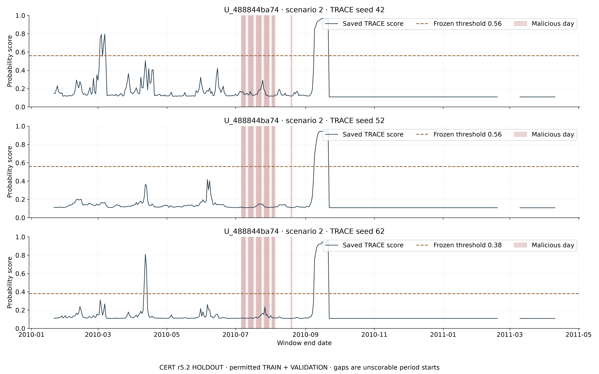
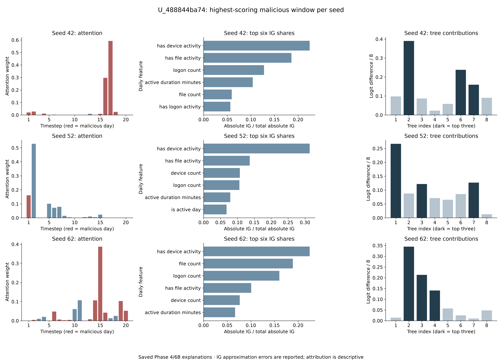
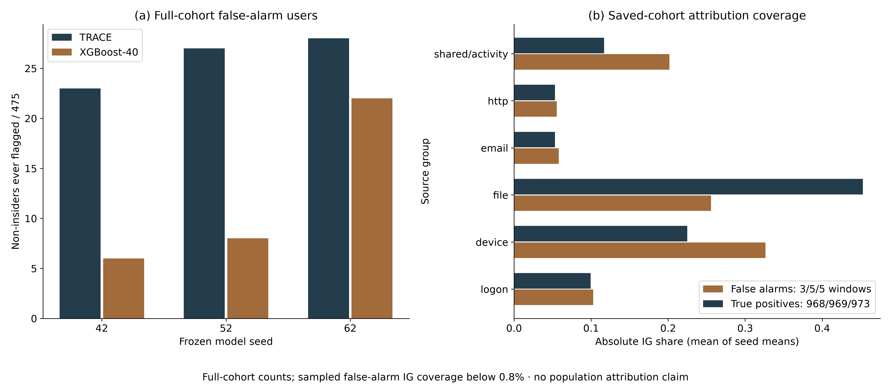
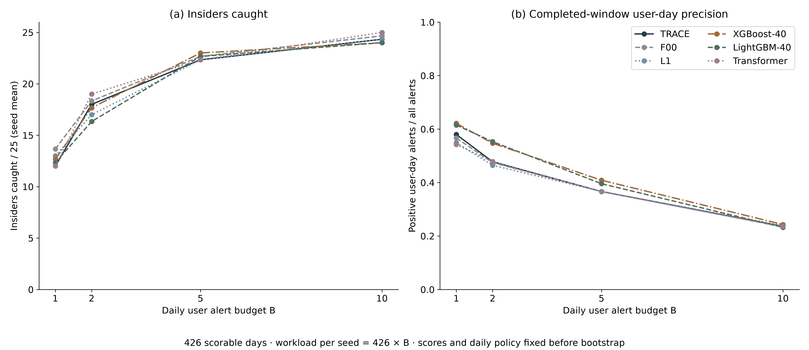
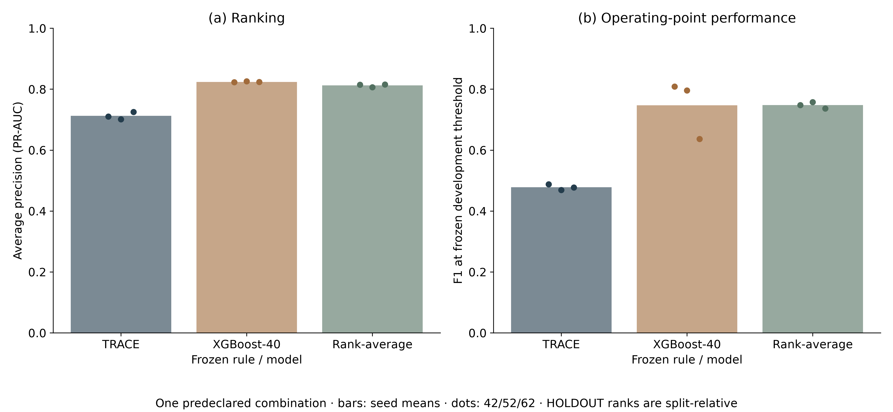
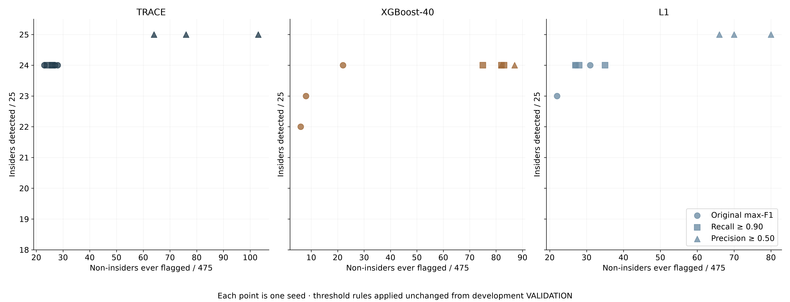

# Phase 7: operational and case analyses on 500 unseen users

Completed 2026-10-22T14:37:47.132377+00:00. Exploratory/descriptive analyses of frozen Phase 4 models and saved predictions. r5.2 TEST remains sealed. HOLDOUT users are evaluation only.

## Findings

TRACE detects 24 of 25 insiders in every seed. The same scenario-2 insider, U_488844ba74, is missed in all three; this is also the complete union of insiders missed in any TRACE seed. XGBoost-40 detects this case in all three seeds, while TRACE catches other insiders missed by XGBoost-40. The union of their frozen-threshold detection sets covers all 25 insiders in every seed; a union is a complementarity description, not an additional deployed combination.

TRACE flags 23, 27 and 28 non-insiders, versus 6, 8 and 22 for XGBoost-40. At B=1 daily alert, TRACE catches 13, 10 and 13 insiders; XGBoost-40 catches 13, 12 and 13. At B=10, TRACE catches 25, 24 and 24; XGBoost-40 catches 24 in every seed. Median malicious-window detection delay is zero days among detected insiders for both models, with undetected insiders retained separately.

The only tried rank-average combination has mean AP 0.812170 and F1 0.747533, versus TRACE 0.712201/0.477874 and XGBoost-40 0.824003/0.747053. The mean AP difference is +0.099970 versus TRACE (95% user-cluster CI 0.007574 to 0.218996) and -0.011833 versus XGBoost-40 (-0.112486 to 0.092212). These unadjusted exploratory results do not show improvement over XGBoost-40. All seedwise results and count/F1 contrasts follow below.

## Amendment 7 and execution boundary

SHA-256 `1768798af048c4918a6b68f8f750032ed7ab9375d442928e8806e5610a9a9af4` over 54787 preregistration bytes before its receipt, UTC 2026-10-22T14:20:01.9498954Z. The prior 43344-byte prefix is preserved with SHA-256 `b7008715a27e025b408fd55cdfac4b28b60424805b49991a35bfee8bf84808c5`. [Amendment receipt](AMENDMENT7_RECEIPT.json). Phase 6C was complete and its final audit passed before this amendment; its report hash remains `49e65383a32f1ffdaf859bf70ce1bc5b28777e7b9519fe5b7b8cfcf5998b86fe`.

## Amendment 7: operational and case analyses (exploratory)

Authorisation: Qasim approved CHATGPT_PHASE7_PROMPT.md on 22 October 2026 at 21:20 (+08), queued to start only after Phase 6C completion. The Phase 6C report ends PHASE6C_COMPLETE and its final audit passed before this amendment. This amendment and its SHA-256 receipt precede every Phase 7 calculation. These analyses are descriptive/exploratory and do not select a new model or recipe.

Boundaries: r5.2 TEST remains sealed. Use only the original frozen Phase 4 holdout checkpoints, saved HOLDOUT predictions, frozen thresholds, permitted aggregated daily inputs and existing Phase 4/6B explanation outputs. No retraining, new HOLDOUT prediction passes, new model/recipe search, fitted HOLDOUT references or scaling. Development VALIDATION alone supplies P5/P6 thresholds; any required development prediction pass uses the same frozen Phase 4 checkpoint. The only transductive score transformation is the explicitly authorised parameter-free P5 rank average. HOLDOUT is evaluation only: the same 500 users and permitted TRAIN+VALIDATION periods (through 2011-04-10), 25 insiders and 475 non-insiders. Models wherever applicable: TRACE (TA2/F11), task-only F00, attention-linear L1, XGBoost-40, LightGBM-40 and Transformer; seeds 42/52/62. Public case identifiers are pseudonyms only. Never output raw CERT identifiers, names, email addresses or log text. Do not modify existing repositories or push. Use two numerical CPU threads per process; any required development-only GPU inference shares the GPU with a 35% allocator cap, small batches and cooperative pauses, without controlling another chat's processes. Record missing inputs, exclusions, failures and limitations, without substituting or optimising a different analysis.

Common definitions: preserve Phase 4 row order, completed 20-day window construction and label=max daily malicious label. Primary operational evaluation is pooled completed TRAIN+VALIDATION windows; do not construct a window crossing a period boundary. Alert means score >= the corresponding frozen development threshold, as in Phase 4. An insider is detected when at least one malicious completed window alerts; a non-insider is flagged when any window alerts. Always report denominators /25 and /475. Global window rank is descending score over the entire identical held-out cohort for the exact model and seed, average rank for score ties. Temporal sorting uses end-date then pseudonym then original row index. Daily user ranking uses maximum score of that user's windows ending that day, with pseudonym ascending as the deterministic tie-break; labels do not break ties. A daily alert episode is a maximal consecutive-calendar-day run of alerting endpoints for a user, splitting at period boundaries. Report both alerting window counts and user-day/episode counts. Insiders' non-malicious windows are never silently relabelled false-alarm non-insiders.

P1: identify the scenario-2 insider missed by TRACE in every seed, and the union of all insiders missed by TRACE in any seed, by the frozen detection rule. Report every such case, not a selected favourable example. For each case: malicious-day count and span; each of the 13 aggregated daily features on every malicious day, its user's own permitted-period non-malicious median and the difference (evaluation-only descriptive reference, never used to scale a model); every TRACE malicious-containing window's score, frozen threshold, date range and global rank per seed; highest such score and its rank; every other model's detection status, first malicious-window alert end-date and rank. For the highest-scoring malicious window for each TRACE seed (ties by earliest end-date then row index), reuse saved attention over 20 days, signed IG values and normalized absolute IG shares, and reference-centred tree contributions, with top features and top three trees by absolute contribution. Do not generate new target predictions or IG/intervention experiments. If an explanation component is absent from the frozen explanation outputs, retain the case and mark that component unavailable with the exact coverage/reason. Case statements are factual model-relative observations, using the observed score/threshold, malicious-day sparsity, activity deviations and available explanation weights; no causal or personal-intent claim. Output all case tables/CSVs and score timelines with frozen thresholds and malicious-day shading at 300 dpi.

P2: TRACE and XGBoost-40 non-insider false-alarm counts and pseudonym sets per seed; pairwise Jaccard overlap across seeds within each model and between models (including corresponding seeds), with Jaccard(empty,empty)=1 disclosed. For TRACE, contrast false-alarm windows (non-insider and above threshold) with true-positive windows (malicious completed window and above threshold): mean IG share per feature and grouped source, and mean aggregated daily features. IG uses only available saved Phase 4/6B explanation cohort rows, with explicit eligible/full-window coverage counts; do not imply a matched benign explanation sample represents all false alarms. Absolute IG share is abs(IG) normalized over all 20x13 entries per window, then summed over timesteps/features; zero-total windows are excluded and counted. Source groups use the five source count+activity-flag pairs; total_events, duration and is_active_day form an explicitly labelled shared/activity group. Mean activity features use all eligible windows and all their 20 days (overlapping-window weighting disclosed), with an additional unique-user-day summary if feasible. Report alert episodes per user and per day, all per-seed tables, source shares and an explanatory figure/CSV. Source driving is an attribution observation within the available explanation cohort, not causal proof.

P3: a 25-row pseudonymised insider table gives scenario and malicious-day count, then every model/seed's detected flag, first alerting end-date, days from first malicious day and global rank. To resolve timing semantics transparently, supply both (i) first alert of any window for that insider, whose delay may be negative and is explicitly a pre-onset alert rather than a true-positive detection, and (ii) first alert on a malicious-containing window, used for insider-detection status and non-negative detection delay. Record whether a pre-onset alert falls within the 19 days before the first malicious day. Missing alerts stay missing; do not impute a delay. Give per-scenario detection counts and median/IQR delay per model/seed, plus arithmetic seed summaries where meaningful. Report detected-only delay distributions and their denominators; never treat undetected insiders as zero-day catches.

P4: per calendar day rank users by their maximum saved window score ending that day; alert top B distinct users for B=1,2,5,10 (or all available if fewer). Do not rerank by labels or tune a budget. For every model/seed/budget report insiders caught /25 using selected malicious-containing windows, median first-catch delay from first malicious day among those caught, precision of user-day alerts using the inherited completed-window label, total alerts/workload, eligible days and unique users. Also report malicious-ENDPOINT-day precision as a separately labelled descriptive check, since window-positive is not a malicious action on the alert day. Contrasts are TRACE minus XGBoost-40 and TRACE minus L1 in insiders caught at each B, for each seed and the arithmetic three-seed metric mean: 32 paired percentile-CI rows. Keep daily rankings/selected alerts fixed in the user-cluster bootstrap; resampling measures user uncertainty of the frozen daily policy rather than reranking duplicate sampled users.

P5: per seed, list detected insider and non-insider false-alarm sets in TRACE-only, XGBoost-40-only, both and neither cells. Try exactly one combination: arithmetic mean of the two within-split percentile ranks, rankdata(method='average')/N, increasing with score; compute development VALIDATION ranks within its split and HOLDOUT ranks within its split, independently and with no labels/weights fitted. Freeze the combination threshold from development VALIDATION by the original Phase 4 max-F1 rule and its deterministic tie convention before applying it to HOLDOUT. No alternative ranking, weighting, calibration or combination is tried. Report AP, F1, precision/recall, insider detections /25 and false-alarm users /475 for each seed and arithmetic mean of seed metrics. Contrasts combination minus TRACE and combination minus XGBoost-40 for AP, F1 and insiders caught, each seed and arithmetic three-seed mean: 24 paired percentile-CI rows. The rank transformation depends on the evaluation score distribution but is the sole explicitly authorised parameter-free exception; disclose the split-relative threshold interpretation.

P6: only TRACE, XGBoost-40 and L1. Use their frozen checkpoint's development VALIDATION scores and labels. Evaluate all distinct observed score thresholds using >=. Recall >=0.90 rule: choose the highest threshold attaining recall >=0.90 (thus the least-alert threshold meeting the target). Precision >=0.50 rule: among thresholds attaining precision >=0.50 choose maximum recall, then lowest threshold; if unattainable choose maximum precision, then maximum recall, then lowest threshold, and label closest attainable. Precision for an empty prediction set is zero; no empty-set perfect-precision shortcut. Freeze each rule/threshold and development achieved precision/recall before applying unchanged to HOLDOUT. Report F1, precision, recall, insiders /25 and non-insiders /475 beside the original frozen max-F1 operating point, without selecting a preferred HOLDOUT threshold.

Uncertainty and decision rules: P4 and P5 contrasts use B=2,000 paired whole-user cluster replicates, numpy default_rng(42), drawing 500 user clusters with replacement, retaining all rows per user and identical multiplicities for both sides and all seeds. Reuse the verified Phase 4 multiplicity stream if available. Metrics and ranks/policies/thresholds are fixed definitions. Recompute AP/F1 under bootstrap weights; insider-count differences sum the resampled user multiplicities of detected insiders, and report the original count-difference units. Arithmetic three-seed contrasts average seed metrics, never probabilities. Percentile 95% CIs omit undefined replicates and report attempted/valid counts. CI direction is above if lower>0, below if upper<0, otherwise compatible with zero. These exploratory CIs have no requested multiplicity adjustment and are not simultaneous inference; do not label a multiplicity-controlled significant result or equivalence. P1/P2/P3/P6 are descriptive, with no unrequested hypothesis tests or post-hoc combinations. All six blocks and every requested outcome are retained regardless of result.

Deliverables: phase7/CHATGPT_PHASE7_REPORT.md containing Amendment 7 and SHA-256 receipt, all requested P1-P6 tables (wide 25-row timing table plus readable long CSV), 300-dpi figures with final font size at least 12 pt and adjacent source-data CSVs, explicit skips/deviations/coverage limitations, PHASE7_RESULTS.json and integrity audit. Preserve original source/checkpoint/prediction/explanation hashes and prior reports. End the report PHASE7_COMPLETE only after all outcomes and deliverables have been accounted for and verified.

Amendment 7 SHA-256 receipt (UTC 2026-10-22T14:20:01.9498954Z): 1768798af048c4918a6b68f8f750032ed7ab9375d442928e8806e5610a9a9af4 (entire preregistration through Amendment 7, before this receipt; 54787 bytes). Previous prefix: 43344 bytes, SHA-256 b7008715a27e025b408fd55cdfac4b28b60424805b49991a35bfee8bf84808c5. No Phase 7 computation preceded this receipt.

No model is retrained and no HOLDOUT prediction pass is repeated. The original 18 model-seed prediction arrays, checkpoints and thresholds are reused. Only the six frozen TRACE/L1 checkpoints require development-VALIDATION inference for the declared thresholds; XGBoost validation predictions are already saved. All nine development score arrays and all 21 P5/P6 thresholds were frozen before these policies were evaluated on HOLDOUT. A GPU allocator cap of 35%, small batches, cooperative pauses and two CPU threads share resources without controlling another chat.

Primary cohort: 213,000 completed 20-day windows, 1,172 positive windows, 500 unseen users (25 insiders, 475 non-insiders), permitted TRAIN+VALIDATION dates 2010-01-02 through 2011-04-10. Endpoints are available on 426 days. No cross-period windows are created. An alert uses score >= frozen threshold; insider detection requires an alert on a malicious-containing completed window. Non-insider false alarms use any alert. Global ranks descend across all 213,000 windows for the same model/seed, with average ranks on ties.

## P1: missed-insider case study

| user | scenario | malicious days | first malicious day | last malicious day | span calendar days | malicious window count | nonmalicious reference days | nonmalicious active days | nonmalicious inactive days | missed all TRACE seeds | missed TRACE seeds |
| --- | --- | --- | --- | --- | --- | --- | --- | --- | --- | --- | --- |
| U_488844ba74 | 2 | 23 | 2010-07-06 | 2010-08-19 | 45 | 64 | 441 | 148 | 293 | yes | 42, 52, 62 |

This user has 23 malicious days over a 45-day span and 64 malicious-containing windows. The peak TRACE scores remain below threshold in all seeds. The all-day non-malicious medians are zero; therefore the activity comparison does not support a claim that the malicious days resemble the normal active-day profile. All 13 daily feature values, own non-malicious medians and differences are shown in the detailed table below.

| user | scenario | seed | source row | end date | max malicious window score | threshold | score margin | global window rank | rank percent | malicious days within window | detected |
| --- | --- | --- | --- | --- | --- | --- | --- | --- | --- | --- | --- |
| U_488844ba74 | 2 | 42 | 176975 | 2010-07-25 | 0.291107 | 0.56 | -0.268893 | 3173 | 1.48967 | 14 | no |
| U_488844ba74 | 2 | 52 | 177019 | 2010-09-07 | 0.232373 | 0.56 | -0.327627 | 4250 | 1.99531 | 1 | no |
| U_488844ba74 | 2 | 62 | 176977 | 2010-07-27 | 0.233927 | 0.38 | -0.146073 | 3224 | 1.51362 | 14 | no |

| user | seed | source row | end date | max all window score | threshold | global window rank | contains malicious day | alert | days since last malicious day | all alert windows | malicious alert windows |
| --- | --- | --- | --- | --- | --- | --- | --- | --- | --- | --- | --- |
| U_488844ba74 | 42 | 177028 | 2010-09-16 | 0.966423 | 0.56 | 464 | no | yes | 28 | 17 | 0 |
| U_488844ba74 | 52 | 177033 | 2010-09-21 | 0.945328 | 0.56 | 257 | no | yes | 33 | 13 | 0 |
| U_488844ba74 | 62 | 177033 | 2010-09-21 | 0.964072 | 0.38 | 513 | no | yes | 33 | 16 | 0 |

The highest overall scores are explicitly separated from the highest malicious-containing scores. TRACE alerts outside the labelled malicious-containing windows for this user; those alerts do not count as malicious detection.

| Other model | Seed | Detected | First malicious-window alert | Delay days | Global rank | Frozen threshold |
| --- | --- | --- | --- | --- | --- | --- |
| F00 | 42 | no | — | — | — | 0.95 |
| F00 | 52 | no | — | — | — | 0.56 |
| F00 | 62 | no | — | — | — | 0.22 |
| L1 | 42 | no | — | — | — | 0.66 |
| L1 | 52 | no | — | — | — | 0.59 |
| L1 | 62 | no | — | — | — | 0.44 |
| XGBoost-40 | 42 | yes | 2010-07-07 | 1 | 921 | 0.64 |
| XGBoost-40 | 52 | yes | 2010-07-06 | 0 | 913 | 0.51 |
| XGBoost-40 | 62 | yes | 2010-07-06 | 0 | 959 | 0.06 |
| LightGBM-40 | 42 | yes | 2010-07-06 | 0 | 2190 | 0.0392767 |
| LightGBM-40 | 52 | yes | 2010-07-06 | 0 | 1119 | 0.477009 |
| LightGBM-40 | 62 | yes | 2010-07-08 | 2 | 1284 | 0.286614 |
| Transformer | 42 | no | — | — | — | 0.587556 |
| Transformer | 52 | no | — | — | — | 0.881881 |
| Transformer | 62 | yes | 2010-07-19 | 13 | 2600 | 0.863858 |

Model-relative explanation: the peak malicious-window logits are -0.890, -1.195 and -1.186, below threshold logits +0.241, +0.241 and -0.490. Their attention masses on malicious days are 98.6%, 16.1% and 76.4%, against malicious-day fractions 70%, 5% and 70% in the selected windows. Thus low attention to malicious days is not a consistent explanation of the miss. The frozen mean-tree readout supplies insufficient positive logit at these operating points despite the observed activity and attention. The device-activity flag has a negative signed IG sum in all three peak windows, but the large completeness errors prevent an exact feature-based or causal explanation. This is a statement about the frozen models, not about the person’s intent.

| user | seed | source row | original logit | threshold logit | attention mass on malicious days | malicious day fraction | IG logit difference | IG completeness residual | IG relative completeness residual |
| --- | --- | --- | --- | --- | --- | --- | --- | --- | --- |
| U_488844ba74 | 42 | 176975 | -0.890012 | 0.241162 | 0.986241 | 0.7 | 1.21041 | 0.282964 | 0.233776 |
| U_488844ba74 | 52 | 177019 | -1.19496 | 0.241162 | 0.160812 | 0.05 | 0.906184 | -0.167372 | 0.1847 |
| U_488844ba74 | 62 | 176977 | -1.18627 | -0.489548 | 0.763869 | 0.7 | 0.915158 | -1.58228 | 1.72896 |

[Timeline source data](figure_P1_timeline_U_488844ba74.csv). Each malicious day is shaded. [Every case window score](P1_ALL_CASE_WINDOW_SCORES.csv); [malicious-containing windows only](P1_MALICIOUS_CONTAINING_WINDOW_SCORES.csv).

[Explanation figure data](figure_P1_explanations_U_488844ba74.csv). Dark tree bars are the top three by absolute reference-centred contribution; references come from development TRAIN. All 13 IG features, all 20 attention days and all eight trees are included below.

### P1 daily features on all malicious days

| user | scenario | date | feature | malicious day value | own nonmalicious day median | difference | nonmalicious reference days |
| --- | --- | --- | --- | --- | --- | --- | --- |
| U_488844ba74 | 2 | 2010-07-06 | total_events | 190 | 0 | 190 | 441 |
| U_488844ba74 | 2 | 2010-07-06 | logon_count | 8 | 0 | 8 | 441 |
| U_488844ba74 | 2 | 2010-07-06 | device_count | 6 | 0 | 6 | 441 |
| U_488844ba74 | 2 | 2010-07-06 | file_count | 7 | 0 | 7 | 441 |
| U_488844ba74 | 2 | 2010-07-06 | email_count | 53 | 0 | 53 | 441 |
| U_488844ba74 | 2 | 2010-07-06 | http_count | 116 | 0 | 116 | 441 |
| U_488844ba74 | 2 | 2010-07-06 | active_duration_minutes | 968 | 0 | 968 | 441 |
| U_488844ba74 | 2 | 2010-07-06 | has_logon_activity | 1 | 0 | 1 | 441 |
| U_488844ba74 | 2 | 2010-07-06 | has_device_activity | 1 | 0 | 1 | 441 |
| U_488844ba74 | 2 | 2010-07-06 | has_file_activity | 1 | 0 | 1 | 441 |
| U_488844ba74 | 2 | 2010-07-06 | has_email_activity | 1 | 0 | 1 | 441 |
| U_488844ba74 | 2 | 2010-07-06 | has_http_activity | 1 | 0 | 1 | 441 |
| U_488844ba74 | 2 | 2010-07-06 | is_active_day | 1 | 0 | 1 | 441 |
| U_488844ba74 | 2 | 2010-07-07 | total_events | 198 | 0 | 198 | 441 |
| U_488844ba74 | 2 | 2010-07-07 | logon_count | 10 | 0 | 10 | 441 |
| U_488844ba74 | 2 | 2010-07-07 | device_count | 8 | 0 | 8 | 441 |
| U_488844ba74 | 2 | 2010-07-07 | file_count | 9 | 0 | 9 | 441 |
| U_488844ba74 | 2 | 2010-07-07 | email_count | 50 | 0 | 50 | 441 |
| U_488844ba74 | 2 | 2010-07-07 | http_count | 121 | 0 | 121 | 441 |
| U_488844ba74 | 2 | 2010-07-07 | active_duration_minutes | 1027 | 0 | 1027 | 441 |
| U_488844ba74 | 2 | 2010-07-07 | has_logon_activity | 1 | 0 | 1 | 441 |
| U_488844ba74 | 2 | 2010-07-07 | has_device_activity | 1 | 0 | 1 | 441 |
| U_488844ba74 | 2 | 2010-07-07 | has_file_activity | 1 | 0 | 1 | 441 |
| U_488844ba74 | 2 | 2010-07-07 | has_email_activity | 1 | 0 | 1 | 441 |
| U_488844ba74 | 2 | 2010-07-07 | has_http_activity | 1 | 0 | 1 | 441 |
| U_488844ba74 | 2 | 2010-07-07 | is_active_day | 1 | 0 | 1 | 441 |
| U_488844ba74 | 2 | 2010-07-08 | total_events | 185 | 0 | 185 | 441 |
| U_488844ba74 | 2 | 2010-07-08 | logon_count | 8 | 0 | 8 | 441 |
| U_488844ba74 | 2 | 2010-07-08 | device_count | 6 | 0 | 6 | 441 |
| U_488844ba74 | 2 | 2010-07-08 | file_count | 19 | 0 | 19 | 441 |
| U_488844ba74 | 2 | 2010-07-08 | email_count | 37 | 0 | 37 | 441 |
| U_488844ba74 | 2 | 2010-07-08 | http_count | 115 | 0 | 115 | 441 |
| U_488844ba74 | 2 | 2010-07-08 | active_duration_minutes | 858 | 0 | 858 | 441 |
| U_488844ba74 | 2 | 2010-07-08 | has_logon_activity | 1 | 0 | 1 | 441 |
| U_488844ba74 | 2 | 2010-07-08 | has_device_activity | 1 | 0 | 1 | 441 |
| U_488844ba74 | 2 | 2010-07-08 | has_file_activity | 1 | 0 | 1 | 441 |
| U_488844ba74 | 2 | 2010-07-08 | has_email_activity | 1 | 0 | 1 | 441 |
| U_488844ba74 | 2 | 2010-07-08 | has_http_activity | 1 | 0 | 1 | 441 |
| U_488844ba74 | 2 | 2010-07-08 | is_active_day | 1 | 0 | 1 | 441 |
| U_488844ba74 | 2 | 2010-07-09 | total_events | 178 | 0 | 178 | 441 |
| U_488844ba74 | 2 | 2010-07-09 | logon_count | 10 | 0 | 10 | 441 |
| U_488844ba74 | 2 | 2010-07-09 | device_count | 8 | 0 | 8 | 441 |
| U_488844ba74 | 2 | 2010-07-09 | file_count | 11 | 0 | 11 | 441 |
| U_488844ba74 | 2 | 2010-07-09 | email_count | 33 | 0 | 33 | 441 |
| U_488844ba74 | 2 | 2010-07-09 | http_count | 116 | 0 | 116 | 441 |
| U_488844ba74 | 2 | 2010-07-09 | active_duration_minutes | 1078 | 0 | 1078 | 441 |
| U_488844ba74 | 2 | 2010-07-09 | has_logon_activity | 1 | 0 | 1 | 441 |
| U_488844ba74 | 2 | 2010-07-09 | has_device_activity | 1 | 0 | 1 | 441 |
| U_488844ba74 | 2 | 2010-07-09 | has_file_activity | 1 | 0 | 1 | 441 |
| U_488844ba74 | 2 | 2010-07-09 | has_email_activity | 1 | 0 | 1 | 441 |
| U_488844ba74 | 2 | 2010-07-09 | has_http_activity | 1 | 0 | 1 | 441 |
| U_488844ba74 | 2 | 2010-07-09 | is_active_day | 1 | 0 | 1 | 441 |
| U_488844ba74 | 2 | 2010-07-12 | total_events | 183 | 0 | 183 | 441 |
| U_488844ba74 | 2 | 2010-07-12 | logon_count | 4 | 0 | 4 | 441 |
| U_488844ba74 | 2 | 2010-07-12 | device_count | 2 | 0 | 2 | 441 |
| U_488844ba74 | 2 | 2010-07-12 | file_count | 7 | 0 | 7 | 441 |
| U_488844ba74 | 2 | 2010-07-12 | email_count | 52 | 0 | 52 | 441 |
| U_488844ba74 | 2 | 2010-07-12 | http_count | 118 | 0 | 118 | 441 |
| U_488844ba74 | 2 | 2010-07-12 | active_duration_minutes | 702 | 0 | 702 | 441 |
| U_488844ba74 | 2 | 2010-07-12 | has_logon_activity | 1 | 0 | 1 | 441 |
| U_488844ba74 | 2 | 2010-07-12 | has_device_activity | 1 | 0 | 1 | 441 |
| U_488844ba74 | 2 | 2010-07-12 | has_file_activity | 1 | 0 | 1 | 441 |
| U_488844ba74 | 2 | 2010-07-12 | has_email_activity | 1 | 0 | 1 | 441 |
| U_488844ba74 | 2 | 2010-07-12 | has_http_activity | 1 | 0 | 1 | 441 |
| U_488844ba74 | 2 | 2010-07-12 | is_active_day | 1 | 0 | 1 | 441 |
| U_488844ba74 | 2 | 2010-07-13 | total_events | 157 | 0 | 157 | 441 |
| U_488844ba74 | 2 | 2010-07-13 | logon_count | 4 | 0 | 4 | 441 |
| U_488844ba74 | 2 | 2010-07-13 | device_count | 0 | 0 | 0 | 441 |
| U_488844ba74 | 2 | 2010-07-13 | file_count | 0 | 0 | 0 | 441 |
| U_488844ba74 | 2 | 2010-07-13 | email_count | 35 | 0 | 35 | 441 |
| U_488844ba74 | 2 | 2010-07-13 | http_count | 118 | 0 | 118 | 441 |
| U_488844ba74 | 2 | 2010-07-13 | active_duration_minutes | 742 | 0 | 742 | 441 |
| U_488844ba74 | 2 | 2010-07-13 | has_logon_activity | 1 | 0 | 1 | 441 |
| U_488844ba74 | 2 | 2010-07-13 | has_device_activity | 0 | 0 | 0 | 441 |
| U_488844ba74 | 2 | 2010-07-13 | has_file_activity | 0 | 0 | 0 | 441 |
| U_488844ba74 | 2 | 2010-07-13 | has_email_activity | 1 | 0 | 1 | 441 |
| U_488844ba74 | 2 | 2010-07-13 | has_http_activity | 1 | 0 | 1 | 441 |
| U_488844ba74 | 2 | 2010-07-13 | is_active_day | 1 | 0 | 1 | 441 |
| U_488844ba74 | 2 | 2010-07-14 | total_events | 188 | 0 | 188 | 441 |
| U_488844ba74 | 2 | 2010-07-14 | logon_count | 12 | 0 | 12 | 441 |
| U_488844ba74 | 2 | 2010-07-14 | device_count | 8 | 0 | 8 | 441 |
| U_488844ba74 | 2 | 2010-07-14 | file_count | 21 | 0 | 21 | 441 |
| U_488844ba74 | 2 | 2010-07-14 | email_count | 31 | 0 | 31 | 441 |
| U_488844ba74 | 2 | 2010-07-14 | http_count | 116 | 0 | 116 | 441 |
| U_488844ba74 | 2 | 2010-07-14 | active_duration_minutes | 1193 | 0 | 1193 | 441 |
| U_488844ba74 | 2 | 2010-07-14 | has_logon_activity | 1 | 0 | 1 | 441 |
| U_488844ba74 | 2 | 2010-07-14 | has_device_activity | 1 | 0 | 1 | 441 |
| U_488844ba74 | 2 | 2010-07-14 | has_file_activity | 1 | 0 | 1 | 441 |
| U_488844ba74 | 2 | 2010-07-14 | has_email_activity | 1 | 0 | 1 | 441 |
| U_488844ba74 | 2 | 2010-07-14 | has_http_activity | 1 | 0 | 1 | 441 |
| U_488844ba74 | 2 | 2010-07-14 | is_active_day | 1 | 0 | 1 | 441 |
| U_488844ba74 | 2 | 2010-07-15 | total_events | 158 | 0 | 158 | 441 |
| U_488844ba74 | 2 | 2010-07-15 | logon_count | 4 | 0 | 4 | 441 |
| U_488844ba74 | 2 | 2010-07-15 | device_count | 2 | 0 | 2 | 441 |
| U_488844ba74 | 2 | 2010-07-15 | file_count | 2 | 0 | 2 | 441 |
| U_488844ba74 | 2 | 2010-07-15 | email_count | 35 | 0 | 35 | 441 |
| U_488844ba74 | 2 | 2010-07-15 | http_count | 115 | 0 | 115 | 441 |
| U_488844ba74 | 2 | 2010-07-15 | active_duration_minutes | 761 | 0 | 761 | 441 |
| U_488844ba74 | 2 | 2010-07-15 | has_logon_activity | 1 | 0 | 1 | 441 |
| U_488844ba74 | 2 | 2010-07-15 | has_device_activity | 1 | 0 | 1 | 441 |
| U_488844ba74 | 2 | 2010-07-15 | has_file_activity | 1 | 0 | 1 | 441 |
| U_488844ba74 | 2 | 2010-07-15 | has_email_activity | 1 | 0 | 1 | 441 |
| U_488844ba74 | 2 | 2010-07-15 | has_http_activity | 1 | 0 | 1 | 441 |
| U_488844ba74 | 2 | 2010-07-15 | is_active_day | 1 | 0 | 1 | 441 |
| U_488844ba74 | 2 | 2010-07-16 | total_events | 162 | 0 | 162 | 441 |
| U_488844ba74 | 2 | 2010-07-16 | logon_count | 4 | 0 | 4 | 441 |
| U_488844ba74 | 2 | 2010-07-16 | device_count | 2 | 0 | 2 | 441 |
| U_488844ba74 | 2 | 2010-07-16 | file_count | 2 | 0 | 2 | 441 |
| U_488844ba74 | 2 | 2010-07-16 | email_count | 33 | 0 | 33 | 441 |
| U_488844ba74 | 2 | 2010-07-16 | http_count | 121 | 0 | 121 | 441 |
| U_488844ba74 | 2 | 2010-07-16 | active_duration_minutes | 913 | 0 | 913 | 441 |
| U_488844ba74 | 2 | 2010-07-16 | has_logon_activity | 1 | 0 | 1 | 441 |
| U_488844ba74 | 2 | 2010-07-16 | has_device_activity | 1 | 0 | 1 | 441 |
| U_488844ba74 | 2 | 2010-07-16 | has_file_activity | 1 | 0 | 1 | 441 |
| U_488844ba74 | 2 | 2010-07-16 | has_email_activity | 1 | 0 | 1 | 441 |
| U_488844ba74 | 2 | 2010-07-16 | has_http_activity | 1 | 0 | 1 | 441 |
| U_488844ba74 | 2 | 2010-07-16 | is_active_day | 1 | 0 | 1 | 441 |
| U_488844ba74 | 2 | 2010-07-19 | total_events | 179 | 0 | 179 | 441 |
| U_488844ba74 | 2 | 2010-07-19 | logon_count | 6 | 0 | 6 | 441 |
| U_488844ba74 | 2 | 2010-07-19 | device_count | 2 | 0 | 2 | 441 |
| U_488844ba74 | 2 | 2010-07-19 | file_count | 8 | 0 | 8 | 441 |
| U_488844ba74 | 2 | 2010-07-19 | email_count | 46 | 0 | 46 | 441 |
| U_488844ba74 | 2 | 2010-07-19 | http_count | 117 | 0 | 117 | 441 |
| U_488844ba74 | 2 | 2010-07-19 | active_duration_minutes | 880 | 0 | 880 | 441 |
| U_488844ba74 | 2 | 2010-07-19 | has_logon_activity | 1 | 0 | 1 | 441 |
| U_488844ba74 | 2 | 2010-07-19 | has_device_activity | 1 | 0 | 1 | 441 |
| U_488844ba74 | 2 | 2010-07-19 | has_file_activity | 1 | 0 | 1 | 441 |
| U_488844ba74 | 2 | 2010-07-19 | has_email_activity | 1 | 0 | 1 | 441 |
| U_488844ba74 | 2 | 2010-07-19 | has_http_activity | 1 | 0 | 1 | 441 |
| U_488844ba74 | 2 | 2010-07-19 | is_active_day | 1 | 0 | 1 | 441 |
| U_488844ba74 | 2 | 2010-07-20 | total_events | 167 | 0 | 167 | 441 |
| U_488844ba74 | 2 | 2010-07-20 | logon_count | 4 | 0 | 4 | 441 |
| U_488844ba74 | 2 | 2010-07-20 | device_count | 2 | 0 | 2 | 441 |
| U_488844ba74 | 2 | 2010-07-20 | file_count | 9 | 0 | 9 | 441 |
| U_488844ba74 | 2 | 2010-07-20 | email_count | 34 | 0 | 34 | 441 |
| U_488844ba74 | 2 | 2010-07-20 | http_count | 118 | 0 | 118 | 441 |
| U_488844ba74 | 2 | 2010-07-20 | active_duration_minutes | 883 | 0 | 883 | 441 |
| U_488844ba74 | 2 | 2010-07-20 | has_logon_activity | 1 | 0 | 1 | 441 |
| U_488844ba74 | 2 | 2010-07-20 | has_device_activity | 1 | 0 | 1 | 441 |
| U_488844ba74 | 2 | 2010-07-20 | has_file_activity | 1 | 0 | 1 | 441 |
| U_488844ba74 | 2 | 2010-07-20 | has_email_activity | 1 | 0 | 1 | 441 |
| U_488844ba74 | 2 | 2010-07-20 | has_http_activity | 1 | 0 | 1 | 441 |
| U_488844ba74 | 2 | 2010-07-20 | is_active_day | 1 | 0 | 1 | 441 |
| U_488844ba74 | 2 | 2010-07-21 | total_events | 182 | 0 | 182 | 441 |
| U_488844ba74 | 2 | 2010-07-21 | logon_count | 10 | 0 | 10 | 441 |
| U_488844ba74 | 2 | 2010-07-21 | device_count | 8 | 0 | 8 | 441 |
| U_488844ba74 | 2 | 2010-07-21 | file_count | 10 | 0 | 10 | 441 |
| U_488844ba74 | 2 | 2010-07-21 | email_count | 32 | 0 | 32 | 441 |
| U_488844ba74 | 2 | 2010-07-21 | http_count | 122 | 0 | 122 | 441 |
| U_488844ba74 | 2 | 2010-07-21 | active_duration_minutes | 888 | 0 | 888 | 441 |
| U_488844ba74 | 2 | 2010-07-21 | has_logon_activity | 1 | 0 | 1 | 441 |
| U_488844ba74 | 2 | 2010-07-21 | has_device_activity | 1 | 0 | 1 | 441 |
| U_488844ba74 | 2 | 2010-07-21 | has_file_activity | 1 | 0 | 1 | 441 |
| U_488844ba74 | 2 | 2010-07-21 | has_email_activity | 1 | 0 | 1 | 441 |
| U_488844ba74 | 2 | 2010-07-21 | has_http_activity | 1 | 0 | 1 | 441 |
| U_488844ba74 | 2 | 2010-07-21 | is_active_day | 1 | 0 | 1 | 441 |
| U_488844ba74 | 2 | 2010-07-22 | total_events | 176 | 0 | 176 | 441 |
| U_488844ba74 | 2 | 2010-07-22 | logon_count | 10 | 0 | 10 | 441 |
| U_488844ba74 | 2 | 2010-07-22 | device_count | 6 | 0 | 6 | 441 |
| U_488844ba74 | 2 | 2010-07-22 | file_count | 7 | 0 | 7 | 441 |
| U_488844ba74 | 2 | 2010-07-22 | email_count | 32 | 0 | 32 | 441 |
| U_488844ba74 | 2 | 2010-07-22 | http_count | 121 | 0 | 121 | 441 |
| U_488844ba74 | 2 | 2010-07-22 | active_duration_minutes | 914 | 0 | 914 | 441 |
| U_488844ba74 | 2 | 2010-07-22 | has_logon_activity | 1 | 0 | 1 | 441 |
| U_488844ba74 | 2 | 2010-07-22 | has_device_activity | 1 | 0 | 1 | 441 |
| U_488844ba74 | 2 | 2010-07-22 | has_file_activity | 1 | 0 | 1 | 441 |
| U_488844ba74 | 2 | 2010-07-22 | has_email_activity | 1 | 0 | 1 | 441 |
| U_488844ba74 | 2 | 2010-07-22 | has_http_activity | 1 | 0 | 1 | 441 |
| U_488844ba74 | 2 | 2010-07-22 | is_active_day | 1 | 0 | 1 | 441 |
| U_488844ba74 | 2 | 2010-07-23 | total_events | 186 | 0 | 186 | 441 |
| U_488844ba74 | 2 | 2010-07-23 | logon_count | 12 | 0 | 12 | 441 |
| U_488844ba74 | 2 | 2010-07-23 | device_count | 10 | 0 | 10 | 441 |
| U_488844ba74 | 2 | 2010-07-23 | file_count | 15 | 0 | 15 | 441 |
| U_488844ba74 | 2 | 2010-07-23 | email_count | 31 | 0 | 31 | 441 |
| U_488844ba74 | 2 | 2010-07-23 | http_count | 118 | 0 | 118 | 441 |
| U_488844ba74 | 2 | 2010-07-23 | active_duration_minutes | 772 | 0 | 772 | 441 |
| U_488844ba74 | 2 | 2010-07-23 | has_logon_activity | 1 | 0 | 1 | 441 |
| U_488844ba74 | 2 | 2010-07-23 | has_device_activity | 1 | 0 | 1 | 441 |
| U_488844ba74 | 2 | 2010-07-23 | has_file_activity | 1 | 0 | 1 | 441 |
| U_488844ba74 | 2 | 2010-07-23 | has_email_activity | 1 | 0 | 1 | 441 |
| U_488844ba74 | 2 | 2010-07-23 | has_http_activity | 1 | 0 | 1 | 441 |
| U_488844ba74 | 2 | 2010-07-23 | is_active_day | 1 | 0 | 1 | 441 |
| U_488844ba74 | 2 | 2010-07-26 | total_events | 184 | 0 | 184 | 441 |
| U_488844ba74 | 2 | 2010-07-26 | logon_count | 10 | 0 | 10 | 441 |
| U_488844ba74 | 2 | 2010-07-26 | device_count | 8 | 0 | 8 | 441 |
| U_488844ba74 | 2 | 2010-07-26 | file_count | 3 | 0 | 3 | 441 |
| U_488844ba74 | 2 | 2010-07-26 | email_count | 47 | 0 | 47 | 441 |
| U_488844ba74 | 2 | 2010-07-26 | http_count | 116 | 0 | 116 | 441 |
| U_488844ba74 | 2 | 2010-07-26 | active_duration_minutes | 1221 | 0 | 1221 | 441 |
| U_488844ba74 | 2 | 2010-07-26 | has_logon_activity | 1 | 0 | 1 | 441 |
| U_488844ba74 | 2 | 2010-07-26 | has_device_activity | 1 | 0 | 1 | 441 |
| U_488844ba74 | 2 | 2010-07-26 | has_file_activity | 1 | 0 | 1 | 441 |
| U_488844ba74 | 2 | 2010-07-26 | has_email_activity | 1 | 0 | 1 | 441 |
| U_488844ba74 | 2 | 2010-07-26 | has_http_activity | 1 | 0 | 1 | 441 |
| U_488844ba74 | 2 | 2010-07-26 | is_active_day | 1 | 0 | 1 | 441 |
| U_488844ba74 | 2 | 2010-07-27 | total_events | 186 | 0 | 186 | 441 |
| U_488844ba74 | 2 | 2010-07-27 | logon_count | 10 | 0 | 10 | 441 |
| U_488844ba74 | 2 | 2010-07-27 | device_count | 8 | 0 | 8 | 441 |
| U_488844ba74 | 2 | 2010-07-27 | file_count | 16 | 0 | 16 | 441 |
| U_488844ba74 | 2 | 2010-07-27 | email_count | 35 | 0 | 35 | 441 |
| U_488844ba74 | 2 | 2010-07-27 | http_count | 117 | 0 | 117 | 441 |
| U_488844ba74 | 2 | 2010-07-27 | active_duration_minutes | 1364 | 0 | 1364 | 441 |
| U_488844ba74 | 2 | 2010-07-27 | has_logon_activity | 1 | 0 | 1 | 441 |
| U_488844ba74 | 2 | 2010-07-27 | has_device_activity | 1 | 0 | 1 | 441 |
| U_488844ba74 | 2 | 2010-07-27 | has_file_activity | 1 | 0 | 1 | 441 |
| U_488844ba74 | 2 | 2010-07-27 | has_email_activity | 1 | 0 | 1 | 441 |
| U_488844ba74 | 2 | 2010-07-27 | has_http_activity | 1 | 0 | 1 | 441 |
| U_488844ba74 | 2 | 2010-07-27 | is_active_day | 1 | 0 | 1 | 441 |
| U_488844ba74 | 2 | 2010-07-28 | total_events | 162 | 0 | 162 | 441 |
| U_488844ba74 | 2 | 2010-07-28 | logon_count | 4 | 0 | 4 | 441 |
| U_488844ba74 | 2 | 2010-07-28 | device_count | 2 | 0 | 2 | 441 |
| U_488844ba74 | 2 | 2010-07-28 | file_count | 3 | 0 | 3 | 441 |
| U_488844ba74 | 2 | 2010-07-28 | email_count | 30 | 0 | 30 | 441 |
| U_488844ba74 | 2 | 2010-07-28 | http_count | 123 | 0 | 123 | 441 |
| U_488844ba74 | 2 | 2010-07-28 | active_duration_minutes | 726 | 0 | 726 | 441 |
| U_488844ba74 | 2 | 2010-07-28 | has_logon_activity | 1 | 0 | 1 | 441 |
| U_488844ba74 | 2 | 2010-07-28 | has_device_activity | 1 | 0 | 1 | 441 |
| U_488844ba74 | 2 | 2010-07-28 | has_file_activity | 1 | 0 | 1 | 441 |
| U_488844ba74 | 2 | 2010-07-28 | has_email_activity | 1 | 0 | 1 | 441 |
| U_488844ba74 | 2 | 2010-07-28 | has_http_activity | 1 | 0 | 1 | 441 |
| U_488844ba74 | 2 | 2010-07-28 | is_active_day | 1 | 0 | 1 | 441 |
| U_488844ba74 | 2 | 2010-07-29 | total_events | 191 | 0 | 191 | 441 |
| U_488844ba74 | 2 | 2010-07-29 | logon_count | 12 | 0 | 12 | 441 |
| U_488844ba74 | 2 | 2010-07-29 | device_count | 8 | 0 | 8 | 441 |
| U_488844ba74 | 2 | 2010-07-29 | file_count | 14 | 0 | 14 | 441 |
| U_488844ba74 | 2 | 2010-07-29 | email_count | 39 | 0 | 39 | 441 |
| U_488844ba74 | 2 | 2010-07-29 | http_count | 118 | 0 | 118 | 441 |
| U_488844ba74 | 2 | 2010-07-29 | active_duration_minutes | 1269 | 0 | 1269 | 441 |
| U_488844ba74 | 2 | 2010-07-29 | has_logon_activity | 1 | 0 | 1 | 441 |
| U_488844ba74 | 2 | 2010-07-29 | has_device_activity | 1 | 0 | 1 | 441 |
| U_488844ba74 | 2 | 2010-07-29 | has_file_activity | 1 | 0 | 1 | 441 |
| U_488844ba74 | 2 | 2010-07-29 | has_email_activity | 1 | 0 | 1 | 441 |
| U_488844ba74 | 2 | 2010-07-29 | has_http_activity | 1 | 0 | 1 | 441 |
| U_488844ba74 | 2 | 2010-07-29 | is_active_day | 1 | 0 | 1 | 441 |
| U_488844ba74 | 2 | 2010-07-30 | total_events | 160 | 0 | 160 | 441 |
| U_488844ba74 | 2 | 2010-07-30 | logon_count | 4 | 0 | 4 | 441 |
| U_488844ba74 | 2 | 2010-07-30 | device_count | 2 | 0 | 2 | 441 |
| U_488844ba74 | 2 | 2010-07-30 | file_count | 0 | 0 | 0 | 441 |
| U_488844ba74 | 2 | 2010-07-30 | email_count | 36 | 0 | 36 | 441 |
| U_488844ba74 | 2 | 2010-07-30 | http_count | 118 | 0 | 118 | 441 |
| U_488844ba74 | 2 | 2010-07-30 | active_duration_minutes | 839 | 0 | 839 | 441 |
| U_488844ba74 | 2 | 2010-07-30 | has_logon_activity | 1 | 0 | 1 | 441 |
| U_488844ba74 | 2 | 2010-07-30 | has_device_activity | 1 | 0 | 1 | 441 |
| U_488844ba74 | 2 | 2010-07-30 | has_file_activity | 0 | 0 | 0 | 441 |
| U_488844ba74 | 2 | 2010-07-30 | has_email_activity | 1 | 0 | 1 | 441 |
| U_488844ba74 | 2 | 2010-07-30 | has_http_activity | 1 | 0 | 1 | 441 |
| U_488844ba74 | 2 | 2010-07-30 | is_active_day | 1 | 0 | 1 | 441 |
| U_488844ba74 | 2 | 2010-08-02 | total_events | 171 | 0 | 171 | 441 |
| U_488844ba74 | 2 | 2010-08-02 | logon_count | 6 | 0 | 6 | 441 |
| U_488844ba74 | 2 | 2010-08-02 | device_count | 4 | 0 | 4 | 441 |
| U_488844ba74 | 2 | 2010-08-02 | file_count | 0 | 0 | 0 | 441 |
| U_488844ba74 | 2 | 2010-08-02 | email_count | 45 | 0 | 45 | 441 |
| U_488844ba74 | 2 | 2010-08-02 | http_count | 116 | 0 | 116 | 441 |
| U_488844ba74 | 2 | 2010-08-02 | active_duration_minutes | 596 | 0 | 596 | 441 |
| U_488844ba74 | 2 | 2010-08-02 | has_logon_activity | 1 | 0 | 1 | 441 |
| U_488844ba74 | 2 | 2010-08-02 | has_device_activity | 1 | 0 | 1 | 441 |
| U_488844ba74 | 2 | 2010-08-02 | has_file_activity | 0 | 0 | 0 | 441 |
| U_488844ba74 | 2 | 2010-08-02 | has_email_activity | 1 | 0 | 1 | 441 |
| U_488844ba74 | 2 | 2010-08-02 | has_http_activity | 1 | 0 | 1 | 441 |
| U_488844ba74 | 2 | 2010-08-02 | is_active_day | 1 | 0 | 1 | 441 |
| U_488844ba74 | 2 | 2010-08-03 | total_events | 161 | 0 | 161 | 441 |
| U_488844ba74 | 2 | 2010-08-03 | logon_count | 4 | 0 | 4 | 441 |
| U_488844ba74 | 2 | 2010-08-03 | device_count | 2 | 0 | 2 | 441 |
| U_488844ba74 | 2 | 2010-08-03 | file_count | 9 | 0 | 9 | 441 |
| U_488844ba74 | 2 | 2010-08-03 | email_count | 30 | 0 | 30 | 441 |
| U_488844ba74 | 2 | 2010-08-03 | http_count | 116 | 0 | 116 | 441 |
| U_488844ba74 | 2 | 2010-08-03 | active_duration_minutes | 832 | 0 | 832 | 441 |
| U_488844ba74 | 2 | 2010-08-03 | has_logon_activity | 1 | 0 | 1 | 441 |
| U_488844ba74 | 2 | 2010-08-03 | has_device_activity | 1 | 0 | 1 | 441 |
| U_488844ba74 | 2 | 2010-08-03 | has_file_activity | 1 | 0 | 1 | 441 |
| U_488844ba74 | 2 | 2010-08-03 | has_email_activity | 1 | 0 | 1 | 441 |
| U_488844ba74 | 2 | 2010-08-03 | has_http_activity | 1 | 0 | 1 | 441 |
| U_488844ba74 | 2 | 2010-08-03 | is_active_day | 1 | 0 | 1 | 441 |
| U_488844ba74 | 2 | 2010-08-04 | total_events | 174 | 0 | 174 | 441 |
| U_488844ba74 | 2 | 2010-08-04 | logon_count | 6 | 0 | 6 | 441 |
| U_488844ba74 | 2 | 2010-08-04 | device_count | 4 | 0 | 4 | 441 |
| U_488844ba74 | 2 | 2010-08-04 | file_count | 8 | 0 | 8 | 441 |
| U_488844ba74 | 2 | 2010-08-04 | email_count | 39 | 0 | 39 | 441 |
| U_488844ba74 | 2 | 2010-08-04 | http_count | 117 | 0 | 117 | 441 |
| U_488844ba74 | 2 | 2010-08-04 | active_duration_minutes | 785 | 0 | 785 | 441 |
| U_488844ba74 | 2 | 2010-08-04 | has_logon_activity | 1 | 0 | 1 | 441 |
| U_488844ba74 | 2 | 2010-08-04 | has_device_activity | 1 | 0 | 1 | 441 |
| U_488844ba74 | 2 | 2010-08-04 | has_file_activity | 1 | 0 | 1 | 441 |
| U_488844ba74 | 2 | 2010-08-04 | has_email_activity | 1 | 0 | 1 | 441 |
| U_488844ba74 | 2 | 2010-08-04 | has_http_activity | 1 | 0 | 1 | 441 |
| U_488844ba74 | 2 | 2010-08-04 | is_active_day | 1 | 0 | 1 | 441 |
| U_488844ba74 | 2 | 2010-08-19 | total_events | 153 | 0 | 153 | 441 |
| U_488844ba74 | 2 | 2010-08-19 | logon_count | 4 | 0 | 4 | 441 |
| U_488844ba74 | 2 | 2010-08-19 | device_count | 2 | 0 | 2 | 441 |
| U_488844ba74 | 2 | 2010-08-19 | file_count | 1 | 0 | 1 | 441 |
| U_488844ba74 | 2 | 2010-08-19 | email_count | 32 | 0 | 32 | 441 |
| U_488844ba74 | 2 | 2010-08-19 | http_count | 114 | 0 | 114 | 441 |
| U_488844ba74 | 2 | 2010-08-19 | active_duration_minutes | 754 | 0 | 754 | 441 |
| U_488844ba74 | 2 | 2010-08-19 | has_logon_activity | 1 | 0 | 1 | 441 |
| U_488844ba74 | 2 | 2010-08-19 | has_device_activity | 1 | 0 | 1 | 441 |
| U_488844ba74 | 2 | 2010-08-19 | has_file_activity | 1 | 0 | 1 | 441 |
| U_488844ba74 | 2 | 2010-08-19 | has_email_activity | 1 | 0 | 1 | 441 |
| U_488844ba74 | 2 | 2010-08-19 | has_http_activity | 1 | 0 | 1 | 441 |
| U_488844ba74 | 2 | 2010-08-19 | is_active_day | 1 | 0 | 1 | 441 |

### P1 attention over 20 days per peak window

| user | seed | source row | timestep | date | attention | malicious day | IG absolute share |
| --- | --- | --- | --- | --- | --- | --- | --- |
| U_488844ba74 | 42 | 176975 | 1 | 2010-07-06 | 0.0201433 | 1 | 0.0262496 |
| U_488844ba74 | 42 | 176975 | 2 | 2010-07-07 | 0.0279133 | 1 | 0.0326653 |
| U_488844ba74 | 42 | 176975 | 3 | 2010-07-08 | 0.000856023 | 1 | 0.0224006 |
| U_488844ba74 | 42 | 176975 | 4 | 2010-07-09 | 0.0108845 | 1 | 0.0162776 |
| U_488844ba74 | 42 | 176975 | 5 | 2010-07-10 | 5.47364e-05 | 0 | 0.00408644 |
| U_488844ba74 | 42 | 176975 | 6 | 2010-07-11 | 0.00271562 | 0 | 0.0120497 |
| U_488844ba74 | 42 | 176975 | 7 | 2010-07-12 | 0.000173517 | 1 | 0.00700255 |
| U_488844ba74 | 42 | 176975 | 8 | 2010-07-13 | 0.000265505 | 1 | 0.0018163 |
| U_488844ba74 | 42 | 176975 | 9 | 2010-07-14 | 0.00102381 | 1 | 0.0259863 |
| U_488844ba74 | 42 | 176975 | 10 | 2010-07-15 | 0.000377241 | 1 | 0.0107715 |
| U_488844ba74 | 42 | 176975 | 11 | 2010-07-16 | 0.000299422 | 1 | 0.0187961 |
| U_488844ba74 | 42 | 176975 | 12 | 2010-07-17 | 0.000340203 | 0 | 0.00861358 |
| U_488844ba74 | 42 | 176975 | 13 | 2010-07-18 | 0.00943056 | 0 | 0.00340533 |
| U_488844ba74 | 42 | 176975 | 14 | 2010-07-19 | 0.00107441 | 1 | 0.0157405 |
| U_488844ba74 | 42 | 176975 | 15 | 2010-07-20 | 0.00905334 | 1 | 0.0125655 |
| U_488844ba74 | 42 | 176975 | 16 | 2010-07-21 | 0.29761 | 1 | 0.0275439 |
| U_488844ba74 | 42 | 176975 | 17 | 2010-07-22 | 0.59206 | 1 | 0.308752 |
| U_488844ba74 | 42 | 176975 | 18 | 2010-07-23 | 0.024506 | 1 | 0.219176 |
| U_488844ba74 | 42 | 176975 | 19 | 2010-07-24 | 7.84078e-05 | 0 | 0.11852 |
| U_488844ba74 | 42 | 176975 | 20 | 2010-07-25 | 0.00113968 | 0 | 0.107581 |
| U_488844ba74 | 52 | 177019 | 1 | 2010-08-19 | 0.160812 | 1 | 0.0190034 |
| U_488844ba74 | 52 | 177019 | 2 | 2010-08-20 | 0.528255 | 0 | 0.0576193 |
| U_488844ba74 | 52 | 177019 | 3 | 2010-08-21 | 0.00016246 | 0 | 0.00837175 |
| U_488844ba74 | 52 | 177019 | 4 | 2010-08-22 | 8.20409e-05 | 0 | 0.00927858 |
| U_488844ba74 | 52 | 177019 | 5 | 2010-08-23 | 0.10057 | 0 | 0.0519787 |
| U_488844ba74 | 52 | 177019 | 6 | 2010-08-24 | 0.0723612 | 0 | 0.0676465 |
| U_488844ba74 | 52 | 177019 | 7 | 2010-08-25 | 0.078403 | 0 | 0.0521133 |
| U_488844ba74 | 52 | 177019 | 8 | 2010-08-26 | 0.0142515 | 0 | 0.0334543 |
| U_488844ba74 | 52 | 177019 | 9 | 2010-08-27 | 0.00335783 | 0 | 0.0391715 |
| U_488844ba74 | 52 | 177019 | 10 | 2010-08-28 | 4.75206e-06 | 0 | 0.0270896 |
| U_488844ba74 | 52 | 177019 | 11 | 2010-08-29 | 7.43736e-06 | 0 | 0.0280712 |
| U_488844ba74 | 52 | 177019 | 12 | 2010-08-30 | 0.00495465 | 0 | 0.0686421 |
| U_488844ba74 | 52 | 177019 | 13 | 2010-08-31 | 0.0098659 | 0 | 0.111155 |
| U_488844ba74 | 52 | 177019 | 14 | 2010-09-01 | 0.00406716 | 0 | 0.0911579 |
| U_488844ba74 | 52 | 177019 | 15 | 2010-09-02 | 0.0228435 | 0 | 0.151493 |
| U_488844ba74 | 52 | 177019 | 16 | 2010-09-03 | 2.97051e-08 | 0 | 0.0315536 |
| U_488844ba74 | 52 | 177019 | 17 | 2010-09-04 | 2.7208e-08 | 0 | 0.0347295 |
| U_488844ba74 | 52 | 177019 | 18 | 2010-09-05 | 3.97938e-08 | 0 | 0.0373892 |
| U_488844ba74 | 52 | 177019 | 19 | 2010-09-06 | 8.47868e-08 | 0 | 0.0395962 |
| U_488844ba74 | 52 | 177019 | 20 | 2010-09-07 | 2.71373e-07 | 0 | 0.0404855 |
| U_488844ba74 | 62 | 176977 | 1 | 2010-07-08 | 0.000232857 | 1 | 0.161455 |
| U_488844ba74 | 62 | 176977 | 2 | 2010-07-09 | 0.00434801 | 1 | 0.166356 |
| U_488844ba74 | 62 | 176977 | 3 | 2010-07-10 | 0.0102725 | 0 | 0.0320473 |
| U_488844ba74 | 62 | 176977 | 4 | 2010-07-11 | 0.0204401 | 0 | 0.0395762 |
| U_488844ba74 | 62 | 176977 | 5 | 2010-07-12 | 0.000118211 | 1 | 0.0993338 |
| U_488844ba74 | 62 | 176977 | 6 | 2010-07-13 | 0.0479044 | 1 | 0.0198084 |
| U_488844ba74 | 62 | 176977 | 7 | 2010-07-14 | 0.00595307 | 1 | 0.0893237 |
| U_488844ba74 | 62 | 176977 | 8 | 2010-07-15 | 0.0020673 | 1 | 0.024267 |
| U_488844ba74 | 62 | 176977 | 9 | 2010-07-16 | 0.00414503 | 1 | 0.0229048 |
| U_488844ba74 | 62 | 176977 | 10 | 2010-07-17 | 0.0606203 | 0 | 0.0107128 |
| U_488844ba74 | 62 | 176977 | 11 | 2010-07-18 | 0.106894 | 0 | 0.0143392 |
| U_488844ba74 | 62 | 176977 | 12 | 2010-07-19 | 0.000469212 | 1 | 0.0299365 |
| U_488844ba74 | 62 | 176977 | 13 | 2010-07-20 | 0.00770839 | 1 | 0.0181803 |
| U_488844ba74 | 62 | 176977 | 14 | 2010-07-21 | 0.106629 | 1 | 0.0229488 |
| U_488844ba74 | 62 | 176977 | 15 | 2010-07-22 | 0.387121 | 1 | 0.0723755 |
| U_488844ba74 | 62 | 176977 | 16 | 2010-07-23 | 0.0424029 | 1 | 0.0430515 |
| U_488844ba74 | 62 | 176977 | 17 | 2010-07-24 | 0.0127696 | 0 | 0.0253728 |
| U_488844ba74 | 62 | 176977 | 18 | 2010-07-25 | 0.025135 | 0 | 0.0192884 |
| U_488844ba74 | 62 | 176977 | 19 | 2010-07-26 | 0.102897 | 1 | 0.0373691 |
| U_488844ba74 | 62 | 176977 | 20 | 2010-07-27 | 0.0518728 | 1 | 0.051353 |

### P1 complete IG feature rankings

| user | seed | source row | feature | signed IG sum | absolute IG | absolute IG share | absolute rank |
| --- | --- | --- | --- | --- | --- | --- | --- |
| U_488844ba74 | 42 | 176975 | total_events | -0.180093 | 0.37711 | 0.02103 | 13 |
| U_488844ba74 | 42 | 176975 | logon_count | 2.2298 | 2.29408 | 0.127932 | 3 |
| U_488844ba74 | 42 | 176975 | device_count | 0.51466 | 0.950018 | 0.0529789 | 7 |
| U_488844ba74 | 42 | 176975 | file_count | -0.415836 | 1.07077 | 0.0597127 | 5 |
| U_488844ba74 | 42 | 176975 | email_count | 0.0173593 | 0.544617 | 0.0303712 | 12 |
| U_488844ba74 | 42 | 176975 | http_count | 0.3301 | 0.588079 | 0.0327949 | 9 |
| U_488844ba74 | 42 | 176975 | active_duration_minutes | 1.48439 | 1.86787 | 0.104164 | 4 |
| U_488844ba74 | 42 | 176975 | has_logon_activity | -0.955384 | 1.01606 | 0.0566621 | 6 |
| U_488844ba74 | 42 | 176975 | has_device_activity | -3.98963 | 4.02673 | 0.224555 | 1 |
| U_488844ba74 | 42 | 176975 | has_file_activity | 3.16266 | 3.33521 | 0.185992 | 2 |
| U_488844ba74 | 42 | 176975 | has_email_activity | 0.469411 | 0.553794 | 0.030883 | 11 |
| U_488844ba74 | 42 | 176975 | has_http_activity | -0.676365 | 0.725537 | 0.0404605 | 8 |
| U_488844ba74 | 42 | 176975 | is_active_day | -0.497702 | 0.582134 | 0.0324634 | 10 |
| U_488844ba74 | 52 | 177019 | total_events | 2.074 | 2.51962 | 0.0500882 | 7 |
| U_488844ba74 | 52 | 177019 | logon_count | 4.09367 | 5.32313 | 0.10582 | 4 |
| U_488844ba74 | 52 | 177019 | device_count | 5.39421 | 5.39421 | 0.107233 | 3 |
| U_488844ba74 | 52 | 177019 | file_count | 0.611913 | 1.29912 | 0.0258255 | 11 |
| U_488844ba74 | 52 | 177019 | email_count | -0.406609 | 0.692398 | 0.0137644 | 12 |
| U_488844ba74 | 52 | 177019 | http_count | -0.116309 | 0.436057 | 0.00866849 | 13 |
| U_488844ba74 | 52 | 177019 | active_duration_minutes | 3.37232 | 3.97091 | 0.0789389 | 5 |
| U_488844ba74 | 52 | 177019 | has_logon_activity | -1.42799 | 1.43934 | 0.028613 | 10 |
| U_488844ba74 | 52 | 177019 | has_device_activity | -15.7872 | 15.7872 | 0.313838 | 1 |
| U_488844ba74 | 52 | 177019 | has_file_activity | 6.51015 | 6.85775 | 0.136327 | 2 |
| U_488844ba74 | 52 | 177019 | has_email_activity | 1.50229 | 1.50229 | 0.0298644 | 9 |
| U_488844ba74 | 52 | 177019 | has_http_activity | -1.66034 | 1.66034 | 0.0330064 | 8 |
| U_488844ba74 | 52 | 177019 | is_active_day | -3.42127 | 3.42127 | 0.0680124 | 6 |
| U_488844ba74 | 62 | 176977 | total_events | 0.196995 | 0.671197 | 0.0149357 | 12 |
| U_488844ba74 | 62 | 176977 | logon_count | -2.80564 | 7.20249 | 0.160272 | 3 |
| U_488844ba74 | 62 | 176977 | device_count | 2.92612 | 3.44137 | 0.0765783 | 5 |
| U_488844ba74 | 62 | 176977 | file_count | 7.11787 | 8.48525 | 0.188816 | 2 |
| U_488844ba74 | 62 | 176977 | email_count | -1.36106 | 2.52718 | 0.0562355 | 7 |
| U_488844ba74 | 62 | 176977 | http_count | 0.692895 | 0.964295 | 0.0214578 | 9 |
| U_488844ba74 | 62 | 176977 | active_duration_minutes | 0.752732 | 2.99645 | 0.0666779 | 6 |
| U_488844ba74 | 62 | 176977 | has_logon_activity | -0.793466 | 0.793466 | 0.0176564 | 10 |
| U_488844ba74 | 62 | 176977 | has_device_activity | -10.0801 | 10.0801 | 0.224305 | 1 |
| U_488844ba74 | 62 | 176977 | has_file_activity | 4.52793 | 4.52793 | 0.100757 | 4 |
| U_488844ba74 | 62 | 176977 | has_email_activity | -0.00226829 | 0.726439 | 0.0161649 | 11 |
| U_488844ba74 | 62 | 176977 | has_http_activity | -1.96433 | 1.96433 | 0.0437109 | 8 |
| U_488844ba74 | 62 | 176977 | is_active_day | 0.125186 | 0.558735 | 0.0124331 | 13 |

### P1 complete tree contributions

| user | seed | source row | tree | raw tree output | development TRAIN reference | reference centred logit contribution | absolute rank | top three |
| --- | --- | --- | --- | --- | --- | --- | --- | --- |
| U_488844ba74 | 42 | 176975 | 1 | -1.26817 | -2.05181 | 0.0979549 | 4 | no |
| U_488844ba74 | 42 | 176975 | 2 | 0.637489 | -2.48314 | 0.390079 | 1 | yes |
| U_488844ba74 | 42 | 176975 | 3 | -1.31132 | -2.0066 | 0.0869099 | 6 | no |
| U_488844ba74 | 42 | 176975 | 4 | -1.7513 | -1.93389 | 0.0228248 | 8 | no |
| U_488844ba74 | 42 | 176975 | 5 | -1.4889 | -1.95652 | 0.0584526 | 7 | no |
| U_488844ba74 | 42 | 176975 | 6 | 0.0785301 | -1.82605 | 0.238073 | 2 | yes |
| U_488844ba74 | 42 | 176975 | 7 | -0.63593 | -1.91225 | 0.15954 | 3 | yes |
| U_488844ba74 | 42 | 176975 | 8 | -1.38049 | -2.10404 | 0.0904431 | 5 | no |
| U_488844ba74 | 52 | 177019 | 1 | 0.152456 | -1.9806 | 0.266632 | 1 | yes |
| U_488844ba74 | 52 | 177019 | 2 | -1.34652 | -2.04839 | 0.0877342 | 4 | no |
| U_488844ba74 | 52 | 177019 | 3 | -1.06516 | -2.03889 | 0.121716 | 3 | yes |
| U_488844ba74 | 52 | 177019 | 4 | -1.44614 | -2.01696 | 0.0713523 | 6 | no |
| U_488844ba74 | 52 | 177019 | 5 | -1.61298 | -2.13493 | 0.0652429 | 7 | no |
| U_488844ba74 | 52 | 177019 | 6 | -1.28992 | -1.97594 | 0.0857529 | 5 | no |
| U_488844ba74 | 52 | 177019 | 7 | -1.01775 | -2.03334 | 0.12695 | 2 | yes |
| U_488844ba74 | 52 | 177019 | 8 | -1.93367 | -2.03706 | 0.0129226 | 8 | no |
| U_488844ba74 | 62 | 176977 | 1 | -1.7856 | -1.89791 | 0.0140385 | 7 | no |
| U_488844ba74 | 62 | 176977 | 2 | 0.402695 | -2.35168 | 0.344296 | 1 | yes |
| U_488844ba74 | 62 | 176977 | 3 | -0.370355 | -2.07601 | 0.213207 | 2 | yes |
| U_488844ba74 | 62 | 176977 | 4 | -0.699222 | -1.82403 | 0.140602 | 3 | yes |
| U_488844ba74 | 62 | 176977 | 5 | -1.45652 | -1.91355 | 0.0571291 | 4 | no |
| U_488844ba74 | 62 | 176977 | 6 | -1.90359 | -2.10329 | 0.0249619 | 6 | no |
| U_488844ba74 | 62 | 176977 | 7 | -1.9267 | -2.01025 | 0.0104435 | 8 | no |
| U_488844ba74 | 62 | 176977 | 8 | -1.75085 | -2.13256 | 0.0477138 | 5 | no |

### P1 every malicious-containing window score

| user | scenario | seed | source row | start date | end date | partition | contains malicious day | malicious endpoint | score | threshold | alert | global window rank |
| --- | --- | --- | --- | --- | --- | --- | --- | --- | --- | --- | --- | --- |
| U_488844ba74 | 2 | 42 | 176956 | 2010-06-17 | 2010-07-06 | train | yes | yes | 0.16034 | 0.56 | no | 4299 |
| U_488844ba74 | 2 | 42 | 176957 | 2010-06-18 | 2010-07-07 | train | yes | yes | 0.167614 | 0.56 | no | 4151 |
| U_488844ba74 | 2 | 42 | 176958 | 2010-06-19 | 2010-07-08 | train | yes | yes | 0.151477 | 0.56 | no | 4549 |
| U_488844ba74 | 2 | 42 | 176959 | 2010-06-20 | 2010-07-09 | train | yes | yes | 0.131457 | 0.56 | no | 5808 |
| U_488844ba74 | 2 | 42 | 176960 | 2010-06-21 | 2010-07-10 | train | yes | no | 0.139808 | 0.56 | no | 5117 |
| U_488844ba74 | 2 | 42 | 176961 | 2010-06-22 | 2010-07-11 | train | yes | no | 0.150929 | 0.56 | no | 4568 |
| U_488844ba74 | 2 | 42 | 176962 | 2010-06-23 | 2010-07-12 | train | yes | yes | 0.130801 | 0.56 | no | 5878 |
| U_488844ba74 | 2 | 42 | 176963 | 2010-06-24 | 2010-07-13 | train | yes | yes | 0.133411 | 0.56 | no | 5628 |
| U_488844ba74 | 2 | 42 | 176964 | 2010-06-25 | 2010-07-14 | train | yes | yes | 0.169031 | 0.56 | no | 4118 |
| U_488844ba74 | 2 | 42 | 176965 | 2010-06-26 | 2010-07-15 | train | yes | yes | 0.136253 | 0.56 | no | 5374 |
| U_488844ba74 | 2 | 42 | 176966 | 2010-06-27 | 2010-07-16 | train | yes | yes | 0.125571 | 0.56 | no | 6530 |
| U_488844ba74 | 2 | 42 | 176967 | 2010-06-28 | 2010-07-17 | train | yes | no | 0.124767 | 0.56 | no | 6642 |
| U_488844ba74 | 2 | 42 | 176968 | 2010-06-29 | 2010-07-18 | train | yes | no | 0.130859 | 0.56 | no | 5873 |
| U_488844ba74 | 2 | 42 | 176969 | 2010-06-30 | 2010-07-19 | train | yes | yes | 0.139647 | 0.56 | no | 5130 |
| U_488844ba74 | 2 | 42 | 176970 | 2010-07-01 | 2010-07-20 | train | yes | yes | 0.135598 | 0.56 | no | 5430 |
| U_488844ba74 | 2 | 42 | 176971 | 2010-07-02 | 2010-07-21 | train | yes | yes | 0.166385 | 0.56 | no | 4173 |
| U_488844ba74 | 2 | 42 | 176972 | 2010-07-03 | 2010-07-22 | train | yes | yes | 0.188412 | 0.56 | no | 3764 |
| U_488844ba74 | 2 | 42 | 176973 | 2010-07-04 | 2010-07-23 | train | yes | yes | 0.184261 | 0.56 | no | 3825 |
| U_488844ba74 | 2 | 42 | 176974 | 2010-07-05 | 2010-07-24 | train | yes | no | 0.231543 | 0.56 | no | 3420 |
| U_488844ba74 | 2 | 42 | 176975 | 2010-07-06 | 2010-07-25 | train | yes | no | 0.291107 | 0.56 | no | 3173 |
| U_488844ba74 | 2 | 42 | 176976 | 2010-07-07 | 2010-07-26 | train | yes | yes | 0.192272 | 0.56 | no | 3718 |
| U_488844ba74 | 2 | 42 | 176977 | 2010-07-08 | 2010-07-27 | train | yes | yes | 0.173033 | 0.56 | no | 4004 |
| U_488844ba74 | 2 | 42 | 176978 | 2010-07-09 | 2010-07-28 | train | yes | yes | 0.124836 | 0.56 | no | 6632 |
| U_488844ba74 | 2 | 42 | 176979 | 2010-07-10 | 2010-07-29 | train | yes | yes | 0.130606 | 0.56 | no | 5908 |
| U_488844ba74 | 2 | 42 | 176980 | 2010-07-11 | 2010-07-30 | train | yes | yes | 0.117096 | 0.56 | no | 8349 |
| U_488844ba74 | 2 | 42 | 176981 | 2010-07-12 | 2010-07-31 | train | yes | no | 0.117616 | 0.56 | no | 8180 |
| U_488844ba74 | 2 | 42 | 176982 | 2010-07-13 | 2010-08-01 | train | yes | no | 0.119013 | 0.56 | no | 7748 |
| U_488844ba74 | 2 | 42 | 176983 | 2010-07-14 | 2010-08-02 | train | yes | yes | 0.118153 | 0.56 | no | 8014 |
| U_488844ba74 | 2 | 42 | 176984 | 2010-07-15 | 2010-08-03 | train | yes | yes | 0.118241 | 0.56 | no | 7984 |
| U_488844ba74 | 2 | 42 | 176985 | 2010-07-16 | 2010-08-04 | train | yes | yes | 0.118138 | 0.56 | no | 8020 |
| U_488844ba74 | 2 | 42 | 176986 | 2010-07-17 | 2010-08-05 | train | yes | no | 0.130417 | 0.56 | no | 5929 |
| U_488844ba74 | 2 | 42 | 176987 | 2010-07-18 | 2010-08-06 | train | yes | no | 0.129862 | 0.56 | no | 5991 |
| U_488844ba74 | 2 | 42 | 176988 | 2010-07-19 | 2010-08-07 | train | yes | no | 0.130731 | 0.56 | no | 5892 |
| U_488844ba74 | 2 | 42 | 176989 | 2010-07-20 | 2010-08-08 | train | yes | no | 0.180432 | 0.56 | no | 3877 |
| U_488844ba74 | 2 | 42 | 176990 | 2010-07-21 | 2010-08-09 | train | yes | no | 0.191968 | 0.56 | no | 3720 |
| U_488844ba74 | 2 | 42 | 176991 | 2010-07-22 | 2010-08-10 | train | yes | no | 0.147109 | 0.56 | no | 4752 |
| U_488844ba74 | 2 | 42 | 176992 | 2010-07-23 | 2010-08-11 | train | yes | no | 0.126901 | 0.56 | no | 6368 |
| U_488844ba74 | 2 | 42 | 176993 | 2010-07-24 | 2010-08-12 | train | yes | no | 0.132208 | 0.56 | no | 5734 |
| U_488844ba74 | 2 | 42 | 176994 | 2010-07-25 | 2010-08-13 | train | yes | no | 0.128268 | 0.56 | no | 6171 |
| U_488844ba74 | 2 | 42 | 176995 | 2010-07-26 | 2010-08-14 | train | yes | no | 0.149496 | 0.56 | no | 4646 |
| U_488844ba74 | 2 | 42 | 176996 | 2010-07-27 | 2010-08-15 | train | yes | no | 0.121865 | 0.56 | no | 7119 |
| U_488844ba74 | 2 | 42 | 176997 | 2010-07-28 | 2010-08-16 | train | yes | no | 0.125552 | 0.56 | no | 6533 |
| U_488844ba74 | 2 | 42 | 176998 | 2010-07-29 | 2010-08-17 | train | yes | no | 0.126401 | 0.56 | no | 6424 |
| U_488844ba74 | 2 | 42 | 176999 | 2010-07-30 | 2010-08-18 | train | yes | no | 0.119384 | 0.56 | no | 7665 |
| U_488844ba74 | 2 | 42 | 177000 | 2010-07-31 | 2010-08-19 | train | yes | yes | 0.118601 | 0.56 | no | 7880 |
| U_488844ba74 | 2 | 42 | 177001 | 2010-08-01 | 2010-08-20 | train | yes | no | 0.119225 | 0.56 | no | 7695 |
| U_488844ba74 | 2 | 42 | 177002 | 2010-08-02 | 2010-08-21 | train | yes | no | 0.127377 | 0.56 | no | 6294 |
| U_488844ba74 | 2 | 42 | 177003 | 2010-08-03 | 2010-08-22 | train | yes | no | 0.158092 | 0.56 | no | 4356 |
| U_488844ba74 | 2 | 42 | 177004 | 2010-08-04 | 2010-08-23 | train | yes | no | 0.142752 | 0.56 | no | 4967 |
| U_488844ba74 | 2 | 42 | 177005 | 2010-08-05 | 2010-08-24 | train | yes | no | 0.170615 | 0.56 | no | 4063 |
| U_488844ba74 | 2 | 42 | 177006 | 2010-08-06 | 2010-08-25 | train | yes | no | 0.162299 | 0.56 | no | 4252 |
| U_488844ba74 | 2 | 42 | 177007 | 2010-08-07 | 2010-08-26 | train | yes | no | 0.121686 | 0.56 | no | 7148 |
| U_488844ba74 | 2 | 42 | 177008 | 2010-08-08 | 2010-08-27 | train | yes | no | 0.129785 | 0.56 | no | 5999 |
| U_488844ba74 | 2 | 42 | 177009 | 2010-08-09 | 2010-08-28 | train | yes | no | 0.128017 | 0.56 | no | 6204 |
| U_488844ba74 | 2 | 42 | 177010 | 2010-08-10 | 2010-08-29 | train | yes | no | 0.127168 | 0.56 | no | 6328 |
| U_488844ba74 | 2 | 42 | 177011 | 2010-08-11 | 2010-08-30 | train | yes | no | 0.129699 | 0.56 | no | 6011 |
| U_488844ba74 | 2 | 42 | 177012 | 2010-08-12 | 2010-08-31 | train | yes | no | 0.122927 | 0.56 | no | 6943 |
| U_488844ba74 | 2 | 42 | 177013 | 2010-08-13 | 2010-09-01 | train | yes | no | 0.125458 | 0.56 | no | 6550 |
| U_488844ba74 | 2 | 42 | 177014 | 2010-08-14 | 2010-09-02 | train | yes | no | 0.119414 | 0.56 | no | 7658 |
| U_488844ba74 | 2 | 42 | 177015 | 2010-08-15 | 2010-09-03 | train | yes | no | 0.11965 | 0.56 | no | 7597 |
| U_488844ba74 | 2 | 42 | 177016 | 2010-08-16 | 2010-09-04 | train | yes | no | 0.119444 | 0.56 | no | 7649 |
| U_488844ba74 | 2 | 42 | 177017 | 2010-08-17 | 2010-09-05 | train | yes | no | 0.127688 | 0.56 | no | 6245 |
| U_488844ba74 | 2 | 42 | 177018 | 2010-08-18 | 2010-09-06 | train | yes | no | 0.146693 | 0.56 | no | 4765 |
| U_488844ba74 | 2 | 42 | 177019 | 2010-08-19 | 2010-09-07 | train | yes | no | 0.187431 | 0.56 | no | 3780 |
| U_488844ba74 | 2 | 52 | 176956 | 2010-06-17 | 2010-07-06 | train | yes | yes | 0.113459 | 0.56 | no | 11216 |
| U_488844ba74 | 2 | 52 | 176957 | 2010-06-18 | 2010-07-07 | train | yes | yes | 0.112841 | 0.56 | no | 11642 |
| U_488844ba74 | 2 | 52 | 176958 | 2010-06-19 | 2010-07-08 | train | yes | yes | 0.109684 | 0.56 | no | 20819 |
| U_488844ba74 | 2 | 52 | 176959 | 2010-06-20 | 2010-07-09 | train | yes | yes | 0.109183 | 0.56 | no | 26563 |
| U_488844ba74 | 2 | 52 | 176960 | 2010-06-21 | 2010-07-10 | train | yes | no | 0.109187 | 0.56 | no | 26494 |
| U_488844ba74 | 2 | 52 | 176961 | 2010-06-22 | 2010-07-11 | train | yes | no | 0.109986 | 0.56 | no | 18690 |
| U_488844ba74 | 2 | 52 | 176962 | 2010-06-23 | 2010-07-12 | train | yes | yes | 0.108829 | 0.56 | no | 34687.5 |
| U_488844ba74 | 2 | 52 | 176963 | 2010-06-24 | 2010-07-13 | train | yes | yes | 0.109442 | 0.56 | no | 23190 |
| U_488844ba74 | 2 | 52 | 176964 | 2010-06-25 | 2010-07-14 | train | yes | yes | 0.111358 | 0.56 | no | 13454 |
| U_488844ba74 | 2 | 52 | 176965 | 2010-06-26 | 2010-07-15 | train | yes | yes | 0.113918 | 0.56 | no | 10904 |
| U_488844ba74 | 2 | 52 | 176966 | 2010-06-27 | 2010-07-16 | train | yes | yes | 0.111788 | 0.56 | no | 12766 |
| U_488844ba74 | 2 | 52 | 176967 | 2010-06-28 | 2010-07-17 | train | yes | no | 0.111585 | 0.56 | no | 13076 |
| U_488844ba74 | 2 | 52 | 176968 | 2010-06-29 | 2010-07-18 | train | yes | no | 0.116039 | 0.56 | no | 9848 |
| U_488844ba74 | 2 | 52 | 176969 | 2010-06-30 | 2010-07-19 | train | yes | yes | 0.12639 | 0.56 | no | 7691 |
| U_488844ba74 | 2 | 52 | 176970 | 2010-07-01 | 2010-07-20 | train | yes | yes | 0.131552 | 0.56 | no | 7112 |
| U_488844ba74 | 2 | 52 | 176971 | 2010-07-02 | 2010-07-21 | train | yes | yes | 0.140538 | 0.56 | no | 6370 |
| U_488844ba74 | 2 | 52 | 176972 | 2010-07-03 | 2010-07-22 | train | yes | yes | 0.1533 | 0.56 | no | 5723 |
| U_488844ba74 | 2 | 52 | 176973 | 2010-07-04 | 2010-07-23 | train | yes | yes | 0.144678 | 0.56 | no | 6149 |
| U_488844ba74 | 2 | 52 | 176974 | 2010-07-05 | 2010-07-24 | train | yes | no | 0.144537 | 0.56 | no | 6157 |
| U_488844ba74 | 2 | 52 | 176975 | 2010-07-06 | 2010-07-25 | train | yes | no | 0.1491 | 0.56 | no | 5913 |
| U_488844ba74 | 2 | 52 | 176976 | 2010-07-07 | 2010-07-26 | train | yes | yes | 0.128351 | 0.56 | no | 7456 |
| U_488844ba74 | 2 | 52 | 176977 | 2010-07-08 | 2010-07-27 | train | yes | yes | 0.114842 | 0.56 | no | 10348 |
| U_488844ba74 | 2 | 52 | 176978 | 2010-07-09 | 2010-07-28 | train | yes | yes | 0.114423 | 0.56 | no | 10597 |
| U_488844ba74 | 2 | 52 | 176979 | 2010-07-10 | 2010-07-29 | train | yes | yes | 0.112689 | 0.56 | no | 11764 |
| U_488844ba74 | 2 | 52 | 176980 | 2010-07-11 | 2010-07-30 | train | yes | yes | 0.110479 | 0.56 | no | 16198 |
| U_488844ba74 | 2 | 52 | 176981 | 2010-07-12 | 2010-07-31 | train | yes | no | 0.110328 | 0.56 | no | 16900 |
| U_488844ba74 | 2 | 52 | 176982 | 2010-07-13 | 2010-08-01 | train | yes | no | 0.114186 | 0.56 | no | 10737 |
| U_488844ba74 | 2 | 52 | 176983 | 2010-07-14 | 2010-08-02 | train | yes | yes | 0.112462 | 0.56 | no | 11969 |
| U_488844ba74 | 2 | 52 | 176984 | 2010-07-15 | 2010-08-03 | train | yes | yes | 0.111184 | 0.56 | no | 13865 |
| U_488844ba74 | 2 | 52 | 176985 | 2010-07-16 | 2010-08-04 | train | yes | yes | 0.113933 | 0.56 | no | 10892 |
| U_488844ba74 | 2 | 52 | 176986 | 2010-07-17 | 2010-08-05 | train | yes | no | 0.119405 | 0.56 | no | 8837 |
| U_488844ba74 | 2 | 52 | 176987 | 2010-07-18 | 2010-08-06 | train | yes | no | 0.117657 | 0.56 | no | 9316 |
| U_488844ba74 | 2 | 52 | 176988 | 2010-07-19 | 2010-08-07 | train | yes | no | 0.11764 | 0.56 | no | 9322 |
| U_488844ba74 | 2 | 52 | 176989 | 2010-07-20 | 2010-08-08 | train | yes | no | 0.131869 | 0.56 | no | 7080 |
| U_488844ba74 | 2 | 52 | 176990 | 2010-07-21 | 2010-08-09 | train | yes | no | 0.140391 | 0.56 | no | 6378 |
| U_488844ba74 | 2 | 52 | 176991 | 2010-07-22 | 2010-08-10 | train | yes | no | 0.13949 | 0.56 | no | 6449 |
| U_488844ba74 | 2 | 52 | 176992 | 2010-07-23 | 2010-08-11 | train | yes | no | 0.137724 | 0.56 | no | 6585 |
| U_488844ba74 | 2 | 52 | 176993 | 2010-07-24 | 2010-08-12 | train | yes | no | 0.141544 | 0.56 | no | 6319 |
| U_488844ba74 | 2 | 52 | 176994 | 2010-07-25 | 2010-08-13 | train | yes | no | 0.137308 | 0.56 | no | 6617 |
| U_488844ba74 | 2 | 52 | 176995 | 2010-07-26 | 2010-08-14 | train | yes | no | 0.1425 | 0.56 | no | 6255 |
| U_488844ba74 | 2 | 52 | 176996 | 2010-07-27 | 2010-08-15 | train | yes | no | 0.122827 | 0.56 | no | 8204 |
| U_488844ba74 | 2 | 52 | 176997 | 2010-07-28 | 2010-08-16 | train | yes | no | 0.114941 | 0.56 | no | 10300 |
| U_488844ba74 | 2 | 52 | 176998 | 2010-07-29 | 2010-08-17 | train | yes | no | 0.115265 | 0.56 | no | 10154 |
| U_488844ba74 | 2 | 52 | 176999 | 2010-07-30 | 2010-08-18 | train | yes | no | 0.111547 | 0.56 | no | 13135 |
| U_488844ba74 | 2 | 52 | 177000 | 2010-07-31 | 2010-08-19 | train | yes | yes | 0.110486 | 0.56 | no | 16167 |
| U_488844ba74 | 2 | 52 | 177001 | 2010-08-01 | 2010-08-20 | train | yes | no | 0.109793 | 0.56 | no | 19967 |
| U_488844ba74 | 2 | 52 | 177002 | 2010-08-02 | 2010-08-21 | train | yes | no | 0.109996 | 0.56 | no | 18616.5 |
| U_488844ba74 | 2 | 52 | 177003 | 2010-08-03 | 2010-08-22 | train | yes | no | 0.111741 | 0.56 | no | 12839 |
| U_488844ba74 | 2 | 52 | 177004 | 2010-08-04 | 2010-08-23 | train | yes | no | 0.116202 | 0.56 | no | 9784 |
| U_488844ba74 | 2 | 52 | 177005 | 2010-08-05 | 2010-08-24 | train | yes | no | 0.121482 | 0.56 | no | 8440 |
| U_488844ba74 | 2 | 52 | 177006 | 2010-08-06 | 2010-08-25 | train | yes | no | 0.123184 | 0.56 | no | 8145 |
| U_488844ba74 | 2 | 52 | 177007 | 2010-08-07 | 2010-08-26 | train | yes | no | 0.116991 | 0.56 | no | 9509 |
| U_488844ba74 | 2 | 52 | 177008 | 2010-08-08 | 2010-08-27 | train | yes | no | 0.115368 | 0.56 | no | 10112 |
| U_488844ba74 | 2 | 52 | 177009 | 2010-08-09 | 2010-08-28 | train | yes | no | 0.115882 | 0.56 | no | 9918 |
| U_488844ba74 | 2 | 52 | 177010 | 2010-08-10 | 2010-08-29 | train | yes | no | 0.113809 | 0.56 | no | 10978 |
| U_488844ba74 | 2 | 52 | 177011 | 2010-08-11 | 2010-08-30 | train | yes | no | 0.114846 | 0.56 | no | 10346 |
| U_488844ba74 | 2 | 52 | 177012 | 2010-08-12 | 2010-08-31 | train | yes | no | 0.112609 | 0.56 | no | 11826 |
| U_488844ba74 | 2 | 52 | 177013 | 2010-08-13 | 2010-09-01 | train | yes | no | 0.114841 | 0.56 | no | 10349 |
| U_488844ba74 | 2 | 52 | 177014 | 2010-08-14 | 2010-09-02 | train | yes | no | 0.122305 | 0.56 | no | 8291 |
| U_488844ba74 | 2 | 52 | 177015 | 2010-08-15 | 2010-09-03 | train | yes | no | 0.121032 | 0.56 | no | 8515 |
| U_488844ba74 | 2 | 52 | 177016 | 2010-08-16 | 2010-09-04 | train | yes | no | 0.120281 | 0.56 | no | 8644 |
| U_488844ba74 | 2 | 52 | 177017 | 2010-08-17 | 2010-09-05 | train | yes | no | 0.140305 | 0.56 | no | 6389 |
| U_488844ba74 | 2 | 52 | 177018 | 2010-08-18 | 2010-09-06 | train | yes | no | 0.168981 | 0.56 | no | 5217 |
| U_488844ba74 | 2 | 52 | 177019 | 2010-08-19 | 2010-09-07 | train | yes | no | 0.232373 | 0.56 | no | 4250 |
| U_488844ba74 | 2 | 62 | 176956 | 2010-06-17 | 2010-07-06 | train | yes | yes | 0.111632 | 0.38 | no | 13729 |
| U_488844ba74 | 2 | 62 | 176957 | 2010-06-18 | 2010-07-07 | train | yes | yes | 0.115973 | 0.38 | no | 8647 |
| U_488844ba74 | 2 | 62 | 176958 | 2010-06-19 | 2010-07-08 | train | yes | yes | 0.110961 | 0.38 | no | 15715 |
| U_488844ba74 | 2 | 62 | 176959 | 2010-06-20 | 2010-07-09 | train | yes | yes | 0.109962 | 0.38 | no | 21285 |
| U_488844ba74 | 2 | 62 | 176960 | 2010-06-21 | 2010-07-10 | train | yes | no | 0.110689 | 0.38 | no | 16775 |
| U_488844ba74 | 2 | 62 | 176961 | 2010-06-22 | 2010-07-11 | train | yes | no | 0.112154 | 0.38 | no | 12618 |
| U_488844ba74 | 2 | 62 | 176962 | 2010-06-23 | 2010-07-12 | train | yes | yes | 0.111275 | 0.38 | no | 14692 |
| U_488844ba74 | 2 | 62 | 176963 | 2010-06-24 | 2010-07-13 | train | yes | yes | 0.111929 | 0.38 | no | 13064 |
| U_488844ba74 | 2 | 62 | 176964 | 2010-06-25 | 2010-07-14 | train | yes | yes | 0.115106 | 0.38 | no | 9178 |
| U_488844ba74 | 2 | 62 | 176965 | 2010-06-26 | 2010-07-15 | train | yes | yes | 0.114402 | 0.38 | no | 9713 |
| U_488844ba74 | 2 | 62 | 176966 | 2010-06-27 | 2010-07-16 | train | yes | yes | 0.109757 | 0.38 | no | 23491 |
| U_488844ba74 | 2 | 62 | 176967 | 2010-06-28 | 2010-07-17 | train | yes | no | 0.109715 | 0.38 | no | 24043.5 |
| U_488844ba74 | 2 | 62 | 176968 | 2010-06-29 | 2010-07-18 | train | yes | no | 0.116745 | 0.38 | no | 8246 |
| U_488844ba74 | 2 | 62 | 176969 | 2010-06-30 | 2010-07-19 | train | yes | yes | 0.122306 | 0.38 | no | 6523 |
| U_488844ba74 | 2 | 62 | 176970 | 2010-07-01 | 2010-07-20 | train | yes | yes | 0.114363 | 0.38 | no | 9745 |
| U_488844ba74 | 2 | 62 | 176971 | 2010-07-02 | 2010-07-21 | train | yes | yes | 0.116936 | 0.38 | no | 8153 |
| U_488844ba74 | 2 | 62 | 176972 | 2010-07-03 | 2010-07-22 | train | yes | yes | 0.127148 | 0.38 | no | 5677 |
| U_488844ba74 | 2 | 62 | 176973 | 2010-07-04 | 2010-07-23 | train | yes | yes | 0.139858 | 0.38 | no | 4549 |
| U_488844ba74 | 2 | 62 | 176974 | 2010-07-05 | 2010-07-24 | train | yes | no | 0.156817 | 0.38 | no | 3996 |
| U_488844ba74 | 2 | 62 | 176975 | 2010-07-06 | 2010-07-25 | train | yes | no | 0.165759 | 0.38 | no | 3822 |
| U_488844ba74 | 2 | 62 | 176976 | 2010-07-07 | 2010-07-26 | train | yes | yes | 0.151964 | 0.38 | no | 4126 |
| U_488844ba74 | 2 | 62 | 176977 | 2010-07-08 | 2010-07-27 | train | yes | yes | 0.233927 | 0.38 | no | 3224 |
| U_488844ba74 | 2 | 62 | 176978 | 2010-07-09 | 2010-07-28 | train | yes | yes | 0.140135 | 0.38 | no | 4533 |
| U_488844ba74 | 2 | 62 | 176979 | 2010-07-10 | 2010-07-29 | train | yes | yes | 0.153184 | 0.38 | no | 4094 |
| U_488844ba74 | 2 | 62 | 176980 | 2010-07-11 | 2010-07-30 | train | yes | yes | 0.11841 | 0.38 | no | 7552 |
| U_488844ba74 | 2 | 62 | 176981 | 2010-07-12 | 2010-07-31 | train | yes | no | 0.117513 | 0.38 | no | 7885 |
| U_488844ba74 | 2 | 62 | 176982 | 2010-07-13 | 2010-08-01 | train | yes | no | 0.140563 | 0.38 | no | 4515 |
| U_488844ba74 | 2 | 62 | 176983 | 2010-07-14 | 2010-08-02 | train | yes | yes | 0.121489 | 0.38 | no | 6708 |
| U_488844ba74 | 2 | 62 | 176984 | 2010-07-15 | 2010-08-03 | train | yes | yes | 0.113851 | 0.38 | no | 10223 |
| U_488844ba74 | 2 | 62 | 176985 | 2010-07-16 | 2010-08-04 | train | yes | yes | 0.115806 | 0.38 | no | 8723 |
| U_488844ba74 | 2 | 62 | 176986 | 2010-07-17 | 2010-08-05 | train | yes | no | 0.113555 | 0.38 | no | 10561 |
| U_488844ba74 | 2 | 62 | 176987 | 2010-07-18 | 2010-08-06 | train | yes | no | 0.112742 | 0.38 | no | 11572 |
| U_488844ba74 | 2 | 62 | 176988 | 2010-07-19 | 2010-08-07 | train | yes | no | 0.113648 | 0.38 | no | 10446 |
| U_488844ba74 | 2 | 62 | 176989 | 2010-07-20 | 2010-08-08 | train | yes | no | 0.122359 | 0.38 | no | 6512 |
| U_488844ba74 | 2 | 62 | 176990 | 2010-07-21 | 2010-08-09 | train | yes | no | 0.125921 | 0.38 | no | 5868 |
| U_488844ba74 | 2 | 62 | 176991 | 2010-07-22 | 2010-08-10 | train | yes | no | 0.116775 | 0.38 | no | 8236 |
| U_488844ba74 | 2 | 62 | 176992 | 2010-07-23 | 2010-08-11 | train | yes | no | 0.11227 | 0.38 | no | 12403 |
| U_488844ba74 | 2 | 62 | 176993 | 2010-07-24 | 2010-08-12 | train | yes | no | 0.110264 | 0.38 | no | 18974 |
| U_488844ba74 | 2 | 62 | 176994 | 2010-07-25 | 2010-08-13 | train | yes | no | 0.109687 | 0.38 | no | 24403 |
| U_488844ba74 | 2 | 62 | 176995 | 2010-07-26 | 2010-08-14 | train | yes | no | 0.110151 | 0.38 | no | 19774 |
| U_488844ba74 | 2 | 62 | 176996 | 2010-07-27 | 2010-08-15 | train | yes | no | 0.110993 | 0.38 | no | 15618 |
| U_488844ba74 | 2 | 62 | 176997 | 2010-07-28 | 2010-08-16 | train | yes | no | 0.109643 | 0.38 | no | 24977 |
| U_488844ba74 | 2 | 62 | 176998 | 2010-07-29 | 2010-08-17 | train | yes | no | 0.109499 | 0.38 | no | 27263 |
| U_488844ba74 | 2 | 62 | 176999 | 2010-07-30 | 2010-08-18 | train | yes | no | 0.109688 | 0.38 | no | 24385.5 |
| U_488844ba74 | 2 | 62 | 177000 | 2010-07-31 | 2010-08-19 | train | yes | yes | 0.109234 | 0.38 | no | 33899 |
| U_488844ba74 | 2 | 62 | 177001 | 2010-08-01 | 2010-08-20 | train | yes | no | 0.109578 | 0.38 | no | 25916.5 |
| U_488844ba74 | 2 | 62 | 177002 | 2010-08-02 | 2010-08-21 | train | yes | no | 0.109975 | 0.38 | no | 21167 |
| U_488844ba74 | 2 | 62 | 177003 | 2010-08-03 | 2010-08-22 | train | yes | no | 0.110952 | 0.38 | no | 15744 |
| U_488844ba74 | 2 | 62 | 177004 | 2010-08-04 | 2010-08-23 | train | yes | no | 0.113357 | 0.38 | no | 10791 |
| U_488844ba74 | 2 | 62 | 177005 | 2010-08-05 | 2010-08-24 | train | yes | no | 0.121829 | 0.38 | no | 6629 |
| U_488844ba74 | 2 | 62 | 177006 | 2010-08-06 | 2010-08-25 | train | yes | no | 0.118172 | 0.38 | no | 7646 |
| U_488844ba74 | 2 | 62 | 177007 | 2010-08-07 | 2010-08-26 | train | yes | no | 0.110979 | 0.38 | no | 15656 |
| U_488844ba74 | 2 | 62 | 177008 | 2010-08-08 | 2010-08-27 | train | yes | no | 0.109453 | 0.38 | no | 28210 |
| U_488844ba74 | 2 | 62 | 177009 | 2010-08-09 | 2010-08-28 | train | yes | no | 0.109757 | 0.38 | no | 23495 |
| U_488844ba74 | 2 | 62 | 177010 | 2010-08-10 | 2010-08-29 | train | yes | no | 0.110499 | 0.38 | no | 17695 |
| U_488844ba74 | 2 | 62 | 177011 | 2010-08-11 | 2010-08-30 | train | yes | no | 0.11077 | 0.38 | no | 16438 |
| U_488844ba74 | 2 | 62 | 177012 | 2010-08-12 | 2010-08-31 | train | yes | no | 0.1145 | 0.38 | no | 9618 |
| U_488844ba74 | 2 | 62 | 177013 | 2010-08-13 | 2010-09-01 | train | yes | no | 0.113878 | 0.38 | no | 10191 |
| U_488844ba74 | 2 | 62 | 177014 | 2010-08-14 | 2010-09-02 | train | yes | no | 0.113831 | 0.38 | no | 10247 |
| U_488844ba74 | 2 | 62 | 177015 | 2010-08-15 | 2010-09-03 | train | yes | no | 0.11432 | 0.38 | no | 9776 |
| U_488844ba74 | 2 | 62 | 177016 | 2010-08-16 | 2010-09-04 | train | yes | no | 0.115759 | 0.38 | no | 8747 |
| U_488844ba74 | 2 | 62 | 177017 | 2010-08-17 | 2010-09-05 | train | yes | no | 0.125237 | 0.38 | no | 5991 |
| U_488844ba74 | 2 | 62 | 177018 | 2010-08-18 | 2010-09-06 | train | yes | no | 0.132523 | 0.38 | no | 5080 |
| U_488844ba74 | 2 | 62 | 177019 | 2010-08-19 | 2010-09-07 | train | yes | no | 0.1593 | 0.38 | no | 3950 |

## P2: false-alarm characterisation

| model | seed | noninsiders flagged | noninsiders total | pseudonyms |
| --- | --- | --- | --- | --- |
| TRACE | 42 | 23 | 475 | U_00d7382852, U_0b4988ea44, U_1395e115e0, U_217664027b, U_3587ea251a, U_3aece6655b, U_445cd56f20, U_4ccaf1afe9, U_5814f3f5cb, U_5a5c3625a1, U_5a77b606e6, U_67616d93dc, U_7aed45d3ef, U_a2106df5a8, U_a5af8727ec, U_b8b5a79958, U_baa4b2a94c, U_c72ed145b3, U_c85bb22296, U_cf53883e73, U_daaad9fa33, U_dc922788cb, U_dd24ef56c6 |
| TRACE | 52 | 27 | 475 | U_00d7382852, U_0862fafe5a, U_10802dd2b3, U_1187a51971, U_217664027b, U_3587ea251a, U_3aece6655b, U_445cd56f20, U_4ccaf1afe9, U_5814f3f5cb, U_5a5c3625a1, U_5a77b606e6, U_67616d93dc, U_7aed45d3ef, U_9f7d1f507d, U_a2106df5a8, U_a5af8727ec, U_b61a0fcfd2, U_baa4b2a94c, U_bdce9b56f4, U_c5be0c0344, U_c72ed145b3, U_c85bb22296, U_cf53883e73, U_daaad9fa33, U_dc922788cb, U_dd24ef56c6 |
| TRACE | 62 | 28 | 475 | U_00d7382852, U_1187a51971, U_217664027b, U_3587ea251a, U_3aece6655b, U_445cd56f20, U_4b7de8106c, U_4ccaf1afe9, U_5814f3f5cb, U_59b8b2a258, U_5a5c3625a1, U_5a77b606e6, U_67616d93dc, U_71427fad52, U_71dd986d3d, U_7aed45d3ef, U_a2106df5a8, U_a5af8727ec, U_b8b5a79958, U_baa4b2a94c, U_c5be0c0344, U_c72ed145b3, U_c85bb22296, U_cf53883e73, U_daaad9fa33, U_dc922788cb, U_dd24ef56c6, U_e3a3d59800 |
| XGBoost-40 | 42 | 6 | 475 | U_10802dd2b3, U_3aece6655b, U_74b292206d, U_cf53883e73, U_daaad9fa33, U_f08bf7e746 |
| XGBoost-40 | 52 | 8 | 475 | U_10802dd2b3, U_3aece6655b, U_5814f3f5cb, U_67616d93dc, U_74b292206d, U_cf53883e73, U_daaad9fa33, U_f08bf7e746 |
| XGBoost-40 | 62 | 22 | 475 | U_10802dd2b3, U_217664027b, U_3587ea251a, U_3aece6655b, U_486f9d22e0, U_5608823934, U_5814f3f5cb, U_5a5c3625a1, U_61218359a5, U_67616d93dc, U_74b292206d, U_7aed45d3ef, U_b3e26a10ba, U_b8b5a79958, U_baa4b2a94c, U_bdce9b56f4, U_c72ed145b3, U_cd716ea833, U_cf53883e73, U_daaad9fa33, U_f08bf7e746, U_f9fd97e578 |

| model a | seed a | model b | seed b | users a | users b | intersection | union | Jaccard |
| --- | --- | --- | --- | --- | --- | --- | --- | --- |
| TRACE | 42 | TRACE | 52 | 23 | 27 | 20 | 30 | 0.666667 |
| TRACE | 42 | TRACE | 62 | 23 | 28 | 21 | 30 | 0.7 |
| TRACE | 42 | XGBoost-40 | 42 | 23 | 6 | 3 | 26 | 0.115385 |
| TRACE | 42 | XGBoost-40 | 52 | 23 | 8 | 5 | 26 | 0.192308 |
| TRACE | 42 | XGBoost-40 | 62 | 23 | 22 | 12 | 33 | 0.363636 |
| TRACE | 52 | TRACE | 62 | 27 | 28 | 22 | 33 | 0.666667 |
| TRACE | 52 | XGBoost-40 | 42 | 27 | 6 | 4 | 29 | 0.137931 |
| TRACE | 52 | XGBoost-40 | 52 | 27 | 8 | 6 | 29 | 0.206897 |
| TRACE | 52 | XGBoost-40 | 62 | 27 | 22 | 13 | 36 | 0.361111 |
| TRACE | 62 | XGBoost-40 | 42 | 28 | 6 | 3 | 31 | 0.0967742 |
| TRACE | 62 | XGBoost-40 | 52 | 28 | 8 | 5 | 31 | 0.16129 |
| TRACE | 62 | XGBoost-40 | 62 | 28 | 22 | 12 | 38 | 0.315789 |
| XGBoost-40 | 42 | XGBoost-40 | 52 | 6 | 8 | 6 | 8 | 0.75 |
| XGBoost-40 | 42 | XGBoost-40 | 62 | 6 | 22 | 6 | 22 | 0.272727 |
| XGBoost-40 | 52 | XGBoost-40 | 62 | 8 | 22 | 8 | 22 | 0.363636 |

Jaccard is intersection/union; empty versus empty is defined as one. The table includes all within-model seed pairs and all nine between-model seed pairs. False-alarm users are non-insiders only. [Full user-level alert counts](P2_ALERTS_PER_USER.csv), [all alert episodes](P2_ALERT_EPISODES.csv) and [every permitted calendar day](P2_ALERTS_PER_DAY.csv) retain pseudonyms and explicit scorable status.

| seed | group | full windows | saved explanation windows | valid IG windows | zero total IG excluded | coverage fraction | median IG relative completeness residual | P95 IG relative completeness residual |
| --- | --- | --- | --- | --- | --- | --- | --- | --- |
| 42 | false_alarm_noninsider | 562 | 3 | 3 | 0 | 0.00533808 | 0.0144961 | 0.0701936 |
| 42 | true_positive | 968 | 968 | 968 | 0 | 1 | 0.000773468 | 0.0638096 |
| 52 | false_alarm_noninsider | 724 | 5 | 5 | 0 | 0.00690608 | 0.00795247 | 0.0616414 |
| 52 | true_positive | 969 | 969 | 969 | 0 | 1 | 0.00659584 | 0.0730499 |
| 62 | false_alarm_noninsider | 648 | 5 | 5 | 0 | 0.00771605 | 0.000621656 | 0.112453 |
| 62 | true_positive | 973 | 973 | 973 | 0 | 1 | 0.00327853 | 0.861087 |

Only the saved explanation sample is used. Device has the largest false-alarm source share in each seed (about 0.30–0.38), while file has the largest true-positive share (about 0.40–0.52). This difference describes 3/5/5 saved false-alarm windows, below 0.8% coverage, and does not establish a population driver. Shared/activity combines total_events, duration and is_active_day; every source combines its count and activity flag. All shares use absolute IG normalized within each window before averaging.

[Figure data](figure_P2_false_alarms.csv). Full-cohort counts and sampled attribution have different coverage.

### P2 mean IG per feature and per source

| seed | group | level | name | mean absolute IG share | explanation windows |
| --- | --- | --- | --- | --- | --- |
| 42 | false_alarm_noninsider | feature | total_events | 0.00931513 | 3 |
| 42 | false_alarm_noninsider | feature | logon_count | 0.0394124 | 3 |
| 42 | false_alarm_noninsider | feature | device_count | 0.171078 | 3 |
| 42 | false_alarm_noninsider | feature | file_count | 0.102171 | 3 |
| 42 | false_alarm_noninsider | feature | email_count | 0.0600726 | 3 |
| 42 | false_alarm_noninsider | feature | http_count | 0.0253621 | 3 |
| 42 | false_alarm_noninsider | feature | active_duration_minutes | 0.16648 | 3 |
| 42 | false_alarm_noninsider | feature | has_logon_activity | 0.0567053 | 3 |
| 42 | false_alarm_noninsider | feature | has_device_activity | 0.211216 | 3 |
| 42 | false_alarm_noninsider | feature | has_file_activity | 0.0928495 | 3 |
| 42 | false_alarm_noninsider | feature | has_email_activity | 0.0172741 | 3 |
| 42 | false_alarm_noninsider | feature | has_http_activity | 0.0234746 | 3 |
| 42 | false_alarm_noninsider | feature | is_active_day | 0.0245901 | 3 |
| 42 | false_alarm_noninsider | source | logon | 0.0961177 | 3 |
| 42 | false_alarm_noninsider | source | device | 0.382294 | 3 |
| 42 | false_alarm_noninsider | source | file | 0.19502 | 3 |
| 42 | false_alarm_noninsider | source | email | 0.0773468 | 3 |
| 42 | false_alarm_noninsider | source | http | 0.0488367 | 3 |
| 42 | false_alarm_noninsider | source | shared/activity | 0.200385 | 3 |
| 42 | true_positive | feature | total_events | 0.0274015 | 968 |
| 42 | true_positive | feature | logon_count | 0.0802743 | 968 |
| 42 | true_positive | feature | device_count | 0.113418 | 968 |
| 42 | true_positive | feature | file_count | 0.0541077 | 968 |
| 42 | true_positive | feature | email_count | 0.0294042 | 968 |
| 42 | true_positive | feature | http_count | 0.0376947 | 968 |
| 42 | true_positive | feature | active_duration_minutes | 0.0880933 | 968 |
| 42 | true_positive | feature | has_logon_activity | 0.0317379 | 968 |
| 42 | true_positive | feature | has_device_activity | 0.114328 | 968 |
| 42 | true_positive | feature | has_file_activity | 0.347216 | 968 |
| 42 | true_positive | feature | has_email_activity | 0.0287895 | 968 |
| 42 | true_positive | feature | has_http_activity | 0.0275671 | 968 |
| 42 | true_positive | feature | is_active_day | 0.0199679 | 968 |
| 42 | true_positive | source | logon | 0.112012 | 968 |
| 42 | true_positive | source | device | 0.227746 | 968 |
| 42 | true_positive | source | file | 0.401324 | 968 |
| 42 | true_positive | source | email | 0.0581937 | 968 |
| 42 | true_positive | source | http | 0.0652618 | 968 |
| 42 | true_positive | source | shared/activity | 0.135463 | 968 |
| 52 | false_alarm_noninsider | feature | total_events | 0.0613038 | 5 |
| 52 | false_alarm_noninsider | feature | logon_count | 0.0940906 | 5 |
| 52 | false_alarm_noninsider | feature | device_count | 0.0827205 | 5 |
| 52 | false_alarm_noninsider | feature | file_count | 0.0463176 | 5 |
| 52 | false_alarm_noninsider | feature | email_count | 0.0253316 | 5 |
| 52 | false_alarm_noninsider | feature | http_count | 0.0365532 | 5 |
| 52 | false_alarm_noninsider | feature | active_duration_minutes | 0.0817012 | 5 |
| 52 | false_alarm_noninsider | feature | has_logon_activity | 0.0196734 | 5 |
| 52 | false_alarm_noninsider | feature | has_device_activity | 0.217393 | 5 |
| 52 | false_alarm_noninsider | feature | has_file_activity | 0.25353 | 5 |
| 52 | false_alarm_noninsider | feature | has_email_activity | 0.0183293 | 5 |
| 52 | false_alarm_noninsider | feature | has_http_activity | 0.019614 | 5 |
| 52 | false_alarm_noninsider | feature | is_active_day | 0.0434424 | 5 |
| 52 | false_alarm_noninsider | source | logon | 0.113764 | 5 |
| 52 | false_alarm_noninsider | source | device | 0.300113 | 5 |
| 52 | false_alarm_noninsider | source | file | 0.299847 | 5 |
| 52 | false_alarm_noninsider | source | email | 0.0436609 | 5 |
| 52 | false_alarm_noninsider | source | http | 0.0561672 | 5 |
| 52 | false_alarm_noninsider | source | shared/activity | 0.186447 | 5 |
| 52 | true_positive | feature | total_events | 0.039309 | 969 |
| 52 | true_positive | feature | logon_count | 0.0730784 | 969 |
| 52 | true_positive | feature | device_count | 0.0661423 | 969 |
| 52 | true_positive | feature | file_count | 0.0648345 | 969 |
| 52 | true_positive | feature | email_count | 0.0270078 | 969 |
| 52 | true_positive | feature | http_count | 0.024278 | 969 |
| 52 | true_positive | feature | active_duration_minutes | 0.0452333 | 969 |
| 52 | true_positive | feature | has_logon_activity | 0.0104451 | 969 |
| 52 | true_positive | feature | has_device_activity | 0.12482 | 969 |
| 52 | true_positive | feature | has_file_activity | 0.45648 | 969 |
| 52 | true_positive | feature | has_email_activity | 0.0227298 | 969 |
| 52 | true_positive | feature | has_http_activity | 0.0194306 | 969 |
| 52 | true_positive | feature | is_active_day | 0.0262111 | 969 |
| 52 | true_positive | source | logon | 0.0835235 | 969 |
| 52 | true_positive | source | device | 0.190962 | 969 |
| 52 | true_positive | source | file | 0.521315 | 969 |
| 52 | true_positive | source | email | 0.0497375 | 969 |
| 52 | true_positive | source | http | 0.0437086 | 969 |
| 52 | true_positive | source | shared/activity | 0.110753 | 969 |
| 62 | false_alarm_noninsider | feature | total_events | 0.00917858 | 5 |
| 62 | false_alarm_noninsider | feature | logon_count | 0.0480625 | 5 |
| 62 | false_alarm_noninsider | feature | device_count | 0.0850545 | 5 |
| 62 | false_alarm_noninsider | feature | file_count | 0.073422 | 5 |
| 62 | false_alarm_noninsider | feature | email_count | 0.0412106 | 5 |
| 62 | false_alarm_noninsider | feature | http_count | 0.0297997 | 5 |
| 62 | false_alarm_noninsider | feature | active_duration_minutes | 0.162568 | 5 |
| 62 | false_alarm_noninsider | feature | has_logon_activity | 0.0502876 | 5 |
| 62 | false_alarm_noninsider | feature | has_device_activity | 0.211924 | 5 |
| 62 | false_alarm_noninsider | feature | has_file_activity | 0.19888 | 5 |
| 62 | false_alarm_noninsider | feature | has_email_activity | 0.011588 | 5 |
| 62 | false_alarm_noninsider | feature | has_http_activity | 0.0318814 | 5 |
| 62 | false_alarm_noninsider | feature | is_active_day | 0.0461432 | 5 |
| 62 | false_alarm_noninsider | source | logon | 0.0983501 | 5 |
| 62 | false_alarm_noninsider | source | device | 0.296979 | 5 |
| 62 | false_alarm_noninsider | source | file | 0.272302 | 5 |
| 62 | false_alarm_noninsider | source | email | 0.0527986 | 5 |
| 62 | false_alarm_noninsider | source | http | 0.0616811 | 5 |
| 62 | false_alarm_noninsider | source | shared/activity | 0.21789 | 5 |
| 62 | true_positive | feature | total_events | 0.0215694 | 973 |
| 62 | true_positive | feature | logon_count | 0.082146 | 973 |
| 62 | true_positive | feature | device_count | 0.108602 | 973 |
| 62 | true_positive | feature | file_count | 0.053893 | 973 |
| 62 | true_positive | feature | email_count | 0.032774 | 973 |
| 62 | true_positive | feature | http_count | 0.0283768 | 973 |
| 62 | true_positive | feature | active_duration_minutes | 0.0632905 | 973 |
| 62 | true_positive | feature | has_logon_activity | 0.0202037 | 973 |
| 62 | true_positive | feature | has_device_activity | 0.146834 | 973 |
| 62 | true_positive | feature | has_file_activity | 0.381849 | 973 |
| 62 | true_positive | feature | has_email_activity | 0.0183092 | 973 |
| 62 | true_positive | feature | has_http_activity | 0.0223105 | 973 |
| 62 | true_positive | feature | is_active_day | 0.0198411 | 973 |
| 62 | true_positive | source | logon | 0.10235 | 973 |
| 62 | true_positive | source | device | 0.255436 | 973 |
| 62 | true_positive | source | file | 0.435743 | 973 |
| 62 | true_positive | source | email | 0.0510832 | 973 |
| 62 | true_positive | source | http | 0.0506873 | 973 |
| 62 | true_positive | source | shared/activity | 0.104701 | 973 |

### P2 mean daily activity features

| seed | group | feature | window day weighted mean | unique user day mean | windows | window day instances | unique user days |
| --- | --- | --- | --- | --- | --- | --- | --- |
| 42 | false_alarm_noninsider | total_events | 39.7434 | 60.7825 | 562 | 11240 | 1448 |
| 42 | false_alarm_noninsider | logon_count | 2.29368 | 2.66575 | 562 | 11240 | 1448 |
| 42 | false_alarm_noninsider | device_count | 2.95196 | 2.28108 | 562 | 11240 | 1448 |
| 42 | false_alarm_noninsider | file_count | 2.40756 | 2.24378 | 562 | 11240 | 1448 |
| 42 | false_alarm_noninsider | email_count | 8.90641 | 13.924 | 562 | 11240 | 1448 |
| 42 | false_alarm_noninsider | http_count | 23.1838 | 39.6678 | 562 | 11240 | 1448 |
| 42 | false_alarm_noninsider | active_duration_minutes | 419.931 | 432.542 | 562 | 11240 | 1448 |
| 42 | false_alarm_noninsider | has_logon_activity | 0.775089 | 0.713398 | 562 | 11240 | 1448 |
| 42 | false_alarm_noninsider | has_device_activity | 0.647331 | 0.479282 | 562 | 11240 | 1448 |
| 42 | false_alarm_noninsider | has_file_activity | 0.515214 | 0.39779 | 562 | 11240 | 1448 |
| 42 | false_alarm_noninsider | has_email_activity | 0.771174 | 0.70511 | 562 | 11240 | 1448 |
| 42 | false_alarm_noninsider | has_http_activity | 0.772153 | 0.70442 | 562 | 11240 | 1448 |
| 42 | false_alarm_noninsider | is_active_day | 0.77758 | 0.714779 | 562 | 11240 | 1448 |
| 42 | true_positive | total_events | 97.2544 | 86.0752 | 968 | 19360 | 1582 |
| 42 | true_positive | logon_count | 1.80579 | 1.74968 | 968 | 19360 | 1582 |
| 42 | true_positive | device_count | 2.54168 | 2.00569 | 968 | 19360 | 1582 |
| 42 | true_positive | file_count | 1.16555 | 0.965234 | 968 | 19360 | 1582 |
| 42 | true_positive | email_count | 20.0673 | 18.0664 | 968 | 19360 | 1582 |
| 42 | true_positive | http_count | 71.6741 | 63.2882 | 968 | 19360 | 1582 |
| 42 | true_positive | active_duration_minutes | 381.741 | 372.19 | 968 | 19360 | 1582 |
| 42 | true_positive | has_logon_activity | 0.669938 | 0.647282 | 968 | 19360 | 1582 |
| 42 | true_positive | has_device_activity | 0.28936 | 0.237674 | 968 | 19360 | 1582 |
| 42 | true_positive | has_file_activity | 0.279236 | 0.228192 | 968 | 19360 | 1582 |
| 42 | true_positive | has_email_activity | 0.67061 | 0.646018 | 968 | 19360 | 1582 |
| 42 | true_positive | has_http_activity | 0.666994 | 0.644753 | 968 | 19360 | 1582 |
| 42 | true_positive | is_active_day | 0.674122 | 0.650442 | 968 | 19360 | 1582 |
| 52 | false_alarm_noninsider | total_events | 66.971 | 88.9906 | 724 | 14480 | 2337 |
| 52 | false_alarm_noninsider | logon_count | 2.16699 | 2.32178 | 724 | 14480 | 2337 |
| 52 | false_alarm_noninsider | device_count | 2.33039 | 1.64827 | 724 | 14480 | 2337 |
| 52 | false_alarm_noninsider | file_count | 2.25877 | 2.11125 | 724 | 14480 | 2337 |
| 52 | false_alarm_noninsider | email_count | 13.1321 | 18.1647 | 724 | 14480 | 2337 |
| 52 | false_alarm_noninsider | http_count | 47.0827 | 64.7445 | 724 | 14480 | 2337 |
| 52 | false_alarm_noninsider | active_duration_minutes | 424.155 | 437.448 | 724 | 14480 | 2337 |
| 52 | false_alarm_noninsider | has_logon_activity | 0.753729 | 0.725289 | 724 | 14480 | 2337 |
| 52 | false_alarm_noninsider | has_device_activity | 0.503522 | 0.370988 | 724 | 14480 | 2337 |
| 52 | false_alarm_noninsider | has_file_activity | 0.408218 | 0.314506 | 724 | 14480 | 2337 |
| 52 | false_alarm_noninsider | has_email_activity | 0.746616 | 0.718442 | 724 | 14480 | 2337 |
| 52 | false_alarm_noninsider | has_http_activity | 0.746961 | 0.716731 | 724 | 14480 | 2337 |
| 52 | false_alarm_noninsider | is_active_day | 0.755318 | 0.726573 | 724 | 14480 | 2337 |
| 52 | true_positive | total_events | 97.4301 | 85.7879 | 969 | 19380 | 1584 |
| 52 | true_positive | logon_count | 1.81001 | 1.74495 | 969 | 19380 | 1584 |
| 52 | true_positive | device_count | 2.53813 | 1.99937 | 969 | 19380 | 1584 |
| 52 | true_positive | file_count | 1.16125 | 0.96149 | 969 | 19380 | 1584 |
| 52 | true_positive | email_count | 20.1211 | 18.0246 | 969 | 19380 | 1584 |
| 52 | true_positive | http_count | 71.7997 | 63.0574 | 969 | 19380 | 1584 |
| 52 | true_positive | active_duration_minutes | 381.224 | 371.355 | 969 | 19380 | 1584 |
| 52 | true_positive | has_logon_activity | 0.670795 | 0.645833 | 969 | 19380 | 1584 |
| 52 | true_positive | has_device_activity | 0.289061 | 0.236111 | 969 | 19380 | 1584 |
| 52 | true_positive | has_file_activity | 0.279154 | 0.226641 | 969 | 19380 | 1584 |
| 52 | true_positive | has_email_activity | 0.671311 | 0.644571 | 969 | 19380 | 1584 |
| 52 | true_positive | has_http_activity | 0.667802 | 0.643308 | 969 | 19380 | 1584 |
| 52 | true_positive | is_active_day | 0.674974 | 0.64899 | 969 | 19380 | 1584 |
| 62 | false_alarm_noninsider | total_events | 48.3093 | 69.1876 | 648 | 12960 | 2100 |
| 62 | false_alarm_noninsider | logon_count | 2.5027 | 2.7319 | 648 | 12960 | 2100 |
| 62 | false_alarm_noninsider | device_count | 2.94923 | 2.24619 | 648 | 12960 | 2100 |
| 62 | false_alarm_noninsider | file_count | 2.5517 | 2.23476 | 648 | 12960 | 2100 |
| 62 | false_alarm_noninsider | email_count | 11.1249 | 15.9652 | 648 | 12960 | 2100 |
| 62 | false_alarm_noninsider | http_count | 29.1808 | 46.0095 | 648 | 12960 | 2100 |
| 62 | false_alarm_noninsider | active_duration_minutes | 422.495 | 434.713 | 648 | 12960 | 2100 |
| 62 | false_alarm_noninsider | has_logon_activity | 0.750463 | 0.721429 | 648 | 12960 | 2100 |
| 62 | false_alarm_noninsider | has_device_activity | 0.609028 | 0.456667 | 648 | 12960 | 2100 |
| 62 | false_alarm_noninsider | has_file_activity | 0.487886 | 0.385714 | 648 | 12960 | 2100 |
| 62 | false_alarm_noninsider | has_email_activity | 0.746142 | 0.71381 | 648 | 12960 | 2100 |
| 62 | false_alarm_noninsider | has_http_activity | 0.747068 | 0.713333 | 648 | 12960 | 2100 |
| 62 | false_alarm_noninsider | is_active_day | 0.75216 | 0.722381 | 648 | 12960 | 2100 |
| 62 | true_positive | total_events | 96.959 | 85.6988 | 973 | 19460 | 1587 |
| 62 | true_positive | logon_count | 1.81788 | 1.7448 | 973 | 19460 | 1587 |
| 62 | true_positive | device_count | 2.51989 | 2.00189 | 973 | 19460 | 1587 |
| 62 | true_positive | file_count | 1.1702 | 0.963453 | 973 | 19460 | 1587 |
| 62 | true_positive | email_count | 20.0932 | 17.9912 | 973 | 19460 | 1587 |
| 62 | true_positive | http_count | 71.3579 | 62.9975 | 973 | 19460 | 1587 |
| 62 | true_positive | active_duration_minutes | 382.461 | 371.693 | 973 | 19460 | 1587 |
| 62 | true_positive | has_logon_activity | 0.67261 | 0.647133 | 973 | 19460 | 1587 |
| 62 | true_positive | has_device_activity | 0.289311 | 0.238185 | 973 | 19460 | 1587 |
| 62 | true_positive | has_file_activity | 0.279753 | 0.228103 | 973 | 19460 | 1587 |
| 62 | true_positive | has_email_activity | 0.673176 | 0.645873 | 973 | 19460 | 1587 |
| 62 | true_positive | has_http_activity | 0.669887 | 0.644612 | 973 | 19460 | 1587 |
| 62 | true_positive | is_active_day | 0.676773 | 0.650284 | 973 | 19460 | 1587 |

The window-day mean counts every occurrence of a day in an overlapping alerting window. The unique-user-day mean counts a user/date once within the respective group. Both use the full eligible false-alarm/true-positive window group, not just the explanation sample. Counts and duration retain their original aggregate units; flags are proportions.

## P3: per-insider detection timing

The [25-row wide timing table](P3_INSIDER_TIMING_25_ROWS.csv) contains every requested model/seed column for all 25 insiders. The same entries appear below, grouped by model to stay readable, and in [long format](P3_INSIDER_TIMING_LONG.csv). In each seed cell, D means detected on a malicious window; TP gives detection delay/global rank; ANY gives first-any-alert delay/global rank, which can be negative. A pre-onset ANY alert is not a true-positive detection. Missing delay/rank stays unavailable.

### TRACE (all 25 insiders)

| user | scenario | malicious days | seed 42 | seed 52 | seed 62 |
| --- | --- | --- | --- | --- | --- |
| U_1313adc649 | 4 | 3 | D=yes; TP=0d/228; ANY=0d/228 | D=yes; TP=0d/204; ANY=0d/204 | D=yes; TP=0d/185; ANY=0d/185 |
| U_865e43c4d2 | 1 | 3 | D=yes; TP=1d/541; ANY=-2d/787 | D=yes; TP=0d/1696; ANY=-2d/611 | D=yes; TP=0d/927; ANY=-2d/1226 |
| U_5be8860c51 | 4 | 11 | D=yes; TP=0d/318; ANY=0d/318 | D=yes; TP=0d/281; ANY=0d/281 | D=yes; TP=0d/375; ANY=0d/375 |
| U_40ed753be3 | 4 | 15 | D=yes; TP=0d/901; ANY=-242d/2559 | D=yes; TP=0d/368; ANY=-298d/2664 | D=yes; TP=0d/687; ANY=-242d/2742 |
| U_b69b0bc631 | 2 | 29 | D=yes; TP=0d/1168; ANY=-158d/1185 | D=yes; TP=0d/1363; ANY=-158d/1429 | D=yes; TP=0d/852; ANY=-158d/1733 |
| U_cbc9bd5e00 | 3 | 2 | D=yes; TP=0d/639; ANY=0d/639 | D=yes; TP=0d/458; ANY=0d/458 | D=yes; TP=0d/627; ANY=0d/627 |
| U_0e8c026f6f | 1 | 3 | D=yes; TP=0d/454; ANY=0d/454 | D=yes; TP=0d/438; ANY=0d/438 | D=yes; TP=0d/421; ANY=0d/421 |
| U_c7a4246880 | 1 | 2 | D=yes; TP=0d/1677; ANY=0d/1677 | D=yes; TP=1d/475; ANY=1d/475 | D=yes; TP=1d/456; ANY=1d/456 |
| U_0df5d55f49 | 1 | 1 | D=yes; TP=0d/403; ANY=-14d/1936 | D=yes; TP=0d/507; ANY=-3d/2731 | D=yes; TP=0d/221; ANY=-6d/2772 |
| U_0154c27516 | 4 | 13 | D=yes; TP=0d/213; ANY=0d/213 | D=yes; TP=0d/296; ANY=0d/296 | D=yes; TP=0d/328; ANY=0d/328 |
| U_d7f4f10c1e | 2 | 31 | D=yes; TP=33d/2507; ANY=33d/2507 | D=yes; TP=35d/2915; ANY=35d/2915 | D=yes; TP=32d/2806; ANY=32d/2806 |
| U_58cbf501e1 | 2 | 30 | D=yes; TP=0d/2235; ANY=-343d/2782 | D=yes; TP=0d/1040; ANY=-343d/2519 | D=yes; TP=0d/1999; ANY=-343d/1717 |
| U_bb95f9e8f0 | 4 | 9 | D=yes; TP=57d/622; ANY=-288d/2438 | D=yes; TP=57d/444; ANY=-258d/2958 | D=yes; TP=57d/219; ANY=-294d/1787 |
| U_1f2969af58 | 2 | 30 | D=yes; TP=0d/1418; ANY=-180d/2324 | D=yes; TP=0d/2579; ANY=-180d/1173 | D=yes; TP=0d/1140; ANY=-180d/1549 |
| U_a48019351b | 3 | 2 | D=yes; TP=0d/575; ANY=0d/575 | D=yes; TP=0d/999; ANY=0d/999 | D=yes; TP=0d/827; ANY=0d/827 |
| U_19d37d837a | 4 | 8 | D=yes; TP=15d/102; ANY=15d/102 | D=yes; TP=15d/387; ANY=15d/387 | D=yes; TP=15d/240; ANY=15d/240 |
| U_3544b1e64c | 4 | 9 | D=yes; TP=0d/123; ANY=0d/123 | D=yes; TP=0d/135; ANY=0d/135 | D=yes; TP=0d/306; ANY=0d/306 |
| U_4c2fbd8f96 | 4 | 14 | D=yes; TP=0d/292; ANY=0d/292 | D=yes; TP=0d/375; ANY=0d/375 | D=yes; TP=0d/404; ANY=0d/404 |
| U_fb2ba82804 | 2 | 26 | D=yes; TP=37d/2594; ANY=37d/2594 | D=yes; TP=37d/2758; ANY=37d/2758 | D=yes; TP=37d/2809; ANY=37d/2809 |
| U_488844ba74 | 2 | 23 | D=no; TP=—d/—; ANY=-125d/2157 | D=no; TP=—d/—; ANY=65d/2702 | D=no; TP=—d/—; ANY=-86d/2766 |
| U_b13c5022f7 | 2 | 25 | D=yes; TP=0d/1950; ANY=-327d/2458 | D=yes; TP=0d/1872; ANY=-327d/2666 | D=yes; TP=0d/1004; ANY=-327d/2584 |
| U_0aeb6e5b2a | 2 | 27 | D=yes; TP=0d/801; ANY=-179d/2074 | D=yes; TP=0d/684; ANY=-179d/827 | D=yes; TP=0d/855; ANY=-179d/1522 |
| U_6766236577 | 1 | 3 | D=yes; TP=0d/1067; ANY=0d/1067 | D=yes; TP=0d/567; ANY=0d/567 | D=yes; TP=0d/2393; ANY=0d/2393 |
| U_2cfd941e08 | 4 | 9 | D=yes; TP=0d/113; ANY=0d/113 | D=yes; TP=0d/302; ANY=0d/302 | D=yes; TP=0d/422; ANY=0d/422 |
| U_0b3522e30f | 1 | 4 | D=yes; TP=6d/83; ANY=6d/83 | D=yes; TP=6d/464; ANY=6d/464 | D=yes; TP=6d/380; ANY=6d/380 |

### F00 (all 25 insiders)

| user | scenario | malicious days | seed 42 | seed 52 | seed 62 |
| --- | --- | --- | --- | --- | --- |
| U_1313adc649 | 4 | 3 | D=yes; TP=0d/16.5; ANY=0d/16.5 | D=yes; TP=0d/295.5; ANY=0d/295.5 | D=yes; TP=0d/172.5; ANY=0d/172.5 |
| U_865e43c4d2 | 1 | 3 | D=yes; TP=1d/487; ANY=-2d/537 | D=yes; TP=0d/1119; ANY=-2d/564 | D=yes; TP=0d/592; ANY=-2d/602 |
| U_5be8860c51 | 4 | 11 | D=yes; TP=0d/16.5; ANY=0d/16.5 | D=yes; TP=0d/337; ANY=0d/337 | D=yes; TP=0d/373; ANY=0d/373 |
| U_40ed753be3 | 4 | 15 | D=yes; TP=6d/730; ANY=-242d/585 | D=yes; TP=0d/379; ANY=-298d/2572 | D=yes; TP=0d/1094; ANY=-242d/2660 |
| U_b69b0bc631 | 2 | 29 | D=yes; TP=43d/721; ANY=43d/721 | D=yes; TP=0d/701; ANY=-158d/976 | D=yes; TP=0d/794; ANY=-158d/1817 |
| U_cbc9bd5e00 | 3 | 2 | D=yes; TP=0d/442; ANY=0d/442 | D=yes; TP=0d/435; ANY=0d/435 | D=yes; TP=0d/519; ANY=0d/519 |
| U_0e8c026f6f | 1 | 3 | D=yes; TP=0d/260.5; ANY=0d/260.5 | D=yes; TP=0d/438; ANY=0d/438 | D=yes; TP=0d/356; ANY=0d/356 |
| U_c7a4246880 | 1 | 2 | D=yes; TP=0d/713; ANY=0d/713 | D=yes; TP=1d/421; ANY=1d/421 | D=yes; TP=1d/392; ANY=1d/392 |
| U_0df5d55f49 | 1 | 1 | D=yes; TP=0d/295.5; ANY=-2d/756 | D=yes; TP=0d/388.5; ANY=-3d/2531 | D=yes; TP=0d/241; ANY=-13d/2619 |
| U_0154c27516 | 4 | 13 | D=yes; TP=0d/16.5; ANY=0d/16.5 | D=yes; TP=0d/325; ANY=0d/325 | D=yes; TP=0d/335.5; ANY=0d/335.5 |
| U_d7f4f10c1e | 2 | 31 | D=yes; TP=36d/682; ANY=36d/682 | D=yes; TP=35d/3003; ANY=35d/3003 | D=yes; TP=32d/2711; ANY=32d/2711 |
| U_58cbf501e1 | 2 | 30 | D=yes; TP=48d/691; ANY=48d/691 | D=yes; TP=0d/1630; ANY=-343d/3161 | D=yes; TP=0d/2002; ANY=-343d/2030 |
| U_bb95f9e8f0 | 4 | 9 | D=yes; TP=57d/468.5; ANY=-4d/742 | D=yes; TP=57d/330.5; ANY=-259d/3224 | D=yes; TP=57d/189.5; ANY=-294d/622 |
| U_1f2969af58 | 2 | 30 | D=yes; TP=1d/762; ANY=-97d/753 | D=yes; TP=0d/2953; ANY=-180d/1320 | D=yes; TP=0d/1177; ANY=-180d/1921 |
| U_a48019351b | 3 | 2 | D=yes; TP=0d/457; ANY=0d/457 | D=yes; TP=0d/886; ANY=0d/886 | D=yes; TP=0d/547; ANY=0d/547 |
| U_19d37d837a | 4 | 8 | D=yes; TP=15d/213; ANY=15d/213 | D=yes; TP=15d/376; ANY=15d/376 | D=yes; TP=15d/204; ANY=15d/204 |
| U_3544b1e64c | 4 | 9 | D=yes; TP=0d/16.5; ANY=0d/16.5 | D=yes; TP=0d/228.5; ANY=0d/228.5 | D=yes; TP=0d/277.5; ANY=0d/277.5 |
| U_4c2fbd8f96 | 4 | 14 | D=yes; TP=0d/239; ANY=0d/239 | D=yes; TP=0d/407; ANY=0d/407 | D=yes; TP=0d/359; ANY=0d/359 |
| U_fb2ba82804 | 2 | 26 | D=no; TP=—d/—; ANY=—d/— | D=yes; TP=36d/2987; ANY=36d/2987 | D=yes; TP=39d/2726; ANY=39d/2726 |
| U_488844ba74 | 2 | 23 | D=no; TP=—d/—; ANY=71d/587 | D=no; TP=—d/—; ANY=64d/2834 | D=no; TP=—d/—; ANY=-85d/2311 |
| U_b13c5022f7 | 2 | 25 | D=yes; TP=36d/774; ANY=36d/774 | D=yes; TP=0d/2135; ANY=-327d/3047 | D=yes; TP=0d/2222; ANY=-327d/2640 |
| U_0aeb6e5b2a | 2 | 27 | D=yes; TP=52d/696; ANY=-141d/758 | D=yes; TP=0d/795; ANY=-179d/908 | D=yes; TP=0d/824; ANY=-179d/1310 |
| U_6766236577 | 1 | 3 | D=yes; TP=0d/598; ANY=0d/598 | D=yes; TP=0d/524; ANY=0d/524 | D=yes; TP=0d/2310; ANY=0d/2310 |
| U_2cfd941e08 | 4 | 9 | D=yes; TP=0d/126; ANY=0d/126 | D=yes; TP=0d/262.5; ANY=0d/262.5 | D=yes; TP=0d/344; ANY=0d/344 |
| U_0b3522e30f | 1 | 4 | D=yes; TP=6d/213; ANY=6d/213 | D=yes; TP=6d/516; ANY=6d/516 | D=yes; TP=6d/409; ANY=6d/409 |

### L1 (all 25 insiders)

| user | scenario | malicious days | seed 42 | seed 52 | seed 62 |
| --- | --- | --- | --- | --- | --- |
| U_1313adc649 | 4 | 3 | D=yes; TP=0d/478; ANY=0d/478 | D=yes; TP=0d/502; ANY=0d/502 | D=yes; TP=0d/260; ANY=0d/260 |
| U_865e43c4d2 | 1 | 3 | D=yes; TP=1d/1063; ANY=-1d/2066 | D=yes; TP=0d/2800; ANY=-2d/2159 | D=yes; TP=0d/2529; ANY=-2d/2526 |
| U_5be8860c51 | 4 | 11 | D=yes; TP=0d/580; ANY=0d/580 | D=yes; TP=0d/590; ANY=0d/590 | D=yes; TP=0d/434; ANY=0d/434 |
| U_40ed753be3 | 4 | 15 | D=yes; TP=0d/1278; ANY=-242d/1297 | D=yes; TP=0d/514; ANY=-63d/2671 | D=yes; TP=0d/1105; ANY=-242d/2841 |
| U_b69b0bc631 | 2 | 29 | D=yes; TP=0d/1125; ANY=-158d/1151 | D=yes; TP=0d/961; ANY=-158d/1172 | D=yes; TP=0d/656; ANY=-158d/1544 |
| U_cbc9bd5e00 | 3 | 2 | D=yes; TP=0d/706; ANY=0d/706 | D=yes; TP=0d/675; ANY=0d/675 | D=yes; TP=0d/659; ANY=0d/659 |
| U_0e8c026f6f | 1 | 3 | D=yes; TP=0d/717; ANY=0d/717 | D=yes; TP=0d/1477; ANY=0d/1477 | D=yes; TP=0d/660; ANY=0d/660 |
| U_c7a4246880 | 1 | 2 | D=yes; TP=0d/2346; ANY=0d/2346 | D=yes; TP=0d/2455; ANY=0d/2455 | D=yes; TP=1d/569; ANY=1d/569 |
| U_0df5d55f49 | 1 | 1 | D=yes; TP=0d/404; ANY=-7d/1354 | D=yes; TP=0d/647; ANY=-4d/2827 | D=yes; TP=0d/233; ANY=-6d/2807 |
| U_0154c27516 | 4 | 13 | D=yes; TP=0d/496; ANY=0d/496 | D=yes; TP=0d/692; ANY=0d/692 | D=yes; TP=0d/430; ANY=0d/430 |
| U_d7f4f10c1e | 2 | 31 | D=yes; TP=33d/2539; ANY=33d/2539 | D=yes; TP=36d/1659; ANY=36d/1659 | D=yes; TP=32d/2708; ANY=32d/2708 |
| U_58cbf501e1 | 2 | 30 | D=yes; TP=0d/1797; ANY=-329d/2110 | D=yes; TP=0d/1185; ANY=-343d/2464 | D=yes; TP=0d/2105; ANY=-343d/2355 |
| U_bb95f9e8f0 | 4 | 9 | D=yes; TP=57d/952; ANY=-6d/2537 | D=yes; TP=57d/287; ANY=-7d/2750 | D=yes; TP=57d/188; ANY=-5d/2744 |
| U_1f2969af58 | 2 | 30 | D=yes; TP=0d/1419; ANY=-180d/2148 | D=yes; TP=0d/2462; ANY=-180d/1177 | D=yes; TP=0d/1052; ANY=-180d/1390 |
| U_a48019351b | 3 | 2 | D=yes; TP=0d/825; ANY=0d/825 | D=yes; TP=0d/1509; ANY=0d/1509 | D=yes; TP=0d/1504; ANY=0d/1504 |
| U_19d37d837a | 4 | 8 | D=yes; TP=15d/429; ANY=15d/429 | D=yes; TP=15d/650; ANY=15d/650 | D=yes; TP=15d/303; ANY=15d/303 |
| U_3544b1e64c | 4 | 9 | D=yes; TP=0d/399; ANY=0d/399 | D=yes; TP=0d/381; ANY=0d/381 | D=yes; TP=0d/306; ANY=0d/306 |
| U_4c2fbd8f96 | 4 | 14 | D=yes; TP=0d/660; ANY=0d/660 | D=yes; TP=0d/756; ANY=0d/756 | D=yes; TP=0d/471; ANY=0d/471 |
| U_fb2ba82804 | 2 | 26 | D=no; TP=—d/—; ANY=—d/— | D=yes; TP=36d/2823; ANY=36d/2823 | D=yes; TP=37d/2738; ANY=37d/2738 |
| U_488844ba74 | 2 | 23 | D=no; TP=—d/—; ANY=-124d/2582 | D=no; TP=—d/—; ANY=65d/2545 | D=no; TP=—d/—; ANY=-85d/2535 |
| U_b13c5022f7 | 2 | 25 | D=yes; TP=0d/1302; ANY=-327d/2329 | D=yes; TP=0d/1738; ANY=-327d/2508 | D=yes; TP=0d/1291; ANY=-327d/2675 |
| U_0aeb6e5b2a | 2 | 27 | D=yes; TP=0d/771; ANY=-179d/1991 | D=yes; TP=0d/512; ANY=-179d/542 | D=yes; TP=0d/582; ANY=-179d/1387 |
| U_6766236577 | 1 | 3 | D=yes; TP=0d/1356; ANY=0d/1356 | D=yes; TP=0d/1378; ANY=0d/1378 | D=yes; TP=0d/2486; ANY=0d/2486 |
| U_2cfd941e08 | 4 | 9 | D=yes; TP=0d/526; ANY=0d/526 | D=yes; TP=0d/571; ANY=0d/571 | D=yes; TP=0d/502; ANY=0d/502 |
| U_0b3522e30f | 1 | 4 | D=yes; TP=6d/263; ANY=6d/263 | D=yes; TP=6d/987; ANY=6d/987 | D=yes; TP=6d/538; ANY=6d/538 |

### XGBoost-40 (all 25 insiders)

| user | scenario | malicious days | seed 42 | seed 52 | seed 62 |
| --- | --- | --- | --- | --- | --- |
| U_1313adc649 | 4 | 3 | D=yes; TP=0d/648; ANY=0d/648 | D=yes; TP=0d/598; ANY=0d/598 | D=yes; TP=0d/632; ANY=0d/632 |
| U_865e43c4d2 | 1 | 3 | D=yes; TP=7d/748; ANY=7d/748 | D=yes; TP=7d/827; ANY=7d/827 | D=yes; TP=7d/806; ANY=7d/806 |
| U_5be8860c51 | 4 | 11 | D=yes; TP=0d/337.5; ANY=0d/337.5 | D=yes; TP=0d/294; ANY=0d/294 | D=yes; TP=0d/321.5; ANY=0d/321.5 |
| U_40ed753be3 | 4 | 15 | D=no; TP=—d/—; ANY=—d/— | D=no; TP=—d/—; ANY=—d/— | D=yes; TP=0d/1763; ANY=-298d/1542 |
| U_b69b0bc631 | 2 | 29 | D=yes; TP=0d/426; ANY=0d/426 | D=yes; TP=0d/388.5; ANY=0d/388.5 | D=yes; TP=0d/390; ANY=0d/390 |
| U_cbc9bd5e00 | 3 | 2 | D=yes; TP=0d/393; ANY=0d/393 | D=yes; TP=0d/491; ANY=0d/491 | D=yes; TP=0d/420; ANY=0d/420 |
| U_0e8c026f6f | 1 | 3 | D=yes; TP=0d/683; ANY=0d/683 | D=yes; TP=0d/669.5; ANY=0d/669.5 | D=yes; TP=0d/620; ANY=0d/620 |
| U_c7a4246880 | 1 | 2 | D=no; TP=—d/—; ANY=—d/— | D=yes; TP=18d/1073; ANY=18d/1073 | D=yes; TP=0d/984; ANY=0d/984 |
| U_0df5d55f49 | 1 | 1 | D=yes; TP=0d/41.5; ANY=-7d/54 | D=yes; TP=0d/29.5; ANY=-7d/69 | D=yes; TP=0d/29; ANY=-10d/1516 |
| U_0154c27516 | 4 | 13 | D=yes; TP=0d/580; ANY=0d/580 | D=yes; TP=0d/601; ANY=0d/601 | D=yes; TP=0d/566; ANY=0d/566 |
| U_d7f4f10c1e | 2 | 31 | D=yes; TP=0d/997; ANY=0d/997 | D=yes; TP=0d/975; ANY=0d/975 | D=yes; TP=0d/808; ANY=0d/808 |
| U_58cbf501e1 | 2 | 30 | D=yes; TP=0d/785.5; ANY=0d/785.5 | D=yes; TP=0d/733; ANY=0d/733 | D=yes; TP=0d/718; ANY=-293d/1813.5 |
| U_bb95f9e8f0 | 4 | 9 | D=no; TP=—d/—; ANY=—d/— | D=no; TP=—d/—; ANY=—d/— | D=no; TP=—d/—; ANY=—d/— |
| U_1f2969af58 | 2 | 30 | D=yes; TP=49d/818; ANY=49d/818 | D=yes; TP=47d/1043; ANY=47d/1043 | D=yes; TP=42d/1421; ANY=42d/1421 |
| U_a48019351b | 3 | 2 | D=yes; TP=0d/415; ANY=0d/415 | D=yes; TP=0d/478; ANY=0d/478 | D=yes; TP=0d/407; ANY=0d/407 |
| U_19d37d837a | 4 | 8 | D=yes; TP=15d/681; ANY=15d/681 | D=yes; TP=15d/638; ANY=15d/638 | D=yes; TP=15d/737; ANY=15d/737 |
| U_3544b1e64c | 4 | 9 | D=yes; TP=0d/375; ANY=0d/375 | D=yes; TP=0d/338.5; ANY=0d/338.5 | D=yes; TP=0d/292; ANY=0d/292 |
| U_4c2fbd8f96 | 4 | 14 | D=yes; TP=0d/400.5; ANY=0d/400.5 | D=yes; TP=0d/454; ANY=0d/454 | D=yes; TP=0d/359; ANY=0d/359 |
| U_fb2ba82804 | 2 | 26 | D=yes; TP=8d/864; ANY=8d/864 | D=yes; TP=8d/900; ANY=8d/900 | D=yes; TP=8d/892; ANY=8d/892 |
| U_488844ba74 | 2 | 23 | D=yes; TP=1d/921; ANY=1d/921 | D=yes; TP=0d/913; ANY=0d/913 | D=yes; TP=0d/959; ANY=0d/959 |
| U_b13c5022f7 | 2 | 25 | D=yes; TP=0d/559; ANY=0d/559 | D=yes; TP=0d/536; ANY=0d/536 | D=yes; TP=0d/558; ANY=0d/558 |
| U_0aeb6e5b2a | 2 | 27 | D=yes; TP=0d/361; ANY=0d/361 | D=yes; TP=0d/539; ANY=0d/539 | D=yes; TP=0d/513; ANY=0d/513 |
| U_6766236577 | 1 | 3 | D=yes; TP=0d/629; ANY=0d/629 | D=yes; TP=0d/663; ANY=0d/663 | D=yes; TP=0d/707; ANY=0d/707 |
| U_2cfd941e08 | 4 | 9 | D=yes; TP=0d/456; ANY=0d/456 | D=yes; TP=0d/441; ANY=0d/441 | D=yes; TP=0d/375; ANY=0d/375 |
| U_0b3522e30f | 1 | 4 | D=yes; TP=6d/778; ANY=6d/778 | D=yes; TP=6d/853; ANY=6d/853 | D=yes; TP=6d/814; ANY=6d/814 |

### LightGBM-40 (all 25 insiders)

| user | scenario | malicious days | seed 42 | seed 52 | seed 62 |
| --- | --- | --- | --- | --- | --- |
| U_1313adc649 | 4 | 3 | D=yes; TP=0d/691; ANY=0d/691 | D=yes; TP=0d/570; ANY=0d/570 | D=yes; TP=0d/588; ANY=0d/588 |
| U_865e43c4d2 | 1 | 3 | D=yes; TP=0d/1759; ANY=-1d/1979 | D=yes; TP=7d/1040; ANY=7d/1040 | D=yes; TP=7d/858; ANY=7d/858 |
| U_5be8860c51 | 4 | 11 | D=yes; TP=0d/228; ANY=0d/228 | D=yes; TP=0d/321; ANY=0d/321 | D=yes; TP=0d/225.5; ANY=0d/225.5 |
| U_40ed753be3 | 4 | 15 | D=yes; TP=0d/1750.5; ANY=-298d/1553 | D=no; TP=—d/—; ANY=—d/— | D=yes; TP=0d/1188; ANY=-298d/1140 |
| U_b69b0bc631 | 2 | 29 | D=yes; TP=0d/497; ANY=0d/497 | D=yes; TP=0d/445; ANY=0d/445 | D=yes; TP=0d/390; ANY=0d/390 |
| U_cbc9bd5e00 | 3 | 2 | D=yes; TP=0d/653; ANY=0d/653 | D=yes; TP=0d/550; ANY=0d/550 | D=yes; TP=0d/500; ANY=0d/500 |
| U_0e8c026f6f | 1 | 3 | D=yes; TP=0d/641; ANY=0d/641 | D=yes; TP=0d/674; ANY=0d/674 | D=yes; TP=0d/706.5; ANY=0d/706.5 |
| U_c7a4246880 | 1 | 2 | D=yes; TP=17d/924; ANY=17d/924 | D=no; TP=—d/—; ANY=—d/— | D=yes; TP=1d/1101; ANY=1d/1101 |
| U_0df5d55f49 | 1 | 1 | D=yes; TP=0d/690; ANY=-14d/1219.5 | D=yes; TP=0d/651; ANY=-14d/727.5 | D=yes; TP=0d/814; ANY=-14d/1186 |
| U_0154c27516 | 4 | 13 | D=yes; TP=0d/572; ANY=0d/572 | D=yes; TP=0d/547; ANY=0d/547 | D=yes; TP=0d/520.5; ANY=0d/520.5 |
| U_d7f4f10c1e | 2 | 31 | D=yes; TP=0d/928; ANY=0d/928 | D=yes; TP=0d/1131; ANY=0d/1131 | D=yes; TP=1d/1106; ANY=1d/1106 |
| U_58cbf501e1 | 2 | 30 | D=yes; TP=0d/693; ANY=-294d/2197 | D=yes; TP=0d/777; ANY=0d/777 | D=yes; TP=0d/682.5; ANY=0d/682.5 |
| U_bb95f9e8f0 | 4 | 9 | D=no; TP=—d/—; ANY=-328d/941 | D=no; TP=—d/—; ANY=—d/— | D=no; TP=—d/—; ANY=-138d/1125 |
| U_1f2969af58 | 2 | 30 | D=yes; TP=42d/1338; ANY=-119d/2205 | D=yes; TP=42d/1126; ANY=42d/1126 | D=yes; TP=42d/1000; ANY=-113d/1350 |
| U_a48019351b | 3 | 2 | D=yes; TP=0d/606; ANY=0d/606 | D=yes; TP=0d/580; ANY=0d/580 | D=yes; TP=0d/527; ANY=0d/527 |
| U_19d37d837a | 4 | 8 | D=yes; TP=15d/697; ANY=15d/697 | D=yes; TP=15d/625; ANY=15d/625 | D=yes; TP=15d/644.5; ANY=15d/644.5 |
| U_3544b1e64c | 4 | 9 | D=yes; TP=0d/332; ANY=0d/332 | D=yes; TP=0d/260; ANY=0d/260 | D=yes; TP=0d/273; ANY=0d/273 |
| U_4c2fbd8f96 | 4 | 14 | D=yes; TP=0d/210; ANY=0d/210 | D=yes; TP=0d/272; ANY=0d/272 | D=yes; TP=0d/212; ANY=0d/212 |
| U_fb2ba82804 | 2 | 26 | D=yes; TP=8d/1132; ANY=8d/1132 | D=yes; TP=35d/696; ANY=35d/696 | D=yes; TP=8d/769; ANY=8d/769 |
| U_488844ba74 | 2 | 23 | D=yes; TP=0d/2190; ANY=0d/2190 | D=yes; TP=0d/1119; ANY=0d/1119 | D=yes; TP=2d/1284; ANY=2d/1284 |
| U_b13c5022f7 | 2 | 25 | D=yes; TP=0d/548; ANY=0d/548 | D=yes; TP=0d/597; ANY=0d/597 | D=yes; TP=0d/570; ANY=-8d/1373 |
| U_0aeb6e5b2a | 2 | 27 | D=yes; TP=0d/545; ANY=0d/545 | D=yes; TP=0d/529; ANY=0d/529 | D=yes; TP=0d/555; ANY=0d/555 |
| U_6766236577 | 1 | 3 | D=yes; TP=0d/696; ANY=0d/696 | D=yes; TP=0d/812; ANY=0d/812 | D=yes; TP=0d/772; ANY=0d/772 |
| U_2cfd941e08 | 4 | 9 | D=yes; TP=0d/491; ANY=0d/491 | D=yes; TP=0d/549; ANY=0d/549 | D=yes; TP=0d/472; ANY=0d/472 |
| U_0b3522e30f | 1 | 4 | D=yes; TP=6d/959; ANY=6d/959 | D=yes; TP=7d/887; ANY=7d/887 | D=yes; TP=6d/771; ANY=6d/771 |

### Transformer (all 25 insiders)

| user | scenario | malicious days | seed 42 | seed 52 | seed 62 |
| --- | --- | --- | --- | --- | --- |
| U_1313adc649 | 4 | 3 | D=yes; TP=0d/15; ANY=0d/15 | D=yes; TP=0d/84; ANY=0d/84 | D=yes; TP=0d/423; ANY=0d/423 |
| U_865e43c4d2 | 1 | 3 | D=yes; TP=0d/597; ANY=-2d/564 | D=yes; TP=0d/611; ANY=-2d/448 | D=yes; TP=0d/775; ANY=-2d/795 |
| U_5be8860c51 | 4 | 11 | D=yes; TP=0d/192; ANY=0d/192 | D=yes; TP=0d/29; ANY=0d/29 | D=yes; TP=0d/88; ANY=0d/88 |
| U_40ed753be3 | 4 | 15 | D=yes; TP=44d/1207; ANY=44d/1207 | D=yes; TP=0d/730; ANY=-298d/635 | D=yes; TP=1d/2000; ANY=-242d/2712 |
| U_b69b0bc631 | 2 | 29 | D=yes; TP=0d/1327; ANY=-158d/1830 | D=yes; TP=0d/1193; ANY=-158d/1882 | D=yes; TP=0d/1830; ANY=-158d/1580 |
| U_cbc9bd5e00 | 3 | 2 | D=yes; TP=0d/501; ANY=0d/501 | D=yes; TP=0d/894; ANY=0d/894 | D=yes; TP=0d/682; ANY=0d/682 |
| U_0e8c026f6f | 1 | 3 | D=yes; TP=0d/432; ANY=0d/432 | D=yes; TP=0d/420; ANY=0d/420 | D=yes; TP=0d/431; ANY=0d/431 |
| U_c7a4246880 | 1 | 2 | D=yes; TP=15d/1963; ANY=15d/1963 | D=yes; TP=1d/619; ANY=1d/619 | D=yes; TP=0d/565; ANY=0d/565 |
| U_0df5d55f49 | 1 | 1 | D=yes; TP=0d/1711; ANY=-14d/2271 | D=yes; TP=0d/284; ANY=-14d/413 | D=yes; TP=0d/563; ANY=-14d/1183 |
| U_0154c27516 | 4 | 13 | D=yes; TP=0d/174; ANY=0d/174 | D=yes; TP=0d/3; ANY=0d/3 | D=yes; TP=0d/330; ANY=0d/330 |
| U_d7f4f10c1e | 2 | 31 | D=yes; TP=34d/2352; ANY=34d/2352 | D=yes; TP=31d/974; ANY=31d/974 | D=yes; TP=36d/1455; ANY=36d/1455 |
| U_58cbf501e1 | 2 | 30 | D=yes; TP=0d/1240; ANY=-343d/2375 | D=yes; TP=0d/1738; ANY=-286d/1419 | D=yes; TP=0d/2026; ANY=-334d/2656 |
| U_bb95f9e8f0 | 4 | 9 | D=yes; TP=57d/2164; ANY=57d/2164 | D=yes; TP=57d/435; ANY=-294d/930 | D=yes; TP=4d/1927; ANY=-2d/2717 |
| U_1f2969af58 | 2 | 30 | D=yes; TP=0d/1544; ANY=-180d/1572 | D=yes; TP=0d/1590; ANY=-180d/1009 | D=yes; TP=0d/1235; ANY=-180d/1489 |
| U_a48019351b | 3 | 2 | D=yes; TP=0d/553; ANY=0d/553 | D=yes; TP=0d/1034; ANY=0d/1034 | D=yes; TP=0d/712; ANY=0d/712 |
| U_19d37d837a | 4 | 8 | D=yes; TP=15d/72; ANY=15d/72 | D=yes; TP=15d/326; ANY=15d/326 | D=yes; TP=15d/345; ANY=15d/345 |
| U_3544b1e64c | 4 | 9 | D=yes; TP=0d/2; ANY=0d/2 | D=yes; TP=0d/9; ANY=0d/9 | D=yes; TP=0d/289; ANY=0d/289 |
| U_4c2fbd8f96 | 4 | 14 | D=yes; TP=0d/279; ANY=0d/279 | D=yes; TP=0d/59; ANY=0d/59 | D=yes; TP=0d/380; ANY=0d/380 |
| U_fb2ba82804 | 2 | 26 | D=yes; TP=37d/1689; ANY=37d/1689 | D=yes; TP=36d/1251; ANY=-113d/1877 | D=yes; TP=36d/2558; ANY=36d/2558 |
| U_488844ba74 | 2 | 23 | D=no; TP=—d/—; ANY=65d/2217 | D=no; TP=—d/—; ANY=65d/1627 | D=yes; TP=13d/2600; ANY=13d/2600 |
| U_b13c5022f7 | 2 | 25 | D=yes; TP=0d/2116; ANY=-327d/2300 | D=yes; TP=16d/1622; ANY=-316d/1820 | D=yes; TP=0d/2481; ANY=-303d/2708 |
| U_0aeb6e5b2a | 2 | 27 | D=yes; TP=0d/1394; ANY=-179d/2106 | D=yes; TP=0d/888; ANY=-179d/1741 | D=yes; TP=0d/1916; ANY=-179d/2622 |
| U_6766236577 | 1 | 3 | D=yes; TP=0d/410; ANY=-2d/647 | D=yes; TP=0d/384; ANY=-2d/396 | D=yes; TP=0d/444; ANY=0d/444 |
| U_2cfd941e08 | 4 | 9 | D=yes; TP=0d/352; ANY=0d/352 | D=yes; TP=0d/106; ANY=0d/106 | D=yes; TP=0d/297; ANY=0d/297 |
| U_0b3522e30f | 1 | 4 | D=yes; TP=6d/498; ANY=6d/498 | D=yes; TP=6d/428; ANY=6d/428 | D=yes; TP=6d/526; ANY=6d/526 |

### P3 model/seed delay summaries

| model | seed | insiders detected | insiders total | noninsiders flagged | noninsiders total | delay n | median delay days | delay Q1 | delay Q3 | first any delay n | first any median delay days | first any delay Q1 | first any delay Q3 |
| --- | --- | --- | --- | --- | --- | --- | --- | --- | --- | --- | --- | --- | --- |
| TRACE | 42 | 24 | 25 | 23 | 475 | 24 | 0 | 0 | 0.25 | 25 | 0 | -158 | 0 |
| TRACE | 52 | 24 | 25 | 27 | 475 | 24 | 0 | 0 | 0.25 | 25 | 0 | -158 | 0 |
| TRACE | 62 | 24 | 25 | 28 | 475 | 24 | 0 | 0 | 0.25 | 25 | 0 | -158 | 0 |
| F00 | 42 | 23 | 25 | 17 | 475 | 23 | 0 | 0 | 25.5 | 24 | 0 | -0.5 | 8.25 |
| F00 | 52 | 24 | 25 | 34 | 475 | 24 | 0 | 0 | 0.25 | 25 | 0 | -158 | 0 |
| F00 | 62 | 24 | 25 | 32 | 475 | 24 | 0 | 0 | 0.25 | 25 | 0 | -158 | 0 |
| L1 | 42 | 23 | 25 | 22 | 475 | 23 | 0 | 0 | 0 | 24 | 0 | -132.5 | 0 |
| L1 | 52 | 24 | 25 | 31 | 475 | 24 | 0 | 0 | 0 | 25 | 0 | -7 | 0 |
| L1 | 62 | 24 | 25 | 27 | 475 | 24 | 0 | 0 | 0.25 | 25 | 0 | -85 | 0 |
| XGBoost-40 | 42 | 22 | 25 | 6 | 475 | 22 | 0 | 0 | 0.75 | 22 | 0 | 0 | 0.75 |
| XGBoost-40 | 52 | 23 | 25 | 8 | 475 | 23 | 0 | 0 | 3 | 23 | 0 | 0 | 3 |
| XGBoost-40 | 62 | 24 | 25 | 22 | 475 | 24 | 0 | 0 | 0 | 24 | 0 | 0 | 0 |
| LightGBM-40 | 42 | 24 | 25 | 37 | 475 | 24 | 0 | 0 | 0 | 25 | 0 | 0 | 0 |
| LightGBM-40 | 52 | 22 | 25 | 13 | 475 | 22 | 0 | 0 | 0 | 22 | 0 | 0 | 0 |
| LightGBM-40 | 62 | 24 | 25 | 14 | 475 | 24 | 0 | 0 | 1.25 | 25 | 0 | 0 | 1 |
| Transformer | 42 | 24 | 25 | 23 | 475 | 24 | 0 | 0 | 8.25 | 25 | 0 | -2 | 15 |
| Transformer | 52 | 24 | 25 | 14 | 475 | 24 | 0 | 0 | 2.25 | 25 | 0 | -158 | 0 |
| Transformer | 62 | 25 | 25 | 20 | 475 | 25 | 0 | 0 | 1 | 25 | 0 | -14 | 0 |

| model | seed | insiders detected | noninsiders flagged | delay n | median delay days | delay Q1 | delay Q3 |
| --- | --- | --- | --- | --- | --- | --- | --- |
| TRACE | arithmetic_mean_of_seed_summaries | 24 | 26 | 24 | 0 | 0 | 0.25 |
| F00 | arithmetic_mean_of_seed_summaries | 23.6667 | 27.6667 | 23.6667 | 0 | 0 | 8.66667 |
| L1 | arithmetic_mean_of_seed_summaries | 23.6667 | 26.6667 | 23.6667 | 0 | 0 | 0.0833333 |
| XGBoost-40 | arithmetic_mean_of_seed_summaries | 23 | 12 | 23 | 0 | 0 | 1.25 |
| LightGBM-40 | arithmetic_mean_of_seed_summaries | 23.3333 | 21.3333 | 23.3333 | 0 | 0 | 0.416667 |
| Transformer | arithmetic_mean_of_seed_summaries | 24.3333 | 19 | 24.3333 | 0 | 0 | 3.83333 |

Median and quartiles use detected insiders only; delay_n states the denominator. The arithmetic seed summary averages the three seedwise quantities, including quantiles; it is not a new pooled delay distribution. First-any summaries retain non-malicious/pre-onset alerts and are shown separately. Negative delays can extend farther back than 19 days; the long CSV records whether the first-any alert falls within the 19-day pre-onset window. These are whole permitted-period observations, not a prospective early-warning claim.

### P3 per-scenario summaries

| model | seed | scenario | insiders | insiders detected | delay n | median delay days | delay Q1 | delay Q3 |
| --- | --- | --- | --- | --- | --- | --- | --- | --- |
| TRACE | 42 | 1 | 6 | 6 | 6 | 0 | 0 | 0.75 |
| TRACE | 42 | 2 | 8 | 7 | 7 | 0 | 0 | 16.5 |
| TRACE | 42 | 3 | 2 | 2 | 2 | 0 | 0 | 0 |
| TRACE | 42 | 4 | 9 | 9 | 9 | 0 | 0 | 0 |
| TRACE | 52 | 1 | 6 | 6 | 6 | 0 | 0 | 0.75 |
| TRACE | 52 | 2 | 8 | 7 | 7 | 0 | 0 | 17.5 |
| TRACE | 52 | 3 | 2 | 2 | 2 | 0 | 0 | 0 |
| TRACE | 52 | 4 | 9 | 9 | 9 | 0 | 0 | 0 |
| TRACE | 62 | 1 | 6 | 6 | 6 | 0 | 0 | 0.75 |
| TRACE | 62 | 2 | 8 | 7 | 7 | 0 | 0 | 16 |
| TRACE | 62 | 3 | 2 | 2 | 2 | 0 | 0 | 0 |
| TRACE | 62 | 4 | 9 | 9 | 9 | 0 | 0 | 0 |
| F00 | 42 | 1 | 6 | 6 | 6 | 0 | 0 | 0.75 |
| F00 | 42 | 2 | 8 | 6 | 6 | 39.5 | 36 | 46.75 |
| F00 | 42 | 3 | 2 | 2 | 2 | 0 | 0 | 0 |
| F00 | 42 | 4 | 9 | 9 | 9 | 0 | 0 | 6 |
| F00 | 52 | 1 | 6 | 6 | 6 | 0 | 0 | 0.75 |
| F00 | 52 | 2 | 8 | 7 | 7 | 0 | 0 | 17.5 |
| F00 | 52 | 3 | 2 | 2 | 2 | 0 | 0 | 0 |
| F00 | 52 | 4 | 9 | 9 | 9 | 0 | 0 | 0 |
| F00 | 62 | 1 | 6 | 6 | 6 | 0 | 0 | 0.75 |
| F00 | 62 | 2 | 8 | 7 | 7 | 0 | 0 | 16 |
| F00 | 62 | 3 | 2 | 2 | 2 | 0 | 0 | 0 |
| F00 | 62 | 4 | 9 | 9 | 9 | 0 | 0 | 0 |
| L1 | 42 | 1 | 6 | 6 | 6 | 0 | 0 | 0.75 |
| L1 | 42 | 2 | 8 | 6 | 6 | 0 | 0 | 0 |
| L1 | 42 | 3 | 2 | 2 | 2 | 0 | 0 | 0 |
| L1 | 42 | 4 | 9 | 9 | 9 | 0 | 0 | 0 |
| L1 | 52 | 1 | 6 | 6 | 6 | 0 | 0 | 0 |
| L1 | 52 | 2 | 8 | 7 | 7 | 0 | 0 | 18 |
| L1 | 52 | 3 | 2 | 2 | 2 | 0 | 0 | 0 |
| L1 | 52 | 4 | 9 | 9 | 9 | 0 | 0 | 0 |
| L1 | 62 | 1 | 6 | 6 | 6 | 0 | 0 | 0.75 |
| L1 | 62 | 2 | 8 | 7 | 7 | 0 | 0 | 16 |
| L1 | 62 | 3 | 2 | 2 | 2 | 0 | 0 | 0 |
| L1 | 62 | 4 | 9 | 9 | 9 | 0 | 0 | 0 |
| XGBoost-40 | 42 | 1 | 6 | 5 | 5 | 0 | 0 | 6 |
| XGBoost-40 | 42 | 2 | 8 | 8 | 8 | 0 | 0 | 2.75 |
| XGBoost-40 | 42 | 3 | 2 | 2 | 2 | 0 | 0 | 0 |
| XGBoost-40 | 42 | 4 | 9 | 7 | 7 | 0 | 0 | 0 |
| XGBoost-40 | 52 | 1 | 6 | 6 | 6 | 3 | 0 | 6.75 |
| XGBoost-40 | 52 | 2 | 8 | 8 | 8 | 0 | 0 | 2 |
| XGBoost-40 | 52 | 3 | 2 | 2 | 2 | 0 | 0 | 0 |
| XGBoost-40 | 52 | 4 | 9 | 7 | 7 | 0 | 0 | 0 |
| XGBoost-40 | 62 | 1 | 6 | 6 | 6 | 0 | 0 | 4.5 |
| XGBoost-40 | 62 | 2 | 8 | 8 | 8 | 0 | 0 | 2 |
| XGBoost-40 | 62 | 3 | 2 | 2 | 2 | 0 | 0 | 0 |
| XGBoost-40 | 62 | 4 | 9 | 8 | 8 | 0 | 0 | 0 |
| LightGBM-40 | 42 | 1 | 6 | 6 | 6 | 0 | 0 | 4.5 |
| LightGBM-40 | 42 | 2 | 8 | 8 | 8 | 0 | 0 | 2 |
| LightGBM-40 | 42 | 3 | 2 | 2 | 2 | 0 | 0 | 0 |
| LightGBM-40 | 42 | 4 | 9 | 8 | 8 | 0 | 0 | 0 |
| LightGBM-40 | 52 | 1 | 6 | 5 | 5 | 0 | 0 | 7 |
| LightGBM-40 | 52 | 2 | 8 | 8 | 8 | 0 | 0 | 8.75 |
| LightGBM-40 | 52 | 3 | 2 | 2 | 2 | 0 | 0 | 0 |
| LightGBM-40 | 52 | 4 | 9 | 7 | 7 | 0 | 0 | 0 |
| LightGBM-40 | 62 | 1 | 6 | 6 | 6 | 0.5 | 0 | 4.75 |
| LightGBM-40 | 62 | 2 | 8 | 8 | 8 | 0.5 | 0 | 3.5 |
| LightGBM-40 | 62 | 3 | 2 | 2 | 2 | 0 | 0 | 0 |
| LightGBM-40 | 62 | 4 | 9 | 8 | 8 | 0 | 0 | 0 |
| Transformer | 42 | 1 | 6 | 6 | 6 | 0 | 0 | 4.5 |
| Transformer | 42 | 2 | 8 | 7 | 7 | 0 | 0 | 17 |
| Transformer | 42 | 3 | 2 | 2 | 2 | 0 | 0 | 0 |
| Transformer | 42 | 4 | 9 | 9 | 9 | 0 | 0 | 15 |
| Transformer | 52 | 1 | 6 | 6 | 6 | 0 | 0 | 0.75 |
| Transformer | 52 | 2 | 8 | 7 | 7 | 0 | 0 | 23.5 |
| Transformer | 52 | 3 | 2 | 2 | 2 | 0 | 0 | 0 |
| Transformer | 52 | 4 | 9 | 9 | 9 | 0 | 0 | 0 |
| Transformer | 62 | 1 | 6 | 6 | 6 | 0 | 0 | 0 |
| Transformer | 62 | 2 | 8 | 8 | 8 | 0 | 0 | 18.75 |
| Transformer | 62 | 3 | 2 | 2 | 2 | 0 | 0 | 0 |
| Transformer | 62 | 4 | 9 | 9 | 9 | 0 | 0 | 1 |

## P4: fixed daily alert budgets

Each eligible day alerts exactly the top B users by their maximum window score ending that day. There is one completed endpoint per user/day here, so no duplicate-user aggregation changes the score. Ties are resolved by pseudonym ascending. Across 426 days, per-seed workload is 426, 852, 2,130 and 4,260 alerts for B=1/2/5/10. Precision uses completed-window labels; endpoint-day precision is also shown. No threshold or budget is selected from HOLDOUT.

| model | seed | budget | insiders caught | insiders total | median days to first catch | caught delay n | user day precision | malicious endpoint day precision | total alerts | eligible days | unique users alerted | tie rule | label rule |
| --- | --- | --- | --- | --- | --- | --- | --- | --- | --- | --- | --- | --- | --- |
| TRACE | 42 | 1 | 13 | 25 | 2 | 13 | 0.570423 | 0.0938967 | 426 | 426 | 26 | pseudonym ascending | max daily label within completed 20-day window |
| TRACE | 42 | 2 | 19 | 25 | 0 | 19 | 0.473005 | 0.0892019 | 852 | 426 | 32 | pseudonym ascending | max daily label within completed 20-day window |
| TRACE | 42 | 5 | 23 | 25 | 0 | 23 | 0.359624 | 0.0741784 | 2130 | 426 | 49 | pseudonym ascending | max daily label within completed 20-day window |
| TRACE | 42 | 10 | 25 | 25 | 0 | 25 | 0.235915 | 0.0558685 | 4260 | 426 | 87 | pseudonym ascending | max daily label within completed 20-day window |
| TRACE | 52 | 1 | 10 | 25 | 1 | 10 | 0.58216 | 0.0798122 | 426 | 426 | 19 | pseudonym ascending | max daily label within completed 20-day window |
| TRACE | 52 | 2 | 18 | 25 | 1 | 18 | 0.470657 | 0.0833333 | 852 | 426 | 30 | pseudonym ascending | max daily label within completed 20-day window |
| TRACE | 52 | 5 | 22 | 25 | 0 | 22 | 0.375117 | 0.084507 | 2130 | 426 | 44 | pseudonym ascending | max daily label within completed 20-day window |
| TRACE | 52 | 10 | 24 | 25 | 0 | 24 | 0.236854 | 0.0553991 | 4260 | 426 | 77 | pseudonym ascending | max daily label within completed 20-day window |
| TRACE | 62 | 1 | 13 | 25 | 9 | 13 | 0.586854 | 0.0962441 | 426 | 426 | 23 | pseudonym ascending | max daily label within completed 20-day window |
| TRACE | 62 | 2 | 17 | 25 | 0 | 17 | 0.489437 | 0.092723 | 852 | 426 | 31 | pseudonym ascending | max daily label within completed 20-day window |
| TRACE | 62 | 5 | 22 | 25 | 0 | 22 | 0.364319 | 0.0760563 | 2130 | 426 | 43 | pseudonym ascending | max daily label within completed 20-day window |
| TRACE | 62 | 10 | 24 | 25 | 0 | 24 | 0.23662 | 0.0568075 | 4260 | 426 | 86 | pseudonym ascending | max daily label within completed 20-day window |
| F00 | 42 | 1 | 13 | 25 | 0 | 13 | 0.561033 | 0.0938967 | 426 | 426 | 30 | pseudonym ascending | max daily label within completed 20-day window |
| F00 | 42 | 2 | 18 | 25 | 0 | 18 | 0.481221 | 0.0868545 | 852 | 426 | 39 | pseudonym ascending | max daily label within completed 20-day window |
| F00 | 42 | 5 | 24 | 25 | 0 | 24 | 0.364789 | 0.0737089 | 2130 | 426 | 50 | pseudonym ascending | max daily label within completed 20-day window |
| F00 | 42 | 10 | 25 | 25 | 0 | 25 | 0.235446 | 0.0556338 | 4260 | 426 | 82 | pseudonym ascending | max daily label within completed 20-day window |
| F00 | 52 | 1 | 14 | 25 | 1 | 14 | 0.561033 | 0.0985915 | 426 | 426 | 29 | pseudonym ascending | max daily label within completed 20-day window |
| F00 | 52 | 2 | 18 | 25 | 0.5 | 18 | 0.470657 | 0.084507 | 852 | 426 | 39 | pseudonym ascending | max daily label within completed 20-day window |
| F00 | 52 | 5 | 23 | 25 | 0 | 23 | 0.371362 | 0.0821596 | 2130 | 426 | 51 | pseudonym ascending | max daily label within completed 20-day window |
| F00 | 52 | 10 | 25 | 25 | 0 | 25 | 0.235446 | 0.0553991 | 4260 | 426 | 74 | pseudonym ascending | max daily label within completed 20-day window |
| F00 | 62 | 1 | 14 | 25 | 3 | 14 | 0.577465 | 0.0915493 | 426 | 426 | 25 | pseudonym ascending | max daily label within completed 20-day window |
| F00 | 62 | 2 | 19 | 25 | 0 | 19 | 0.471831 | 0.0868545 | 852 | 426 | 33 | pseudonym ascending | max daily label within completed 20-day window |
| F00 | 62 | 5 | 21 | 25 | 0 | 21 | 0.362441 | 0.0779343 | 2130 | 426 | 49 | pseudonym ascending | max daily label within completed 20-day window |
| F00 | 62 | 10 | 24 | 25 | 0 | 24 | 0.230986 | 0.0551643 | 4260 | 426 | 87 | pseudonym ascending | max daily label within completed 20-day window |
| L1 | 42 | 1 | 14 | 25 | 3.5 | 14 | 0.556338 | 0.0821596 | 426 | 426 | 23 | pseudonym ascending | max daily label within completed 20-day window |
| L1 | 42 | 2 | 17 | 25 | 1 | 17 | 0.45892 | 0.0739437 | 852 | 426 | 27 | pseudonym ascending | max daily label within completed 20-day window |
| L1 | 42 | 5 | 21 | 25 | 0 | 21 | 0.361972 | 0.0807512 | 2130 | 426 | 43 | pseudonym ascending | max daily label within completed 20-day window |
| L1 | 42 | 10 | 25 | 25 | 0 | 25 | 0.240845 | 0.056338 | 4260 | 426 | 77 | pseudonym ascending | max daily label within completed 20-day window |
| L1 | 52 | 1 | 10 | 25 | 6 | 10 | 0.535211 | 0.0868545 | 426 | 426 | 20 | pseudonym ascending | max daily label within completed 20-day window |
| L1 | 52 | 2 | 15 | 25 | 3 | 15 | 0.457746 | 0.0751174 | 852 | 426 | 25 | pseudonym ascending | max daily label within completed 20-day window |
| L1 | 52 | 5 | 24 | 25 | 0 | 24 | 0.3723 | 0.0892019 | 2130 | 426 | 48 | pseudonym ascending | max daily label within completed 20-day window |
| L1 | 52 | 10 | 24 | 25 | 0 | 24 | 0.235681 | 0.0553991 | 4260 | 426 | 83 | pseudonym ascending | max daily label within completed 20-day window |
| L1 | 62 | 1 | 15 | 25 | 7 | 15 | 0.556338 | 0.084507 | 426 | 426 | 23 | pseudonym ascending | max daily label within completed 20-day window |
| L1 | 62 | 2 | 19 | 25 | 2 | 19 | 0.476526 | 0.0786385 | 852 | 426 | 27 | pseudonym ascending | max daily label within completed 20-day window |
| L1 | 62 | 5 | 22 | 25 | 0 | 22 | 0.365258 | 0.0807512 | 2130 | 426 | 40 | pseudonym ascending | max daily label within completed 20-day window |
| L1 | 62 | 10 | 24 | 25 | 0 | 24 | 0.239906 | 0.056338 | 4260 | 426 | 82 | pseudonym ascending | max daily label within completed 20-day window |
| XGBoost-40 | 42 | 1 | 13 | 25 | 8 | 13 | 0.622066 | 0.159624 | 426 | 426 | 23 | pseudonym ascending | max daily label within completed 20-day window |
| XGBoost-40 | 42 | 2 | 17 | 25 | 2 | 17 | 0.546948 | 0.133803 | 852 | 426 | 32 | pseudonym ascending | max daily label within completed 20-day window |
| XGBoost-40 | 42 | 5 | 23 | 25 | 0 | 23 | 0.407042 | 0.101408 | 2130 | 426 | 49 | pseudonym ascending | max daily label within completed 20-day window |
| XGBoost-40 | 42 | 10 | 24 | 25 | 0 | 24 | 0.241784 | 0.0624413 | 4260 | 426 | 76 | pseudonym ascending | max daily label within completed 20-day window |
| XGBoost-40 | 52 | 1 | 12 | 25 | 6.5 | 12 | 0.619718 | 0.164319 | 426 | 426 | 22 | pseudonym ascending | max daily label within completed 20-day window |
| XGBoost-40 | 52 | 2 | 18 | 25 | 5 | 18 | 0.545775 | 0.124413 | 852 | 426 | 31 | pseudonym ascending | max daily label within completed 20-day window |
| XGBoost-40 | 52 | 5 | 23 | 25 | 0 | 23 | 0.410329 | 0.102817 | 2130 | 426 | 55 | pseudonym ascending | max daily label within completed 20-day window |
| XGBoost-40 | 52 | 10 | 24 | 25 | 0 | 24 | 0.243427 | 0.0624413 | 4260 | 426 | 76 | pseudonym ascending | max daily label within completed 20-day window |
| XGBoost-40 | 62 | 1 | 13 | 25 | 8 | 13 | 0.622066 | 0.15493 | 426 | 426 | 24 | pseudonym ascending | max daily label within completed 20-day window |
| XGBoost-40 | 62 | 2 | 18 | 25 | 0.5 | 18 | 0.548122 | 0.131455 | 852 | 426 | 33 | pseudonym ascending | max daily label within completed 20-day window |
| XGBoost-40 | 62 | 5 | 23 | 25 | 0 | 23 | 0.408451 | 0.104225 | 2130 | 426 | 52 | pseudonym ascending | max daily label within completed 20-day window |
| XGBoost-40 | 62 | 10 | 24 | 25 | 0 | 24 | 0.243662 | 0.0626761 | 4260 | 426 | 68 | pseudonym ascending | max daily label within completed 20-day window |
| LightGBM-40 | 42 | 1 | 13 | 25 | 6 | 13 | 0.626761 | 0.185446 | 426 | 426 | 26 | pseudonym ascending | max daily label within completed 20-day window |
| LightGBM-40 | 42 | 2 | 18 | 25 | 1.5 | 18 | 0.558685 | 0.142019 | 852 | 426 | 41 | pseudonym ascending | max daily label within completed 20-day window |
| LightGBM-40 | 42 | 5 | 23 | 25 | 0 | 23 | 0.394836 | 0.100939 | 2130 | 426 | 67 | pseudonym ascending | max daily label within completed 20-day window |
| LightGBM-40 | 42 | 10 | 24 | 25 | 0 | 24 | 0.231925 | 0.0619718 | 4260 | 426 | 92 | pseudonym ascending | max daily label within completed 20-day window |
| LightGBM-40 | 52 | 1 | 12 | 25 | 5 | 12 | 0.622066 | 0.171362 | 426 | 426 | 31 | pseudonym ascending | max daily label within completed 20-day window |
| LightGBM-40 | 52 | 2 | 16 | 25 | 0 | 16 | 0.54108 | 0.13615 | 852 | 426 | 41 | pseudonym ascending | max daily label within completed 20-day window |
| LightGBM-40 | 52 | 5 | 23 | 25 | 0 | 23 | 0.383568 | 0.0981221 | 2130 | 426 | 66 | pseudonym ascending | max daily label within completed 20-day window |
| LightGBM-40 | 52 | 10 | 24 | 25 | 0 | 24 | 0.220657 | 0.0565728 | 4260 | 426 | 106 | pseudonym ascending | max daily label within completed 20-day window |
| LightGBM-40 | 62 | 1 | 12 | 25 | 2 | 12 | 0.596244 | 0.152582 | 426 | 426 | 28 | pseudonym ascending | max daily label within completed 20-day window |
| LightGBM-40 | 62 | 2 | 15 | 25 | 0 | 15 | 0.558685 | 0.144366 | 852 | 426 | 36 | pseudonym ascending | max daily label within completed 20-day window |
| LightGBM-40 | 62 | 5 | 22 | 25 | 0 | 22 | 0.408451 | 0.103286 | 2130 | 426 | 73 | pseudonym ascending | max daily label within completed 20-day window |
| LightGBM-40 | 62 | 10 | 24 | 25 | 0 | 24 | 0.243897 | 0.064554 | 4260 | 426 | 97 | pseudonym ascending | max daily label within completed 20-day window |
| Transformer | 42 | 1 | 11 | 25 | 0 | 11 | 0.530516 | 0.0798122 | 426 | 426 | 28 | pseudonym ascending | max daily label within completed 20-day window |
| Transformer | 42 | 2 | 19 | 25 | 11 | 19 | 0.449531 | 0.0715962 | 852 | 426 | 35 | pseudonym ascending | max daily label within completed 20-day window |
| Transformer | 42 | 5 | 23 | 25 | 0 | 23 | 0.360563 | 0.0760563 | 2130 | 426 | 51 | pseudonym ascending | max daily label within completed 20-day window |
| Transformer | 42 | 10 | 25 | 25 | 0 | 25 | 0.224883 | 0.0535211 | 4260 | 426 | 73 | pseudonym ascending | max daily label within completed 20-day window |
| Transformer | 52 | 1 | 12 | 25 | 0 | 12 | 0.535211 | 0.0821596 | 426 | 426 | 25 | pseudonym ascending | max daily label within completed 20-day window |
| Transformer | 52 | 2 | 19 | 25 | 0 | 19 | 0.483568 | 0.0751174 | 852 | 426 | 32 | pseudonym ascending | max daily label within completed 20-day window |
| Transformer | 52 | 5 | 22 | 25 | 0 | 22 | 0.378404 | 0.0793427 | 2130 | 426 | 44 | pseudonym ascending | max daily label within completed 20-day window |
| Transformer | 52 | 10 | 25 | 25 | 0 | 25 | 0.238732 | 0.0568075 | 4260 | 426 | 58 | pseudonym ascending | max daily label within completed 20-day window |
| Transformer | 62 | 1 | 13 | 25 | 3 | 13 | 0.561033 | 0.0962441 | 426 | 426 | 27 | pseudonym ascending | max daily label within completed 20-day window |
| Transformer | 62 | 2 | 19 | 25 | 3 | 19 | 0.502347 | 0.0798122 | 852 | 426 | 33 | pseudonym ascending | max daily label within completed 20-day window |
| Transformer | 62 | 5 | 22 | 25 | 0 | 22 | 0.358216 | 0.0652582 | 2130 | 426 | 43 | pseudonym ascending | max daily label within completed 20-day window |
| Transformer | 62 | 10 | 25 | 25 | 0 | 25 | 0.243192 | 0.058216 | 4260 | 426 | 56 | pseudonym ascending | max daily label within completed 20-day window |

[Figure data](figure_P4_daily_budget.csv). [All selected user-day alerts](P4_SELECTED_USER_DAY_ALERTS.csv) retain the source window, label and pseudonym.

### P4 all paired count contrasts

| contrast | budget | seed | metric | estimate | ci95 low | ci95 high | CI direction | attempted replicates | valid replicates | undefined replicates | bootstrap seed | cluster | multiplicity adjusted |
| --- | --- | --- | --- | --- | --- | --- | --- | --- | --- | --- | --- | --- | --- |
| TRACE minus XGBoost-40 | 1 | 42 | insiders_caught_count | 0 | -6 | 7 | compatible_with_zero | 2000 | 2000 | 0 | 42 | user | no |
| TRACE minus XGBoost-40 | 1 | 52 | insiders_caught_count | -2 | -8 | 4 | compatible_with_zero | 2000 | 2000 | 0 | 42 | user | no |
| TRACE minus XGBoost-40 | 1 | 62 | insiders_caught_count | 0 | -6 | 6 | compatible_with_zero | 2000 | 2000 | 0 | 42 | user | no |
| TRACE minus XGBoost-40 | 1 | mean_three | insiders_caught_count | -0.666667 | -6 | 4.66667 | compatible_with_zero | 2000 | 2000 | 0 | 42 | user | no |
| TRACE minus L1 | 1 | 42 | insiders_caught_count | -1 | -5 | 2 | compatible_with_zero | 2000 | 2000 | 0 | 42 | user | no |
| TRACE minus L1 | 1 | 52 | insiders_caught_count | 0 | -3 | 3 | compatible_with_zero | 2000 | 2000 | 0 | 42 | user | no |
| TRACE minus L1 | 1 | 62 | insiders_caught_count | -2 | -6 | 1 | compatible_with_zero | 2000 | 2000 | 0 | 42 | user | no |
| TRACE minus L1 | 1 | mean_three | insiders_caught_count | -1 | -3.33333 | 1 | compatible_with_zero | 2000 | 2000 | 0 | 42 | user | no |
| TRACE minus XGBoost-40 | 2 | 42 | insiders_caught_count | 2 | -3 | 7.025 | compatible_with_zero | 2000 | 2000 | 0 | 42 | user | no |
| TRACE minus XGBoost-40 | 2 | 52 | insiders_caught_count | 0 | -4 | 4 | compatible_with_zero | 2000 | 2000 | 0 | 42 | user | no |
| TRACE minus XGBoost-40 | 2 | 62 | insiders_caught_count | -1 | -5 | 3 | compatible_with_zero | 2000 | 2000 | 0 | 42 | user | no |
| TRACE minus XGBoost-40 | 2 | mean_three | insiders_caught_count | 0.333333 | -3.66667 | 4.33333 | compatible_with_zero | 2000 | 2000 | 0 | 42 | user | no |
| TRACE minus L1 | 2 | 42 | insiders_caught_count | 2 | -2 | 6 | compatible_with_zero | 2000 | 2000 | 0 | 42 | user | no |
| TRACE minus L1 | 2 | 52 | insiders_caught_count | 3 | -2 | 8 | compatible_with_zero | 2000 | 2000 | 0 | 42 | user | no |
| TRACE minus L1 | 2 | 62 | insiders_caught_count | -2 | -5 | 0 | compatible_with_zero | 2000 | 2000 | 0 | 42 | user | no |
| TRACE minus L1 | 2 | mean_three | insiders_caught_count | 1 | -1.66667 | 3.66667 | compatible_with_zero | 2000 | 2000 | 0 | 42 | user | no |
| TRACE minus XGBoost-40 | 5 | 42 | insiders_caught_count | 0 | -4 | 4 | compatible_with_zero | 2000 | 2000 | 0 | 42 | user | no |
| TRACE minus XGBoost-40 | 5 | 52 | insiders_caught_count | -1 | -4.025 | 2 | compatible_with_zero | 2000 | 2000 | 0 | 42 | user | no |
| TRACE minus XGBoost-40 | 5 | 62 | insiders_caught_count | -1 | -5 | 3 | compatible_with_zero | 2000 | 2000 | 0 | 42 | user | no |
| TRACE minus XGBoost-40 | 5 | mean_three | insiders_caught_count | -0.666667 | -4.33333 | 3 | compatible_with_zero | 2000 | 2000 | 0 | 42 | user | no |
| TRACE minus L1 | 5 | 42 | insiders_caught_count | 2 | 0 | 5 | compatible_with_zero | 2000 | 2000 | 0 | 42 | user | no |
| TRACE minus L1 | 5 | 52 | insiders_caught_count | -2 | -5 | 0 | compatible_with_zero | 2000 | 2000 | 0 | 42 | user | no |
| TRACE minus L1 | 5 | 62 | insiders_caught_count | 0 | -3 | 3 | compatible_with_zero | 2000 | 2000 | 0 | 42 | user | no |
| TRACE minus L1 | 5 | mean_three | insiders_caught_count | 0 | -1.66667 | 1.33333 | compatible_with_zero | 2000 | 2000 | 0 | 42 | user | no |
| TRACE minus XGBoost-40 | 10 | 42 | insiders_caught_count | 1 | 0 | 3 | compatible_with_zero | 2000 | 2000 | 0 | 42 | user | no |
| TRACE minus XGBoost-40 | 10 | 52 | insiders_caught_count | 0 | -3 | 3 | compatible_with_zero | 2000 | 2000 | 0 | 42 | user | no |
| TRACE minus XGBoost-40 | 10 | 62 | insiders_caught_count | 0 | -3 | 3 | compatible_with_zero | 2000 | 2000 | 0 | 42 | user | no |
| TRACE minus XGBoost-40 | 10 | mean_three | insiders_caught_count | 0.333333 | -2 | 3 | compatible_with_zero | 2000 | 2000 | 0 | 42 | user | no |
| TRACE minus L1 | 10 | 42 | insiders_caught_count | 0 | 0 | 0 | compatible_with_zero | 2000 | 2000 | 0 | 42 | user | no |
| TRACE minus L1 | 10 | 52 | insiders_caught_count | 0 | 0 | 0 | compatible_with_zero | 2000 | 2000 | 0 | 42 | user | no |
| TRACE minus L1 | 10 | 62 | insiders_caught_count | 0 | 0 | 0 | compatible_with_zero | 2000 | 2000 | 0 | 42 | user | no |
| TRACE minus L1 | 10 | mean_three | insiders_caught_count | 0 | 0 | 0 | compatible_with_zero | 2000 | 2000 | 0 | 42 | user | no |

All 32 rows are preserved: two comparator contrasts, four budgets, each seed plus the arithmetic three-seed count mean. Bootstrap weights resample all 500 users with seed 42 and 2,000 replicates; the two sides share multiplicities. These CIs condition on the frozen daily policy and remain unadjusted.

## P5: complementarity and the single rank average

| seed | population | cell | users | denominator | pseudonyms |
| --- | --- | --- | --- | --- | --- |
| 42 | insiders | TRACE_only | 3 | 25 | U_40ed753be3, U_bb95f9e8f0, U_c7a4246880 |
| 42 | insiders | XGBoost-40_only | 1 | 25 | U_488844ba74 |
| 42 | insiders | both | 21 | 25 | U_0154c27516, U_0aeb6e5b2a, U_0b3522e30f, U_0df5d55f49, U_0e8c026f6f, U_1313adc649, U_19d37d837a, U_1f2969af58, U_2cfd941e08, U_3544b1e64c, U_4c2fbd8f96, U_58cbf501e1, U_5be8860c51, U_6766236577, U_865e43c4d2, U_a48019351b, U_b13c5022f7, U_b69b0bc631, U_cbc9bd5e00, U_d7f4f10c1e, U_fb2ba82804 |
| 42 | insiders | neither | 0 | 25 |  |
| 42 | noninsiders | TRACE_only | 20 | 475 | U_00d7382852, U_0b4988ea44, U_1395e115e0, U_217664027b, U_3587ea251a, U_445cd56f20, U_4ccaf1afe9, U_5814f3f5cb, U_5a5c3625a1, U_5a77b606e6, U_67616d93dc, U_7aed45d3ef, U_a2106df5a8, U_a5af8727ec, U_b8b5a79958, U_baa4b2a94c, U_c72ed145b3, U_c85bb22296, U_dc922788cb, U_dd24ef56c6 |
| 42 | noninsiders | XGBoost-40_only | 3 | 475 | U_10802dd2b3, U_74b292206d, U_f08bf7e746 |
| 42 | noninsiders | both | 3 | 475 | U_3aece6655b, U_cf53883e73, U_daaad9fa33 |
| 42 | noninsiders | neither | 449 | 475 | U_002011dd6a, U_007c5c21d8, U_02cc8e2bdb, U_035b886ebd, U_0549b5f474, U_05814b454b, U_06016e8df0, U_0606019675, U_06ab57b5a7, U_070d1e16a0, U_07dbee252d, U_0862fafe5a, U_0a287dc72d, U_0b052684cd, U_0c517b5055, U_0c5f4d5cbd, U_0cd371a20b, U_0f2f213485, U_0f3078c8ea, U_0f359b6e0a, U_104f214b1f, U_105758f08a, U_10cac331c9, U_10cf8b6315, U_111af80b57, U_113743e7b5, U_1142e33e64, U_1187a51971, U_128cd1bd1a, U_12bfb07c82, U_12c2450983, U_13c6c50333, U_13dccd9dec, U_13e1310e03, U_1533658278, U_15a229e69b, U_15ea5d0c1c, U_16449f28b4, U_16583f1b78, U_1724a75833, U_174ce3950d, U_19395bfc0a, U_19e5d6f2f9, U_19f154579e, U_1aca2435ca, U_1ad1cceda3, U_1b5b1fa3f9, U_1b7bca00d7, U_1c6dbd1fc2, U_1f19bb11c2, U_1f7dea350f, U_201a324e5b, U_2048323f7e, U_21a67455a7, U_220c5020bf, U_220df792b4, U_221a103283, U_2270556893, U_22e694b062, U_23152ae0ac, U_237ffc3017, U_23eb88d75e, U_25ecd28db4, U_2608128120, U_262783e3bc, U_265daea127, U_273274cbb0, U_2a05b1347e, U_2a5225acab, U_2ac325be0c, U_2b6404574b, U_2bb6c10721, U_2bd4e16309, U_2d8381afca, U_2ea1daf437, U_2edfab1b22, U_2fec8bd583, U_30238b4460, U_3041e38045, U_304376b37d, U_3051cc78eb, U_3063d127e5, U_30c4527947, U_31e13b02d4, U_31f14003c5, U_33b230da9c, U_33b8a078bb, U_33c8987a5a, U_34483f8a1a, U_3563bed847, U_3585fd786c, U_3680644c9f, U_36db7ddc41, U_3765cedda0, U_37840838d1, U_378b848858, U_3790dca161, U_383a87a33e, U_39802c07dc, U_3adab1fe55, U_3ae4b30d8d, U_3b1494c022, U_3baee6f00f, U_3ca3d6dcb2, U_3cb2faaa3e, U_3cbf1efe41, U_3d44c52603, U_3e70f24bbf, U_3ea6895fb5, U_40758e4992, U_41768d0109, U_42494c8f44, U_43aa2e37f2, U_43f544974c, U_444fcea1cc, U_46c872c6a6, U_46d56af6ba, U_47ae304c0c, U_486f9d22e0, U_489c0e890d, U_48ab77a707, U_49ddcd546c, U_4aec735ef2, U_4b0a4d7223, U_4b7de8106c, U_4b8e67ba38, U_4b9d777572, U_4be3d5d4ab, U_4c218e91a0, U_4c6bfccdb0, U_4c92c98e2b, U_4d0cb7f62f, U_4d40cda304, U_4e034ec24c, U_4e89aafe8a, U_4eb8ddbc41, U_4f0743c884, U_50182702b8, U_5025a55d05, U_5036b0825f, U_50bf699ec4, U_50d50e4439, U_535373895a, U_53993d711d, U_53a387607c, U_53f220b315, U_550f962e57, U_5539f013a4, U_5585c6a77e, U_55a05be75c, U_5608823934, U_5637bb9ad2, U_577e686108, U_58e1f5cd3f, U_5900494f41, U_5931229102, U_59456bdfac, U_595157525c, U_599a16b9a4, U_59b8b2a258, U_5a36ad2921, U_5bfb2a2322, U_5bfcb7c1bb, U_5ca8cfff9b, U_5d83aecefb, U_5dd83c6e21, U_5e87803876, U_5ea863b06b, U_5f2ac6cd52, U_601e019ac8, U_605c678182, U_60852e3711, U_60960e7bee, U_60a9fac8d9, U_60eb1ac3a3, U_60fbb377e1, U_610351ec8f, U_6116753634, U_61218359a5, U_61e3aa3791, U_620ac42dd7, U_622cc54ee1, U_624f312802, U_625175adc8, U_6347a8313f, U_63ae054893, U_63d7789a7e, U_64e0f7b337, U_650fdab497, U_65397929c8, U_6544ef21aa, U_65a6e37274, U_6681d5225d, U_669fe7eaac, U_66b73f24ad, U_66d727131b, U_683f649a16, U_6981653a58, U_6a7f52dec6, U_6b485b6244, U_6bdbf01fcb, U_6c58702dce, U_6c9594a784, U_6d2e348441, U_6d38c7a84d, U_6d910cbc25, U_6d9eeac75b, U_6e63e8e802, U_6e7b4abf15, U_6e99433e9b, U_6f60adae3e, U_6f9fae7e2a, U_6fe18a94fe, U_70c19b47b5, U_71427fad52, U_718cfc4b53, U_71dd986d3d, U_72738f5110, U_73339c75ac, U_744329ef32, U_753934e7eb, U_7574694c21, U_7583d74033, U_7643280652, U_7735e1e777, U_77743bc98a, U_7787ec9c54, U_77d17e9fbd, U_77da4d51cd, U_782cc0e790, U_79296e9ee0, U_7b10507523, U_7b5d648b95, U_7b70899591, U_7ba0029131, U_7bb5ce9e4a, U_7cd002d1ac, U_7cd133b9c9, U_7d92b4640e, U_7dc5662f2d, U_7dfb90eb9d, U_7e28f065e4, U_7f3835d280, U_8056e2edb1, U_809f88251b, U_811a675e38, U_817e58e2d0, U_81b9478dcb, U_81c25b3aa4, U_822fd41990, U_82e9f5ef8a, U_83a709d827, U_841c8f011d, U_8448bf8391, U_8527bc8c1d, U_857b467ea2, U_86c906e8e5, U_87c2afa565, U_87ff53866d, U_883e99d4a1, U_8901c24d78, U_891fc771ba, U_89a15d7582, U_89b4610c48, U_8ac62a1249, U_8d2a5446a7, U_8d6332cb35, U_8d7bca3f17, U_8e0e53140b, U_8e28ecca41, U_8eec9b4456, U_8faa965299, U_9028b9eb6e, U_908cc0a460, U_90c4e96c53, U_9197111535, U_91ffb5da21, U_928377799c, U_94c186e7d0, U_955708644b, U_9564ba5bc6, U_96555bf097, U_9807f3cbfd, U_9833c68a9a, U_9870870a35, U_99076bfc4d, U_99120fde68, U_993e302180, U_9985be53e6, U_9991d60487, U_99a1dee0c5, U_9bb0149e31, U_9bc2961169, U_9bfca5d775, U_9cca16f70c, U_9eccf3d0cd, U_9f7d1f507d, U_a027b23b3f, U_a0e0780dbc, U_a1a92bd699, U_a24ac90a43, U_a2a552828b, U_a2b6832688, U_a2b90ac822, U_a2c841bd54, U_a2c9b28593, U_a3d62c99d4, U_a45d980190, U_a49eaa22aa, U_a4c588d7b6, U_a5b86405df, U_a609e81215, U_a63b840706, U_a63fa955c2, U_a789e2e73e, U_a8291e1599, U_a8e18ec840, U_a97cedcad2, U_aa4ba0086f, U_aabbc35821, U_aba2e2a064, U_abb582a0c3, U_ac9e306f5c, U_ad5368c12a, U_ada2ddf25d, U_b0267ec5dd, U_b11ed43930, U_b3dce65bfb, U_b3e26a10ba, U_b4476144e1, U_b4e27ba2c4, U_b5c24260e1, U_b5d6594f8f, U_b61a0fcfd2, U_b6add31cc2, U_b7611d05dc, U_b8d9cdd3db, U_b93ab449a2, U_b9f5ff9f64, U_ba0887694d, U_babd6fd1a4, U_bb96b6bab9, U_bbc5da00da, U_bc3f30970a, U_bd76754d44, U_bda583101a, U_bdce9b56f4, U_be0f8fa344, U_be1d6fdb86, U_beda2184f5, U_c0d2b4bae5, U_c127b86800, U_c249c65d0a, U_c27f5ea136, U_c2e15fbf80, U_c328d40042, U_c34f73bee2, U_c570f0f6c8, U_c5be0c0344, U_c740d9eaad, U_c90f774ee2, U_c967059377, U_ca2f1ca363, U_ca4a3d0e7e, U_ca8c4192e6, U_cb56ab0e99, U_cb917d75b9, U_cbd53b578d, U_cbdaa7b2c0, U_cd716ea833, U_cd8a1e4bbf, U_cef50a1c2b, U_cf5e279513, U_cf836aa28f, U_d0e3e5ccf6, U_d0f31488a1, U_d1f2029b45, U_d200ba1d07, U_d21c59c49d, U_d24e25a2a0, U_d2d84af4e9, U_d2dc26bba5, U_d43189d057, U_d4983be5e6, U_d49ed25fcb, U_d4fe3aaf4b, U_d685b47d02, U_d7997d9544, U_d7dc33169e, U_d82ec8fff7, U_d84782f29a, U_da2e53346a, U_daa76edd04, U_db1ee9604a, U_dbc50d0702, U_dbe21b246d, U_dc6305c873, U_ddc5be6f86, U_de5916d515, U_df066ee60c, U_df94b8f85c, U_dfd0e22e40, U_dfecfcbd3f, U_e012f11333, U_e04eb71f37, U_e190541770, U_e239d6ebb5, U_e2a7fd02ea, U_e2d194b746, U_e38306ca09, U_e3a3d59800, U_e5bf64dfba, U_e6408b3d53, U_e65cf38095, U_e6f8f12fec, U_e781d32efd, U_e82a926837, U_e958da31a8, U_ea8ab66964, U_ebb86b26a6, U_ebe3ebd046, U_ec914445ed, U_edcc6baa2f, U_ee0b72e0e8, U_eeac01cce0, U_eef46619bf, U_f023f52676, U_f0bcae3e47, U_f0bff17919, U_f177d28cb1, U_f24825e5bd, U_f3d79b2cd7, U_f5769ff3e0, U_f59e987834, U_f6bb8d0040, U_f76a4f358a, U_f7e0a48fad, U_f7f626e2aa, U_f93cca8ebe, U_f9aaa260ce, U_f9fd97e578, U_fa78bb4819, U_faf90a5080, U_fc1bf58c4d, U_fd31eb1556, U_fe475e5cab, U_ff179650a2, U_ff9cfc022a, U_fff7cb0e66 |
| 52 | insiders | TRACE_only | 2 | 25 | U_40ed753be3, U_bb95f9e8f0 |
| 52 | insiders | XGBoost-40_only | 1 | 25 | U_488844ba74 |
| 52 | insiders | both | 22 | 25 | U_0154c27516, U_0aeb6e5b2a, U_0b3522e30f, U_0df5d55f49, U_0e8c026f6f, U_1313adc649, U_19d37d837a, U_1f2969af58, U_2cfd941e08, U_3544b1e64c, U_4c2fbd8f96, U_58cbf501e1, U_5be8860c51, U_6766236577, U_865e43c4d2, U_a48019351b, U_b13c5022f7, U_b69b0bc631, U_c7a4246880, U_cbc9bd5e00, U_d7f4f10c1e, U_fb2ba82804 |
| 52 | insiders | neither | 0 | 25 |  |
| 52 | noninsiders | TRACE_only | 21 | 475 | U_00d7382852, U_0862fafe5a, U_1187a51971, U_217664027b, U_3587ea251a, U_445cd56f20, U_4ccaf1afe9, U_5a5c3625a1, U_5a77b606e6, U_7aed45d3ef, U_9f7d1f507d, U_a2106df5a8, U_a5af8727ec, U_b61a0fcfd2, U_baa4b2a94c, U_bdce9b56f4, U_c5be0c0344, U_c72ed145b3, U_c85bb22296, U_dc922788cb, U_dd24ef56c6 |
| 52 | noninsiders | XGBoost-40_only | 2 | 475 | U_74b292206d, U_f08bf7e746 |
| 52 | noninsiders | both | 6 | 475 | U_10802dd2b3, U_3aece6655b, U_5814f3f5cb, U_67616d93dc, U_cf53883e73, U_daaad9fa33 |
| 52 | noninsiders | neither | 446 | 475 | U_002011dd6a, U_007c5c21d8, U_02cc8e2bdb, U_035b886ebd, U_0549b5f474, U_05814b454b, U_06016e8df0, U_0606019675, U_06ab57b5a7, U_070d1e16a0, U_07dbee252d, U_0a287dc72d, U_0b052684cd, U_0b4988ea44, U_0c517b5055, U_0c5f4d5cbd, U_0cd371a20b, U_0f2f213485, U_0f3078c8ea, U_0f359b6e0a, U_104f214b1f, U_105758f08a, U_10cac331c9, U_10cf8b6315, U_111af80b57, U_113743e7b5, U_1142e33e64, U_128cd1bd1a, U_12bfb07c82, U_12c2450983, U_1395e115e0, U_13c6c50333, U_13dccd9dec, U_13e1310e03, U_1533658278, U_15a229e69b, U_15ea5d0c1c, U_16449f28b4, U_16583f1b78, U_1724a75833, U_174ce3950d, U_19395bfc0a, U_19e5d6f2f9, U_19f154579e, U_1aca2435ca, U_1ad1cceda3, U_1b5b1fa3f9, U_1b7bca00d7, U_1c6dbd1fc2, U_1f19bb11c2, U_1f7dea350f, U_201a324e5b, U_2048323f7e, U_21a67455a7, U_220c5020bf, U_220df792b4, U_221a103283, U_2270556893, U_22e694b062, U_23152ae0ac, U_237ffc3017, U_23eb88d75e, U_25ecd28db4, U_2608128120, U_262783e3bc, U_265daea127, U_273274cbb0, U_2a05b1347e, U_2a5225acab, U_2ac325be0c, U_2b6404574b, U_2bb6c10721, U_2bd4e16309, U_2d8381afca, U_2ea1daf437, U_2edfab1b22, U_2fec8bd583, U_30238b4460, U_3041e38045, U_304376b37d, U_3051cc78eb, U_3063d127e5, U_30c4527947, U_31e13b02d4, U_31f14003c5, U_33b230da9c, U_33b8a078bb, U_33c8987a5a, U_34483f8a1a, U_3563bed847, U_3585fd786c, U_3680644c9f, U_36db7ddc41, U_3765cedda0, U_37840838d1, U_378b848858, U_3790dca161, U_383a87a33e, U_39802c07dc, U_3adab1fe55, U_3ae4b30d8d, U_3b1494c022, U_3baee6f00f, U_3ca3d6dcb2, U_3cb2faaa3e, U_3cbf1efe41, U_3d44c52603, U_3e70f24bbf, U_3ea6895fb5, U_40758e4992, U_41768d0109, U_42494c8f44, U_43aa2e37f2, U_43f544974c, U_444fcea1cc, U_46c872c6a6, U_46d56af6ba, U_47ae304c0c, U_486f9d22e0, U_489c0e890d, U_48ab77a707, U_49ddcd546c, U_4aec735ef2, U_4b0a4d7223, U_4b7de8106c, U_4b8e67ba38, U_4b9d777572, U_4be3d5d4ab, U_4c218e91a0, U_4c6bfccdb0, U_4c92c98e2b, U_4d0cb7f62f, U_4d40cda304, U_4e034ec24c, U_4e89aafe8a, U_4eb8ddbc41, U_4f0743c884, U_50182702b8, U_5025a55d05, U_5036b0825f, U_50bf699ec4, U_50d50e4439, U_535373895a, U_53993d711d, U_53a387607c, U_53f220b315, U_550f962e57, U_5539f013a4, U_5585c6a77e, U_55a05be75c, U_5608823934, U_5637bb9ad2, U_577e686108, U_58e1f5cd3f, U_5900494f41, U_5931229102, U_59456bdfac, U_595157525c, U_599a16b9a4, U_59b8b2a258, U_5a36ad2921, U_5bfb2a2322, U_5bfcb7c1bb, U_5ca8cfff9b, U_5d83aecefb, U_5dd83c6e21, U_5e87803876, U_5ea863b06b, U_5f2ac6cd52, U_601e019ac8, U_605c678182, U_60852e3711, U_60960e7bee, U_60a9fac8d9, U_60eb1ac3a3, U_60fbb377e1, U_610351ec8f, U_6116753634, U_61218359a5, U_61e3aa3791, U_620ac42dd7, U_622cc54ee1, U_624f312802, U_625175adc8, U_6347a8313f, U_63ae054893, U_63d7789a7e, U_64e0f7b337, U_650fdab497, U_65397929c8, U_6544ef21aa, U_65a6e37274, U_6681d5225d, U_669fe7eaac, U_66b73f24ad, U_66d727131b, U_683f649a16, U_6981653a58, U_6a7f52dec6, U_6b485b6244, U_6bdbf01fcb, U_6c58702dce, U_6c9594a784, U_6d2e348441, U_6d38c7a84d, U_6d910cbc25, U_6d9eeac75b, U_6e63e8e802, U_6e7b4abf15, U_6e99433e9b, U_6f60adae3e, U_6f9fae7e2a, U_6fe18a94fe, U_70c19b47b5, U_71427fad52, U_718cfc4b53, U_71dd986d3d, U_72738f5110, U_73339c75ac, U_744329ef32, U_753934e7eb, U_7574694c21, U_7583d74033, U_7643280652, U_7735e1e777, U_77743bc98a, U_7787ec9c54, U_77d17e9fbd, U_77da4d51cd, U_782cc0e790, U_79296e9ee0, U_7b10507523, U_7b5d648b95, U_7b70899591, U_7ba0029131, U_7bb5ce9e4a, U_7cd002d1ac, U_7cd133b9c9, U_7d92b4640e, U_7dc5662f2d, U_7dfb90eb9d, U_7e28f065e4, U_7f3835d280, U_8056e2edb1, U_809f88251b, U_811a675e38, U_817e58e2d0, U_81b9478dcb, U_81c25b3aa4, U_822fd41990, U_82e9f5ef8a, U_83a709d827, U_841c8f011d, U_8448bf8391, U_8527bc8c1d, U_857b467ea2, U_86c906e8e5, U_87c2afa565, U_87ff53866d, U_883e99d4a1, U_8901c24d78, U_891fc771ba, U_89a15d7582, U_89b4610c48, U_8ac62a1249, U_8d2a5446a7, U_8d6332cb35, U_8d7bca3f17, U_8e0e53140b, U_8e28ecca41, U_8eec9b4456, U_8faa965299, U_9028b9eb6e, U_908cc0a460, U_90c4e96c53, U_9197111535, U_91ffb5da21, U_928377799c, U_94c186e7d0, U_955708644b, U_9564ba5bc6, U_96555bf097, U_9807f3cbfd, U_9833c68a9a, U_9870870a35, U_99076bfc4d, U_99120fde68, U_993e302180, U_9985be53e6, U_9991d60487, U_99a1dee0c5, U_9bb0149e31, U_9bc2961169, U_9bfca5d775, U_9cca16f70c, U_9eccf3d0cd, U_a027b23b3f, U_a0e0780dbc, U_a1a92bd699, U_a24ac90a43, U_a2a552828b, U_a2b6832688, U_a2b90ac822, U_a2c841bd54, U_a2c9b28593, U_a3d62c99d4, U_a45d980190, U_a49eaa22aa, U_a4c588d7b6, U_a5b86405df, U_a609e81215, U_a63b840706, U_a63fa955c2, U_a789e2e73e, U_a8291e1599, U_a8e18ec840, U_a97cedcad2, U_aa4ba0086f, U_aabbc35821, U_aba2e2a064, U_abb582a0c3, U_ac9e306f5c, U_ad5368c12a, U_ada2ddf25d, U_b0267ec5dd, U_b11ed43930, U_b3dce65bfb, U_b3e26a10ba, U_b4476144e1, U_b4e27ba2c4, U_b5c24260e1, U_b5d6594f8f, U_b6add31cc2, U_b7611d05dc, U_b8b5a79958, U_b8d9cdd3db, U_b93ab449a2, U_b9f5ff9f64, U_ba0887694d, U_babd6fd1a4, U_bb96b6bab9, U_bbc5da00da, U_bc3f30970a, U_bd76754d44, U_bda583101a, U_be0f8fa344, U_be1d6fdb86, U_beda2184f5, U_c0d2b4bae5, U_c127b86800, U_c249c65d0a, U_c27f5ea136, U_c2e15fbf80, U_c328d40042, U_c34f73bee2, U_c570f0f6c8, U_c740d9eaad, U_c90f774ee2, U_c967059377, U_ca2f1ca363, U_ca4a3d0e7e, U_ca8c4192e6, U_cb56ab0e99, U_cb917d75b9, U_cbd53b578d, U_cbdaa7b2c0, U_cd716ea833, U_cd8a1e4bbf, U_cef50a1c2b, U_cf5e279513, U_cf836aa28f, U_d0e3e5ccf6, U_d0f31488a1, U_d1f2029b45, U_d200ba1d07, U_d21c59c49d, U_d24e25a2a0, U_d2d84af4e9, U_d2dc26bba5, U_d43189d057, U_d4983be5e6, U_d49ed25fcb, U_d4fe3aaf4b, U_d685b47d02, U_d7997d9544, U_d7dc33169e, U_d82ec8fff7, U_d84782f29a, U_da2e53346a, U_daa76edd04, U_db1ee9604a, U_dbc50d0702, U_dbe21b246d, U_dc6305c873, U_ddc5be6f86, U_de5916d515, U_df066ee60c, U_df94b8f85c, U_dfd0e22e40, U_dfecfcbd3f, U_e012f11333, U_e04eb71f37, U_e190541770, U_e239d6ebb5, U_e2a7fd02ea, U_e2d194b746, U_e38306ca09, U_e3a3d59800, U_e5bf64dfba, U_e6408b3d53, U_e65cf38095, U_e6f8f12fec, U_e781d32efd, U_e82a926837, U_e958da31a8, U_ea8ab66964, U_ebb86b26a6, U_ebe3ebd046, U_ec914445ed, U_edcc6baa2f, U_ee0b72e0e8, U_eeac01cce0, U_eef46619bf, U_f023f52676, U_f0bcae3e47, U_f0bff17919, U_f177d28cb1, U_f24825e5bd, U_f3d79b2cd7, U_f5769ff3e0, U_f59e987834, U_f6bb8d0040, U_f76a4f358a, U_f7e0a48fad, U_f7f626e2aa, U_f93cca8ebe, U_f9aaa260ce, U_f9fd97e578, U_fa78bb4819, U_faf90a5080, U_fc1bf58c4d, U_fd31eb1556, U_fe475e5cab, U_ff179650a2, U_ff9cfc022a, U_fff7cb0e66 |
| 62 | insiders | TRACE_only | 1 | 25 | U_bb95f9e8f0 |
| 62 | insiders | XGBoost-40_only | 1 | 25 | U_488844ba74 |
| 62 | insiders | both | 23 | 25 | U_0154c27516, U_0aeb6e5b2a, U_0b3522e30f, U_0df5d55f49, U_0e8c026f6f, U_1313adc649, U_19d37d837a, U_1f2969af58, U_2cfd941e08, U_3544b1e64c, U_40ed753be3, U_4c2fbd8f96, U_58cbf501e1, U_5be8860c51, U_6766236577, U_865e43c4d2, U_a48019351b, U_b13c5022f7, U_b69b0bc631, U_c7a4246880, U_cbc9bd5e00, U_d7f4f10c1e, U_fb2ba82804 |
| 62 | insiders | neither | 0 | 25 |  |
| 62 | noninsiders | TRACE_only | 16 | 475 | U_00d7382852, U_1187a51971, U_445cd56f20, U_4b7de8106c, U_4ccaf1afe9, U_59b8b2a258, U_5a77b606e6, U_71427fad52, U_71dd986d3d, U_a2106df5a8, U_a5af8727ec, U_c5be0c0344, U_c85bb22296, U_dc922788cb, U_dd24ef56c6, U_e3a3d59800 |
| 62 | noninsiders | XGBoost-40_only | 10 | 475 | U_10802dd2b3, U_486f9d22e0, U_5608823934, U_61218359a5, U_74b292206d, U_b3e26a10ba, U_bdce9b56f4, U_cd716ea833, U_f08bf7e746, U_f9fd97e578 |
| 62 | noninsiders | both | 12 | 475 | U_217664027b, U_3587ea251a, U_3aece6655b, U_5814f3f5cb, U_5a5c3625a1, U_67616d93dc, U_7aed45d3ef, U_b8b5a79958, U_baa4b2a94c, U_c72ed145b3, U_cf53883e73, U_daaad9fa33 |
| 62 | noninsiders | neither | 437 | 475 | U_002011dd6a, U_007c5c21d8, U_02cc8e2bdb, U_035b886ebd, U_0549b5f474, U_05814b454b, U_06016e8df0, U_0606019675, U_06ab57b5a7, U_070d1e16a0, U_07dbee252d, U_0862fafe5a, U_0a287dc72d, U_0b052684cd, U_0b4988ea44, U_0c517b5055, U_0c5f4d5cbd, U_0cd371a20b, U_0f2f213485, U_0f3078c8ea, U_0f359b6e0a, U_104f214b1f, U_105758f08a, U_10cac331c9, U_10cf8b6315, U_111af80b57, U_113743e7b5, U_1142e33e64, U_128cd1bd1a, U_12bfb07c82, U_12c2450983, U_1395e115e0, U_13c6c50333, U_13dccd9dec, U_13e1310e03, U_1533658278, U_15a229e69b, U_15ea5d0c1c, U_16449f28b4, U_16583f1b78, U_1724a75833, U_174ce3950d, U_19395bfc0a, U_19e5d6f2f9, U_19f154579e, U_1aca2435ca, U_1ad1cceda3, U_1b5b1fa3f9, U_1b7bca00d7, U_1c6dbd1fc2, U_1f19bb11c2, U_1f7dea350f, U_201a324e5b, U_2048323f7e, U_21a67455a7, U_220c5020bf, U_220df792b4, U_221a103283, U_2270556893, U_22e694b062, U_23152ae0ac, U_237ffc3017, U_23eb88d75e, U_25ecd28db4, U_2608128120, U_262783e3bc, U_265daea127, U_273274cbb0, U_2a05b1347e, U_2a5225acab, U_2ac325be0c, U_2b6404574b, U_2bb6c10721, U_2bd4e16309, U_2d8381afca, U_2ea1daf437, U_2edfab1b22, U_2fec8bd583, U_30238b4460, U_3041e38045, U_304376b37d, U_3051cc78eb, U_3063d127e5, U_30c4527947, U_31e13b02d4, U_31f14003c5, U_33b230da9c, U_33b8a078bb, U_33c8987a5a, U_34483f8a1a, U_3563bed847, U_3585fd786c, U_3680644c9f, U_36db7ddc41, U_3765cedda0, U_37840838d1, U_378b848858, U_3790dca161, U_383a87a33e, U_39802c07dc, U_3adab1fe55, U_3ae4b30d8d, U_3b1494c022, U_3baee6f00f, U_3ca3d6dcb2, U_3cb2faaa3e, U_3cbf1efe41, U_3d44c52603, U_3e70f24bbf, U_3ea6895fb5, U_40758e4992, U_41768d0109, U_42494c8f44, U_43aa2e37f2, U_43f544974c, U_444fcea1cc, U_46c872c6a6, U_46d56af6ba, U_47ae304c0c, U_489c0e890d, U_48ab77a707, U_49ddcd546c, U_4aec735ef2, U_4b0a4d7223, U_4b8e67ba38, U_4b9d777572, U_4be3d5d4ab, U_4c218e91a0, U_4c6bfccdb0, U_4c92c98e2b, U_4d0cb7f62f, U_4d40cda304, U_4e034ec24c, U_4e89aafe8a, U_4eb8ddbc41, U_4f0743c884, U_50182702b8, U_5025a55d05, U_5036b0825f, U_50bf699ec4, U_50d50e4439, U_535373895a, U_53993d711d, U_53a387607c, U_53f220b315, U_550f962e57, U_5539f013a4, U_5585c6a77e, U_55a05be75c, U_5637bb9ad2, U_577e686108, U_58e1f5cd3f, U_5900494f41, U_5931229102, U_59456bdfac, U_595157525c, U_599a16b9a4, U_5a36ad2921, U_5bfb2a2322, U_5bfcb7c1bb, U_5ca8cfff9b, U_5d83aecefb, U_5dd83c6e21, U_5e87803876, U_5ea863b06b, U_5f2ac6cd52, U_601e019ac8, U_605c678182, U_60852e3711, U_60960e7bee, U_60a9fac8d9, U_60eb1ac3a3, U_60fbb377e1, U_610351ec8f, U_6116753634, U_61e3aa3791, U_620ac42dd7, U_622cc54ee1, U_624f312802, U_625175adc8, U_6347a8313f, U_63ae054893, U_63d7789a7e, U_64e0f7b337, U_650fdab497, U_65397929c8, U_6544ef21aa, U_65a6e37274, U_6681d5225d, U_669fe7eaac, U_66b73f24ad, U_66d727131b, U_683f649a16, U_6981653a58, U_6a7f52dec6, U_6b485b6244, U_6bdbf01fcb, U_6c58702dce, U_6c9594a784, U_6d2e348441, U_6d38c7a84d, U_6d910cbc25, U_6d9eeac75b, U_6e63e8e802, U_6e7b4abf15, U_6e99433e9b, U_6f60adae3e, U_6f9fae7e2a, U_6fe18a94fe, U_70c19b47b5, U_718cfc4b53, U_72738f5110, U_73339c75ac, U_744329ef32, U_753934e7eb, U_7574694c21, U_7583d74033, U_7643280652, U_7735e1e777, U_77743bc98a, U_7787ec9c54, U_77d17e9fbd, U_77da4d51cd, U_782cc0e790, U_79296e9ee0, U_7b10507523, U_7b5d648b95, U_7b70899591, U_7ba0029131, U_7bb5ce9e4a, U_7cd002d1ac, U_7cd133b9c9, U_7d92b4640e, U_7dc5662f2d, U_7dfb90eb9d, U_7e28f065e4, U_7f3835d280, U_8056e2edb1, U_809f88251b, U_811a675e38, U_817e58e2d0, U_81b9478dcb, U_81c25b3aa4, U_822fd41990, U_82e9f5ef8a, U_83a709d827, U_841c8f011d, U_8448bf8391, U_8527bc8c1d, U_857b467ea2, U_86c906e8e5, U_87c2afa565, U_87ff53866d, U_883e99d4a1, U_8901c24d78, U_891fc771ba, U_89a15d7582, U_89b4610c48, U_8ac62a1249, U_8d2a5446a7, U_8d6332cb35, U_8d7bca3f17, U_8e0e53140b, U_8e28ecca41, U_8eec9b4456, U_8faa965299, U_9028b9eb6e, U_908cc0a460, U_90c4e96c53, U_9197111535, U_91ffb5da21, U_928377799c, U_94c186e7d0, U_955708644b, U_9564ba5bc6, U_96555bf097, U_9807f3cbfd, U_9833c68a9a, U_9870870a35, U_99076bfc4d, U_99120fde68, U_993e302180, U_9985be53e6, U_9991d60487, U_99a1dee0c5, U_9bb0149e31, U_9bc2961169, U_9bfca5d775, U_9cca16f70c, U_9eccf3d0cd, U_9f7d1f507d, U_a027b23b3f, U_a0e0780dbc, U_a1a92bd699, U_a24ac90a43, U_a2a552828b, U_a2b6832688, U_a2b90ac822, U_a2c841bd54, U_a2c9b28593, U_a3d62c99d4, U_a45d980190, U_a49eaa22aa, U_a4c588d7b6, U_a5b86405df, U_a609e81215, U_a63b840706, U_a63fa955c2, U_a789e2e73e, U_a8291e1599, U_a8e18ec840, U_a97cedcad2, U_aa4ba0086f, U_aabbc35821, U_aba2e2a064, U_abb582a0c3, U_ac9e306f5c, U_ad5368c12a, U_ada2ddf25d, U_b0267ec5dd, U_b11ed43930, U_b3dce65bfb, U_b4476144e1, U_b4e27ba2c4, U_b5c24260e1, U_b5d6594f8f, U_b61a0fcfd2, U_b6add31cc2, U_b7611d05dc, U_b8d9cdd3db, U_b93ab449a2, U_b9f5ff9f64, U_ba0887694d, U_babd6fd1a4, U_bb96b6bab9, U_bbc5da00da, U_bc3f30970a, U_bd76754d44, U_bda583101a, U_be0f8fa344, U_be1d6fdb86, U_beda2184f5, U_c0d2b4bae5, U_c127b86800, U_c249c65d0a, U_c27f5ea136, U_c2e15fbf80, U_c328d40042, U_c34f73bee2, U_c570f0f6c8, U_c740d9eaad, U_c90f774ee2, U_c967059377, U_ca2f1ca363, U_ca4a3d0e7e, U_ca8c4192e6, U_cb56ab0e99, U_cb917d75b9, U_cbd53b578d, U_cbdaa7b2c0, U_cd8a1e4bbf, U_cef50a1c2b, U_cf5e279513, U_cf836aa28f, U_d0e3e5ccf6, U_d0f31488a1, U_d1f2029b45, U_d200ba1d07, U_d21c59c49d, U_d24e25a2a0, U_d2d84af4e9, U_d2dc26bba5, U_d43189d057, U_d4983be5e6, U_d49ed25fcb, U_d4fe3aaf4b, U_d685b47d02, U_d7997d9544, U_d7dc33169e, U_d82ec8fff7, U_d84782f29a, U_da2e53346a, U_daa76edd04, U_db1ee9604a, U_dbc50d0702, U_dbe21b246d, U_dc6305c873, U_ddc5be6f86, U_de5916d515, U_df066ee60c, U_df94b8f85c, U_dfd0e22e40, U_dfecfcbd3f, U_e012f11333, U_e04eb71f37, U_e190541770, U_e239d6ebb5, U_e2a7fd02ea, U_e2d194b746, U_e38306ca09, U_e5bf64dfba, U_e6408b3d53, U_e65cf38095, U_e6f8f12fec, U_e781d32efd, U_e82a926837, U_e958da31a8, U_ea8ab66964, U_ebb86b26a6, U_ebe3ebd046, U_ec914445ed, U_edcc6baa2f, U_ee0b72e0e8, U_eeac01cce0, U_eef46619bf, U_f023f52676, U_f0bcae3e47, U_f0bff17919, U_f177d28cb1, U_f24825e5bd, U_f3d79b2cd7, U_f5769ff3e0, U_f59e987834, U_f6bb8d0040, U_f76a4f358a, U_f7e0a48fad, U_f7f626e2aa, U_f93cca8ebe, U_f9aaa260ce, U_fa78bb4819, U_faf90a5080, U_fc1bf58c4d, U_fd31eb1556, U_fe475e5cab, U_ff179650a2, U_ff9cfc022a, U_fff7cb0e66 |

The insiders’ "neither" cell contains zero users in each seed: the union of frozen-threshold detections covers 25/25. This does not imply that the predeclared rank-average threshold preserves that union. The non-insider cells partition all 475 users; neither includes users flagged by neither model.

| model | seed | threshold | rule | validation PR AUC | validation F1 | validation precision | validation recall | validation alert windows |
| --- | --- | --- | --- | --- | --- | --- | --- | --- |
| Rank-average | 42 | 0.99 | original sorted grid+quantile max-F1; first maximum | 0.960139 | 0.898096 | 0.954762 | 0.84778 | 420 |
| Rank-average | 52 | 0.99 | original sorted grid+quantile max-F1; first maximum | 0.959021 | 0.909692 | 0.949425 | 0.87315 | 435 |
| Rank-average | 62 | 0.99 | original sorted grid+quantile max-F1; first maximum | 0.97017 | 0.912125 | 0.962441 | 0.866808 | 426 |

| model | seed | PR AUC | F1 | precision | recall | threshold | alert windows | insiders detected | insiders total | noninsiders flagged | noninsiders total |
| --- | --- | --- | --- | --- | --- | --- | --- | --- | --- | --- | --- |
| Rank-average | 42 | 0.814546 | 0.748117 | 0.73399 | 0.762799 | 0.99 | 1218 | 23 | 25 | 10 | 475 |
| TRACE | 42 | 0.710041 | 0.487412 | 0.345714 | 0.825939 | 0.56 | 2800 | 24 | 25 | 23 | 475 |
| XGBoost-40 | 42 | 0.82281 | 0.808958 | 0.871063 | 0.755119 | 0.64 | 1016 | 22 | 25 | 6 | 475 |
| Rank-average | 52 | 0.806244 | 0.757769 | 0.75616 | 0.759386 | 0.99 | 1177 | 23 | 25 | 11 | 475 |
| TRACE | 52 | 0.70143 | 0.469249 | 0.327586 | 0.826792 | 0.56 | 2958 | 24 | 25 | 27 | 475 |
| XGBoost-40 | 52 | 0.825753 | 0.795747 | 0.82765 | 0.766212 | 0.51 | 1085 | 23 | 25 | 8 | 475 |
| Rank-average | 62 | 0.81572 | 0.736714 | 0.702243 | 0.774744 | 0.99 | 1293 | 24 | 25 | 12 | 475 |
| TRACE | 62 | 0.72513 | 0.476961 | 0.334594 | 0.830205 | 0.38 | 2908 | 24 | 25 | 28 | 475 |
| XGBoost-40 | 62 | 0.823446 | 0.636453 | 0.517352 | 0.826792 | 0.06 | 1873 | 24 | 25 | 22 | 475 |
| Rank-average | mean_three | 0.81217 | 0.747533 | 0.730798 | 0.765643 | — | 1229.33 | 23.3333 | 25 | 11 | 475 |
| TRACE | mean_three | 0.712201 | 0.477874 | 0.335965 | 0.827645 | — | 2888.67 | 24 | 25 | 26 | 475 |
| XGBoost-40 | mean_three | 0.824003 | 0.747053 | 0.738688 | 0.782708 | — | 1324.67 | 23 | 25 | 12 | 475 |

The combination is exactly the equal mean of within-split average ranks divided by split N. The threshold uses the original TRACE/XGBoost grid+quantile max-F1 rule with first maximum on development VALIDATION. No other combination is evaluated. Seed means average metrics, never probabilities.

[Figure data](figure_P5_rank_average.csv).

### P5 all paired combination contrasts

| contrast | metric | seed | estimate | ci95 low | ci95 high | CI direction | attempted replicates | valid replicates | undefined replicates | bootstrap seed | cluster | multiplicity adjusted |
| --- | --- | --- | --- | --- | --- | --- | --- | --- | --- | --- | --- | --- |
| Rank-average minus TRACE | PR_AUC | 42 | 0.104505 | 0.0125895 | 0.220781 | above | 2000 | 2000 | 0 | 42 | user | no |
| Rank-average minus TRACE | PR_AUC | 52 | 0.104814 | 0.00891583 | 0.232207 | above | 2000 | 2000 | 0 | 42 | user | no |
| Rank-average minus TRACE | PR_AUC | 62 | 0.0905896 | -0.0038545 | 0.210809 | compatible_with_zero | 2000 | 2000 | 0 | 42 | user | no |
| Rank-average minus TRACE | PR_AUC | mean_three | 0.0999696 | 0.00757384 | 0.218996 | above | 2000 | 2000 | 0 | 42 | user | no |
| Rank-average minus TRACE | F1 | 42 | 0.260705 | 0.113078 | 0.384884 | above | 2000 | 2000 | 0 | 42 | user | no |
| Rank-average minus TRACE | F1 | 52 | 0.28852 | 0.144576 | 0.411644 | above | 2000 | 2000 | 0 | 42 | user | no |
| Rank-average minus TRACE | F1 | 62 | 0.259753 | 0.126206 | 0.392899 | above | 2000 | 2000 | 0 | 42 | user | no |
| Rank-average minus TRACE | F1 | mean_three | 0.269659 | 0.12972 | 0.396511 | above | 2000 | 2000 | 0 | 42 | user | no |
| Rank-average minus TRACE | insiders_detected | 42 | -1 | -3 | 0 | compatible_with_zero | 2000 | 2000 | 0 | 42 | user | no |
| Rank-average minus TRACE | insiders_detected | 52 | -1 | -3 | 0 | compatible_with_zero | 2000 | 2000 | 0 | 42 | user | no |
| Rank-average minus TRACE | insiders_detected | 62 | 0 | -3 | 3 | compatible_with_zero | 2000 | 2000 | 0 | 42 | user | no |
| Rank-average minus TRACE | insiders_detected | mean_three | -0.666667 | -3 | 1 | compatible_with_zero | 2000 | 2000 | 0 | 42 | user | no |
| Rank-average minus XGBoost-40 | PR_AUC | 42 | -0.00826412 | -0.103074 | 0.100248 | compatible_with_zero | 2000 | 2000 | 0 | 42 | user | no |
| Rank-average minus XGBoost-40 | PR_AUC | 52 | -0.0195089 | -0.125007 | 0.0860176 | compatible_with_zero | 2000 | 2000 | 0 | 42 | user | no |
| Rank-average minus XGBoost-40 | PR_AUC | 62 | -0.0077257 | -0.112283 | 0.0982202 | compatible_with_zero | 2000 | 2000 | 0 | 42 | user | no |
| Rank-average minus XGBoost-40 | PR_AUC | mean_three | -0.0118329 | -0.112486 | 0.092212 | compatible_with_zero | 2000 | 2000 | 0 | 42 | user | no |
| Rank-average minus XGBoost-40 | F1 | 42 | -0.0608408 | -0.189543 | 0.0786983 | compatible_with_zero | 2000 | 2000 | 0 | 42 | user | no |
| Rank-average minus XGBoost-40 | F1 | 52 | -0.0379773 | -0.159803 | 0.0997287 | compatible_with_zero | 2000 | 2000 | 0 | 42 | user | no |
| Rank-average minus XGBoost-40 | F1 | 62 | 0.100261 | -0.0695782 | 0.276037 | compatible_with_zero | 2000 | 2000 | 0 | 42 | user | no |
| Rank-average minus XGBoost-40 | F1 | mean_three | 0.000480898 | -0.129217 | 0.142045 | compatible_with_zero | 2000 | 2000 | 0 | 42 | user | no |
| Rank-average minus XGBoost-40 | insiders_detected | 42 | 1 | -2 | 4.025 | compatible_with_zero | 2000 | 2000 | 0 | 42 | user | no |
| Rank-average minus XGBoost-40 | insiders_detected | 52 | 0 | -3 | 3 | compatible_with_zero | 2000 | 2000 | 0 | 42 | user | no |
| Rank-average minus XGBoost-40 | insiders_detected | 62 | 0 | 0 | 0 | compatible_with_zero | 2000 | 2000 | 0 | 42 | user | no |
| Rank-average minus XGBoost-40 | insiders_detected | mean_three | 0.333333 | -1.33333 | 2.33333 | compatible_with_zero | 2000 | 2000 | 0 | 42 | user | no |

## P6: threshold-rule sensitivity

Recall ≥0.90 chooses the highest observed development-VALIDATION score threshold attaining the target. Precision ≥0.50 chooses maximal recall among eligible thresholds, then the lowest threshold; if unattainable, maximal precision/recall then lowest threshold is used and labelled closest attainable. The achieved development values and all frozen thresholds follow. HOLDOUT results are reported for both rules beside the original max-F1 threshold, without choosing an operating point from these results.

| model | seed | rule | threshold | validation precision | validation recall | target attained |
| --- | --- | --- | --- | --- | --- | --- |
| TRACE | 42 | recall_ge_0.90 | 0.423548 | 0.871166 | 0.900634 | yes |
| TRACE | 42 | precision_ge_0.50 | 0.131994 | 0.5 | 0.976744 | yes |
| TRACE | 52 | recall_ge_0.90 | 0.685312 | 0.936264 | 0.900634 | yes |
| TRACE | 52 | precision_ge_0.50 | 0.1495 | 0.5 | 0.97463 | yes |
| TRACE | 62 | recall_ge_0.90 | 0.443368 | 0.938326 | 0.900634 | yes |
| TRACE | 62 | precision_ge_0.50 | 0.120872 | 0.5 | 0.983087 | yes |
| XGBoost-40 | 42 | recall_ge_0.90 | 0.000767149 | 0.562748 | 0.900634 | yes |
| XGBoost-40 | 42 | precision_ge_0.50 | 0.000566756 | 0.5 | 0.900634 | yes |
| XGBoost-40 | 52 | recall_ge_0.90 | 0.000502986 | 0.515738 | 0.900634 | yes |
| XGBoost-40 | 52 | precision_ge_0.50 | 0.000453299 | 0.5 | 0.904863 | yes |
| XGBoost-40 | 62 | recall_ge_0.90 | 0.000585737 | 0.50654 | 0.900634 | yes |
| XGBoost-40 | 62 | precision_ge_0.50 | 0.000563192 | 0.5 | 0.902748 | yes |
| L1 | 42 | recall_ge_0.90 | 0.338591 | 0.841897 | 0.900634 | yes |
| L1 | 42 | precision_ge_0.50 | 0.149946 | 0.5 | 0.978858 | yes |
| L1 | 52 | recall_ge_0.90 | 0.498373 | 0.924078 | 0.900634 | yes |
| L1 | 52 | precision_ge_0.50 | 0.181481 | 0.5 | 0.959831 | yes |
| L1 | 62 | recall_ge_0.90 | 0.450151 | 0.936264 | 0.900634 | yes |
| L1 | 62 | precision_ge_0.50 | 0.14332 | 0.5 | 0.97463 | yes |

| model | seed | rule | development target attained | PR AUC | F1 | precision | recall | threshold | alert windows | insiders detected | insiders total | noninsiders flagged | noninsiders total |
| --- | --- | --- | --- | --- | --- | --- | --- | --- | --- | --- | --- | --- | --- |
| TRACE | 42 | original_max_F1 | — | 0.710041 | 0.487412 | 0.345714 | 0.825939 | 0.56 | 2800 | 24 | 25 | 23 | 475 |
| TRACE | 42 | recall_ge_0.90 | yes | 0.710041 | 0.475586 | 0.333105 | 0.831058 | 0.423548 | 2924 | 24 | 25 | 26 | 475 |
| TRACE | 42 | precision_ge_0.50 | yes | 0.710041 | 0.29987 | 0.18049 | 0.885666 | 0.131994 | 5751 | 25 | 25 | 76 | 475 |
| TRACE | 52 | original_max_F1 | — | 0.70143 | 0.469249 | 0.327586 | 0.826792 | 0.56 | 2958 | 24 | 25 | 27 | 475 |
| TRACE | 52 | recall_ge_0.90 | yes | 0.70143 | 0.493929 | 0.354205 | 0.8157 | 0.685312 | 2699 | 24 | 25 | 24 | 475 |
| TRACE | 52 | precision_ge_0.50 | yes | 0.70143 | 0.289876 | 0.173729 | 0.874573 | 0.1495 | 5900 | 25 | 25 | 64 | 475 |
| TRACE | 62 | original_max_F1 | — | 0.72513 | 0.476961 | 0.334594 | 0.830205 | 0.38 | 2908 | 24 | 25 | 28 | 475 |
| TRACE | 62 | recall_ge_0.90 | yes | 0.72513 | 0.486922 | 0.345221 | 0.825939 | 0.443368 | 2804 | 24 | 25 | 26 | 475 |
| TRACE | 62 | precision_ge_0.50 | yes | 0.72513 | 0.26088 | 0.152768 | 0.892491 | 0.120872 | 6847 | 25 | 25 | 103 | 475 |
| XGBoost-40 | 42 | original_max_F1 | — | 0.82281 | 0.808958 | 0.871063 | 0.755119 | 0.64 | 1016 | 22 | 25 | 6 | 475 |
| XGBoost-40 | 42 | recall_ge_0.90 | yes | 0.82281 | 0.260944 | 0.152443 | 0.90529 | 0.000767149 | 6960 | 24 | 25 | 75 | 475 |
| XGBoost-40 | 42 | precision_ge_0.50 | yes | 0.82281 | 0.242424 | 0.13965 | 0.918089 | 0.000566756 | 7705 | 24 | 25 | 82 | 475 |
| XGBoost-40 | 52 | original_max_F1 | — | 0.825753 | 0.795747 | 0.82765 | 0.766212 | 0.51 | 1085 | 23 | 25 | 8 | 475 |
| XGBoost-40 | 52 | recall_ge_0.90 | yes | 0.825753 | 0.238064 | 0.136466 | 0.931741 | 0.000502986 | 8002 | 24 | 25 | 83 | 475 |
| XGBoost-40 | 52 | precision_ge_0.50 | yes | 0.825753 | 0.230802 | 0.13168 | 0.933447 | 0.000453299 | 8308 | 24 | 25 | 87 | 475 |
| XGBoost-40 | 62 | original_max_F1 | — | 0.823446 | 0.636453 | 0.517352 | 0.826792 | 0.06 | 1873 | 24 | 25 | 22 | 475 |
| XGBoost-40 | 62 | recall_ge_0.90 | yes | 0.823446 | 0.242506 | 0.139704 | 0.918089 | 0.000585737 | 7702 | 24 | 25 | 82 | 475 |
| XGBoost-40 | 62 | precision_ge_0.50 | yes | 0.823446 | 0.240098 | 0.138108 | 0.918089 | 0.000563192 | 7791 | 24 | 25 | 82 | 475 |
| L1 | 42 | original_max_F1 | — | 0.66833 | 0.501861 | 0.364479 | 0.805461 | 0.66 | 2590 | 23 | 25 | 22 | 475 |
| L1 | 42 | recall_ge_0.90 | yes | 0.66833 | 0.465248 | 0.321779 | 0.83959 | 0.338591 | 3058 | 24 | 25 | 28 | 475 |
| L1 | 42 | precision_ge_0.50 | yes | 0.66833 | 0.322262 | 0.196755 | 0.889932 | 0.149946 | 5301 | 25 | 25 | 66 | 475 |
| L1 | 52 | original_max_F1 | — | 0.665363 | 0.4745 | 0.335573 | 0.809727 | 0.59 | 2828 | 24 | 25 | 31 | 475 |
| L1 | 52 | recall_ge_0.90 | yes | 0.665363 | 0.459754 | 0.318152 | 0.828498 | 0.498373 | 3052 | 24 | 25 | 35 | 475 |
| L1 | 52 | precision_ge_0.50 | yes | 0.665363 | 0.284288 | 0.16973 | 0.874573 | 0.181481 | 6039 | 25 | 25 | 70 | 475 |
| L1 | 62 | original_max_F1 | — | 0.689795 | 0.485558 | 0.342827 | 0.831911 | 0.44 | 2844 | 24 | 25 | 27 | 475 |
| L1 | 62 | recall_ge_0.90 | yes | 0.689795 | 0.487135 | 0.344401 | 0.831911 | 0.450151 | 2831 | 24 | 25 | 27 | 475 |
| L1 | 62 | precision_ge_0.50 | yes | 0.689795 | 0.274657 | 0.161886 | 0.90529 | 0.14332 | 6554 | 25 | 25 | 80 | 475 |

[Figure data](figure_P6_threshold_rules.csv). A higher insider catch can entail many more non-insider users flagged; the full precision/recall table gives the corresponding window metrics.

## P2 full alert-episode accounting

An episode is a maximal run of consecutive alerting calendar endpoints for a user, split at period boundaries. Episode starts per day and all alert-day counts are reported; the 38 days without completed windows stay unavailable, rather than zero-scored. User rows include all 500 users with the non-insider flag so zero-episode users remain explicit.

### P2 alert counts and episodes per user

| model | seed | user | noninsider | flagged | alert windows | alert user days | alert episodes | max score | threshold |
| --- | --- | --- | --- | --- | --- | --- | --- | --- | --- |
| TRACE | 42 | U_60960e7bee | yes | no | 0 | 0 | 0 | 0.111078 | 0.56 |
| TRACE | 42 | U_ada2ddf25d | yes | no | 0 | 0 | 0 | 0.109372 | 0.56 |
| TRACE | 42 | U_3680644c9f | yes | no | 0 | 0 | 0 | 0.191723 | 0.56 |
| TRACE | 42 | U_4e89aafe8a | yes | no | 0 | 0 | 0 | 0.109018 | 0.56 |
| TRACE | 42 | U_4eb8ddbc41 | yes | no | 0 | 0 | 0 | 0.306667 | 0.56 |
| TRACE | 42 | U_c90f774ee2 | yes | no | 0 | 0 | 0 | 0.108948 | 0.56 |
| TRACE | 42 | U_e190541770 | yes | no | 0 | 0 | 0 | 0.109054 | 0.56 |
| TRACE | 42 | U_5036b0825f | yes | no | 0 | 0 | 0 | 0.151867 | 0.56 |
| TRACE | 42 | U_1f7dea350f | yes | no | 0 | 0 | 0 | 0.108949 | 0.56 |
| TRACE | 42 | U_1313adc649 | no | yes | 25 | 25 | 1 | 0.969135 | 0.56 |
| TRACE | 42 | U_13e1310e03 | yes | no | 0 | 0 | 0 | 0.108924 | 0.56 |
| TRACE | 42 | U_3063d127e5 | yes | no | 0 | 0 | 0 | 0.10893 | 0.56 |
| TRACE | 42 | U_71dd986d3d | yes | no | 0 | 0 | 0 | 0.172354 | 0.56 |
| TRACE | 42 | U_daaad9fa33 | yes | yes | 3 | 3 | 2 | 0.672535 | 0.56 |
| TRACE | 42 | U_7574694c21 | yes | no | 0 | 0 | 0 | 0.109685 | 0.56 |
| TRACE | 42 | U_13dccd9dec | yes | no | 0 | 0 | 0 | 0.108924 | 0.56 |
| TRACE | 42 | U_a24ac90a43 | yes | no | 0 | 0 | 0 | 0.108932 | 0.56 |
| TRACE | 42 | U_2048323f7e | yes | no | 0 | 0 | 0 | 0.108925 | 0.56 |
| TRACE | 42 | U_0f359b6e0a | yes | no | 0 | 0 | 0 | 0.108922 | 0.56 |
| TRACE | 42 | U_7e28f065e4 | yes | no | 0 | 0 | 0 | 0.108926 | 0.56 |
| TRACE | 42 | U_b8d9cdd3db | yes | no | 0 | 0 | 0 | 0.179471 | 0.56 |
| TRACE | 42 | U_cb917d75b9 | yes | no | 0 | 0 | 0 | 0.108986 | 0.56 |
| TRACE | 42 | U_daa76edd04 | yes | no | 0 | 0 | 0 | 0.108945 | 0.56 |
| TRACE | 42 | U_90c4e96c53 | yes | no | 0 | 0 | 0 | 0.108927 | 0.56 |
| TRACE | 42 | U_865e43c4d2 | no | yes | 17 | 17 | 4 | 0.965653 | 0.56 |
| TRACE | 42 | U_0b052684cd | yes | no | 0 | 0 | 0 | 0.109063 | 0.56 |
| TRACE | 42 | U_3ae4b30d8d | yes | no | 0 | 0 | 0 | 0.108958 | 0.56 |
| TRACE | 42 | U_5be8860c51 | no | yes | 54 | 54 | 2 | 0.969154 | 0.56 |
| TRACE | 42 | U_7b10507523 | yes | no | 0 | 0 | 0 | 0.114116 | 0.56 |
| TRACE | 42 | U_a1a92bd699 | yes | no | 0 | 0 | 0 | 0.108925 | 0.56 |
| TRACE | 42 | U_43f544974c | yes | no | 0 | 0 | 0 | 0.108927 | 0.56 |
| TRACE | 42 | U_6e63e8e802 | yes | no | 0 | 0 | 0 | 0.109562 | 0.56 |
| TRACE | 42 | U_89b4610c48 | yes | no | 0 | 0 | 0 | 0.108926 | 0.56 |
| TRACE | 42 | U_b4e27ba2c4 | yes | no | 0 | 0 | 0 | 0.108926 | 0.56 |
| TRACE | 42 | U_cf53883e73 | yes | yes | 26 | 26 | 7 | 0.827907 | 0.56 |
| TRACE | 42 | U_c127b86800 | yes | no | 0 | 0 | 0 | 0.116147 | 0.56 |
| TRACE | 42 | U_3ca3d6dcb2 | yes | no | 0 | 0 | 0 | 0.10893 | 0.56 |
| TRACE | 42 | U_fff7cb0e66 | yes | no | 0 | 0 | 0 | 0.10893 | 0.56 |
| TRACE | 42 | U_53993d711d | yes | no | 0 | 0 | 0 | 0.116428 | 0.56 |
| TRACE | 42 | U_809f88251b | yes | no | 0 | 0 | 0 | 0.111743 | 0.56 |
| TRACE | 42 | U_cbdaa7b2c0 | yes | no | 0 | 0 | 0 | 0.110125 | 0.56 |
| TRACE | 42 | U_0c517b5055 | yes | no | 0 | 0 | 0 | 0.108924 | 0.56 |
| TRACE | 42 | U_4aec735ef2 | yes | no | 0 | 0 | 0 | 0.108929 | 0.56 |
| TRACE | 42 | U_2bb6c10721 | yes | no | 0 | 0 | 0 | 0.10903 | 0.56 |
| TRACE | 42 | U_73339c75ac | yes | no | 0 | 0 | 0 | 0.108927 | 0.56 |
| TRACE | 42 | U_d43189d057 | yes | no | 0 | 0 | 0 | 0.108926 | 0.56 |
| TRACE | 42 | U_c570f0f6c8 | yes | no | 0 | 0 | 0 | 0.108929 | 0.56 |
| TRACE | 42 | U_3adab1fe55 | yes | no | 0 | 0 | 0 | 0.274102 | 0.56 |
| TRACE | 42 | U_a2c9b28593 | yes | no | 0 | 0 | 0 | 0.113056 | 0.56 |
| TRACE | 42 | U_6e7b4abf15 | yes | no | 0 | 0 | 0 | 0.108996 | 0.56 |
| TRACE | 42 | U_4e034ec24c | yes | no | 0 | 0 | 0 | 0.10893 | 0.56 |
| TRACE | 42 | U_02cc8e2bdb | yes | no | 0 | 0 | 0 | 0.10893 | 0.56 |
| TRACE | 42 | U_d200ba1d07 | yes | no | 0 | 0 | 0 | 0.117383 | 0.56 |
| TRACE | 42 | U_eef46619bf | yes | no | 0 | 0 | 0 | 0.109114 | 0.56 |
| TRACE | 42 | U_3e70f24bbf | yes | no | 0 | 0 | 0 | 0.108926 | 0.56 |
| TRACE | 42 | U_40ed753be3 | no | yes | 105 | 105 | 7 | 0.969056 | 0.56 |
| TRACE | 42 | U_5931229102 | yes | no | 0 | 0 | 0 | 0.108928 | 0.56 |
| TRACE | 42 | U_babd6fd1a4 | yes | no | 0 | 0 | 0 | 0.108953 | 0.56 |
| TRACE | 42 | U_d24e25a2a0 | yes | no | 0 | 0 | 0 | 0.108957 | 0.56 |
| TRACE | 42 | U_9bb0149e31 | yes | no | 0 | 0 | 0 | 0.108929 | 0.56 |
| TRACE | 42 | U_df94b8f85c | yes | no | 0 | 0 | 0 | 0.108937 | 0.56 |
| TRACE | 42 | U_7787ec9c54 | yes | no | 0 | 0 | 0 | 0.108948 | 0.56 |
| TRACE | 42 | U_4ccaf1afe9 | yes | yes | 5 | 5 | 2 | 0.940479 | 0.56 |
| TRACE | 42 | U_15ea5d0c1c | yes | no | 0 | 0 | 0 | 0.2523 | 0.56 |
| TRACE | 42 | U_c27f5ea136 | yes | no | 0 | 0 | 0 | 0.108929 | 0.56 |
| TRACE | 42 | U_2fec8bd583 | yes | no | 0 | 0 | 0 | 0.108954 | 0.56 |
| TRACE | 42 | U_201a324e5b | yes | no | 0 | 0 | 0 | 0.108933 | 0.56 |
| TRACE | 42 | U_489c0e890d | yes | no | 0 | 0 | 0 | 0.109161 | 0.56 |
| TRACE | 42 | U_87c2afa565 | yes | no | 0 | 0 | 0 | 0.109129 | 0.56 |
| TRACE | 42 | U_d49ed25fcb | yes | no | 0 | 0 | 0 | 0.10893 | 0.56 |
| TRACE | 42 | U_61218359a5 | yes | no | 0 | 0 | 0 | 0.151473 | 0.56 |
| TRACE | 42 | U_94c186e7d0 | yes | no | 0 | 0 | 0 | 0.109189 | 0.56 |
| TRACE | 42 | U_c249c65d0a | yes | no | 0 | 0 | 0 | 0.109423 | 0.56 |
| TRACE | 42 | U_5f2ac6cd52 | yes | no | 0 | 0 | 0 | 0.108956 | 0.56 |
| TRACE | 42 | U_8901c24d78 | yes | no | 0 | 0 | 0 | 0.109536 | 0.56 |
| TRACE | 42 | U_857b467ea2 | yes | no | 0 | 0 | 0 | 0.108929 | 0.56 |
| TRACE | 42 | U_9f7d1f507d | yes | no | 0 | 0 | 0 | 0.171513 | 0.56 |
| TRACE | 42 | U_87ff53866d | yes | no | 0 | 0 | 0 | 0.154136 | 0.56 |
| TRACE | 42 | U_00d7382852 | yes | yes | 7 | 7 | 1 | 0.912663 | 0.56 |
| TRACE | 42 | U_a5af8727ec | yes | yes | 13 | 13 | 1 | 0.963929 | 0.56 |
| TRACE | 42 | U_8faa965299 | yes | no | 0 | 0 | 0 | 0.108965 | 0.56 |
| TRACE | 42 | U_33b230da9c | yes | no | 0 | 0 | 0 | 0.108928 | 0.56 |
| TRACE | 42 | U_c34f73bee2 | yes | no | 0 | 0 | 0 | 0.108923 | 0.56 |
| TRACE | 42 | U_36db7ddc41 | yes | no | 0 | 0 | 0 | 0.108939 | 0.56 |
| TRACE | 42 | U_2edfab1b22 | yes | no | 0 | 0 | 0 | 0.108924 | 0.56 |
| TRACE | 42 | U_be0f8fa344 | yes | no | 0 | 0 | 0 | 0.108948 | 0.56 |
| TRACE | 42 | U_c328d40042 | yes | no | 0 | 0 | 0 | 0.108936 | 0.56 |
| TRACE | 42 | U_4d0cb7f62f | yes | no | 0 | 0 | 0 | 0.112209 | 0.56 |
| TRACE | 42 | U_4f0743c884 | yes | no | 0 | 0 | 0 | 0.108929 | 0.56 |
| TRACE | 42 | U_4c218e91a0 | yes | no | 0 | 0 | 0 | 0.116219 | 0.56 |
| TRACE | 42 | U_7b70899591 | yes | no | 0 | 0 | 0 | 0.110349 | 0.56 |
| TRACE | 42 | U_b69b0bc631 | no | yes | 236 | 236 | 2 | 0.961003 | 0.56 |
| TRACE | 42 | U_3cb2faaa3e | yes | no | 0 | 0 | 0 | 0.114209 | 0.56 |
| TRACE | 42 | U_b7611d05dc | yes | no | 0 | 0 | 0 | 0.109121 | 0.56 |
| TRACE | 42 | U_b3e26a10ba | yes | no | 0 | 0 | 0 | 0.124744 | 0.56 |
| TRACE | 42 | U_265daea127 | yes | no | 0 | 0 | 0 | 0.108928 | 0.56 |
| TRACE | 42 | U_d0f31488a1 | yes | no | 0 | 0 | 0 | 0.108921 | 0.56 |
| TRACE | 42 | U_841c8f011d | yes | no | 0 | 0 | 0 | 0.108928 | 0.56 |
| TRACE | 42 | U_65397929c8 | yes | no | 0 | 0 | 0 | 0.108938 | 0.56 |
| TRACE | 42 | U_19e5d6f2f9 | yes | no | 0 | 0 | 0 | 0.108926 | 0.56 |
| TRACE | 42 | U_3baee6f00f | yes | no | 0 | 0 | 0 | 0.108925 | 0.56 |
| TRACE | 42 | U_81c25b3aa4 | yes | no | 0 | 0 | 0 | 0.159903 | 0.56 |
| TRACE | 42 | U_5608823934 | yes | no | 0 | 0 | 0 | 0.154804 | 0.56 |
| TRACE | 42 | U_cbc9bd5e00 | no | yes | 21 | 21 | 1 | 0.969006 | 0.56 |
| TRACE | 42 | U_6681d5225d | yes | no | 0 | 0 | 0 | 0.111112 | 0.56 |
| TRACE | 42 | U_6f60adae3e | yes | no | 0 | 0 | 0 | 0.108929 | 0.56 |
| TRACE | 42 | U_91ffb5da21 | yes | no | 0 | 0 | 0 | 0.108944 | 0.56 |
| TRACE | 42 | U_1395e115e0 | yes | yes | 1 | 1 | 1 | 0.696374 | 0.56 |
| TRACE | 42 | U_89a15d7582 | yes | no | 0 | 0 | 0 | 0.108929 | 0.56 |
| TRACE | 42 | U_577e686108 | yes | no | 0 | 0 | 0 | 0.111237 | 0.56 |
| TRACE | 42 | U_0e8c026f6f | no | yes | 25 | 25 | 2 | 0.967898 | 0.56 |
| TRACE | 42 | U_42494c8f44 | yes | no | 0 | 0 | 0 | 0.108927 | 0.56 |
| TRACE | 42 | U_7ba0029131 | yes | no | 0 | 0 | 0 | 0.108959 | 0.56 |
| TRACE | 42 | U_7bb5ce9e4a | yes | no | 0 | 0 | 0 | 0.167016 | 0.56 |
| TRACE | 42 | U_22e694b062 | yes | no | 0 | 0 | 0 | 0.108944 | 0.56 |
| TRACE | 42 | U_8ac62a1249 | yes | no | 0 | 0 | 0 | 0.292143 | 0.56 |
| TRACE | 42 | U_cef50a1c2b | yes | no | 0 | 0 | 0 | 0.108952 | 0.56 |
| TRACE | 42 | U_6544ef21aa | yes | no | 0 | 0 | 0 | 0.108925 | 0.56 |
| TRACE | 42 | U_dbc50d0702 | yes | no | 0 | 0 | 0 | 0.313109 | 0.56 |
| TRACE | 42 | U_0f2f213485 | yes | no | 0 | 0 | 0 | 0.108961 | 0.56 |
| TRACE | 42 | U_9564ba5bc6 | yes | no | 0 | 0 | 0 | 0.10893 | 0.56 |
| TRACE | 42 | U_60fbb377e1 | yes | no | 0 | 0 | 0 | 0.10895 | 0.56 |
| TRACE | 42 | U_1533658278 | yes | no | 0 | 0 | 0 | 0.108927 | 0.56 |
| TRACE | 42 | U_0549b5f474 | yes | no | 0 | 0 | 0 | 0.121927 | 0.56 |
| TRACE | 42 | U_4c92c98e2b | yes | no | 0 | 0 | 0 | 0.116591 | 0.56 |
| TRACE | 42 | U_4b0a4d7223 | yes | no | 0 | 0 | 0 | 0.108924 | 0.56 |
| TRACE | 42 | U_a8e18ec840 | yes | no | 0 | 0 | 0 | 0.10893 | 0.56 |
| TRACE | 42 | U_6a7f52dec6 | yes | no | 0 | 0 | 0 | 0.120531 | 0.56 |
| TRACE | 42 | U_5e87803876 | yes | no | 0 | 0 | 0 | 0.115663 | 0.56 |
| TRACE | 42 | U_c7a4246880 | no | yes | 4 | 4 | 1 | 0.968607 | 0.56 |
| TRACE | 42 | U_34483f8a1a | yes | no | 0 | 0 | 0 | 0.108929 | 0.56 |
| TRACE | 42 | U_f5769ff3e0 | yes | no | 0 | 0 | 0 | 0.108925 | 0.56 |
| TRACE | 42 | U_883e99d4a1 | yes | no | 0 | 0 | 0 | 0.10893 | 0.56 |
| TRACE | 42 | U_e781d32efd | yes | no | 0 | 0 | 0 | 0.109359 | 0.56 |
| TRACE | 42 | U_3563bed847 | yes | no | 0 | 0 | 0 | 0.108928 | 0.56 |
| TRACE | 42 | U_a63fa955c2 | yes | no | 0 | 0 | 0 | 0.108928 | 0.56 |
| TRACE | 42 | U_1724a75833 | yes | no | 0 | 0 | 0 | 0.108929 | 0.56 |
| TRACE | 42 | U_955708644b | yes | no | 0 | 0 | 0 | 0.108924 | 0.56 |
| TRACE | 42 | U_dc6305c873 | yes | no | 0 | 0 | 0 | 0.10893 | 0.56 |
| TRACE | 42 | U_a4c588d7b6 | yes | no | 0 | 0 | 0 | 0.115349 | 0.56 |
| TRACE | 42 | U_9bc2961169 | yes | no | 0 | 0 | 0 | 0.109202 | 0.56 |
| TRACE | 42 | U_aabbc35821 | yes | no | 0 | 0 | 0 | 0.111037 | 0.56 |
| TRACE | 42 | U_ee0b72e0e8 | yes | no | 0 | 0 | 0 | 0.108929 | 0.56 |
| TRACE | 42 | U_ca2f1ca363 | yes | no | 0 | 0 | 0 | 0.108923 | 0.56 |
| TRACE | 42 | U_f9aaa260ce | yes | no | 0 | 0 | 0 | 0.108931 | 0.56 |
| TRACE | 42 | U_2a5225acab | yes | no | 0 | 0 | 0 | 0.108928 | 0.56 |
| TRACE | 42 | U_6fe18a94fe | yes | no | 0 | 0 | 0 | 0.108926 | 0.56 |
| TRACE | 42 | U_928377799c | yes | no | 0 | 0 | 0 | 0.110215 | 0.56 |
| TRACE | 42 | U_9cca16f70c | yes | no | 0 | 0 | 0 | 0.108928 | 0.56 |
| TRACE | 42 | U_d2dc26bba5 | yes | no | 0 | 0 | 0 | 0.108981 | 0.56 |
| TRACE | 42 | U_baa4b2a94c | yes | yes | 28 | 28 | 6 | 0.969106 | 0.56 |
| TRACE | 42 | U_217664027b | yes | yes | 1 | 1 | 1 | 0.959814 | 0.56 |
| TRACE | 42 | U_21a67455a7 | yes | no | 0 | 0 | 0 | 0.109336 | 0.56 |
| TRACE | 42 | U_e958da31a8 | yes | no | 0 | 0 | 0 | 0.108928 | 0.56 |
| TRACE | 42 | U_002011dd6a | yes | no | 0 | 0 | 0 | 0.108926 | 0.56 |
| TRACE | 42 | U_a8291e1599 | yes | no | 0 | 0 | 0 | 0.109942 | 0.56 |
| TRACE | 42 | U_9991d60487 | yes | no | 0 | 0 | 0 | 0.132978 | 0.56 |
| TRACE | 42 | U_753934e7eb | yes | no | 0 | 0 | 0 | 0.109123 | 0.56 |
| TRACE | 42 | U_220c5020bf | yes | no | 0 | 0 | 0 | 0.108948 | 0.56 |
| TRACE | 42 | U_b3dce65bfb | yes | no | 0 | 0 | 0 | 0.121878 | 0.56 |
| TRACE | 42 | U_66d727131b | yes | no | 0 | 0 | 0 | 0.109157 | 0.56 |
| TRACE | 42 | U_891fc771ba | yes | no | 0 | 0 | 0 | 0.110274 | 0.56 |
| TRACE | 42 | U_669fe7eaac | yes | no | 0 | 0 | 0 | 0.150067 | 0.56 |
| TRACE | 42 | U_6e99433e9b | yes | no | 0 | 0 | 0 | 0.111364 | 0.56 |
| TRACE | 42 | U_77da4d51cd | yes | no | 0 | 0 | 0 | 0.109027 | 0.56 |
| TRACE | 42 | U_7aed45d3ef | yes | yes | 29 | 29 | 7 | 0.943311 | 0.56 |
| TRACE | 42 | U_128cd1bd1a | yes | no | 0 | 0 | 0 | 0.10894 | 0.56 |
| TRACE | 42 | U_111af80b57 | yes | no | 0 | 0 | 0 | 0.109753 | 0.56 |
| TRACE | 42 | U_5539f013a4 | yes | no | 0 | 0 | 0 | 0.10894 | 0.56 |
| TRACE | 42 | U_9197111535 | yes | no | 0 | 0 | 0 | 0.110223 | 0.56 |
| TRACE | 42 | U_a2b6832688 | yes | no | 0 | 0 | 0 | 0.108935 | 0.56 |
| TRACE | 42 | U_dfecfcbd3f | yes | no | 0 | 0 | 0 | 0.294207 | 0.56 |
| TRACE | 42 | U_3ea6895fb5 | yes | no | 0 | 0 | 0 | 0.108922 | 0.56 |
| TRACE | 42 | U_8e28ecca41 | yes | no | 0 | 0 | 0 | 0.108928 | 0.56 |
| TRACE | 42 | U_30c4527947 | yes | no | 0 | 0 | 0 | 0.10912 | 0.56 |
| TRACE | 42 | U_1142e33e64 | yes | no | 0 | 0 | 0 | 0.10975 | 0.56 |
| TRACE | 42 | U_5bfcb7c1bb | yes | no | 0 | 0 | 0 | 0.109118 | 0.56 |
| TRACE | 42 | U_383a87a33e | yes | no | 0 | 0 | 0 | 0.108954 | 0.56 |
| TRACE | 42 | U_f24825e5bd | yes | no | 0 | 0 | 0 | 0.108926 | 0.56 |
| TRACE | 42 | U_f93cca8ebe | yes | no | 0 | 0 | 0 | 0.108929 | 0.56 |
| TRACE | 42 | U_c740d9eaad | yes | no | 0 | 0 | 0 | 0.108923 | 0.56 |
| TRACE | 42 | U_d0e3e5ccf6 | yes | no | 0 | 0 | 0 | 0.108928 | 0.56 |
| TRACE | 42 | U_db1ee9604a | yes | no | 0 | 0 | 0 | 0.108929 | 0.56 |
| TRACE | 42 | U_0df5d55f49 | no | yes | 34 | 34 | 1 | 0.969029 | 0.56 |
| TRACE | 42 | U_2bd4e16309 | yes | no | 0 | 0 | 0 | 0.108929 | 0.56 |
| TRACE | 42 | U_8448bf8391 | yes | no | 0 | 0 | 0 | 0.108929 | 0.56 |
| TRACE | 42 | U_beda2184f5 | yes | no | 0 | 0 | 0 | 0.108923 | 0.56 |
| TRACE | 42 | U_0154c27516 | no | yes | 35 | 35 | 2 | 0.96917 | 0.56 |
| TRACE | 42 | U_06ab57b5a7 | yes | no | 0 | 0 | 0 | 0.109097 | 0.56 |
| TRACE | 42 | U_43aa2e37f2 | yes | no | 0 | 0 | 0 | 0.108922 | 0.56 |
| TRACE | 42 | U_b0267ec5dd | yes | no | 0 | 0 | 0 | 0.110249 | 0.56 |
| TRACE | 42 | U_77d17e9fbd | yes | no | 0 | 0 | 0 | 0.251044 | 0.56 |
| TRACE | 42 | U_37840838d1 | yes | no | 0 | 0 | 0 | 0.108927 | 0.56 |
| TRACE | 42 | U_1c6dbd1fc2 | yes | no | 0 | 0 | 0 | 0.108943 | 0.56 |
| TRACE | 42 | U_a5b86405df | yes | no | 0 | 0 | 0 | 0.109138 | 0.56 |
| TRACE | 42 | U_304376b37d | yes | no | 0 | 0 | 0 | 0.113039 | 0.56 |
| TRACE | 42 | U_d84782f29a | yes | no | 0 | 0 | 0 | 0.111127 | 0.56 |
| TRACE | 42 | U_3587ea251a | yes | yes | 23 | 23 | 6 | 0.950607 | 0.56 |
| TRACE | 42 | U_0862fafe5a | yes | no | 0 | 0 | 0 | 0.12555 | 0.56 |
| TRACE | 42 | U_4be3d5d4ab | yes | no | 0 | 0 | 0 | 0.110178 | 0.56 |
| TRACE | 42 | U_d7f4f10c1e | no | yes | 46 | 46 | 1 | 0.963653 | 0.56 |
| TRACE | 42 | U_8d6332cb35 | yes | no | 0 | 0 | 0 | 0.196158 | 0.56 |
| TRACE | 42 | U_70c19b47b5 | yes | no | 0 | 0 | 0 | 0.108998 | 0.56 |
| TRACE | 42 | U_12bfb07c82 | yes | no | 0 | 0 | 0 | 0.110539 | 0.56 |
| TRACE | 42 | U_601e019ac8 | yes | no | 0 | 0 | 0 | 0.108946 | 0.56 |
| TRACE | 42 | U_53f220b315 | yes | no | 0 | 0 | 0 | 0.109163 | 0.56 |
| TRACE | 42 | U_3cbf1efe41 | yes | no | 0 | 0 | 0 | 0.108945 | 0.56 |
| TRACE | 42 | U_3d44c52603 | yes | no | 0 | 0 | 0 | 0.108949 | 0.56 |
| TRACE | 42 | U_ec914445ed | yes | no | 0 | 0 | 0 | 0.108959 | 0.56 |
| TRACE | 42 | U_486f9d22e0 | yes | no | 0 | 0 | 0 | 0.276734 | 0.56 |
| TRACE | 42 | U_718cfc4b53 | yes | no | 0 | 0 | 0 | 0.146838 | 0.56 |
| TRACE | 42 | U_7cd133b9c9 | yes | no | 0 | 0 | 0 | 0.108964 | 0.56 |
| TRACE | 42 | U_16583f1b78 | yes | no | 0 | 0 | 0 | 0.109194 | 0.56 |
| TRACE | 42 | U_dd24ef56c6 | yes | yes | 2 | 2 | 1 | 0.953595 | 0.56 |
| TRACE | 42 | U_b11ed43930 | yes | no | 0 | 0 | 0 | 0.108929 | 0.56 |
| TRACE | 42 | U_9bfca5d775 | yes | no | 0 | 0 | 0 | 0.108928 | 0.56 |
| TRACE | 42 | U_273274cbb0 | yes | no | 0 | 0 | 0 | 0.108928 | 0.56 |
| TRACE | 42 | U_bda583101a | yes | no | 0 | 0 | 0 | 0.108927 | 0.56 |
| TRACE | 42 | U_3b1494c022 | yes | no | 0 | 0 | 0 | 0.109604 | 0.56 |
| TRACE | 42 | U_65a6e37274 | yes | no | 0 | 0 | 0 | 0.108948 | 0.56 |
| TRACE | 42 | U_8d7bca3f17 | yes | no | 0 | 0 | 0 | 0.202825 | 0.56 |
| TRACE | 42 | U_fd31eb1556 | yes | no | 0 | 0 | 0 | 0.108925 | 0.56 |
| TRACE | 42 | U_6d2e348441 | yes | no | 0 | 0 | 0 | 0.10893 | 0.56 |
| TRACE | 42 | U_e3a3d59800 | yes | no | 0 | 0 | 0 | 0.337089 | 0.56 |
| TRACE | 42 | U_ff179650a2 | yes | no | 0 | 0 | 0 | 0.108956 | 0.56 |
| TRACE | 42 | U_e38306ca09 | yes | no | 0 | 0 | 0 | 0.109066 | 0.56 |
| TRACE | 42 | U_7cd002d1ac | yes | no | 0 | 0 | 0 | 0.108927 | 0.56 |
| TRACE | 42 | U_82e9f5ef8a | yes | no | 0 | 0 | 0 | 0.108924 | 0.56 |
| TRACE | 42 | U_d82ec8fff7 | yes | no | 0 | 0 | 0 | 0.108925 | 0.56 |
| TRACE | 42 | U_b61a0fcfd2 | yes | no | 0 | 0 | 0 | 0.53414 | 0.56 |
| TRACE | 42 | U_58cbf501e1 | no | yes | 399 | 399 | 3 | 0.96093 | 0.56 |
| TRACE | 42 | U_cf5e279513 | yes | no | 0 | 0 | 0 | 0.108929 | 0.56 |
| TRACE | 42 | U_070d1e16a0 | yes | no | 0 | 0 | 0 | 0.111483 | 0.56 |
| TRACE | 42 | U_58e1f5cd3f | yes | no | 0 | 0 | 0 | 0.139741 | 0.56 |
| TRACE | 42 | U_6d9eeac75b | yes | no | 0 | 0 | 0 | 0.108923 | 0.56 |
| TRACE | 42 | U_e2a7fd02ea | yes | no | 0 | 0 | 0 | 0.148319 | 0.56 |
| TRACE | 42 | U_6bdbf01fcb | yes | no | 0 | 0 | 0 | 0.108934 | 0.56 |
| TRACE | 42 | U_817e58e2d0 | yes | no | 0 | 0 | 0 | 0.131381 | 0.56 |
| TRACE | 42 | U_cf836aa28f | yes | no | 0 | 0 | 0 | 0.108946 | 0.56 |
| TRACE | 42 | U_6d910cbc25 | yes | no | 0 | 0 | 0 | 0.109183 | 0.56 |
| TRACE | 42 | U_cbd53b578d | yes | no | 0 | 0 | 0 | 0.110124 | 0.56 |
| TRACE | 42 | U_40758e4992 | yes | no | 0 | 0 | 0 | 0.109777 | 0.56 |
| TRACE | 42 | U_f76a4f358a | yes | no | 0 | 0 | 0 | 0.108926 | 0.56 |
| TRACE | 42 | U_605c678182 | yes | no | 0 | 0 | 0 | 0.109354 | 0.56 |
| TRACE | 42 | U_c967059377 | yes | no | 0 | 0 | 0 | 0.113814 | 0.56 |
| TRACE | 42 | U_50d50e4439 | yes | no | 0 | 0 | 0 | 0.110524 | 0.56 |
| TRACE | 42 | U_3aece6655b | yes | yes | 2 | 2 | 2 | 0.965342 | 0.56 |
| TRACE | 42 | U_174ce3950d | yes | no | 0 | 0 | 0 | 0.109347 | 0.56 |
| TRACE | 42 | U_1187a51971 | yes | no | 0 | 0 | 0 | 0.192999 | 0.56 |
| TRACE | 42 | U_edcc6baa2f | yes | no | 0 | 0 | 0 | 0.108939 | 0.56 |
| TRACE | 42 | U_bb95f9e8f0 | no | yes | 27 | 27 | 5 | 0.966887 | 0.56 |
| TRACE | 42 | U_ba0887694d | yes | no | 0 | 0 | 0 | 0.10994 | 0.56 |
| TRACE | 42 | U_41768d0109 | yes | no | 0 | 0 | 0 | 0.108945 | 0.56 |
| TRACE | 42 | U_5a36ad2921 | yes | no | 0 | 0 | 0 | 0.109765 | 0.56 |
| TRACE | 42 | U_a45d980190 | yes | no | 0 | 0 | 0 | 0.110083 | 0.56 |
| TRACE | 42 | U_237ffc3017 | yes | no | 0 | 0 | 0 | 0.10894 | 0.56 |
| TRACE | 42 | U_3041e38045 | yes | no | 0 | 0 | 0 | 0.108963 | 0.56 |
| TRACE | 42 | U_6347a8313f | yes | no | 0 | 0 | 0 | 0.113942 | 0.56 |
| TRACE | 42 | U_1f19bb11c2 | yes | no | 0 | 0 | 0 | 0.10901 | 0.56 |
| TRACE | 42 | U_e65cf38095 | yes | no | 0 | 0 | 0 | 0.108961 | 0.56 |
| TRACE | 42 | U_b4476144e1 | yes | no | 0 | 0 | 0 | 0.108952 | 0.56 |
| TRACE | 42 | U_782cc0e790 | yes | no | 0 | 0 | 0 | 0.108938 | 0.56 |
| TRACE | 42 | U_be1d6fdb86 | yes | no | 0 | 0 | 0 | 0.108932 | 0.56 |
| TRACE | 42 | U_83a709d827 | yes | no | 0 | 0 | 0 | 0.108939 | 0.56 |
| TRACE | 42 | U_d4fe3aaf4b | yes | no | 0 | 0 | 0 | 0.109038 | 0.56 |
| TRACE | 42 | U_25ecd28db4 | yes | no | 0 | 0 | 0 | 0.10894 | 0.56 |
| TRACE | 42 | U_0b4988ea44 | yes | yes | 1 | 1 | 1 | 0.640458 | 0.56 |
| TRACE | 42 | U_3790dca161 | yes | no | 0 | 0 | 0 | 0.110126 | 0.56 |
| TRACE | 42 | U_f08bf7e746 | yes | no | 0 | 0 | 0 | 0.109569 | 0.56 |
| TRACE | 42 | U_650fdab497 | yes | no | 0 | 0 | 0 | 0.108923 | 0.56 |
| TRACE | 42 | U_5025a55d05 | yes | no | 0 | 0 | 0 | 0.108954 | 0.56 |
| TRACE | 42 | U_0cd371a20b | yes | no | 0 | 0 | 0 | 0.10894 | 0.56 |
| TRACE | 42 | U_113743e7b5 | yes | no | 0 | 0 | 0 | 0.113117 | 0.56 |
| TRACE | 42 | U_3585fd786c | yes | no | 0 | 0 | 0 | 0.108929 | 0.56 |
| TRACE | 42 | U_ac9e306f5c | yes | no | 0 | 0 | 0 | 0.10893 | 0.56 |
| TRACE | 42 | U_5ca8cfff9b | yes | no | 0 | 0 | 0 | 0.108925 | 0.56 |
| TRACE | 42 | U_a789e2e73e | yes | no | 0 | 0 | 0 | 0.108931 | 0.56 |
| TRACE | 42 | U_13c6c50333 | yes | no | 0 | 0 | 0 | 0.10894 | 0.56 |
| TRACE | 42 | U_d1f2029b45 | yes | no | 0 | 0 | 0 | 0.108929 | 0.56 |
| TRACE | 42 | U_a2106df5a8 | yes | yes | 7 | 7 | 4 | 0.967027 | 0.56 |
| TRACE | 42 | U_dc922788cb | yes | yes | 15 | 15 | 4 | 0.873838 | 0.56 |
| TRACE | 42 | U_6c9594a784 | yes | no | 0 | 0 | 0 | 0.108925 | 0.56 |
| TRACE | 42 | U_4c6bfccdb0 | yes | no | 0 | 0 | 0 | 0.108924 | 0.56 |
| TRACE | 42 | U_550f962e57 | yes | no | 0 | 0 | 0 | 0.108929 | 0.56 |
| TRACE | 42 | U_622cc54ee1 | yes | no | 0 | 0 | 0 | 0.10893 | 0.56 |
| TRACE | 42 | U_79296e9ee0 | yes | no | 0 | 0 | 0 | 0.108957 | 0.56 |
| TRACE | 42 | U_035b886ebd | yes | no | 0 | 0 | 0 | 0.183742 | 0.56 |
| TRACE | 42 | U_ff9cfc022a | yes | no | 0 | 0 | 0 | 0.11732 | 0.56 |
| TRACE | 42 | U_66b73f24ad | yes | no | 0 | 0 | 0 | 0.108925 | 0.56 |
| TRACE | 42 | U_a609e81215 | yes | no | 0 | 0 | 0 | 0.139344 | 0.56 |
| TRACE | 42 | U_5d83aecefb | yes | no | 0 | 0 | 0 | 0.108969 | 0.56 |
| TRACE | 42 | U_e04eb71f37 | yes | no | 0 | 0 | 0 | 0.108944 | 0.56 |
| TRACE | 42 | U_0f3078c8ea | yes | no | 0 | 0 | 0 | 0.108945 | 0.56 |
| TRACE | 42 | U_10cac331c9 | yes | no | 0 | 0 | 0 | 0.109355 | 0.56 |
| TRACE | 42 | U_b6add31cc2 | yes | no | 0 | 0 | 0 | 0.111485 | 0.56 |
| TRACE | 42 | U_71427fad52 | yes | no | 0 | 0 | 0 | 0.281721 | 0.56 |
| TRACE | 42 | U_0606019675 | yes | no | 0 | 0 | 0 | 0.112795 | 0.56 |
| TRACE | 42 | U_a0e0780dbc | yes | no | 0 | 0 | 0 | 0.108931 | 0.56 |
| TRACE | 42 | U_e5bf64dfba | yes | no | 0 | 0 | 0 | 0.108963 | 0.56 |
| TRACE | 42 | U_6d38c7a84d | yes | no | 0 | 0 | 0 | 0.10893 | 0.56 |
| TRACE | 42 | U_9833c68a9a | yes | no | 0 | 0 | 0 | 0.108925 | 0.56 |
| TRACE | 42 | U_a2c841bd54 | yes | no | 0 | 0 | 0 | 0.108976 | 0.56 |
| TRACE | 42 | U_5dd83c6e21 | yes | no | 0 | 0 | 0 | 0.109205 | 0.56 |
| TRACE | 42 | U_ea8ab66964 | yes | no | 0 | 0 | 0 | 0.109058 | 0.56 |
| TRACE | 42 | U_a027b23b3f | yes | no | 0 | 0 | 0 | 0.108987 | 0.56 |
| TRACE | 42 | U_5a5c3625a1 | yes | yes | 360 | 360 | 13 | 0.926326 | 0.56 |
| TRACE | 42 | U_96555bf097 | yes | no | 0 | 0 | 0 | 0.109435 | 0.56 |
| TRACE | 42 | U_d7997d9544 | yes | no | 0 | 0 | 0 | 0.10894 | 0.56 |
| TRACE | 42 | U_d685b47d02 | yes | no | 0 | 0 | 0 | 0.108931 | 0.56 |
| TRACE | 42 | U_60a9fac8d9 | yes | no | 0 | 0 | 0 | 0.10895 | 0.56 |
| TRACE | 42 | U_99a1dee0c5 | yes | no | 0 | 0 | 0 | 0.113592 | 0.56 |
| TRACE | 42 | U_47ae304c0c | yes | no | 0 | 0 | 0 | 0.112281 | 0.56 |
| TRACE | 42 | U_5bfb2a2322 | yes | no | 0 | 0 | 0 | 0.120572 | 0.56 |
| TRACE | 42 | U_c5be0c0344 | yes | no | 0 | 0 | 0 | 0.51445 | 0.56 |
| TRACE | 42 | U_f59e987834 | yes | no | 0 | 0 | 0 | 0.108968 | 0.56 |
| TRACE | 42 | U_de5916d515 | yes | no | 0 | 0 | 0 | 0.10893 | 0.56 |
| TRACE | 42 | U_1b5b1fa3f9 | yes | no | 0 | 0 | 0 | 0.108957 | 0.56 |
| TRACE | 42 | U_6116753634 | yes | no | 0 | 0 | 0 | 0.108926 | 0.56 |
| TRACE | 42 | U_1f2969af58 | no | yes | 259 | 259 | 1 | 0.961339 | 0.56 |
| TRACE | 42 | U_1aca2435ca | yes | no | 0 | 0 | 0 | 0.109617 | 0.56 |
| TRACE | 42 | U_77743bc98a | yes | no | 0 | 0 | 0 | 0.109008 | 0.56 |
| TRACE | 42 | U_105758f08a | yes | no | 0 | 0 | 0 | 0.108926 | 0.56 |
| TRACE | 42 | U_b9f5ff9f64 | yes | no | 0 | 0 | 0 | 0.10896 | 0.56 |
| TRACE | 42 | U_ad5368c12a | yes | no | 0 | 0 | 0 | 0.108987 | 0.56 |
| TRACE | 42 | U_50bf699ec4 | yes | no | 0 | 0 | 0 | 0.108924 | 0.56 |
| TRACE | 42 | U_50182702b8 | yes | no | 0 | 0 | 0 | 0.108951 | 0.56 |
| TRACE | 42 | U_10cf8b6315 | yes | no | 0 | 0 | 0 | 0.108939 | 0.56 |
| TRACE | 42 | U_bb96b6bab9 | yes | no | 0 | 0 | 0 | 0.109397 | 0.56 |
| TRACE | 42 | U_2ac325be0c | yes | no | 0 | 0 | 0 | 0.10893 | 0.56 |
| TRACE | 42 | U_bbc5da00da | yes | no | 0 | 0 | 0 | 0.108999 | 0.56 |
| TRACE | 42 | U_abb582a0c3 | yes | no | 0 | 0 | 0 | 0.108925 | 0.56 |
| TRACE | 42 | U_f9fd97e578 | yes | no | 0 | 0 | 0 | 0.109532 | 0.56 |
| TRACE | 42 | U_53a387607c | yes | no | 0 | 0 | 0 | 0.108945 | 0.56 |
| TRACE | 42 | U_81b9478dcb | yes | no | 0 | 0 | 0 | 0.108926 | 0.56 |
| TRACE | 42 | U_3051cc78eb | yes | no | 0 | 0 | 0 | 0.108929 | 0.56 |
| TRACE | 42 | U_23eb88d75e | yes | no | 0 | 0 | 0 | 0.108951 | 0.56 |
| TRACE | 42 | U_908cc0a460 | yes | no | 0 | 0 | 0 | 0.108938 | 0.56 |
| TRACE | 42 | U_a48019351b | no | yes | 21 | 21 | 1 | 0.968926 | 0.56 |
| TRACE | 42 | U_30238b4460 | yes | no | 0 | 0 | 0 | 0.108948 | 0.56 |
| TRACE | 42 | U_6b485b6244 | yes | no | 0 | 0 | 0 | 0.138051 | 0.56 |
| TRACE | 42 | U_63d7789a7e | yes | no | 0 | 0 | 0 | 0.108935 | 0.56 |
| TRACE | 42 | U_610351ec8f | yes | no | 0 | 0 | 0 | 0.108927 | 0.56 |
| TRACE | 42 | U_cd8a1e4bbf | yes | no | 0 | 0 | 0 | 0.122144 | 0.56 |
| TRACE | 42 | U_55a05be75c | yes | no | 0 | 0 | 0 | 0.10896 | 0.56 |
| TRACE | 42 | U_e82a926837 | yes | no | 0 | 0 | 0 | 0.10893 | 0.56 |
| TRACE | 42 | U_ddc5be6f86 | yes | no | 0 | 0 | 0 | 0.109089 | 0.56 |
| TRACE | 42 | U_10802dd2b3 | yes | no | 0 | 0 | 0 | 0.460524 | 0.56 |
| TRACE | 42 | U_bdce9b56f4 | yes | no | 0 | 0 | 0 | 0.176187 | 0.56 |
| TRACE | 42 | U_49ddcd546c | yes | no | 0 | 0 | 0 | 0.108926 | 0.56 |
| TRACE | 42 | U_f7f626e2aa | yes | no | 0 | 0 | 0 | 0.108924 | 0.56 |
| TRACE | 42 | U_39802c07dc | yes | no | 0 | 0 | 0 | 0.108946 | 0.56 |
| TRACE | 42 | U_599a16b9a4 | yes | no | 0 | 0 | 0 | 0.108925 | 0.56 |
| TRACE | 42 | U_16449f28b4 | yes | no | 0 | 0 | 0 | 0.109659 | 0.56 |
| TRACE | 42 | U_19d37d837a | no | yes | 32 | 32 | 1 | 0.969135 | 0.56 |
| TRACE | 42 | U_d21c59c49d | yes | no | 0 | 0 | 0 | 0.180061 | 0.56 |
| TRACE | 42 | U_05814b454b | yes | no | 0 | 0 | 0 | 0.110674 | 0.56 |
| TRACE | 42 | U_822fd41990 | yes | no | 0 | 0 | 0 | 0.108929 | 0.56 |
| TRACE | 42 | U_3544b1e64c | no | yes | 49 | 49 | 2 | 0.969164 | 0.56 |
| TRACE | 42 | U_7d92b4640e | yes | no | 0 | 0 | 0 | 0.108927 | 0.56 |
| TRACE | 42 | U_2b6404574b | yes | no | 0 | 0 | 0 | 0.108935 | 0.56 |
| TRACE | 42 | U_4c2fbd8f96 | no | yes | 90 | 90 | 1 | 0.969138 | 0.56 |
| TRACE | 42 | U_31e13b02d4 | yes | no | 0 | 0 | 0 | 0.110028 | 0.56 |
| TRACE | 42 | U_86c906e8e5 | yes | no | 0 | 0 | 0 | 0.108976 | 0.56 |
| TRACE | 42 | U_fb2ba82804 | no | yes | 3 | 3 | 1 | 0.781387 | 0.56 |
| TRACE | 42 | U_595157525c | yes | no | 0 | 0 | 0 | 0.108996 | 0.56 |
| TRACE | 42 | U_dbe21b246d | yes | no | 0 | 0 | 0 | 0.11965 | 0.56 |
| TRACE | 42 | U_d2d84af4e9 | yes | no | 0 | 0 | 0 | 0.125513 | 0.56 |
| TRACE | 42 | U_c2e15fbf80 | yes | no | 0 | 0 | 0 | 0.109058 | 0.56 |
| TRACE | 42 | U_da2e53346a | yes | no | 0 | 0 | 0 | 0.109031 | 0.56 |
| TRACE | 42 | U_faf90a5080 | yes | no | 0 | 0 | 0 | 0.10893 | 0.56 |
| TRACE | 42 | U_33b8a078bb | yes | no | 0 | 0 | 0 | 0.108929 | 0.56 |
| TRACE | 42 | U_7dfb90eb9d | yes | no | 0 | 0 | 0 | 0.114507 | 0.56 |
| TRACE | 42 | U_5900494f41 | yes | no | 0 | 0 | 0 | 0.10906 | 0.56 |
| TRACE | 42 | U_4b9d777572 | yes | no | 0 | 0 | 0 | 0.110781 | 0.56 |
| TRACE | 42 | U_104f214b1f | yes | no | 0 | 0 | 0 | 0.109428 | 0.56 |
| TRACE | 42 | U_8e0e53140b | yes | no | 0 | 0 | 0 | 0.111207 | 0.56 |
| TRACE | 42 | U_7b5d648b95 | yes | no | 0 | 0 | 0 | 0.109128 | 0.56 |
| TRACE | 42 | U_007c5c21d8 | yes | no | 0 | 0 | 0 | 0.108925 | 0.56 |
| TRACE | 42 | U_2270556893 | yes | no | 0 | 0 | 0 | 0.108926 | 0.56 |
| TRACE | 42 | U_c85bb22296 | yes | yes | 4 | 4 | 1 | 0.841254 | 0.56 |
| TRACE | 42 | U_a2b90ac822 | yes | no | 0 | 0 | 0 | 0.109015 | 0.56 |
| TRACE | 42 | U_ca4a3d0e7e | yes | no | 0 | 0 | 0 | 0.108951 | 0.56 |
| TRACE | 42 | U_67616d93dc | yes | yes | 6 | 6 | 3 | 0.965831 | 0.56 |
| TRACE | 42 | U_fa78bb4819 | yes | no | 0 | 0 | 0 | 0.108925 | 0.56 |
| TRACE | 42 | U_a63b840706 | yes | no | 0 | 0 | 0 | 0.108927 | 0.56 |
| TRACE | 42 | U_624f312802 | yes | no | 0 | 0 | 0 | 0.110588 | 0.56 |
| TRACE | 42 | U_5a77b606e6 | yes | yes | 2 | 2 | 1 | 0.956528 | 0.56 |
| TRACE | 42 | U_72738f5110 | yes | no | 0 | 0 | 0 | 0.116953 | 0.56 |
| TRACE | 42 | U_1b7bca00d7 | yes | no | 0 | 0 | 0 | 0.10936 | 0.56 |
| TRACE | 42 | U_c0d2b4bae5 | yes | no | 0 | 0 | 0 | 0.108996 | 0.56 |
| TRACE | 42 | U_8527bc8c1d | yes | no | 0 | 0 | 0 | 0.10905 | 0.56 |
| TRACE | 42 | U_e239d6ebb5 | yes | no | 0 | 0 | 0 | 0.10893 | 0.56 |
| TRACE | 42 | U_ca8c4192e6 | yes | no | 0 | 0 | 0 | 0.114714 | 0.56 |
| TRACE | 42 | U_f6bb8d0040 | yes | no | 0 | 0 | 0 | 0.109374 | 0.56 |
| TRACE | 42 | U_b93ab449a2 | yes | no | 0 | 0 | 0 | 0.108952 | 0.56 |
| TRACE | 42 | U_4b8e67ba38 | yes | no | 0 | 0 | 0 | 0.108925 | 0.56 |
| TRACE | 42 | U_e6f8f12fec | yes | no | 0 | 0 | 0 | 0.109949 | 0.56 |
| TRACE | 42 | U_0a287dc72d | yes | no | 0 | 0 | 0 | 0.271781 | 0.56 |
| TRACE | 42 | U_a2a552828b | yes | no | 0 | 0 | 0 | 0.108927 | 0.56 |
| TRACE | 42 | U_9985be53e6 | yes | no | 0 | 0 | 0 | 0.109009 | 0.56 |
| TRACE | 42 | U_993e302180 | yes | no | 0 | 0 | 0 | 0.111196 | 0.56 |
| TRACE | 42 | U_744329ef32 | yes | no | 0 | 0 | 0 | 0.108926 | 0.56 |
| TRACE | 42 | U_33c8987a5a | yes | no | 0 | 0 | 0 | 0.109493 | 0.56 |
| TRACE | 42 | U_ebe3ebd046 | yes | no | 0 | 0 | 0 | 0.126955 | 0.56 |
| TRACE | 42 | U_aba2e2a064 | yes | no | 0 | 0 | 0 | 0.109181 | 0.56 |
| TRACE | 42 | U_5ea863b06b | yes | no | 0 | 0 | 0 | 0.109173 | 0.56 |
| TRACE | 42 | U_23152ae0ac | yes | no | 0 | 0 | 0 | 0.109216 | 0.56 |
| TRACE | 42 | U_535373895a | yes | no | 0 | 0 | 0 | 0.108925 | 0.56 |
| TRACE | 42 | U_a97cedcad2 | yes | no | 0 | 0 | 0 | 0.10905 | 0.56 |
| TRACE | 42 | U_b5c24260e1 | yes | no | 0 | 0 | 0 | 0.169557 | 0.56 |
| TRACE | 42 | U_f3d79b2cd7 | yes | no | 0 | 0 | 0 | 0.108929 | 0.56 |
| TRACE | 42 | U_620ac42dd7 | yes | no | 0 | 0 | 0 | 0.108932 | 0.56 |
| TRACE | 42 | U_7f3835d280 | yes | no | 0 | 0 | 0 | 0.108941 | 0.56 |
| TRACE | 42 | U_cb56ab0e99 | yes | no | 0 | 0 | 0 | 0.110635 | 0.56 |
| TRACE | 42 | U_8056e2edb1 | yes | no | 0 | 0 | 0 | 0.110861 | 0.56 |
| TRACE | 42 | U_488844ba74 | no | yes | 17 | 17 | 3 | 0.966423 | 0.56 |
| TRACE | 42 | U_7735e1e777 | yes | no | 0 | 0 | 0 | 0.108924 | 0.56 |
| TRACE | 42 | U_4b7de8106c | yes | no | 0 | 0 | 0 | 0.269869 | 0.56 |
| TRACE | 42 | U_bc3f30970a | yes | no | 0 | 0 | 0 | 0.108956 | 0.56 |
| TRACE | 42 | U_5585c6a77e | yes | no | 0 | 0 | 0 | 0.108991 | 0.56 |
| TRACE | 42 | U_b5d6594f8f | yes | no | 0 | 0 | 0 | 0.108926 | 0.56 |
| TRACE | 42 | U_06016e8df0 | yes | no | 0 | 0 | 0 | 0.110474 | 0.56 |
| TRACE | 42 | U_61e3aa3791 | yes | no | 0 | 0 | 0 | 0.151989 | 0.56 |
| TRACE | 42 | U_b13c5022f7 | no | yes | 385 | 385 | 5 | 0.960449 | 0.56 |
| TRACE | 42 | U_59b8b2a258 | yes | no | 0 | 0 | 0 | 0.213345 | 0.56 |
| TRACE | 42 | U_2608128120 | yes | no | 0 | 0 | 0 | 0.108932 | 0.56 |
| TRACE | 42 | U_7583d74033 | yes | no | 0 | 0 | 0 | 0.108922 | 0.56 |
| TRACE | 42 | U_46d56af6ba | yes | no | 0 | 0 | 0 | 0.108931 | 0.56 |
| TRACE | 42 | U_3765cedda0 | yes | no | 0 | 0 | 0 | 0.111537 | 0.56 |
| TRACE | 42 | U_378b848858 | yes | no | 0 | 0 | 0 | 0.310637 | 0.56 |
| TRACE | 42 | U_6f9fae7e2a | yes | no | 0 | 0 | 0 | 0.113729 | 0.56 |
| TRACE | 42 | U_e6408b3d53 | yes | no | 0 | 0 | 0 | 0.108939 | 0.56 |
| TRACE | 42 | U_f7e0a48fad | yes | no | 0 | 0 | 0 | 0.108937 | 0.56 |
| TRACE | 42 | U_7643280652 | yes | no | 0 | 0 | 0 | 0.108931 | 0.56 |
| TRACE | 42 | U_1ad1cceda3 | yes | no | 0 | 0 | 0 | 0.108931 | 0.56 |
| TRACE | 42 | U_625175adc8 | yes | no | 0 | 0 | 0 | 0.108939 | 0.56 |
| TRACE | 42 | U_15a229e69b | yes | no | 0 | 0 | 0 | 0.108924 | 0.56 |
| TRACE | 42 | U_59456bdfac | yes | no | 0 | 0 | 0 | 0.108951 | 0.56 |
| TRACE | 42 | U_220df792b4 | yes | no | 0 | 0 | 0 | 0.108997 | 0.56 |
| TRACE | 42 | U_7dc5662f2d | yes | no | 0 | 0 | 0 | 0.108944 | 0.56 |
| TRACE | 42 | U_19395bfc0a | yes | no | 0 | 0 | 0 | 0.108929 | 0.56 |
| TRACE | 42 | U_2a05b1347e | yes | no | 0 | 0 | 0 | 0.109279 | 0.56 |
| TRACE | 42 | U_9870870a35 | yes | no | 0 | 0 | 0 | 0.108931 | 0.56 |
| TRACE | 42 | U_12c2450983 | yes | no | 0 | 0 | 0 | 0.109015 | 0.56 |
| TRACE | 42 | U_60852e3711 | yes | no | 0 | 0 | 0 | 0.108981 | 0.56 |
| TRACE | 42 | U_74b292206d | yes | no | 0 | 0 | 0 | 0.274379 | 0.56 |
| TRACE | 42 | U_60eb1ac3a3 | yes | no | 0 | 0 | 0 | 0.297928 | 0.56 |
| TRACE | 42 | U_811a675e38 | yes | no | 0 | 0 | 0 | 0.108964 | 0.56 |
| TRACE | 42 | U_0c5f4d5cbd | yes | no | 0 | 0 | 0 | 0.108923 | 0.56 |
| TRACE | 42 | U_0aeb6e5b2a | no | yes | 257 | 257 | 1 | 0.961581 | 0.56 |
| TRACE | 42 | U_99120fde68 | yes | no | 0 | 0 | 0 | 0.148089 | 0.56 |
| TRACE | 42 | U_8eec9b4456 | yes | no | 0 | 0 | 0 | 0.108952 | 0.56 |
| TRACE | 42 | U_aa4ba0086f | yes | no | 0 | 0 | 0 | 0.119141 | 0.56 |
| TRACE | 42 | U_99076bfc4d | yes | no | 0 | 0 | 0 | 0.109354 | 0.56 |
| TRACE | 42 | U_48ab77a707 | yes | no | 0 | 0 | 0 | 0.108928 | 0.56 |
| TRACE | 42 | U_4d40cda304 | yes | no | 0 | 0 | 0 | 0.108945 | 0.56 |
| TRACE | 42 | U_262783e3bc | yes | no | 0 | 0 | 0 | 0.10893 | 0.56 |
| TRACE | 42 | U_f023f52676 | yes | no | 0 | 0 | 0 | 0.108928 | 0.56 |
| TRACE | 42 | U_eeac01cce0 | yes | no | 0 | 0 | 0 | 0.10893 | 0.56 |
| TRACE | 42 | U_07dbee252d | yes | no | 0 | 0 | 0 | 0.109135 | 0.56 |
| TRACE | 42 | U_444fcea1cc | yes | no | 0 | 0 | 0 | 0.108929 | 0.56 |
| TRACE | 42 | U_221a103283 | yes | no | 0 | 0 | 0 | 0.109029 | 0.56 |
| TRACE | 42 | U_f177d28cb1 | yes | no | 0 | 0 | 0 | 0.109082 | 0.56 |
| TRACE | 42 | U_dfd0e22e40 | yes | no | 0 | 0 | 0 | 0.108929 | 0.56 |
| TRACE | 42 | U_19f154579e | yes | no | 0 | 0 | 0 | 0.267473 | 0.56 |
| TRACE | 42 | U_8d2a5446a7 | yes | no | 0 | 0 | 0 | 0.109109 | 0.56 |
| TRACE | 42 | U_9028b9eb6e | yes | no | 0 | 0 | 0 | 0.148821 | 0.56 |
| TRACE | 42 | U_63ae054893 | yes | no | 0 | 0 | 0 | 0.109218 | 0.56 |
| TRACE | 42 | U_64e0f7b337 | yes | no | 0 | 0 | 0 | 0.108944 | 0.56 |
| TRACE | 42 | U_46c872c6a6 | yes | no | 0 | 0 | 0 | 0.10901 | 0.56 |
| TRACE | 42 | U_445cd56f20 | yes | yes | 12 | 12 | 3 | 0.953337 | 0.56 |
| TRACE | 42 | U_9807f3cbfd | yes | no | 0 | 0 | 0 | 0.109056 | 0.56 |
| TRACE | 42 | U_df066ee60c | yes | no | 0 | 0 | 0 | 0.108927 | 0.56 |
| TRACE | 42 | U_c72ed145b3 | yes | yes | 2 | 2 | 1 | 0.819528 | 0.56 |
| TRACE | 42 | U_6766236577 | no | yes | 9 | 9 | 2 | 0.963085 | 0.56 |
| TRACE | 42 | U_cd716ea833 | yes | no | 0 | 0 | 0 | 0.179493 | 0.56 |
| TRACE | 42 | U_e2d194b746 | yes | no | 0 | 0 | 0 | 0.108926 | 0.56 |
| TRACE | 42 | U_a3d62c99d4 | yes | no | 0 | 0 | 0 | 0.109317 | 0.56 |
| TRACE | 42 | U_2cfd941e08 | no | yes | 67 | 67 | 3 | 0.969162 | 0.56 |
| TRACE | 42 | U_0b3522e30f | no | yes | 21 | 21 | 1 | 0.969102 | 0.56 |
| TRACE | 42 | U_d7dc33169e | yes | no | 0 | 0 | 0 | 0.183346 | 0.56 |
| TRACE | 42 | U_683f649a16 | yes | no | 0 | 0 | 0 | 0.108958 | 0.56 |
| TRACE | 42 | U_f0bff17919 | yes | no | 0 | 0 | 0 | 0.108956 | 0.56 |
| TRACE | 42 | U_5814f3f5cb | yes | yes | 12 | 12 | 1 | 0.953264 | 0.56 |
| TRACE | 42 | U_ebb86b26a6 | yes | no | 0 | 0 | 0 | 0.208556 | 0.56 |
| TRACE | 42 | U_e012f11333 | yes | no | 0 | 0 | 0 | 0.133742 | 0.56 |
| TRACE | 42 | U_f0bcae3e47 | yes | no | 0 | 0 | 0 | 0.222797 | 0.56 |
| TRACE | 42 | U_6981653a58 | yes | no | 0 | 0 | 0 | 0.110817 | 0.56 |
| TRACE | 42 | U_9eccf3d0cd | yes | no | 0 | 0 | 0 | 0.108948 | 0.56 |
| TRACE | 42 | U_fe475e5cab | yes | no | 0 | 0 | 0 | 0.108931 | 0.56 |
| TRACE | 42 | U_b8b5a79958 | yes | yes | 1 | 1 | 1 | 0.842749 | 0.56 |
| TRACE | 42 | U_31f14003c5 | yes | no | 0 | 0 | 0 | 0.109869 | 0.56 |
| TRACE | 42 | U_fc1bf58c4d | yes | no | 0 | 0 | 0 | 0.108933 | 0.56 |
| TRACE | 42 | U_d4983be5e6 | yes | no | 0 | 0 | 0 | 0.108926 | 0.56 |
| TRACE | 42 | U_2ea1daf437 | yes | no | 0 | 0 | 0 | 0.109056 | 0.56 |
| TRACE | 42 | U_bd76754d44 | yes | no | 0 | 0 | 0 | 0.109087 | 0.56 |
| TRACE | 42 | U_a49eaa22aa | yes | no | 0 | 0 | 0 | 0.10893 | 0.56 |
| TRACE | 42 | U_5637bb9ad2 | yes | no | 0 | 0 | 0 | 0.110348 | 0.56 |
| TRACE | 42 | U_2d8381afca | yes | no | 0 | 0 | 0 | 0.136165 | 0.56 |
| TRACE | 42 | U_6c58702dce | yes | no | 0 | 0 | 0 | 0.108929 | 0.56 |
| TRACE | 52 | U_60960e7bee | yes | no | 0 | 0 | 0 | 0.112388 | 0.56 |
| TRACE | 52 | U_ada2ddf25d | yes | no | 0 | 0 | 0 | 0.108839 | 0.56 |
| TRACE | 52 | U_3680644c9f | yes | no | 0 | 0 | 0 | 0.521539 | 0.56 |
| TRACE | 52 | U_4e89aafe8a | yes | no | 0 | 0 | 0 | 0.108671 | 0.56 |
| TRACE | 52 | U_4eb8ddbc41 | yes | no | 0 | 0 | 0 | 0.438224 | 0.56 |
| TRACE | 52 | U_c90f774ee2 | yes | no | 0 | 0 | 0 | 0.108685 | 0.56 |
| TRACE | 52 | U_e190541770 | yes | no | 0 | 0 | 0 | 0.108754 | 0.56 |
| TRACE | 52 | U_5036b0825f | yes | no | 0 | 0 | 0 | 0.115656 | 0.56 |
| TRACE | 52 | U_1f7dea350f | yes | no | 0 | 0 | 0 | 0.108711 | 0.56 |
| TRACE | 52 | U_1313adc649 | no | yes | 25 | 25 | 1 | 0.945476 | 0.56 |
| TRACE | 52 | U_13e1310e03 | yes | no | 0 | 0 | 0 | 0.108676 | 0.56 |
| TRACE | 52 | U_3063d127e5 | yes | no | 0 | 0 | 0 | 0.108673 | 0.56 |
| TRACE | 52 | U_71dd986d3d | yes | no | 0 | 0 | 0 | 0.124565 | 0.56 |
| TRACE | 52 | U_daaad9fa33 | yes | yes | 2 | 2 | 1 | 0.631206 | 0.56 |
| TRACE | 52 | U_7574694c21 | yes | no | 0 | 0 | 0 | 0.109307 | 0.56 |
| TRACE | 52 | U_13dccd9dec | yes | no | 0 | 0 | 0 | 0.108674 | 0.56 |
| TRACE | 52 | U_a24ac90a43 | yes | no | 0 | 0 | 0 | 0.108681 | 0.56 |
| TRACE | 52 | U_2048323f7e | yes | no | 0 | 0 | 0 | 0.108667 | 0.56 |
| TRACE | 52 | U_0f359b6e0a | yes | no | 0 | 0 | 0 | 0.10867 | 0.56 |
| TRACE | 52 | U_7e28f065e4 | yes | no | 0 | 0 | 0 | 0.108672 | 0.56 |
| TRACE | 52 | U_b8d9cdd3db | yes | no | 0 | 0 | 0 | 0.207973 | 0.56 |
| TRACE | 52 | U_cb917d75b9 | yes | no | 0 | 0 | 0 | 0.108708 | 0.56 |
| TRACE | 52 | U_daa76edd04 | yes | no | 0 | 0 | 0 | 0.108672 | 0.56 |
| TRACE | 52 | U_90c4e96c53 | yes | no | 0 | 0 | 0 | 0.108677 | 0.56 |
| TRACE | 52 | U_865e43c4d2 | no | yes | 19 | 19 | 2 | 0.938646 | 0.56 |
| TRACE | 52 | U_0b052684cd | yes | no | 0 | 0 | 0 | 0.108679 | 0.56 |
| TRACE | 52 | U_3ae4b30d8d | yes | no | 0 | 0 | 0 | 0.108736 | 0.56 |
| TRACE | 52 | U_5be8860c51 | no | yes | 54 | 54 | 2 | 0.945542 | 0.56 |
| TRACE | 52 | U_7b10507523 | yes | no | 0 | 0 | 0 | 0.109248 | 0.56 |
| TRACE | 52 | U_a1a92bd699 | yes | no | 0 | 0 | 0 | 0.108674 | 0.56 |
| TRACE | 52 | U_43f544974c | yes | no | 0 | 0 | 0 | 0.108667 | 0.56 |
| TRACE | 52 | U_6e63e8e802 | yes | no | 0 | 0 | 0 | 0.108796 | 0.56 |
| TRACE | 52 | U_89b4610c48 | yes | no | 0 | 0 | 0 | 0.108666 | 0.56 |
| TRACE | 52 | U_b4e27ba2c4 | yes | no | 0 | 0 | 0 | 0.108666 | 0.56 |
| TRACE | 52 | U_cf53883e73 | yes | yes | 81 | 81 | 20 | 0.832905 | 0.56 |
| TRACE | 52 | U_c127b86800 | yes | no | 0 | 0 | 0 | 0.108336 | 0.56 |
| TRACE | 52 | U_3ca3d6dcb2 | yes | no | 0 | 0 | 0 | 0.108679 | 0.56 |
| TRACE | 52 | U_fff7cb0e66 | yes | no | 0 | 0 | 0 | 0.108665 | 0.56 |
| TRACE | 52 | U_53993d711d | yes | no | 0 | 0 | 0 | 0.119528 | 0.56 |
| TRACE | 52 | U_809f88251b | yes | no | 0 | 0 | 0 | 0.109439 | 0.56 |
| TRACE | 52 | U_cbdaa7b2c0 | yes | no | 0 | 0 | 0 | 0.108804 | 0.56 |
| TRACE | 52 | U_0c517b5055 | yes | no | 0 | 0 | 0 | 0.108681 | 0.56 |
| TRACE | 52 | U_4aec735ef2 | yes | no | 0 | 0 | 0 | 0.108707 | 0.56 |
| TRACE | 52 | U_2bb6c10721 | yes | no | 0 | 0 | 0 | 0.108678 | 0.56 |
| TRACE | 52 | U_73339c75ac | yes | no | 0 | 0 | 0 | 0.108675 | 0.56 |
| TRACE | 52 | U_d43189d057 | yes | no | 0 | 0 | 0 | 0.108666 | 0.56 |
| TRACE | 52 | U_c570f0f6c8 | yes | no | 0 | 0 | 0 | 0.108707 | 0.56 |
| TRACE | 52 | U_3adab1fe55 | yes | no | 0 | 0 | 0 | 0.195101 | 0.56 |
| TRACE | 52 | U_a2c9b28593 | yes | no | 0 | 0 | 0 | 0.10881 | 0.56 |
| TRACE | 52 | U_6e7b4abf15 | yes | no | 0 | 0 | 0 | 0.108679 | 0.56 |
| TRACE | 52 | U_4e034ec24c | yes | no | 0 | 0 | 0 | 0.108665 | 0.56 |
| TRACE | 52 | U_02cc8e2bdb | yes | no | 0 | 0 | 0 | 0.108667 | 0.56 |
| TRACE | 52 | U_d200ba1d07 | yes | no | 0 | 0 | 0 | 0.109676 | 0.56 |
| TRACE | 52 | U_eef46619bf | yes | no | 0 | 0 | 0 | 0.108981 | 0.56 |
| TRACE | 52 | U_3e70f24bbf | yes | no | 0 | 0 | 0 | 0.108668 | 0.56 |
| TRACE | 52 | U_40ed753be3 | no | yes | 121 | 121 | 12 | 0.945411 | 0.56 |
| TRACE | 52 | U_5931229102 | yes | no | 0 | 0 | 0 | 0.108675 | 0.56 |
| TRACE | 52 | U_babd6fd1a4 | yes | no | 0 | 0 | 0 | 0.108709 | 0.56 |
| TRACE | 52 | U_d24e25a2a0 | yes | no | 0 | 0 | 0 | 0.108722 | 0.56 |
| TRACE | 52 | U_9bb0149e31 | yes | no | 0 | 0 | 0 | 0.108691 | 0.56 |
| TRACE | 52 | U_df94b8f85c | yes | no | 0 | 0 | 0 | 0.10867 | 0.56 |
| TRACE | 52 | U_7787ec9c54 | yes | no | 0 | 0 | 0 | 0.108722 | 0.56 |
| TRACE | 52 | U_4ccaf1afe9 | yes | yes | 13 | 13 | 4 | 0.861364 | 0.56 |
| TRACE | 52 | U_15ea5d0c1c | yes | no | 0 | 0 | 0 | 0.195519 | 0.56 |
| TRACE | 52 | U_c27f5ea136 | yes | no | 0 | 0 | 0 | 0.108707 | 0.56 |
| TRACE | 52 | U_2fec8bd583 | yes | no | 0 | 0 | 0 | 0.108711 | 0.56 |
| TRACE | 52 | U_201a324e5b | yes | no | 0 | 0 | 0 | 0.108678 | 0.56 |
| TRACE | 52 | U_489c0e890d | yes | no | 0 | 0 | 0 | 0.108937 | 0.56 |
| TRACE | 52 | U_87c2afa565 | yes | no | 0 | 0 | 0 | 0.108766 | 0.56 |
| TRACE | 52 | U_d49ed25fcb | yes | no | 0 | 0 | 0 | 0.108671 | 0.56 |
| TRACE | 52 | U_61218359a5 | yes | no | 0 | 0 | 0 | 0.242056 | 0.56 |
| TRACE | 52 | U_94c186e7d0 | yes | no | 0 | 0 | 0 | 0.115299 | 0.56 |
| TRACE | 52 | U_c249c65d0a | yes | no | 0 | 0 | 0 | 0.108698 | 0.56 |
| TRACE | 52 | U_5f2ac6cd52 | yes | no | 0 | 0 | 0 | 0.108716 | 0.56 |
| TRACE | 52 | U_8901c24d78 | yes | no | 0 | 0 | 0 | 0.414891 | 0.56 |
| TRACE | 52 | U_857b467ea2 | yes | no | 0 | 0 | 0 | 0.108665 | 0.56 |
| TRACE | 52 | U_9f7d1f507d | yes | yes | 2 | 2 | 1 | 0.702919 | 0.56 |
| TRACE | 52 | U_87ff53866d | yes | no | 0 | 0 | 0 | 0.180979 | 0.56 |
| TRACE | 52 | U_00d7382852 | yes | yes | 2 | 2 | 2 | 0.645684 | 0.56 |
| TRACE | 52 | U_a5af8727ec | yes | yes | 13 | 13 | 1 | 0.945378 | 0.56 |
| TRACE | 52 | U_8faa965299 | yes | no | 0 | 0 | 0 | 0.108683 | 0.56 |
| TRACE | 52 | U_33b230da9c | yes | no | 0 | 0 | 0 | 0.108678 | 0.56 |
| TRACE | 52 | U_c34f73bee2 | yes | no | 0 | 0 | 0 | 0.108677 | 0.56 |
| TRACE | 52 | U_36db7ddc41 | yes | no | 0 | 0 | 0 | 0.108692 | 0.56 |
| TRACE | 52 | U_2edfab1b22 | yes | no | 0 | 0 | 0 | 0.108684 | 0.56 |
| TRACE | 52 | U_be0f8fa344 | yes | no | 0 | 0 | 0 | 0.108713 | 0.56 |
| TRACE | 52 | U_c328d40042 | yes | no | 0 | 0 | 0 | 0.108679 | 0.56 |
| TRACE | 52 | U_4d0cb7f62f | yes | no | 0 | 0 | 0 | 0.108718 | 0.56 |
| TRACE | 52 | U_4f0743c884 | yes | no | 0 | 0 | 0 | 0.108668 | 0.56 |
| TRACE | 52 | U_4c218e91a0 | yes | no | 0 | 0 | 0 | 0.108696 | 0.56 |
| TRACE | 52 | U_7b70899591 | yes | no | 0 | 0 | 0 | 0.109232 | 0.56 |
| TRACE | 52 | U_b69b0bc631 | no | yes | 235 | 235 | 2 | 0.939004 | 0.56 |
| TRACE | 52 | U_3cb2faaa3e | yes | no | 0 | 0 | 0 | 0.108684 | 0.56 |
| TRACE | 52 | U_b7611d05dc | yes | no | 0 | 0 | 0 | 0.108303 | 0.56 |
| TRACE | 52 | U_b3e26a10ba | yes | no | 0 | 0 | 0 | 0.201869 | 0.56 |
| TRACE | 52 | U_265daea127 | yes | no | 0 | 0 | 0 | 0.108675 | 0.56 |
| TRACE | 52 | U_d0f31488a1 | yes | no | 0 | 0 | 0 | 0.108678 | 0.56 |
| TRACE | 52 | U_841c8f011d | yes | no | 0 | 0 | 0 | 0.108668 | 0.56 |
| TRACE | 52 | U_65397929c8 | yes | no | 0 | 0 | 0 | 0.10867 | 0.56 |
| TRACE | 52 | U_19e5d6f2f9 | yes | no | 0 | 0 | 0 | 0.108673 | 0.56 |
| TRACE | 52 | U_3baee6f00f | yes | no | 0 | 0 | 0 | 0.108673 | 0.56 |
| TRACE | 52 | U_81c25b3aa4 | yes | no | 0 | 0 | 0 | 0.126147 | 0.56 |
| TRACE | 52 | U_5608823934 | yes | no | 0 | 0 | 0 | 0.150841 | 0.56 |
| TRACE | 52 | U_cbc9bd5e00 | no | yes | 21 | 21 | 1 | 0.945081 | 0.56 |
| TRACE | 52 | U_6681d5225d | yes | no | 0 | 0 | 0 | 0.109312 | 0.56 |
| TRACE | 52 | U_6f60adae3e | yes | no | 0 | 0 | 0 | 0.108669 | 0.56 |
| TRACE | 52 | U_91ffb5da21 | yes | no | 0 | 0 | 0 | 0.108684 | 0.56 |
| TRACE | 52 | U_1395e115e0 | yes | no | 0 | 0 | 0 | 0.37076 | 0.56 |
| TRACE | 52 | U_89a15d7582 | yes | no | 0 | 0 | 0 | 0.108675 | 0.56 |
| TRACE | 52 | U_577e686108 | yes | no | 0 | 0 | 0 | 0.108736 | 0.56 |
| TRACE | 52 | U_0e8c026f6f | no | yes | 23 | 23 | 2 | 0.941833 | 0.56 |
| TRACE | 52 | U_42494c8f44 | yes | no | 0 | 0 | 0 | 0.108674 | 0.56 |
| TRACE | 52 | U_7ba0029131 | yes | no | 0 | 0 | 0 | 0.108698 | 0.56 |
| TRACE | 52 | U_7bb5ce9e4a | yes | no | 0 | 0 | 0 | 0.113222 | 0.56 |
| TRACE | 52 | U_22e694b062 | yes | no | 0 | 0 | 0 | 0.108683 | 0.56 |
| TRACE | 52 | U_8ac62a1249 | yes | no | 0 | 0 | 0 | 0.108577 | 0.56 |
| TRACE | 52 | U_cef50a1c2b | yes | no | 0 | 0 | 0 | 0.10872 | 0.56 |
| TRACE | 52 | U_6544ef21aa | yes | no | 0 | 0 | 0 | 0.108666 | 0.56 |
| TRACE | 52 | U_dbc50d0702 | yes | no | 0 | 0 | 0 | 0.369049 | 0.56 |
| TRACE | 52 | U_0f2f213485 | yes | no | 0 | 0 | 0 | 0.108742 | 0.56 |
| TRACE | 52 | U_9564ba5bc6 | yes | no | 0 | 0 | 0 | 0.108665 | 0.56 |
| TRACE | 52 | U_60fbb377e1 | yes | no | 0 | 0 | 0 | 0.108722 | 0.56 |
| TRACE | 52 | U_1533658278 | yes | no | 0 | 0 | 0 | 0.108666 | 0.56 |
| TRACE | 52 | U_0549b5f474 | yes | no | 0 | 0 | 0 | 0.266357 | 0.56 |
| TRACE | 52 | U_4c92c98e2b | yes | no | 0 | 0 | 0 | 0.109028 | 0.56 |
| TRACE | 52 | U_4b0a4d7223 | yes | no | 0 | 0 | 0 | 0.108676 | 0.56 |
| TRACE | 52 | U_a8e18ec840 | yes | no | 0 | 0 | 0 | 0.108665 | 0.56 |
| TRACE | 52 | U_6a7f52dec6 | yes | no | 0 | 0 | 0 | 0.1089 | 0.56 |
| TRACE | 52 | U_5e87803876 | yes | no | 0 | 0 | 0 | 0.110947 | 0.56 |
| TRACE | 52 | U_c7a4246880 | no | yes | 7 | 7 | 1 | 0.939771 | 0.56 |
| TRACE | 52 | U_34483f8a1a | yes | no | 0 | 0 | 0 | 0.108665 | 0.56 |
| TRACE | 52 | U_f5769ff3e0 | yes | no | 0 | 0 | 0 | 0.10868 | 0.56 |
| TRACE | 52 | U_883e99d4a1 | yes | no | 0 | 0 | 0 | 0.108666 | 0.56 |
| TRACE | 52 | U_e781d32efd | yes | no | 0 | 0 | 0 | 0.108764 | 0.56 |
| TRACE | 52 | U_3563bed847 | yes | no | 0 | 0 | 0 | 0.108686 | 0.56 |
| TRACE | 52 | U_a63fa955c2 | yes | no | 0 | 0 | 0 | 0.108666 | 0.56 |
| TRACE | 52 | U_1724a75833 | yes | no | 0 | 0 | 0 | 0.108707 | 0.56 |
| TRACE | 52 | U_955708644b | yes | no | 0 | 0 | 0 | 0.108673 | 0.56 |
| TRACE | 52 | U_dc6305c873 | yes | no | 0 | 0 | 0 | 0.108666 | 0.56 |
| TRACE | 52 | U_a4c588d7b6 | yes | no | 0 | 0 | 0 | 0.113683 | 0.56 |
| TRACE | 52 | U_9bc2961169 | yes | no | 0 | 0 | 0 | 0.136708 | 0.56 |
| TRACE | 52 | U_aabbc35821 | yes | no | 0 | 0 | 0 | 0.109056 | 0.56 |
| TRACE | 52 | U_ee0b72e0e8 | yes | no | 0 | 0 | 0 | 0.108707 | 0.56 |
| TRACE | 52 | U_ca2f1ca363 | yes | no | 0 | 0 | 0 | 0.108678 | 0.56 |
| TRACE | 52 | U_f9aaa260ce | yes | no | 0 | 0 | 0 | 0.108678 | 0.56 |
| TRACE | 52 | U_2a5225acab | yes | no | 0 | 0 | 0 | 0.108674 | 0.56 |
| TRACE | 52 | U_6fe18a94fe | yes | no | 0 | 0 | 0 | 0.108666 | 0.56 |
| TRACE | 52 | U_928377799c | yes | no | 0 | 0 | 0 | 0.110182 | 0.56 |
| TRACE | 52 | U_9cca16f70c | yes | no | 0 | 0 | 0 | 0.10867 | 0.56 |
| TRACE | 52 | U_d2dc26bba5 | yes | no | 0 | 0 | 0 | 0.108676 | 0.56 |
| TRACE | 52 | U_baa4b2a94c | yes | yes | 21 | 21 | 4 | 0.944953 | 0.56 |
| TRACE | 52 | U_217664027b | yes | yes | 15 | 15 | 5 | 0.939229 | 0.56 |
| TRACE | 52 | U_21a67455a7 | yes | no | 0 | 0 | 0 | 0.108726 | 0.56 |
| TRACE | 52 | U_e958da31a8 | yes | no | 0 | 0 | 0 | 0.108674 | 0.56 |
| TRACE | 52 | U_002011dd6a | yes | no | 0 | 0 | 0 | 0.108675 | 0.56 |
| TRACE | 52 | U_a8291e1599 | yes | no | 0 | 0 | 0 | 0.111842 | 0.56 |
| TRACE | 52 | U_9991d60487 | yes | no | 0 | 0 | 0 | 0.198445 | 0.56 |
| TRACE | 52 | U_753934e7eb | yes | no | 0 | 0 | 0 | 0.108933 | 0.56 |
| TRACE | 52 | U_220c5020bf | yes | no | 0 | 0 | 0 | 0.108713 | 0.56 |
| TRACE | 52 | U_b3dce65bfb | yes | no | 0 | 0 | 0 | 0.118051 | 0.56 |
| TRACE | 52 | U_66d727131b | yes | no | 0 | 0 | 0 | 0.108878 | 0.56 |
| TRACE | 52 | U_891fc771ba | yes | no | 0 | 0 | 0 | 0.109433 | 0.56 |
| TRACE | 52 | U_669fe7eaac | yes | no | 0 | 0 | 0 | 0.116548 | 0.56 |
| TRACE | 52 | U_6e99433e9b | yes | no | 0 | 0 | 0 | 0.109181 | 0.56 |
| TRACE | 52 | U_77da4d51cd | yes | no | 0 | 0 | 0 | 0.108686 | 0.56 |
| TRACE | 52 | U_7aed45d3ef | yes | yes | 26 | 26 | 4 | 0.901407 | 0.56 |
| TRACE | 52 | U_128cd1bd1a | yes | no | 0 | 0 | 0 | 0.10867 | 0.56 |
| TRACE | 52 | U_111af80b57 | yes | no | 0 | 0 | 0 | 0.108827 | 0.56 |
| TRACE | 52 | U_5539f013a4 | yes | no | 0 | 0 | 0 | 0.10867 | 0.56 |
| TRACE | 52 | U_9197111535 | yes | no | 0 | 0 | 0 | 0.108874 | 0.56 |
| TRACE | 52 | U_a2b6832688 | yes | no | 0 | 0 | 0 | 0.108675 | 0.56 |
| TRACE | 52 | U_dfecfcbd3f | yes | no | 0 | 0 | 0 | 0.262784 | 0.56 |
| TRACE | 52 | U_3ea6895fb5 | yes | no | 0 | 0 | 0 | 0.108676 | 0.56 |
| TRACE | 52 | U_8e28ecca41 | yes | no | 0 | 0 | 0 | 0.108668 | 0.56 |
| TRACE | 52 | U_30c4527947 | yes | no | 0 | 0 | 0 | 0.108942 | 0.56 |
| TRACE | 52 | U_1142e33e64 | yes | no | 0 | 0 | 0 | 0.108682 | 0.56 |
| TRACE | 52 | U_5bfcb7c1bb | yes | no | 0 | 0 | 0 | 0.108568 | 0.56 |
| TRACE | 52 | U_383a87a33e | yes | no | 0 | 0 | 0 | 0.108692 | 0.56 |
| TRACE | 52 | U_f24825e5bd | yes | no | 0 | 0 | 0 | 0.108666 | 0.56 |
| TRACE | 52 | U_f93cca8ebe | yes | no | 0 | 0 | 0 | 0.108707 | 0.56 |
| TRACE | 52 | U_c740d9eaad | yes | no | 0 | 0 | 0 | 0.108673 | 0.56 |
| TRACE | 52 | U_d0e3e5ccf6 | yes | no | 0 | 0 | 0 | 0.108668 | 0.56 |
| TRACE | 52 | U_db1ee9604a | yes | no | 0 | 0 | 0 | 0.108665 | 0.56 |
| TRACE | 52 | U_0df5d55f49 | no | yes | 23 | 23 | 1 | 0.941619 | 0.56 |
| TRACE | 52 | U_2bd4e16309 | yes | no | 0 | 0 | 0 | 0.108683 | 0.56 |
| TRACE | 52 | U_8448bf8391 | yes | no | 0 | 0 | 0 | 0.108668 | 0.56 |
| TRACE | 52 | U_beda2184f5 | yes | no | 0 | 0 | 0 | 0.108675 | 0.56 |
| TRACE | 52 | U_0154c27516 | no | yes | 35 | 35 | 2 | 0.945495 | 0.56 |
| TRACE | 52 | U_06ab57b5a7 | yes | no | 0 | 0 | 0 | 0.108713 | 0.56 |
| TRACE | 52 | U_43aa2e37f2 | yes | no | 0 | 0 | 0 | 0.108676 | 0.56 |
| TRACE | 52 | U_b0267ec5dd | yes | no | 0 | 0 | 0 | 0.115437 | 0.56 |
| TRACE | 52 | U_77d17e9fbd | yes | no | 0 | 0 | 0 | 0.129859 | 0.56 |
| TRACE | 52 | U_37840838d1 | yes | no | 0 | 0 | 0 | 0.108682 | 0.56 |
| TRACE | 52 | U_1c6dbd1fc2 | yes | no | 0 | 0 | 0 | 0.108698 | 0.56 |
| TRACE | 52 | U_a5b86405df | yes | no | 0 | 0 | 0 | 0.108938 | 0.56 |
| TRACE | 52 | U_304376b37d | yes | no | 0 | 0 | 0 | 0.108724 | 0.56 |
| TRACE | 52 | U_d84782f29a | yes | no | 0 | 0 | 0 | 0.112331 | 0.56 |
| TRACE | 52 | U_3587ea251a | yes | yes | 8 | 8 | 4 | 0.770028 | 0.56 |
| TRACE | 52 | U_0862fafe5a | yes | yes | 8 | 8 | 1 | 0.892443 | 0.56 |
| TRACE | 52 | U_4be3d5d4ab | yes | no | 0 | 0 | 0 | 0.108718 | 0.56 |
| TRACE | 52 | U_d7f4f10c1e | no | yes | 44 | 44 | 1 | 0.942351 | 0.56 |
| TRACE | 52 | U_8d6332cb35 | yes | no | 0 | 0 | 0 | 0.327102 | 0.56 |
| TRACE | 52 | U_70c19b47b5 | yes | no | 0 | 0 | 0 | 0.108721 | 0.56 |
| TRACE | 52 | U_12bfb07c82 | yes | no | 0 | 0 | 0 | 0.109184 | 0.56 |
| TRACE | 52 | U_601e019ac8 | yes | no | 0 | 0 | 0 | 0.108685 | 0.56 |
| TRACE | 52 | U_53f220b315 | yes | no | 0 | 0 | 0 | 0.108687 | 0.56 |
| TRACE | 52 | U_3cbf1efe41 | yes | no | 0 | 0 | 0 | 0.108716 | 0.56 |
| TRACE | 52 | U_3d44c52603 | yes | no | 0 | 0 | 0 | 0.108714 | 0.56 |
| TRACE | 52 | U_ec914445ed | yes | no | 0 | 0 | 0 | 0.108713 | 0.56 |
| TRACE | 52 | U_486f9d22e0 | yes | no | 0 | 0 | 0 | 0.128226 | 0.56 |
| TRACE | 52 | U_718cfc4b53 | yes | no | 0 | 0 | 0 | 0.29552 | 0.56 |
| TRACE | 52 | U_7cd133b9c9 | yes | no | 0 | 0 | 0 | 0.108738 | 0.56 |
| TRACE | 52 | U_16583f1b78 | yes | no | 0 | 0 | 0 | 0.108673 | 0.56 |
| TRACE | 52 | U_dd24ef56c6 | yes | yes | 6 | 6 | 1 | 0.895273 | 0.56 |
| TRACE | 52 | U_b11ed43930 | yes | no | 0 | 0 | 0 | 0.10867 | 0.56 |
| TRACE | 52 | U_9bfca5d775 | yes | no | 0 | 0 | 0 | 0.108673 | 0.56 |
| TRACE | 52 | U_273274cbb0 | yes | no | 0 | 0 | 0 | 0.10867 | 0.56 |
| TRACE | 52 | U_bda583101a | yes | no | 0 | 0 | 0 | 0.108667 | 0.56 |
| TRACE | 52 | U_3b1494c022 | yes | no | 0 | 0 | 0 | 0.109541 | 0.56 |
| TRACE | 52 | U_65a6e37274 | yes | no | 0 | 0 | 0 | 0.108722 | 0.56 |
| TRACE | 52 | U_8d7bca3f17 | yes | no | 0 | 0 | 0 | 0.234418 | 0.56 |
| TRACE | 52 | U_fd31eb1556 | yes | no | 0 | 0 | 0 | 0.108679 | 0.56 |
| TRACE | 52 | U_6d2e348441 | yes | no | 0 | 0 | 0 | 0.108668 | 0.56 |
| TRACE | 52 | U_e3a3d59800 | yes | no | 0 | 0 | 0 | 0.399001 | 0.56 |
| TRACE | 52 | U_ff179650a2 | yes | no | 0 | 0 | 0 | 0.108731 | 0.56 |
| TRACE | 52 | U_e38306ca09 | yes | no | 0 | 0 | 0 | 0.109042 | 0.56 |
| TRACE | 52 | U_7cd002d1ac | yes | no | 0 | 0 | 0 | 0.108666 | 0.56 |
| TRACE | 52 | U_82e9f5ef8a | yes | no | 0 | 0 | 0 | 0.108676 | 0.56 |
| TRACE | 52 | U_d82ec8fff7 | yes | no | 0 | 0 | 0 | 0.108668 | 0.56 |
| TRACE | 52 | U_b61a0fcfd2 | yes | yes | 5 | 5 | 1 | 0.855421 | 0.56 |
| TRACE | 52 | U_58cbf501e1 | no | yes | 400 | 400 | 2 | 0.936326 | 0.56 |
| TRACE | 52 | U_cf5e279513 | yes | no | 0 | 0 | 0 | 0.108707 | 0.56 |
| TRACE | 52 | U_070d1e16a0 | yes | no | 0 | 0 | 0 | 0.108731 | 0.56 |
| TRACE | 52 | U_58e1f5cd3f | yes | no | 0 | 0 | 0 | 0.195966 | 0.56 |
| TRACE | 52 | U_6d9eeac75b | yes | no | 0 | 0 | 0 | 0.108673 | 0.56 |
| TRACE | 52 | U_e2a7fd02ea | yes | no | 0 | 0 | 0 | 0.18015 | 0.56 |
| TRACE | 52 | U_6bdbf01fcb | yes | no | 0 | 0 | 0 | 0.111401 | 0.56 |
| TRACE | 52 | U_817e58e2d0 | yes | no | 0 | 0 | 0 | 0.121988 | 0.56 |
| TRACE | 52 | U_cf836aa28f | yes | no | 0 | 0 | 0 | 0.108716 | 0.56 |
| TRACE | 52 | U_6d910cbc25 | yes | no | 0 | 0 | 0 | 0.1087 | 0.56 |
| TRACE | 52 | U_cbd53b578d | yes | no | 0 | 0 | 0 | 0.108774 | 0.56 |
| TRACE | 52 | U_40758e4992 | yes | no | 0 | 0 | 0 | 0.109812 | 0.56 |
| TRACE | 52 | U_f76a4f358a | yes | no | 0 | 0 | 0 | 0.108678 | 0.56 |
| TRACE | 52 | U_605c678182 | yes | no | 0 | 0 | 0 | 0.109399 | 0.56 |
| TRACE | 52 | U_c967059377 | yes | no | 0 | 0 | 0 | 0.108746 | 0.56 |
| TRACE | 52 | U_50d50e4439 | yes | no | 0 | 0 | 0 | 0.109415 | 0.56 |
| TRACE | 52 | U_3aece6655b | yes | yes | 40 | 40 | 10 | 0.943097 | 0.56 |
| TRACE | 52 | U_174ce3950d | yes | no | 0 | 0 | 0 | 0.108481 | 0.56 |
| TRACE | 52 | U_1187a51971 | yes | yes | 3 | 3 | 1 | 0.760283 | 0.56 |
| TRACE | 52 | U_edcc6baa2f | yes | no | 0 | 0 | 0 | 0.108683 | 0.56 |
| TRACE | 52 | U_bb95f9e8f0 | no | yes | 39 | 39 | 6 | 0.943449 | 0.56 |
| TRACE | 52 | U_ba0887694d | yes | no | 0 | 0 | 0 | 0.108709 | 0.56 |
| TRACE | 52 | U_41768d0109 | yes | no | 0 | 0 | 0 | 0.108711 | 0.56 |
| TRACE | 52 | U_5a36ad2921 | yes | no | 0 | 0 | 0 | 0.108954 | 0.56 |
| TRACE | 52 | U_a45d980190 | yes | no | 0 | 0 | 0 | 0.109719 | 0.56 |
| TRACE | 52 | U_237ffc3017 | yes | no | 0 | 0 | 0 | 0.108686 | 0.56 |
| TRACE | 52 | U_3041e38045 | yes | no | 0 | 0 | 0 | 0.108806 | 0.56 |
| TRACE | 52 | U_6347a8313f | yes | no | 0 | 0 | 0 | 0.108794 | 0.56 |
| TRACE | 52 | U_1f19bb11c2 | yes | no | 0 | 0 | 0 | 0.108697 | 0.56 |
| TRACE | 52 | U_e65cf38095 | yes | no | 0 | 0 | 0 | 0.108687 | 0.56 |
| TRACE | 52 | U_b4476144e1 | yes | no | 0 | 0 | 0 | 0.10871 | 0.56 |
| TRACE | 52 | U_782cc0e790 | yes | no | 0 | 0 | 0 | 0.108685 | 0.56 |
| TRACE | 52 | U_be1d6fdb86 | yes | no | 0 | 0 | 0 | 0.10867 | 0.56 |
| TRACE | 52 | U_83a709d827 | yes | no | 0 | 0 | 0 | 0.108671 | 0.56 |
| TRACE | 52 | U_d4fe3aaf4b | yes | no | 0 | 0 | 0 | 0.108773 | 0.56 |
| TRACE | 52 | U_25ecd28db4 | yes | no | 0 | 0 | 0 | 0.108691 | 0.56 |
| TRACE | 52 | U_0b4988ea44 | yes | no | 0 | 0 | 0 | 0.526549 | 0.56 |
| TRACE | 52 | U_3790dca161 | yes | no | 0 | 0 | 0 | 0.108704 | 0.56 |
| TRACE | 52 | U_f08bf7e746 | yes | no | 0 | 0 | 0 | 0.14717 | 0.56 |
| TRACE | 52 | U_650fdab497 | yes | no | 0 | 0 | 0 | 0.108671 | 0.56 |
| TRACE | 52 | U_5025a55d05 | yes | no | 0 | 0 | 0 | 0.108707 | 0.56 |
| TRACE | 52 | U_0cd371a20b | yes | no | 0 | 0 | 0 | 0.108689 | 0.56 |
| TRACE | 52 | U_113743e7b5 | yes | no | 0 | 0 | 0 | 0.140263 | 0.56 |
| TRACE | 52 | U_3585fd786c | yes | no | 0 | 0 | 0 | 0.108681 | 0.56 |
| TRACE | 52 | U_ac9e306f5c | yes | no | 0 | 0 | 0 | 0.108666 | 0.56 |
| TRACE | 52 | U_5ca8cfff9b | yes | no | 0 | 0 | 0 | 0.108673 | 0.56 |
| TRACE | 52 | U_a789e2e73e | yes | no | 0 | 0 | 0 | 0.108671 | 0.56 |
| TRACE | 52 | U_13c6c50333 | yes | no | 0 | 0 | 0 | 0.10868 | 0.56 |
| TRACE | 52 | U_d1f2029b45 | yes | no | 0 | 0 | 0 | 0.108707 | 0.56 |
| TRACE | 52 | U_a2106df5a8 | yes | yes | 19 | 19 | 4 | 0.943563 | 0.56 |
| TRACE | 52 | U_dc922788cb | yes | yes | 8 | 8 | 6 | 0.886206 | 0.56 |
| TRACE | 52 | U_6c9594a784 | yes | no | 0 | 0 | 0 | 0.108676 | 0.56 |
| TRACE | 52 | U_4c6bfccdb0 | yes | no | 0 | 0 | 0 | 0.10868 | 0.56 |
| TRACE | 52 | U_550f962e57 | yes | no | 0 | 0 | 0 | 0.10867 | 0.56 |
| TRACE | 52 | U_622cc54ee1 | yes | no | 0 | 0 | 0 | 0.108666 | 0.56 |
| TRACE | 52 | U_79296e9ee0 | yes | no | 0 | 0 | 0 | 0.108695 | 0.56 |
| TRACE | 52 | U_035b886ebd | yes | no | 0 | 0 | 0 | 0.13056 | 0.56 |
| TRACE | 52 | U_ff9cfc022a | yes | no | 0 | 0 | 0 | 0.243387 | 0.56 |
| TRACE | 52 | U_66b73f24ad | yes | no | 0 | 0 | 0 | 0.108676 | 0.56 |
| TRACE | 52 | U_a609e81215 | yes | no | 0 | 0 | 0 | 0.113313 | 0.56 |
| TRACE | 52 | U_5d83aecefb | yes | no | 0 | 0 | 0 | 0.108689 | 0.56 |
| TRACE | 52 | U_e04eb71f37 | yes | no | 0 | 0 | 0 | 0.10867 | 0.56 |
| TRACE | 52 | U_0f3078c8ea | yes | no | 0 | 0 | 0 | 0.108729 | 0.56 |
| TRACE | 52 | U_10cac331c9 | yes | no | 0 | 0 | 0 | 0.108683 | 0.56 |
| TRACE | 52 | U_b6add31cc2 | yes | no | 0 | 0 | 0 | 0.109202 | 0.56 |
| TRACE | 52 | U_71427fad52 | yes | no | 0 | 0 | 0 | 0.23091 | 0.56 |
| TRACE | 52 | U_0606019675 | yes | no | 0 | 0 | 0 | 0.117752 | 0.56 |
| TRACE | 52 | U_a0e0780dbc | yes | no | 0 | 0 | 0 | 0.10867 | 0.56 |
| TRACE | 52 | U_e5bf64dfba | yes | no | 0 | 0 | 0 | 0.108717 | 0.56 |
| TRACE | 52 | U_6d38c7a84d | yes | no | 0 | 0 | 0 | 0.108667 | 0.56 |
| TRACE | 52 | U_9833c68a9a | yes | no | 0 | 0 | 0 | 0.108676 | 0.56 |
| TRACE | 52 | U_a2c841bd54 | yes | no | 0 | 0 | 0 | 0.10872 | 0.56 |
| TRACE | 52 | U_5dd83c6e21 | yes | no | 0 | 0 | 0 | 0.108698 | 0.56 |
| TRACE | 52 | U_ea8ab66964 | yes | no | 0 | 0 | 0 | 0.11128 | 0.56 |
| TRACE | 52 | U_a027b23b3f | yes | no | 0 | 0 | 0 | 0.108739 | 0.56 |
| TRACE | 52 | U_5a5c3625a1 | yes | yes | 299 | 299 | 16 | 0.880328 | 0.56 |
| TRACE | 52 | U_96555bf097 | yes | no | 0 | 0 | 0 | 0.108702 | 0.56 |
| TRACE | 52 | U_d7997d9544 | yes | no | 0 | 0 | 0 | 0.10867 | 0.56 |
| TRACE | 52 | U_d685b47d02 | yes | no | 0 | 0 | 0 | 0.108674 | 0.56 |
| TRACE | 52 | U_60a9fac8d9 | yes | no | 0 | 0 | 0 | 0.108723 | 0.56 |
| TRACE | 52 | U_99a1dee0c5 | yes | no | 0 | 0 | 0 | 0.108878 | 0.56 |
| TRACE | 52 | U_47ae304c0c | yes | no | 0 | 0 | 0 | 0.109366 | 0.56 |
| TRACE | 52 | U_5bfb2a2322 | yes | no | 0 | 0 | 0 | 0.108879 | 0.56 |
| TRACE | 52 | U_c5be0c0344 | yes | yes | 5 | 5 | 4 | 0.619124 | 0.56 |
| TRACE | 52 | U_f59e987834 | yes | no | 0 | 0 | 0 | 0.108746 | 0.56 |
| TRACE | 52 | U_de5916d515 | yes | no | 0 | 0 | 0 | 0.108669 | 0.56 |
| TRACE | 52 | U_1b5b1fa3f9 | yes | no | 0 | 0 | 0 | 0.111085 | 0.56 |
| TRACE | 52 | U_6116753634 | yes | no | 0 | 0 | 0 | 0.108666 | 0.56 |
| TRACE | 52 | U_1f2969af58 | no | yes | 259 | 259 | 1 | 0.938049 | 0.56 |
| TRACE | 52 | U_1aca2435ca | yes | no | 0 | 0 | 0 | 0.111324 | 0.56 |
| TRACE | 52 | U_77743bc98a | yes | no | 0 | 0 | 0 | 0.112073 | 0.56 |
| TRACE | 52 | U_105758f08a | yes | no | 0 | 0 | 0 | 0.108667 | 0.56 |
| TRACE | 52 | U_b9f5ff9f64 | yes | no | 0 | 0 | 0 | 0.108707 | 0.56 |
| TRACE | 52 | U_ad5368c12a | yes | no | 0 | 0 | 0 | 0.108682 | 0.56 |
| TRACE | 52 | U_50bf699ec4 | yes | no | 0 | 0 | 0 | 0.108671 | 0.56 |
| TRACE | 52 | U_50182702b8 | yes | no | 0 | 0 | 0 | 0.108713 | 0.56 |
| TRACE | 52 | U_10cf8b6315 | yes | no | 0 | 0 | 0 | 0.108678 | 0.56 |
| TRACE | 52 | U_bb96b6bab9 | yes | no | 0 | 0 | 0 | 0.108718 | 0.56 |
| TRACE | 52 | U_2ac325be0c | yes | no | 0 | 0 | 0 | 0.108665 | 0.56 |
| TRACE | 52 | U_bbc5da00da | yes | no | 0 | 0 | 0 | 0.10867 | 0.56 |
| TRACE | 52 | U_abb582a0c3 | yes | no | 0 | 0 | 0 | 0.108665 | 0.56 |
| TRACE | 52 | U_f9fd97e578 | yes | no | 0 | 0 | 0 | 0.111078 | 0.56 |
| TRACE | 52 | U_53a387607c | yes | no | 0 | 0 | 0 | 0.108718 | 0.56 |
| TRACE | 52 | U_81b9478dcb | yes | no | 0 | 0 | 0 | 0.108665 | 0.56 |
| TRACE | 52 | U_3051cc78eb | yes | no | 0 | 0 | 0 | 0.108707 | 0.56 |
| TRACE | 52 | U_23eb88d75e | yes | no | 0 | 0 | 0 | 0.108716 | 0.56 |
| TRACE | 52 | U_908cc0a460 | yes | no | 0 | 0 | 0 | 0.10867 | 0.56 |
| TRACE | 52 | U_a48019351b | no | yes | 21 | 21 | 1 | 0.944975 | 0.56 |
| TRACE | 52 | U_30238b4460 | yes | no | 0 | 0 | 0 | 0.108707 | 0.56 |
| TRACE | 52 | U_6b485b6244 | yes | no | 0 | 0 | 0 | 0.109683 | 0.56 |
| TRACE | 52 | U_63d7789a7e | yes | no | 0 | 0 | 0 | 0.108707 | 0.56 |
| TRACE | 52 | U_610351ec8f | yes | no | 0 | 0 | 0 | 0.10867 | 0.56 |
| TRACE | 52 | U_cd8a1e4bbf | yes | no | 0 | 0 | 0 | 0.116523 | 0.56 |
| TRACE | 52 | U_55a05be75c | yes | no | 0 | 0 | 0 | 0.108707 | 0.56 |
| TRACE | 52 | U_e82a926837 | yes | no | 0 | 0 | 0 | 0.108669 | 0.56 |
| TRACE | 52 | U_ddc5be6f86 | yes | no | 0 | 0 | 0 | 0.1084 | 0.56 |
| TRACE | 52 | U_10802dd2b3 | yes | yes | 4 | 4 | 1 | 0.855136 | 0.56 |
| TRACE | 52 | U_bdce9b56f4 | yes | yes | 67 | 67 | 19 | 0.940694 | 0.56 |
| TRACE | 52 | U_49ddcd546c | yes | no | 0 | 0 | 0 | 0.108665 | 0.56 |
| TRACE | 52 | U_f7f626e2aa | yes | no | 0 | 0 | 0 | 0.108671 | 0.56 |
| TRACE | 52 | U_39802c07dc | yes | no | 0 | 0 | 0 | 0.108714 | 0.56 |
| TRACE | 52 | U_599a16b9a4 | yes | no | 0 | 0 | 0 | 0.108676 | 0.56 |
| TRACE | 52 | U_16449f28b4 | yes | no | 0 | 0 | 0 | 0.108922 | 0.56 |
| TRACE | 52 | U_19d37d837a | no | yes | 32 | 32 | 1 | 0.945497 | 0.56 |
| TRACE | 52 | U_d21c59c49d | yes | no | 0 | 0 | 0 | 0.129558 | 0.56 |
| TRACE | 52 | U_05814b454b | yes | no | 0 | 0 | 0 | 0.109399 | 0.56 |
| TRACE | 52 | U_822fd41990 | yes | no | 0 | 0 | 0 | 0.108707 | 0.56 |
| TRACE | 52 | U_3544b1e64c | no | yes | 49 | 49 | 2 | 0.945559 | 0.56 |
| TRACE | 52 | U_7d92b4640e | yes | no | 0 | 0 | 0 | 0.108679 | 0.56 |
| TRACE | 52 | U_2b6404574b | yes | no | 0 | 0 | 0 | 0.108705 | 0.56 |
| TRACE | 52 | U_4c2fbd8f96 | no | yes | 90 | 90 | 1 | 0.945541 | 0.56 |
| TRACE | 52 | U_31e13b02d4 | yes | no | 0 | 0 | 0 | 0.10879 | 0.56 |
| TRACE | 52 | U_86c906e8e5 | yes | no | 0 | 0 | 0 | 0.108716 | 0.56 |
| TRACE | 52 | U_fb2ba82804 | no | yes | 3 | 3 | 1 | 0.787998 | 0.56 |
| TRACE | 52 | U_595157525c | yes | no | 0 | 0 | 0 | 0.108753 | 0.56 |
| TRACE | 52 | U_dbe21b246d | yes | no | 0 | 0 | 0 | 0.151455 | 0.56 |
| TRACE | 52 | U_d2d84af4e9 | yes | no | 0 | 0 | 0 | 0.110124 | 0.56 |
| TRACE | 52 | U_c2e15fbf80 | yes | no | 0 | 0 | 0 | 0.108678 | 0.56 |
| TRACE | 52 | U_da2e53346a | yes | no | 0 | 0 | 0 | 0.108713 | 0.56 |
| TRACE | 52 | U_faf90a5080 | yes | no | 0 | 0 | 0 | 0.108665 | 0.56 |
| TRACE | 52 | U_33b8a078bb | yes | no | 0 | 0 | 0 | 0.108707 | 0.56 |
| TRACE | 52 | U_7dfb90eb9d | yes | no | 0 | 0 | 0 | 0.147251 | 0.56 |
| TRACE | 52 | U_5900494f41 | yes | no | 0 | 0 | 0 | 0.10873 | 0.56 |
| TRACE | 52 | U_4b9d777572 | yes | no | 0 | 0 | 0 | 0.11543 | 0.56 |
| TRACE | 52 | U_104f214b1f | yes | no | 0 | 0 | 0 | 0.108705 | 0.56 |
| TRACE | 52 | U_8e0e53140b | yes | no | 0 | 0 | 0 | 0.141984 | 0.56 |
| TRACE | 52 | U_7b5d648b95 | yes | no | 0 | 0 | 0 | 0.11238 | 0.56 |
| TRACE | 52 | U_007c5c21d8 | yes | no | 0 | 0 | 0 | 0.10868 | 0.56 |
| TRACE | 52 | U_2270556893 | yes | no | 0 | 0 | 0 | 0.108666 | 0.56 |
| TRACE | 52 | U_c85bb22296 | yes | yes | 7 | 7 | 1 | 0.927287 | 0.56 |
| TRACE | 52 | U_a2b90ac822 | yes | no | 0 | 0 | 0 | 0.108766 | 0.56 |
| TRACE | 52 | U_ca4a3d0e7e | yes | no | 0 | 0 | 0 | 0.108759 | 0.56 |
| TRACE | 52 | U_67616d93dc | yes | yes | 28 | 28 | 8 | 0.93236 | 0.56 |
| TRACE | 52 | U_fa78bb4819 | yes | no | 0 | 0 | 0 | 0.108667 | 0.56 |
| TRACE | 52 | U_a63b840706 | yes | no | 0 | 0 | 0 | 0.108678 | 0.56 |
| TRACE | 52 | U_624f312802 | yes | no | 0 | 0 | 0 | 0.109435 | 0.56 |
| TRACE | 52 | U_5a77b606e6 | yes | yes | 8 | 8 | 2 | 0.864314 | 0.56 |
| TRACE | 52 | U_72738f5110 | yes | no | 0 | 0 | 0 | 0.108934 | 0.56 |
| TRACE | 52 | U_1b7bca00d7 | yes | no | 0 | 0 | 0 | 0.108689 | 0.56 |
| TRACE | 52 | U_c0d2b4bae5 | yes | no | 0 | 0 | 0 | 0.108735 | 0.56 |
| TRACE | 52 | U_8527bc8c1d | yes | no | 0 | 0 | 0 | 0.108675 | 0.56 |
| TRACE | 52 | U_e239d6ebb5 | yes | no | 0 | 0 | 0 | 0.108666 | 0.56 |
| TRACE | 52 | U_ca8c4192e6 | yes | no | 0 | 0 | 0 | 0.110255 | 0.56 |
| TRACE | 52 | U_f6bb8d0040 | yes | no | 0 | 0 | 0 | 0.108748 | 0.56 |
| TRACE | 52 | U_b93ab449a2 | yes | no | 0 | 0 | 0 | 0.108769 | 0.56 |
| TRACE | 52 | U_4b8e67ba38 | yes | no | 0 | 0 | 0 | 0.108669 | 0.56 |
| TRACE | 52 | U_e6f8f12fec | yes | no | 0 | 0 | 0 | 0.109877 | 0.56 |
| TRACE | 52 | U_0a287dc72d | yes | no | 0 | 0 | 0 | 0.366898 | 0.56 |
| TRACE | 52 | U_a2a552828b | yes | no | 0 | 0 | 0 | 0.108673 | 0.56 |
| TRACE | 52 | U_9985be53e6 | yes | no | 0 | 0 | 0 | 0.108749 | 0.56 |
| TRACE | 52 | U_993e302180 | yes | no | 0 | 0 | 0 | 0.109145 | 0.56 |
| TRACE | 52 | U_744329ef32 | yes | no | 0 | 0 | 0 | 0.108668 | 0.56 |
| TRACE | 52 | U_33c8987a5a | yes | no | 0 | 0 | 0 | 0.108787 | 0.56 |
| TRACE | 52 | U_ebe3ebd046 | yes | no | 0 | 0 | 0 | 0.139086 | 0.56 |
| TRACE | 52 | U_aba2e2a064 | yes | no | 0 | 0 | 0 | 0.108936 | 0.56 |
| TRACE | 52 | U_5ea863b06b | yes | no | 0 | 0 | 0 | 0.108678 | 0.56 |
| TRACE | 52 | U_23152ae0ac | yes | no | 0 | 0 | 0 | 0.108682 | 0.56 |
| TRACE | 52 | U_535373895a | yes | no | 0 | 0 | 0 | 0.108666 | 0.56 |
| TRACE | 52 | U_a97cedcad2 | yes | no | 0 | 0 | 0 | 0.108731 | 0.56 |
| TRACE | 52 | U_b5c24260e1 | yes | no | 0 | 0 | 0 | 0.267767 | 0.56 |
| TRACE | 52 | U_f3d79b2cd7 | yes | no | 0 | 0 | 0 | 0.108707 | 0.56 |
| TRACE | 52 | U_620ac42dd7 | yes | no | 0 | 0 | 0 | 0.108668 | 0.56 |
| TRACE | 52 | U_7f3835d280 | yes | no | 0 | 0 | 0 | 0.10867 | 0.56 |
| TRACE | 52 | U_cb56ab0e99 | yes | no | 0 | 0 | 0 | 0.108697 | 0.56 |
| TRACE | 52 | U_8056e2edb1 | yes | no | 0 | 0 | 0 | 0.109707 | 0.56 |
| TRACE | 52 | U_488844ba74 | no | yes | 13 | 13 | 1 | 0.945328 | 0.56 |
| TRACE | 52 | U_7735e1e777 | yes | no | 0 | 0 | 0 | 0.108675 | 0.56 |
| TRACE | 52 | U_4b7de8106c | yes | no | 0 | 0 | 0 | 0.399572 | 0.56 |
| TRACE | 52 | U_bc3f30970a | yes | no | 0 | 0 | 0 | 0.108711 | 0.56 |
| TRACE | 52 | U_5585c6a77e | yes | no | 0 | 0 | 0 | 0.108668 | 0.56 |
| TRACE | 52 | U_b5d6594f8f | yes | no | 0 | 0 | 0 | 0.108675 | 0.56 |
| TRACE | 52 | U_06016e8df0 | yes | no | 0 | 0 | 0 | 0.108717 | 0.56 |
| TRACE | 52 | U_61e3aa3791 | yes | no | 0 | 0 | 0 | 0.157919 | 0.56 |
| TRACE | 52 | U_b13c5022f7 | no | yes | 370 | 370 | 8 | 0.934126 | 0.56 |
| TRACE | 52 | U_59b8b2a258 | yes | no | 0 | 0 | 0 | 0.328514 | 0.56 |
| TRACE | 52 | U_2608128120 | yes | no | 0 | 0 | 0 | 0.10867 | 0.56 |
| TRACE | 52 | U_7583d74033 | yes | no | 0 | 0 | 0 | 0.10868 | 0.56 |
| TRACE | 52 | U_46d56af6ba | yes | no | 0 | 0 | 0 | 0.108676 | 0.56 |
| TRACE | 52 | U_3765cedda0 | yes | no | 0 | 0 | 0 | 0.109587 | 0.56 |
| TRACE | 52 | U_378b848858 | yes | no | 0 | 0 | 0 | 0.112811 | 0.56 |
| TRACE | 52 | U_6f9fae7e2a | yes | no | 0 | 0 | 0 | 0.116572 | 0.56 |
| TRACE | 52 | U_e6408b3d53 | yes | no | 0 | 0 | 0 | 0.10867 | 0.56 |
| TRACE | 52 | U_f7e0a48fad | yes | no | 0 | 0 | 0 | 0.108707 | 0.56 |
| TRACE | 52 | U_7643280652 | yes | no | 0 | 0 | 0 | 0.108682 | 0.56 |
| TRACE | 52 | U_1ad1cceda3 | yes | no | 0 | 0 | 0 | 0.108677 | 0.56 |
| TRACE | 52 | U_625175adc8 | yes | no | 0 | 0 | 0 | 0.108671 | 0.56 |
| TRACE | 52 | U_15a229e69b | yes | no | 0 | 0 | 0 | 0.108673 | 0.56 |
| TRACE | 52 | U_59456bdfac | yes | no | 0 | 0 | 0 | 0.108708 | 0.56 |
| TRACE | 52 | U_220df792b4 | yes | no | 0 | 0 | 0 | 0.108703 | 0.56 |
| TRACE | 52 | U_7dc5662f2d | yes | no | 0 | 0 | 0 | 0.108704 | 0.56 |
| TRACE | 52 | U_19395bfc0a | yes | no | 0 | 0 | 0 | 0.108707 | 0.56 |
| TRACE | 52 | U_2a05b1347e | yes | no | 0 | 0 | 0 | 0.108928 | 0.56 |
| TRACE | 52 | U_9870870a35 | yes | no | 0 | 0 | 0 | 0.108668 | 0.56 |
| TRACE | 52 | U_12c2450983 | yes | no | 0 | 0 | 0 | 0.108741 | 0.56 |
| TRACE | 52 | U_60852e3711 | yes | no | 0 | 0 | 0 | 0.10877 | 0.56 |
| TRACE | 52 | U_74b292206d | yes | no | 0 | 0 | 0 | 0.480447 | 0.56 |
| TRACE | 52 | U_60eb1ac3a3 | yes | no | 0 | 0 | 0 | 0.275367 | 0.56 |
| TRACE | 52 | U_811a675e38 | yes | no | 0 | 0 | 0 | 0.10875 | 0.56 |
| TRACE | 52 | U_0c5f4d5cbd | yes | no | 0 | 0 | 0 | 0.108678 | 0.56 |
| TRACE | 52 | U_0aeb6e5b2a | no | yes | 257 | 257 | 1 | 0.941263 | 0.56 |
| TRACE | 52 | U_99120fde68 | yes | no | 0 | 0 | 0 | 0.112644 | 0.56 |
| TRACE | 52 | U_8eec9b4456 | yes | no | 0 | 0 | 0 | 0.108721 | 0.56 |
| TRACE | 52 | U_aa4ba0086f | yes | no | 0 | 0 | 0 | 0.108725 | 0.56 |
| TRACE | 52 | U_99076bfc4d | yes | no | 0 | 0 | 0 | 0.108911 | 0.56 |
| TRACE | 52 | U_48ab77a707 | yes | no | 0 | 0 | 0 | 0.108671 | 0.56 |
| TRACE | 52 | U_4d40cda304 | yes | no | 0 | 0 | 0 | 0.108685 | 0.56 |
| TRACE | 52 | U_262783e3bc | yes | no | 0 | 0 | 0 | 0.108666 | 0.56 |
| TRACE | 52 | U_f023f52676 | yes | no | 0 | 0 | 0 | 0.10867 | 0.56 |
| TRACE | 52 | U_eeac01cce0 | yes | no | 0 | 0 | 0 | 0.108707 | 0.56 |
| TRACE | 52 | U_07dbee252d | yes | no | 0 | 0 | 0 | 0.108915 | 0.56 |
| TRACE | 52 | U_444fcea1cc | yes | no | 0 | 0 | 0 | 0.108668 | 0.56 |
| TRACE | 52 | U_221a103283 | yes | no | 0 | 0 | 0 | 0.113126 | 0.56 |
| TRACE | 52 | U_f177d28cb1 | yes | no | 0 | 0 | 0 | 0.108953 | 0.56 |
| TRACE | 52 | U_dfd0e22e40 | yes | no | 0 | 0 | 0 | 0.108667 | 0.56 |
| TRACE | 52 | U_19f154579e | yes | no | 0 | 0 | 0 | 0.51165 | 0.56 |
| TRACE | 52 | U_8d2a5446a7 | yes | no | 0 | 0 | 0 | 0.184072 | 0.56 |
| TRACE | 52 | U_9028b9eb6e | yes | no | 0 | 0 | 0 | 0.114314 | 0.56 |
| TRACE | 52 | U_63ae054893 | yes | no | 0 | 0 | 0 | 0.146691 | 0.56 |
| TRACE | 52 | U_64e0f7b337 | yes | no | 0 | 0 | 0 | 0.108688 | 0.56 |
| TRACE | 52 | U_46c872c6a6 | yes | no | 0 | 0 | 0 | 0.108671 | 0.56 |
| TRACE | 52 | U_445cd56f20 | yes | yes | 19 | 19 | 5 | 0.88634 | 0.56 |
| TRACE | 52 | U_9807f3cbfd | yes | no | 0 | 0 | 0 | 0.108681 | 0.56 |
| TRACE | 52 | U_df066ee60c | yes | no | 0 | 0 | 0 | 0.108667 | 0.56 |
| TRACE | 52 | U_c72ed145b3 | yes | yes | 4 | 4 | 1 | 0.861178 | 0.56 |
| TRACE | 52 | U_6766236577 | no | yes | 9 | 9 | 2 | 0.940096 | 0.56 |
| TRACE | 52 | U_cd716ea833 | yes | no | 0 | 0 | 0 | 0.123827 | 0.56 |
| TRACE | 52 | U_e2d194b746 | yes | no | 0 | 0 | 0 | 0.108668 | 0.56 |
| TRACE | 52 | U_a3d62c99d4 | yes | no | 0 | 0 | 0 | 0.108678 | 0.56 |
| TRACE | 52 | U_2cfd941e08 | no | yes | 67 | 67 | 3 | 0.945556 | 0.56 |
| TRACE | 52 | U_0b3522e30f | no | yes | 18 | 18 | 2 | 0.941583 | 0.56 |
| TRACE | 52 | U_d7dc33169e | yes | no | 0 | 0 | 0 | 0.11248 | 0.56 |
| TRACE | 52 | U_683f649a16 | yes | no | 0 | 0 | 0 | 0.108719 | 0.56 |
| TRACE | 52 | U_f0bff17919 | yes | no | 0 | 0 | 0 | 0.108721 | 0.56 |
| TRACE | 52 | U_5814f3f5cb | yes | yes | 11 | 11 | 1 | 0.940276 | 0.56 |
| TRACE | 52 | U_ebb86b26a6 | yes | no | 0 | 0 | 0 | 0.220293 | 0.56 |
| TRACE | 52 | U_e012f11333 | yes | no | 0 | 0 | 0 | 0.118207 | 0.56 |
| TRACE | 52 | U_f0bcae3e47 | yes | no | 0 | 0 | 0 | 0.136331 | 0.56 |
| TRACE | 52 | U_6981653a58 | yes | no | 0 | 0 | 0 | 0.108856 | 0.56 |
| TRACE | 52 | U_9eccf3d0cd | yes | no | 0 | 0 | 0 | 0.108719 | 0.56 |
| TRACE | 52 | U_fe475e5cab | yes | no | 0 | 0 | 0 | 0.108665 | 0.56 |
| TRACE | 52 | U_b8b5a79958 | yes | no | 0 | 0 | 0 | 0.422851 | 0.56 |
| TRACE | 52 | U_31f14003c5 | yes | no | 0 | 0 | 0 | 0.109682 | 0.56 |
| TRACE | 52 | U_fc1bf58c4d | yes | no | 0 | 0 | 0 | 0.108669 | 0.56 |
| TRACE | 52 | U_d4983be5e6 | yes | no | 0 | 0 | 0 | 0.108678 | 0.56 |
| TRACE | 52 | U_2ea1daf437 | yes | no | 0 | 0 | 0 | 0.108693 | 0.56 |
| TRACE | 52 | U_bd76754d44 | yes | no | 0 | 0 | 0 | 0.108676 | 0.56 |
| TRACE | 52 | U_a49eaa22aa | yes | no | 0 | 0 | 0 | 0.108674 | 0.56 |
| TRACE | 52 | U_5637bb9ad2 | yes | no | 0 | 0 | 0 | 0.108687 | 0.56 |
| TRACE | 52 | U_2d8381afca | yes | no | 0 | 0 | 0 | 0.451432 | 0.56 |
| TRACE | 52 | U_6c58702dce | yes | no | 0 | 0 | 0 | 0.108672 | 0.56 |
| TRACE | 62 | U_60960e7bee | yes | no | 0 | 0 | 0 | 0.157875 | 0.38 |
| TRACE | 62 | U_ada2ddf25d | yes | no | 0 | 0 | 0 | 0.276147 | 0.38 |
| TRACE | 62 | U_3680644c9f | yes | no | 0 | 0 | 0 | 0.1146 | 0.38 |
| TRACE | 62 | U_4e89aafe8a | yes | no | 0 | 0 | 0 | 0.108662 | 0.38 |
| TRACE | 62 | U_4eb8ddbc41 | yes | no | 0 | 0 | 0 | 0.127906 | 0.38 |
| TRACE | 62 | U_c90f774ee2 | yes | no | 0 | 0 | 0 | 0.108707 | 0.38 |
| TRACE | 62 | U_e190541770 | yes | no | 0 | 0 | 0 | 0.167089 | 0.38 |
| TRACE | 62 | U_5036b0825f | yes | no | 0 | 0 | 0 | 0.109397 | 0.38 |
| TRACE | 62 | U_1f7dea350f | yes | no | 0 | 0 | 0 | 0.108766 | 0.38 |
| TRACE | 62 | U_1313adc649 | no | yes | 25 | 25 | 1 | 0.96923 | 0.38 |
| TRACE | 62 | U_13e1310e03 | yes | no | 0 | 0 | 0 | 0.108647 | 0.38 |
| TRACE | 62 | U_3063d127e5 | yes | no | 0 | 0 | 0 | 0.10863 | 0.38 |
| TRACE | 62 | U_71dd986d3d | yes | yes | 1 | 1 | 1 | 0.406252 | 0.38 |
| TRACE | 62 | U_daaad9fa33 | yes | yes | 6 | 6 | 2 | 0.673027 | 0.38 |
| TRACE | 62 | U_7574694c21 | yes | no | 0 | 0 | 0 | 0.1117 | 0.38 |
| TRACE | 62 | U_13dccd9dec | yes | no | 0 | 0 | 0 | 0.108646 | 0.38 |
| TRACE | 62 | U_a24ac90a43 | yes | no | 0 | 0 | 0 | 0.108673 | 0.38 |
| TRACE | 62 | U_2048323f7e | yes | no | 0 | 0 | 0 | 0.108635 | 0.38 |
| TRACE | 62 | U_0f359b6e0a | yes | no | 0 | 0 | 0 | 0.108639 | 0.38 |
| TRACE | 62 | U_7e28f065e4 | yes | no | 0 | 0 | 0 | 0.108648 | 0.38 |
| TRACE | 62 | U_b8d9cdd3db | yes | no | 0 | 0 | 0 | 0.185205 | 0.38 |
| TRACE | 62 | U_cb917d75b9 | yes | no | 0 | 0 | 0 | 0.117108 | 0.38 |
| TRACE | 62 | U_daa76edd04 | yes | no | 0 | 0 | 0 | 0.10864 | 0.38 |
| TRACE | 62 | U_90c4e96c53 | yes | no | 0 | 0 | 0 | 0.108645 | 0.38 |
| TRACE | 62 | U_865e43c4d2 | no | yes | 25 | 25 | 2 | 0.969075 | 0.38 |
| TRACE | 62 | U_0b052684cd | yes | no | 0 | 0 | 0 | 0.108654 | 0.38 |
| TRACE | 62 | U_3ae4b30d8d | yes | no | 0 | 0 | 0 | 0.108944 | 0.38 |
| TRACE | 62 | U_5be8860c51 | no | yes | 54 | 54 | 2 | 0.969302 | 0.38 |
| TRACE | 62 | U_7b10507523 | yes | no | 0 | 0 | 0 | 0.114193 | 0.38 |
| TRACE | 62 | U_a1a92bd699 | yes | no | 0 | 0 | 0 | 0.108656 | 0.38 |
| TRACE | 62 | U_43f544974c | yes | no | 0 | 0 | 0 | 0.108635 | 0.38 |
| TRACE | 62 | U_6e63e8e802 | yes | no | 0 | 0 | 0 | 0.131616 | 0.38 |
| TRACE | 62 | U_89b4610c48 | yes | no | 0 | 0 | 0 | 0.108631 | 0.38 |
| TRACE | 62 | U_b4e27ba2c4 | yes | no | 0 | 0 | 0 | 0.10863 | 0.38 |
| TRACE | 62 | U_cf53883e73 | yes | yes | 86 | 86 | 19 | 0.941015 | 0.38 |
| TRACE | 62 | U_c127b86800 | yes | no | 0 | 0 | 0 | 0.121939 | 0.38 |
| TRACE | 62 | U_3ca3d6dcb2 | yes | no | 0 | 0 | 0 | 0.108662 | 0.38 |
| TRACE | 62 | U_fff7cb0e66 | yes | no | 0 | 0 | 0 | 0.10863 | 0.38 |
| TRACE | 62 | U_53993d711d | yes | no | 0 | 0 | 0 | 0.10996 | 0.38 |
| TRACE | 62 | U_809f88251b | yes | no | 0 | 0 | 0 | 0.110513 | 0.38 |
| TRACE | 62 | U_cbdaa7b2c0 | yes | no | 0 | 0 | 0 | 0.108848 | 0.38 |
| TRACE | 62 | U_0c517b5055 | yes | no | 0 | 0 | 0 | 0.108651 | 0.38 |
| TRACE | 62 | U_4aec735ef2 | yes | no | 0 | 0 | 0 | 0.108675 | 0.38 |
| TRACE | 62 | U_2bb6c10721 | yes | no | 0 | 0 | 0 | 0.108718 | 0.38 |
| TRACE | 62 | U_73339c75ac | yes | no | 0 | 0 | 0 | 0.108655 | 0.38 |
| TRACE | 62 | U_d43189d057 | yes | no | 0 | 0 | 0 | 0.108631 | 0.38 |
| TRACE | 62 | U_c570f0f6c8 | yes | no | 0 | 0 | 0 | 0.108675 | 0.38 |
| TRACE | 62 | U_3adab1fe55 | yes | no | 0 | 0 | 0 | 0.120674 | 0.38 |
| TRACE | 62 | U_a2c9b28593 | yes | no | 0 | 0 | 0 | 0.13777 | 0.38 |
| TRACE | 62 | U_6e7b4abf15 | yes | no | 0 | 0 | 0 | 0.108685 | 0.38 |
| TRACE | 62 | U_4e034ec24c | yes | no | 0 | 0 | 0 | 0.10863 | 0.38 |
| TRACE | 62 | U_02cc8e2bdb | yes | no | 0 | 0 | 0 | 0.108635 | 0.38 |
| TRACE | 62 | U_d200ba1d07 | yes | no | 0 | 0 | 0 | 0.115012 | 0.38 |
| TRACE | 62 | U_eef46619bf | yes | no | 0 | 0 | 0 | 0.117144 | 0.38 |
| TRACE | 62 | U_3e70f24bbf | yes | no | 0 | 0 | 0 | 0.10863 | 0.38 |
| TRACE | 62 | U_40ed753be3 | no | yes | 136 | 136 | 11 | 0.969002 | 0.38 |
| TRACE | 62 | U_5931229102 | yes | no | 0 | 0 | 0 | 0.108652 | 0.38 |
| TRACE | 62 | U_babd6fd1a4 | yes | no | 0 | 0 | 0 | 0.108841 | 0.38 |
| TRACE | 62 | U_d24e25a2a0 | yes | no | 0 | 0 | 0 | 0.10898 | 0.38 |
| TRACE | 62 | U_9bb0149e31 | yes | no | 0 | 0 | 0 | 0.108675 | 0.38 |
| TRACE | 62 | U_df94b8f85c | yes | no | 0 | 0 | 0 | 0.108639 | 0.38 |
| TRACE | 62 | U_7787ec9c54 | yes | no | 0 | 0 | 0 | 0.108811 | 0.38 |
| TRACE | 62 | U_4ccaf1afe9 | yes | yes | 1 | 1 | 1 | 0.487173 | 0.38 |
| TRACE | 62 | U_15ea5d0c1c | yes | no | 0 | 0 | 0 | 0.171456 | 0.38 |
| TRACE | 62 | U_c27f5ea136 | yes | no | 0 | 0 | 0 | 0.108675 | 0.38 |
| TRACE | 62 | U_2fec8bd583 | yes | no | 0 | 0 | 0 | 0.108739 | 0.38 |
| TRACE | 62 | U_201a324e5b | yes | no | 0 | 0 | 0 | 0.108678 | 0.38 |
| TRACE | 62 | U_489c0e890d | yes | no | 0 | 0 | 0 | 0.212901 | 0.38 |
| TRACE | 62 | U_87c2afa565 | yes | no | 0 | 0 | 0 | 0.124784 | 0.38 |
| TRACE | 62 | U_d49ed25fcb | yes | no | 0 | 0 | 0 | 0.108631 | 0.38 |
| TRACE | 62 | U_61218359a5 | yes | no | 0 | 0 | 0 | 0.146996 | 0.38 |
| TRACE | 62 | U_94c186e7d0 | yes | no | 0 | 0 | 0 | 0.109052 | 0.38 |
| TRACE | 62 | U_c249c65d0a | yes | no | 0 | 0 | 0 | 0.11119 | 0.38 |
| TRACE | 62 | U_5f2ac6cd52 | yes | no | 0 | 0 | 0 | 0.108764 | 0.38 |
| TRACE | 62 | U_8901c24d78 | yes | no | 0 | 0 | 0 | 0.118186 | 0.38 |
| TRACE | 62 | U_857b467ea2 | yes | no | 0 | 0 | 0 | 0.10863 | 0.38 |
| TRACE | 62 | U_9f7d1f507d | yes | no | 0 | 0 | 0 | 0.119005 | 0.38 |
| TRACE | 62 | U_87ff53866d | yes | no | 0 | 0 | 0 | 0.168411 | 0.38 |
| TRACE | 62 | U_00d7382852 | yes | yes | 19 | 19 | 7 | 0.921957 | 0.38 |
| TRACE | 62 | U_a5af8727ec | yes | yes | 16 | 16 | 2 | 0.946565 | 0.38 |
| TRACE | 62 | U_8faa965299 | yes | no | 0 | 0 | 0 | 0.110066 | 0.38 |
| TRACE | 62 | U_33b230da9c | yes | no | 0 | 0 | 0 | 0.10865 | 0.38 |
| TRACE | 62 | U_c34f73bee2 | yes | no | 0 | 0 | 0 | 0.108644 | 0.38 |
| TRACE | 62 | U_36db7ddc41 | yes | no | 0 | 0 | 0 | 0.108698 | 0.38 |
| TRACE | 62 | U_2edfab1b22 | yes | no | 0 | 0 | 0 | 0.108649 | 0.38 |
| TRACE | 62 | U_be0f8fa344 | yes | no | 0 | 0 | 0 | 0.108848 | 0.38 |
| TRACE | 62 | U_c328d40042 | yes | no | 0 | 0 | 0 | 0.108663 | 0.38 |
| TRACE | 62 | U_4d0cb7f62f | yes | no | 0 | 0 | 0 | 0.109744 | 0.38 |
| TRACE | 62 | U_4f0743c884 | yes | no | 0 | 0 | 0 | 0.108632 | 0.38 |
| TRACE | 62 | U_4c218e91a0 | yes | no | 0 | 0 | 0 | 0.108799 | 0.38 |
| TRACE | 62 | U_7b70899591 | yes | no | 0 | 0 | 0 | 0.220546 | 0.38 |
| TRACE | 62 | U_b69b0bc631 | no | yes | 236 | 236 | 2 | 0.959789 | 0.38 |
| TRACE | 62 | U_3cb2faaa3e | yes | no | 0 | 0 | 0 | 0.109064 | 0.38 |
| TRACE | 62 | U_b7611d05dc | yes | no | 0 | 0 | 0 | 0.109901 | 0.38 |
| TRACE | 62 | U_b3e26a10ba | yes | no | 0 | 0 | 0 | 0.163501 | 0.38 |
| TRACE | 62 | U_265daea127 | yes | no | 0 | 0 | 0 | 0.108653 | 0.38 |
| TRACE | 62 | U_d0f31488a1 | yes | no | 0 | 0 | 0 | 0.108647 | 0.38 |
| TRACE | 62 | U_841c8f011d | yes | no | 0 | 0 | 0 | 0.108632 | 0.38 |
| TRACE | 62 | U_65397929c8 | yes | no | 0 | 0 | 0 | 0.108634 | 0.38 |
| TRACE | 62 | U_19e5d6f2f9 | yes | no | 0 | 0 | 0 | 0.10865 | 0.38 |
| TRACE | 62 | U_3baee6f00f | yes | no | 0 | 0 | 0 | 0.10865 | 0.38 |
| TRACE | 62 | U_81c25b3aa4 | yes | no | 0 | 0 | 0 | 0.135562 | 0.38 |
| TRACE | 62 | U_5608823934 | yes | no | 0 | 0 | 0 | 0.120374 | 0.38 |
| TRACE | 62 | U_cbc9bd5e00 | no | yes | 21 | 21 | 1 | 0.969167 | 0.38 |
| TRACE | 62 | U_6681d5225d | yes | no | 0 | 0 | 0 | 0.111492 | 0.38 |
| TRACE | 62 | U_6f60adae3e | yes | no | 0 | 0 | 0 | 0.108638 | 0.38 |
| TRACE | 62 | U_91ffb5da21 | yes | no | 0 | 0 | 0 | 0.108681 | 0.38 |
| TRACE | 62 | U_1395e115e0 | yes | no | 0 | 0 | 0 | 0.351642 | 0.38 |
| TRACE | 62 | U_89a15d7582 | yes | no | 0 | 0 | 0 | 0.108651 | 0.38 |
| TRACE | 62 | U_577e686108 | yes | no | 0 | 0 | 0 | 0.112583 | 0.38 |
| TRACE | 62 | U_0e8c026f6f | no | yes | 19 | 19 | 3 | 0.968333 | 0.38 |
| TRACE | 62 | U_42494c8f44 | yes | no | 0 | 0 | 0 | 0.108652 | 0.38 |
| TRACE | 62 | U_7ba0029131 | yes | no | 0 | 0 | 0 | 0.108782 | 0.38 |
| TRACE | 62 | U_7bb5ce9e4a | yes | no | 0 | 0 | 0 | 0.109448 | 0.38 |
| TRACE | 62 | U_22e694b062 | yes | no | 0 | 0 | 0 | 0.108699 | 0.38 |
| TRACE | 62 | U_8ac62a1249 | yes | no | 0 | 0 | 0 | 0.370436 | 0.38 |
| TRACE | 62 | U_cef50a1c2b | yes | no | 0 | 0 | 0 | 0.10874 | 0.38 |
| TRACE | 62 | U_6544ef21aa | yes | no | 0 | 0 | 0 | 0.108633 | 0.38 |
| TRACE | 62 | U_dbc50d0702 | yes | no | 0 | 0 | 0 | 0.167529 | 0.38 |
| TRACE | 62 | U_0f2f213485 | yes | no | 0 | 0 | 0 | 0.10904 | 0.38 |
| TRACE | 62 | U_9564ba5bc6 | yes | no | 0 | 0 | 0 | 0.10863 | 0.38 |
| TRACE | 62 | U_60fbb377e1 | yes | no | 0 | 0 | 0 | 0.108946 | 0.38 |
| TRACE | 62 | U_1533658278 | yes | no | 0 | 0 | 0 | 0.108633 | 0.38 |
| TRACE | 62 | U_0549b5f474 | yes | no | 0 | 0 | 0 | 0.120763 | 0.38 |
| TRACE | 62 | U_4c92c98e2b | yes | no | 0 | 0 | 0 | 0.129766 | 0.38 |
| TRACE | 62 | U_4b0a4d7223 | yes | no | 0 | 0 | 0 | 0.108645 | 0.38 |
| TRACE | 62 | U_a8e18ec840 | yes | no | 0 | 0 | 0 | 0.10863 | 0.38 |
| TRACE | 62 | U_6a7f52dec6 | yes | no | 0 | 0 | 0 | 0.109194 | 0.38 |
| TRACE | 62 | U_5e87803876 | yes | no | 0 | 0 | 0 | 0.111499 | 0.38 |
| TRACE | 62 | U_c7a4246880 | no | yes | 2 | 2 | 1 | 0.967494 | 0.38 |
| TRACE | 62 | U_34483f8a1a | yes | no | 0 | 0 | 0 | 0.10863 | 0.38 |
| TRACE | 62 | U_f5769ff3e0 | yes | no | 0 | 0 | 0 | 0.108644 | 0.38 |
| TRACE | 62 | U_883e99d4a1 | yes | no | 0 | 0 | 0 | 0.10863 | 0.38 |
| TRACE | 62 | U_e781d32efd | yes | no | 0 | 0 | 0 | 0.138182 | 0.38 |
| TRACE | 62 | U_3563bed847 | yes | no | 0 | 0 | 0 | 0.108676 | 0.38 |
| TRACE | 62 | U_a63fa955c2 | yes | no | 0 | 0 | 0 | 0.108633 | 0.38 |
| TRACE | 62 | U_1724a75833 | yes | no | 0 | 0 | 0 | 0.108675 | 0.38 |
| TRACE | 62 | U_955708644b | yes | no | 0 | 0 | 0 | 0.108648 | 0.38 |
| TRACE | 62 | U_dc6305c873 | yes | no | 0 | 0 | 0 | 0.10863 | 0.38 |
| TRACE | 62 | U_a4c588d7b6 | yes | no | 0 | 0 | 0 | 0.121666 | 0.38 |
| TRACE | 62 | U_9bc2961169 | yes | no | 0 | 0 | 0 | 0.109037 | 0.38 |
| TRACE | 62 | U_aabbc35821 | yes | no | 0 | 0 | 0 | 0.249749 | 0.38 |
| TRACE | 62 | U_ee0b72e0e8 | yes | no | 0 | 0 | 0 | 0.108675 | 0.38 |
| TRACE | 62 | U_ca2f1ca363 | yes | no | 0 | 0 | 0 | 0.108642 | 0.38 |
| TRACE | 62 | U_f9aaa260ce | yes | no | 0 | 0 | 0 | 0.108654 | 0.38 |
| TRACE | 62 | U_2a5225acab | yes | no | 0 | 0 | 0 | 0.108642 | 0.38 |
| TRACE | 62 | U_6fe18a94fe | yes | no | 0 | 0 | 0 | 0.108632 | 0.38 |
| TRACE | 62 | U_928377799c | yes | no | 0 | 0 | 0 | 0.109941 | 0.38 |
| TRACE | 62 | U_9cca16f70c | yes | no | 0 | 0 | 0 | 0.108639 | 0.38 |
| TRACE | 62 | U_d2dc26bba5 | yes | no | 0 | 0 | 0 | 0.108639 | 0.38 |
| TRACE | 62 | U_baa4b2a94c | yes | yes | 18 | 18 | 4 | 0.968396 | 0.38 |
| TRACE | 62 | U_217664027b | yes | yes | 6 | 6 | 4 | 0.956539 | 0.38 |
| TRACE | 62 | U_21a67455a7 | yes | no | 0 | 0 | 0 | 0.114512 | 0.38 |
| TRACE | 62 | U_e958da31a8 | yes | no | 0 | 0 | 0 | 0.108663 | 0.38 |
| TRACE | 62 | U_002011dd6a | yes | no | 0 | 0 | 0 | 0.108646 | 0.38 |
| TRACE | 62 | U_a8291e1599 | yes | no | 0 | 0 | 0 | 0.118807 | 0.38 |
| TRACE | 62 | U_9991d60487 | yes | no | 0 | 0 | 0 | 0.123134 | 0.38 |
| TRACE | 62 | U_753934e7eb | yes | no | 0 | 0 | 0 | 0.169161 | 0.38 |
| TRACE | 62 | U_220c5020bf | yes | no | 0 | 0 | 0 | 0.108856 | 0.38 |
| TRACE | 62 | U_b3dce65bfb | yes | no | 0 | 0 | 0 | 0.122852 | 0.38 |
| TRACE | 62 | U_66d727131b | yes | no | 0 | 0 | 0 | 0.149273 | 0.38 |
| TRACE | 62 | U_891fc771ba | yes | no | 0 | 0 | 0 | 0.110271 | 0.38 |
| TRACE | 62 | U_669fe7eaac | yes | no | 0 | 0 | 0 | 0.109485 | 0.38 |
| TRACE | 62 | U_6e99433e9b | yes | no | 0 | 0 | 0 | 0.110582 | 0.38 |
| TRACE | 62 | U_77da4d51cd | yes | no | 0 | 0 | 0 | 0.108767 | 0.38 |
| TRACE | 62 | U_7aed45d3ef | yes | yes | 56 | 56 | 13 | 0.966601 | 0.38 |
| TRACE | 62 | U_128cd1bd1a | yes | no | 0 | 0 | 0 | 0.108634 | 0.38 |
| TRACE | 62 | U_111af80b57 | yes | no | 0 | 0 | 0 | 0.151258 | 0.38 |
| TRACE | 62 | U_5539f013a4 | yes | no | 0 | 0 | 0 | 0.108635 | 0.38 |
| TRACE | 62 | U_9197111535 | yes | no | 0 | 0 | 0 | 0.152966 | 0.38 |
| TRACE | 62 | U_a2b6832688 | yes | no | 0 | 0 | 0 | 0.10863 | 0.38 |
| TRACE | 62 | U_dfecfcbd3f | yes | no | 0 | 0 | 0 | 0.254747 | 0.38 |
| TRACE | 62 | U_3ea6895fb5 | yes | no | 0 | 0 | 0 | 0.108639 | 0.38 |
| TRACE | 62 | U_8e28ecca41 | yes | no | 0 | 0 | 0 | 0.108634 | 0.38 |
| TRACE | 62 | U_30c4527947 | yes | no | 0 | 0 | 0 | 0.113941 | 0.38 |
| TRACE | 62 | U_1142e33e64 | yes | no | 0 | 0 | 0 | 0.108804 | 0.38 |
| TRACE | 62 | U_5bfcb7c1bb | yes | no | 0 | 0 | 0 | 0.109515 | 0.38 |
| TRACE | 62 | U_383a87a33e | yes | no | 0 | 0 | 0 | 0.108683 | 0.38 |
| TRACE | 62 | U_f24825e5bd | yes | no | 0 | 0 | 0 | 0.108631 | 0.38 |
| TRACE | 62 | U_f93cca8ebe | yes | no | 0 | 0 | 0 | 0.108675 | 0.38 |
| TRACE | 62 | U_c740d9eaad | yes | no | 0 | 0 | 0 | 0.108644 | 0.38 |
| TRACE | 62 | U_d0e3e5ccf6 | yes | no | 0 | 0 | 0 | 0.108631 | 0.38 |
| TRACE | 62 | U_db1ee9604a | yes | no | 0 | 0 | 0 | 0.10863 | 0.38 |
| TRACE | 62 | U_0df5d55f49 | no | yes | 26 | 26 | 1 | 0.969295 | 0.38 |
| TRACE | 62 | U_2bd4e16309 | yes | no | 0 | 0 | 0 | 0.10866 | 0.38 |
| TRACE | 62 | U_8448bf8391 | yes | no | 0 | 0 | 0 | 0.108632 | 0.38 |
| TRACE | 62 | U_beda2184f5 | yes | no | 0 | 0 | 0 | 0.108645 | 0.38 |
| TRACE | 62 | U_0154c27516 | no | yes | 35 | 35 | 2 | 0.969314 | 0.38 |
| TRACE | 62 | U_06ab57b5a7 | yes | no | 0 | 0 | 0 | 0.115106 | 0.38 |
| TRACE | 62 | U_43aa2e37f2 | yes | no | 0 | 0 | 0 | 0.108643 | 0.38 |
| TRACE | 62 | U_b0267ec5dd | yes | no | 0 | 0 | 0 | 0.156023 | 0.38 |
| TRACE | 62 | U_77d17e9fbd | yes | no | 0 | 0 | 0 | 0.135587 | 0.38 |
| TRACE | 62 | U_37840838d1 | yes | no | 0 | 0 | 0 | 0.108654 | 0.38 |
| TRACE | 62 | U_1c6dbd1fc2 | yes | no | 0 | 0 | 0 | 0.108759 | 0.38 |
| TRACE | 62 | U_a5b86405df | yes | no | 0 | 0 | 0 | 0.109581 | 0.38 |
| TRACE | 62 | U_304376b37d | yes | no | 0 | 0 | 0 | 0.11687 | 0.38 |
| TRACE | 62 | U_d84782f29a | yes | no | 0 | 0 | 0 | 0.111956 | 0.38 |
| TRACE | 62 | U_3587ea251a | yes | yes | 23 | 23 | 5 | 0.959426 | 0.38 |
| TRACE | 62 | U_0862fafe5a | yes | no | 0 | 0 | 0 | 0.158017 | 0.38 |
| TRACE | 62 | U_4be3d5d4ab | yes | no | 0 | 0 | 0 | 0.111784 | 0.38 |
| TRACE | 62 | U_d7f4f10c1e | no | yes | 45 | 45 | 2 | 0.959745 | 0.38 |
| TRACE | 62 | U_8d6332cb35 | yes | no | 0 | 0 | 0 | 0.134557 | 0.38 |
| TRACE | 62 | U_70c19b47b5 | yes | no | 0 | 0 | 0 | 0.109364 | 0.38 |
| TRACE | 62 | U_12bfb07c82 | yes | no | 0 | 0 | 0 | 0.110098 | 0.38 |
| TRACE | 62 | U_601e019ac8 | yes | no | 0 | 0 | 0 | 0.108679 | 0.38 |
| TRACE | 62 | U_53f220b315 | yes | no | 0 | 0 | 0 | 0.108994 | 0.38 |
| TRACE | 62 | U_3cbf1efe41 | yes | no | 0 | 0 | 0 | 0.108862 | 0.38 |
| TRACE | 62 | U_3d44c52603 | yes | no | 0 | 0 | 0 | 0.108847 | 0.38 |
| TRACE | 62 | U_ec914445ed | yes | no | 0 | 0 | 0 | 0.109026 | 0.38 |
| TRACE | 62 | U_486f9d22e0 | yes | no | 0 | 0 | 0 | 0.151065 | 0.38 |
| TRACE | 62 | U_718cfc4b53 | yes | no | 0 | 0 | 0 | 0.203906 | 0.38 |
| TRACE | 62 | U_7cd133b9c9 | yes | no | 0 | 0 | 0 | 0.109306 | 0.38 |
| TRACE | 62 | U_16583f1b78 | yes | no | 0 | 0 | 0 | 0.108699 | 0.38 |
| TRACE | 62 | U_dd24ef56c6 | yes | yes | 3 | 3 | 1 | 0.864838 | 0.38 |
| TRACE | 62 | U_b11ed43930 | yes | no | 0 | 0 | 0 | 0.108641 | 0.38 |
| TRACE | 62 | U_9bfca5d775 | yes | no | 0 | 0 | 0 | 0.108651 | 0.38 |
| TRACE | 62 | U_273274cbb0 | yes | no | 0 | 0 | 0 | 0.108641 | 0.38 |
| TRACE | 62 | U_bda583101a | yes | no | 0 | 0 | 0 | 0.108631 | 0.38 |
| TRACE | 62 | U_3b1494c022 | yes | no | 0 | 0 | 0 | 0.110759 | 0.38 |
| TRACE | 62 | U_65a6e37274 | yes | no | 0 | 0 | 0 | 0.108845 | 0.38 |
| TRACE | 62 | U_8d7bca3f17 | yes | no | 0 | 0 | 0 | 0.160645 | 0.38 |
| TRACE | 62 | U_fd31eb1556 | yes | no | 0 | 0 | 0 | 0.108644 | 0.38 |
| TRACE | 62 | U_6d2e348441 | yes | no | 0 | 0 | 0 | 0.108631 | 0.38 |
| TRACE | 62 | U_e3a3d59800 | yes | yes | 1 | 1 | 1 | 0.72839 | 0.38 |
| TRACE | 62 | U_ff179650a2 | yes | no | 0 | 0 | 0 | 0.10881 | 0.38 |
| TRACE | 62 | U_e38306ca09 | yes | no | 0 | 0 | 0 | 0.110792 | 0.38 |
| TRACE | 62 | U_7cd002d1ac | yes | no | 0 | 0 | 0 | 0.10863 | 0.38 |
| TRACE | 62 | U_82e9f5ef8a | yes | no | 0 | 0 | 0 | 0.108644 | 0.38 |
| TRACE | 62 | U_d82ec8fff7 | yes | no | 0 | 0 | 0 | 0.108633 | 0.38 |
| TRACE | 62 | U_b61a0fcfd2 | yes | no | 0 | 0 | 0 | 0.358152 | 0.38 |
| TRACE | 62 | U_58cbf501e1 | no | yes | 400 | 400 | 2 | 0.959745 | 0.38 |
| TRACE | 62 | U_cf5e279513 | yes | no | 0 | 0 | 0 | 0.108675 | 0.38 |
| TRACE | 62 | U_070d1e16a0 | yes | no | 0 | 0 | 0 | 0.118353 | 0.38 |
| TRACE | 62 | U_58e1f5cd3f | yes | no | 0 | 0 | 0 | 0.126276 | 0.38 |
| TRACE | 62 | U_6d9eeac75b | yes | no | 0 | 0 | 0 | 0.108644 | 0.38 |
| TRACE | 62 | U_e2a7fd02ea | yes | no | 0 | 0 | 0 | 0.165476 | 0.38 |
| TRACE | 62 | U_6bdbf01fcb | yes | no | 0 | 0 | 0 | 0.108873 | 0.38 |
| TRACE | 62 | U_817e58e2d0 | yes | no | 0 | 0 | 0 | 0.20603 | 0.38 |
| TRACE | 62 | U_cf836aa28f | yes | no | 0 | 0 | 0 | 0.108727 | 0.38 |
| TRACE | 62 | U_6d910cbc25 | yes | no | 0 | 0 | 0 | 0.115915 | 0.38 |
| TRACE | 62 | U_cbd53b578d | yes | no | 0 | 0 | 0 | 0.120982 | 0.38 |
| TRACE | 62 | U_40758e4992 | yes | no | 0 | 0 | 0 | 0.24707 | 0.38 |
| TRACE | 62 | U_f76a4f358a | yes | no | 0 | 0 | 0 | 0.108655 | 0.38 |
| TRACE | 62 | U_605c678182 | yes | no | 0 | 0 | 0 | 0.116971 | 0.38 |
| TRACE | 62 | U_c967059377 | yes | no | 0 | 0 | 0 | 0.113245 | 0.38 |
| TRACE | 62 | U_50d50e4439 | yes | no | 0 | 0 | 0 | 0.109733 | 0.38 |
| TRACE | 62 | U_3aece6655b | yes | yes | 18 | 18 | 9 | 0.95856 | 0.38 |
| TRACE | 62 | U_174ce3950d | yes | no | 0 | 0 | 0 | 0.114391 | 0.38 |
| TRACE | 62 | U_1187a51971 | yes | yes | 4 | 4 | 1 | 0.816023 | 0.38 |
| TRACE | 62 | U_edcc6baa2f | yes | no | 0 | 0 | 0 | 0.108656 | 0.38 |
| TRACE | 62 | U_bb95f9e8f0 | no | yes | 37 | 37 | 3 | 0.969139 | 0.38 |
| TRACE | 62 | U_ba0887694d | yes | no | 0 | 0 | 0 | 0.108807 | 0.38 |
| TRACE | 62 | U_41768d0109 | yes | no | 0 | 0 | 0 | 0.108833 | 0.38 |
| TRACE | 62 | U_5a36ad2921 | yes | no | 0 | 0 | 0 | 0.110153 | 0.38 |
| TRACE | 62 | U_a45d980190 | yes | no | 0 | 0 | 0 | 0.108837 | 0.38 |
| TRACE | 62 | U_237ffc3017 | yes | no | 0 | 0 | 0 | 0.108669 | 0.38 |
| TRACE | 62 | U_3041e38045 | yes | no | 0 | 0 | 0 | 0.108807 | 0.38 |
| TRACE | 62 | U_6347a8313f | yes | no | 0 | 0 | 0 | 0.112569 | 0.38 |
| TRACE | 62 | U_1f19bb11c2 | yes | no | 0 | 0 | 0 | 0.114712 | 0.38 |
| TRACE | 62 | U_e65cf38095 | yes | no | 0 | 0 | 0 | 0.111589 | 0.38 |
| TRACE | 62 | U_b4476144e1 | yes | no | 0 | 0 | 0 | 0.109016 | 0.38 |
| TRACE | 62 | U_782cc0e790 | yes | no | 0 | 0 | 0 | 0.108682 | 0.38 |
| TRACE | 62 | U_be1d6fdb86 | yes | no | 0 | 0 | 0 | 0.10863 | 0.38 |
| TRACE | 62 | U_83a709d827 | yes | no | 0 | 0 | 0 | 0.108634 | 0.38 |
| TRACE | 62 | U_d4fe3aaf4b | yes | no | 0 | 0 | 0 | 0.165876 | 0.38 |
| TRACE | 62 | U_25ecd28db4 | yes | no | 0 | 0 | 0 | 0.108663 | 0.38 |
| TRACE | 62 | U_0b4988ea44 | yes | no | 0 | 0 | 0 | 0.113963 | 0.38 |
| TRACE | 62 | U_3790dca161 | yes | no | 0 | 0 | 0 | 0.111951 | 0.38 |
| TRACE | 62 | U_f08bf7e746 | yes | no | 0 | 0 | 0 | 0.14755 | 0.38 |
| TRACE | 62 | U_650fdab497 | yes | no | 0 | 0 | 0 | 0.10864 | 0.38 |
| TRACE | 62 | U_5025a55d05 | yes | no | 0 | 0 | 0 | 0.109014 | 0.38 |
| TRACE | 62 | U_0cd371a20b | yes | no | 0 | 0 | 0 | 0.108692 | 0.38 |
| TRACE | 62 | U_113743e7b5 | yes | no | 0 | 0 | 0 | 0.111769 | 0.38 |
| TRACE | 62 | U_3585fd786c | yes | no | 0 | 0 | 0 | 0.10867 | 0.38 |
| TRACE | 62 | U_ac9e306f5c | yes | no | 0 | 0 | 0 | 0.108631 | 0.38 |
| TRACE | 62 | U_5ca8cfff9b | yes | no | 0 | 0 | 0 | 0.108649 | 0.38 |
| TRACE | 62 | U_a789e2e73e | yes | no | 0 | 0 | 0 | 0.108631 | 0.38 |
| TRACE | 62 | U_13c6c50333 | yes | no | 0 | 0 | 0 | 0.108686 | 0.38 |
| TRACE | 62 | U_d1f2029b45 | yes | no | 0 | 0 | 0 | 0.108675 | 0.38 |
| TRACE | 62 | U_a2106df5a8 | yes | yes | 2 | 2 | 1 | 0.95861 | 0.38 |
| TRACE | 62 | U_dc922788cb | yes | yes | 13 | 13 | 6 | 0.676338 | 0.38 |
| TRACE | 62 | U_6c9594a784 | yes | no | 0 | 0 | 0 | 0.108648 | 0.38 |
| TRACE | 62 | U_4c6bfccdb0 | yes | no | 0 | 0 | 0 | 0.108644 | 0.38 |
| TRACE | 62 | U_550f962e57 | yes | no | 0 | 0 | 0 | 0.108644 | 0.38 |
| TRACE | 62 | U_622cc54ee1 | yes | no | 0 | 0 | 0 | 0.10863 | 0.38 |
| TRACE | 62 | U_79296e9ee0 | yes | no | 0 | 0 | 0 | 0.108677 | 0.38 |
| TRACE | 62 | U_035b886ebd | yes | no | 0 | 0 | 0 | 0.117357 | 0.38 |
| TRACE | 62 | U_ff9cfc022a | yes | no | 0 | 0 | 0 | 0.111657 | 0.38 |
| TRACE | 62 | U_66b73f24ad | yes | no | 0 | 0 | 0 | 0.108659 | 0.38 |
| TRACE | 62 | U_a609e81215 | yes | no | 0 | 0 | 0 | 0.109319 | 0.38 |
| TRACE | 62 | U_5d83aecefb | yes | no | 0 | 0 | 0 | 0.108706 | 0.38 |
| TRACE | 62 | U_e04eb71f37 | yes | no | 0 | 0 | 0 | 0.108644 | 0.38 |
| TRACE | 62 | U_0f3078c8ea | yes | no | 0 | 0 | 0 | 0.108861 | 0.38 |
| TRACE | 62 | U_10cac331c9 | yes | no | 0 | 0 | 0 | 0.110679 | 0.38 |
| TRACE | 62 | U_b6add31cc2 | yes | no | 0 | 0 | 0 | 0.111481 | 0.38 |
| TRACE | 62 | U_71427fad52 | yes | yes | 3 | 3 | 1 | 0.687294 | 0.38 |
| TRACE | 62 | U_0606019675 | yes | no | 0 | 0 | 0 | 0.110958 | 0.38 |
| TRACE | 62 | U_a0e0780dbc | yes | no | 0 | 0 | 0 | 0.108631 | 0.38 |
| TRACE | 62 | U_e5bf64dfba | yes | no | 0 | 0 | 0 | 0.109021 | 0.38 |
| TRACE | 62 | U_6d38c7a84d | yes | no | 0 | 0 | 0 | 0.10863 | 0.38 |
| TRACE | 62 | U_9833c68a9a | yes | no | 0 | 0 | 0 | 0.108647 | 0.38 |
| TRACE | 62 | U_a2c841bd54 | yes | no | 0 | 0 | 0 | 0.108884 | 0.38 |
| TRACE | 62 | U_5dd83c6e21 | yes | no | 0 | 0 | 0 | 0.108658 | 0.38 |
| TRACE | 62 | U_ea8ab66964 | yes | no | 0 | 0 | 0 | 0.108779 | 0.38 |
| TRACE | 62 | U_a027b23b3f | yes | no | 0 | 0 | 0 | 0.148597 | 0.38 |
| TRACE | 62 | U_5a5c3625a1 | yes | yes | 314 | 314 | 25 | 0.955768 | 0.38 |
| TRACE | 62 | U_96555bf097 | yes | no | 0 | 0 | 0 | 0.119447 | 0.38 |
| TRACE | 62 | U_d7997d9544 | yes | no | 0 | 0 | 0 | 0.108637 | 0.38 |
| TRACE | 62 | U_d685b47d02 | yes | no | 0 | 0 | 0 | 0.108663 | 0.38 |
| TRACE | 62 | U_60a9fac8d9 | yes | no | 0 | 0 | 0 | 0.108973 | 0.38 |
| TRACE | 62 | U_99a1dee0c5 | yes | no | 0 | 0 | 0 | 0.116849 | 0.38 |
| TRACE | 62 | U_47ae304c0c | yes | no | 0 | 0 | 0 | 0.110276 | 0.38 |
| TRACE | 62 | U_5bfb2a2322 | yes | no | 0 | 0 | 0 | 0.132413 | 0.38 |
| TRACE | 62 | U_c5be0c0344 | yes | yes | 4 | 4 | 3 | 0.685467 | 0.38 |
| TRACE | 62 | U_f59e987834 | yes | no | 0 | 0 | 0 | 0.109867 | 0.38 |
| TRACE | 62 | U_de5916d515 | yes | no | 0 | 0 | 0 | 0.10863 | 0.38 |
| TRACE | 62 | U_1b5b1fa3f9 | yes | no | 0 | 0 | 0 | 0.108836 | 0.38 |
| TRACE | 62 | U_6116753634 | yes | no | 0 | 0 | 0 | 0.108631 | 0.38 |
| TRACE | 62 | U_1f2969af58 | no | yes | 259 | 259 | 1 | 0.95988 | 0.38 |
| TRACE | 62 | U_1aca2435ca | yes | no | 0 | 0 | 0 | 0.116536 | 0.38 |
| TRACE | 62 | U_77743bc98a | yes | no | 0 | 0 | 0 | 0.10882 | 0.38 |
| TRACE | 62 | U_105758f08a | yes | no | 0 | 0 | 0 | 0.108634 | 0.38 |
| TRACE | 62 | U_b9f5ff9f64 | yes | no | 0 | 0 | 0 | 0.108675 | 0.38 |
| TRACE | 62 | U_ad5368c12a | yes | no | 0 | 0 | 0 | 0.108674 | 0.38 |
| TRACE | 62 | U_50bf699ec4 | yes | no | 0 | 0 | 0 | 0.108645 | 0.38 |
| TRACE | 62 | U_50182702b8 | yes | no | 0 | 0 | 0 | 0.108738 | 0.38 |
| TRACE | 62 | U_10cf8b6315 | yes | no | 0 | 0 | 0 | 0.108653 | 0.38 |
| TRACE | 62 | U_bb96b6bab9 | yes | no | 0 | 0 | 0 | 0.119323 | 0.38 |
| TRACE | 62 | U_2ac325be0c | yes | no | 0 | 0 | 0 | 0.10863 | 0.38 |
| TRACE | 62 | U_bbc5da00da | yes | no | 0 | 0 | 0 | 0.108648 | 0.38 |
| TRACE | 62 | U_abb582a0c3 | yes | no | 0 | 0 | 0 | 0.10863 | 0.38 |
| TRACE | 62 | U_f9fd97e578 | yes | no | 0 | 0 | 0 | 0.108824 | 0.38 |
| TRACE | 62 | U_53a387607c | yes | no | 0 | 0 | 0 | 0.108766 | 0.38 |
| TRACE | 62 | U_81b9478dcb | yes | no | 0 | 0 | 0 | 0.10863 | 0.38 |
| TRACE | 62 | U_3051cc78eb | yes | no | 0 | 0 | 0 | 0.108675 | 0.38 |
| TRACE | 62 | U_23eb88d75e | yes | no | 0 | 0 | 0 | 0.10878 | 0.38 |
| TRACE | 62 | U_908cc0a460 | yes | no | 0 | 0 | 0 | 0.108634 | 0.38 |
| TRACE | 62 | U_a48019351b | no | yes | 21 | 21 | 1 | 0.969158 | 0.38 |
| TRACE | 62 | U_30238b4460 | yes | no | 0 | 0 | 0 | 0.108835 | 0.38 |
| TRACE | 62 | U_6b485b6244 | yes | no | 0 | 0 | 0 | 0.119344 | 0.38 |
| TRACE | 62 | U_63d7789a7e | yes | no | 0 | 0 | 0 | 0.108759 | 0.38 |
| TRACE | 62 | U_610351ec8f | yes | no | 0 | 0 | 0 | 0.108633 | 0.38 |
| TRACE | 62 | U_cd8a1e4bbf | yes | no | 0 | 0 | 0 | 0.124739 | 0.38 |
| TRACE | 62 | U_55a05be75c | yes | no | 0 | 0 | 0 | 0.108753 | 0.38 |
| TRACE | 62 | U_e82a926837 | yes | no | 0 | 0 | 0 | 0.108631 | 0.38 |
| TRACE | 62 | U_ddc5be6f86 | yes | no | 0 | 0 | 0 | 0.109202 | 0.38 |
| TRACE | 62 | U_10802dd2b3 | yes | no | 0 | 0 | 0 | 0.169453 | 0.38 |
| TRACE | 62 | U_bdce9b56f4 | yes | no | 0 | 0 | 0 | 0.261629 | 0.38 |
| TRACE | 62 | U_49ddcd546c | yes | no | 0 | 0 | 0 | 0.108633 | 0.38 |
| TRACE | 62 | U_f7f626e2aa | yes | no | 0 | 0 | 0 | 0.108645 | 0.38 |
| TRACE | 62 | U_39802c07dc | yes | no | 0 | 0 | 0 | 0.108757 | 0.38 |
| TRACE | 62 | U_599a16b9a4 | yes | no | 0 | 0 | 0 | 0.108648 | 0.38 |
| TRACE | 62 | U_16449f28b4 | yes | no | 0 | 0 | 0 | 0.185717 | 0.38 |
| TRACE | 62 | U_19d37d837a | no | yes | 32 | 32 | 1 | 0.969297 | 0.38 |
| TRACE | 62 | U_d21c59c49d | yes | no | 0 | 0 | 0 | 0.119136 | 0.38 |
| TRACE | 62 | U_05814b454b | yes | no | 0 | 0 | 0 | 0.109864 | 0.38 |
| TRACE | 62 | U_822fd41990 | yes | no | 0 | 0 | 0 | 0.108675 | 0.38 |
| TRACE | 62 | U_3544b1e64c | no | yes | 49 | 49 | 2 | 0.969309 | 0.38 |
| TRACE | 62 | U_7d92b4640e | yes | no | 0 | 0 | 0 | 0.108651 | 0.38 |
| TRACE | 62 | U_2b6404574b | yes | no | 0 | 0 | 0 | 0.108663 | 0.38 |
| TRACE | 62 | U_4c2fbd8f96 | no | yes | 90 | 90 | 1 | 0.969315 | 0.38 |
| TRACE | 62 | U_31e13b02d4 | yes | no | 0 | 0 | 0 | 0.108905 | 0.38 |
| TRACE | 62 | U_86c906e8e5 | yes | no | 0 | 0 | 0 | 0.109907 | 0.38 |
| TRACE | 62 | U_fb2ba82804 | no | yes | 3 | 3 | 1 | 0.841769 | 0.38 |
| TRACE | 62 | U_595157525c | yes | no | 0 | 0 | 0 | 0.109044 | 0.38 |
| TRACE | 62 | U_dbe21b246d | yes | no | 0 | 0 | 0 | 0.116321 | 0.38 |
| TRACE | 62 | U_d2d84af4e9 | yes | no | 0 | 0 | 0 | 0.109317 | 0.38 |
| TRACE | 62 | U_c2e15fbf80 | yes | no | 0 | 0 | 0 | 0.108671 | 0.38 |
| TRACE | 62 | U_da2e53346a | yes | no | 0 | 0 | 0 | 0.121202 | 0.38 |
| TRACE | 62 | U_faf90a5080 | yes | no | 0 | 0 | 0 | 0.10863 | 0.38 |
| TRACE | 62 | U_33b8a078bb | yes | no | 0 | 0 | 0 | 0.108675 | 0.38 |
| TRACE | 62 | U_7dfb90eb9d | yes | no | 0 | 0 | 0 | 0.112889 | 0.38 |
| TRACE | 62 | U_5900494f41 | yes | no | 0 | 0 | 0 | 0.122272 | 0.38 |
| TRACE | 62 | U_4b9d777572 | yes | no | 0 | 0 | 0 | 0.109678 | 0.38 |
| TRACE | 62 | U_104f214b1f | yes | no | 0 | 0 | 0 | 0.113586 | 0.38 |
| TRACE | 62 | U_8e0e53140b | yes | no | 0 | 0 | 0 | 0.127586 | 0.38 |
| TRACE | 62 | U_7b5d648b95 | yes | no | 0 | 0 | 0 | 0.112385 | 0.38 |
| TRACE | 62 | U_007c5c21d8 | yes | no | 0 | 0 | 0 | 0.108654 | 0.38 |
| TRACE | 62 | U_2270556893 | yes | no | 0 | 0 | 0 | 0.10863 | 0.38 |
| TRACE | 62 | U_c85bb22296 | yes | yes | 4 | 4 | 1 | 0.9081 | 0.38 |
| TRACE | 62 | U_a2b90ac822 | yes | no | 0 | 0 | 0 | 0.109239 | 0.38 |
| TRACE | 62 | U_ca4a3d0e7e | yes | no | 0 | 0 | 0 | 0.108806 | 0.38 |
| TRACE | 62 | U_67616d93dc | yes | yes | 4 | 4 | 3 | 0.899238 | 0.38 |
| TRACE | 62 | U_fa78bb4819 | yes | no | 0 | 0 | 0 | 0.108635 | 0.38 |
| TRACE | 62 | U_a63b840706 | yes | no | 0 | 0 | 0 | 0.108655 | 0.38 |
| TRACE | 62 | U_624f312802 | yes | no | 0 | 0 | 0 | 0.110056 | 0.38 |
| TRACE | 62 | U_5a77b606e6 | yes | yes | 4 | 4 | 3 | 0.551189 | 0.38 |
| TRACE | 62 | U_72738f5110 | yes | no | 0 | 0 | 0 | 0.128676 | 0.38 |
| TRACE | 62 | U_1b7bca00d7 | yes | no | 0 | 0 | 0 | 0.113213 | 0.38 |
| TRACE | 62 | U_c0d2b4bae5 | yes | no | 0 | 0 | 0 | 0.119769 | 0.38 |
| TRACE | 62 | U_8527bc8c1d | yes | no | 0 | 0 | 0 | 0.109873 | 0.38 |
| TRACE | 62 | U_e239d6ebb5 | yes | no | 0 | 0 | 0 | 0.10863 | 0.38 |
| TRACE | 62 | U_ca8c4192e6 | yes | no | 0 | 0 | 0 | 0.112241 | 0.38 |
| TRACE | 62 | U_f6bb8d0040 | yes | no | 0 | 0 | 0 | 0.110395 | 0.38 |
| TRACE | 62 | U_b93ab449a2 | yes | no | 0 | 0 | 0 | 0.108893 | 0.38 |
| TRACE | 62 | U_4b8e67ba38 | yes | no | 0 | 0 | 0 | 0.108631 | 0.38 |
| TRACE | 62 | U_e6f8f12fec | yes | no | 0 | 0 | 0 | 0.120129 | 0.38 |
| TRACE | 62 | U_0a287dc72d | yes | no | 0 | 0 | 0 | 0.34539 | 0.38 |
| TRACE | 62 | U_a2a552828b | yes | no | 0 | 0 | 0 | 0.108652 | 0.38 |
| TRACE | 62 | U_9985be53e6 | yes | no | 0 | 0 | 0 | 0.10892 | 0.38 |
| TRACE | 62 | U_993e302180 | yes | no | 0 | 0 | 0 | 0.109977 | 0.38 |
| TRACE | 62 | U_744329ef32 | yes | no | 0 | 0 | 0 | 0.108631 | 0.38 |
| TRACE | 62 | U_33c8987a5a | yes | no | 0 | 0 | 0 | 0.134219 | 0.38 |
| TRACE | 62 | U_ebe3ebd046 | yes | no | 0 | 0 | 0 | 0.151083 | 0.38 |
| TRACE | 62 | U_aba2e2a064 | yes | no | 0 | 0 | 0 | 0.109366 | 0.38 |
| TRACE | 62 | U_5ea863b06b | yes | no | 0 | 0 | 0 | 0.11102 | 0.38 |
| TRACE | 62 | U_23152ae0ac | yes | no | 0 | 0 | 0 | 0.108751 | 0.38 |
| TRACE | 62 | U_535373895a | yes | no | 0 | 0 | 0 | 0.10863 | 0.38 |
| TRACE | 62 | U_a97cedcad2 | yes | no | 0 | 0 | 0 | 0.158997 | 0.38 |
| TRACE | 62 | U_b5c24260e1 | yes | no | 0 | 0 | 0 | 0.127071 | 0.38 |
| TRACE | 62 | U_f3d79b2cd7 | yes | no | 0 | 0 | 0 | 0.108675 | 0.38 |
| TRACE | 62 | U_620ac42dd7 | yes | no | 0 | 0 | 0 | 0.108633 | 0.38 |
| TRACE | 62 | U_7f3835d280 | yes | no | 0 | 0 | 0 | 0.108634 | 0.38 |
| TRACE | 62 | U_cb56ab0e99 | yes | no | 0 | 0 | 0 | 0.111406 | 0.38 |
| TRACE | 62 | U_8056e2edb1 | yes | no | 0 | 0 | 0 | 0.109099 | 0.38 |
| TRACE | 62 | U_488844ba74 | no | yes | 16 | 16 | 2 | 0.964072 | 0.38 |
| TRACE | 62 | U_7735e1e777 | yes | no | 0 | 0 | 0 | 0.108646 | 0.38 |
| TRACE | 62 | U_4b7de8106c | yes | yes | 1 | 1 | 1 | 0.404628 | 0.38 |
| TRACE | 62 | U_bc3f30970a | yes | no | 0 | 0 | 0 | 0.108817 | 0.38 |
| TRACE | 62 | U_5585c6a77e | yes | no | 0 | 0 | 0 | 0.108637 | 0.38 |
| TRACE | 62 | U_b5d6594f8f | yes | no | 0 | 0 | 0 | 0.10865 | 0.38 |
| TRACE | 62 | U_06016e8df0 | yes | no | 0 | 0 | 0 | 0.110926 | 0.38 |
| TRACE | 62 | U_61e3aa3791 | yes | no | 0 | 0 | 0 | 0.116214 | 0.38 |
| TRACE | 62 | U_b13c5022f7 | no | yes | 382 | 382 | 6 | 0.959519 | 0.38 |
| TRACE | 62 | U_59b8b2a258 | yes | yes | 2 | 2 | 1 | 0.829246 | 0.38 |
| TRACE | 62 | U_2608128120 | yes | no | 0 | 0 | 0 | 0.108635 | 0.38 |
| TRACE | 62 | U_7583d74033 | yes | no | 0 | 0 | 0 | 0.108653 | 0.38 |
| TRACE | 62 | U_46d56af6ba | yes | no | 0 | 0 | 0 | 0.108661 | 0.38 |
| TRACE | 62 | U_3765cedda0 | yes | no | 0 | 0 | 0 | 0.109477 | 0.38 |
| TRACE | 62 | U_378b848858 | yes | no | 0 | 0 | 0 | 0.111867 | 0.38 |
| TRACE | 62 | U_6f9fae7e2a | yes | no | 0 | 0 | 0 | 0.136425 | 0.38 |
| TRACE | 62 | U_e6408b3d53 | yes | no | 0 | 0 | 0 | 0.108634 | 0.38 |
| TRACE | 62 | U_f7e0a48fad | yes | no | 0 | 0 | 0 | 0.108782 | 0.38 |
| TRACE | 62 | U_7643280652 | yes | no | 0 | 0 | 0 | 0.108682 | 0.38 |
| TRACE | 62 | U_1ad1cceda3 | yes | no | 0 | 0 | 0 | 0.108663 | 0.38 |
| TRACE | 62 | U_625175adc8 | yes | no | 0 | 0 | 0 | 0.108634 | 0.38 |
| TRACE | 62 | U_15a229e69b | yes | no | 0 | 0 | 0 | 0.108651 | 0.38 |
| TRACE | 62 | U_59456bdfac | yes | no | 0 | 0 | 0 | 0.108765 | 0.38 |
| TRACE | 62 | U_220df792b4 | yes | no | 0 | 0 | 0 | 0.11737 | 0.38 |
| TRACE | 62 | U_7dc5662f2d | yes | no | 0 | 0 | 0 | 0.108818 | 0.38 |
| TRACE | 62 | U_19395bfc0a | yes | no | 0 | 0 | 0 | 0.108675 | 0.38 |
| TRACE | 62 | U_2a05b1347e | yes | no | 0 | 0 | 0 | 0.167744 | 0.38 |
| TRACE | 62 | U_9870870a35 | yes | no | 0 | 0 | 0 | 0.108632 | 0.38 |
| TRACE | 62 | U_12c2450983 | yes | no | 0 | 0 | 0 | 0.171834 | 0.38 |
| TRACE | 62 | U_60852e3711 | yes | no | 0 | 0 | 0 | 0.108963 | 0.38 |
| TRACE | 62 | U_74b292206d | yes | no | 0 | 0 | 0 | 0.169319 | 0.38 |
| TRACE | 62 | U_60eb1ac3a3 | yes | no | 0 | 0 | 0 | 0.123454 | 0.38 |
| TRACE | 62 | U_811a675e38 | yes | no | 0 | 0 | 0 | 0.108931 | 0.38 |
| TRACE | 62 | U_0c5f4d5cbd | yes | no | 0 | 0 | 0 | 0.10865 | 0.38 |
| TRACE | 62 | U_0aeb6e5b2a | no | yes | 257 | 257 | 1 | 0.959873 | 0.38 |
| TRACE | 62 | U_99120fde68 | yes | no | 0 | 0 | 0 | 0.109384 | 0.38 |
| TRACE | 62 | U_8eec9b4456 | yes | no | 0 | 0 | 0 | 0.109072 | 0.38 |
| TRACE | 62 | U_aa4ba0086f | yes | no | 0 | 0 | 0 | 0.111202 | 0.38 |
| TRACE | 62 | U_99076bfc4d | yes | no | 0 | 0 | 0 | 0.216536 | 0.38 |
| TRACE | 62 | U_48ab77a707 | yes | no | 0 | 0 | 0 | 0.108646 | 0.38 |
| TRACE | 62 | U_4d40cda304 | yes | no | 0 | 0 | 0 | 0.108704 | 0.38 |
| TRACE | 62 | U_262783e3bc | yes | no | 0 | 0 | 0 | 0.108633 | 0.38 |
| TRACE | 62 | U_f023f52676 | yes | no | 0 | 0 | 0 | 0.108642 | 0.38 |
| TRACE | 62 | U_eeac01cce0 | yes | no | 0 | 0 | 0 | 0.108675 | 0.38 |
| TRACE | 62 | U_07dbee252d | yes | no | 0 | 0 | 0 | 0.173876 | 0.38 |
| TRACE | 62 | U_444fcea1cc | yes | no | 0 | 0 | 0 | 0.108634 | 0.38 |
| TRACE | 62 | U_221a103283 | yes | no | 0 | 0 | 0 | 0.109047 | 0.38 |
| TRACE | 62 | U_f177d28cb1 | yes | no | 0 | 0 | 0 | 0.117911 | 0.38 |
| TRACE | 62 | U_dfd0e22e40 | yes | no | 0 | 0 | 0 | 0.108636 | 0.38 |
| TRACE | 62 | U_19f154579e | yes | no | 0 | 0 | 0 | 0.278219 | 0.38 |
| TRACE | 62 | U_8d2a5446a7 | yes | no | 0 | 0 | 0 | 0.109033 | 0.38 |
| TRACE | 62 | U_9028b9eb6e | yes | no | 0 | 0 | 0 | 0.118003 | 0.38 |
| TRACE | 62 | U_63ae054893 | yes | no | 0 | 0 | 0 | 0.109338 | 0.38 |
| TRACE | 62 | U_64e0f7b337 | yes | no | 0 | 0 | 0 | 0.10869 | 0.38 |
| TRACE | 62 | U_46c872c6a6 | yes | no | 0 | 0 | 0 | 0.108686 | 0.38 |
| TRACE | 62 | U_445cd56f20 | yes | yes | 20 | 20 | 3 | 0.966328 | 0.38 |
| TRACE | 62 | U_9807f3cbfd | yes | no | 0 | 0 | 0 | 0.108726 | 0.38 |
| TRACE | 62 | U_df066ee60c | yes | no | 0 | 0 | 0 | 0.108633 | 0.38 |
| TRACE | 62 | U_c72ed145b3 | yes | yes | 5 | 5 | 1 | 0.829554 | 0.38 |
| TRACE | 62 | U_6766236577 | no | yes | 5 | 5 | 2 | 0.750169 | 0.38 |
| TRACE | 62 | U_cd716ea833 | yes | no | 0 | 0 | 0 | 0.232522 | 0.38 |
| TRACE | 62 | U_e2d194b746 | yes | no | 0 | 0 | 0 | 0.108632 | 0.38 |
| TRACE | 62 | U_a3d62c99d4 | yes | no | 0 | 0 | 0 | 0.108736 | 0.38 |
| TRACE | 62 | U_2cfd941e08 | no | yes | 67 | 67 | 3 | 0.969266 | 0.38 |
| TRACE | 62 | U_0b3522e30f | no | yes | 18 | 18 | 3 | 0.968869 | 0.38 |
| TRACE | 62 | U_d7dc33169e | yes | no | 0 | 0 | 0 | 0.200391 | 0.38 |
| TRACE | 62 | U_683f649a16 | yes | no | 0 | 0 | 0 | 0.109011 | 0.38 |
| TRACE | 62 | U_f0bff17919 | yes | no | 0 | 0 | 0 | 0.108745 | 0.38 |
| TRACE | 62 | U_5814f3f5cb | yes | yes | 10 | 10 | 1 | 0.952882 | 0.38 |
| TRACE | 62 | U_ebb86b26a6 | yes | no | 0 | 0 | 0 | 0.170266 | 0.38 |
| TRACE | 62 | U_e012f11333 | yes | no | 0 | 0 | 0 | 0.134715 | 0.38 |
| TRACE | 62 | U_f0bcae3e47 | yes | no | 0 | 0 | 0 | 0.22921 | 0.38 |
| TRACE | 62 | U_6981653a58 | yes | no | 0 | 0 | 0 | 0.157878 | 0.38 |
| TRACE | 62 | U_9eccf3d0cd | yes | no | 0 | 0 | 0 | 0.108748 | 0.38 |
| TRACE | 62 | U_fe475e5cab | yes | no | 0 | 0 | 0 | 0.108632 | 0.38 |
| TRACE | 62 | U_b8b5a79958 | yes | yes | 4 | 4 | 3 | 0.959333 | 0.38 |
| TRACE | 62 | U_31f14003c5 | yes | no | 0 | 0 | 0 | 0.10971 | 0.38 |
| TRACE | 62 | U_fc1bf58c4d | yes | no | 0 | 0 | 0 | 0.10863 | 0.38 |
| TRACE | 62 | U_d4983be5e6 | yes | no | 0 | 0 | 0 | 0.108652 | 0.38 |
| TRACE | 62 | U_2ea1daf437 | yes | no | 0 | 0 | 0 | 0.114715 | 0.38 |
| TRACE | 62 | U_bd76754d44 | yes | no | 0 | 0 | 0 | 0.11342 | 0.38 |
| TRACE | 62 | U_a49eaa22aa | yes | no | 0 | 0 | 0 | 0.10863 | 0.38 |
| TRACE | 62 | U_5637bb9ad2 | yes | no | 0 | 0 | 0 | 0.109488 | 0.38 |
| TRACE | 62 | U_2d8381afca | yes | no | 0 | 0 | 0 | 0.124138 | 0.38 |
| TRACE | 62 | U_6c58702dce | yes | no | 0 | 0 | 0 | 0.108641 | 0.38 |
| XGBoost-40 | 42 | U_60960e7bee | yes | no | 0 | 0 | 0 | 0.0281028 | 0.64 |
| XGBoost-40 | 42 | U_ada2ddf25d | yes | no | 0 | 0 | 0 | 0.00117579 | 0.64 |
| XGBoost-40 | 42 | U_3680644c9f | yes | no | 0 | 0 | 0 | 0.0139134 | 0.64 |
| XGBoost-40 | 42 | U_4e89aafe8a | yes | no | 0 | 0 | 0 | 3.49349e-06 | 0.64 |
| XGBoost-40 | 42 | U_4eb8ddbc41 | yes | no | 0 | 0 | 0 | 0.00286929 | 0.64 |
| XGBoost-40 | 42 | U_c90f774ee2 | yes | no | 0 | 0 | 0 | 2.06428e-06 | 0.64 |
| XGBoost-40 | 42 | U_e190541770 | yes | no | 0 | 0 | 0 | 5.05871e-06 | 0.64 |
| XGBoost-40 | 42 | U_5036b0825f | yes | no | 0 | 0 | 0 | 3.23641e-06 | 0.64 |
| XGBoost-40 | 42 | U_1f7dea350f | yes | no | 0 | 0 | 0 | 2.05259e-06 | 0.64 |
| XGBoost-40 | 42 | U_1313adc649 | no | yes | 25 | 25 | 1 | 0.999432 | 0.64 |
| XGBoost-40 | 42 | U_13e1310e03 | yes | no | 0 | 0 | 0 | 2.28111e-06 | 0.64 |
| XGBoost-40 | 42 | U_3063d127e5 | yes | no | 0 | 0 | 0 | 1.40741e-06 | 0.64 |
| XGBoost-40 | 42 | U_71dd986d3d | yes | no | 0 | 0 | 0 | 0.0068147 | 0.64 |
| XGBoost-40 | 42 | U_daaad9fa33 | yes | yes | 6 | 6 | 2 | 0.879723 | 0.64 |
| XGBoost-40 | 42 | U_7574694c21 | yes | no | 0 | 0 | 0 | 0.000296907 | 0.64 |
| XGBoost-40 | 42 | U_13dccd9dec | yes | no | 0 | 0 | 0 | 5.11447e-06 | 0.64 |
| XGBoost-40 | 42 | U_a24ac90a43 | yes | no | 0 | 0 | 0 | 5.28479e-06 | 0.64 |
| XGBoost-40 | 42 | U_2048323f7e | yes | no | 0 | 0 | 0 | 2.40315e-07 | 0.64 |
| XGBoost-40 | 42 | U_0f359b6e0a | yes | no | 0 | 0 | 0 | 3.44467e-06 | 0.64 |
| XGBoost-40 | 42 | U_7e28f065e4 | yes | no | 0 | 0 | 0 | 2.61305e-06 | 0.64 |
| XGBoost-40 | 42 | U_b8d9cdd3db | yes | no | 0 | 0 | 0 | 0.000159891 | 0.64 |
| XGBoost-40 | 42 | U_cb917d75b9 | yes | no | 0 | 0 | 0 | 2.19333e-06 | 0.64 |
| XGBoost-40 | 42 | U_daa76edd04 | yes | no | 0 | 0 | 0 | 5.56521e-07 | 0.64 |
| XGBoost-40 | 42 | U_90c4e96c53 | yes | no | 0 | 0 | 0 | 2.64826e-06 | 0.64 |
| XGBoost-40 | 42 | U_865e43c4d2 | no | yes | 20 | 20 | 1 | 0.996395 | 0.64 |
| XGBoost-40 | 42 | U_0b052684cd | yes | no | 0 | 0 | 0 | 1.25281e-05 | 0.64 |
| XGBoost-40 | 42 | U_3ae4b30d8d | yes | no | 0 | 0 | 0 | 1.93661e-06 | 0.64 |
| XGBoost-40 | 42 | U_5be8860c51 | no | yes | 54 | 54 | 2 | 0.999995 | 0.64 |
| XGBoost-40 | 42 | U_7b10507523 | yes | no | 0 | 0 | 0 | 0.000189125 | 0.64 |
| XGBoost-40 | 42 | U_a1a92bd699 | yes | no | 0 | 0 | 0 | 1.95806e-06 | 0.64 |
| XGBoost-40 | 42 | U_43f544974c | yes | no | 0 | 0 | 0 | 2.66639e-07 | 0.64 |
| XGBoost-40 | 42 | U_6e63e8e802 | yes | no | 0 | 0 | 0 | 2.2571e-05 | 0.64 |
| XGBoost-40 | 42 | U_89b4610c48 | yes | no | 0 | 0 | 0 | 4.65879e-07 | 0.64 |
| XGBoost-40 | 42 | U_b4e27ba2c4 | yes | no | 0 | 0 | 0 | 3.72113e-07 | 0.64 |
| XGBoost-40 | 42 | U_cf53883e73 | yes | yes | 41 | 41 | 7 | 0.997366 | 0.64 |
| XGBoost-40 | 42 | U_c127b86800 | yes | no | 0 | 0 | 0 | 0.000335412 | 0.64 |
| XGBoost-40 | 42 | U_3ca3d6dcb2 | yes | no | 0 | 0 | 0 | 2.2078e-06 | 0.64 |
| XGBoost-40 | 42 | U_fff7cb0e66 | yes | no | 0 | 0 | 0 | 1.56104e-06 | 0.64 |
| XGBoost-40 | 42 | U_53993d711d | yes | no | 0 | 0 | 0 | 7.46033e-05 | 0.64 |
| XGBoost-40 | 42 | U_809f88251b | yes | no | 0 | 0 | 0 | 3.93472e-05 | 0.64 |
| XGBoost-40 | 42 | U_cbdaa7b2c0 | yes | no | 0 | 0 | 0 | 5.42374e-07 | 0.64 |
| XGBoost-40 | 42 | U_0c517b5055 | yes | no | 0 | 0 | 0 | 5.78938e-06 | 0.64 |
| XGBoost-40 | 42 | U_4aec735ef2 | yes | no | 0 | 0 | 0 | 5.21256e-06 | 0.64 |
| XGBoost-40 | 42 | U_2bb6c10721 | yes | no | 0 | 0 | 0 | 6.69519e-07 | 0.64 |
| XGBoost-40 | 42 | U_73339c75ac | yes | no | 0 | 0 | 0 | 3.57206e-06 | 0.64 |
| XGBoost-40 | 42 | U_d43189d057 | yes | no | 0 | 0 | 0 | 3.63963e-07 | 0.64 |
| XGBoost-40 | 42 | U_c570f0f6c8 | yes | no | 0 | 0 | 0 | 1.19743e-06 | 0.64 |
| XGBoost-40 | 42 | U_3adab1fe55 | yes | no | 0 | 0 | 0 | 0.000247599 | 0.64 |
| XGBoost-40 | 42 | U_a2c9b28593 | yes | no | 0 | 0 | 0 | 1.76526e-05 | 0.64 |
| XGBoost-40 | 42 | U_6e7b4abf15 | yes | no | 0 | 0 | 0 | 2.50365e-07 | 0.64 |
| XGBoost-40 | 42 | U_4e034ec24c | yes | no | 0 | 0 | 0 | 2.89607e-06 | 0.64 |
| XGBoost-40 | 42 | U_02cc8e2bdb | yes | no | 0 | 0 | 0 | 2.24961e-06 | 0.64 |
| XGBoost-40 | 42 | U_d200ba1d07 | yes | no | 0 | 0 | 0 | 0.000961471 | 0.64 |
| XGBoost-40 | 42 | U_eef46619bf | yes | no | 0 | 0 | 0 | 1.16349e-05 | 0.64 |
| XGBoost-40 | 42 | U_3e70f24bbf | yes | no | 0 | 0 | 0 | 3.78626e-07 | 0.64 |
| XGBoost-40 | 42 | U_40ed753be3 | no | no | 0 | 0 | 0 | 0.313266 | 0.64 |
| XGBoost-40 | 42 | U_5931229102 | yes | no | 0 | 0 | 0 | 1.59687e-05 | 0.64 |
| XGBoost-40 | 42 | U_babd6fd1a4 | yes | no | 0 | 0 | 0 | 1.39922e-06 | 0.64 |
| XGBoost-40 | 42 | U_d24e25a2a0 | yes | no | 0 | 0 | 0 | 2.08897e-06 | 0.64 |
| XGBoost-40 | 42 | U_9bb0149e31 | yes | no | 0 | 0 | 0 | 3.18852e-06 | 0.64 |
| XGBoost-40 | 42 | U_df94b8f85c | yes | no | 0 | 0 | 0 | 5.16748e-07 | 0.64 |
| XGBoost-40 | 42 | U_7787ec9c54 | yes | no | 0 | 0 | 0 | 1.48353e-06 | 0.64 |
| XGBoost-40 | 42 | U_4ccaf1afe9 | yes | no | 0 | 0 | 0 | 0.0046514 | 0.64 |
| XGBoost-40 | 42 | U_15ea5d0c1c | yes | no | 0 | 0 | 0 | 0.000834388 | 0.64 |
| XGBoost-40 | 42 | U_c27f5ea136 | yes | no | 0 | 0 | 0 | 3.92425e-05 | 0.64 |
| XGBoost-40 | 42 | U_2fec8bd583 | yes | no | 0 | 0 | 0 | 4.567e-06 | 0.64 |
| XGBoost-40 | 42 | U_201a324e5b | yes | no | 0 | 0 | 0 | 5.34645e-06 | 0.64 |
| XGBoost-40 | 42 | U_489c0e890d | yes | no | 0 | 0 | 0 | 1.36718e-06 | 0.64 |
| XGBoost-40 | 42 | U_87c2afa565 | yes | no | 0 | 0 | 0 | 4.44298e-05 | 0.64 |
| XGBoost-40 | 42 | U_d49ed25fcb | yes | no | 0 | 0 | 0 | 1.86031e-06 | 0.64 |
| XGBoost-40 | 42 | U_61218359a5 | yes | no | 0 | 0 | 0 | 0.0858119 | 0.64 |
| XGBoost-40 | 42 | U_94c186e7d0 | yes | no | 0 | 0 | 0 | 8.30299e-05 | 0.64 |
| XGBoost-40 | 42 | U_c249c65d0a | yes | no | 0 | 0 | 0 | 5.45931e-06 | 0.64 |
| XGBoost-40 | 42 | U_5f2ac6cd52 | yes | no | 0 | 0 | 0 | 9.10417e-07 | 0.64 |
| XGBoost-40 | 42 | U_8901c24d78 | yes | no | 0 | 0 | 0 | 0.0124415 | 0.64 |
| XGBoost-40 | 42 | U_857b467ea2 | yes | no | 0 | 0 | 0 | 1.45128e-06 | 0.64 |
| XGBoost-40 | 42 | U_9f7d1f507d | yes | no | 0 | 0 | 0 | 0.000877453 | 0.64 |
| XGBoost-40 | 42 | U_87ff53866d | yes | no | 0 | 0 | 0 | 0.000306566 | 0.64 |
| XGBoost-40 | 42 | U_00d7382852 | yes | no | 0 | 0 | 0 | 0.00703553 | 0.64 |
| XGBoost-40 | 42 | U_a5af8727ec | yes | no | 0 | 0 | 0 | 0.0499717 | 0.64 |
| XGBoost-40 | 42 | U_8faa965299 | yes | no | 0 | 0 | 0 | 5.56603e-06 | 0.64 |
| XGBoost-40 | 42 | U_33b230da9c | yes | no | 0 | 0 | 0 | 2.82873e-06 | 0.64 |
| XGBoost-40 | 42 | U_c34f73bee2 | yes | no | 0 | 0 | 0 | 3.12226e-06 | 0.64 |
| XGBoost-40 | 42 | U_36db7ddc41 | yes | no | 0 | 0 | 0 | 5.10605e-06 | 0.64 |
| XGBoost-40 | 42 | U_2edfab1b22 | yes | no | 0 | 0 | 0 | 2.15785e-05 | 0.64 |
| XGBoost-40 | 42 | U_be0f8fa344 | yes | no | 0 | 0 | 0 | 1.39922e-06 | 0.64 |
| XGBoost-40 | 42 | U_c328d40042 | yes | no | 0 | 0 | 0 | 1.9042e-06 | 0.64 |
| XGBoost-40 | 42 | U_4d0cb7f62f | yes | no | 0 | 0 | 0 | 0.000151705 | 0.64 |
| XGBoost-40 | 42 | U_4f0743c884 | yes | no | 0 | 0 | 0 | 5.5727e-07 | 0.64 |
| XGBoost-40 | 42 | U_4c218e91a0 | yes | no | 0 | 0 | 0 | 5.78465e-05 | 0.64 |
| XGBoost-40 | 42 | U_7b70899591 | yes | no | 0 | 0 | 0 | 2.70863e-05 | 0.64 |
| XGBoost-40 | 42 | U_b69b0bc631 | no | yes | 70 | 70 | 1 | 1 | 0.64 |
| XGBoost-40 | 42 | U_3cb2faaa3e | yes | no | 0 | 0 | 0 | 5.50748e-05 | 0.64 |
| XGBoost-40 | 42 | U_b7611d05dc | yes | no | 0 | 0 | 0 | 1.06661e-05 | 0.64 |
| XGBoost-40 | 42 | U_b3e26a10ba | yes | no | 0 | 0 | 0 | 0.370625 | 0.64 |
| XGBoost-40 | 42 | U_265daea127 | yes | no | 0 | 0 | 0 | 1.41993e-05 | 0.64 |
| XGBoost-40 | 42 | U_d0f31488a1 | yes | no | 0 | 0 | 0 | 1.81398e-06 | 0.64 |
| XGBoost-40 | 42 | U_841c8f011d | yes | no | 0 | 0 | 0 | 5.42864e-07 | 0.64 |
| XGBoost-40 | 42 | U_65397929c8 | yes | no | 0 | 0 | 0 | 4.76391e-07 | 0.64 |
| XGBoost-40 | 42 | U_19e5d6f2f9 | yes | no | 0 | 0 | 0 | 2.59518e-06 | 0.64 |
| XGBoost-40 | 42 | U_3baee6f00f | yes | no | 0 | 0 | 0 | 2.26596e-06 | 0.64 |
| XGBoost-40 | 42 | U_81c25b3aa4 | yes | no | 0 | 0 | 0 | 0.000280899 | 0.64 |
| XGBoost-40 | 42 | U_5608823934 | yes | no | 0 | 0 | 0 | 0.533635 | 0.64 |
| XGBoost-40 | 42 | U_cbc9bd5e00 | no | yes | 20 | 20 | 1 | 0.999997 | 0.64 |
| XGBoost-40 | 42 | U_6681d5225d | yes | no | 0 | 0 | 0 | 0.000123863 | 0.64 |
| XGBoost-40 | 42 | U_6f60adae3e | yes | no | 0 | 0 | 0 | 1.29836e-05 | 0.64 |
| XGBoost-40 | 42 | U_91ffb5da21 | yes | no | 0 | 0 | 0 | 1.76802e-06 | 0.64 |
| XGBoost-40 | 42 | U_1395e115e0 | yes | no | 0 | 0 | 0 | 0.00733628 | 0.64 |
| XGBoost-40 | 42 | U_89a15d7582 | yes | no | 0 | 0 | 0 | 2.16399e-06 | 0.64 |
| XGBoost-40 | 42 | U_577e686108 | yes | no | 0 | 0 | 0 | 4.49117e-06 | 0.64 |
| XGBoost-40 | 42 | U_0e8c026f6f | no | yes | 26 | 26 | 1 | 0.99686 | 0.64 |
| XGBoost-40 | 42 | U_42494c8f44 | yes | no | 0 | 0 | 0 | 2.70021e-06 | 0.64 |
| XGBoost-40 | 42 | U_7ba0029131 | yes | no | 0 | 0 | 0 | 7.85552e-06 | 0.64 |
| XGBoost-40 | 42 | U_7bb5ce9e4a | yes | no | 0 | 0 | 0 | 1.20454e-05 | 0.64 |
| XGBoost-40 | 42 | U_22e694b062 | yes | no | 0 | 0 | 0 | 1.81497e-06 | 0.64 |
| XGBoost-40 | 42 | U_8ac62a1249 | yes | no | 0 | 0 | 0 | 0.000721231 | 0.64 |
| XGBoost-40 | 42 | U_cef50a1c2b | yes | no | 0 | 0 | 0 | 2.23974e-06 | 0.64 |
| XGBoost-40 | 42 | U_6544ef21aa | yes | no | 0 | 0 | 0 | 2.26003e-07 | 0.64 |
| XGBoost-40 | 42 | U_dbc50d0702 | yes | no | 0 | 0 | 0 | 0.000549103 | 0.64 |
| XGBoost-40 | 42 | U_0f2f213485 | yes | no | 0 | 0 | 0 | 8.19524e-06 | 0.64 |
| XGBoost-40 | 42 | U_9564ba5bc6 | yes | no | 0 | 0 | 0 | 1.44251e-06 | 0.64 |
| XGBoost-40 | 42 | U_60fbb377e1 | yes | no | 0 | 0 | 0 | 2.59098e-06 | 0.64 |
| XGBoost-40 | 42 | U_1533658278 | yes | no | 0 | 0 | 0 | 3.5681e-07 | 0.64 |
| XGBoost-40 | 42 | U_0549b5f474 | yes | no | 0 | 0 | 0 | 0.000122465 | 0.64 |
| XGBoost-40 | 42 | U_4c92c98e2b | yes | no | 0 | 0 | 0 | 0.000111801 | 0.64 |
| XGBoost-40 | 42 | U_4b0a4d7223 | yes | no | 0 | 0 | 0 | 2.97123e-06 | 0.64 |
| XGBoost-40 | 42 | U_a8e18ec840 | yes | no | 0 | 0 | 0 | 1.47447e-06 | 0.64 |
| XGBoost-40 | 42 | U_6a7f52dec6 | yes | no | 0 | 0 | 0 | 8.98279e-06 | 0.64 |
| XGBoost-40 | 42 | U_5e87803876 | yes | no | 0 | 0 | 0 | 0.000387007 | 0.64 |
| XGBoost-40 | 42 | U_c7a4246880 | no | no | 0 | 0 | 0 | 0.598399 | 0.64 |
| XGBoost-40 | 42 | U_34483f8a1a | yes | no | 0 | 0 | 0 | 1.62898e-06 | 0.64 |
| XGBoost-40 | 42 | U_f5769ff3e0 | yes | no | 0 | 0 | 0 | 2.67112e-06 | 0.64 |
| XGBoost-40 | 42 | U_883e99d4a1 | yes | no | 0 | 0 | 0 | 4.7924e-06 | 0.64 |
| XGBoost-40 | 42 | U_e781d32efd | yes | no | 0 | 0 | 0 | 4.20633e-05 | 0.64 |
| XGBoost-40 | 42 | U_3563bed847 | yes | no | 0 | 0 | 0 | 6.48062e-06 | 0.64 |
| XGBoost-40 | 42 | U_a63fa955c2 | yes | no | 0 | 0 | 0 | 3.5681e-07 | 0.64 |
| XGBoost-40 | 42 | U_1724a75833 | yes | no | 0 | 0 | 0 | 6.49998e-06 | 0.64 |
| XGBoost-40 | 42 | U_955708644b | yes | no | 0 | 0 | 0 | 1.89138e-06 | 0.64 |
| XGBoost-40 | 42 | U_dc6305c873 | yes | no | 0 | 0 | 0 | 2.14406e-06 | 0.64 |
| XGBoost-40 | 42 | U_a4c588d7b6 | yes | no | 0 | 0 | 0 | 0.000484849 | 0.64 |
| XGBoost-40 | 42 | U_9bc2961169 | yes | no | 0 | 0 | 0 | 0.000461435 | 0.64 |
| XGBoost-40 | 42 | U_aabbc35821 | yes | no | 0 | 0 | 0 | 6.62012e-05 | 0.64 |
| XGBoost-40 | 42 | U_ee0b72e0e8 | yes | no | 0 | 0 | 0 | 4.35286e-06 | 0.64 |
| XGBoost-40 | 42 | U_ca2f1ca363 | yes | no | 0 | 0 | 0 | 1.44578e-05 | 0.64 |
| XGBoost-40 | 42 | U_f9aaa260ce | yes | no | 0 | 0 | 0 | 2.19864e-06 | 0.64 |
| XGBoost-40 | 42 | U_2a5225acab | yes | no | 0 | 0 | 0 | 4.88253e-06 | 0.64 |
| XGBoost-40 | 42 | U_6fe18a94fe | yes | no | 0 | 0 | 0 | 3.94662e-07 | 0.64 |
| XGBoost-40 | 42 | U_928377799c | yes | no | 0 | 0 | 0 | 1.05748e-06 | 0.64 |
| XGBoost-40 | 42 | U_9cca16f70c | yes | no | 0 | 0 | 0 | 5.09191e-07 | 0.64 |
| XGBoost-40 | 42 | U_d2dc26bba5 | yes | no | 0 | 0 | 0 | 1.53907e-05 | 0.64 |
| XGBoost-40 | 42 | U_baa4b2a94c | yes | no | 0 | 0 | 0 | 0.0437057 | 0.64 |
| XGBoost-40 | 42 | U_217664027b | yes | no | 0 | 0 | 0 | 0.0908512 | 0.64 |
| XGBoost-40 | 42 | U_21a67455a7 | yes | no | 0 | 0 | 0 | 4.55679e-05 | 0.64 |
| XGBoost-40 | 42 | U_e958da31a8 | yes | no | 0 | 0 | 0 | 1.38596e-05 | 0.64 |
| XGBoost-40 | 42 | U_002011dd6a | yes | no | 0 | 0 | 0 | 4.96693e-06 | 0.64 |
| XGBoost-40 | 42 | U_a8291e1599 | yes | no | 0 | 0 | 0 | 0.000648512 | 0.64 |
| XGBoost-40 | 42 | U_9991d60487 | yes | no | 0 | 0 | 0 | 0.000118294 | 0.64 |
| XGBoost-40 | 42 | U_753934e7eb | yes | no | 0 | 0 | 0 | 6.78702e-06 | 0.64 |
| XGBoost-40 | 42 | U_220c5020bf | yes | no | 0 | 0 | 0 | 1.6665e-06 | 0.64 |
| XGBoost-40 | 42 | U_b3dce65bfb | yes | no | 0 | 0 | 0 | 0.00119311 | 0.64 |
| XGBoost-40 | 42 | U_66d727131b | yes | no | 0 | 0 | 0 | 4.36303e-06 | 0.64 |
| XGBoost-40 | 42 | U_891fc771ba | yes | no | 0 | 0 | 0 | 3.06686e-05 | 0.64 |
| XGBoost-40 | 42 | U_669fe7eaac | yes | no | 0 | 0 | 0 | 7.33811e-06 | 0.64 |
| XGBoost-40 | 42 | U_6e99433e9b | yes | no | 0 | 0 | 0 | 2.85973e-05 | 0.64 |
| XGBoost-40 | 42 | U_77da4d51cd | yes | no | 0 | 0 | 0 | 4.91264e-07 | 0.64 |
| XGBoost-40 | 42 | U_7aed45d3ef | yes | no | 0 | 0 | 0 | 0.0456826 | 0.64 |
| XGBoost-40 | 42 | U_128cd1bd1a | yes | no | 0 | 0 | 0 | 5.51456e-07 | 0.64 |
| XGBoost-40 | 42 | U_111af80b57 | yes | no | 0 | 0 | 0 | 9.82778e-06 | 0.64 |
| XGBoost-40 | 42 | U_5539f013a4 | yes | no | 0 | 0 | 0 | 7.1351e-07 | 0.64 |
| XGBoost-40 | 42 | U_9197111535 | yes | no | 0 | 0 | 0 | 4.29567e-05 | 0.64 |
| XGBoost-40 | 42 | U_a2b6832688 | yes | no | 0 | 0 | 0 | 1.77562e-06 | 0.64 |
| XGBoost-40 | 42 | U_dfecfcbd3f | yes | no | 0 | 0 | 0 | 0.000306509 | 0.64 |
| XGBoost-40 | 42 | U_3ea6895fb5 | yes | no | 0 | 0 | 0 | 4.84331e-06 | 0.64 |
| XGBoost-40 | 42 | U_8e28ecca41 | yes | no | 0 | 0 | 0 | 1.51441e-07 | 0.64 |
| XGBoost-40 | 42 | U_30c4527947 | yes | no | 0 | 0 | 0 | 5.59052e-06 | 0.64 |
| XGBoost-40 | 42 | U_1142e33e64 | yes | no | 0 | 0 | 0 | 1.07607e-05 | 0.64 |
| XGBoost-40 | 42 | U_5bfcb7c1bb | yes | no | 0 | 0 | 0 | 0.00977392 | 0.64 |
| XGBoost-40 | 42 | U_383a87a33e | yes | no | 0 | 0 | 0 | 1.78298e-06 | 0.64 |
| XGBoost-40 | 42 | U_f24825e5bd | yes | no | 0 | 0 | 0 | 3.29043e-07 | 0.64 |
| XGBoost-40 | 42 | U_f93cca8ebe | yes | no | 0 | 0 | 0 | 5.04946e-06 | 0.64 |
| XGBoost-40 | 42 | U_c740d9eaad | yes | no | 0 | 0 | 0 | 3.40425e-06 | 0.64 |
| XGBoost-40 | 42 | U_d0e3e5ccf6 | yes | no | 0 | 0 | 0 | 3.45998e-07 | 0.64 |
| XGBoost-40 | 42 | U_db1ee9604a | yes | no | 0 | 0 | 0 | 1.52717e-06 | 0.64 |
| XGBoost-40 | 42 | U_0df5d55f49 | no | yes | 27 | 27 | 1 | 0.999999 | 0.64 |
| XGBoost-40 | 42 | U_2bd4e16309 | yes | no | 0 | 0 | 0 | 2.89648e-05 | 0.64 |
| XGBoost-40 | 42 | U_8448bf8391 | yes | no | 0 | 0 | 0 | 5.21162e-07 | 0.64 |
| XGBoost-40 | 42 | U_beda2184f5 | yes | no | 0 | 0 | 0 | 2.8657e-06 | 0.64 |
| XGBoost-40 | 42 | U_0154c27516 | no | yes | 35 | 35 | 2 | 0.999947 | 0.64 |
| XGBoost-40 | 42 | U_06ab57b5a7 | yes | no | 0 | 0 | 0 | 6.67143e-06 | 0.64 |
| XGBoost-40 | 42 | U_43aa2e37f2 | yes | no | 0 | 0 | 0 | 3.77148e-06 | 0.64 |
| XGBoost-40 | 42 | U_b0267ec5dd | yes | no | 0 | 0 | 0 | 0.00015822 | 0.64 |
| XGBoost-40 | 42 | U_77d17e9fbd | yes | no | 0 | 0 | 0 | 2.68446e-05 | 0.64 |
| XGBoost-40 | 42 | U_37840838d1 | yes | no | 0 | 0 | 0 | 2.87877e-05 | 0.64 |
| XGBoost-40 | 42 | U_1c6dbd1fc2 | yes | no | 0 | 0 | 0 | 1.8002e-06 | 0.64 |
| XGBoost-40 | 42 | U_a5b86405df | yes | no | 0 | 0 | 0 | 5.72241e-07 | 0.64 |
| XGBoost-40 | 42 | U_304376b37d | yes | no | 0 | 0 | 0 | 4.53831e-06 | 0.64 |
| XGBoost-40 | 42 | U_d84782f29a | yes | no | 0 | 0 | 0 | 0.00473458 | 0.64 |
| XGBoost-40 | 42 | U_3587ea251a | yes | no | 0 | 0 | 0 | 0.361926 | 0.64 |
| XGBoost-40 | 42 | U_0862fafe5a | yes | no | 0 | 0 | 0 | 0.00764698 | 0.64 |
| XGBoost-40 | 42 | U_4be3d5d4ab | yes | no | 0 | 0 | 0 | 5.41337e-06 | 0.64 |
| XGBoost-40 | 42 | U_d7f4f10c1e | no | yes | 71 | 71 | 1 | 1 | 0.64 |
| XGBoost-40 | 42 | U_8d6332cb35 | yes | no | 0 | 0 | 0 | 0.000776953 | 0.64 |
| XGBoost-40 | 42 | U_70c19b47b5 | yes | no | 0 | 0 | 0 | 1.90309e-06 | 0.64 |
| XGBoost-40 | 42 | U_12bfb07c82 | yes | no | 0 | 0 | 0 | 2.44983e-05 | 0.64 |
| XGBoost-40 | 42 | U_601e019ac8 | yes | no | 0 | 0 | 0 | 1.88199e-06 | 0.64 |
| XGBoost-40 | 42 | U_53f220b315 | yes | no | 0 | 0 | 0 | 7.93878e-05 | 0.64 |
| XGBoost-40 | 42 | U_3cbf1efe41 | yes | no | 0 | 0 | 0 | 1.39282e-06 | 0.64 |
| XGBoost-40 | 42 | U_3d44c52603 | yes | no | 0 | 0 | 0 | 1.46918e-06 | 0.64 |
| XGBoost-40 | 42 | U_ec914445ed | yes | no | 0 | 0 | 0 | 2.34016e-06 | 0.64 |
| XGBoost-40 | 42 | U_486f9d22e0 | yes | no | 0 | 0 | 0 | 0.108936 | 0.64 |
| XGBoost-40 | 42 | U_718cfc4b53 | yes | no | 0 | 0 | 0 | 0.00780538 | 0.64 |
| XGBoost-40 | 42 | U_7cd133b9c9 | yes | no | 0 | 0 | 0 | 5.2761e-05 | 0.64 |
| XGBoost-40 | 42 | U_16583f1b78 | yes | no | 0 | 0 | 0 | 3.98264e-05 | 0.64 |
| XGBoost-40 | 42 | U_dd24ef56c6 | yes | no | 0 | 0 | 0 | 0.00199225 | 0.64 |
| XGBoost-40 | 42 | U_b11ed43930 | yes | no | 0 | 0 | 0 | 5.03319e-06 | 0.64 |
| XGBoost-40 | 42 | U_9bfca5d775 | yes | no | 0 | 0 | 0 | 1.69601e-06 | 0.64 |
| XGBoost-40 | 42 | U_273274cbb0 | yes | no | 0 | 0 | 0 | 5.24122e-06 | 0.64 |
| XGBoost-40 | 42 | U_bda583101a | yes | no | 0 | 0 | 0 | 3.52506e-07 | 0.64 |
| XGBoost-40 | 42 | U_3b1494c022 | yes | no | 0 | 0 | 0 | 0.000617447 | 0.64 |
| XGBoost-40 | 42 | U_65a6e37274 | yes | no | 0 | 0 | 0 | 2.36497e-06 | 0.64 |
| XGBoost-40 | 42 | U_8d7bca3f17 | yes | no | 0 | 0 | 0 | 0.0406832 | 0.64 |
| XGBoost-40 | 42 | U_fd31eb1556 | yes | no | 0 | 0 | 0 | 2.97046e-06 | 0.64 |
| XGBoost-40 | 42 | U_6d2e348441 | yes | no | 0 | 0 | 0 | 1.48455e-06 | 0.64 |
| XGBoost-40 | 42 | U_e3a3d59800 | yes | no | 0 | 0 | 0 | 0.00426549 | 0.64 |
| XGBoost-40 | 42 | U_ff179650a2 | yes | no | 0 | 0 | 0 | 1.80166e-06 | 0.64 |
| XGBoost-40 | 42 | U_e38306ca09 | yes | no | 0 | 0 | 0 | 1.43103e-05 | 0.64 |
| XGBoost-40 | 42 | U_7cd002d1ac | yes | no | 0 | 0 | 0 | 3.75575e-07 | 0.64 |
| XGBoost-40 | 42 | U_82e9f5ef8a | yes | no | 0 | 0 | 0 | 2.43594e-06 | 0.64 |
| XGBoost-40 | 42 | U_d82ec8fff7 | yes | no | 0 | 0 | 0 | 1.57131e-07 | 0.64 |
| XGBoost-40 | 42 | U_b61a0fcfd2 | yes | no | 0 | 0 | 0 | 0.00205968 | 0.64 |
| XGBoost-40 | 42 | U_58cbf501e1 | no | yes | 57 | 57 | 2 | 1 | 0.64 |
| XGBoost-40 | 42 | U_cf5e279513 | yes | no | 0 | 0 | 0 | 4.84113e-06 | 0.64 |
| XGBoost-40 | 42 | U_070d1e16a0 | yes | no | 0 | 0 | 0 | 7.86294e-06 | 0.64 |
| XGBoost-40 | 42 | U_58e1f5cd3f | yes | no | 0 | 0 | 0 | 6.75117e-05 | 0.64 |
| XGBoost-40 | 42 | U_6d9eeac75b | yes | no | 0 | 0 | 0 | 2.5648e-06 | 0.64 |
| XGBoost-40 | 42 | U_e2a7fd02ea | yes | no | 0 | 0 | 0 | 3.09711e-05 | 0.64 |
| XGBoost-40 | 42 | U_6bdbf01fcb | yes | no | 0 | 0 | 0 | 0.00241578 | 0.64 |
| XGBoost-40 | 42 | U_817e58e2d0 | yes | no | 0 | 0 | 0 | 0.00601728 | 0.64 |
| XGBoost-40 | 42 | U_cf836aa28f | yes | no | 0 | 0 | 0 | 4.00235e-06 | 0.64 |
| XGBoost-40 | 42 | U_6d910cbc25 | yes | no | 0 | 0 | 0 | 6.26535e-06 | 0.64 |
| XGBoost-40 | 42 | U_cbd53b578d | yes | no | 0 | 0 | 0 | 0.000518397 | 0.64 |
| XGBoost-40 | 42 | U_40758e4992 | yes | no | 0 | 0 | 0 | 5.36549e-05 | 0.64 |
| XGBoost-40 | 42 | U_f76a4f358a | yes | no | 0 | 0 | 0 | 4.3971e-06 | 0.64 |
| XGBoost-40 | 42 | U_605c678182 | yes | no | 0 | 0 | 0 | 3.54789e-06 | 0.64 |
| XGBoost-40 | 42 | U_c967059377 | yes | no | 0 | 0 | 0 | 2.55554e-05 | 0.64 |
| XGBoost-40 | 42 | U_50d50e4439 | yes | no | 0 | 0 | 0 | 3.11899e-05 | 0.64 |
| XGBoost-40 | 42 | U_3aece6655b | yes | yes | 12 | 12 | 4 | 0.86446 | 0.64 |
| XGBoost-40 | 42 | U_174ce3950d | yes | no | 0 | 0 | 0 | 6.86357e-05 | 0.64 |
| XGBoost-40 | 42 | U_1187a51971 | yes | no | 0 | 0 | 0 | 0.00145252 | 0.64 |
| XGBoost-40 | 42 | U_edcc6baa2f | yes | no | 0 | 0 | 0 | 6.65426e-06 | 0.64 |
| XGBoost-40 | 42 | U_bb95f9e8f0 | no | no | 0 | 0 | 0 | 0.0239333 | 0.64 |
| XGBoost-40 | 42 | U_ba0887694d | yes | no | 0 | 0 | 0 | 5.2852e-05 | 0.64 |
| XGBoost-40 | 42 | U_41768d0109 | yes | no | 0 | 0 | 0 | 3.41807e-06 | 0.64 |
| XGBoost-40 | 42 | U_5a36ad2921 | yes | no | 0 | 0 | 0 | 0.000326932 | 0.64 |
| XGBoost-40 | 42 | U_a45d980190 | yes | no | 0 | 0 | 0 | 2.85175e-06 | 0.64 |
| XGBoost-40 | 42 | U_237ffc3017 | yes | no | 0 | 0 | 0 | 1.97811e-06 | 0.64 |
| XGBoost-40 | 42 | U_3041e38045 | yes | no | 0 | 0 | 0 | 2.51425e-06 | 0.64 |
| XGBoost-40 | 42 | U_6347a8313f | yes | no | 0 | 0 | 0 | 0.105147 | 0.64 |
| XGBoost-40 | 42 | U_1f19bb11c2 | yes | no | 0 | 0 | 0 | 3.79828e-06 | 0.64 |
| XGBoost-40 | 42 | U_e65cf38095 | yes | no | 0 | 0 | 0 | 4.02425e-06 | 0.64 |
| XGBoost-40 | 42 | U_b4476144e1 | yes | no | 0 | 0 | 0 | 2.28527e-06 | 0.64 |
| XGBoost-40 | 42 | U_782cc0e790 | yes | no | 0 | 0 | 0 | 2.18167e-06 | 0.64 |
| XGBoost-40 | 42 | U_be1d6fdb86 | yes | no | 0 | 0 | 0 | 2.89607e-06 | 0.64 |
| XGBoost-40 | 42 | U_83a709d827 | yes | no | 0 | 0 | 0 | 3.57159e-06 | 0.64 |
| XGBoost-40 | 42 | U_d4fe3aaf4b | yes | no | 0 | 0 | 0 | 2.37195e-06 | 0.64 |
| XGBoost-40 | 42 | U_25ecd28db4 | yes | no | 0 | 0 | 0 | 2.30695e-06 | 0.64 |
| XGBoost-40 | 42 | U_0b4988ea44 | yes | no | 0 | 0 | 0 | 0.0601767 | 0.64 |
| XGBoost-40 | 42 | U_3790dca161 | yes | no | 0 | 0 | 0 | 0.00171199 | 0.64 |
| XGBoost-40 | 42 | U_f08bf7e746 | yes | yes | 2 | 2 | 1 | 0.809023 | 0.64 |
| XGBoost-40 | 42 | U_650fdab497 | yes | no | 0 | 0 | 0 | 1.69189e-06 | 0.64 |
| XGBoost-40 | 42 | U_5025a55d05 | yes | no | 0 | 0 | 0 | 1.88407e-06 | 0.64 |
| XGBoost-40 | 42 | U_0cd371a20b | yes | no | 0 | 0 | 0 | 2.15745e-06 | 0.64 |
| XGBoost-40 | 42 | U_113743e7b5 | yes | no | 0 | 0 | 0 | 0.0170617 | 0.64 |
| XGBoost-40 | 42 | U_3585fd786c | yes | no | 0 | 0 | 0 | 9.63792e-07 | 0.64 |
| XGBoost-40 | 42 | U_ac9e306f5c | yes | no | 0 | 0 | 0 | 2.98991e-06 | 0.64 |
| XGBoost-40 | 42 | U_5ca8cfff9b | yes | no | 0 | 0 | 0 | 3.88814e-06 | 0.64 |
| XGBoost-40 | 42 | U_a789e2e73e | yes | no | 0 | 0 | 0 | 2.77044e-06 | 0.64 |
| XGBoost-40 | 42 | U_13c6c50333 | yes | no | 0 | 0 | 0 | 2.04031e-06 | 0.64 |
| XGBoost-40 | 42 | U_d1f2029b45 | yes | no | 0 | 0 | 0 | 3.3679e-06 | 0.64 |
| XGBoost-40 | 42 | U_a2106df5a8 | yes | no | 0 | 0 | 0 | 0.0193136 | 0.64 |
| XGBoost-40 | 42 | U_dc922788cb | yes | no | 0 | 0 | 0 | 0.0131886 | 0.64 |
| XGBoost-40 | 42 | U_6c9594a784 | yes | no | 0 | 0 | 0 | 2.2726e-06 | 0.64 |
| XGBoost-40 | 42 | U_4c6bfccdb0 | yes | no | 0 | 0 | 0 | 2.66285e-06 | 0.64 |
| XGBoost-40 | 42 | U_550f962e57 | yes | no | 0 | 0 | 0 | 5.84482e-06 | 0.64 |
| XGBoost-40 | 42 | U_622cc54ee1 | yes | no | 0 | 0 | 0 | 1.53562e-06 | 0.64 |
| XGBoost-40 | 42 | U_79296e9ee0 | yes | no | 0 | 0 | 0 | 1.75445e-06 | 0.64 |
| XGBoost-40 | 42 | U_035b886ebd | yes | no | 0 | 0 | 0 | 0.000376191 | 0.64 |
| XGBoost-40 | 42 | U_ff9cfc022a | yes | no | 0 | 0 | 0 | 0.000645823 | 0.64 |
| XGBoost-40 | 42 | U_66b73f24ad | yes | no | 0 | 0 | 0 | 2.71645e-06 | 0.64 |
| XGBoost-40 | 42 | U_a609e81215 | yes | no | 0 | 0 | 0 | 4.38507e-06 | 0.64 |
| XGBoost-40 | 42 | U_5d83aecefb | yes | no | 0 | 0 | 0 | 1.73965e-06 | 0.64 |
| XGBoost-40 | 42 | U_e04eb71f37 | yes | no | 0 | 0 | 0 | 4.67436e-06 | 0.64 |
| XGBoost-40 | 42 | U_0f3078c8ea | yes | no | 0 | 0 | 0 | 1.73976e-06 | 0.64 |
| XGBoost-40 | 42 | U_10cac331c9 | yes | no | 0 | 0 | 0 | 8.16806e-05 | 0.64 |
| XGBoost-40 | 42 | U_b6add31cc2 | yes | no | 0 | 0 | 0 | 2.79728e-05 | 0.64 |
| XGBoost-40 | 42 | U_71427fad52 | yes | no | 0 | 0 | 0 | 0.00195066 | 0.64 |
| XGBoost-40 | 42 | U_0606019675 | yes | no | 0 | 0 | 0 | 7.59278e-05 | 0.64 |
| XGBoost-40 | 42 | U_a0e0780dbc | yes | no | 0 | 0 | 0 | 2.10743e-06 | 0.64 |
| XGBoost-40 | 42 | U_e5bf64dfba | yes | no | 0 | 0 | 0 | 1.74365e-06 | 0.64 |
| XGBoost-40 | 42 | U_6d38c7a84d | yes | no | 0 | 0 | 0 | 2.55461e-06 | 0.64 |
| XGBoost-40 | 42 | U_9833c68a9a | yes | no | 0 | 0 | 0 | 1.96989e-06 | 0.64 |
| XGBoost-40 | 42 | U_a2c841bd54 | yes | no | 0 | 0 | 0 | 7.34271e-06 | 0.64 |
| XGBoost-40 | 42 | U_5dd83c6e21 | yes | no | 0 | 0 | 0 | 0.000123496 | 0.64 |
| XGBoost-40 | 42 | U_ea8ab66964 | yes | no | 0 | 0 | 0 | 1.42741e-05 | 0.64 |
| XGBoost-40 | 42 | U_a027b23b3f | yes | no | 0 | 0 | 0 | 1.43544e-05 | 0.64 |
| XGBoost-40 | 42 | U_5a5c3625a1 | yes | no | 0 | 0 | 0 | 0.561923 | 0.64 |
| XGBoost-40 | 42 | U_96555bf097 | yes | no | 0 | 0 | 0 | 6.26918e-06 | 0.64 |
| XGBoost-40 | 42 | U_d7997d9544 | yes | no | 0 | 0 | 0 | 4.82541e-07 | 0.64 |
| XGBoost-40 | 42 | U_d685b47d02 | yes | no | 0 | 0 | 0 | 8.75991e-06 | 0.64 |
| XGBoost-40 | 42 | U_60a9fac8d9 | yes | no | 0 | 0 | 0 | 2.56626e-06 | 0.64 |
| XGBoost-40 | 42 | U_99a1dee0c5 | yes | no | 0 | 0 | 0 | 0.000681985 | 0.64 |
| XGBoost-40 | 42 | U_47ae304c0c | yes | no | 0 | 0 | 0 | 5.27052e-05 | 0.64 |
| XGBoost-40 | 42 | U_5bfb2a2322 | yes | no | 0 | 0 | 0 | 0.000136908 | 0.64 |
| XGBoost-40 | 42 | U_c5be0c0344 | yes | no | 0 | 0 | 0 | 0.00861854 | 0.64 |
| XGBoost-40 | 42 | U_f59e987834 | yes | no | 0 | 0 | 0 | 5.03409e-05 | 0.64 |
| XGBoost-40 | 42 | U_de5916d515 | yes | no | 0 | 0 | 0 | 3.73606e-06 | 0.64 |
| XGBoost-40 | 42 | U_1b5b1fa3f9 | yes | no | 0 | 0 | 0 | 1.12842e-05 | 0.64 |
| XGBoost-40 | 42 | U_6116753634 | yes | no | 0 | 0 | 0 | 5.72765e-07 | 0.64 |
| XGBoost-40 | 42 | U_1f2969af58 | no | yes | 22 | 22 | 2 | 0.999961 | 0.64 |
| XGBoost-40 | 42 | U_1aca2435ca | yes | no | 0 | 0 | 0 | 0.00335249 | 0.64 |
| XGBoost-40 | 42 | U_77743bc98a | yes | no | 0 | 0 | 0 | 0.000239925 | 0.64 |
| XGBoost-40 | 42 | U_105758f08a | yes | no | 0 | 0 | 0 | 7.26171e-07 | 0.64 |
| XGBoost-40 | 42 | U_b9f5ff9f64 | yes | no | 0 | 0 | 0 | 6.20797e-05 | 0.64 |
| XGBoost-40 | 42 | U_ad5368c12a | yes | no | 0 | 0 | 0 | 1.91428e-06 | 0.64 |
| XGBoost-40 | 42 | U_50bf699ec4 | yes | no | 0 | 0 | 0 | 1.70479e-06 | 0.64 |
| XGBoost-40 | 42 | U_50182702b8 | yes | no | 0 | 0 | 0 | 2.70119e-06 | 0.64 |
| XGBoost-40 | 42 | U_10cf8b6315 | yes | no | 0 | 0 | 0 | 2.93084e-06 | 0.64 |
| XGBoost-40 | 42 | U_bb96b6bab9 | yes | no | 0 | 0 | 0 | 2.11076e-05 | 0.64 |
| XGBoost-40 | 42 | U_2ac325be0c | yes | no | 0 | 0 | 0 | 3.39006e-06 | 0.64 |
| XGBoost-40 | 42 | U_bbc5da00da | yes | no | 0 | 0 | 0 | 2.69952e-06 | 0.64 |
| XGBoost-40 | 42 | U_abb582a0c3 | yes | no | 0 | 0 | 0 | 7.85596e-07 | 0.64 |
| XGBoost-40 | 42 | U_f9fd97e578 | yes | no | 0 | 0 | 0 | 0.092861 | 0.64 |
| XGBoost-40 | 42 | U_53a387607c | yes | no | 0 | 0 | 0 | 2.05741e-06 | 0.64 |
| XGBoost-40 | 42 | U_81b9478dcb | yes | no | 0 | 0 | 0 | 3.0952e-07 | 0.64 |
| XGBoost-40 | 42 | U_3051cc78eb | yes | no | 0 | 0 | 0 | 4.72459e-06 | 0.64 |
| XGBoost-40 | 42 | U_23eb88d75e | yes | no | 0 | 0 | 0 | 1.66479e-06 | 0.64 |
| XGBoost-40 | 42 | U_908cc0a460 | yes | no | 0 | 0 | 0 | 5.10769e-06 | 0.64 |
| XGBoost-40 | 42 | U_a48019351b | no | yes | 21 | 21 | 1 | 0.999971 | 0.64 |
| XGBoost-40 | 42 | U_30238b4460 | yes | no | 0 | 0 | 0 | 1.33385e-06 | 0.64 |
| XGBoost-40 | 42 | U_6b485b6244 | yes | no | 0 | 0 | 0 | 0.000505223 | 0.64 |
| XGBoost-40 | 42 | U_63d7789a7e | yes | no | 0 | 0 | 0 | 1.33547e-05 | 0.64 |
| XGBoost-40 | 42 | U_610351ec8f | yes | no | 0 | 0 | 0 | 1.72875e-06 | 0.64 |
| XGBoost-40 | 42 | U_cd8a1e4bbf | yes | no | 0 | 0 | 0 | 0.000894301 | 0.64 |
| XGBoost-40 | 42 | U_55a05be75c | yes | no | 0 | 0 | 0 | 8.49576e-05 | 0.64 |
| XGBoost-40 | 42 | U_e82a926837 | yes | no | 0 | 0 | 0 | 6.84727e-07 | 0.64 |
| XGBoost-40 | 42 | U_ddc5be6f86 | yes | no | 0 | 0 | 0 | 9.12814e-05 | 0.64 |
| XGBoost-40 | 42 | U_10802dd2b3 | yes | yes | 1 | 1 | 1 | 0.69291 | 0.64 |
| XGBoost-40 | 42 | U_bdce9b56f4 | yes | no | 0 | 0 | 0 | 0.0611832 | 0.64 |
| XGBoost-40 | 42 | U_49ddcd546c | yes | no | 0 | 0 | 0 | 2.54544e-07 | 0.64 |
| XGBoost-40 | 42 | U_f7f626e2aa | yes | no | 0 | 0 | 0 | 2.65641e-06 | 0.64 |
| XGBoost-40 | 42 | U_39802c07dc | yes | no | 0 | 0 | 0 | 2.91667e-06 | 0.64 |
| XGBoost-40 | 42 | U_599a16b9a4 | yes | no | 0 | 0 | 0 | 5.01271e-06 | 0.64 |
| XGBoost-40 | 42 | U_16449f28b4 | yes | no | 0 | 0 | 0 | 2.22149e-06 | 0.64 |
| XGBoost-40 | 42 | U_19d37d837a | no | yes | 32 | 32 | 1 | 0.999741 | 0.64 |
| XGBoost-40 | 42 | U_d21c59c49d | yes | no | 0 | 0 | 0 | 8.77366e-06 | 0.64 |
| XGBoost-40 | 42 | U_05814b454b | yes | no | 0 | 0 | 0 | 2.97695e-05 | 0.64 |
| XGBoost-40 | 42 | U_822fd41990 | yes | no | 0 | 0 | 0 | 4.84113e-06 | 0.64 |
| XGBoost-40 | 42 | U_3544b1e64c | no | yes | 49 | 49 | 2 | 0.999995 | 0.64 |
| XGBoost-40 | 42 | U_7d92b4640e | yes | no | 0 | 0 | 0 | 2.96816e-05 | 0.64 |
| XGBoost-40 | 42 | U_2b6404574b | yes | no | 0 | 0 | 0 | 1.54305e-05 | 0.64 |
| XGBoost-40 | 42 | U_4c2fbd8f96 | no | yes | 90 | 90 | 1 | 0.999994 | 0.64 |
| XGBoost-40 | 42 | U_31e13b02d4 | yes | no | 0 | 0 | 0 | 1.76015e-06 | 0.64 |
| XGBoost-40 | 42 | U_86c906e8e5 | yes | no | 0 | 0 | 0 | 6.86825e-05 | 0.64 |
| XGBoost-40 | 42 | U_fb2ba82804 | no | yes | 32 | 32 | 1 | 0.999826 | 0.64 |
| XGBoost-40 | 42 | U_595157525c | yes | no | 0 | 0 | 0 | 1.17551e-05 | 0.64 |
| XGBoost-40 | 42 | U_dbe21b246d | yes | no | 0 | 0 | 0 | 0.00255308 | 0.64 |
| XGBoost-40 | 42 | U_d2d84af4e9 | yes | no | 0 | 0 | 0 | 3.66616e-06 | 0.64 |
| XGBoost-40 | 42 | U_c2e15fbf80 | yes | no | 0 | 0 | 0 | 5.51518e-05 | 0.64 |
| XGBoost-40 | 42 | U_da2e53346a | yes | no | 0 | 0 | 0 | 4.88115e-06 | 0.64 |
| XGBoost-40 | 42 | U_faf90a5080 | yes | no | 0 | 0 | 0 | 2.80563e-06 | 0.64 |
| XGBoost-40 | 42 | U_33b8a078bb | yes | no | 0 | 0 | 0 | 1.57968e-06 | 0.64 |
| XGBoost-40 | 42 | U_7dfb90eb9d | yes | no | 0 | 0 | 0 | 0.000475258 | 0.64 |
| XGBoost-40 | 42 | U_5900494f41 | yes | no | 0 | 0 | 0 | 4.24338e-05 | 0.64 |
| XGBoost-40 | 42 | U_4b9d777572 | yes | no | 0 | 0 | 0 | 9.74684e-05 | 0.64 |
| XGBoost-40 | 42 | U_104f214b1f | yes | no | 0 | 0 | 0 | 0.000274265 | 0.64 |
| XGBoost-40 | 42 | U_8e0e53140b | yes | no | 0 | 0 | 0 | 0.00615289 | 0.64 |
| XGBoost-40 | 42 | U_7b5d648b95 | yes | no | 0 | 0 | 0 | 7.97977e-05 | 0.64 |
| XGBoost-40 | 42 | U_007c5c21d8 | yes | no | 0 | 0 | 0 | 1.09912e-05 | 0.64 |
| XGBoost-40 | 42 | U_2270556893 | yes | no | 0 | 0 | 0 | 3.42266e-07 | 0.64 |
| XGBoost-40 | 42 | U_c85bb22296 | yes | no | 0 | 0 | 0 | 0.0357558 | 0.64 |
| XGBoost-40 | 42 | U_a2b90ac822 | yes | no | 0 | 0 | 0 | 2.58589e-06 | 0.64 |
| XGBoost-40 | 42 | U_ca4a3d0e7e | yes | no | 0 | 0 | 0 | 1.6665e-06 | 0.64 |
| XGBoost-40 | 42 | U_67616d93dc | yes | no | 0 | 0 | 0 | 0.581305 | 0.64 |
| XGBoost-40 | 42 | U_fa78bb4819 | yes | no | 0 | 0 | 0 | 5.95383e-07 | 0.64 |
| XGBoost-40 | 42 | U_a63b840706 | yes | no | 0 | 0 | 0 | 2.43776e-06 | 0.64 |
| XGBoost-40 | 42 | U_624f312802 | yes | no | 0 | 0 | 0 | 5.26613e-05 | 0.64 |
| XGBoost-40 | 42 | U_5a77b606e6 | yes | no | 0 | 0 | 0 | 0.00303011 | 0.64 |
| XGBoost-40 | 42 | U_72738f5110 | yes | no | 0 | 0 | 0 | 9.64182e-05 | 0.64 |
| XGBoost-40 | 42 | U_1b7bca00d7 | yes | no | 0 | 0 | 0 | 0.000221944 | 0.64 |
| XGBoost-40 | 42 | U_c0d2b4bae5 | yes | no | 0 | 0 | 0 | 1.30445e-05 | 0.64 |
| XGBoost-40 | 42 | U_8527bc8c1d | yes | no | 0 | 0 | 0 | 9.59942e-06 | 0.64 |
| XGBoost-40 | 42 | U_e239d6ebb5 | yes | no | 0 | 0 | 0 | 2.68512e-06 | 0.64 |
| XGBoost-40 | 42 | U_ca8c4192e6 | yes | no | 0 | 0 | 0 | 2.01736e-05 | 0.64 |
| XGBoost-40 | 42 | U_f6bb8d0040 | yes | no | 0 | 0 | 0 | 0.000759764 | 0.64 |
| XGBoost-40 | 42 | U_b93ab449a2 | yes | no | 0 | 0 | 0 | 4.36283e-06 | 0.64 |
| XGBoost-40 | 42 | U_4b8e67ba38 | yes | no | 0 | 0 | 0 | 1.75783e-07 | 0.64 |
| XGBoost-40 | 42 | U_e6f8f12fec | yes | no | 0 | 0 | 0 | 1.27173e-06 | 0.64 |
| XGBoost-40 | 42 | U_0a287dc72d | yes | no | 0 | 0 | 0 | 0.00133621 | 0.64 |
| XGBoost-40 | 42 | U_a2a552828b | yes | no | 0 | 0 | 0 | 1.80059e-06 | 0.64 |
| XGBoost-40 | 42 | U_9985be53e6 | yes | no | 0 | 0 | 0 | 2.46754e-06 | 0.64 |
| XGBoost-40 | 42 | U_993e302180 | yes | no | 0 | 0 | 0 | 2.7362e-05 | 0.64 |
| XGBoost-40 | 42 | U_744329ef32 | yes | no | 0 | 0 | 0 | 5.51871e-07 | 0.64 |
| XGBoost-40 | 42 | U_33c8987a5a | yes | no | 0 | 0 | 0 | 1.41291e-05 | 0.64 |
| XGBoost-40 | 42 | U_ebe3ebd046 | yes | no | 0 | 0 | 0 | 0.000292761 | 0.64 |
| XGBoost-40 | 42 | U_aba2e2a064 | yes | no | 0 | 0 | 0 | 7.92813e-07 | 0.64 |
| XGBoost-40 | 42 | U_5ea863b06b | yes | no | 0 | 0 | 0 | 9.78738e-05 | 0.64 |
| XGBoost-40 | 42 | U_23152ae0ac | yes | no | 0 | 0 | 0 | 6.60747e-06 | 0.64 |
| XGBoost-40 | 42 | U_535373895a | yes | no | 0 | 0 | 0 | 4.57111e-07 | 0.64 |
| XGBoost-40 | 42 | U_a97cedcad2 | yes | no | 0 | 0 | 0 | 4.5291e-06 | 0.64 |
| XGBoost-40 | 42 | U_b5c24260e1 | yes | no | 0 | 0 | 0 | 0.00105201 | 0.64 |
| XGBoost-40 | 42 | U_f3d79b2cd7 | yes | no | 0 | 0 | 0 | 1.55311e-05 | 0.64 |
| XGBoost-40 | 42 | U_620ac42dd7 | yes | no | 0 | 0 | 0 | 1.48104e-06 | 0.64 |
| XGBoost-40 | 42 | U_7f3835d280 | yes | no | 0 | 0 | 0 | 5.09396e-07 | 0.64 |
| XGBoost-40 | 42 | U_cb56ab0e99 | yes | no | 0 | 0 | 0 | 9.64369e-05 | 0.64 |
| XGBoost-40 | 42 | U_8056e2edb1 | yes | no | 0 | 0 | 0 | 3.25487e-05 | 0.64 |
| XGBoost-40 | 42 | U_488844ba74 | no | yes | 17 | 17 | 2 | 0.934274 | 0.64 |
| XGBoost-40 | 42 | U_7735e1e777 | yes | no | 0 | 0 | 0 | 5.23465e-06 | 0.64 |
| XGBoost-40 | 42 | U_4b7de8106c | yes | no | 0 | 0 | 0 | 0.0100632 | 0.64 |
| XGBoost-40 | 42 | U_bc3f30970a | yes | no | 0 | 0 | 0 | 2.14017e-06 | 0.64 |
| XGBoost-40 | 42 | U_5585c6a77e | yes | no | 0 | 0 | 0 | 2.0983e-06 | 0.64 |
| XGBoost-40 | 42 | U_b5d6594f8f | yes | no | 0 | 0 | 0 | 2.5288e-06 | 0.64 |
| XGBoost-40 | 42 | U_06016e8df0 | yes | no | 0 | 0 | 0 | 4.07798e-05 | 0.64 |
| XGBoost-40 | 42 | U_61e3aa3791 | yes | no | 0 | 0 | 0 | 0.000631071 | 0.64 |
| XGBoost-40 | 42 | U_b13c5022f7 | no | yes | 67 | 67 | 1 | 1 | 0.64 |
| XGBoost-40 | 42 | U_59b8b2a258 | yes | no | 0 | 0 | 0 | 0.000871681 | 0.64 |
| XGBoost-40 | 42 | U_2608128120 | yes | no | 0 | 0 | 0 | 5.78362e-07 | 0.64 |
| XGBoost-40 | 42 | U_7583d74033 | yes | no | 0 | 0 | 0 | 2.41776e-06 | 0.64 |
| XGBoost-40 | 42 | U_46d56af6ba | yes | no | 0 | 0 | 0 | 2.11115e-06 | 0.64 |
| XGBoost-40 | 42 | U_3765cedda0 | yes | no | 0 | 0 | 0 | 2.69451e-05 | 0.64 |
| XGBoost-40 | 42 | U_378b848858 | yes | no | 0 | 0 | 0 | 0.000392449 | 0.64 |
| XGBoost-40 | 42 | U_6f9fae7e2a | yes | no | 0 | 0 | 0 | 0.00381318 | 0.64 |
| XGBoost-40 | 42 | U_e6408b3d53 | yes | no | 0 | 0 | 0 | 3.96783e-06 | 0.64 |
| XGBoost-40 | 42 | U_f7e0a48fad | yes | no | 0 | 0 | 0 | 2.68096e-05 | 0.64 |
| XGBoost-40 | 42 | U_7643280652 | yes | no | 0 | 0 | 0 | 6.65847e-06 | 0.64 |
| XGBoost-40 | 42 | U_1ad1cceda3 | yes | no | 0 | 0 | 0 | 8.18686e-06 | 0.64 |
| XGBoost-40 | 42 | U_625175adc8 | yes | no | 0 | 0 | 0 | 4.67436e-06 | 0.64 |
| XGBoost-40 | 42 | U_15a229e69b | yes | no | 0 | 0 | 0 | 2.66456e-06 | 0.64 |
| XGBoost-40 | 42 | U_59456bdfac | yes | no | 0 | 0 | 0 | 2.05048e-06 | 0.64 |
| XGBoost-40 | 42 | U_220df792b4 | yes | no | 0 | 0 | 0 | 4.37186e-06 | 0.64 |
| XGBoost-40 | 42 | U_7dc5662f2d | yes | no | 0 | 0 | 0 | 3.03174e-06 | 0.64 |
| XGBoost-40 | 42 | U_19395bfc0a | yes | no | 0 | 0 | 0 | 5.06244e-06 | 0.64 |
| XGBoost-40 | 42 | U_2a05b1347e | yes | no | 0 | 0 | 0 | 7.01751e-07 | 0.64 |
| XGBoost-40 | 42 | U_9870870a35 | yes | no | 0 | 0 | 0 | 5.5727e-07 | 0.64 |
| XGBoost-40 | 42 | U_12c2450983 | yes | no | 0 | 0 | 0 | 4.49403e-06 | 0.64 |
| XGBoost-40 | 42 | U_60852e3711 | yes | no | 0 | 0 | 0 | 2.24128e-06 | 0.64 |
| XGBoost-40 | 42 | U_74b292206d | yes | yes | 56 | 56 | 28 | 0.991924 | 0.64 |
| XGBoost-40 | 42 | U_60eb1ac3a3 | yes | no | 0 | 0 | 0 | 0.000182013 | 0.64 |
| XGBoost-40 | 42 | U_811a675e38 | yes | no | 0 | 0 | 0 | 1.11948e-06 | 0.64 |
| XGBoost-40 | 42 | U_0c5f4d5cbd | yes | no | 0 | 0 | 0 | 2.97123e-06 | 0.64 |
| XGBoost-40 | 42 | U_0aeb6e5b2a | no | yes | 71 | 71 | 2 | 1 | 0.64 |
| XGBoost-40 | 42 | U_99120fde68 | yes | no | 0 | 0 | 0 | 1.90972e-05 | 0.64 |
| XGBoost-40 | 42 | U_8eec9b4456 | yes | no | 0 | 0 | 0 | 2.30771e-06 | 0.64 |
| XGBoost-40 | 42 | U_aa4ba0086f | yes | no | 0 | 0 | 0 | 1.9004e-05 | 0.64 |
| XGBoost-40 | 42 | U_99076bfc4d | yes | no | 0 | 0 | 0 | 0.000114694 | 0.64 |
| XGBoost-40 | 42 | U_48ab77a707 | yes | no | 0 | 0 | 0 | 9.52788e-06 | 0.64 |
| XGBoost-40 | 42 | U_4d40cda304 | yes | no | 0 | 0 | 0 | 9.91391e-06 | 0.64 |
| XGBoost-40 | 42 | U_262783e3bc | yes | no | 0 | 0 | 0 | 1.38333e-06 | 0.64 |
| XGBoost-40 | 42 | U_f023f52676 | yes | no | 0 | 0 | 0 | 5.54082e-06 | 0.64 |
| XGBoost-40 | 42 | U_eeac01cce0 | yes | no | 0 | 0 | 0 | 3.8853e-06 | 0.64 |
| XGBoost-40 | 42 | U_07dbee252d | yes | no | 0 | 0 | 0 | 2.39664e-06 | 0.64 |
| XGBoost-40 | 42 | U_444fcea1cc | yes | no | 0 | 0 | 0 | 5.19875e-07 | 0.64 |
| XGBoost-40 | 42 | U_221a103283 | yes | no | 0 | 0 | 0 | 0.000415027 | 0.64 |
| XGBoost-40 | 42 | U_f177d28cb1 | yes | no | 0 | 0 | 0 | 7.45111e-06 | 0.64 |
| XGBoost-40 | 42 | U_dfd0e22e40 | yes | no | 0 | 0 | 0 | 3.69729e-07 | 0.64 |
| XGBoost-40 | 42 | U_19f154579e | yes | no | 0 | 0 | 0 | 0.00182138 | 0.64 |
| XGBoost-40 | 42 | U_8d2a5446a7 | yes | no | 0 | 0 | 0 | 0.00458594 | 0.64 |
| XGBoost-40 | 42 | U_9028b9eb6e | yes | no | 0 | 0 | 0 | 5.03051e-05 | 0.64 |
| XGBoost-40 | 42 | U_63ae054893 | yes | no | 0 | 0 | 0 | 8.02149e-05 | 0.64 |
| XGBoost-40 | 42 | U_64e0f7b337 | yes | no | 0 | 0 | 0 | 8.59146e-06 | 0.64 |
| XGBoost-40 | 42 | U_46c872c6a6 | yes | no | 0 | 0 | 0 | 2.13981e-05 | 0.64 |
| XGBoost-40 | 42 | U_445cd56f20 | yes | no | 0 | 0 | 0 | 0.0190977 | 0.64 |
| XGBoost-40 | 42 | U_9807f3cbfd | yes | no | 0 | 0 | 0 | 5.67223e-07 | 0.64 |
| XGBoost-40 | 42 | U_df066ee60c | yes | no | 0 | 0 | 0 | 3.5681e-07 | 0.64 |
| XGBoost-40 | 42 | U_c72ed145b3 | yes | no | 0 | 0 | 0 | 0.506609 | 0.64 |
| XGBoost-40 | 42 | U_6766236577 | no | yes | 6 | 6 | 2 | 0.999863 | 0.64 |
| XGBoost-40 | 42 | U_cd716ea833 | yes | no | 0 | 0 | 0 | 0.103017 | 0.64 |
| XGBoost-40 | 42 | U_e2d194b746 | yes | no | 0 | 0 | 0 | 8.23965e-07 | 0.64 |
| XGBoost-40 | 42 | U_a3d62c99d4 | yes | no | 0 | 0 | 0 | 1.66476e-05 | 0.64 |
| XGBoost-40 | 42 | U_2cfd941e08 | no | yes | 67 | 67 | 3 | 0.999992 | 0.64 |
| XGBoost-40 | 42 | U_0b3522e30f | no | yes | 19 | 19 | 2 | 0.993205 | 0.64 |
| XGBoost-40 | 42 | U_d7dc33169e | yes | no | 0 | 0 | 0 | 0.000338434 | 0.64 |
| XGBoost-40 | 42 | U_683f649a16 | yes | no | 0 | 0 | 0 | 2.07466e-06 | 0.64 |
| XGBoost-40 | 42 | U_f0bff17919 | yes | no | 0 | 0 | 0 | 3.0404e-06 | 0.64 |
| XGBoost-40 | 42 | U_5814f3f5cb | yes | no | 0 | 0 | 0 | 0.378378 | 0.64 |
| XGBoost-40 | 42 | U_ebb86b26a6 | yes | no | 0 | 0 | 0 | 0.0123493 | 0.64 |
| XGBoost-40 | 42 | U_e012f11333 | yes | no | 0 | 0 | 0 | 0.00140618 | 0.64 |
| XGBoost-40 | 42 | U_f0bcae3e47 | yes | no | 0 | 0 | 0 | 0.00107772 | 0.64 |
| XGBoost-40 | 42 | U_6981653a58 | yes | no | 0 | 0 | 0 | 4.63629e-05 | 0.64 |
| XGBoost-40 | 42 | U_9eccf3d0cd | yes | no | 0 | 0 | 0 | 2.36497e-06 | 0.64 |
| XGBoost-40 | 42 | U_fe475e5cab | yes | no | 0 | 0 | 0 | 9.00151e-07 | 0.64 |
| XGBoost-40 | 42 | U_b8b5a79958 | yes | no | 0 | 0 | 0 | 0.235764 | 0.64 |
| XGBoost-40 | 42 | U_31f14003c5 | yes | no | 0 | 0 | 0 | 0.000147672 | 0.64 |
| XGBoost-40 | 42 | U_fc1bf58c4d | yes | no | 0 | 0 | 0 | 1.93142e-06 | 0.64 |
| XGBoost-40 | 42 | U_d4983be5e6 | yes | no | 0 | 0 | 0 | 2.68486e-06 | 0.64 |
| XGBoost-40 | 42 | U_2ea1daf437 | yes | no | 0 | 0 | 0 | 1.16231e-05 | 0.64 |
| XGBoost-40 | 42 | U_bd76754d44 | yes | no | 0 | 0 | 0 | 1.53575e-05 | 0.64 |
| XGBoost-40 | 42 | U_a49eaa22aa | yes | no | 0 | 0 | 0 | 3.67883e-06 | 0.64 |
| XGBoost-40 | 42 | U_5637bb9ad2 | yes | no | 0 | 0 | 0 | 0.0017305 | 0.64 |
| XGBoost-40 | 42 | U_2d8381afca | yes | no | 0 | 0 | 0 | 0.00193639 | 0.64 |
| XGBoost-40 | 42 | U_6c58702dce | yes | no | 0 | 0 | 0 | 5.52428e-06 | 0.64 |
| XGBoost-40 | 52 | U_60960e7bee | yes | no | 0 | 0 | 0 | 0.0755757 | 0.51 |
| XGBoost-40 | 52 | U_ada2ddf25d | yes | no | 0 | 0 | 0 | 0.00264458 | 0.51 |
| XGBoost-40 | 52 | U_3680644c9f | yes | no | 0 | 0 | 0 | 0.0137837 | 0.51 |
| XGBoost-40 | 52 | U_4e89aafe8a | yes | no | 0 | 0 | 0 | 2.68285e-06 | 0.51 |
| XGBoost-40 | 52 | U_4eb8ddbc41 | yes | no | 0 | 0 | 0 | 0.00454721 | 0.51 |
| XGBoost-40 | 52 | U_c90f774ee2 | yes | no | 0 | 0 | 0 | 4.33176e-06 | 0.51 |
| XGBoost-40 | 52 | U_e190541770 | yes | no | 0 | 0 | 0 | 5.76582e-06 | 0.51 |
| XGBoost-40 | 52 | U_5036b0825f | yes | no | 0 | 0 | 0 | 3.51151e-06 | 0.51 |
| XGBoost-40 | 52 | U_1f7dea350f | yes | no | 0 | 0 | 0 | 3.52983e-06 | 0.51 |
| XGBoost-40 | 52 | U_1313adc649 | no | yes | 25 | 25 | 1 | 0.999932 | 0.51 |
| XGBoost-40 | 52 | U_13e1310e03 | yes | no | 0 | 0 | 0 | 4.04093e-06 | 0.51 |
| XGBoost-40 | 52 | U_3063d127e5 | yes | no | 0 | 0 | 0 | 2.67484e-06 | 0.51 |
| XGBoost-40 | 52 | U_71dd986d3d | yes | no | 0 | 0 | 0 | 0.0137593 | 0.51 |
| XGBoost-40 | 52 | U_daaad9fa33 | yes | yes | 6 | 6 | 3 | 0.757599 | 0.51 |
| XGBoost-40 | 52 | U_7574694c21 | yes | no | 0 | 0 | 0 | 0.000313164 | 0.51 |
| XGBoost-40 | 52 | U_13dccd9dec | yes | no | 0 | 0 | 0 | 7.36872e-06 | 0.51 |
| XGBoost-40 | 52 | U_a24ac90a43 | yes | no | 0 | 0 | 0 | 4.66159e-06 | 0.51 |
| XGBoost-40 | 52 | U_2048323f7e | yes | no | 0 | 0 | 0 | 5.46369e-07 | 0.51 |
| XGBoost-40 | 52 | U_0f359b6e0a | yes | no | 0 | 0 | 0 | 2.06105e-05 | 0.51 |
| XGBoost-40 | 52 | U_7e28f065e4 | yes | no | 0 | 0 | 0 | 5.93181e-06 | 0.51 |
| XGBoost-40 | 52 | U_b8d9cdd3db | yes | no | 0 | 0 | 0 | 8.32057e-05 | 0.51 |
| XGBoost-40 | 52 | U_cb917d75b9 | yes | no | 0 | 0 | 0 | 2.13761e-06 | 0.51 |
| XGBoost-40 | 52 | U_daa76edd04 | yes | no | 0 | 0 | 0 | 6.61697e-07 | 0.51 |
| XGBoost-40 | 52 | U_90c4e96c53 | yes | no | 0 | 0 | 0 | 6.08756e-06 | 0.51 |
| XGBoost-40 | 52 | U_865e43c4d2 | no | yes | 20 | 20 | 1 | 0.982771 | 0.51 |
| XGBoost-40 | 52 | U_0b052684cd | yes | no | 0 | 0 | 0 | 7.70735e-05 | 0.51 |
| XGBoost-40 | 52 | U_3ae4b30d8d | yes | no | 0 | 0 | 0 | 3.47855e-06 | 0.51 |
| XGBoost-40 | 52 | U_5be8860c51 | no | yes | 54 | 54 | 2 | 0.999995 | 0.51 |
| XGBoost-40 | 52 | U_7b10507523 | yes | no | 0 | 0 | 0 | 0.000295623 | 0.51 |
| XGBoost-40 | 52 | U_a1a92bd699 | yes | no | 0 | 0 | 0 | 4.20126e-06 | 0.51 |
| XGBoost-40 | 52 | U_43f544974c | yes | no | 0 | 0 | 0 | 2.76415e-07 | 0.51 |
| XGBoost-40 | 52 | U_6e63e8e802 | yes | no | 0 | 0 | 0 | 6.13553e-06 | 0.51 |
| XGBoost-40 | 52 | U_89b4610c48 | yes | no | 0 | 0 | 0 | 6.15796e-07 | 0.51 |
| XGBoost-40 | 52 | U_b4e27ba2c4 | yes | no | 0 | 0 | 0 | 4.04387e-07 | 0.51 |
| XGBoost-40 | 52 | U_cf53883e73 | yes | yes | 33 | 33 | 7 | 0.987743 | 0.51 |
| XGBoost-40 | 52 | U_c127b86800 | yes | no | 0 | 0 | 0 | 0.000794341 | 0.51 |
| XGBoost-40 | 52 | U_3ca3d6dcb2 | yes | no | 0 | 0 | 0 | 3.9805e-06 | 0.51 |
| XGBoost-40 | 52 | U_fff7cb0e66 | yes | no | 0 | 0 | 0 | 1.87232e-06 | 0.51 |
| XGBoost-40 | 52 | U_53993d711d | yes | no | 0 | 0 | 0 | 0.000136274 | 0.51 |
| XGBoost-40 | 52 | U_809f88251b | yes | no | 0 | 0 | 0 | 2.0419e-05 | 0.51 |
| XGBoost-40 | 52 | U_cbdaa7b2c0 | yes | no | 0 | 0 | 0 | 5.02058e-07 | 0.51 |
| XGBoost-40 | 52 | U_0c517b5055 | yes | no | 0 | 0 | 0 | 9.45007e-06 | 0.51 |
| XGBoost-40 | 52 | U_4aec735ef2 | yes | no | 0 | 0 | 0 | 4.06742e-06 | 0.51 |
| XGBoost-40 | 52 | U_2bb6c10721 | yes | no | 0 | 0 | 0 | 5.7137e-07 | 0.51 |
| XGBoost-40 | 52 | U_73339c75ac | yes | no | 0 | 0 | 0 | 5.53578e-06 | 0.51 |
| XGBoost-40 | 52 | U_d43189d057 | yes | no | 0 | 0 | 0 | 3.97899e-07 | 0.51 |
| XGBoost-40 | 52 | U_c570f0f6c8 | yes | no | 0 | 0 | 0 | 1.13538e-06 | 0.51 |
| XGBoost-40 | 52 | U_3adab1fe55 | yes | no | 0 | 0 | 0 | 0.00018685 | 0.51 |
| XGBoost-40 | 52 | U_a2c9b28593 | yes | no | 0 | 0 | 0 | 8.32113e-06 | 0.51 |
| XGBoost-40 | 52 | U_6e7b4abf15 | yes | no | 0 | 0 | 0 | 2.27764e-07 | 0.51 |
| XGBoost-40 | 52 | U_4e034ec24c | yes | no | 0 | 0 | 0 | 2.23828e-06 | 0.51 |
| XGBoost-40 | 52 | U_02cc8e2bdb | yes | no | 0 | 0 | 0 | 2.82072e-06 | 0.51 |
| XGBoost-40 | 52 | U_d200ba1d07 | yes | no | 0 | 0 | 0 | 0.00164617 | 0.51 |
| XGBoost-40 | 52 | U_eef46619bf | yes | no | 0 | 0 | 0 | 5.33285e-06 | 0.51 |
| XGBoost-40 | 52 | U_3e70f24bbf | yes | no | 0 | 0 | 0 | 5.22092e-07 | 0.51 |
| XGBoost-40 | 52 | U_40ed753be3 | no | no | 0 | 0 | 0 | 0.44344 | 0.51 |
| XGBoost-40 | 52 | U_5931229102 | yes | no | 0 | 0 | 0 | 0.000110981 | 0.51 |
| XGBoost-40 | 52 | U_babd6fd1a4 | yes | no | 0 | 0 | 0 | 2.26176e-06 | 0.51 |
| XGBoost-40 | 52 | U_d24e25a2a0 | yes | no | 0 | 0 | 0 | 4.44855e-06 | 0.51 |
| XGBoost-40 | 52 | U_9bb0149e31 | yes | no | 0 | 0 | 0 | 3.96188e-06 | 0.51 |
| XGBoost-40 | 52 | U_df94b8f85c | yes | no | 0 | 0 | 0 | 5.75145e-07 | 0.51 |
| XGBoost-40 | 52 | U_7787ec9c54 | yes | no | 0 | 0 | 0 | 2.23015e-06 | 0.51 |
| XGBoost-40 | 52 | U_4ccaf1afe9 | yes | no | 0 | 0 | 0 | 0.00336293 | 0.51 |
| XGBoost-40 | 52 | U_15ea5d0c1c | yes | no | 0 | 0 | 0 | 0.000873457 | 0.51 |
| XGBoost-40 | 52 | U_c27f5ea136 | yes | no | 0 | 0 | 0 | 2.25253e-05 | 0.51 |
| XGBoost-40 | 52 | U_2fec8bd583 | yes | no | 0 | 0 | 0 | 1.53197e-05 | 0.51 |
| XGBoost-40 | 52 | U_201a324e5b | yes | no | 0 | 0 | 0 | 9.413e-06 | 0.51 |
| XGBoost-40 | 52 | U_489c0e890d | yes | no | 0 | 0 | 0 | 8.38103e-07 | 0.51 |
| XGBoost-40 | 52 | U_87c2afa565 | yes | no | 0 | 0 | 0 | 2.64261e-05 | 0.51 |
| XGBoost-40 | 52 | U_d49ed25fcb | yes | no | 0 | 0 | 0 | 2.47713e-06 | 0.51 |
| XGBoost-40 | 52 | U_61218359a5 | yes | no | 0 | 0 | 0 | 0.127865 | 0.51 |
| XGBoost-40 | 52 | U_94c186e7d0 | yes | no | 0 | 0 | 0 | 9.64233e-05 | 0.51 |
| XGBoost-40 | 52 | U_c249c65d0a | yes | no | 0 | 0 | 0 | 1.10925e-05 | 0.51 |
| XGBoost-40 | 52 | U_5f2ac6cd52 | yes | no | 0 | 0 | 0 | 1.98594e-06 | 0.51 |
| XGBoost-40 | 52 | U_8901c24d78 | yes | no | 0 | 0 | 0 | 0.0160341 | 0.51 |
| XGBoost-40 | 52 | U_857b467ea2 | yes | no | 0 | 0 | 0 | 1.72179e-06 | 0.51 |
| XGBoost-40 | 52 | U_9f7d1f507d | yes | no | 0 | 0 | 0 | 0.00132364 | 0.51 |
| XGBoost-40 | 52 | U_87ff53866d | yes | no | 0 | 0 | 0 | 0.000135859 | 0.51 |
| XGBoost-40 | 52 | U_00d7382852 | yes | no | 0 | 0 | 0 | 0.00635164 | 0.51 |
| XGBoost-40 | 52 | U_a5af8727ec | yes | no | 0 | 0 | 0 | 0.020156 | 0.51 |
| XGBoost-40 | 52 | U_8faa965299 | yes | no | 0 | 0 | 0 | 1.04999e-05 | 0.51 |
| XGBoost-40 | 52 | U_33b230da9c | yes | no | 0 | 0 | 0 | 5.34938e-06 | 0.51 |
| XGBoost-40 | 52 | U_c34f73bee2 | yes | no | 0 | 0 | 0 | 6.20038e-06 | 0.51 |
| XGBoost-40 | 52 | U_36db7ddc41 | yes | no | 0 | 0 | 0 | 5.40139e-06 | 0.51 |
| XGBoost-40 | 52 | U_2edfab1b22 | yes | no | 0 | 0 | 0 | 5.2648e-05 | 0.51 |
| XGBoost-40 | 52 | U_be0f8fa344 | yes | no | 0 | 0 | 0 | 2.18159e-06 | 0.51 |
| XGBoost-40 | 52 | U_c328d40042 | yes | no | 0 | 0 | 0 | 4.57855e-06 | 0.51 |
| XGBoost-40 | 52 | U_4d0cb7f62f | yes | no | 0 | 0 | 0 | 0.000658701 | 0.51 |
| XGBoost-40 | 52 | U_4f0743c884 | yes | no | 0 | 0 | 0 | 4.43707e-07 | 0.51 |
| XGBoost-40 | 52 | U_4c218e91a0 | yes | no | 0 | 0 | 0 | 0.000200057 | 0.51 |
| XGBoost-40 | 52 | U_7b70899591 | yes | no | 0 | 0 | 0 | 1.51214e-05 | 0.51 |
| XGBoost-40 | 52 | U_b69b0bc631 | no | yes | 70 | 70 | 1 | 1 | 0.51 |
| XGBoost-40 | 52 | U_3cb2faaa3e | yes | no | 0 | 0 | 0 | 0.000226606 | 0.51 |
| XGBoost-40 | 52 | U_b7611d05dc | yes | no | 0 | 0 | 0 | 1.43548e-05 | 0.51 |
| XGBoost-40 | 52 | U_b3e26a10ba | yes | no | 0 | 0 | 0 | 0.280643 | 0.51 |
| XGBoost-40 | 52 | U_265daea127 | yes | no | 0 | 0 | 0 | 0.000110955 | 0.51 |
| XGBoost-40 | 52 | U_d0f31488a1 | yes | no | 0 | 0 | 0 | 3.23656e-06 | 0.51 |
| XGBoost-40 | 52 | U_841c8f011d | yes | no | 0 | 0 | 0 | 5.47866e-07 | 0.51 |
| XGBoost-40 | 52 | U_65397929c8 | yes | no | 0 | 0 | 0 | 5.98721e-07 | 0.51 |
| XGBoost-40 | 52 | U_19e5d6f2f9 | yes | no | 0 | 0 | 0 | 5.63211e-06 | 0.51 |
| XGBoost-40 | 52 | U_3baee6f00f | yes | no | 0 | 0 | 0 | 3.41533e-06 | 0.51 |
| XGBoost-40 | 52 | U_81c25b3aa4 | yes | no | 0 | 0 | 0 | 0.000478399 | 0.51 |
| XGBoost-40 | 52 | U_5608823934 | yes | no | 0 | 0 | 0 | 0.357243 | 0.51 |
| XGBoost-40 | 52 | U_cbc9bd5e00 | no | yes | 20 | 20 | 1 | 0.999998 | 0.51 |
| XGBoost-40 | 52 | U_6681d5225d | yes | no | 0 | 0 | 0 | 5.21886e-05 | 0.51 |
| XGBoost-40 | 52 | U_6f60adae3e | yes | no | 0 | 0 | 0 | 2.63427e-05 | 0.51 |
| XGBoost-40 | 52 | U_91ffb5da21 | yes | no | 0 | 0 | 0 | 3.89995e-06 | 0.51 |
| XGBoost-40 | 52 | U_1395e115e0 | yes | no | 0 | 0 | 0 | 0.00273714 | 0.51 |
| XGBoost-40 | 52 | U_89a15d7582 | yes | no | 0 | 0 | 0 | 4.79012e-06 | 0.51 |
| XGBoost-40 | 52 | U_577e686108 | yes | no | 0 | 0 | 0 | 8.7232e-06 | 0.51 |
| XGBoost-40 | 52 | U_0e8c026f6f | no | yes | 26 | 26 | 1 | 0.998173 | 0.51 |
| XGBoost-40 | 52 | U_42494c8f44 | yes | no | 0 | 0 | 0 | 6.16514e-06 | 0.51 |
| XGBoost-40 | 52 | U_7ba0029131 | yes | no | 0 | 0 | 0 | 9.85171e-06 | 0.51 |
| XGBoost-40 | 52 | U_7bb5ce9e4a | yes | no | 0 | 0 | 0 | 1.86693e-05 | 0.51 |
| XGBoost-40 | 52 | U_22e694b062 | yes | no | 0 | 0 | 0 | 4.1915e-06 | 0.51 |
| XGBoost-40 | 52 | U_8ac62a1249 | yes | no | 0 | 0 | 0 | 0.000701063 | 0.51 |
| XGBoost-40 | 52 | U_cef50a1c2b | yes | no | 0 | 0 | 0 | 3.01546e-06 | 0.51 |
| XGBoost-40 | 52 | U_6544ef21aa | yes | no | 0 | 0 | 0 | 2.04352e-07 | 0.51 |
| XGBoost-40 | 52 | U_dbc50d0702 | yes | no | 0 | 0 | 0 | 0.000446042 | 0.51 |
| XGBoost-40 | 52 | U_0f2f213485 | yes | no | 0 | 0 | 0 | 1.94128e-05 | 0.51 |
| XGBoost-40 | 52 | U_9564ba5bc6 | yes | no | 0 | 0 | 0 | 1.22016e-06 | 0.51 |
| XGBoost-40 | 52 | U_60fbb377e1 | yes | no | 0 | 0 | 0 | 4.81281e-06 | 0.51 |
| XGBoost-40 | 52 | U_1533658278 | yes | no | 0 | 0 | 0 | 5.04398e-07 | 0.51 |
| XGBoost-40 | 52 | U_0549b5f474 | yes | no | 0 | 0 | 0 | 0.000225799 | 0.51 |
| XGBoost-40 | 52 | U_4c92c98e2b | yes | no | 0 | 0 | 0 | 5.15692e-05 | 0.51 |
| XGBoost-40 | 52 | U_4b0a4d7223 | yes | no | 0 | 0 | 0 | 6.7856e-06 | 0.51 |
| XGBoost-40 | 52 | U_a8e18ec840 | yes | no | 0 | 0 | 0 | 1.15218e-06 | 0.51 |
| XGBoost-40 | 52 | U_6a7f52dec6 | yes | no | 0 | 0 | 0 | 2.36961e-06 | 0.51 |
| XGBoost-40 | 52 | U_5e87803876 | yes | no | 0 | 0 | 0 | 0.000290489 | 0.51 |
| XGBoost-40 | 52 | U_c7a4246880 | no | yes | 2 | 2 | 1 | 0.555462 | 0.51 |
| XGBoost-40 | 52 | U_34483f8a1a | yes | no | 0 | 0 | 0 | 1.20901e-06 | 0.51 |
| XGBoost-40 | 52 | U_f5769ff3e0 | yes | no | 0 | 0 | 0 | 5.17366e-06 | 0.51 |
| XGBoost-40 | 52 | U_883e99d4a1 | yes | no | 0 | 0 | 0 | 4.36452e-06 | 0.51 |
| XGBoost-40 | 52 | U_e781d32efd | yes | no | 0 | 0 | 0 | 1.94486e-05 | 0.51 |
| XGBoost-40 | 52 | U_3563bed847 | yes | no | 0 | 0 | 0 | 7.50956e-06 | 0.51 |
| XGBoost-40 | 52 | U_a63fa955c2 | yes | no | 0 | 0 | 0 | 3.95926e-07 | 0.51 |
| XGBoost-40 | 52 | U_1724a75833 | yes | no | 0 | 0 | 0 | 5.18296e-06 | 0.51 |
| XGBoost-40 | 52 | U_955708644b | yes | no | 0 | 0 | 0 | 4.71916e-06 | 0.51 |
| XGBoost-40 | 52 | U_dc6305c873 | yes | no | 0 | 0 | 0 | 2.17938e-06 | 0.51 |
| XGBoost-40 | 52 | U_a4c588d7b6 | yes | no | 0 | 0 | 0 | 0.0035743 | 0.51 |
| XGBoost-40 | 52 | U_9bc2961169 | yes | no | 0 | 0 | 0 | 0.000408852 | 0.51 |
| XGBoost-40 | 52 | U_aabbc35821 | yes | no | 0 | 0 | 0 | 1.70948e-05 | 0.51 |
| XGBoost-40 | 52 | U_ee0b72e0e8 | yes | no | 0 | 0 | 0 | 2.73197e-06 | 0.51 |
| XGBoost-40 | 52 | U_ca2f1ca363 | yes | no | 0 | 0 | 0 | 0.000147457 | 0.51 |
| XGBoost-40 | 52 | U_f9aaa260ce | yes | no | 0 | 0 | 0 | 3.74856e-06 | 0.51 |
| XGBoost-40 | 52 | U_2a5225acab | yes | no | 0 | 0 | 0 | 1.57122e-05 | 0.51 |
| XGBoost-40 | 52 | U_6fe18a94fe | yes | no | 0 | 0 | 0 | 4.31811e-07 | 0.51 |
| XGBoost-40 | 52 | U_928377799c | yes | no | 0 | 0 | 0 | 2.39616e-06 | 0.51 |
| XGBoost-40 | 52 | U_9cca16f70c | yes | no | 0 | 0 | 0 | 8.45791e-07 | 0.51 |
| XGBoost-40 | 52 | U_d2dc26bba5 | yes | no | 0 | 0 | 0 | 1.13961e-05 | 0.51 |
| XGBoost-40 | 52 | U_baa4b2a94c | yes | no | 0 | 0 | 0 | 0.121494 | 0.51 |
| XGBoost-40 | 52 | U_217664027b | yes | no | 0 | 0 | 0 | 0.136174 | 0.51 |
| XGBoost-40 | 52 | U_21a67455a7 | yes | no | 0 | 0 | 0 | 4.87212e-05 | 0.51 |
| XGBoost-40 | 52 | U_e958da31a8 | yes | no | 0 | 0 | 0 | 2.82107e-05 | 0.51 |
| XGBoost-40 | 52 | U_002011dd6a | yes | no | 0 | 0 | 0 | 2.20642e-05 | 0.51 |
| XGBoost-40 | 52 | U_a8291e1599 | yes | no | 0 | 0 | 0 | 0.000132848 | 0.51 |
| XGBoost-40 | 52 | U_9991d60487 | yes | no | 0 | 0 | 0 | 9.35732e-05 | 0.51 |
| XGBoost-40 | 52 | U_753934e7eb | yes | no | 0 | 0 | 0 | 6.55905e-06 | 0.51 |
| XGBoost-40 | 52 | U_220c5020bf | yes | no | 0 | 0 | 0 | 1.93215e-06 | 0.51 |
| XGBoost-40 | 52 | U_b3dce65bfb | yes | no | 0 | 0 | 0 | 0.000923875 | 0.51 |
| XGBoost-40 | 52 | U_66d727131b | yes | no | 0 | 0 | 0 | 4.47515e-06 | 0.51 |
| XGBoost-40 | 52 | U_891fc771ba | yes | no | 0 | 0 | 0 | 2.07627e-05 | 0.51 |
| XGBoost-40 | 52 | U_669fe7eaac | yes | no | 0 | 0 | 0 | 3.98973e-06 | 0.51 |
| XGBoost-40 | 52 | U_6e99433e9b | yes | no | 0 | 0 | 0 | 2.26075e-05 | 0.51 |
| XGBoost-40 | 52 | U_77da4d51cd | yes | no | 0 | 0 | 0 | 5.79115e-07 | 0.51 |
| XGBoost-40 | 52 | U_7aed45d3ef | yes | no | 0 | 0 | 0 | 0.112334 | 0.51 |
| XGBoost-40 | 52 | U_128cd1bd1a | yes | no | 0 | 0 | 0 | 5.98721e-07 | 0.51 |
| XGBoost-40 | 52 | U_111af80b57 | yes | no | 0 | 0 | 0 | 6.09774e-06 | 0.51 |
| XGBoost-40 | 52 | U_5539f013a4 | yes | no | 0 | 0 | 0 | 2.68647e-06 | 0.51 |
| XGBoost-40 | 52 | U_9197111535 | yes | no | 0 | 0 | 0 | 3.53798e-05 | 0.51 |
| XGBoost-40 | 52 | U_a2b6832688 | yes | no | 0 | 0 | 0 | 2.39303e-06 | 0.51 |
| XGBoost-40 | 52 | U_dfecfcbd3f | yes | no | 0 | 0 | 0 | 9.05379e-05 | 0.51 |
| XGBoost-40 | 52 | U_3ea6895fb5 | yes | no | 0 | 0 | 0 | 5.8715e-06 | 0.51 |
| XGBoost-40 | 52 | U_8e28ecca41 | yes | no | 0 | 0 | 0 | 4.14819e-07 | 0.51 |
| XGBoost-40 | 52 | U_30c4527947 | yes | no | 0 | 0 | 0 | 5.71993e-06 | 0.51 |
| XGBoost-40 | 52 | U_1142e33e64 | yes | no | 0 | 0 | 0 | 9.53157e-06 | 0.51 |
| XGBoost-40 | 52 | U_5bfcb7c1bb | yes | no | 0 | 0 | 0 | 0.0153351 | 0.51 |
| XGBoost-40 | 52 | U_383a87a33e | yes | no | 0 | 0 | 0 | 4.51977e-06 | 0.51 |
| XGBoost-40 | 52 | U_f24825e5bd | yes | no | 0 | 0 | 0 | 4.3326e-07 | 0.51 |
| XGBoost-40 | 52 | U_f93cca8ebe | yes | no | 0 | 0 | 0 | 4.68669e-06 | 0.51 |
| XGBoost-40 | 52 | U_c740d9eaad | yes | no | 0 | 0 | 0 | 8.16034e-06 | 0.51 |
| XGBoost-40 | 52 | U_d0e3e5ccf6 | yes | no | 0 | 0 | 0 | 5.95283e-07 | 0.51 |
| XGBoost-40 | 52 | U_db1ee9604a | yes | no | 0 | 0 | 0 | 1.13626e-06 | 0.51 |
| XGBoost-40 | 52 | U_0df5d55f49 | no | yes | 27 | 27 | 1 | 0.999999 | 0.51 |
| XGBoost-40 | 52 | U_2bd4e16309 | yes | no | 0 | 0 | 0 | 5.97464e-05 | 0.51 |
| XGBoost-40 | 52 | U_8448bf8391 | yes | no | 0 | 0 | 0 | 4.90668e-07 | 0.51 |
| XGBoost-40 | 52 | U_beda2184f5 | yes | no | 0 | 0 | 0 | 6.23274e-06 | 0.51 |
| XGBoost-40 | 52 | U_0154c27516 | no | yes | 35 | 35 | 2 | 0.999932 | 0.51 |
| XGBoost-40 | 52 | U_06ab57b5a7 | yes | no | 0 | 0 | 0 | 1.0216e-05 | 0.51 |
| XGBoost-40 | 52 | U_43aa2e37f2 | yes | no | 0 | 0 | 0 | 7.13573e-06 | 0.51 |
| XGBoost-40 | 52 | U_b0267ec5dd | yes | no | 0 | 0 | 0 | 0.000361405 | 0.51 |
| XGBoost-40 | 52 | U_77d17e9fbd | yes | no | 0 | 0 | 0 | 3.8365e-05 | 0.51 |
| XGBoost-40 | 52 | U_37840838d1 | yes | no | 0 | 0 | 0 | 7.40852e-05 | 0.51 |
| XGBoost-40 | 52 | U_1c6dbd1fc2 | yes | no | 0 | 0 | 0 | 3.37743e-06 | 0.51 |
| XGBoost-40 | 52 | U_a5b86405df | yes | no | 0 | 0 | 0 | 2.55884e-06 | 0.51 |
| XGBoost-40 | 52 | U_304376b37d | yes | no | 0 | 0 | 0 | 1.20522e-05 | 0.51 |
| XGBoost-40 | 52 | U_d84782f29a | yes | no | 0 | 0 | 0 | 0.00480577 | 0.51 |
| XGBoost-40 | 52 | U_3587ea251a | yes | no | 0 | 0 | 0 | 0.219332 | 0.51 |
| XGBoost-40 | 52 | U_0862fafe5a | yes | no | 0 | 0 | 0 | 0.00367113 | 0.51 |
| XGBoost-40 | 52 | U_4be3d5d4ab | yes | no | 0 | 0 | 0 | 1.78734e-05 | 0.51 |
| XGBoost-40 | 52 | U_d7f4f10c1e | no | yes | 71 | 71 | 1 | 1 | 0.51 |
| XGBoost-40 | 52 | U_8d6332cb35 | yes | no | 0 | 0 | 0 | 0.00154537 | 0.51 |
| XGBoost-40 | 52 | U_70c19b47b5 | yes | no | 0 | 0 | 0 | 3.67285e-06 | 0.51 |
| XGBoost-40 | 52 | U_12bfb07c82 | yes | no | 0 | 0 | 0 | 1.87889e-05 | 0.51 |
| XGBoost-40 | 52 | U_601e019ac8 | yes | no | 0 | 0 | 0 | 5.15758e-06 | 0.51 |
| XGBoost-40 | 52 | U_53f220b315 | yes | no | 0 | 0 | 0 | 6.01849e-05 | 0.51 |
| XGBoost-40 | 52 | U_3cbf1efe41 | yes | no | 0 | 0 | 0 | 2.22459e-06 | 0.51 |
| XGBoost-40 | 52 | U_3d44c52603 | yes | no | 0 | 0 | 0 | 2.87643e-06 | 0.51 |
| XGBoost-40 | 52 | U_ec914445ed | yes | no | 0 | 0 | 0 | 4.25403e-06 | 0.51 |
| XGBoost-40 | 52 | U_486f9d22e0 | yes | no | 0 | 0 | 0 | 0.0266797 | 0.51 |
| XGBoost-40 | 52 | U_718cfc4b53 | yes | no | 0 | 0 | 0 | 0.00381218 | 0.51 |
| XGBoost-40 | 52 | U_7cd133b9c9 | yes | no | 0 | 0 | 0 | 4.13669e-05 | 0.51 |
| XGBoost-40 | 52 | U_16583f1b78 | yes | no | 0 | 0 | 0 | 5.54637e-05 | 0.51 |
| XGBoost-40 | 52 | U_dd24ef56c6 | yes | no | 0 | 0 | 0 | 0.000493144 | 0.51 |
| XGBoost-40 | 52 | U_b11ed43930 | yes | no | 0 | 0 | 0 | 1.32207e-05 | 0.51 |
| XGBoost-40 | 52 | U_9bfca5d775 | yes | no | 0 | 0 | 0 | 4.00465e-06 | 0.51 |
| XGBoost-40 | 52 | U_273274cbb0 | yes | no | 0 | 0 | 0 | 1.55869e-05 | 0.51 |
| XGBoost-40 | 52 | U_bda583101a | yes | no | 0 | 0 | 0 | 4.63598e-07 | 0.51 |
| XGBoost-40 | 52 | U_3b1494c022 | yes | no | 0 | 0 | 0 | 0.000508951 | 0.51 |
| XGBoost-40 | 52 | U_65a6e37274 | yes | no | 0 | 0 | 0 | 3.95062e-06 | 0.51 |
| XGBoost-40 | 52 | U_8d7bca3f17 | yes | no | 0 | 0 | 0 | 0.024132 | 0.51 |
| XGBoost-40 | 52 | U_fd31eb1556 | yes | no | 0 | 0 | 0 | 5.39081e-06 | 0.51 |
| XGBoost-40 | 52 | U_6d2e348441 | yes | no | 0 | 0 | 0 | 2.61022e-06 | 0.51 |
| XGBoost-40 | 52 | U_e3a3d59800 | yes | no | 0 | 0 | 0 | 0.00777435 | 0.51 |
| XGBoost-40 | 52 | U_ff179650a2 | yes | no | 0 | 0 | 0 | 2.86585e-06 | 0.51 |
| XGBoost-40 | 52 | U_e38306ca09 | yes | no | 0 | 0 | 0 | 3.25346e-05 | 0.51 |
| XGBoost-40 | 52 | U_7cd002d1ac | yes | no | 0 | 0 | 0 | 4.25717e-07 | 0.51 |
| XGBoost-40 | 52 | U_82e9f5ef8a | yes | no | 0 | 0 | 0 | 4.86944e-06 | 0.51 |
| XGBoost-40 | 52 | U_d82ec8fff7 | yes | no | 0 | 0 | 0 | 2.32039e-07 | 0.51 |
| XGBoost-40 | 52 | U_b61a0fcfd2 | yes | no | 0 | 0 | 0 | 0.000722101 | 0.51 |
| XGBoost-40 | 52 | U_58cbf501e1 | no | yes | 57 | 57 | 2 | 1 | 0.51 |
| XGBoost-40 | 52 | U_cf5e279513 | yes | no | 0 | 0 | 0 | 2.38021e-06 | 0.51 |
| XGBoost-40 | 52 | U_070d1e16a0 | yes | no | 0 | 0 | 0 | 9.56742e-06 | 0.51 |
| XGBoost-40 | 52 | U_58e1f5cd3f | yes | no | 0 | 0 | 0 | 3.52055e-05 | 0.51 |
| XGBoost-40 | 52 | U_6d9eeac75b | yes | no | 0 | 0 | 0 | 5.56206e-06 | 0.51 |
| XGBoost-40 | 52 | U_e2a7fd02ea | yes | no | 0 | 0 | 0 | 2.42366e-05 | 0.51 |
| XGBoost-40 | 52 | U_6bdbf01fcb | yes | no | 0 | 0 | 0 | 0.00551505 | 0.51 |
| XGBoost-40 | 52 | U_817e58e2d0 | yes | no | 0 | 0 | 0 | 0.00665692 | 0.51 |
| XGBoost-40 | 52 | U_cf836aa28f | yes | no | 0 | 0 | 0 | 5.79128e-06 | 0.51 |
| XGBoost-40 | 52 | U_6d910cbc25 | yes | no | 0 | 0 | 0 | 1.09416e-05 | 0.51 |
| XGBoost-40 | 52 | U_cbd53b578d | yes | no | 0 | 0 | 0 | 0.000150597 | 0.51 |
| XGBoost-40 | 52 | U_40758e4992 | yes | no | 0 | 0 | 0 | 2.85077e-05 | 0.51 |
| XGBoost-40 | 52 | U_f76a4f358a | yes | no | 0 | 0 | 0 | 9.04496e-06 | 0.51 |
| XGBoost-40 | 52 | U_605c678182 | yes | no | 0 | 0 | 0 | 2.78763e-06 | 0.51 |
| XGBoost-40 | 52 | U_c967059377 | yes | no | 0 | 0 | 0 | 5.40788e-05 | 0.51 |
| XGBoost-40 | 52 | U_50d50e4439 | yes | no | 0 | 0 | 0 | 1.87154e-05 | 0.51 |
| XGBoost-40 | 52 | U_3aece6655b | yes | yes | 11 | 11 | 5 | 0.81028 | 0.51 |
| XGBoost-40 | 52 | U_174ce3950d | yes | no | 0 | 0 | 0 | 7.41683e-05 | 0.51 |
| XGBoost-40 | 52 | U_1187a51971 | yes | no | 0 | 0 | 0 | 0.00127929 | 0.51 |
| XGBoost-40 | 52 | U_edcc6baa2f | yes | no | 0 | 0 | 0 | 2.33478e-05 | 0.51 |
| XGBoost-40 | 52 | U_bb95f9e8f0 | no | no | 0 | 0 | 0 | 0.0405574 | 0.51 |
| XGBoost-40 | 52 | U_ba0887694d | yes | no | 0 | 0 | 0 | 0.000259233 | 0.51 |
| XGBoost-40 | 52 | U_41768d0109 | yes | no | 0 | 0 | 0 | 6.41557e-06 | 0.51 |
| XGBoost-40 | 52 | U_5a36ad2921 | yes | no | 0 | 0 | 0 | 0.000996253 | 0.51 |
| XGBoost-40 | 52 | U_a45d980190 | yes | no | 0 | 0 | 0 | 3.30965e-06 | 0.51 |
| XGBoost-40 | 52 | U_237ffc3017 | yes | no | 0 | 0 | 0 | 5.23985e-06 | 0.51 |
| XGBoost-40 | 52 | U_3041e38045 | yes | no | 0 | 0 | 0 | 3.73689e-06 | 0.51 |
| XGBoost-40 | 52 | U_6347a8313f | yes | no | 0 | 0 | 0 | 0.0566654 | 0.51 |
| XGBoost-40 | 52 | U_1f19bb11c2 | yes | no | 0 | 0 | 0 | 8.25683e-06 | 0.51 |
| XGBoost-40 | 52 | U_e65cf38095 | yes | no | 0 | 0 | 0 | 1.05129e-05 | 0.51 |
| XGBoost-40 | 52 | U_b4476144e1 | yes | no | 0 | 0 | 0 | 4.08028e-06 | 0.51 |
| XGBoost-40 | 52 | U_782cc0e790 | yes | no | 0 | 0 | 0 | 4.85364e-06 | 0.51 |
| XGBoost-40 | 52 | U_be1d6fdb86 | yes | no | 0 | 0 | 0 | 2.13951e-06 | 0.51 |
| XGBoost-40 | 52 | U_83a709d827 | yes | no | 0 | 0 | 0 | 5.85675e-06 | 0.51 |
| XGBoost-40 | 52 | U_d4fe3aaf4b | yes | no | 0 | 0 | 0 | 1.87927e-06 | 0.51 |
| XGBoost-40 | 52 | U_25ecd28db4 | yes | no | 0 | 0 | 0 | 5.54201e-06 | 0.51 |
| XGBoost-40 | 52 | U_0b4988ea44 | yes | no | 0 | 0 | 0 | 0.0747046 | 0.51 |
| XGBoost-40 | 52 | U_3790dca161 | yes | no | 0 | 0 | 0 | 0.00199028 | 0.51 |
| XGBoost-40 | 52 | U_f08bf7e746 | yes | yes | 2 | 2 | 1 | 0.753596 | 0.51 |
| XGBoost-40 | 52 | U_650fdab497 | yes | no | 0 | 0 | 0 | 4.9738e-06 | 0.51 |
| XGBoost-40 | 52 | U_5025a55d05 | yes | no | 0 | 0 | 0 | 3.45016e-06 | 0.51 |
| XGBoost-40 | 52 | U_0cd371a20b | yes | no | 0 | 0 | 0 | 4.80503e-06 | 0.51 |
| XGBoost-40 | 52 | U_113743e7b5 | yes | no | 0 | 0 | 0 | 0.0247292 | 0.51 |
| XGBoost-40 | 52 | U_3585fd786c | yes | no | 0 | 0 | 0 | 2.37562e-06 | 0.51 |
| XGBoost-40 | 52 | U_ac9e306f5c | yes | no | 0 | 0 | 0 | 5.03769e-06 | 0.51 |
| XGBoost-40 | 52 | U_5ca8cfff9b | yes | no | 0 | 0 | 0 | 5.53416e-06 | 0.51 |
| XGBoost-40 | 52 | U_a789e2e73e | yes | no | 0 | 0 | 0 | 6.01323e-06 | 0.51 |
| XGBoost-40 | 52 | U_13c6c50333 | yes | no | 0 | 0 | 0 | 4.24735e-06 | 0.51 |
| XGBoost-40 | 52 | U_d1f2029b45 | yes | no | 0 | 0 | 0 | 7.44635e-06 | 0.51 |
| XGBoost-40 | 52 | U_a2106df5a8 | yes | no | 0 | 0 | 0 | 0.0471098 | 0.51 |
| XGBoost-40 | 52 | U_dc922788cb | yes | no | 0 | 0 | 0 | 0.00706932 | 0.51 |
| XGBoost-40 | 52 | U_6c9594a784 | yes | no | 0 | 0 | 0 | 5.18793e-06 | 0.51 |
| XGBoost-40 | 52 | U_4c6bfccdb0 | yes | no | 0 | 0 | 0 | 6.22297e-06 | 0.51 |
| XGBoost-40 | 52 | U_550f962e57 | yes | no | 0 | 0 | 0 | 1.43591e-05 | 0.51 |
| XGBoost-40 | 52 | U_622cc54ee1 | yes | no | 0 | 0 | 0 | 2.20386e-06 | 0.51 |
| XGBoost-40 | 52 | U_79296e9ee0 | yes | no | 0 | 0 | 0 | 3.17814e-06 | 0.51 |
| XGBoost-40 | 52 | U_035b886ebd | yes | no | 0 | 0 | 0 | 0.000577179 | 0.51 |
| XGBoost-40 | 52 | U_ff9cfc022a | yes | no | 0 | 0 | 0 | 9.30438e-05 | 0.51 |
| XGBoost-40 | 52 | U_66b73f24ad | yes | no | 0 | 0 | 0 | 6.31288e-06 | 0.51 |
| XGBoost-40 | 52 | U_a609e81215 | yes | no | 0 | 0 | 0 | 1.00559e-05 | 0.51 |
| XGBoost-40 | 52 | U_5d83aecefb | yes | no | 0 | 0 | 0 | 4.48641e-06 | 0.51 |
| XGBoost-40 | 52 | U_e04eb71f37 | yes | no | 0 | 0 | 0 | 7.91061e-06 | 0.51 |
| XGBoost-40 | 52 | U_0f3078c8ea | yes | no | 0 | 0 | 0 | 2.05566e-06 | 0.51 |
| XGBoost-40 | 52 | U_10cac331c9 | yes | no | 0 | 0 | 0 | 4.94719e-05 | 0.51 |
| XGBoost-40 | 52 | U_b6add31cc2 | yes | no | 0 | 0 | 0 | 2.57283e-05 | 0.51 |
| XGBoost-40 | 52 | U_71427fad52 | yes | no | 0 | 0 | 0 | 0.00365788 | 0.51 |
| XGBoost-40 | 52 | U_0606019675 | yes | no | 0 | 0 | 0 | 5.00758e-05 | 0.51 |
| XGBoost-40 | 52 | U_a0e0780dbc | yes | no | 0 | 0 | 0 | 2.34353e-06 | 0.51 |
| XGBoost-40 | 52 | U_e5bf64dfba | yes | no | 0 | 0 | 0 | 2.6083e-06 | 0.51 |
| XGBoost-40 | 52 | U_6d38c7a84d | yes | no | 0 | 0 | 0 | 2.4577e-06 | 0.51 |
| XGBoost-40 | 52 | U_9833c68a9a | yes | no | 0 | 0 | 0 | 4.45016e-06 | 0.51 |
| XGBoost-40 | 52 | U_a2c841bd54 | yes | no | 0 | 0 | 0 | 6.14236e-06 | 0.51 |
| XGBoost-40 | 52 | U_5dd83c6e21 | yes | no | 0 | 0 | 0 | 0.000177353 | 0.51 |
| XGBoost-40 | 52 | U_ea8ab66964 | yes | no | 0 | 0 | 0 | 1.85099e-05 | 0.51 |
| XGBoost-40 | 52 | U_a027b23b3f | yes | no | 0 | 0 | 0 | 2.96708e-05 | 0.51 |
| XGBoost-40 | 52 | U_5a5c3625a1 | yes | no | 0 | 0 | 0 | 0.221563 | 0.51 |
| XGBoost-40 | 52 | U_96555bf097 | yes | no | 0 | 0 | 0 | 7.91587e-06 | 0.51 |
| XGBoost-40 | 52 | U_d7997d9544 | yes | no | 0 | 0 | 0 | 8.09882e-07 | 0.51 |
| XGBoost-40 | 52 | U_d685b47d02 | yes | no | 0 | 0 | 0 | 4.85855e-05 | 0.51 |
| XGBoost-40 | 52 | U_60a9fac8d9 | yes | no | 0 | 0 | 0 | 4.57158e-06 | 0.51 |
| XGBoost-40 | 52 | U_99a1dee0c5 | yes | no | 0 | 0 | 0 | 0.000146648 | 0.51 |
| XGBoost-40 | 52 | U_47ae304c0c | yes | no | 0 | 0 | 0 | 4.30081e-05 | 0.51 |
| XGBoost-40 | 52 | U_5bfb2a2322 | yes | no | 0 | 0 | 0 | 8.4361e-05 | 0.51 |
| XGBoost-40 | 52 | U_c5be0c0344 | yes | no | 0 | 0 | 0 | 0.014075 | 0.51 |
| XGBoost-40 | 52 | U_f59e987834 | yes | no | 0 | 0 | 0 | 0.00010097 | 0.51 |
| XGBoost-40 | 52 | U_de5916d515 | yes | no | 0 | 0 | 0 | 5.66572e-06 | 0.51 |
| XGBoost-40 | 52 | U_1b5b1fa3f9 | yes | no | 0 | 0 | 0 | 2.84466e-05 | 0.51 |
| XGBoost-40 | 52 | U_6116753634 | yes | no | 0 | 0 | 0 | 6.24414e-07 | 0.51 |
| XGBoost-40 | 52 | U_1f2969af58 | no | yes | 24 | 24 | 2 | 0.999945 | 0.51 |
| XGBoost-40 | 52 | U_1aca2435ca | yes | no | 0 | 0 | 0 | 0.0175549 | 0.51 |
| XGBoost-40 | 52 | U_77743bc98a | yes | no | 0 | 0 | 0 | 0.000475912 | 0.51 |
| XGBoost-40 | 52 | U_105758f08a | yes | no | 0 | 0 | 0 | 6.74321e-07 | 0.51 |
| XGBoost-40 | 52 | U_b9f5ff9f64 | yes | no | 0 | 0 | 0 | 0.000127788 | 0.51 |
| XGBoost-40 | 52 | U_ad5368c12a | yes | no | 0 | 0 | 0 | 5.31647e-06 | 0.51 |
| XGBoost-40 | 52 | U_50bf699ec4 | yes | no | 0 | 0 | 0 | 4.52722e-06 | 0.51 |
| XGBoost-40 | 52 | U_50182702b8 | yes | no | 0 | 0 | 0 | 5.21429e-06 | 0.51 |
| XGBoost-40 | 52 | U_10cf8b6315 | yes | no | 0 | 0 | 0 | 7.94991e-06 | 0.51 |
| XGBoost-40 | 52 | U_bb96b6bab9 | yes | no | 0 | 0 | 0 | 1.11917e-05 | 0.51 |
| XGBoost-40 | 52 | U_2ac325be0c | yes | no | 0 | 0 | 0 | 2.33338e-06 | 0.51 |
| XGBoost-40 | 52 | U_bbc5da00da | yes | no | 0 | 0 | 0 | 3.19665e-06 | 0.51 |
| XGBoost-40 | 52 | U_abb582a0c3 | yes | no | 0 | 0 | 0 | 1.71523e-06 | 0.51 |
| XGBoost-40 | 52 | U_f9fd97e578 | yes | no | 0 | 0 | 0 | 0.0288959 | 0.51 |
| XGBoost-40 | 52 | U_53a387607c | yes | no | 0 | 0 | 0 | 1.95952e-06 | 0.51 |
| XGBoost-40 | 52 | U_81b9478dcb | yes | no | 0 | 0 | 0 | 4.60597e-07 | 0.51 |
| XGBoost-40 | 52 | U_3051cc78eb | yes | no | 0 | 0 | 0 | 1.18241e-06 | 0.51 |
| XGBoost-40 | 52 | U_23eb88d75e | yes | no | 0 | 0 | 0 | 1.88299e-06 | 0.51 |
| XGBoost-40 | 52 | U_908cc0a460 | yes | no | 0 | 0 | 0 | 5.22043e-06 | 0.51 |
| XGBoost-40 | 52 | U_a48019351b | no | yes | 21 | 21 | 1 | 0.999936 | 0.51 |
| XGBoost-40 | 52 | U_30238b4460 | yes | no | 0 | 0 | 0 | 2.22459e-06 | 0.51 |
| XGBoost-40 | 52 | U_6b485b6244 | yes | no | 0 | 0 | 0 | 0.000459888 | 0.51 |
| XGBoost-40 | 52 | U_63d7789a7e | yes | no | 0 | 0 | 0 | 9.02946e-06 | 0.51 |
| XGBoost-40 | 52 | U_610351ec8f | yes | no | 0 | 0 | 0 | 6.26067e-07 | 0.51 |
| XGBoost-40 | 52 | U_cd8a1e4bbf | yes | no | 0 | 0 | 0 | 0.00127974 | 0.51 |
| XGBoost-40 | 52 | U_55a05be75c | yes | no | 0 | 0 | 0 | 4.67501e-05 | 0.51 |
| XGBoost-40 | 52 | U_e82a926837 | yes | no | 0 | 0 | 0 | 1.6224e-06 | 0.51 |
| XGBoost-40 | 52 | U_ddc5be6f86 | yes | no | 0 | 0 | 0 | 7.70008e-05 | 0.51 |
| XGBoost-40 | 52 | U_10802dd2b3 | yes | yes | 4 | 4 | 2 | 0.720603 | 0.51 |
| XGBoost-40 | 52 | U_bdce9b56f4 | yes | no | 0 | 0 | 0 | 0.0801878 | 0.51 |
| XGBoost-40 | 52 | U_49ddcd546c | yes | no | 0 | 0 | 0 | 3.47035e-07 | 0.51 |
| XGBoost-40 | 52 | U_f7f626e2aa | yes | no | 0 | 0 | 0 | 4.14722e-06 | 0.51 |
| XGBoost-40 | 52 | U_39802c07dc | yes | no | 0 | 0 | 0 | 3.54945e-06 | 0.51 |
| XGBoost-40 | 52 | U_599a16b9a4 | yes | no | 0 | 0 | 0 | 8.88189e-06 | 0.51 |
| XGBoost-40 | 52 | U_16449f28b4 | yes | no | 0 | 0 | 0 | 3.512e-06 | 0.51 |
| XGBoost-40 | 52 | U_19d37d837a | no | yes | 32 | 32 | 1 | 0.999964 | 0.51 |
| XGBoost-40 | 52 | U_d21c59c49d | yes | no | 0 | 0 | 0 | 1.71505e-06 | 0.51 |
| XGBoost-40 | 52 | U_05814b454b | yes | no | 0 | 0 | 0 | 2.38969e-05 | 0.51 |
| XGBoost-40 | 52 | U_822fd41990 | yes | no | 0 | 0 | 0 | 4.25105e-06 | 0.51 |
| XGBoost-40 | 52 | U_3544b1e64c | no | yes | 49 | 49 | 2 | 0.999998 | 0.51 |
| XGBoost-40 | 52 | U_7d92b4640e | yes | no | 0 | 0 | 0 | 2.65497e-05 | 0.51 |
| XGBoost-40 | 52 | U_2b6404574b | yes | no | 0 | 0 | 0 | 1.46123e-05 | 0.51 |
| XGBoost-40 | 52 | U_4c2fbd8f96 | no | yes | 90 | 90 | 1 | 0.999992 | 0.51 |
| XGBoost-40 | 52 | U_31e13b02d4 | yes | no | 0 | 0 | 0 | 9.54393e-07 | 0.51 |
| XGBoost-40 | 52 | U_86c906e8e5 | yes | no | 0 | 0 | 0 | 7.01905e-05 | 0.51 |
| XGBoost-40 | 52 | U_fb2ba82804 | no | yes | 32 | 32 | 1 | 0.999781 | 0.51 |
| XGBoost-40 | 52 | U_595157525c | yes | no | 0 | 0 | 0 | 1.4828e-05 | 0.51 |
| XGBoost-40 | 52 | U_dbe21b246d | yes | no | 0 | 0 | 0 | 0.00129181 | 0.51 |
| XGBoost-40 | 52 | U_d2d84af4e9 | yes | no | 0 | 0 | 0 | 2.35342e-06 | 0.51 |
| XGBoost-40 | 52 | U_c2e15fbf80 | yes | no | 0 | 0 | 0 | 0.000192395 | 0.51 |
| XGBoost-40 | 52 | U_da2e53346a | yes | no | 0 | 0 | 0 | 8.56395e-06 | 0.51 |
| XGBoost-40 | 52 | U_faf90a5080 | yes | no | 0 | 0 | 0 | 2.08578e-06 | 0.51 |
| XGBoost-40 | 52 | U_33b8a078bb | yes | no | 0 | 0 | 0 | 1.13538e-06 | 0.51 |
| XGBoost-40 | 52 | U_7dfb90eb9d | yes | no | 0 | 0 | 0 | 0.000317785 | 0.51 |
| XGBoost-40 | 52 | U_5900494f41 | yes | no | 0 | 0 | 0 | 1.58805e-05 | 0.51 |
| XGBoost-40 | 52 | U_4b9d777572 | yes | no | 0 | 0 | 0 | 7.04777e-05 | 0.51 |
| XGBoost-40 | 52 | U_104f214b1f | yes | no | 0 | 0 | 0 | 0.000427724 | 0.51 |
| XGBoost-40 | 52 | U_8e0e53140b | yes | no | 0 | 0 | 0 | 0.00414771 | 0.51 |
| XGBoost-40 | 52 | U_7b5d648b95 | yes | no | 0 | 0 | 0 | 5.91338e-05 | 0.51 |
| XGBoost-40 | 52 | U_007c5c21d8 | yes | no | 0 | 0 | 0 | 1.04515e-05 | 0.51 |
| XGBoost-40 | 52 | U_2270556893 | yes | no | 0 | 0 | 0 | 8.46657e-07 | 0.51 |
| XGBoost-40 | 52 | U_c85bb22296 | yes | no | 0 | 0 | 0 | 0.0162147 | 0.51 |
| XGBoost-40 | 52 | U_a2b90ac822 | yes | no | 0 | 0 | 0 | 2.31717e-06 | 0.51 |
| XGBoost-40 | 52 | U_ca4a3d0e7e | yes | no | 0 | 0 | 0 | 2.13859e-06 | 0.51 |
| XGBoost-40 | 52 | U_67616d93dc | yes | yes | 2 | 2 | 1 | 0.602803 | 0.51 |
| XGBoost-40 | 52 | U_fa78bb4819 | yes | no | 0 | 0 | 0 | 4.83461e-07 | 0.51 |
| XGBoost-40 | 52 | U_a63b840706 | yes | no | 0 | 0 | 0 | 5.17519e-06 | 0.51 |
| XGBoost-40 | 52 | U_624f312802 | yes | no | 0 | 0 | 0 | 2.84396e-05 | 0.51 |
| XGBoost-40 | 52 | U_5a77b606e6 | yes | no | 0 | 0 | 0 | 0.00500626 | 0.51 |
| XGBoost-40 | 52 | U_72738f5110 | yes | no | 0 | 0 | 0 | 5.50979e-05 | 0.51 |
| XGBoost-40 | 52 | U_1b7bca00d7 | yes | no | 0 | 0 | 0 | 0.000417198 | 0.51 |
| XGBoost-40 | 52 | U_c0d2b4bae5 | yes | no | 0 | 0 | 0 | 6.98929e-06 | 0.51 |
| XGBoost-40 | 52 | U_8527bc8c1d | yes | no | 0 | 0 | 0 | 9.15514e-05 | 0.51 |
| XGBoost-40 | 52 | U_e239d6ebb5 | yes | no | 0 | 0 | 0 | 7.89598e-06 | 0.51 |
| XGBoost-40 | 52 | U_ca8c4192e6 | yes | no | 0 | 0 | 0 | 1.98421e-05 | 0.51 |
| XGBoost-40 | 52 | U_f6bb8d0040 | yes | no | 0 | 0 | 0 | 0.00135033 | 0.51 |
| XGBoost-40 | 52 | U_b93ab449a2 | yes | no | 0 | 0 | 0 | 5.13472e-06 | 0.51 |
| XGBoost-40 | 52 | U_4b8e67ba38 | yes | no | 0 | 0 | 0 | 5.17094e-07 | 0.51 |
| XGBoost-40 | 52 | U_e6f8f12fec | yes | no | 0 | 0 | 0 | 1.28789e-06 | 0.51 |
| XGBoost-40 | 52 | U_0a287dc72d | yes | no | 0 | 0 | 0 | 0.000944922 | 0.51 |
| XGBoost-40 | 52 | U_a2a552828b | yes | no | 0 | 0 | 0 | 4.66353e-06 | 0.51 |
| XGBoost-40 | 52 | U_9985be53e6 | yes | no | 0 | 0 | 0 | 3.44888e-06 | 0.51 |
| XGBoost-40 | 52 | U_993e302180 | yes | no | 0 | 0 | 0 | 1.88751e-05 | 0.51 |
| XGBoost-40 | 52 | U_744329ef32 | yes | no | 0 | 0 | 0 | 7.47572e-07 | 0.51 |
| XGBoost-40 | 52 | U_33c8987a5a | yes | no | 0 | 0 | 0 | 5.67294e-06 | 0.51 |
| XGBoost-40 | 52 | U_ebe3ebd046 | yes | no | 0 | 0 | 0 | 0.000125131 | 0.51 |
| XGBoost-40 | 52 | U_aba2e2a064 | yes | no | 0 | 0 | 0 | 1.65355e-06 | 0.51 |
| XGBoost-40 | 52 | U_5ea863b06b | yes | no | 0 | 0 | 0 | 8.42562e-05 | 0.51 |
| XGBoost-40 | 52 | U_23152ae0ac | yes | no | 0 | 0 | 0 | 4.80075e-06 | 0.51 |
| XGBoost-40 | 52 | U_535373895a | yes | no | 0 | 0 | 0 | 6.89569e-07 | 0.51 |
| XGBoost-40 | 52 | U_a97cedcad2 | yes | no | 0 | 0 | 0 | 4.71179e-06 | 0.51 |
| XGBoost-40 | 52 | U_b5c24260e1 | yes | no | 0 | 0 | 0 | 0.00131609 | 0.51 |
| XGBoost-40 | 52 | U_f3d79b2cd7 | yes | no | 0 | 0 | 0 | 7.69298e-06 | 0.51 |
| XGBoost-40 | 52 | U_620ac42dd7 | yes | no | 0 | 0 | 0 | 2.76899e-06 | 0.51 |
| XGBoost-40 | 52 | U_7f3835d280 | yes | no | 0 | 0 | 0 | 1.42505e-06 | 0.51 |
| XGBoost-40 | 52 | U_cb56ab0e99 | yes | no | 0 | 0 | 0 | 5.61457e-05 | 0.51 |
| XGBoost-40 | 52 | U_8056e2edb1 | yes | no | 0 | 0 | 0 | 7.19531e-05 | 0.51 |
| XGBoost-40 | 52 | U_488844ba74 | no | yes | 28 | 28 | 7 | 0.956008 | 0.51 |
| XGBoost-40 | 52 | U_7735e1e777 | yes | no | 0 | 0 | 0 | 9.98593e-06 | 0.51 |
| XGBoost-40 | 52 | U_4b7de8106c | yes | no | 0 | 0 | 0 | 0.0119021 | 0.51 |
| XGBoost-40 | 52 | U_bc3f30970a | yes | no | 0 | 0 | 0 | 4.29038e-06 | 0.51 |
| XGBoost-40 | 52 | U_5585c6a77e | yes | no | 0 | 0 | 0 | 1.52919e-06 | 0.51 |
| XGBoost-40 | 52 | U_b5d6594f8f | yes | no | 0 | 0 | 0 | 5.68632e-06 | 0.51 |
| XGBoost-40 | 52 | U_06016e8df0 | yes | no | 0 | 0 | 0 | 2.15652e-05 | 0.51 |
| XGBoost-40 | 52 | U_61e3aa3791 | yes | no | 0 | 0 | 0 | 0.000442231 | 0.51 |
| XGBoost-40 | 52 | U_b13c5022f7 | no | yes | 67 | 67 | 1 | 1 | 0.51 |
| XGBoost-40 | 52 | U_59b8b2a258 | yes | no | 0 | 0 | 0 | 0.000528376 | 0.51 |
| XGBoost-40 | 52 | U_2608128120 | yes | no | 0 | 0 | 0 | 1.26168e-06 | 0.51 |
| XGBoost-40 | 52 | U_7583d74033 | yes | no | 0 | 0 | 0 | 4.8837e-06 | 0.51 |
| XGBoost-40 | 52 | U_46d56af6ba | yes | no | 0 | 0 | 0 | 7.63813e-06 | 0.51 |
| XGBoost-40 | 52 | U_3765cedda0 | yes | no | 0 | 0 | 0 | 3.31305e-05 | 0.51 |
| XGBoost-40 | 52 | U_378b848858 | yes | no | 0 | 0 | 0 | 0.000442933 | 0.51 |
| XGBoost-40 | 52 | U_6f9fae7e2a | yes | no | 0 | 0 | 0 | 0.0044504 | 0.51 |
| XGBoost-40 | 52 | U_e6408b3d53 | yes | no | 0 | 0 | 0 | 6.51267e-06 | 0.51 |
| XGBoost-40 | 52 | U_f7e0a48fad | yes | no | 0 | 0 | 0 | 1.59466e-05 | 0.51 |
| XGBoost-40 | 52 | U_7643280652 | yes | no | 0 | 0 | 0 | 5.72792e-06 | 0.51 |
| XGBoost-40 | 52 | U_1ad1cceda3 | yes | no | 0 | 0 | 0 | 2.02789e-05 | 0.51 |
| XGBoost-40 | 52 | U_625175adc8 | yes | no | 0 | 0 | 0 | 7.21848e-06 | 0.51 |
| XGBoost-40 | 52 | U_15a229e69b | yes | no | 0 | 0 | 0 | 6.20038e-06 | 0.51 |
| XGBoost-40 | 52 | U_59456bdfac | yes | no | 0 | 0 | 0 | 3.17843e-06 | 0.51 |
| XGBoost-40 | 52 | U_220df792b4 | yes | no | 0 | 0 | 0 | 5.2506e-06 | 0.51 |
| XGBoost-40 | 52 | U_7dc5662f2d | yes | no | 0 | 0 | 0 | 6.76811e-06 | 0.51 |
| XGBoost-40 | 52 | U_19395bfc0a | yes | no | 0 | 0 | 0 | 2.62878e-06 | 0.51 |
| XGBoost-40 | 52 | U_2a05b1347e | yes | no | 0 | 0 | 0 | 8.56639e-07 | 0.51 |
| XGBoost-40 | 52 | U_9870870a35 | yes | no | 0 | 0 | 0 | 4.50075e-07 | 0.51 |
| XGBoost-40 | 52 | U_12c2450983 | yes | no | 0 | 0 | 0 | 3.13343e-06 | 0.51 |
| XGBoost-40 | 52 | U_60852e3711 | yes | no | 0 | 0 | 0 | 5.09784e-06 | 0.51 |
| XGBoost-40 | 52 | U_74b292206d | yes | yes | 111 | 111 | 38 | 0.99633 | 0.51 |
| XGBoost-40 | 52 | U_60eb1ac3a3 | yes | no | 0 | 0 | 0 | 5.87064e-05 | 0.51 |
| XGBoost-40 | 52 | U_811a675e38 | yes | no | 0 | 0 | 0 | 9.85015e-07 | 0.51 |
| XGBoost-40 | 52 | U_0c5f4d5cbd | yes | no | 0 | 0 | 0 | 6.7856e-06 | 0.51 |
| XGBoost-40 | 52 | U_0aeb6e5b2a | no | yes | 70 | 70 | 2 | 0.999999 | 0.51 |
| XGBoost-40 | 52 | U_99120fde68 | yes | no | 0 | 0 | 0 | 2.63403e-05 | 0.51 |
| XGBoost-40 | 52 | U_8eec9b4456 | yes | no | 0 | 0 | 0 | 3.98396e-06 | 0.51 |
| XGBoost-40 | 52 | U_aa4ba0086f | yes | no | 0 | 0 | 0 | 6.98447e-05 | 0.51 |
| XGBoost-40 | 52 | U_99076bfc4d | yes | no | 0 | 0 | 0 | 5.01976e-05 | 0.51 |
| XGBoost-40 | 52 | U_48ab77a707 | yes | no | 0 | 0 | 0 | 1.68596e-05 | 0.51 |
| XGBoost-40 | 52 | U_4d40cda304 | yes | no | 0 | 0 | 0 | 1.198e-05 | 0.51 |
| XGBoost-40 | 52 | U_262783e3bc | yes | no | 0 | 0 | 0 | 2.17938e-06 | 0.51 |
| XGBoost-40 | 52 | U_f023f52676 | yes | no | 0 | 0 | 0 | 1.54717e-05 | 0.51 |
| XGBoost-40 | 52 | U_eeac01cce0 | yes | no | 0 | 0 | 0 | 2.32288e-06 | 0.51 |
| XGBoost-40 | 52 | U_07dbee252d | yes | no | 0 | 0 | 0 | 2.36727e-06 | 0.51 |
| XGBoost-40 | 52 | U_444fcea1cc | yes | no | 0 | 0 | 0 | 8.72542e-07 | 0.51 |
| XGBoost-40 | 52 | U_221a103283 | yes | no | 0 | 0 | 0 | 0.000673889 | 0.51 |
| XGBoost-40 | 52 | U_f177d28cb1 | yes | no | 0 | 0 | 0 | 8.14242e-06 | 0.51 |
| XGBoost-40 | 52 | U_dfd0e22e40 | yes | no | 0 | 0 | 0 | 4.3326e-07 | 0.51 |
| XGBoost-40 | 52 | U_19f154579e | yes | no | 0 | 0 | 0 | 0.00147977 | 0.51 |
| XGBoost-40 | 52 | U_8d2a5446a7 | yes | no | 0 | 0 | 0 | 0.0110505 | 0.51 |
| XGBoost-40 | 52 | U_9028b9eb6e | yes | no | 0 | 0 | 0 | 7.29783e-05 | 0.51 |
| XGBoost-40 | 52 | U_63ae054893 | yes | no | 0 | 0 | 0 | 9.68107e-05 | 0.51 |
| XGBoost-40 | 52 | U_64e0f7b337 | yes | no | 0 | 0 | 0 | 6.67064e-06 | 0.51 |
| XGBoost-40 | 52 | U_46c872c6a6 | yes | no | 0 | 0 | 0 | 4.44937e-05 | 0.51 |
| XGBoost-40 | 52 | U_445cd56f20 | yes | no | 0 | 0 | 0 | 0.0103835 | 0.51 |
| XGBoost-40 | 52 | U_9807f3cbfd | yes | no | 0 | 0 | 0 | 6.1132e-07 | 0.51 |
| XGBoost-40 | 52 | U_df066ee60c | yes | no | 0 | 0 | 0 | 3.95926e-07 | 0.51 |
| XGBoost-40 | 52 | U_c72ed145b3 | yes | no | 0 | 0 | 0 | 0.300869 | 0.51 |
| XGBoost-40 | 52 | U_6766236577 | no | yes | 6 | 6 | 2 | 0.999912 | 0.51 |
| XGBoost-40 | 52 | U_cd716ea833 | yes | no | 0 | 0 | 0 | 0.0247931 | 0.51 |
| XGBoost-40 | 52 | U_e2d194b746 | yes | no | 0 | 0 | 0 | 5.9407e-07 | 0.51 |
| XGBoost-40 | 52 | U_a3d62c99d4 | yes | no | 0 | 0 | 0 | 6.12165e-06 | 0.51 |
| XGBoost-40 | 52 | U_2cfd941e08 | no | yes | 67 | 67 | 3 | 0.999994 | 0.51 |
| XGBoost-40 | 52 | U_0b3522e30f | no | yes | 21 | 21 | 1 | 0.996252 | 0.51 |
| XGBoost-40 | 52 | U_d7dc33169e | yes | no | 0 | 0 | 0 | 0.000280984 | 0.51 |
| XGBoost-40 | 52 | U_683f649a16 | yes | no | 0 | 0 | 0 | 4.10897e-06 | 0.51 |
| XGBoost-40 | 52 | U_f0bff17919 | yes | no | 0 | 0 | 0 | 4.38992e-06 | 0.51 |
| XGBoost-40 | 52 | U_5814f3f5cb | yes | yes | 2 | 2 | 1 | 0.524682 | 0.51 |
| XGBoost-40 | 52 | U_ebb86b26a6 | yes | no | 0 | 0 | 0 | 0.0195725 | 0.51 |
| XGBoost-40 | 52 | U_e012f11333 | yes | no | 0 | 0 | 0 | 0.00483713 | 0.51 |
| XGBoost-40 | 52 | U_f0bcae3e47 | yes | no | 0 | 0 | 0 | 0.00175148 | 0.51 |
| XGBoost-40 | 52 | U_6981653a58 | yes | no | 0 | 0 | 0 | 5.79924e-05 | 0.51 |
| XGBoost-40 | 52 | U_9eccf3d0cd | yes | no | 0 | 0 | 0 | 3.62956e-06 | 0.51 |
| XGBoost-40 | 52 | U_fe475e5cab | yes | no | 0 | 0 | 0 | 8.18625e-07 | 0.51 |
| XGBoost-40 | 52 | U_b8b5a79958 | yes | no | 0 | 0 | 0 | 0.456928 | 0.51 |
| XGBoost-40 | 52 | U_31f14003c5 | yes | no | 0 | 0 | 0 | 5.79755e-05 | 0.51 |
| XGBoost-40 | 52 | U_fc1bf58c4d | yes | no | 0 | 0 | 0 | 2.58404e-06 | 0.51 |
| XGBoost-40 | 52 | U_d4983be5e6 | yes | no | 0 | 0 | 0 | 7.46595e-06 | 0.51 |
| XGBoost-40 | 52 | U_2ea1daf437 | yes | no | 0 | 0 | 0 | 3.16305e-05 | 0.51 |
| XGBoost-40 | 52 | U_bd76754d44 | yes | no | 0 | 0 | 0 | 5.41954e-05 | 0.51 |
| XGBoost-40 | 52 | U_a49eaa22aa | yes | no | 0 | 0 | 0 | 4.24283e-06 | 0.51 |
| XGBoost-40 | 52 | U_5637bb9ad2 | yes | no | 0 | 0 | 0 | 0.00135183 | 0.51 |
| XGBoost-40 | 52 | U_2d8381afca | yes | no | 0 | 0 | 0 | 0.00492448 | 0.51 |
| XGBoost-40 | 52 | U_6c58702dce | yes | no | 0 | 0 | 0 | 1.94309e-05 | 0.51 |
| XGBoost-40 | 62 | U_60960e7bee | yes | no | 0 | 0 | 0 | 0.0487876 | 0.06 |
| XGBoost-40 | 62 | U_ada2ddf25d | yes | no | 0 | 0 | 0 | 0.00297977 | 0.06 |
| XGBoost-40 | 62 | U_3680644c9f | yes | no | 0 | 0 | 0 | 0.0160186 | 0.06 |
| XGBoost-40 | 62 | U_4e89aafe8a | yes | no | 0 | 0 | 0 | 6.49479e-06 | 0.06 |
| XGBoost-40 | 62 | U_4eb8ddbc41 | yes | no | 0 | 0 | 0 | 0.00207136 | 0.06 |
| XGBoost-40 | 62 | U_c90f774ee2 | yes | no | 0 | 0 | 0 | 2.15605e-06 | 0.06 |
| XGBoost-40 | 62 | U_e190541770 | yes | no | 0 | 0 | 0 | 7.85479e-06 | 0.06 |
| XGBoost-40 | 62 | U_5036b0825f | yes | no | 0 | 0 | 0 | 2.24733e-05 | 0.06 |
| XGBoost-40 | 62 | U_1f7dea350f | yes | no | 0 | 0 | 0 | 2.30548e-06 | 0.06 |
| XGBoost-40 | 62 | U_1313adc649 | no | yes | 25 | 25 | 1 | 0.999803 | 0.06 |
| XGBoost-40 | 62 | U_13e1310e03 | yes | no | 0 | 0 | 0 | 4.55744e-06 | 0.06 |
| XGBoost-40 | 62 | U_3063d127e5 | yes | no | 0 | 0 | 0 | 1.87489e-06 | 0.06 |
| XGBoost-40 | 62 | U_71dd986d3d | yes | no | 0 | 0 | 0 | 0.00568362 | 0.06 |
| XGBoost-40 | 62 | U_daaad9fa33 | yes | yes | 106 | 106 | 25 | 0.851231 | 0.06 |
| XGBoost-40 | 62 | U_7574694c21 | yes | no | 0 | 0 | 0 | 0.000350538 | 0.06 |
| XGBoost-40 | 62 | U_13dccd9dec | yes | no | 0 | 0 | 0 | 9.19458e-06 | 0.06 |
| XGBoost-40 | 62 | U_a24ac90a43 | yes | no | 0 | 0 | 0 | 6.4139e-06 | 0.06 |
| XGBoost-40 | 62 | U_2048323f7e | yes | no | 0 | 0 | 0 | 2.81556e-07 | 0.06 |
| XGBoost-40 | 62 | U_0f359b6e0a | yes | no | 0 | 0 | 0 | 1.34375e-05 | 0.06 |
| XGBoost-40 | 62 | U_7e28f065e4 | yes | no | 0 | 0 | 0 | 3.47495e-06 | 0.06 |
| XGBoost-40 | 62 | U_b8d9cdd3db | yes | no | 0 | 0 | 0 | 8.70829e-05 | 0.06 |
| XGBoost-40 | 62 | U_cb917d75b9 | yes | no | 0 | 0 | 0 | 3.86644e-06 | 0.06 |
| XGBoost-40 | 62 | U_daa76edd04 | yes | no | 0 | 0 | 0 | 4.69608e-07 | 0.06 |
| XGBoost-40 | 62 | U_90c4e96c53 | yes | no | 0 | 0 | 0 | 3.81087e-06 | 0.06 |
| XGBoost-40 | 62 | U_865e43c4d2 | no | yes | 21 | 21 | 2 | 0.990439 | 0.06 |
| XGBoost-40 | 62 | U_0b052684cd | yes | no | 0 | 0 | 0 | 5.63618e-05 | 0.06 |
| XGBoost-40 | 62 | U_3ae4b30d8d | yes | no | 0 | 0 | 0 | 3.36894e-06 | 0.06 |
| XGBoost-40 | 62 | U_5be8860c51 | no | yes | 54 | 54 | 2 | 0.999997 | 0.06 |
| XGBoost-40 | 62 | U_7b10507523 | yes | no | 0 | 0 | 0 | 0.000195884 | 0.06 |
| XGBoost-40 | 62 | U_a1a92bd699 | yes | no | 0 | 0 | 0 | 3.15007e-06 | 0.06 |
| XGBoost-40 | 62 | U_43f544974c | yes | no | 0 | 0 | 0 | 1.44017e-07 | 0.06 |
| XGBoost-40 | 62 | U_6e63e8e802 | yes | no | 0 | 0 | 0 | 1.74715e-05 | 0.06 |
| XGBoost-40 | 62 | U_89b4610c48 | yes | no | 0 | 0 | 0 | 4.94044e-07 | 0.06 |
| XGBoost-40 | 62 | U_b4e27ba2c4 | yes | no | 0 | 0 | 0 | 3.50404e-07 | 0.06 |
| XGBoost-40 | 62 | U_cf53883e73 | yes | yes | 153 | 153 | 21 | 0.99724 | 0.06 |
| XGBoost-40 | 62 | U_c127b86800 | yes | no | 0 | 0 | 0 | 0.00466324 | 0.06 |
| XGBoost-40 | 62 | U_3ca3d6dcb2 | yes | no | 0 | 0 | 0 | 3.39863e-06 | 0.06 |
| XGBoost-40 | 62 | U_fff7cb0e66 | yes | no | 0 | 0 | 0 | 2.63073e-06 | 0.06 |
| XGBoost-40 | 62 | U_53993d711d | yes | no | 0 | 0 | 0 | 2.9578e-05 | 0.06 |
| XGBoost-40 | 62 | U_809f88251b | yes | no | 0 | 0 | 0 | 2.16731e-05 | 0.06 |
| XGBoost-40 | 62 | U_cbdaa7b2c0 | yes | no | 0 | 0 | 0 | 2.9191e-07 | 0.06 |
| XGBoost-40 | 62 | U_0c517b5055 | yes | no | 0 | 0 | 0 | 9.99221e-06 | 0.06 |
| XGBoost-40 | 62 | U_4aec735ef2 | yes | no | 0 | 0 | 0 | 4.32364e-06 | 0.06 |
| XGBoost-40 | 62 | U_2bb6c10721 | yes | no | 0 | 0 | 0 | 3.48202e-07 | 0.06 |
| XGBoost-40 | 62 | U_73339c75ac | yes | no | 0 | 0 | 0 | 3.15974e-06 | 0.06 |
| XGBoost-40 | 62 | U_d43189d057 | yes | no | 0 | 0 | 0 | 3.08917e-07 | 0.06 |
| XGBoost-40 | 62 | U_c570f0f6c8 | yes | no | 0 | 0 | 0 | 1.084e-06 | 0.06 |
| XGBoost-40 | 62 | U_3adab1fe55 | yes | no | 0 | 0 | 0 | 0.000121633 | 0.06 |
| XGBoost-40 | 62 | U_a2c9b28593 | yes | no | 0 | 0 | 0 | 1.19192e-05 | 0.06 |
| XGBoost-40 | 62 | U_6e7b4abf15 | yes | no | 0 | 0 | 0 | 2.00518e-07 | 0.06 |
| XGBoost-40 | 62 | U_4e034ec24c | yes | no | 0 | 0 | 0 | 3.96959e-06 | 0.06 |
| XGBoost-40 | 62 | U_02cc8e2bdb | yes | no | 0 | 0 | 0 | 4.69653e-06 | 0.06 |
| XGBoost-40 | 62 | U_d200ba1d07 | yes | no | 0 | 0 | 0 | 0.00115307 | 0.06 |
| XGBoost-40 | 62 | U_eef46619bf | yes | no | 0 | 0 | 0 | 1.2738e-05 | 0.06 |
| XGBoost-40 | 62 | U_3e70f24bbf | yes | no | 0 | 0 | 0 | 3.17095e-07 | 0.06 |
| XGBoost-40 | 62 | U_40ed753be3 | no | yes | 113 | 113 | 30 | 0.404884 | 0.06 |
| XGBoost-40 | 62 | U_5931229102 | yes | no | 0 | 0 | 0 | 2.5046e-05 | 0.06 |
| XGBoost-40 | 62 | U_babd6fd1a4 | yes | no | 0 | 0 | 0 | 1.77131e-06 | 0.06 |
| XGBoost-40 | 62 | U_d24e25a2a0 | yes | no | 0 | 0 | 0 | 3.02131e-06 | 0.06 |
| XGBoost-40 | 62 | U_9bb0149e31 | yes | no | 0 | 0 | 0 | 5.32381e-06 | 0.06 |
| XGBoost-40 | 62 | U_df94b8f85c | yes | no | 0 | 0 | 0 | 5.73162e-07 | 0.06 |
| XGBoost-40 | 62 | U_7787ec9c54 | yes | no | 0 | 0 | 0 | 1.56426e-06 | 0.06 |
| XGBoost-40 | 62 | U_4ccaf1afe9 | yes | no | 0 | 0 | 0 | 0.00468162 | 0.06 |
| XGBoost-40 | 62 | U_15ea5d0c1c | yes | no | 0 | 0 | 0 | 0.00114135 | 0.06 |
| XGBoost-40 | 62 | U_c27f5ea136 | yes | no | 0 | 0 | 0 | 1.18233e-05 | 0.06 |
| XGBoost-40 | 62 | U_2fec8bd583 | yes | no | 0 | 0 | 0 | 6.86412e-06 | 0.06 |
| XGBoost-40 | 62 | U_201a324e5b | yes | no | 0 | 0 | 0 | 1.10915e-05 | 0.06 |
| XGBoost-40 | 62 | U_489c0e890d | yes | no | 0 | 0 | 0 | 2.64326e-06 | 0.06 |
| XGBoost-40 | 62 | U_87c2afa565 | yes | no | 0 | 0 | 0 | 6.99022e-05 | 0.06 |
| XGBoost-40 | 62 | U_d49ed25fcb | yes | no | 0 | 0 | 0 | 2.10486e-06 | 0.06 |
| XGBoost-40 | 62 | U_61218359a5 | yes | yes | 4 | 4 | 1 | 0.132755 | 0.06 |
| XGBoost-40 | 62 | U_94c186e7d0 | yes | no | 0 | 0 | 0 | 3.90431e-05 | 0.06 |
| XGBoost-40 | 62 | U_c249c65d0a | yes | no | 0 | 0 | 0 | 7.82947e-06 | 0.06 |
| XGBoost-40 | 62 | U_5f2ac6cd52 | yes | no | 0 | 0 | 0 | 3.62377e-06 | 0.06 |
| XGBoost-40 | 62 | U_8901c24d78 | yes | no | 0 | 0 | 0 | 0.0111016 | 0.06 |
| XGBoost-40 | 62 | U_857b467ea2 | yes | no | 0 | 0 | 0 | 2.27617e-06 | 0.06 |
| XGBoost-40 | 62 | U_9f7d1f507d | yes | no | 0 | 0 | 0 | 0.000494067 | 0.06 |
| XGBoost-40 | 62 | U_87ff53866d | yes | no | 0 | 0 | 0 | 0.000185247 | 0.06 |
| XGBoost-40 | 62 | U_00d7382852 | yes | no | 0 | 0 | 0 | 0.00750484 | 0.06 |
| XGBoost-40 | 62 | U_a5af8727ec | yes | no | 0 | 0 | 0 | 0.0205998 | 0.06 |
| XGBoost-40 | 62 | U_8faa965299 | yes | no | 0 | 0 | 0 | 1.02821e-05 | 0.06 |
| XGBoost-40 | 62 | U_33b230da9c | yes | no | 0 | 0 | 0 | 4.58688e-06 | 0.06 |
| XGBoost-40 | 62 | U_c34f73bee2 | yes | no | 0 | 0 | 0 | 4.62656e-06 | 0.06 |
| XGBoost-40 | 62 | U_36db7ddc41 | yes | no | 0 | 0 | 0 | 5.16258e-06 | 0.06 |
| XGBoost-40 | 62 | U_2edfab1b22 | yes | no | 0 | 0 | 0 | 4.1698e-05 | 0.06 |
| XGBoost-40 | 62 | U_be0f8fa344 | yes | no | 0 | 0 | 0 | 1.79959e-06 | 0.06 |
| XGBoost-40 | 62 | U_c328d40042 | yes | no | 0 | 0 | 0 | 2.75497e-06 | 0.06 |
| XGBoost-40 | 62 | U_4d0cb7f62f | yes | no | 0 | 0 | 0 | 0.000190042 | 0.06 |
| XGBoost-40 | 62 | U_4f0743c884 | yes | no | 0 | 0 | 0 | 5.48041e-07 | 0.06 |
| XGBoost-40 | 62 | U_4c218e91a0 | yes | no | 0 | 0 | 0 | 0.000120555 | 0.06 |
| XGBoost-40 | 62 | U_7b70899591 | yes | no | 0 | 0 | 0 | 2.19378e-05 | 0.06 |
| XGBoost-40 | 62 | U_b69b0bc631 | no | yes | 77 | 77 | 2 | 1 | 0.06 |
| XGBoost-40 | 62 | U_3cb2faaa3e | yes | no | 0 | 0 | 0 | 2.61681e-05 | 0.06 |
| XGBoost-40 | 62 | U_b7611d05dc | yes | no | 0 | 0 | 0 | 1.81953e-05 | 0.06 |
| XGBoost-40 | 62 | U_b3e26a10ba | yes | yes | 1 | 1 | 1 | 0.230907 | 0.06 |
| XGBoost-40 | 62 | U_265daea127 | yes | no | 0 | 0 | 0 | 2.30537e-05 | 0.06 |
| XGBoost-40 | 62 | U_d0f31488a1 | yes | no | 0 | 0 | 0 | 2.38413e-06 | 0.06 |
| XGBoost-40 | 62 | U_841c8f011d | yes | no | 0 | 0 | 0 | 3.92503e-07 | 0.06 |
| XGBoost-40 | 62 | U_65397929c8 | yes | no | 0 | 0 | 0 | 6.02987e-07 | 0.06 |
| XGBoost-40 | 62 | U_19e5d6f2f9 | yes | no | 0 | 0 | 0 | 4.05993e-06 | 0.06 |
| XGBoost-40 | 62 | U_3baee6f00f | yes | no | 0 | 0 | 0 | 2.66519e-06 | 0.06 |
| XGBoost-40 | 62 | U_81c25b3aa4 | yes | no | 0 | 0 | 0 | 8.44806e-05 | 0.06 |
| XGBoost-40 | 62 | U_5608823934 | yes | yes | 5 | 5 | 4 | 0.146439 | 0.06 |
| XGBoost-40 | 62 | U_cbc9bd5e00 | no | yes | 21 | 21 | 1 | 0.999998 | 0.06 |
| XGBoost-40 | 62 | U_6681d5225d | yes | no | 0 | 0 | 0 | 7.86168e-05 | 0.06 |
| XGBoost-40 | 62 | U_6f60adae3e | yes | no | 0 | 0 | 0 | 3.04074e-05 | 0.06 |
| XGBoost-40 | 62 | U_91ffb5da21 | yes | no | 0 | 0 | 0 | 2.86501e-06 | 0.06 |
| XGBoost-40 | 62 | U_1395e115e0 | yes | no | 0 | 0 | 0 | 0.00338609 | 0.06 |
| XGBoost-40 | 62 | U_89a15d7582 | yes | no | 0 | 0 | 0 | 4.07739e-06 | 0.06 |
| XGBoost-40 | 62 | U_577e686108 | yes | no | 0 | 0 | 0 | 6.34984e-06 | 0.06 |
| XGBoost-40 | 62 | U_0e8c026f6f | no | yes | 26 | 26 | 1 | 0.999217 | 0.06 |
| XGBoost-40 | 62 | U_42494c8f44 | yes | no | 0 | 0 | 0 | 4.49564e-06 | 0.06 |
| XGBoost-40 | 62 | U_7ba0029131 | yes | no | 0 | 0 | 0 | 7.33898e-06 | 0.06 |
| XGBoost-40 | 62 | U_7bb5ce9e4a | yes | no | 0 | 0 | 0 | 1.29374e-05 | 0.06 |
| XGBoost-40 | 62 | U_22e694b062 | yes | no | 0 | 0 | 0 | 3.10314e-06 | 0.06 |
| XGBoost-40 | 62 | U_8ac62a1249 | yes | no | 0 | 0 | 0 | 0.00044785 | 0.06 |
| XGBoost-40 | 62 | U_cef50a1c2b | yes | no | 0 | 0 | 0 | 2.19579e-06 | 0.06 |
| XGBoost-40 | 62 | U_6544ef21aa | yes | no | 0 | 0 | 0 | 1.82333e-07 | 0.06 |
| XGBoost-40 | 62 | U_dbc50d0702 | yes | no | 0 | 0 | 0 | 0.000402303 | 0.06 |
| XGBoost-40 | 62 | U_0f2f213485 | yes | no | 0 | 0 | 0 | 2.04387e-05 | 0.06 |
| XGBoost-40 | 62 | U_9564ba5bc6 | yes | no | 0 | 0 | 0 | 1.23149e-06 | 0.06 |
| XGBoost-40 | 62 | U_60fbb377e1 | yes | no | 0 | 0 | 0 | 3.8455e-06 | 0.06 |
| XGBoost-40 | 62 | U_1533658278 | yes | no | 0 | 0 | 0 | 3.05961e-07 | 0.06 |
| XGBoost-40 | 62 | U_0549b5f474 | yes | no | 0 | 0 | 0 | 0.000260519 | 0.06 |
| XGBoost-40 | 62 | U_4c92c98e2b | yes | no | 0 | 0 | 0 | 6.15818e-05 | 0.06 |
| XGBoost-40 | 62 | U_4b0a4d7223 | yes | no | 0 | 0 | 0 | 3.75258e-06 | 0.06 |
| XGBoost-40 | 62 | U_a8e18ec840 | yes | no | 0 | 0 | 0 | 1.20769e-06 | 0.06 |
| XGBoost-40 | 62 | U_6a7f52dec6 | yes | no | 0 | 0 | 0 | 1.06811e-05 | 0.06 |
| XGBoost-40 | 62 | U_5e87803876 | yes | no | 0 | 0 | 0 | 0.000232165 | 0.06 |
| XGBoost-40 | 62 | U_c7a4246880 | no | yes | 21 | 21 | 1 | 0.743225 | 0.06 |
| XGBoost-40 | 62 | U_34483f8a1a | yes | no | 0 | 0 | 0 | 1.28355e-06 | 0.06 |
| XGBoost-40 | 62 | U_f5769ff3e0 | yes | no | 0 | 0 | 0 | 4.26536e-06 | 0.06 |
| XGBoost-40 | 62 | U_883e99d4a1 | yes | no | 0 | 0 | 0 | 9.43473e-06 | 0.06 |
| XGBoost-40 | 62 | U_e781d32efd | yes | no | 0 | 0 | 0 | 1.6063e-05 | 0.06 |
| XGBoost-40 | 62 | U_3563bed847 | yes | no | 0 | 0 | 0 | 9.49806e-06 | 0.06 |
| XGBoost-40 | 62 | U_a63fa955c2 | yes | no | 0 | 0 | 0 | 3.05961e-07 | 0.06 |
| XGBoost-40 | 62 | U_1724a75833 | yes | no | 0 | 0 | 0 | 6.40632e-06 | 0.06 |
| XGBoost-40 | 62 | U_955708644b | yes | no | 0 | 0 | 0 | 2.74887e-06 | 0.06 |
| XGBoost-40 | 62 | U_dc6305c873 | yes | no | 0 | 0 | 0 | 1.94862e-06 | 0.06 |
| XGBoost-40 | 62 | U_a4c588d7b6 | yes | no | 0 | 0 | 0 | 0.0019857 | 0.06 |
| XGBoost-40 | 62 | U_9bc2961169 | yes | no | 0 | 0 | 0 | 0.000612807 | 0.06 |
| XGBoost-40 | 62 | U_aabbc35821 | yes | no | 0 | 0 | 0 | 2.23031e-05 | 0.06 |
| XGBoost-40 | 62 | U_ee0b72e0e8 | yes | no | 0 | 0 | 0 | 4.3608e-06 | 0.06 |
| XGBoost-40 | 62 | U_ca2f1ca363 | yes | no | 0 | 0 | 0 | 3.47582e-05 | 0.06 |
| XGBoost-40 | 62 | U_f9aaa260ce | yes | no | 0 | 0 | 0 | 7.67404e-06 | 0.06 |
| XGBoost-40 | 62 | U_2a5225acab | yes | no | 0 | 0 | 0 | 1.13119e-05 | 0.06 |
| XGBoost-40 | 62 | U_6fe18a94fe | yes | no | 0 | 0 | 0 | 2.27726e-07 | 0.06 |
| XGBoost-40 | 62 | U_928377799c | yes | no | 0 | 0 | 0 | 2.67334e-06 | 0.06 |
| XGBoost-40 | 62 | U_9cca16f70c | yes | no | 0 | 0 | 0 | 5.03763e-07 | 0.06 |
| XGBoost-40 | 62 | U_d2dc26bba5 | yes | no | 0 | 0 | 0 | 1.01692e-05 | 0.06 |
| XGBoost-40 | 62 | U_baa4b2a94c | yes | yes | 5 | 5 | 1 | 0.17802 | 0.06 |
| XGBoost-40 | 62 | U_217664027b | yes | yes | 2 | 2 | 1 | 0.126661 | 0.06 |
| XGBoost-40 | 62 | U_21a67455a7 | yes | no | 0 | 0 | 0 | 4.71093e-05 | 0.06 |
| XGBoost-40 | 62 | U_e958da31a8 | yes | no | 0 | 0 | 0 | 1.54203e-05 | 0.06 |
| XGBoost-40 | 62 | U_002011dd6a | yes | no | 0 | 0 | 0 | 1.25543e-05 | 0.06 |
| XGBoost-40 | 62 | U_a8291e1599 | yes | no | 0 | 0 | 0 | 0.000500701 | 0.06 |
| XGBoost-40 | 62 | U_9991d60487 | yes | no | 0 | 0 | 0 | 0.000447906 | 0.06 |
| XGBoost-40 | 62 | U_753934e7eb | yes | no | 0 | 0 | 0 | 6.22323e-06 | 0.06 |
| XGBoost-40 | 62 | U_220c5020bf | yes | no | 0 | 0 | 0 | 1.69976e-06 | 0.06 |
| XGBoost-40 | 62 | U_b3dce65bfb | yes | no | 0 | 0 | 0 | 0.000507953 | 0.06 |
| XGBoost-40 | 62 | U_66d727131b | yes | no | 0 | 0 | 0 | 4.21e-06 | 0.06 |
| XGBoost-40 | 62 | U_891fc771ba | yes | no | 0 | 0 | 0 | 1.85974e-05 | 0.06 |
| XGBoost-40 | 62 | U_669fe7eaac | yes | no | 0 | 0 | 0 | 5.56875e-06 | 0.06 |
| XGBoost-40 | 62 | U_6e99433e9b | yes | no | 0 | 0 | 0 | 2.20522e-05 | 0.06 |
| XGBoost-40 | 62 | U_77da4d51cd | yes | no | 0 | 0 | 0 | 4.274e-07 | 0.06 |
| XGBoost-40 | 62 | U_7aed45d3ef | yes | yes | 5 | 5 | 4 | 0.185266 | 0.06 |
| XGBoost-40 | 62 | U_128cd1bd1a | yes | no | 0 | 0 | 0 | 5.90101e-07 | 0.06 |
| XGBoost-40 | 62 | U_111af80b57 | yes | no | 0 | 0 | 0 | 1.60605e-05 | 0.06 |
| XGBoost-40 | 62 | U_5539f013a4 | yes | no | 0 | 0 | 0 | 2.56444e-06 | 0.06 |
| XGBoost-40 | 62 | U_9197111535 | yes | no | 0 | 0 | 0 | 2.92736e-05 | 0.06 |
| XGBoost-40 | 62 | U_a2b6832688 | yes | no | 0 | 0 | 0 | 2.09382e-06 | 0.06 |
| XGBoost-40 | 62 | U_dfecfcbd3f | yes | no | 0 | 0 | 0 | 0.000185991 | 0.06 |
| XGBoost-40 | 62 | U_3ea6895fb5 | yes | no | 0 | 0 | 0 | 4.81546e-06 | 0.06 |
| XGBoost-40 | 62 | U_8e28ecca41 | yes | no | 0 | 0 | 0 | 1.79712e-07 | 0.06 |
| XGBoost-40 | 62 | U_30c4527947 | yes | no | 0 | 0 | 0 | 9.02351e-06 | 0.06 |
| XGBoost-40 | 62 | U_1142e33e64 | yes | no | 0 | 0 | 0 | 1.4833e-05 | 0.06 |
| XGBoost-40 | 62 | U_5bfcb7c1bb | yes | no | 0 | 0 | 0 | 0.00667328 | 0.06 |
| XGBoost-40 | 62 | U_383a87a33e | yes | no | 0 | 0 | 0 | 2.34001e-06 | 0.06 |
| XGBoost-40 | 62 | U_f24825e5bd | yes | no | 0 | 0 | 0 | 2.76878e-07 | 0.06 |
| XGBoost-40 | 62 | U_f93cca8ebe | yes | no | 0 | 0 | 0 | 4.09697e-06 | 0.06 |
| XGBoost-40 | 62 | U_c740d9eaad | yes | no | 0 | 0 | 0 | 7.56729e-06 | 0.06 |
| XGBoost-40 | 62 | U_d0e3e5ccf6 | yes | no | 0 | 0 | 0 | 4.32809e-07 | 0.06 |
| XGBoost-40 | 62 | U_db1ee9604a | yes | no | 0 | 0 | 0 | 1.21382e-06 | 0.06 |
| XGBoost-40 | 62 | U_0df5d55f49 | no | yes | 30 | 30 | 1 | 1 | 0.06 |
| XGBoost-40 | 62 | U_2bd4e16309 | yes | no | 0 | 0 | 0 | 6.36565e-05 | 0.06 |
| XGBoost-40 | 62 | U_8448bf8391 | yes | no | 0 | 0 | 0 | 4.84881e-07 | 0.06 |
| XGBoost-40 | 62 | U_beda2184f5 | yes | no | 0 | 0 | 0 | 4.37163e-06 | 0.06 |
| XGBoost-40 | 62 | U_0154c27516 | no | yes | 35 | 35 | 2 | 0.999986 | 0.06 |
| XGBoost-40 | 62 | U_06ab57b5a7 | yes | no | 0 | 0 | 0 | 8.35272e-06 | 0.06 |
| XGBoost-40 | 62 | U_43aa2e37f2 | yes | no | 0 | 0 | 0 | 4.17865e-06 | 0.06 |
| XGBoost-40 | 62 | U_b0267ec5dd | yes | no | 0 | 0 | 0 | 0.00073495 | 0.06 |
| XGBoost-40 | 62 | U_77d17e9fbd | yes | no | 0 | 0 | 0 | 2.62616e-05 | 0.06 |
| XGBoost-40 | 62 | U_37840838d1 | yes | no | 0 | 0 | 0 | 7.33324e-05 | 0.06 |
| XGBoost-40 | 62 | U_1c6dbd1fc2 | yes | no | 0 | 0 | 0 | 3.75495e-06 | 0.06 |
| XGBoost-40 | 62 | U_a5b86405df | yes | no | 0 | 0 | 0 | 1.64656e-06 | 0.06 |
| XGBoost-40 | 62 | U_304376b37d | yes | no | 0 | 0 | 0 | 7.01358e-06 | 0.06 |
| XGBoost-40 | 62 | U_d84782f29a | yes | no | 0 | 0 | 0 | 0.00413854 | 0.06 |
| XGBoost-40 | 62 | U_3587ea251a | yes | yes | 1 | 1 | 1 | 0.26201 | 0.06 |
| XGBoost-40 | 62 | U_0862fafe5a | yes | no | 0 | 0 | 0 | 0.00282087 | 0.06 |
| XGBoost-40 | 62 | U_4be3d5d4ab | yes | no | 0 | 0 | 0 | 6.44376e-06 | 0.06 |
| XGBoost-40 | 62 | U_d7f4f10c1e | no | yes | 71 | 71 | 1 | 1 | 0.06 |
| XGBoost-40 | 62 | U_8d6332cb35 | yes | no | 0 | 0 | 0 | 0.000723282 | 0.06 |
| XGBoost-40 | 62 | U_70c19b47b5 | yes | no | 0 | 0 | 0 | 2.17299e-06 | 0.06 |
| XGBoost-40 | 62 | U_12bfb07c82 | yes | no | 0 | 0 | 0 | 1.89962e-05 | 0.06 |
| XGBoost-40 | 62 | U_601e019ac8 | yes | no | 0 | 0 | 0 | 3.05137e-06 | 0.06 |
| XGBoost-40 | 62 | U_53f220b315 | yes | no | 0 | 0 | 0 | 0.000108578 | 0.06 |
| XGBoost-40 | 62 | U_3cbf1efe41 | yes | no | 0 | 0 | 0 | 1.92731e-06 | 0.06 |
| XGBoost-40 | 62 | U_3d44c52603 | yes | no | 0 | 0 | 0 | 2.42627e-06 | 0.06 |
| XGBoost-40 | 62 | U_ec914445ed | yes | no | 0 | 0 | 0 | 3.34817e-06 | 0.06 |
| XGBoost-40 | 62 | U_486f9d22e0 | yes | yes | 15 | 15 | 1 | 0.190272 | 0.06 |
| XGBoost-40 | 62 | U_718cfc4b53 | yes | no | 0 | 0 | 0 | 0.00336062 | 0.06 |
| XGBoost-40 | 62 | U_7cd133b9c9 | yes | no | 0 | 0 | 0 | 7.49998e-05 | 0.06 |
| XGBoost-40 | 62 | U_16583f1b78 | yes | no | 0 | 0 | 0 | 2.15221e-05 | 0.06 |
| XGBoost-40 | 62 | U_dd24ef56c6 | yes | no | 0 | 0 | 0 | 0.000741508 | 0.06 |
| XGBoost-40 | 62 | U_b11ed43930 | yes | no | 0 | 0 | 0 | 1.38776e-05 | 0.06 |
| XGBoost-40 | 62 | U_9bfca5d775 | yes | no | 0 | 0 | 0 | 3.18349e-06 | 0.06 |
| XGBoost-40 | 62 | U_273274cbb0 | yes | no | 0 | 0 | 0 | 8.87324e-06 | 0.06 |
| XGBoost-40 | 62 | U_bda583101a | yes | no | 0 | 0 | 0 | 2.76878e-07 | 0.06 |
| XGBoost-40 | 62 | U_3b1494c022 | yes | no | 0 | 0 | 0 | 0.000339587 | 0.06 |
| XGBoost-40 | 62 | U_65a6e37274 | yes | no | 0 | 0 | 0 | 3.64296e-06 | 0.06 |
| XGBoost-40 | 62 | U_8d7bca3f17 | yes | no | 0 | 0 | 0 | 0.0486303 | 0.06 |
| XGBoost-40 | 62 | U_fd31eb1556 | yes | no | 0 | 0 | 0 | 4.66723e-06 | 0.06 |
| XGBoost-40 | 62 | U_6d2e348441 | yes | no | 0 | 0 | 0 | 1.84258e-06 | 0.06 |
| XGBoost-40 | 62 | U_e3a3d59800 | yes | no | 0 | 0 | 0 | 0.0018369 | 0.06 |
| XGBoost-40 | 62 | U_ff179650a2 | yes | no | 0 | 0 | 0 | 1.78358e-06 | 0.06 |
| XGBoost-40 | 62 | U_e38306ca09 | yes | no | 0 | 0 | 0 | 2.90264e-05 | 0.06 |
| XGBoost-40 | 62 | U_7cd002d1ac | yes | no | 0 | 0 | 0 | 2.91008e-07 | 0.06 |
| XGBoost-40 | 62 | U_82e9f5ef8a | yes | no | 0 | 0 | 0 | 3.8414e-06 | 0.06 |
| XGBoost-40 | 62 | U_d82ec8fff7 | yes | no | 0 | 0 | 0 | 8.92455e-08 | 0.06 |
| XGBoost-40 | 62 | U_b61a0fcfd2 | yes | no | 0 | 0 | 0 | 0.000504725 | 0.06 |
| XGBoost-40 | 62 | U_58cbf501e1 | no | yes | 139 | 139 | 19 | 1 | 0.06 |
| XGBoost-40 | 62 | U_cf5e279513 | yes | no | 0 | 0 | 0 | 3.72098e-06 | 0.06 |
| XGBoost-40 | 62 | U_070d1e16a0 | yes | no | 0 | 0 | 0 | 1.39966e-05 | 0.06 |
| XGBoost-40 | 62 | U_58e1f5cd3f | yes | no | 0 | 0 | 0 | 8.55616e-05 | 0.06 |
| XGBoost-40 | 62 | U_6d9eeac75b | yes | no | 0 | 0 | 0 | 3.5863e-06 | 0.06 |
| XGBoost-40 | 62 | U_e2a7fd02ea | yes | no | 0 | 0 | 0 | 5.96574e-05 | 0.06 |
| XGBoost-40 | 62 | U_6bdbf01fcb | yes | no | 0 | 0 | 0 | 0.00224321 | 0.06 |
| XGBoost-40 | 62 | U_817e58e2d0 | yes | no | 0 | 0 | 0 | 0.0119309 | 0.06 |
| XGBoost-40 | 62 | U_cf836aa28f | yes | no | 0 | 0 | 0 | 6.26137e-06 | 0.06 |
| XGBoost-40 | 62 | U_6d910cbc25 | yes | no | 0 | 0 | 0 | 3.67555e-06 | 0.06 |
| XGBoost-40 | 62 | U_cbd53b578d | yes | no | 0 | 0 | 0 | 0.000112319 | 0.06 |
| XGBoost-40 | 62 | U_40758e4992 | yes | no | 0 | 0 | 0 | 6.75186e-05 | 0.06 |
| XGBoost-40 | 62 | U_f76a4f358a | yes | no | 0 | 0 | 0 | 9.68823e-06 | 0.06 |
| XGBoost-40 | 62 | U_605c678182 | yes | no | 0 | 0 | 0 | 5.38804e-06 | 0.06 |
| XGBoost-40 | 62 | U_c967059377 | yes | no | 0 | 0 | 0 | 1.31756e-05 | 0.06 |
| XGBoost-40 | 62 | U_50d50e4439 | yes | no | 0 | 0 | 0 | 1.62089e-05 | 0.06 |
| XGBoost-40 | 62 | U_3aece6655b | yes | yes | 72 | 72 | 15 | 0.739813 | 0.06 |
| XGBoost-40 | 62 | U_174ce3950d | yes | no | 0 | 0 | 0 | 0.000141442 | 0.06 |
| XGBoost-40 | 62 | U_1187a51971 | yes | no | 0 | 0 | 0 | 0.00161557 | 0.06 |
| XGBoost-40 | 62 | U_edcc6baa2f | yes | no | 0 | 0 | 0 | 1.58761e-05 | 0.06 |
| XGBoost-40 | 62 | U_bb95f9e8f0 | no | no | 0 | 0 | 0 | 0.0153594 | 0.06 |
| XGBoost-40 | 62 | U_ba0887694d | yes | no | 0 | 0 | 0 | 9.10756e-05 | 0.06 |
| XGBoost-40 | 62 | U_41768d0109 | yes | no | 0 | 0 | 0 | 6.98783e-06 | 0.06 |
| XGBoost-40 | 62 | U_5a36ad2921 | yes | no | 0 | 0 | 0 | 0.000148955 | 0.06 |
| XGBoost-40 | 62 | U_a45d980190 | yes | no | 0 | 0 | 0 | 1.24813e-06 | 0.06 |
| XGBoost-40 | 62 | U_237ffc3017 | yes | no | 0 | 0 | 0 | 3.06524e-06 | 0.06 |
| XGBoost-40 | 62 | U_3041e38045 | yes | no | 0 | 0 | 0 | 3.49362e-06 | 0.06 |
| XGBoost-40 | 62 | U_6347a8313f | yes | no | 0 | 0 | 0 | 0.0320602 | 0.06 |
| XGBoost-40 | 62 | U_1f19bb11c2 | yes | no | 0 | 0 | 0 | 6.49498e-06 | 0.06 |
| XGBoost-40 | 62 | U_e65cf38095 | yes | no | 0 | 0 | 0 | 6.5658e-06 | 0.06 |
| XGBoost-40 | 62 | U_b4476144e1 | yes | no | 0 | 0 | 0 | 3.90993e-06 | 0.06 |
| XGBoost-40 | 62 | U_782cc0e790 | yes | no | 0 | 0 | 0 | 3.13453e-06 | 0.06 |
| XGBoost-40 | 62 | U_be1d6fdb86 | yes | no | 0 | 0 | 0 | 4.24681e-06 | 0.06 |
| XGBoost-40 | 62 | U_83a709d827 | yes | no | 0 | 0 | 0 | 5.39595e-06 | 0.06 |
| XGBoost-40 | 62 | U_d4fe3aaf4b | yes | no | 0 | 0 | 0 | 2.12475e-06 | 0.06 |
| XGBoost-40 | 62 | U_25ecd28db4 | yes | no | 0 | 0 | 0 | 2.60015e-06 | 0.06 |
| XGBoost-40 | 62 | U_0b4988ea44 | yes | no | 0 | 0 | 0 | 0.0224664 | 0.06 |
| XGBoost-40 | 62 | U_3790dca161 | yes | no | 0 | 0 | 0 | 0.00386388 | 0.06 |
| XGBoost-40 | 62 | U_f08bf7e746 | yes | yes | 7 | 7 | 3 | 0.82137 | 0.06 |
| XGBoost-40 | 62 | U_650fdab497 | yes | no | 0 | 0 | 0 | 2.43124e-06 | 0.06 |
| XGBoost-40 | 62 | U_5025a55d05 | yes | no | 0 | 0 | 0 | 4.11001e-06 | 0.06 |
| XGBoost-40 | 62 | U_0cd371a20b | yes | no | 0 | 0 | 0 | 2.31742e-06 | 0.06 |
| XGBoost-40 | 62 | U_113743e7b5 | yes | no | 0 | 0 | 0 | 0.0175966 | 0.06 |
| XGBoost-40 | 62 | U_3585fd786c | yes | no | 0 | 0 | 0 | 1.49872e-06 | 0.06 |
| XGBoost-40 | 62 | U_ac9e306f5c | yes | no | 0 | 0 | 0 | 4.00815e-06 | 0.06 |
| XGBoost-40 | 62 | U_5ca8cfff9b | yes | no | 0 | 0 | 0 | 4.85709e-06 | 0.06 |
| XGBoost-40 | 62 | U_a789e2e73e | yes | no | 0 | 0 | 0 | 3.57323e-06 | 0.06 |
| XGBoost-40 | 62 | U_13c6c50333 | yes | no | 0 | 0 | 0 | 3.52275e-06 | 0.06 |
| XGBoost-40 | 62 | U_d1f2029b45 | yes | no | 0 | 0 | 0 | 7.74914e-06 | 0.06 |
| XGBoost-40 | 62 | U_a2106df5a8 | yes | no | 0 | 0 | 0 | 0.0166815 | 0.06 |
| XGBoost-40 | 62 | U_dc922788cb | yes | no | 0 | 0 | 0 | 0.00583889 | 0.06 |
| XGBoost-40 | 62 | U_6c9594a784 | yes | no | 0 | 0 | 0 | 3.03144e-06 | 0.06 |
| XGBoost-40 | 62 | U_4c6bfccdb0 | yes | no | 0 | 0 | 0 | 4.47239e-06 | 0.06 |
| XGBoost-40 | 62 | U_550f962e57 | yes | no | 0 | 0 | 0 | 1.35258e-05 | 0.06 |
| XGBoost-40 | 62 | U_622cc54ee1 | yes | no | 0 | 0 | 0 | 2.12853e-06 | 0.06 |
| XGBoost-40 | 62 | U_79296e9ee0 | yes | no | 0 | 0 | 0 | 2.0731e-06 | 0.06 |
| XGBoost-40 | 62 | U_035b886ebd | yes | no | 0 | 0 | 0 | 0.000450489 | 0.06 |
| XGBoost-40 | 62 | U_ff9cfc022a | yes | no | 0 | 0 | 0 | 0.000744029 | 0.06 |
| XGBoost-40 | 62 | U_66b73f24ad | yes | no | 0 | 0 | 0 | 4.55433e-06 | 0.06 |
| XGBoost-40 | 62 | U_a609e81215 | yes | no | 0 | 0 | 0 | 7.39652e-06 | 0.06 |
| XGBoost-40 | 62 | U_5d83aecefb | yes | no | 0 | 0 | 0 | 2.195e-06 | 0.06 |
| XGBoost-40 | 62 | U_e04eb71f37 | yes | no | 0 | 0 | 0 | 5.47818e-06 | 0.06 |
| XGBoost-40 | 62 | U_0f3078c8ea | yes | no | 0 | 0 | 0 | 1.93874e-06 | 0.06 |
| XGBoost-40 | 62 | U_10cac331c9 | yes | no | 0 | 0 | 0 | 5.48856e-05 | 0.06 |
| XGBoost-40 | 62 | U_b6add31cc2 | yes | no | 0 | 0 | 0 | 2.68859e-05 | 0.06 |
| XGBoost-40 | 62 | U_71427fad52 | yes | no | 0 | 0 | 0 | 0.00404675 | 0.06 |
| XGBoost-40 | 62 | U_0606019675 | yes | no | 0 | 0 | 0 | 3.99056e-05 | 0.06 |
| XGBoost-40 | 62 | U_a0e0780dbc | yes | no | 0 | 0 | 0 | 2.16615e-06 | 0.06 |
| XGBoost-40 | 62 | U_e5bf64dfba | yes | no | 0 | 0 | 0 | 2.46265e-06 | 0.06 |
| XGBoost-40 | 62 | U_6d38c7a84d | yes | no | 0 | 0 | 0 | 2.75313e-06 | 0.06 |
| XGBoost-40 | 62 | U_9833c68a9a | yes | no | 0 | 0 | 0 | 4.07761e-06 | 0.06 |
| XGBoost-40 | 62 | U_a2c841bd54 | yes | no | 0 | 0 | 0 | 1.2108e-05 | 0.06 |
| XGBoost-40 | 62 | U_5dd83c6e21 | yes | no | 0 | 0 | 0 | 0.000261876 | 0.06 |
| XGBoost-40 | 62 | U_ea8ab66964 | yes | no | 0 | 0 | 0 | 7.82487e-06 | 0.06 |
| XGBoost-40 | 62 | U_a027b23b3f | yes | no | 0 | 0 | 0 | 1.45605e-05 | 0.06 |
| XGBoost-40 | 62 | U_5a5c3625a1 | yes | yes | 29 | 29 | 8 | 0.566039 | 0.06 |
| XGBoost-40 | 62 | U_96555bf097 | yes | no | 0 | 0 | 0 | 3.55269e-06 | 0.06 |
| XGBoost-40 | 62 | U_d7997d9544 | yes | no | 0 | 0 | 0 | 5.1282e-07 | 0.06 |
| XGBoost-40 | 62 | U_d685b47d02 | yes | no | 0 | 0 | 0 | 1.87765e-05 | 0.06 |
| XGBoost-40 | 62 | U_60a9fac8d9 | yes | no | 0 | 0 | 0 | 3.20631e-06 | 0.06 |
| XGBoost-40 | 62 | U_99a1dee0c5 | yes | no | 0 | 0 | 0 | 5.96495e-05 | 0.06 |
| XGBoost-40 | 62 | U_47ae304c0c | yes | no | 0 | 0 | 0 | 4.74943e-05 | 0.06 |
| XGBoost-40 | 62 | U_5bfb2a2322 | yes | no | 0 | 0 | 0 | 0.00012958 | 0.06 |
| XGBoost-40 | 62 | U_c5be0c0344 | yes | no | 0 | 0 | 0 | 0.0178927 | 0.06 |
| XGBoost-40 | 62 | U_f59e987834 | yes | no | 0 | 0 | 0 | 0.000116462 | 0.06 |
| XGBoost-40 | 62 | U_de5916d515 | yes | no | 0 | 0 | 0 | 3.5229e-06 | 0.06 |
| XGBoost-40 | 62 | U_1b5b1fa3f9 | yes | no | 0 | 0 | 0 | 2.50511e-05 | 0.06 |
| XGBoost-40 | 62 | U_6116753634 | yes | no | 0 | 0 | 0 | 4.71477e-07 | 0.06 |
| XGBoost-40 | 62 | U_1f2969af58 | no | yes | 31 | 31 | 2 | 0.999948 | 0.06 |
| XGBoost-40 | 62 | U_1aca2435ca | yes | no | 0 | 0 | 0 | 0.0216363 | 0.06 |
| XGBoost-40 | 62 | U_77743bc98a | yes | no | 0 | 0 | 0 | 0.000149695 | 0.06 |
| XGBoost-40 | 62 | U_105758f08a | yes | no | 0 | 0 | 0 | 5.38874e-07 | 0.06 |
| XGBoost-40 | 62 | U_b9f5ff9f64 | yes | no | 0 | 0 | 0 | 8.53933e-05 | 0.06 |
| XGBoost-40 | 62 | U_ad5368c12a | yes | no | 0 | 0 | 0 | 3.69506e-06 | 0.06 |
| XGBoost-40 | 62 | U_50bf699ec4 | yes | no | 0 | 0 | 0 | 2.85511e-06 | 0.06 |
| XGBoost-40 | 62 | U_50182702b8 | yes | no | 0 | 0 | 0 | 4.01644e-06 | 0.06 |
| XGBoost-40 | 62 | U_10cf8b6315 | yes | no | 0 | 0 | 0 | 9.20604e-06 | 0.06 |
| XGBoost-40 | 62 | U_bb96b6bab9 | yes | no | 0 | 0 | 0 | 1.47308e-05 | 0.06 |
| XGBoost-40 | 62 | U_2ac325be0c | yes | no | 0 | 0 | 0 | 4.27218e-06 | 0.06 |
| XGBoost-40 | 62 | U_bbc5da00da | yes | no | 0 | 0 | 0 | 5.17066e-06 | 0.06 |
| XGBoost-40 | 62 | U_abb582a0c3 | yes | no | 0 | 0 | 0 | 1.48017e-06 | 0.06 |
| XGBoost-40 | 62 | U_f9fd97e578 | yes | yes | 1 | 1 | 1 | 0.064618 | 0.06 |
| XGBoost-40 | 62 | U_53a387607c | yes | no | 0 | 0 | 0 | 1.60762e-06 | 0.06 |
| XGBoost-40 | 62 | U_81b9478dcb | yes | no | 0 | 0 | 0 | 3.5753e-07 | 0.06 |
| XGBoost-40 | 62 | U_3051cc78eb | yes | no | 0 | 0 | 0 | 2.88575e-06 | 0.06 |
| XGBoost-40 | 62 | U_23eb88d75e | yes | no | 0 | 0 | 0 | 1.28795e-06 | 0.06 |
| XGBoost-40 | 62 | U_908cc0a460 | yes | no | 0 | 0 | 0 | 4.41098e-06 | 0.06 |
| XGBoost-40 | 62 | U_a48019351b | no | yes | 21 | 21 | 1 | 0.999971 | 0.06 |
| XGBoost-40 | 62 | U_30238b4460 | yes | no | 0 | 0 | 0 | 1.70188e-06 | 0.06 |
| XGBoost-40 | 62 | U_6b485b6244 | yes | no | 0 | 0 | 0 | 0.00115558 | 0.06 |
| XGBoost-40 | 62 | U_63d7789a7e | yes | no | 0 | 0 | 0 | 8.50052e-06 | 0.06 |
| XGBoost-40 | 62 | U_610351ec8f | yes | no | 0 | 0 | 0 | 5.97831e-07 | 0.06 |
| XGBoost-40 | 62 | U_cd8a1e4bbf | yes | no | 0 | 0 | 0 | 0.00210038 | 0.06 |
| XGBoost-40 | 62 | U_55a05be75c | yes | no | 0 | 0 | 0 | 6.3541e-05 | 0.06 |
| XGBoost-40 | 62 | U_e82a926837 | yes | no | 0 | 0 | 0 | 8.94024e-07 | 0.06 |
| XGBoost-40 | 62 | U_ddc5be6f86 | yes | no | 0 | 0 | 0 | 4.913e-05 | 0.06 |
| XGBoost-40 | 62 | U_10802dd2b3 | yes | yes | 6 | 6 | 1 | 0.277929 | 0.06 |
| XGBoost-40 | 62 | U_bdce9b56f4 | yes | yes | 4 | 4 | 4 | 0.121814 | 0.06 |
| XGBoost-40 | 62 | U_49ddcd546c | yes | no | 0 | 0 | 0 | 2.02455e-07 | 0.06 |
| XGBoost-40 | 62 | U_f7f626e2aa | yes | no | 0 | 0 | 0 | 3.82307e-06 | 0.06 |
| XGBoost-40 | 62 | U_39802c07dc | yes | no | 0 | 0 | 0 | 5.75305e-06 | 0.06 |
| XGBoost-40 | 62 | U_599a16b9a4 | yes | no | 0 | 0 | 0 | 6.51782e-06 | 0.06 |
| XGBoost-40 | 62 | U_16449f28b4 | yes | no | 0 | 0 | 0 | 2.55411e-06 | 0.06 |
| XGBoost-40 | 62 | U_19d37d837a | no | yes | 32 | 32 | 1 | 0.999868 | 0.06 |
| XGBoost-40 | 62 | U_d21c59c49d | yes | no | 0 | 0 | 0 | 3.31404e-06 | 0.06 |
| XGBoost-40 | 62 | U_05814b454b | yes | no | 0 | 0 | 0 | 2.74209e-05 | 0.06 |
| XGBoost-40 | 62 | U_822fd41990 | yes | no | 0 | 0 | 0 | 4.10485e-06 | 0.06 |
| XGBoost-40 | 62 | U_3544b1e64c | no | yes | 49 | 49 | 2 | 0.999998 | 0.06 |
| XGBoost-40 | 62 | U_7d92b4640e | yes | no | 0 | 0 | 0 | 5.89362e-05 | 0.06 |
| XGBoost-40 | 62 | U_2b6404574b | yes | no | 0 | 0 | 0 | 2.96566e-05 | 0.06 |
| XGBoost-40 | 62 | U_4c2fbd8f96 | no | yes | 90 | 90 | 1 | 0.999996 | 0.06 |
| XGBoost-40 | 62 | U_31e13b02d4 | yes | no | 0 | 0 | 0 | 1.59226e-06 | 0.06 |
| XGBoost-40 | 62 | U_86c906e8e5 | yes | no | 0 | 0 | 0 | 5.64966e-05 | 0.06 |
| XGBoost-40 | 62 | U_fb2ba82804 | no | yes | 32 | 32 | 1 | 0.999883 | 0.06 |
| XGBoost-40 | 62 | U_595157525c | yes | no | 0 | 0 | 0 | 1.72958e-05 | 0.06 |
| XGBoost-40 | 62 | U_dbe21b246d | yes | no | 0 | 0 | 0 | 0.00247137 | 0.06 |
| XGBoost-40 | 62 | U_d2d84af4e9 | yes | no | 0 | 0 | 0 | 2.32223e-06 | 0.06 |
| XGBoost-40 | 62 | U_c2e15fbf80 | yes | no | 0 | 0 | 0 | 7.46468e-05 | 0.06 |
| XGBoost-40 | 62 | U_da2e53346a | yes | no | 0 | 0 | 0 | 7.49868e-06 | 0.06 |
| XGBoost-40 | 62 | U_faf90a5080 | yes | no | 0 | 0 | 0 | 2.79394e-06 | 0.06 |
| XGBoost-40 | 62 | U_33b8a078bb | yes | no | 0 | 0 | 0 | 1.084e-06 | 0.06 |
| XGBoost-40 | 62 | U_7dfb90eb9d | yes | no | 0 | 0 | 0 | 0.000238825 | 0.06 |
| XGBoost-40 | 62 | U_5900494f41 | yes | no | 0 | 0 | 0 | 1.69004e-05 | 0.06 |
| XGBoost-40 | 62 | U_4b9d777572 | yes | no | 0 | 0 | 0 | 3.98505e-05 | 0.06 |
| XGBoost-40 | 62 | U_104f214b1f | yes | no | 0 | 0 | 0 | 0.00031912 | 0.06 |
| XGBoost-40 | 62 | U_8e0e53140b | yes | no | 0 | 0 | 0 | 0.00666014 | 0.06 |
| XGBoost-40 | 62 | U_7b5d648b95 | yes | no | 0 | 0 | 0 | 0.000548628 | 0.06 |
| XGBoost-40 | 62 | U_007c5c21d8 | yes | no | 0 | 0 | 0 | 1.21815e-05 | 0.06 |
| XGBoost-40 | 62 | U_2270556893 | yes | no | 0 | 0 | 0 | 5.58087e-07 | 0.06 |
| XGBoost-40 | 62 | U_c85bb22296 | yes | no | 0 | 0 | 0 | 0.0147131 | 0.06 |
| XGBoost-40 | 62 | U_a2b90ac822 | yes | no | 0 | 0 | 0 | 4.29006e-06 | 0.06 |
| XGBoost-40 | 62 | U_ca4a3d0e7e | yes | no | 0 | 0 | 0 | 1.44931e-06 | 0.06 |
| XGBoost-40 | 62 | U_67616d93dc | yes | yes | 10 | 10 | 4 | 0.409632 | 0.06 |
| XGBoost-40 | 62 | U_fa78bb4819 | yes | no | 0 | 0 | 0 | 4.04931e-07 | 0.06 |
| XGBoost-40 | 62 | U_a63b840706 | yes | no | 0 | 0 | 0 | 3.93846e-06 | 0.06 |
| XGBoost-40 | 62 | U_624f312802 | yes | no | 0 | 0 | 0 | 3.14529e-05 | 0.06 |
| XGBoost-40 | 62 | U_5a77b606e6 | yes | no | 0 | 0 | 0 | 0.00383934 | 0.06 |
| XGBoost-40 | 62 | U_72738f5110 | yes | no | 0 | 0 | 0 | 3.21356e-05 | 0.06 |
| XGBoost-40 | 62 | U_1b7bca00d7 | yes | no | 0 | 0 | 0 | 0.000239897 | 0.06 |
| XGBoost-40 | 62 | U_c0d2b4bae5 | yes | no | 0 | 0 | 0 | 1.1476e-05 | 0.06 |
| XGBoost-40 | 62 | U_8527bc8c1d | yes | no | 0 | 0 | 0 | 1.86224e-05 | 0.06 |
| XGBoost-40 | 62 | U_e239d6ebb5 | yes | no | 0 | 0 | 0 | 5.75481e-06 | 0.06 |
| XGBoost-40 | 62 | U_ca8c4192e6 | yes | no | 0 | 0 | 0 | 2.45151e-05 | 0.06 |
| XGBoost-40 | 62 | U_f6bb8d0040 | yes | no | 0 | 0 | 0 | 0.000701908 | 0.06 |
| XGBoost-40 | 62 | U_b93ab449a2 | yes | no | 0 | 0 | 0 | 2.73028e-05 | 0.06 |
| XGBoost-40 | 62 | U_4b8e67ba38 | yes | no | 0 | 0 | 0 | 2.80309e-07 | 0.06 |
| XGBoost-40 | 62 | U_e6f8f12fec | yes | no | 0 | 0 | 0 | 2.33156e-06 | 0.06 |
| XGBoost-40 | 62 | U_0a287dc72d | yes | no | 0 | 0 | 0 | 0.00445636 | 0.06 |
| XGBoost-40 | 62 | U_a2a552828b | yes | no | 0 | 0 | 0 | 2.18917e-06 | 0.06 |
| XGBoost-40 | 62 | U_9985be53e6 | yes | no | 0 | 0 | 0 | 2.33505e-06 | 0.06 |
| XGBoost-40 | 62 | U_993e302180 | yes | no | 0 | 0 | 0 | 1.58821e-05 | 0.06 |
| XGBoost-40 | 62 | U_744329ef32 | yes | no | 0 | 0 | 0 | 4.89406e-07 | 0.06 |
| XGBoost-40 | 62 | U_33c8987a5a | yes | no | 0 | 0 | 0 | 8.57243e-06 | 0.06 |
| XGBoost-40 | 62 | U_ebe3ebd046 | yes | no | 0 | 0 | 0 | 0.000162529 | 0.06 |
| XGBoost-40 | 62 | U_aba2e2a064 | yes | no | 0 | 0 | 0 | 1.86797e-06 | 0.06 |
| XGBoost-40 | 62 | U_5ea863b06b | yes | no | 0 | 0 | 0 | 6.22832e-05 | 0.06 |
| XGBoost-40 | 62 | U_23152ae0ac | yes | no | 0 | 0 | 0 | 1.01568e-05 | 0.06 |
| XGBoost-40 | 62 | U_535373895a | yes | no | 0 | 0 | 0 | 7.04939e-07 | 0.06 |
| XGBoost-40 | 62 | U_a97cedcad2 | yes | no | 0 | 0 | 0 | 4.56094e-06 | 0.06 |
| XGBoost-40 | 62 | U_b5c24260e1 | yes | no | 0 | 0 | 0 | 0.00151506 | 0.06 |
| XGBoost-40 | 62 | U_f3d79b2cd7 | yes | no | 0 | 0 | 0 | 1.09902e-05 | 0.06 |
| XGBoost-40 | 62 | U_620ac42dd7 | yes | no | 0 | 0 | 0 | 2.35004e-06 | 0.06 |
| XGBoost-40 | 62 | U_7f3835d280 | yes | no | 0 | 0 | 0 | 1.17761e-06 | 0.06 |
| XGBoost-40 | 62 | U_cb56ab0e99 | yes | no | 0 | 0 | 0 | 4.61541e-05 | 0.06 |
| XGBoost-40 | 62 | U_8056e2edb1 | yes | no | 0 | 0 | 0 | 5.61912e-05 | 0.06 |
| XGBoost-40 | 62 | U_488844ba74 | no | yes | 47 | 47 | 5 | 0.941954 | 0.06 |
| XGBoost-40 | 62 | U_7735e1e777 | yes | no | 0 | 0 | 0 | 6.8913e-06 | 0.06 |
| XGBoost-40 | 62 | U_4b7de8106c | yes | no | 0 | 0 | 0 | 0.0137209 | 0.06 |
| XGBoost-40 | 62 | U_bc3f30970a | yes | no | 0 | 0 | 0 | 3.5307e-06 | 0.06 |
| XGBoost-40 | 62 | U_5585c6a77e | yes | no | 0 | 0 | 0 | 3.75148e-06 | 0.06 |
| XGBoost-40 | 62 | U_b5d6594f8f | yes | no | 0 | 0 | 0 | 4.3322e-06 | 0.06 |
| XGBoost-40 | 62 | U_06016e8df0 | yes | no | 0 | 0 | 0 | 1.5789e-05 | 0.06 |
| XGBoost-40 | 62 | U_61e3aa3791 | yes | no | 0 | 0 | 0 | 0.000799259 | 0.06 |
| XGBoost-40 | 62 | U_b13c5022f7 | no | yes | 67 | 67 | 1 | 1 | 0.06 |
| XGBoost-40 | 62 | U_59b8b2a258 | yes | no | 0 | 0 | 0 | 0.000608447 | 0.06 |
| XGBoost-40 | 62 | U_2608128120 | yes | no | 0 | 0 | 0 | 1.02418e-06 | 0.06 |
| XGBoost-40 | 62 | U_7583d74033 | yes | no | 0 | 0 | 0 | 4.14803e-06 | 0.06 |
| XGBoost-40 | 62 | U_46d56af6ba | yes | no | 0 | 0 | 0 | 5.26789e-06 | 0.06 |
| XGBoost-40 | 62 | U_3765cedda0 | yes | no | 0 | 0 | 0 | 3.31342e-05 | 0.06 |
| XGBoost-40 | 62 | U_378b848858 | yes | no | 0 | 0 | 0 | 0.00085136 | 0.06 |
| XGBoost-40 | 62 | U_6f9fae7e2a | yes | no | 0 | 0 | 0 | 0.00483094 | 0.06 |
| XGBoost-40 | 62 | U_e6408b3d53 | yes | no | 0 | 0 | 0 | 8.20739e-06 | 0.06 |
| XGBoost-40 | 62 | U_f7e0a48fad | yes | no | 0 | 0 | 0 | 1.936e-05 | 0.06 |
| XGBoost-40 | 62 | U_7643280652 | yes | no | 0 | 0 | 0 | 4.23105e-06 | 0.06 |
| XGBoost-40 | 62 | U_1ad1cceda3 | yes | no | 0 | 0 | 0 | 9.15449e-06 | 0.06 |
| XGBoost-40 | 62 | U_625175adc8 | yes | no | 0 | 0 | 0 | 6.32459e-06 | 0.06 |
| XGBoost-40 | 62 | U_15a229e69b | yes | no | 0 | 0 | 0 | 4.11736e-06 | 0.06 |
| XGBoost-40 | 62 | U_59456bdfac | yes | no | 0 | 0 | 0 | 2.70172e-06 | 0.06 |
| XGBoost-40 | 62 | U_220df792b4 | yes | no | 0 | 0 | 0 | 5.73313e-06 | 0.06 |
| XGBoost-40 | 62 | U_7dc5662f2d | yes | no | 0 | 0 | 0 | 6.41633e-06 | 0.06 |
| XGBoost-40 | 62 | U_19395bfc0a | yes | no | 0 | 0 | 0 | 3.82366e-06 | 0.06 |
| XGBoost-40 | 62 | U_2a05b1347e | yes | no | 0 | 0 | 0 | 4.27458e-06 | 0.06 |
| XGBoost-40 | 62 | U_9870870a35 | yes | no | 0 | 0 | 0 | 4.84245e-07 | 0.06 |
| XGBoost-40 | 62 | U_12c2450983 | yes | no | 0 | 0 | 0 | 4.44156e-06 | 0.06 |
| XGBoost-40 | 62 | U_60852e3711 | yes | no | 0 | 0 | 0 | 4.09236e-06 | 0.06 |
| XGBoost-40 | 62 | U_74b292206d | yes | yes | 255 | 255 | 39 | 0.979662 | 0.06 |
| XGBoost-40 | 62 | U_60eb1ac3a3 | yes | no | 0 | 0 | 0 | 6.9733e-05 | 0.06 |
| XGBoost-40 | 62 | U_811a675e38 | yes | no | 0 | 0 | 0 | 1.17755e-06 | 0.06 |
| XGBoost-40 | 62 | U_0c5f4d5cbd | yes | no | 0 | 0 | 0 | 4.2698e-06 | 0.06 |
| XGBoost-40 | 62 | U_0aeb6e5b2a | no | yes | 78 | 78 | 1 | 0.999999 | 0.06 |
| XGBoost-40 | 62 | U_99120fde68 | yes | no | 0 | 0 | 0 | 1.4065e-05 | 0.06 |
| XGBoost-40 | 62 | U_8eec9b4456 | yes | no | 0 | 0 | 0 | 3.50958e-06 | 0.06 |
| XGBoost-40 | 62 | U_aa4ba0086f | yes | no | 0 | 0 | 0 | 4.28534e-05 | 0.06 |
| XGBoost-40 | 62 | U_99076bfc4d | yes | no | 0 | 0 | 0 | 6.93875e-05 | 0.06 |
| XGBoost-40 | 62 | U_48ab77a707 | yes | no | 0 | 0 | 0 | 1.36179e-05 | 0.06 |
| XGBoost-40 | 62 | U_4d40cda304 | yes | no | 0 | 0 | 0 | 1.85714e-05 | 0.06 |
| XGBoost-40 | 62 | U_262783e3bc | yes | no | 0 | 0 | 0 | 1.68305e-06 | 0.06 |
| XGBoost-40 | 62 | U_f023f52676 | yes | no | 0 | 0 | 0 | 1.3009e-05 | 0.06 |
| XGBoost-40 | 62 | U_eeac01cce0 | yes | no | 0 | 0 | 0 | 3.52607e-06 | 0.06 |
| XGBoost-40 | 62 | U_07dbee252d | yes | no | 0 | 0 | 0 | 3.96345e-06 | 0.06 |
| XGBoost-40 | 62 | U_444fcea1cc | yes | no | 0 | 0 | 0 | 4.84495e-07 | 0.06 |
| XGBoost-40 | 62 | U_221a103283 | yes | no | 0 | 0 | 0 | 0.000788592 | 0.06 |
| XGBoost-40 | 62 | U_f177d28cb1 | yes | no | 0 | 0 | 0 | 1.41041e-05 | 0.06 |
| XGBoost-40 | 62 | U_dfd0e22e40 | yes | no | 0 | 0 | 0 | 2.91281e-07 | 0.06 |
| XGBoost-40 | 62 | U_19f154579e | yes | no | 0 | 0 | 0 | 0.00269463 | 0.06 |
| XGBoost-40 | 62 | U_8d2a5446a7 | yes | no | 0 | 0 | 0 | 0.00288313 | 0.06 |
| XGBoost-40 | 62 | U_9028b9eb6e | yes | no | 0 | 0 | 0 | 6.20411e-05 | 0.06 |
| XGBoost-40 | 62 | U_63ae054893 | yes | no | 0 | 0 | 0 | 2.73522e-05 | 0.06 |
| XGBoost-40 | 62 | U_64e0f7b337 | yes | no | 0 | 0 | 0 | 6.2954e-06 | 0.06 |
| XGBoost-40 | 62 | U_46c872c6a6 | yes | no | 0 | 0 | 0 | 1.14503e-05 | 0.06 |
| XGBoost-40 | 62 | U_445cd56f20 | yes | no | 0 | 0 | 0 | 0.0104697 | 0.06 |
| XGBoost-40 | 62 | U_9807f3cbfd | yes | no | 0 | 0 | 0 | 3.70219e-07 | 0.06 |
| XGBoost-40 | 62 | U_df066ee60c | yes | no | 0 | 0 | 0 | 3.84217e-07 | 0.06 |
| XGBoost-40 | 62 | U_c72ed145b3 | yes | yes | 1 | 1 | 1 | 0.527119 | 0.06 |
| XGBoost-40 | 62 | U_6766236577 | no | yes | 6 | 6 | 2 | 0.999838 | 0.06 |
| XGBoost-40 | 62 | U_cd716ea833 | yes | yes | 10 | 10 | 6 | 0.120366 | 0.06 |
| XGBoost-40 | 62 | U_e2d194b746 | yes | no | 0 | 0 | 0 | 7.02758e-07 | 0.06 |
| XGBoost-40 | 62 | U_a3d62c99d4 | yes | no | 0 | 0 | 0 | 1.22985e-05 | 0.06 |
| XGBoost-40 | 62 | U_2cfd941e08 | no | yes | 67 | 67 | 3 | 0.999992 | 0.06 |
| XGBoost-40 | 62 | U_0b3522e30f | no | yes | 21 | 21 | 1 | 0.998448 | 0.06 |
| XGBoost-40 | 62 | U_d7dc33169e | yes | no | 0 | 0 | 0 | 0.000371974 | 0.06 |
| XGBoost-40 | 62 | U_683f649a16 | yes | no | 0 | 0 | 0 | 3.01179e-06 | 0.06 |
| XGBoost-40 | 62 | U_f0bff17919 | yes | no | 0 | 0 | 0 | 4.00527e-06 | 0.06 |
| XGBoost-40 | 62 | U_5814f3f5cb | yes | yes | 3 | 3 | 1 | 0.278099 | 0.06 |
| XGBoost-40 | 62 | U_ebb86b26a6 | yes | no | 0 | 0 | 0 | 0.0128105 | 0.06 |
| XGBoost-40 | 62 | U_e012f11333 | yes | no | 0 | 0 | 0 | 0.00277055 | 0.06 |
| XGBoost-40 | 62 | U_f0bcae3e47 | yes | no | 0 | 0 | 0 | 0.00193125 | 0.06 |
| XGBoost-40 | 62 | U_6981653a58 | yes | no | 0 | 0 | 0 | 1.48393e-05 | 0.06 |
| XGBoost-40 | 62 | U_9eccf3d0cd | yes | no | 0 | 0 | 0 | 3.71588e-06 | 0.06 |
| XGBoost-40 | 62 | U_fe475e5cab | yes | no | 0 | 0 | 0 | 9.59205e-07 | 0.06 |
| XGBoost-40 | 62 | U_b8b5a79958 | yes | yes | 4 | 4 | 2 | 0.373053 | 0.06 |
| XGBoost-40 | 62 | U_31f14003c5 | yes | no | 0 | 0 | 0 | 0.000113877 | 0.06 |
| XGBoost-40 | 62 | U_fc1bf58c4d | yes | no | 0 | 0 | 0 | 2.01291e-06 | 0.06 |
| XGBoost-40 | 62 | U_d4983be5e6 | yes | no | 0 | 0 | 0 | 3.94543e-06 | 0.06 |
| XGBoost-40 | 62 | U_2ea1daf437 | yes | no | 0 | 0 | 0 | 1.59453e-05 | 0.06 |
| XGBoost-40 | 62 | U_bd76754d44 | yes | no | 0 | 0 | 0 | 2.91149e-05 | 0.06 |
| XGBoost-40 | 62 | U_a49eaa22aa | yes | no | 0 | 0 | 0 | 5.20081e-06 | 0.06 |
| XGBoost-40 | 62 | U_5637bb9ad2 | yes | no | 0 | 0 | 0 | 0.000794125 | 0.06 |
| XGBoost-40 | 62 | U_2d8381afca | yes | no | 0 | 0 | 0 | 0.001232 | 0.06 |
| XGBoost-40 | 62 | U_6c58702dce | yes | no | 0 | 0 | 0 | 1.17899e-05 | 0.06 |

### P2 alert counts and episode starts per calendar day

| model | seed | date | scorable | alert user days | noninsider alert user days | episode starts | noninsider episode starts |
| --- | --- | --- | --- | --- | --- | --- | --- |
| TRACE | 42 | 2010-01-02 | no | — | — | — | — |
| TRACE | 42 | 2010-01-03 | no | — | — | — | — |
| TRACE | 42 | 2010-01-04 | no | — | — | — | — |
| TRACE | 42 | 2010-01-05 | no | — | — | — | — |
| TRACE | 42 | 2010-01-06 | no | — | — | — | — |
| TRACE | 42 | 2010-01-07 | no | — | — | — | — |
| TRACE | 42 | 2010-01-08 | no | — | — | — | — |
| TRACE | 42 | 2010-01-09 | no | — | — | — | — |
| TRACE | 42 | 2010-01-10 | no | — | — | — | — |
| TRACE | 42 | 2010-01-11 | no | — | — | — | — |
| TRACE | 42 | 2010-01-12 | no | — | — | — | — |
| TRACE | 42 | 2010-01-13 | no | — | — | — | — |
| TRACE | 42 | 2010-01-14 | no | — | — | — | — |
| TRACE | 42 | 2010-01-15 | no | — | — | — | — |
| TRACE | 42 | 2010-01-16 | no | — | — | — | — |
| TRACE | 42 | 2010-01-17 | no | — | — | — | — |
| TRACE | 42 | 2010-01-18 | no | — | — | — | — |
| TRACE | 42 | 2010-01-19 | no | — | — | — | — |
| TRACE | 42 | 2010-01-20 | no | — | — | — | — |
| TRACE | 42 | 2010-01-21 | yes | 6 | 1 | 6 | 1 |
| TRACE | 42 | 2010-01-22 | yes | 6 | 1 | 0 | 0 |
| TRACE | 42 | 2010-01-23 | yes | 6 | 1 | 0 | 0 |
| TRACE | 42 | 2010-01-24 | yes | 6 | 1 | 0 | 0 |
| TRACE | 42 | 2010-01-25 | yes | 6 | 1 | 0 | 0 |
| TRACE | 42 | 2010-01-26 | yes | 6 | 1 | 0 | 0 |
| TRACE | 42 | 2010-01-27 | yes | 6 | 1 | 0 | 0 |
| TRACE | 42 | 2010-01-28 | yes | 6 | 1 | 0 | 0 |
| TRACE | 42 | 2010-01-29 | yes | 6 | 1 | 0 | 0 |
| TRACE | 42 | 2010-01-30 | yes | 6 | 1 | 0 | 0 |
| TRACE | 42 | 2010-01-31 | yes | 6 | 1 | 0 | 0 |
| TRACE | 42 | 2010-02-01 | yes | 6 | 1 | 0 | 0 |
| TRACE | 42 | 2010-02-02 | yes | 6 | 1 | 0 | 0 |
| TRACE | 42 | 2010-02-03 | yes | 6 | 1 | 0 | 0 |
| TRACE | 42 | 2010-02-04 | yes | 6 | 1 | 0 | 0 |
| TRACE | 42 | 2010-02-05 | yes | 6 | 1 | 0 | 0 |
| TRACE | 42 | 2010-02-06 | yes | 6 | 1 | 0 | 0 |
| TRACE | 42 | 2010-02-07 | yes | 6 | 1 | 0 | 0 |
| TRACE | 42 | 2010-02-08 | yes | 6 | 1 | 0 | 0 |
| TRACE | 42 | 2010-02-09 | yes | 6 | 1 | 0 | 0 |
| TRACE | 42 | 2010-02-10 | yes | 6 | 1 | 0 | 0 |
| TRACE | 42 | 2010-02-11 | yes | 6 | 1 | 0 | 0 |
| TRACE | 42 | 2010-02-12 | yes | 6 | 1 | 0 | 0 |
| TRACE | 42 | 2010-02-13 | yes | 6 | 1 | 0 | 0 |
| TRACE | 42 | 2010-02-14 | yes | 6 | 1 | 0 | 0 |
| TRACE | 42 | 2010-02-15 | yes | 6 | 1 | 0 | 0 |
| TRACE | 42 | 2010-02-16 | yes | 6 | 1 | 0 | 0 |
| TRACE | 42 | 2010-02-17 | yes | 6 | 1 | 0 | 0 |
| TRACE | 42 | 2010-02-18 | yes | 6 | 1 | 0 | 0 |
| TRACE | 42 | 2010-02-19 | yes | 6 | 1 | 0 | 0 |
| TRACE | 42 | 2010-02-20 | yes | 6 | 1 | 0 | 0 |
| TRACE | 42 | 2010-02-21 | yes | 6 | 1 | 0 | 0 |
| TRACE | 42 | 2010-02-22 | yes | 6 | 1 | 0 | 0 |
| TRACE | 42 | 2010-02-23 | yes | 6 | 1 | 0 | 0 |
| TRACE | 42 | 2010-02-24 | yes | 6 | 1 | 0 | 0 |
| TRACE | 42 | 2010-02-25 | yes | 6 | 1 | 0 | 0 |
| TRACE | 42 | 2010-02-26 | yes | 7 | 2 | 1 | 1 |
| TRACE | 42 | 2010-02-27 | yes | 7 | 2 | 0 | 0 |
| TRACE | 42 | 2010-02-28 | yes | 6 | 1 | 0 | 0 |
| TRACE | 42 | 2010-03-01 | yes | 6 | 1 | 0 | 0 |
| TRACE | 42 | 2010-03-02 | yes | 7 | 2 | 1 | 1 |
| TRACE | 42 | 2010-03-03 | yes | 8 | 2 | 1 | 0 |
| TRACE | 42 | 2010-03-04 | yes | 8 | 2 | 0 | 0 |
| TRACE | 42 | 2010-03-05 | yes | 6 | 1 | 0 | 0 |
| TRACE | 42 | 2010-03-06 | yes | 7 | 1 | 1 | 0 |
| TRACE | 42 | 2010-03-07 | yes | 7 | 1 | 0 | 0 |
| TRACE | 42 | 2010-03-08 | yes | 5 | 0 | 0 | 0 |
| TRACE | 42 | 2010-03-09 | yes | 5 | 0 | 0 | 0 |
| TRACE | 42 | 2010-03-10 | yes | 6 | 1 | 1 | 1 |
| TRACE | 42 | 2010-03-11 | yes | 5 | 0 | 0 | 0 |
| TRACE | 42 | 2010-03-12 | yes | 5 | 0 | 0 | 0 |
| TRACE | 42 | 2010-03-13 | yes | 5 | 0 | 0 | 0 |
| TRACE | 42 | 2010-03-14 | yes | 5 | 0 | 0 | 0 |
| TRACE | 42 | 2010-03-15 | yes | 5 | 0 | 0 | 0 |
| TRACE | 42 | 2010-03-16 | yes | 5 | 0 | 0 | 0 |
| TRACE | 42 | 2010-03-17 | yes | 5 | 0 | 0 | 0 |
| TRACE | 42 | 2010-03-18 | yes | 7 | 1 | 2 | 1 |
| TRACE | 42 | 2010-03-19 | yes | 6 | 0 | 0 | 0 |
| TRACE | 42 | 2010-03-20 | yes | 6 | 0 | 0 | 0 |
| TRACE | 42 | 2010-03-21 | yes | 6 | 0 | 0 | 0 |
| TRACE | 42 | 2010-03-22 | yes | 7 | 1 | 1 | 1 |
| TRACE | 42 | 2010-03-23 | yes | 7 | 1 | 0 | 0 |
| TRACE | 42 | 2010-03-24 | yes | 9 | 3 | 2 | 2 |
| TRACE | 42 | 2010-03-25 | yes | 8 | 2 | 0 | 0 |
| TRACE | 42 | 2010-03-26 | yes | 8 | 2 | 0 | 0 |
| TRACE | 42 | 2010-03-27 | yes | 8 | 2 | 0 | 0 |
| TRACE | 42 | 2010-03-28 | yes | 8 | 2 | 0 | 0 |
| TRACE | 42 | 2010-03-29 | yes | 8 | 2 | 0 | 0 |
| TRACE | 42 | 2010-03-30 | yes | 9 | 2 | 1 | 0 |
| TRACE | 42 | 2010-03-31 | yes | 8 | 2 | 0 | 0 |
| TRACE | 42 | 2010-04-01 | yes | 7 | 2 | 0 | 0 |
| TRACE | 42 | 2010-04-02 | yes | 7 | 2 | 0 | 0 |
| TRACE | 42 | 2010-04-03 | yes | 7 | 2 | 0 | 0 |
| TRACE | 42 | 2010-04-04 | yes | 7 | 2 | 0 | 0 |
| TRACE | 42 | 2010-04-05 | yes | 7 | 2 | 0 | 0 |
| TRACE | 42 | 2010-04-06 | yes | 6 | 1 | 0 | 0 |
| TRACE | 42 | 2010-04-07 | yes | 6 | 1 | 0 | 0 |
| TRACE | 42 | 2010-04-08 | yes | 5 | 1 | 0 | 0 |
| TRACE | 42 | 2010-04-09 | yes | 6 | 1 | 1 | 0 |
| TRACE | 42 | 2010-04-10 | yes | 6 | 1 | 0 | 0 |
| TRACE | 42 | 2010-04-11 | yes | 6 | 1 | 0 | 0 |
| TRACE | 42 | 2010-04-12 | yes | 6 | 1 | 0 | 0 |
| TRACE | 42 | 2010-04-13 | yes | 6 | 1 | 0 | 0 |
| TRACE | 42 | 2010-04-14 | yes | 6 | 1 | 0 | 0 |
| TRACE | 42 | 2010-04-15 | yes | 5 | 1 | 0 | 0 |
| TRACE | 42 | 2010-04-16 | yes | 6 | 1 | 1 | 0 |
| TRACE | 42 | 2010-04-17 | yes | 6 | 1 | 0 | 0 |
| TRACE | 42 | 2010-04-18 | yes | 7 | 2 | 1 | 1 |
| TRACE | 42 | 2010-04-19 | yes | 7 | 2 | 0 | 0 |
| TRACE | 42 | 2010-04-20 | yes | 6 | 1 | 0 | 0 |
| TRACE | 42 | 2010-04-21 | yes | 6 | 1 | 0 | 0 |
| TRACE | 42 | 2010-04-22 | yes | 6 | 1 | 0 | 0 |
| TRACE | 42 | 2010-04-23 | yes | 6 | 1 | 0 | 0 |
| TRACE | 42 | 2010-04-24 | yes | 6 | 1 | 0 | 0 |
| TRACE | 42 | 2010-04-25 | yes | 6 | 1 | 0 | 0 |
| TRACE | 42 | 2010-04-26 | yes | 6 | 1 | 0 | 0 |
| TRACE | 42 | 2010-04-27 | yes | 6 | 1 | 0 | 0 |
| TRACE | 42 | 2010-04-28 | yes | 7 | 2 | 1 | 1 |
| TRACE | 42 | 2010-04-29 | yes | 7 | 2 | 1 | 1 |
| TRACE | 42 | 2010-04-30 | yes | 7 | 2 | 0 | 0 |
| TRACE | 42 | 2010-05-01 | yes | 7 | 2 | 0 | 0 |
| TRACE | 42 | 2010-05-02 | yes | 7 | 2 | 0 | 0 |
| TRACE | 42 | 2010-05-03 | yes | 7 | 2 | 0 | 0 |
| TRACE | 42 | 2010-05-04 | yes | 8 | 3 | 1 | 1 |
| TRACE | 42 | 2010-05-05 | yes | 8 | 3 | 0 | 0 |
| TRACE | 42 | 2010-05-06 | yes | 8 | 3 | 0 | 0 |
| TRACE | 42 | 2010-05-07 | yes | 9 | 4 | 1 | 1 |
| TRACE | 42 | 2010-05-08 | yes | 8 | 3 | 0 | 0 |
| TRACE | 42 | 2010-05-09 | yes | 8 | 3 | 0 | 0 |
| TRACE | 42 | 2010-05-10 | yes | 9 | 4 | 1 | 1 |
| TRACE | 42 | 2010-05-11 | yes | 8 | 3 | 0 | 0 |
| TRACE | 42 | 2010-05-12 | yes | 6 | 1 | 0 | 0 |
| TRACE | 42 | 2010-05-13 | yes | 5 | 0 | 0 | 0 |
| TRACE | 42 | 2010-05-14 | yes | 5 | 0 | 0 | 0 |
| TRACE | 42 | 2010-05-15 | yes | 6 | 1 | 1 | 1 |
| TRACE | 42 | 2010-05-16 | yes | 6 | 1 | 0 | 0 |
| TRACE | 42 | 2010-05-17 | yes | 5 | 0 | 0 | 0 |
| TRACE | 42 | 2010-05-18 | yes | 5 | 0 | 0 | 0 |
| TRACE | 42 | 2010-05-19 | yes | 6 | 1 | 1 | 1 |
| TRACE | 42 | 2010-05-20 | yes | 6 | 1 | 0 | 0 |
| TRACE | 42 | 2010-05-21 | yes | 6 | 1 | 0 | 0 |
| TRACE | 42 | 2010-05-22 | yes | 6 | 1 | 0 | 0 |
| TRACE | 42 | 2010-05-23 | yes | 7 | 2 | 1 | 1 |
| TRACE | 42 | 2010-05-24 | yes | 6 | 1 | 0 | 0 |
| TRACE | 42 | 2010-05-25 | yes | 6 | 1 | 0 | 0 |
| TRACE | 42 | 2010-05-26 | yes | 6 | 1 | 0 | 0 |
| TRACE | 42 | 2010-05-27 | yes | 6 | 1 | 0 | 0 |
| TRACE | 42 | 2010-05-28 | yes | 6 | 1 | 0 | 0 |
| TRACE | 42 | 2010-05-29 | yes | 6 | 1 | 0 | 0 |
| TRACE | 42 | 2010-05-30 | yes | 6 | 1 | 0 | 0 |
| TRACE | 42 | 2010-05-31 | yes | 6 | 1 | 0 | 0 |
| TRACE | 42 | 2010-06-01 | yes | 6 | 1 | 0 | 0 |
| TRACE | 42 | 2010-06-02 | yes | 6 | 1 | 0 | 0 |
| TRACE | 42 | 2010-06-03 | yes | 6 | 1 | 0 | 0 |
| TRACE | 42 | 2010-06-04 | yes | 6 | 1 | 0 | 0 |
| TRACE | 42 | 2010-06-05 | yes | 6 | 1 | 0 | 0 |
| TRACE | 42 | 2010-06-06 | yes | 6 | 1 | 0 | 0 |
| TRACE | 42 | 2010-06-07 | yes | 6 | 1 | 0 | 0 |
| TRACE | 42 | 2010-06-08 | yes | 6 | 1 | 0 | 0 |
| TRACE | 42 | 2010-06-09 | yes | 6 | 1 | 0 | 0 |
| TRACE | 42 | 2010-06-10 | yes | 6 | 1 | 0 | 0 |
| TRACE | 42 | 2010-06-11 | yes | 6 | 1 | 0 | 0 |
| TRACE | 42 | 2010-06-12 | yes | 7 | 2 | 1 | 1 |
| TRACE | 42 | 2010-06-13 | yes | 8 | 3 | 1 | 1 |
| TRACE | 42 | 2010-06-14 | yes | 6 | 1 | 0 | 0 |
| TRACE | 42 | 2010-06-15 | yes | 6 | 1 | 0 | 0 |
| TRACE | 42 | 2010-06-16 | yes | 6 | 1 | 0 | 0 |
| TRACE | 42 | 2010-06-17 | yes | 9 | 3 | 3 | 2 |
| TRACE | 42 | 2010-06-18 | yes | 8 | 2 | 0 | 0 |
| TRACE | 42 | 2010-06-19 | yes | 8 | 2 | 0 | 0 |
| TRACE | 42 | 2010-06-20 | yes | 8 | 2 | 0 | 0 |
| TRACE | 42 | 2010-06-21 | yes | 8 | 2 | 0 | 0 |
| TRACE | 42 | 2010-06-22 | yes | 8 | 2 | 0 | 0 |
| TRACE | 42 | 2010-06-23 | yes | 8 | 2 | 0 | 0 |
| TRACE | 42 | 2010-06-24 | yes | 7 | 1 | 0 | 0 |
| TRACE | 42 | 2010-06-25 | yes | 6 | 0 | 0 | 0 |
| TRACE | 42 | 2010-06-26 | yes | 6 | 0 | 0 | 0 |
| TRACE | 42 | 2010-06-27 | yes | 6 | 0 | 0 | 0 |
| TRACE | 42 | 2010-06-28 | yes | 6 | 0 | 0 | 0 |
| TRACE | 42 | 2010-06-29 | yes | 7 | 1 | 1 | 1 |
| TRACE | 42 | 2010-06-30 | yes | 6 | 0 | 0 | 0 |
| TRACE | 42 | 2010-07-01 | yes | 6 | 0 | 0 | 0 |
| TRACE | 42 | 2010-07-02 | yes | 7 | 0 | 1 | 0 |
| TRACE | 42 | 2010-07-03 | yes | 7 | 0 | 0 | 0 |
| TRACE | 42 | 2010-07-04 | yes | 8 | 1 | 1 | 1 |
| TRACE | 42 | 2010-07-05 | yes | 7 | 0 | 0 | 0 |
| TRACE | 42 | 2010-07-06 | yes | 7 | 0 | 0 | 0 |
| TRACE | 42 | 2010-07-07 | yes | 8 | 1 | 1 | 1 |
| TRACE | 42 | 2010-07-08 | yes | 7 | 1 | 0 | 0 |
| TRACE | 42 | 2010-07-09 | yes | 8 | 1 | 1 | 0 |
| TRACE | 42 | 2010-07-10 | yes | 8 | 1 | 0 | 0 |
| TRACE | 42 | 2010-07-11 | yes | 8 | 1 | 0 | 0 |
| TRACE | 42 | 2010-07-12 | yes | 8 | 1 | 0 | 0 |
| TRACE | 42 | 2010-07-13 | yes | 7 | 1 | 0 | 0 |
| TRACE | 42 | 2010-07-14 | yes | 6 | 1 | 0 | 0 |
| TRACE | 42 | 2010-07-15 | yes | 9 | 1 | 3 | 0 |
| TRACE | 42 | 2010-07-16 | yes | 8 | 1 | 0 | 0 |
| TRACE | 42 | 2010-07-17 | yes | 8 | 1 | 0 | 0 |
| TRACE | 42 | 2010-07-18 | yes | 8 | 1 | 0 | 0 |
| TRACE | 42 | 2010-07-19 | yes | 8 | 1 | 0 | 0 |
| TRACE | 42 | 2010-07-20 | yes | 9 | 1 | 1 | 0 |
| TRACE | 42 | 2010-07-21 | yes | 9 | 1 | 0 | 0 |
| TRACE | 42 | 2010-07-22 | yes | 9 | 1 | 0 | 0 |
| TRACE | 42 | 2010-07-23 | yes | 9 | 1 | 0 | 0 |
| TRACE | 42 | 2010-07-24 | yes | 9 | 1 | 0 | 0 |
| TRACE | 42 | 2010-07-25 | yes | 9 | 1 | 0 | 0 |
| TRACE | 42 | 2010-07-26 | yes | 10 | 1 | 1 | 0 |
| TRACE | 42 | 2010-07-27 | yes | 10 | 1 | 0 | 0 |
| TRACE | 42 | 2010-07-28 | yes | 10 | 1 | 0 | 0 |
| TRACE | 42 | 2010-07-29 | yes | 11 | 2 | 1 | 1 |
| TRACE | 42 | 2010-07-30 | yes | 10 | 1 | 0 | 0 |
| TRACE | 42 | 2010-07-31 | yes | 10 | 1 | 0 | 0 |
| TRACE | 42 | 2010-08-01 | yes | 10 | 1 | 0 | 0 |
| TRACE | 42 | 2010-08-02 | yes | 10 | 1 | 0 | 0 |
| TRACE | 42 | 2010-08-03 | yes | 10 | 1 | 0 | 0 |
| TRACE | 42 | 2010-08-04 | yes | 9 | 1 | 0 | 0 |
| TRACE | 42 | 2010-08-05 | yes | 7 | 1 | 0 | 0 |
| TRACE | 42 | 2010-08-06 | yes | 7 | 1 | 0 | 0 |
| TRACE | 42 | 2010-08-07 | yes | 7 | 1 | 0 | 0 |
| TRACE | 42 | 2010-08-08 | yes | 7 | 1 | 0 | 0 |
| TRACE | 42 | 2010-08-09 | yes | 7 | 1 | 0 | 0 |
| TRACE | 42 | 2010-08-10 | yes | 7 | 1 | 0 | 0 |
| TRACE | 42 | 2010-08-11 | yes | 8 | 1 | 1 | 0 |
| TRACE | 42 | 2010-08-12 | yes | 8 | 1 | 0 | 0 |
| TRACE | 42 | 2010-08-13 | yes | 7 | 1 | 0 | 0 |
| TRACE | 42 | 2010-08-14 | yes | 8 | 1 | 1 | 0 |
| TRACE | 42 | 2010-08-15 | yes | 8 | 1 | 0 | 0 |
| TRACE | 42 | 2010-08-16 | yes | 8 | 1 | 0 | 0 |
| TRACE | 42 | 2010-08-17 | yes | 7 | 1 | 0 | 0 |
| TRACE | 42 | 2010-08-18 | yes | 7 | 1 | 0 | 0 |
| TRACE | 42 | 2010-08-19 | yes | 7 | 1 | 0 | 0 |
| TRACE | 42 | 2010-08-20 | yes | 7 | 1 | 0 | 0 |
| TRACE | 42 | 2010-08-21 | yes | 8 | 2 | 1 | 1 |
| TRACE | 42 | 2010-08-22 | yes | 8 | 2 | 0 | 0 |
| TRACE | 42 | 2010-08-23 | yes | 7 | 1 | 0 | 0 |
| TRACE | 42 | 2010-08-24 | yes | 7 | 1 | 0 | 0 |
| TRACE | 42 | 2010-08-25 | yes | 8 | 2 | 1 | 1 |
| TRACE | 42 | 2010-08-26 | yes | 7 | 1 | 0 | 0 |
| TRACE | 42 | 2010-08-27 | yes | 7 | 1 | 0 | 0 |
| TRACE | 42 | 2010-08-28 | yes | 7 | 1 | 0 | 0 |
| TRACE | 42 | 2010-08-29 | yes | 7 | 1 | 0 | 0 |
| TRACE | 42 | 2010-08-30 | yes | 8 | 2 | 1 | 1 |
| TRACE | 42 | 2010-08-31 | yes | 8 | 1 | 1 | 0 |
| TRACE | 42 | 2010-09-01 | yes | 8 | 1 | 0 | 0 |
| TRACE | 42 | 2010-09-02 | yes | 8 | 1 | 0 | 0 |
| TRACE | 42 | 2010-09-03 | yes | 8 | 1 | 0 | 0 |
| TRACE | 42 | 2010-09-04 | yes | 8 | 1 | 0 | 0 |
| TRACE | 42 | 2010-09-05 | yes | 8 | 1 | 0 | 0 |
| TRACE | 42 | 2010-09-06 | yes | 8 | 1 | 0 | 0 |
| TRACE | 42 | 2010-09-07 | yes | 8 | 1 | 0 | 0 |
| TRACE | 42 | 2010-09-08 | yes | 8 | 1 | 0 | 0 |
| TRACE | 42 | 2010-09-09 | yes | 8 | 1 | 1 | 0 |
| TRACE | 42 | 2010-09-10 | yes | 8 | 0 | 1 | 0 |
| TRACE | 42 | 2010-09-11 | yes | 8 | 0 | 0 | 0 |
| TRACE | 42 | 2010-09-12 | yes | 8 | 0 | 0 | 0 |
| TRACE | 42 | 2010-09-13 | yes | 7 | 0 | 0 | 0 |
| TRACE | 42 | 2010-09-14 | yes | 7 | 0 | 0 | 0 |
| TRACE | 42 | 2010-09-15 | yes | 6 | 0 | 0 | 0 |
| TRACE | 42 | 2010-09-16 | yes | 8 | 2 | 2 | 2 |
| TRACE | 42 | 2010-09-17 | yes | 7 | 1 | 0 | 0 |
| TRACE | 42 | 2010-09-18 | yes | 7 | 1 | 0 | 0 |
| TRACE | 42 | 2010-09-19 | yes | 8 | 2 | 1 | 1 |
| TRACE | 42 | 2010-09-20 | yes | 8 | 2 | 0 | 0 |
| TRACE | 42 | 2010-09-21 | yes | 7 | 1 | 0 | 0 |
| TRACE | 42 | 2010-09-22 | yes | 6 | 1 | 0 | 0 |
| TRACE | 42 | 2010-09-23 | yes | 6 | 1 | 0 | 0 |
| TRACE | 42 | 2010-09-24 | yes | 7 | 2 | 1 | 1 |
| TRACE | 42 | 2010-09-25 | yes | 6 | 1 | 0 | 0 |
| TRACE | 42 | 2010-09-26 | yes | 6 | 1 | 0 | 0 |
| TRACE | 42 | 2010-09-27 | yes | 6 | 1 | 0 | 0 |
| TRACE | 42 | 2010-09-28 | yes | 7 | 2 | 1 | 1 |
| TRACE | 42 | 2010-09-29 | yes | 6 | 1 | 0 | 0 |
| TRACE | 42 | 2010-09-30 | yes | 7 | 2 | 1 | 1 |
| TRACE | 42 | 2010-10-01 | yes | 7 | 2 | 0 | 0 |
| TRACE | 42 | 2010-10-02 | yes | 7 | 2 | 0 | 0 |
| TRACE | 42 | 2010-10-03 | yes | 7 | 2 | 0 | 0 |
| TRACE | 42 | 2010-10-04 | yes | 8 | 2 | 1 | 0 |
| TRACE | 42 | 2010-10-05 | yes | 7 | 2 | 0 | 0 |
| TRACE | 42 | 2010-10-06 | yes | 7 | 2 | 0 | 0 |
| TRACE | 42 | 2010-10-07 | yes | 5 | 1 | 0 | 0 |
| TRACE | 42 | 2010-10-08 | yes | 4 | 1 | 0 | 0 |
| TRACE | 42 | 2010-10-09 | yes | 4 | 1 | 0 | 0 |
| TRACE | 42 | 2010-10-10 | yes | 4 | 1 | 0 | 0 |
| TRACE | 42 | 2010-10-11 | yes | 4 | 1 | 0 | 0 |
| TRACE | 42 | 2010-10-12 | yes | 4 | 1 | 0 | 0 |
| TRACE | 42 | 2010-10-13 | yes | 4 | 1 | 0 | 0 |
| TRACE | 42 | 2010-10-14 | yes | 4 | 1 | 0 | 0 |
| TRACE | 42 | 2010-10-15 | yes | 4 | 1 | 0 | 0 |
| TRACE | 42 | 2010-10-16 | yes | 4 | 1 | 0 | 0 |
| TRACE | 42 | 2010-10-17 | yes | 4 | 1 | 0 | 0 |
| TRACE | 42 | 2010-10-18 | yes | 4 | 1 | 0 | 0 |
| TRACE | 42 | 2010-10-19 | yes | 4 | 1 | 0 | 0 |
| TRACE | 42 | 2010-10-20 | yes | 4 | 1 | 0 | 0 |
| TRACE | 42 | 2010-10-21 | yes | 4 | 1 | 0 | 0 |
| TRACE | 42 | 2010-10-22 | yes | 4 | 1 | 0 | 0 |
| TRACE | 42 | 2010-10-23 | yes | 4 | 1 | 0 | 0 |
| TRACE | 42 | 2010-10-24 | yes | 3 | 1 | 0 | 0 |
| TRACE | 42 | 2010-10-25 | yes | 3 | 1 | 0 | 0 |
| TRACE | 42 | 2010-10-26 | yes | 3 | 1 | 0 | 0 |
| TRACE | 42 | 2010-10-27 | yes | 3 | 1 | 0 | 0 |
| TRACE | 42 | 2010-10-28 | yes | 3 | 1 | 0 | 0 |
| TRACE | 42 | 2010-10-29 | yes | 3 | 1 | 0 | 0 |
| TRACE | 42 | 2010-10-30 | yes | 3 | 1 | 0 | 0 |
| TRACE | 42 | 2010-10-31 | yes | 3 | 1 | 0 | 0 |
| TRACE | 42 | 2010-11-01 | yes | 3 | 1 | 0 | 0 |
| TRACE | 42 | 2010-11-02 | yes | 3 | 1 | 0 | 0 |
| TRACE | 42 | 2010-11-03 | yes | 3 | 1 | 0 | 0 |
| TRACE | 42 | 2010-11-04 | yes | 4 | 2 | 1 | 1 |
| TRACE | 42 | 2010-11-05 | yes | 3 | 1 | 0 | 0 |
| TRACE | 42 | 2010-11-06 | yes | 3 | 1 | 0 | 0 |
| TRACE | 42 | 2010-11-07 | yes | 5 | 3 | 2 | 2 |
| TRACE | 42 | 2010-11-08 | yes | 5 | 3 | 0 | 0 |
| TRACE | 42 | 2010-11-09 | yes | 4 | 2 | 0 | 0 |
| TRACE | 42 | 2010-11-10 | yes | 4 | 2 | 1 | 1 |
| TRACE | 42 | 2010-11-11 | yes | 3 | 1 | 0 | 0 |
| TRACE | 42 | 2010-11-12 | yes | 3 | 1 | 0 | 0 |
| TRACE | 42 | 2010-11-13 | yes | 3 | 1 | 0 | 0 |
| TRACE | 42 | 2010-11-14 | yes | 4 | 2 | 1 | 1 |
| TRACE | 42 | 2010-11-15 | yes | 5 | 2 | 1 | 0 |
| TRACE | 42 | 2010-11-16 | yes | 4 | 1 | 0 | 0 |
| TRACE | 42 | 2010-11-17 | yes | 4 | 1 | 0 | 0 |
| TRACE | 42 | 2010-11-18 | yes | 4 | 1 | 0 | 0 |
| TRACE | 42 | 2010-11-19 | yes | 4 | 1 | 0 | 0 |
| TRACE | 42 | 2010-11-20 | yes | 4 | 1 | 0 | 0 |
| TRACE | 42 | 2010-11-21 | yes | 4 | 1 | 0 | 0 |
| TRACE | 42 | 2010-11-22 | yes | 5 | 2 | 1 | 1 |
| TRACE | 42 | 2010-11-23 | yes | 5 | 2 | 0 | 0 |
| TRACE | 42 | 2010-11-24 | yes | 6 | 3 | 1 | 1 |
| TRACE | 42 | 2010-11-25 | yes | 5 | 2 | 0 | 0 |
| TRACE | 42 | 2010-11-26 | yes | 5 | 2 | 0 | 0 |
| TRACE | 42 | 2010-11-27 | yes | 7 | 4 | 2 | 2 |
| TRACE | 42 | 2010-11-28 | yes | 12 | 9 | 5 | 5 |
| TRACE | 42 | 2010-11-29 | yes | 8 | 5 | 0 | 0 |
| TRACE | 42 | 2010-11-30 | yes | 8 | 5 | 1 | 1 |
| TRACE | 42 | 2010-12-01 | yes | 7 | 4 | 0 | 0 |
| TRACE | 42 | 2010-12-02 | yes | 5 | 3 | 0 | 0 |
| TRACE | 42 | 2010-12-03 | yes | 5 | 2 | 1 | 0 |
| TRACE | 42 | 2010-12-04 | yes | 6 | 2 | 1 | 0 |
| TRACE | 42 | 2010-12-05 | yes | 8 | 4 | 2 | 2 |
| TRACE | 42 | 2010-12-06 | yes | 5 | 1 | 0 | 0 |
| TRACE | 42 | 2010-12-07 | yes | 6 | 2 | 1 | 1 |
| TRACE | 42 | 2010-12-08 | yes | 4 | 1 | 0 | 0 |
| TRACE | 42 | 2010-12-09 | yes | 4 | 1 | 0 | 0 |
| TRACE | 42 | 2010-12-10 | yes | 4 | 1 | 0 | 0 |
| TRACE | 42 | 2010-12-11 | yes | 4 | 1 | 0 | 0 |
| TRACE | 42 | 2010-12-12 | yes | 4 | 1 | 0 | 0 |
| TRACE | 42 | 2010-12-13 | yes | 4 | 1 | 0 | 0 |
| TRACE | 42 | 2010-12-14 | yes | 6 | 3 | 2 | 2 |
| TRACE | 42 | 2010-12-15 | yes | 4 | 1 | 0 | 0 |
| TRACE | 42 | 2010-12-16 | yes | 5 | 1 | 2 | 1 |
| TRACE | 42 | 2010-12-17 | yes | 5 | 1 | 0 | 0 |
| TRACE | 42 | 2010-12-18 | yes | 5 | 1 | 0 | 0 |
| TRACE | 42 | 2010-12-19 | yes | 5 | 1 | 0 | 0 |
| TRACE | 42 | 2010-12-20 | yes | 5 | 1 | 0 | 0 |
| TRACE | 42 | 2010-12-21 | yes | 5 | 2 | 1 | 1 |
| TRACE | 42 | 2010-12-22 | yes | 5 | 2 | 0 | 0 |
| TRACE | 42 | 2010-12-23 | yes | 5 | 2 | 0 | 0 |
| TRACE | 42 | 2010-12-24 | yes | 5 | 2 | 0 | 0 |
| TRACE | 42 | 2010-12-25 | yes | 5 | 2 | 0 | 0 |
| TRACE | 42 | 2010-12-26 | yes | 6 | 3 | 1 | 1 |
| TRACE | 42 | 2010-12-27 | yes | 7 | 3 | 1 | 0 |
| TRACE | 42 | 2010-12-28 | yes | 7 | 3 | 0 | 0 |
| TRACE | 42 | 2010-12-29 | yes | 8 | 3 | 1 | 0 |
| TRACE | 42 | 2010-12-30 | yes | 8 | 3 | 1 | 1 |
| TRACE | 42 | 2010-12-31 | yes | 9 | 4 | 1 | 1 |
| TRACE | 42 | 2011-01-01 | yes | 10 | 5 | 1 | 1 |
| TRACE | 42 | 2011-01-02 | yes | 10 | 5 | 0 | 0 |
| TRACE | 42 | 2011-01-03 | yes | 9 | 5 | 0 | 0 |
| TRACE | 42 | 2011-01-04 | yes | 6 | 2 | 0 | 0 |
| TRACE | 42 | 2011-01-05 | yes | 7 | 2 | 1 | 0 |
| TRACE | 42 | 2011-01-06 | yes | 9 | 3 | 2 | 1 |
| TRACE | 42 | 2011-01-07 | yes | 9 | 3 | 1 | 1 |
| TRACE | 42 | 2011-01-08 | yes | 10 | 4 | 1 | 1 |
| TRACE | 42 | 2011-01-09 | yes | 9 | 4 | 0 | 0 |
| TRACE | 42 | 2011-01-10 | yes | 8 | 3 | 0 | 0 |
| TRACE | 42 | 2011-01-11 | yes | 8 | 3 | 0 | 0 |
| TRACE | 42 | 2011-01-12 | yes | 7 | 2 | 0 | 0 |
| TRACE | 42 | 2011-01-13 | yes | 6 | 1 | 0 | 0 |
| TRACE | 42 | 2011-01-14 | yes | 7 | 1 | 1 | 0 |
| TRACE | 42 | 2011-01-15 | yes | 7 | 1 | 0 | 0 |
| TRACE | 42 | 2011-01-16 | yes | 7 | 1 | 0 | 0 |
| TRACE | 42 | 2011-01-17 | yes | 8 | 2 | 1 | 1 |
| TRACE | 42 | 2011-01-18 | yes | 8 | 2 | 0 | 0 |
| TRACE | 42 | 2011-01-19 | yes | 6 | 1 | 0 | 0 |
| TRACE | 42 | 2011-01-20 | yes | 6 | 1 | 0 | 0 |
| TRACE | 42 | 2011-01-21 | yes | 6 | 1 | 0 | 0 |
| TRACE | 42 | 2011-01-22 | yes | 6 | 1 | 0 | 0 |
| TRACE | 42 | 2011-01-23 | yes | 6 | 1 | 0 | 0 |
| TRACE | 42 | 2011-01-24 | yes | 6 | 1 | 0 | 0 |
| TRACE | 42 | 2011-01-25 | yes | 6 | 1 | 0 | 0 |
| TRACE | 42 | 2011-01-26 | yes | 6 | 1 | 0 | 0 |
| TRACE | 42 | 2011-01-27 | yes | 6 | 1 | 0 | 0 |
| TRACE | 42 | 2011-01-28 | yes | 6 | 1 | 0 | 0 |
| TRACE | 42 | 2011-01-29 | yes | 6 | 1 | 0 | 0 |
| TRACE | 42 | 2011-01-30 | yes | 5 | 1 | 0 | 0 |
| TRACE | 42 | 2011-01-31 | yes | 5 | 1 | 0 | 0 |
| TRACE | 42 | 2011-02-01 | yes | 5 | 1 | 0 | 0 |
| TRACE | 42 | 2011-02-02 | yes | 6 | 1 | 1 | 0 |
| TRACE | 42 | 2011-02-03 | yes | 6 | 1 | 0 | 0 |
| TRACE | 42 | 2011-02-04 | yes | 6 | 1 | 0 | 0 |
| TRACE | 42 | 2011-02-05 | yes | 6 | 1 | 0 | 0 |
| TRACE | 42 | 2011-02-06 | yes | 6 | 1 | 0 | 0 |
| TRACE | 42 | 2011-02-07 | yes | 6 | 1 | 0 | 0 |
| TRACE | 42 | 2011-02-08 | yes | 7 | 1 | 1 | 0 |
| TRACE | 42 | 2011-02-09 | yes | 7 | 1 | 0 | 0 |
| TRACE | 42 | 2011-02-10 | yes | 7 | 1 | 0 | 0 |
| TRACE | 42 | 2011-02-11 | yes | 7 | 1 | 0 | 0 |
| TRACE | 42 | 2011-02-12 | yes | 7 | 1 | 0 | 0 |
| TRACE | 42 | 2011-02-13 | yes | 7 | 1 | 0 | 0 |
| TRACE | 42 | 2011-02-14 | yes | 8 | 1 | 1 | 0 |
| TRACE | 42 | 2011-02-15 | yes | 8 | 1 | 0 | 0 |
| TRACE | 42 | 2011-02-16 | yes | 9 | 1 | 1 | 0 |
| TRACE | 42 | 2011-02-17 | yes | 10 | 2 | 1 | 1 |
| TRACE | 42 | 2011-02-18 | yes | 8 | 1 | 0 | 0 |
| TRACE | 42 | 2011-02-19 | no | — | — | — | — |
| TRACE | 42 | 2011-02-20 | no | — | — | — | — |
| TRACE | 42 | 2011-02-21 | no | — | — | — | — |
| TRACE | 42 | 2011-02-22 | no | — | — | — | — |
| TRACE | 42 | 2011-02-23 | no | — | — | — | — |
| TRACE | 42 | 2011-02-24 | no | — | — | — | — |
| TRACE | 42 | 2011-02-25 | no | — | — | — | — |
| TRACE | 42 | 2011-02-26 | no | — | — | — | — |
| TRACE | 42 | 2011-02-27 | no | — | — | — | — |
| TRACE | 42 | 2011-02-28 | no | — | — | — | — |
| TRACE | 42 | 2011-03-01 | no | — | — | — | — |
| TRACE | 42 | 2011-03-02 | no | — | — | — | — |
| TRACE | 42 | 2011-03-03 | no | — | — | — | — |
| TRACE | 42 | 2011-03-04 | no | — | — | — | — |
| TRACE | 42 | 2011-03-05 | no | — | — | — | — |
| TRACE | 42 | 2011-03-06 | no | — | — | — | — |
| TRACE | 42 | 2011-03-07 | no | — | — | — | — |
| TRACE | 42 | 2011-03-08 | no | — | — | — | — |
| TRACE | 42 | 2011-03-09 | no | — | — | — | — |
| TRACE | 42 | 2011-03-10 | yes | 9 | 0 | 9 | 0 |
| TRACE | 42 | 2011-03-11 | yes | 9 | 0 | 0 | 0 |
| TRACE | 42 | 2011-03-12 | yes | 9 | 0 | 0 | 0 |
| TRACE | 42 | 2011-03-13 | yes | 9 | 0 | 0 | 0 |
| TRACE | 42 | 2011-03-14 | yes | 9 | 0 | 0 | 0 |
| TRACE | 42 | 2011-03-15 | yes | 7 | 0 | 0 | 0 |
| TRACE | 42 | 2011-03-16 | yes | 6 | 0 | 0 | 0 |
| TRACE | 42 | 2011-03-17 | yes | 7 | 0 | 1 | 0 |
| TRACE | 42 | 2011-03-18 | yes | 9 | 0 | 2 | 0 |
| TRACE | 42 | 2011-03-19 | yes | 9 | 0 | 0 | 0 |
| TRACE | 42 | 2011-03-20 | yes | 10 | 1 | 1 | 1 |
| TRACE | 42 | 2011-03-21 | yes | 9 | 1 | 0 | 0 |
| TRACE | 42 | 2011-03-22 | yes | 9 | 1 | 0 | 0 |
| TRACE | 42 | 2011-03-23 | yes | 9 | 1 | 0 | 0 |
| TRACE | 42 | 2011-03-24 | yes | 10 | 1 | 1 | 0 |
| TRACE | 42 | 2011-03-25 | yes | 9 | 2 | 1 | 1 |
| TRACE | 42 | 2011-03-26 | yes | 11 | 3 | 2 | 1 |
| TRACE | 42 | 2011-03-27 | yes | 11 | 3 | 0 | 0 |
| TRACE | 42 | 2011-03-28 | yes | 8 | 1 | 0 | 0 |
| TRACE | 42 | 2011-03-29 | yes | 9 | 2 | 1 | 1 |
| TRACE | 42 | 2011-03-30 | yes | 8 | 1 | 0 | 0 |
| TRACE | 42 | 2011-03-31 | yes | 9 | 2 | 2 | 1 |
| TRACE | 42 | 2011-04-01 | yes | 8 | 1 | 0 | 0 |
| TRACE | 42 | 2011-04-02 | yes | 8 | 1 | 0 | 0 |
| TRACE | 42 | 2011-04-03 | yes | 7 | 1 | 0 | 0 |
| TRACE | 42 | 2011-04-04 | yes | 7 | 1 | 0 | 0 |
| TRACE | 42 | 2011-04-05 | yes | 6 | 1 | 0 | 0 |
| TRACE | 42 | 2011-04-06 | yes | 5 | 1 | 0 | 0 |
| TRACE | 42 | 2011-04-07 | yes | 5 | 1 | 0 | 0 |
| TRACE | 42 | 2011-04-08 | yes | 6 | 1 | 1 | 0 |
| TRACE | 42 | 2011-04-09 | yes | 6 | 1 | 0 | 0 |
| TRACE | 42 | 2011-04-10 | yes | 6 | 1 | 0 | 0 |
| TRACE | 52 | 2010-01-02 | no | — | — | — | — |
| TRACE | 52 | 2010-01-03 | no | — | — | — | — |
| TRACE | 52 | 2010-01-04 | no | — | — | — | — |
| TRACE | 52 | 2010-01-05 | no | — | — | — | — |
| TRACE | 52 | 2010-01-06 | no | — | — | — | — |
| TRACE | 52 | 2010-01-07 | no | — | — | — | — |
| TRACE | 52 | 2010-01-08 | no | — | — | — | — |
| TRACE | 52 | 2010-01-09 | no | — | — | — | — |
| TRACE | 52 | 2010-01-10 | no | — | — | — | — |
| TRACE | 52 | 2010-01-11 | no | — | — | — | — |
| TRACE | 52 | 2010-01-12 | no | — | — | — | — |
| TRACE | 52 | 2010-01-13 | no | — | — | — | — |
| TRACE | 52 | 2010-01-14 | no | — | — | — | — |
| TRACE | 52 | 2010-01-15 | no | — | — | — | — |
| TRACE | 52 | 2010-01-16 | no | — | — | — | — |
| TRACE | 52 | 2010-01-17 | no | — | — | — | — |
| TRACE | 52 | 2010-01-18 | no | — | — | — | — |
| TRACE | 52 | 2010-01-19 | no | — | — | — | — |
| TRACE | 52 | 2010-01-20 | no | — | — | — | — |
| TRACE | 52 | 2010-01-21 | yes | 8 | 2 | 8 | 2 |
| TRACE | 52 | 2010-01-22 | yes | 7 | 1 | 0 | 0 |
| TRACE | 52 | 2010-01-23 | yes | 8 | 2 | 1 | 1 |
| TRACE | 52 | 2010-01-24 | yes | 8 | 2 | 0 | 0 |
| TRACE | 52 | 2010-01-25 | yes | 7 | 2 | 0 | 0 |
| TRACE | 52 | 2010-01-26 | yes | 7 | 2 | 0 | 0 |
| TRACE | 52 | 2010-01-27 | yes | 7 | 2 | 0 | 0 |
| TRACE | 52 | 2010-01-28 | yes | 6 | 1 | 0 | 0 |
| TRACE | 52 | 2010-01-29 | yes | 6 | 1 | 0 | 0 |
| TRACE | 52 | 2010-01-30 | yes | 6 | 1 | 0 | 0 |
| TRACE | 52 | 2010-01-31 | yes | 6 | 1 | 0 | 0 |
| TRACE | 52 | 2010-02-01 | yes | 6 | 1 | 0 | 0 |
| TRACE | 52 | 2010-02-02 | yes | 6 | 1 | 0 | 0 |
| TRACE | 52 | 2010-02-03 | yes | 6 | 1 | 0 | 0 |
| TRACE | 52 | 2010-02-04 | yes | 6 | 1 | 0 | 0 |
| TRACE | 52 | 2010-02-05 | yes | 6 | 1 | 0 | 0 |
| TRACE | 52 | 2010-02-06 | yes | 6 | 1 | 0 | 0 |
| TRACE | 52 | 2010-02-07 | yes | 6 | 1 | 0 | 0 |
| TRACE | 52 | 2010-02-08 | yes | 7 | 2 | 1 | 1 |
| TRACE | 52 | 2010-02-09 | yes | 7 | 2 | 0 | 0 |
| TRACE | 52 | 2010-02-10 | yes | 7 | 2 | 0 | 0 |
| TRACE | 52 | 2010-02-11 | yes | 6 | 1 | 0 | 0 |
| TRACE | 52 | 2010-02-12 | yes | 7 | 2 | 1 | 1 |
| TRACE | 52 | 2010-02-13 | yes | 6 | 1 | 0 | 0 |
| TRACE | 52 | 2010-02-14 | yes | 6 | 1 | 0 | 0 |
| TRACE | 52 | 2010-02-15 | yes | 6 | 1 | 0 | 0 |
| TRACE | 52 | 2010-02-16 | yes | 5 | 0 | 0 | 0 |
| TRACE | 52 | 2010-02-17 | yes | 5 | 0 | 0 | 0 |
| TRACE | 52 | 2010-02-18 | yes | 5 | 0 | 0 | 0 |
| TRACE | 52 | 2010-02-19 | yes | 6 | 1 | 1 | 1 |
| TRACE | 52 | 2010-02-20 | yes | 5 | 0 | 0 | 0 |
| TRACE | 52 | 2010-02-21 | yes | 5 | 0 | 0 | 0 |
| TRACE | 52 | 2010-02-22 | yes | 6 | 1 | 1 | 1 |
| TRACE | 52 | 2010-02-23 | yes | 6 | 1 | 0 | 0 |
| TRACE | 52 | 2010-02-24 | yes | 6 | 1 | 0 | 0 |
| TRACE | 52 | 2010-02-25 | yes | 6 | 1 | 0 | 0 |
| TRACE | 52 | 2010-02-26 | yes | 6 | 1 | 0 | 0 |
| TRACE | 52 | 2010-02-27 | yes | 6 | 1 | 0 | 0 |
| TRACE | 52 | 2010-02-28 | yes | 7 | 2 | 1 | 1 |
| TRACE | 52 | 2010-03-01 | yes | 7 | 2 | 0 | 0 |
| TRACE | 52 | 2010-03-02 | yes | 7 | 2 | 0 | 0 |
| TRACE | 52 | 2010-03-03 | yes | 7 | 2 | 0 | 0 |
| TRACE | 52 | 2010-03-04 | yes | 6 | 2 | 0 | 0 |
| TRACE | 52 | 2010-03-05 | yes | 5 | 1 | 0 | 0 |
| TRACE | 52 | 2010-03-06 | yes | 5 | 1 | 0 | 0 |
| TRACE | 52 | 2010-03-07 | yes | 5 | 1 | 1 | 1 |
| TRACE | 52 | 2010-03-08 | yes | 6 | 2 | 1 | 1 |
| TRACE | 52 | 2010-03-09 | yes | 4 | 0 | 0 | 0 |
| TRACE | 52 | 2010-03-10 | yes | 5 | 0 | 1 | 0 |
| TRACE | 52 | 2010-03-11 | yes | 5 | 0 | 0 | 0 |
| TRACE | 52 | 2010-03-12 | yes | 5 | 0 | 0 | 0 |
| TRACE | 52 | 2010-03-13 | yes | 5 | 0 | 0 | 0 |
| TRACE | 52 | 2010-03-14 | yes | 5 | 0 | 0 | 0 |
| TRACE | 52 | 2010-03-15 | yes | 5 | 0 | 0 | 0 |
| TRACE | 52 | 2010-03-16 | yes | 6 | 1 | 1 | 1 |
| TRACE | 52 | 2010-03-17 | yes | 5 | 0 | 0 | 0 |
| TRACE | 52 | 2010-03-18 | yes | 5 | 0 | 0 | 0 |
| TRACE | 52 | 2010-03-19 | yes | 7 | 2 | 2 | 2 |
| TRACE | 52 | 2010-03-20 | yes | 8 | 3 | 1 | 1 |
| TRACE | 52 | 2010-03-21 | yes | 7 | 2 | 0 | 0 |
| TRACE | 52 | 2010-03-22 | yes | 6 | 1 | 0 | 0 |
| TRACE | 52 | 2010-03-23 | yes | 6 | 1 | 1 | 1 |
| TRACE | 52 | 2010-03-24 | yes | 6 | 1 | 1 | 1 |
| TRACE | 52 | 2010-03-25 | yes | 7 | 2 | 1 | 1 |
| TRACE | 52 | 2010-03-26 | yes | 6 | 1 | 0 | 0 |
| TRACE | 52 | 2010-03-27 | yes | 6 | 1 | 0 | 0 |
| TRACE | 52 | 2010-03-28 | yes | 6 | 1 | 0 | 0 |
| TRACE | 52 | 2010-03-29 | yes | 7 | 1 | 1 | 0 |
| TRACE | 52 | 2010-03-30 | yes | 6 | 1 | 0 | 0 |
| TRACE | 52 | 2010-03-31 | yes | 8 | 3 | 2 | 2 |
| TRACE | 52 | 2010-04-01 | yes | 8 | 3 | 0 | 0 |
| TRACE | 52 | 2010-04-02 | yes | 8 | 3 | 0 | 0 |
| TRACE | 52 | 2010-04-03 | yes | 8 | 3 | 0 | 0 |
| TRACE | 52 | 2010-04-04 | yes | 8 | 3 | 0 | 0 |
| TRACE | 52 | 2010-04-05 | yes | 8 | 3 | 1 | 1 |
| TRACE | 52 | 2010-04-06 | yes | 6 | 1 | 0 | 0 |
| TRACE | 52 | 2010-04-07 | yes | 6 | 1 | 0 | 0 |
| TRACE | 52 | 2010-04-08 | yes | 6 | 1 | 0 | 0 |
| TRACE | 52 | 2010-04-09 | yes | 7 | 2 | 1 | 1 |
| TRACE | 52 | 2010-04-10 | yes | 6 | 2 | 0 | 0 |
| TRACE | 52 | 2010-04-11 | yes | 7 | 3 | 1 | 1 |
| TRACE | 52 | 2010-04-12 | yes | 5 | 2 | 0 | 0 |
| TRACE | 52 | 2010-04-13 | yes | 6 | 2 | 1 | 0 |
| TRACE | 52 | 2010-04-14 | yes | 7 | 2 | 1 | 0 |
| TRACE | 52 | 2010-04-15 | yes | 6 | 1 | 0 | 0 |
| TRACE | 52 | 2010-04-16 | yes | 6 | 1 | 0 | 0 |
| TRACE | 52 | 2010-04-17 | yes | 6 | 1 | 0 | 0 |
| TRACE | 52 | 2010-04-18 | yes | 6 | 1 | 0 | 0 |
| TRACE | 52 | 2010-04-19 | yes | 6 | 1 | 0 | 0 |
| TRACE | 52 | 2010-04-20 | yes | 6 | 1 | 0 | 0 |
| TRACE | 52 | 2010-04-21 | yes | 6 | 1 | 0 | 0 |
| TRACE | 52 | 2010-04-22 | yes | 6 | 1 | 0 | 0 |
| TRACE | 52 | 2010-04-23 | yes | 6 | 1 | 0 | 0 |
| TRACE | 52 | 2010-04-24 | yes | 6 | 1 | 0 | 0 |
| TRACE | 52 | 2010-04-25 | yes | 6 | 1 | 0 | 0 |
| TRACE | 52 | 2010-04-26 | yes | 6 | 1 | 0 | 0 |
| TRACE | 52 | 2010-04-27 | yes | 8 | 3 | 2 | 2 |
| TRACE | 52 | 2010-04-28 | yes | 7 | 2 | 1 | 1 |
| TRACE | 52 | 2010-04-29 | yes | 8 | 2 | 1 | 0 |
| TRACE | 52 | 2010-04-30 | yes | 8 | 3 | 2 | 2 |
| TRACE | 52 | 2010-05-01 | yes | 10 | 4 | 2 | 1 |
| TRACE | 52 | 2010-05-02 | yes | 8 | 3 | 0 | 0 |
| TRACE | 52 | 2010-05-03 | yes | 8 | 3 | 0 | 0 |
| TRACE | 52 | 2010-05-04 | yes | 8 | 3 | 1 | 1 |
| TRACE | 52 | 2010-05-05 | yes | 7 | 2 | 0 | 0 |
| TRACE | 52 | 2010-05-06 | yes | 8 | 3 | 1 | 1 |
| TRACE | 52 | 2010-05-07 | yes | 7 | 2 | 0 | 0 |
| TRACE | 52 | 2010-05-08 | yes | 7 | 2 | 0 | 0 |
| TRACE | 52 | 2010-05-09 | yes | 8 | 3 | 1 | 1 |
| TRACE | 52 | 2010-05-10 | yes | 7 | 2 | 0 | 0 |
| TRACE | 52 | 2010-05-11 | yes | 6 | 1 | 0 | 0 |
| TRACE | 52 | 2010-05-12 | yes | 7 | 2 | 1 | 1 |
| TRACE | 52 | 2010-05-13 | yes | 7 | 2 | 0 | 0 |
| TRACE | 52 | 2010-05-14 | yes | 7 | 2 | 0 | 0 |
| TRACE | 52 | 2010-05-15 | yes | 7 | 2 | 0 | 0 |
| TRACE | 52 | 2010-05-16 | yes | 7 | 2 | 0 | 0 |
| TRACE | 52 | 2010-05-17 | yes | 5 | 0 | 0 | 0 |
| TRACE | 52 | 2010-05-18 | yes | 5 | 0 | 0 | 0 |
| TRACE | 52 | 2010-05-19 | yes | 6 | 1 | 1 | 1 |
| TRACE | 52 | 2010-05-20 | yes | 6 | 1 | 0 | 0 |
| TRACE | 52 | 2010-05-21 | yes | 6 | 1 | 0 | 0 |
| TRACE | 52 | 2010-05-22 | yes | 6 | 1 | 0 | 0 |
| TRACE | 52 | 2010-05-23 | yes | 6 | 1 | 0 | 0 |
| TRACE | 52 | 2010-05-24 | yes | 6 | 1 | 0 | 0 |
| TRACE | 52 | 2010-05-25 | yes | 7 | 2 | 1 | 1 |
| TRACE | 52 | 2010-05-26 | yes | 7 | 2 | 0 | 0 |
| TRACE | 52 | 2010-05-27 | yes | 6 | 1 | 0 | 0 |
| TRACE | 52 | 2010-05-28 | yes | 6 | 1 | 0 | 0 |
| TRACE | 52 | 2010-05-29 | yes | 6 | 1 | 0 | 0 |
| TRACE | 52 | 2010-05-30 | yes | 7 | 2 | 1 | 1 |
| TRACE | 52 | 2010-05-31 | yes | 7 | 2 | 0 | 0 |
| TRACE | 52 | 2010-06-01 | yes | 7 | 2 | 0 | 0 |
| TRACE | 52 | 2010-06-02 | yes | 6 | 1 | 0 | 0 |
| TRACE | 52 | 2010-06-03 | yes | 6 | 1 | 0 | 0 |
| TRACE | 52 | 2010-06-04 | yes | 6 | 1 | 0 | 0 |
| TRACE | 52 | 2010-06-05 | yes | 6 | 1 | 0 | 0 |
| TRACE | 52 | 2010-06-06 | yes | 6 | 1 | 0 | 0 |
| TRACE | 52 | 2010-06-07 | yes | 7 | 2 | 1 | 1 |
| TRACE | 52 | 2010-06-08 | yes | 7 | 2 | 0 | 0 |
| TRACE | 52 | 2010-06-09 | yes | 7 | 2 | 0 | 0 |
| TRACE | 52 | 2010-06-10 | yes | 8 | 3 | 1 | 1 |
| TRACE | 52 | 2010-06-11 | yes | 7 | 2 | 0 | 0 |
| TRACE | 52 | 2010-06-12 | yes | 7 | 2 | 0 | 0 |
| TRACE | 52 | 2010-06-13 | yes | 7 | 2 | 0 | 0 |
| TRACE | 52 | 2010-06-14 | yes | 7 | 2 | 0 | 0 |
| TRACE | 52 | 2010-06-15 | yes | 8 | 3 | 1 | 1 |
| TRACE | 52 | 2010-06-16 | yes | 7 | 2 | 0 | 0 |
| TRACE | 52 | 2010-06-17 | yes | 7 | 1 | 1 | 0 |
| TRACE | 52 | 2010-06-18 | yes | 7 | 1 | 0 | 0 |
| TRACE | 52 | 2010-06-19 | yes | 7 | 1 | 0 | 0 |
| TRACE | 52 | 2010-06-20 | yes | 7 | 1 | 0 | 0 |
| TRACE | 52 | 2010-06-21 | yes | 7 | 1 | 0 | 0 |
| TRACE | 52 | 2010-06-22 | yes | 7 | 1 | 0 | 0 |
| TRACE | 52 | 2010-06-23 | yes | 9 | 3 | 2 | 2 |
| TRACE | 52 | 2010-06-24 | yes | 8 | 2 | 0 | 0 |
| TRACE | 52 | 2010-06-25 | yes | 7 | 1 | 0 | 0 |
| TRACE | 52 | 2010-06-26 | yes | 8 | 2 | 1 | 1 |
| TRACE | 52 | 2010-06-27 | yes | 8 | 2 | 0 | 0 |
| TRACE | 52 | 2010-06-28 | yes | 9 | 2 | 1 | 0 |
| TRACE | 52 | 2010-06-29 | yes | 7 | 1 | 0 | 0 |
| TRACE | 52 | 2010-06-30 | yes | 7 | 1 | 0 | 0 |
| TRACE | 52 | 2010-07-01 | yes | 7 | 1 | 0 | 0 |
| TRACE | 52 | 2010-07-02 | yes | 7 | 1 | 0 | 0 |
| TRACE | 52 | 2010-07-03 | yes | 7 | 1 | 0 | 0 |
| TRACE | 52 | 2010-07-04 | yes | 6 | 0 | 0 | 0 |
| TRACE | 52 | 2010-07-05 | yes | 6 | 0 | 0 | 0 |
| TRACE | 52 | 2010-07-06 | yes | 6 | 0 | 0 | 0 |
| TRACE | 52 | 2010-07-07 | yes | 6 | 0 | 0 | 0 |
| TRACE | 52 | 2010-07-08 | yes | 5 | 0 | 0 | 0 |
| TRACE | 52 | 2010-07-09 | yes | 7 | 1 | 2 | 1 |
| TRACE | 52 | 2010-07-10 | yes | 7 | 1 | 0 | 0 |
| TRACE | 52 | 2010-07-11 | yes | 7 | 1 | 0 | 0 |
| TRACE | 52 | 2010-07-12 | yes | 8 | 2 | 1 | 1 |
| TRACE | 52 | 2010-07-13 | yes | 10 | 3 | 2 | 1 |
| TRACE | 52 | 2010-07-14 | yes | 10 | 3 | 0 | 0 |
| TRACE | 52 | 2010-07-15 | yes | 10 | 2 | 1 | 0 |
| TRACE | 52 | 2010-07-16 | yes | 9 | 2 | 0 | 0 |
| TRACE | 52 | 2010-07-17 | yes | 9 | 2 | 0 | 0 |
| TRACE | 52 | 2010-07-18 | yes | 8 | 1 | 0 | 0 |
| TRACE | 52 | 2010-07-19 | yes | 8 | 1 | 0 | 0 |
| TRACE | 52 | 2010-07-20 | yes | 8 | 1 | 0 | 0 |
| TRACE | 52 | 2010-07-21 | yes | 9 | 1 | 1 | 0 |
| TRACE | 52 | 2010-07-22 | yes | 9 | 1 | 0 | 0 |
| TRACE | 52 | 2010-07-23 | yes | 9 | 1 | 0 | 0 |
| TRACE | 52 | 2010-07-24 | yes | 9 | 1 | 0 | 0 |
| TRACE | 52 | 2010-07-25 | yes | 9 | 1 | 0 | 0 |
| TRACE | 52 | 2010-07-26 | yes | 9 | 1 | 1 | 0 |
| TRACE | 52 | 2010-07-27 | yes | 9 | 1 | 0 | 0 |
| TRACE | 52 | 2010-07-28 | yes | 9 | 1 | 0 | 0 |
| TRACE | 52 | 2010-07-29 | yes | 10 | 2 | 2 | 1 |
| TRACE | 52 | 2010-07-30 | yes | 10 | 2 | 0 | 0 |
| TRACE | 52 | 2010-07-31 | yes | 10 | 2 | 0 | 0 |
| TRACE | 52 | 2010-08-01 | yes | 10 | 2 | 0 | 0 |
| TRACE | 52 | 2010-08-02 | yes | 10 | 1 | 1 | 0 |
| TRACE | 52 | 2010-08-03 | yes | 10 | 1 | 0 | 0 |
| TRACE | 52 | 2010-08-04 | yes | 9 | 1 | 0 | 0 |
| TRACE | 52 | 2010-08-05 | yes | 7 | 1 | 0 | 0 |
| TRACE | 52 | 2010-08-06 | yes | 7 | 1 | 0 | 0 |
| TRACE | 52 | 2010-08-07 | yes | 7 | 1 | 0 | 0 |
| TRACE | 52 | 2010-08-08 | yes | 7 | 1 | 0 | 0 |
| TRACE | 52 | 2010-08-09 | yes | 6 | 0 | 0 | 0 |
| TRACE | 52 | 2010-08-10 | yes | 6 | 0 | 0 | 0 |
| TRACE | 52 | 2010-08-11 | yes | 7 | 1 | 2 | 1 |
| TRACE | 52 | 2010-08-12 | yes | 9 | 2 | 2 | 1 |
| TRACE | 52 | 2010-08-13 | yes | 8 | 1 | 0 | 0 |
| TRACE | 52 | 2010-08-14 | yes | 8 | 1 | 0 | 0 |
| TRACE | 52 | 2010-08-15 | yes | 8 | 1 | 0 | 0 |
| TRACE | 52 | 2010-08-16 | yes | 9 | 2 | 1 | 1 |
| TRACE | 52 | 2010-08-17 | yes | 9 | 2 | 0 | 0 |
| TRACE | 52 | 2010-08-18 | yes | 9 | 2 | 0 | 0 |
| TRACE | 52 | 2010-08-19 | yes | 9 | 2 | 0 | 0 |
| TRACE | 52 | 2010-08-20 | yes | 9 | 2 | 0 | 0 |
| TRACE | 52 | 2010-08-21 | yes | 8 | 1 | 0 | 0 |
| TRACE | 52 | 2010-08-22 | yes | 7 | 1 | 0 | 0 |
| TRACE | 52 | 2010-08-23 | yes | 7 | 1 | 0 | 0 |
| TRACE | 52 | 2010-08-24 | yes | 7 | 1 | 0 | 0 |
| TRACE | 52 | 2010-08-25 | yes | 7 | 1 | 0 | 0 |
| TRACE | 52 | 2010-08-26 | yes | 7 | 1 | 0 | 0 |
| TRACE | 52 | 2010-08-27 | yes | 7 | 1 | 0 | 0 |
| TRACE | 52 | 2010-08-28 | yes | 8 | 2 | 1 | 1 |
| TRACE | 52 | 2010-08-29 | yes | 8 | 2 | 0 | 0 |
| TRACE | 52 | 2010-08-30 | yes | 9 | 3 | 2 | 2 |
| TRACE | 52 | 2010-08-31 | yes | 7 | 1 | 0 | 0 |
| TRACE | 52 | 2010-09-01 | yes | 6 | 0 | 0 | 0 |
| TRACE | 52 | 2010-09-02 | yes | 6 | 0 | 0 | 0 |
| TRACE | 52 | 2010-09-03 | yes | 7 | 1 | 1 | 1 |
| TRACE | 52 | 2010-09-04 | yes | 8 | 2 | 1 | 1 |
| TRACE | 52 | 2010-09-05 | yes | 9 | 2 | 1 | 0 |
| TRACE | 52 | 2010-09-06 | yes | 8 | 1 | 0 | 0 |
| TRACE | 52 | 2010-09-07 | yes | 8 | 1 | 0 | 0 |
| TRACE | 52 | 2010-09-08 | yes | 8 | 1 | 0 | 0 |
| TRACE | 52 | 2010-09-09 | yes | 9 | 1 | 1 | 0 |
| TRACE | 52 | 2010-09-10 | yes | 9 | 1 | 0 | 0 |
| TRACE | 52 | 2010-09-11 | yes | 9 | 1 | 0 | 0 |
| TRACE | 52 | 2010-09-12 | yes | 11 | 2 | 2 | 1 |
| TRACE | 52 | 2010-09-13 | yes | 9 | 1 | 0 | 0 |
| TRACE | 52 | 2010-09-14 | yes | 9 | 1 | 0 | 0 |
| TRACE | 52 | 2010-09-15 | yes | 7 | 1 | 0 | 0 |
| TRACE | 52 | 2010-09-16 | yes | 7 | 1 | 1 | 1 |
| TRACE | 52 | 2010-09-17 | yes | 6 | 0 | 0 | 0 |
| TRACE | 52 | 2010-09-18 | yes | 6 | 0 | 0 | 0 |
| TRACE | 52 | 2010-09-19 | yes | 6 | 0 | 0 | 0 |
| TRACE | 52 | 2010-09-20 | yes | 8 | 2 | 2 | 2 |
| TRACE | 52 | 2010-09-21 | yes | 9 | 2 | 2 | 1 |
| TRACE | 52 | 2010-09-22 | yes | 5 | 0 | 0 | 0 |
| TRACE | 52 | 2010-09-23 | yes | 5 | 0 | 0 | 0 |
| TRACE | 52 | 2010-09-24 | yes | 5 | 0 | 0 | 0 |
| TRACE | 52 | 2010-09-25 | yes | 5 | 0 | 0 | 0 |
| TRACE | 52 | 2010-09-26 | yes | 5 | 0 | 0 | 0 |
| TRACE | 52 | 2010-09-27 | yes | 6 | 1 | 1 | 1 |
| TRACE | 52 | 2010-09-28 | yes | 5 | 0 | 0 | 0 |
| TRACE | 52 | 2010-09-29 | yes | 7 | 2 | 2 | 2 |
| TRACE | 52 | 2010-09-30 | yes | 7 | 2 | 0 | 0 |
| TRACE | 52 | 2010-10-01 | yes | 6 | 1 | 0 | 0 |
| TRACE | 52 | 2010-10-02 | yes | 8 | 3 | 2 | 2 |
| TRACE | 52 | 2010-10-03 | yes | 8 | 3 | 0 | 0 |
| TRACE | 52 | 2010-10-04 | yes | 7 | 2 | 0 | 0 |
| TRACE | 52 | 2010-10-05 | yes | 8 | 3 | 2 | 1 |
| TRACE | 52 | 2010-10-06 | yes | 7 | 2 | 0 | 0 |
| TRACE | 52 | 2010-10-07 | yes | 5 | 1 | 0 | 0 |
| TRACE | 52 | 2010-10-08 | yes | 5 | 1 | 0 | 0 |
| TRACE | 52 | 2010-10-09 | yes | 6 | 2 | 1 | 1 |
| TRACE | 52 | 2010-10-10 | yes | 5 | 1 | 0 | 0 |
| TRACE | 52 | 2010-10-11 | yes | 5 | 1 | 0 | 0 |
| TRACE | 52 | 2010-10-12 | yes | 4 | 1 | 0 | 0 |
| TRACE | 52 | 2010-10-13 | yes | 4 | 1 | 0 | 0 |
| TRACE | 52 | 2010-10-14 | yes | 4 | 1 | 0 | 0 |
| TRACE | 52 | 2010-10-15 | yes | 5 | 2 | 1 | 1 |
| TRACE | 52 | 2010-10-16 | yes | 5 | 2 | 0 | 0 |
| TRACE | 52 | 2010-10-17 | yes | 5 | 2 | 1 | 1 |
| TRACE | 52 | 2010-10-18 | yes | 7 | 4 | 2 | 2 |
| TRACE | 52 | 2010-10-19 | yes | 7 | 3 | 1 | 0 |
| TRACE | 52 | 2010-10-20 | yes | 6 | 2 | 0 | 0 |
| TRACE | 52 | 2010-10-21 | yes | 7 | 3 | 1 | 1 |
| TRACE | 52 | 2010-10-22 | yes | 7 | 3 | 0 | 0 |
| TRACE | 52 | 2010-10-23 | yes | 7 | 3 | 0 | 0 |
| TRACE | 52 | 2010-10-24 | yes | 6 | 3 | 1 | 1 |
| TRACE | 52 | 2010-10-25 | yes | 5 | 2 | 0 | 0 |
| TRACE | 52 | 2010-10-26 | yes | 5 | 2 | 1 | 1 |
| TRACE | 52 | 2010-10-27 | yes | 6 | 2 | 1 | 0 |
| TRACE | 52 | 2010-10-28 | yes | 6 | 2 | 0 | 0 |
| TRACE | 52 | 2010-10-29 | yes | 5 | 2 | 0 | 0 |
| TRACE | 52 | 2010-10-30 | yes | 4 | 1 | 0 | 0 |
| TRACE | 52 | 2010-10-31 | yes | 4 | 1 | 0 | 0 |
| TRACE | 52 | 2010-11-01 | yes | 5 | 2 | 1 | 1 |
| TRACE | 52 | 2010-11-02 | yes | 6 | 3 | 1 | 1 |
| TRACE | 52 | 2010-11-03 | yes | 6 | 3 | 0 | 0 |
| TRACE | 52 | 2010-11-04 | yes | 6 | 3 | 0 | 0 |
| TRACE | 52 | 2010-11-05 | yes | 7 | 4 | 1 | 1 |
| TRACE | 52 | 2010-11-06 | yes | 7 | 4 | 0 | 0 |
| TRACE | 52 | 2010-11-07 | yes | 7 | 4 | 0 | 0 |
| TRACE | 52 | 2010-11-08 | yes | 6 | 4 | 0 | 0 |
| TRACE | 52 | 2010-11-09 | yes | 4 | 2 | 0 | 0 |
| TRACE | 52 | 2010-11-10 | yes | 3 | 1 | 0 | 0 |
| TRACE | 52 | 2010-11-11 | yes | 3 | 1 | 0 | 0 |
| TRACE | 52 | 2010-11-12 | yes | 3 | 1 | 0 | 0 |
| TRACE | 52 | 2010-11-13 | yes | 3 | 1 | 0 | 0 |
| TRACE | 52 | 2010-11-14 | yes | 3 | 1 | 0 | 0 |
| TRACE | 52 | 2010-11-15 | yes | 3 | 1 | 1 | 0 |
| TRACE | 52 | 2010-11-16 | yes | 4 | 2 | 1 | 1 |
| TRACE | 52 | 2010-11-17 | yes | 3 | 1 | 0 | 0 |
| TRACE | 52 | 2010-11-18 | yes | 4 | 1 | 1 | 0 |
| TRACE | 52 | 2010-11-19 | yes | 5 | 2 | 1 | 1 |
| TRACE | 52 | 2010-11-20 | yes | 5 | 2 | 0 | 0 |
| TRACE | 52 | 2010-11-21 | yes | 5 | 2 | 0 | 0 |
| TRACE | 52 | 2010-11-22 | yes | 5 | 2 | 0 | 0 |
| TRACE | 52 | 2010-11-23 | yes | 6 | 3 | 2 | 2 |
| TRACE | 52 | 2010-11-24 | yes | 6 | 3 | 1 | 1 |
| TRACE | 52 | 2010-11-25 | yes | 7 | 4 | 1 | 1 |
| TRACE | 52 | 2010-11-26 | yes | 6 | 3 | 0 | 0 |
| TRACE | 52 | 2010-11-27 | yes | 6 | 4 | 1 | 1 |
| TRACE | 52 | 2010-11-28 | yes | 7 | 5 | 1 | 1 |
| TRACE | 52 | 2010-11-29 | yes | 7 | 4 | 1 | 0 |
| TRACE | 52 | 2010-11-30 | yes | 10 | 7 | 3 | 3 |
| TRACE | 52 | 2010-12-01 | yes | 9 | 6 | 1 | 1 |
| TRACE | 52 | 2010-12-02 | yes | 7 | 4 | 1 | 1 |
| TRACE | 52 | 2010-12-03 | yes | 5 | 2 | 0 | 0 |
| TRACE | 52 | 2010-12-04 | yes | 6 | 3 | 1 | 1 |
| TRACE | 52 | 2010-12-05 | yes | 7 | 4 | 1 | 1 |
| TRACE | 52 | 2010-12-06 | yes | 7 | 3 | 1 | 0 |
| TRACE | 52 | 2010-12-07 | yes | 8 | 4 | 1 | 1 |
| TRACE | 52 | 2010-12-08 | yes | 5 | 2 | 0 | 0 |
| TRACE | 52 | 2010-12-09 | yes | 4 | 1 | 0 | 0 |
| TRACE | 52 | 2010-12-10 | yes | 5 | 2 | 1 | 1 |
| TRACE | 52 | 2010-12-11 | yes | 5 | 2 | 0 | 0 |
| TRACE | 52 | 2010-12-12 | yes | 5 | 2 | 0 | 0 |
| TRACE | 52 | 2010-12-13 | yes | 5 | 1 | 1 | 0 |
| TRACE | 52 | 2010-12-14 | yes | 6 | 2 | 1 | 1 |
| TRACE | 52 | 2010-12-15 | yes | 5 | 2 | 0 | 0 |
| TRACE | 52 | 2010-12-16 | yes | 6 | 2 | 1 | 0 |
| TRACE | 52 | 2010-12-17 | yes | 6 | 2 | 0 | 0 |
| TRACE | 52 | 2010-12-18 | yes | 6 | 2 | 0 | 0 |
| TRACE | 52 | 2010-12-19 | yes | 7 | 3 | 1 | 1 |
| TRACE | 52 | 2010-12-20 | yes | 9 | 5 | 2 | 2 |
| TRACE | 52 | 2010-12-21 | yes | 5 | 1 | 0 | 0 |
| TRACE | 52 | 2010-12-22 | yes | 4 | 1 | 0 | 0 |
| TRACE | 52 | 2010-12-23 | yes | 4 | 1 | 0 | 0 |
| TRACE | 52 | 2010-12-24 | yes | 4 | 1 | 0 | 0 |
| TRACE | 52 | 2010-12-25 | yes | 4 | 1 | 0 | 0 |
| TRACE | 52 | 2010-12-26 | yes | 5 | 2 | 1 | 1 |
| TRACE | 52 | 2010-12-27 | yes | 6 | 2 | 1 | 0 |
| TRACE | 52 | 2010-12-28 | yes | 8 | 4 | 2 | 2 |
| TRACE | 52 | 2010-12-29 | yes | 9 | 4 | 2 | 1 |
| TRACE | 52 | 2010-12-30 | yes | 12 | 7 | 3 | 3 |
| TRACE | 52 | 2010-12-31 | yes | 12 | 7 | 0 | 0 |
| TRACE | 52 | 2011-01-01 | yes | 12 | 7 | 0 | 0 |
| TRACE | 52 | 2011-01-02 | yes | 12 | 6 | 1 | 0 |
| TRACE | 52 | 2011-01-03 | yes | 10 | 4 | 0 | 0 |
| TRACE | 52 | 2011-01-04 | yes | 9 | 3 | 0 | 0 |
| TRACE | 52 | 2011-01-05 | yes | 10 | 4 | 1 | 1 |
| TRACE | 52 | 2011-01-06 | yes | 9 | 3 | 0 | 0 |
| TRACE | 52 | 2011-01-07 | yes | 8 | 2 | 0 | 0 |
| TRACE | 52 | 2011-01-08 | yes | 9 | 3 | 1 | 1 |
| TRACE | 52 | 2011-01-09 | yes | 8 | 3 | 0 | 0 |
| TRACE | 52 | 2011-01-10 | yes | 9 | 4 | 1 | 1 |
| TRACE | 52 | 2011-01-11 | yes | 9 | 4 | 0 | 0 |
| TRACE | 52 | 2011-01-12 | yes | 8 | 3 | 0 | 0 |
| TRACE | 52 | 2011-01-13 | yes | 7 | 2 | 0 | 0 |
| TRACE | 52 | 2011-01-14 | yes | 8 | 2 | 1 | 0 |
| TRACE | 52 | 2011-01-15 | yes | 8 | 2 | 0 | 0 |
| TRACE | 52 | 2011-01-16 | yes | 10 | 4 | 2 | 2 |
| TRACE | 52 | 2011-01-17 | yes | 10 | 4 | 1 | 1 |
| TRACE | 52 | 2011-01-18 | yes | 7 | 1 | 0 | 0 |
| TRACE | 52 | 2011-01-19 | yes | 6 | 1 | 0 | 0 |
| TRACE | 52 | 2011-01-20 | yes | 7 | 2 | 1 | 1 |
| TRACE | 52 | 2011-01-21 | yes | 7 | 2 | 0 | 0 |
| TRACE | 52 | 2011-01-22 | yes | 7 | 2 | 0 | 0 |
| TRACE | 52 | 2011-01-23 | yes | 7 | 2 | 0 | 0 |
| TRACE | 52 | 2011-01-24 | yes | 7 | 2 | 0 | 0 |
| TRACE | 52 | 2011-01-25 | yes | 6 | 1 | 0 | 0 |
| TRACE | 52 | 2011-01-26 | yes | 6 | 1 | 0 | 0 |
| TRACE | 52 | 2011-01-27 | yes | 7 | 2 | 1 | 1 |
| TRACE | 52 | 2011-01-28 | yes | 7 | 2 | 0 | 0 |
| TRACE | 52 | 2011-01-29 | yes | 6 | 1 | 0 | 0 |
| TRACE | 52 | 2011-01-30 | yes | 5 | 1 | 0 | 0 |
| TRACE | 52 | 2011-01-31 | yes | 5 | 1 | 0 | 0 |
| TRACE | 52 | 2011-02-01 | yes | 5 | 1 | 0 | 0 |
| TRACE | 52 | 2011-02-02 | yes | 7 | 2 | 2 | 1 |
| TRACE | 52 | 2011-02-03 | yes | 7 | 2 | 0 | 0 |
| TRACE | 52 | 2011-02-04 | yes | 7 | 2 | 0 | 0 |
| TRACE | 52 | 2011-02-05 | yes | 7 | 2 | 0 | 0 |
| TRACE | 52 | 2011-02-06 | yes | 7 | 2 | 0 | 0 |
| TRACE | 52 | 2011-02-07 | yes | 7 | 2 | 0 | 0 |
| TRACE | 52 | 2011-02-08 | yes | 8 | 2 | 1 | 0 |
| TRACE | 52 | 2011-02-09 | yes | 9 | 3 | 1 | 1 |
| TRACE | 52 | 2011-02-10 | yes | 9 | 3 | 0 | 0 |
| TRACE | 52 | 2011-02-11 | yes | 8 | 2 | 0 | 0 |
| TRACE | 52 | 2011-02-12 | yes | 8 | 2 | 0 | 0 |
| TRACE | 52 | 2011-02-13 | yes | 9 | 3 | 1 | 1 |
| TRACE | 52 | 2011-02-14 | yes | 9 | 2 | 1 | 0 |
| TRACE | 52 | 2011-02-15 | yes | 9 | 2 | 0 | 0 |
| TRACE | 52 | 2011-02-16 | yes | 11 | 3 | 2 | 1 |
| TRACE | 52 | 2011-02-17 | yes | 12 | 4 | 3 | 3 |
| TRACE | 52 | 2011-02-18 | yes | 10 | 3 | 0 | 0 |
| TRACE | 52 | 2011-02-19 | no | — | — | — | — |
| TRACE | 52 | 2011-02-20 | no | — | — | — | — |
| TRACE | 52 | 2011-02-21 | no | — | — | — | — |
| TRACE | 52 | 2011-02-22 | no | — | — | — | — |
| TRACE | 52 | 2011-02-23 | no | — | — | — | — |
| TRACE | 52 | 2011-02-24 | no | — | — | — | — |
| TRACE | 52 | 2011-02-25 | no | — | — | — | — |
| TRACE | 52 | 2011-02-26 | no | — | — | — | — |
| TRACE | 52 | 2011-02-27 | no | — | — | — | — |
| TRACE | 52 | 2011-02-28 | no | — | — | — | — |
| TRACE | 52 | 2011-03-01 | no | — | — | — | — |
| TRACE | 52 | 2011-03-02 | no | — | — | — | — |
| TRACE | 52 | 2011-03-03 | no | — | — | — | — |
| TRACE | 52 | 2011-03-04 | no | — | — | — | — |
| TRACE | 52 | 2011-03-05 | no | — | — | — | — |
| TRACE | 52 | 2011-03-06 | no | — | — | — | — |
| TRACE | 52 | 2011-03-07 | no | — | — | — | — |
| TRACE | 52 | 2011-03-08 | no | — | — | — | — |
| TRACE | 52 | 2011-03-09 | no | — | — | — | — |
| TRACE | 52 | 2011-03-10 | yes | 11 | 1 | 11 | 1 |
| TRACE | 52 | 2011-03-11 | yes | 10 | 0 | 0 | 0 |
| TRACE | 52 | 2011-03-12 | yes | 11 | 1 | 1 | 1 |
| TRACE | 52 | 2011-03-13 | yes | 10 | 0 | 0 | 0 |
| TRACE | 52 | 2011-03-14 | yes | 9 | 0 | 0 | 0 |
| TRACE | 52 | 2011-03-15 | yes | 9 | 1 | 1 | 1 |
| TRACE | 52 | 2011-03-16 | yes | 7 | 1 | 0 | 0 |
| TRACE | 52 | 2011-03-17 | yes | 8 | 1 | 1 | 0 |
| TRACE | 52 | 2011-03-18 | yes | 8 | 1 | 0 | 0 |
| TRACE | 52 | 2011-03-19 | yes | 8 | 1 | 0 | 0 |
| TRACE | 52 | 2011-03-20 | yes | 8 | 1 | 0 | 0 |
| TRACE | 52 | 2011-03-21 | yes | 7 | 0 | 0 | 0 |
| TRACE | 52 | 2011-03-22 | yes | 8 | 0 | 1 | 0 |
| TRACE | 52 | 2011-03-23 | yes | 9 | 1 | 1 | 1 |
| TRACE | 52 | 2011-03-24 | yes | 10 | 2 | 1 | 1 |
| TRACE | 52 | 2011-03-25 | yes | 11 | 3 | 1 | 1 |
| TRACE | 52 | 2011-03-26 | yes | 10 | 2 | 0 | 0 |
| TRACE | 52 | 2011-03-27 | yes | 11 | 3 | 1 | 1 |
| TRACE | 52 | 2011-03-28 | yes | 8 | 1 | 0 | 0 |
| TRACE | 52 | 2011-03-29 | yes | 10 | 2 | 2 | 1 |
| TRACE | 52 | 2011-03-30 | yes | 9 | 1 | 0 | 0 |
| TRACE | 52 | 2011-03-31 | yes | 8 | 1 | 0 | 0 |
| TRACE | 52 | 2011-04-01 | yes | 8 | 1 | 0 | 0 |
| TRACE | 52 | 2011-04-02 | yes | 8 | 1 | 0 | 0 |
| TRACE | 52 | 2011-04-03 | yes | 7 | 2 | 1 | 1 |
| TRACE | 52 | 2011-04-04 | yes | 8 | 2 | 1 | 0 |
| TRACE | 52 | 2011-04-05 | yes | 6 | 1 | 0 | 0 |
| TRACE | 52 | 2011-04-06 | yes | 4 | 0 | 0 | 0 |
| TRACE | 52 | 2011-04-07 | yes | 5 | 1 | 1 | 1 |
| TRACE | 52 | 2011-04-08 | yes | 6 | 1 | 1 | 0 |
| TRACE | 52 | 2011-04-09 | yes | 6 | 1 | 0 | 0 |
| TRACE | 52 | 2011-04-10 | yes | 6 | 1 | 0 | 0 |
| TRACE | 62 | 2010-01-02 | no | — | — | — | — |
| TRACE | 62 | 2010-01-03 | no | — | — | — | — |
| TRACE | 62 | 2010-01-04 | no | — | — | — | — |
| TRACE | 62 | 2010-01-05 | no | — | — | — | — |
| TRACE | 62 | 2010-01-06 | no | — | — | — | — |
| TRACE | 62 | 2010-01-07 | no | — | — | — | — |
| TRACE | 62 | 2010-01-08 | no | — | — | — | — |
| TRACE | 62 | 2010-01-09 | no | — | — | — | — |
| TRACE | 62 | 2010-01-10 | no | — | — | — | — |
| TRACE | 62 | 2010-01-11 | no | — | — | — | — |
| TRACE | 62 | 2010-01-12 | no | — | — | — | — |
| TRACE | 62 | 2010-01-13 | no | — | — | — | — |
| TRACE | 62 | 2010-01-14 | no | — | — | — | — |
| TRACE | 62 | 2010-01-15 | no | — | — | — | — |
| TRACE | 62 | 2010-01-16 | no | — | — | — | — |
| TRACE | 62 | 2010-01-17 | no | — | — | — | — |
| TRACE | 62 | 2010-01-18 | no | — | — | — | — |
| TRACE | 62 | 2010-01-19 | no | — | — | — | — |
| TRACE | 62 | 2010-01-20 | no | — | — | — | — |
| TRACE | 62 | 2010-01-21 | yes | 7 | 2 | 7 | 2 |
| TRACE | 62 | 2010-01-22 | yes | 7 | 2 | 0 | 0 |
| TRACE | 62 | 2010-01-23 | yes | 7 | 2 | 0 | 0 |
| TRACE | 62 | 2010-01-24 | yes | 8 | 3 | 1 | 1 |
| TRACE | 62 | 2010-01-25 | yes | 8 | 3 | 0 | 0 |
| TRACE | 62 | 2010-01-26 | yes | 8 | 3 | 0 | 0 |
| TRACE | 62 | 2010-01-27 | yes | 7 | 2 | 0 | 0 |
| TRACE | 62 | 2010-01-28 | yes | 7 | 2 | 0 | 0 |
| TRACE | 62 | 2010-01-29 | yes | 6 | 1 | 0 | 0 |
| TRACE | 62 | 2010-01-30 | yes | 6 | 1 | 0 | 0 |
| TRACE | 62 | 2010-01-31 | yes | 6 | 1 | 0 | 0 |
| TRACE | 62 | 2010-02-01 | yes | 6 | 1 | 0 | 0 |
| TRACE | 62 | 2010-02-02 | yes | 7 | 2 | 1 | 1 |
| TRACE | 62 | 2010-02-03 | yes | 6 | 1 | 0 | 0 |
| TRACE | 62 | 2010-02-04 | yes | 6 | 1 | 0 | 0 |
| TRACE | 62 | 2010-02-05 | yes | 6 | 1 | 0 | 0 |
| TRACE | 62 | 2010-02-06 | yes | 5 | 0 | 0 | 0 |
| TRACE | 62 | 2010-02-07 | yes | 5 | 0 | 0 | 0 |
| TRACE | 62 | 2010-02-08 | yes | 6 | 1 | 1 | 1 |
| TRACE | 62 | 2010-02-09 | yes | 6 | 1 | 0 | 0 |
| TRACE | 62 | 2010-02-10 | yes | 6 | 1 | 0 | 0 |
| TRACE | 62 | 2010-02-11 | yes | 6 | 1 | 1 | 1 |
| TRACE | 62 | 2010-02-12 | yes | 5 | 0 | 0 | 0 |
| TRACE | 62 | 2010-02-13 | yes | 6 | 1 | 1 | 1 |
| TRACE | 62 | 2010-02-14 | yes | 6 | 1 | 0 | 0 |
| TRACE | 62 | 2010-02-15 | yes | 5 | 0 | 0 | 0 |
| TRACE | 62 | 2010-02-16 | yes | 6 | 1 | 1 | 1 |
| TRACE | 62 | 2010-02-17 | yes | 5 | 0 | 0 | 0 |
| TRACE | 62 | 2010-02-18 | yes | 7 | 2 | 2 | 2 |
| TRACE | 62 | 2010-02-19 | yes | 8 | 3 | 2 | 2 |
| TRACE | 62 | 2010-02-20 | yes | 8 | 3 | 1 | 1 |
| TRACE | 62 | 2010-02-21 | yes | 7 | 2 | 0 | 0 |
| TRACE | 62 | 2010-02-22 | yes | 8 | 3 | 1 | 1 |
| TRACE | 62 | 2010-02-23 | yes | 7 | 2 | 0 | 0 |
| TRACE | 62 | 2010-02-24 | yes | 8 | 3 | 1 | 1 |
| TRACE | 62 | 2010-02-25 | yes | 6 | 1 | 0 | 0 |
| TRACE | 62 | 2010-02-26 | yes | 6 | 1 | 0 | 0 |
| TRACE | 62 | 2010-02-27 | yes | 6 | 1 | 0 | 0 |
| TRACE | 62 | 2010-02-28 | yes | 6 | 1 | 0 | 0 |
| TRACE | 62 | 2010-03-01 | yes | 6 | 1 | 0 | 0 |
| TRACE | 62 | 2010-03-02 | yes | 6 | 1 | 0 | 0 |
| TRACE | 62 | 2010-03-03 | yes | 6 | 1 | 0 | 0 |
| TRACE | 62 | 2010-03-04 | yes | 7 | 2 | 1 | 1 |
| TRACE | 62 | 2010-03-05 | yes | 6 | 1 | 0 | 0 |
| TRACE | 62 | 2010-03-06 | yes | 7 | 2 | 1 | 1 |
| TRACE | 62 | 2010-03-07 | yes | 6 | 1 | 0 | 0 |
| TRACE | 62 | 2010-03-08 | yes | 7 | 2 | 1 | 1 |
| TRACE | 62 | 2010-03-09 | yes | 7 | 2 | 0 | 0 |
| TRACE | 62 | 2010-03-10 | yes | 5 | 0 | 0 | 0 |
| TRACE | 62 | 2010-03-11 | yes | 5 | 0 | 0 | 0 |
| TRACE | 62 | 2010-03-12 | yes | 5 | 0 | 0 | 0 |
| TRACE | 62 | 2010-03-13 | yes | 5 | 0 | 0 | 0 |
| TRACE | 62 | 2010-03-14 | yes | 5 | 0 | 0 | 0 |
| TRACE | 62 | 2010-03-15 | yes | 5 | 0 | 0 | 0 |
| TRACE | 62 | 2010-03-16 | yes | 5 | 0 | 0 | 0 |
| TRACE | 62 | 2010-03-17 | yes | 5 | 0 | 0 | 0 |
| TRACE | 62 | 2010-03-18 | yes | 6 | 0 | 1 | 0 |
| TRACE | 62 | 2010-03-19 | yes | 7 | 1 | 1 | 1 |
| TRACE | 62 | 2010-03-20 | yes | 6 | 0 | 0 | 0 |
| TRACE | 62 | 2010-03-21 | yes | 7 | 1 | 1 | 1 |
| TRACE | 62 | 2010-03-22 | yes | 7 | 1 | 1 | 1 |
| TRACE | 62 | 2010-03-23 | yes | 7 | 1 | 0 | 0 |
| TRACE | 62 | 2010-03-24 | yes | 8 | 1 | 1 | 0 |
| TRACE | 62 | 2010-03-25 | yes | 8 | 1 | 0 | 0 |
| TRACE | 62 | 2010-03-26 | yes | 8 | 1 | 0 | 0 |
| TRACE | 62 | 2010-03-27 | yes | 7 | 1 | 0 | 0 |
| TRACE | 62 | 2010-03-28 | yes | 7 | 1 | 0 | 0 |
| TRACE | 62 | 2010-03-29 | yes | 7 | 1 | 0 | 0 |
| TRACE | 62 | 2010-03-30 | yes | 8 | 2 | 1 | 1 |
| TRACE | 62 | 2010-03-31 | yes | 8 | 2 | 0 | 0 |
| TRACE | 62 | 2010-04-01 | yes | 7 | 2 | 0 | 0 |
| TRACE | 62 | 2010-04-02 | yes | 8 | 3 | 1 | 1 |
| TRACE | 62 | 2010-04-03 | yes | 7 | 2 | 0 | 0 |
| TRACE | 62 | 2010-04-04 | yes | 6 | 1 | 0 | 0 |
| TRACE | 62 | 2010-04-05 | yes | 8 | 3 | 2 | 2 |
| TRACE | 62 | 2010-04-06 | yes | 6 | 1 | 0 | 0 |
| TRACE | 62 | 2010-04-07 | yes | 6 | 1 | 0 | 0 |
| TRACE | 62 | 2010-04-08 | yes | 5 | 1 | 0 | 0 |
| TRACE | 62 | 2010-04-09 | yes | 5 | 1 | 0 | 0 |
| TRACE | 62 | 2010-04-10 | yes | 5 | 1 | 0 | 0 |
| TRACE | 62 | 2010-04-11 | yes | 6 | 1 | 1 | 0 |
| TRACE | 62 | 2010-04-12 | yes | 6 | 1 | 1 | 0 |
| TRACE | 62 | 2010-04-13 | yes | 7 | 1 | 1 | 0 |
| TRACE | 62 | 2010-04-14 | yes | 6 | 1 | 0 | 0 |
| TRACE | 62 | 2010-04-15 | yes | 6 | 1 | 0 | 0 |
| TRACE | 62 | 2010-04-16 | yes | 6 | 1 | 0 | 0 |
| TRACE | 62 | 2010-04-17 | yes | 7 | 2 | 1 | 1 |
| TRACE | 62 | 2010-04-18 | yes | 7 | 2 | 0 | 0 |
| TRACE | 62 | 2010-04-19 | yes | 6 | 1 | 0 | 0 |
| TRACE | 62 | 2010-04-20 | yes | 7 | 2 | 1 | 1 |
| TRACE | 62 | 2010-04-21 | yes | 7 | 2 | 0 | 0 |
| TRACE | 62 | 2010-04-22 | yes | 6 | 1 | 0 | 0 |
| TRACE | 62 | 2010-04-23 | yes | 6 | 1 | 0 | 0 |
| TRACE | 62 | 2010-04-24 | yes | 6 | 1 | 0 | 0 |
| TRACE | 62 | 2010-04-25 | yes | 6 | 1 | 0 | 0 |
| TRACE | 62 | 2010-04-26 | yes | 6 | 1 | 0 | 0 |
| TRACE | 62 | 2010-04-27 | yes | 7 | 2 | 1 | 1 |
| TRACE | 62 | 2010-04-28 | yes | 7 | 2 | 1 | 1 |
| TRACE | 62 | 2010-04-29 | yes | 6 | 1 | 0 | 0 |
| TRACE | 62 | 2010-04-30 | yes | 6 | 1 | 0 | 0 |
| TRACE | 62 | 2010-05-01 | yes | 7 | 2 | 1 | 1 |
| TRACE | 62 | 2010-05-02 | yes | 8 | 3 | 1 | 1 |
| TRACE | 62 | 2010-05-03 | yes | 7 | 2 | 0 | 0 |
| TRACE | 62 | 2010-05-04 | yes | 8 | 3 | 1 | 1 |
| TRACE | 62 | 2010-05-05 | yes | 8 | 3 | 0 | 0 |
| TRACE | 62 | 2010-05-06 | yes | 9 | 4 | 1 | 1 |
| TRACE | 62 | 2010-05-07 | yes | 8 | 3 | 1 | 1 |
| TRACE | 62 | 2010-05-08 | yes | 8 | 3 | 0 | 0 |
| TRACE | 62 | 2010-05-09 | yes | 8 | 3 | 0 | 0 |
| TRACE | 62 | 2010-05-10 | yes | 7 | 2 | 0 | 0 |
| TRACE | 62 | 2010-05-11 | yes | 7 | 2 | 1 | 1 |
| TRACE | 62 | 2010-05-12 | yes | 7 | 2 | 0 | 0 |
| TRACE | 62 | 2010-05-13 | yes | 7 | 2 | 1 | 1 |
| TRACE | 62 | 2010-05-14 | yes | 7 | 2 | 1 | 1 |
| TRACE | 62 | 2010-05-15 | yes | 7 | 2 | 0 | 0 |
| TRACE | 62 | 2010-05-16 | yes | 6 | 1 | 0 | 0 |
| TRACE | 62 | 2010-05-17 | yes | 6 | 1 | 0 | 0 |
| TRACE | 62 | 2010-05-18 | yes | 6 | 1 | 0 | 0 |
| TRACE | 62 | 2010-05-19 | yes | 6 | 1 | 0 | 0 |
| TRACE | 62 | 2010-05-20 | yes | 6 | 1 | 0 | 0 |
| TRACE | 62 | 2010-05-21 | yes | 6 | 1 | 0 | 0 |
| TRACE | 62 | 2010-05-22 | yes | 6 | 1 | 0 | 0 |
| TRACE | 62 | 2010-05-23 | yes | 6 | 1 | 0 | 0 |
| TRACE | 62 | 2010-05-24 | yes | 7 | 2 | 1 | 1 |
| TRACE | 62 | 2010-05-25 | yes | 7 | 2 | 0 | 0 |
| TRACE | 62 | 2010-05-26 | yes | 7 | 2 | 0 | 0 |
| TRACE | 62 | 2010-05-27 | yes | 6 | 1 | 0 | 0 |
| TRACE | 62 | 2010-05-28 | yes | 6 | 1 | 0 | 0 |
| TRACE | 62 | 2010-05-29 | yes | 6 | 1 | 0 | 0 |
| TRACE | 62 | 2010-05-30 | yes | 6 | 1 | 0 | 0 |
| TRACE | 62 | 2010-05-31 | yes | 6 | 1 | 0 | 0 |
| TRACE | 62 | 2010-06-01 | yes | 6 | 1 | 0 | 0 |
| TRACE | 62 | 2010-06-02 | yes | 6 | 1 | 0 | 0 |
| TRACE | 62 | 2010-06-03 | yes | 6 | 1 | 0 | 0 |
| TRACE | 62 | 2010-06-04 | yes | 6 | 1 | 0 | 0 |
| TRACE | 62 | 2010-06-05 | yes | 6 | 1 | 0 | 0 |
| TRACE | 62 | 2010-06-06 | yes | 6 | 1 | 0 | 0 |
| TRACE | 62 | 2010-06-07 | yes | 6 | 1 | 0 | 0 |
| TRACE | 62 | 2010-06-08 | yes | 7 | 2 | 1 | 1 |
| TRACE | 62 | 2010-06-09 | yes | 7 | 2 | 0 | 0 |
| TRACE | 62 | 2010-06-10 | yes | 7 | 2 | 0 | 0 |
| TRACE | 62 | 2010-06-11 | yes | 7 | 2 | 0 | 0 |
| TRACE | 62 | 2010-06-12 | yes | 7 | 2 | 0 | 0 |
| TRACE | 62 | 2010-06-13 | yes | 8 | 3 | 1 | 1 |
| TRACE | 62 | 2010-06-14 | yes | 7 | 2 | 0 | 0 |
| TRACE | 62 | 2010-06-15 | yes | 6 | 1 | 0 | 0 |
| TRACE | 62 | 2010-06-16 | yes | 7 | 2 | 1 | 1 |
| TRACE | 62 | 2010-06-17 | yes | 8 | 2 | 2 | 1 |
| TRACE | 62 | 2010-06-18 | yes | 8 | 2 | 0 | 0 |
| TRACE | 62 | 2010-06-19 | yes | 7 | 1 | 0 | 0 |
| TRACE | 62 | 2010-06-20 | yes | 7 | 1 | 0 | 0 |
| TRACE | 62 | 2010-06-21 | yes | 7 | 1 | 0 | 0 |
| TRACE | 62 | 2010-06-22 | yes | 8 | 2 | 1 | 1 |
| TRACE | 62 | 2010-06-23 | yes | 8 | 2 | 0 | 0 |
| TRACE | 62 | 2010-06-24 | yes | 7 | 1 | 0 | 0 |
| TRACE | 62 | 2010-06-25 | yes | 6 | 0 | 0 | 0 |
| TRACE | 62 | 2010-06-26 | yes | 6 | 0 | 0 | 0 |
| TRACE | 62 | 2010-06-27 | yes | 6 | 0 | 0 | 0 |
| TRACE | 62 | 2010-06-28 | yes | 6 | 0 | 0 | 0 |
| TRACE | 62 | 2010-06-29 | yes | 7 | 1 | 1 | 1 |
| TRACE | 62 | 2010-06-30 | yes | 6 | 0 | 0 | 0 |
| TRACE | 62 | 2010-07-01 | yes | 6 | 0 | 0 | 0 |
| TRACE | 62 | 2010-07-02 | yes | 6 | 0 | 0 | 0 |
| TRACE | 62 | 2010-07-03 | yes | 6 | 0 | 0 | 0 |
| TRACE | 62 | 2010-07-04 | yes | 6 | 0 | 0 | 0 |
| TRACE | 62 | 2010-07-05 | yes | 6 | 0 | 0 | 0 |
| TRACE | 62 | 2010-07-06 | yes | 7 | 1 | 1 | 1 |
| TRACE | 62 | 2010-07-07 | yes | 7 | 1 | 0 | 0 |
| TRACE | 62 | 2010-07-08 | yes | 6 | 1 | 0 | 0 |
| TRACE | 62 | 2010-07-09 | yes | 7 | 1 | 1 | 0 |
| TRACE | 62 | 2010-07-10 | yes | 8 | 1 | 1 | 0 |
| TRACE | 62 | 2010-07-11 | yes | 8 | 1 | 0 | 0 |
| TRACE | 62 | 2010-07-12 | yes | 8 | 1 | 0 | 0 |
| TRACE | 62 | 2010-07-13 | yes | 8 | 1 | 0 | 0 |
| TRACE | 62 | 2010-07-14 | yes | 7 | 1 | 0 | 0 |
| TRACE | 62 | 2010-07-15 | yes | 9 | 1 | 2 | 0 |
| TRACE | 62 | 2010-07-16 | yes | 9 | 1 | 0 | 0 |
| TRACE | 62 | 2010-07-17 | yes | 9 | 1 | 0 | 0 |
| TRACE | 62 | 2010-07-18 | yes | 8 | 1 | 0 | 0 |
| TRACE | 62 | 2010-07-19 | yes | 8 | 1 | 1 | 0 |
| TRACE | 62 | 2010-07-20 | yes | 8 | 1 | 0 | 0 |
| TRACE | 62 | 2010-07-21 | yes | 8 | 1 | 0 | 0 |
| TRACE | 62 | 2010-07-22 | yes | 9 | 2 | 1 | 1 |
| TRACE | 62 | 2010-07-23 | yes | 9 | 2 | 0 | 0 |
| TRACE | 62 | 2010-07-24 | yes | 9 | 2 | 0 | 0 |
| TRACE | 62 | 2010-07-25 | yes | 10 | 2 | 1 | 0 |
| TRACE | 62 | 2010-07-26 | yes | 11 | 2 | 1 | 0 |
| TRACE | 62 | 2010-07-27 | yes | 11 | 2 | 0 | 0 |
| TRACE | 62 | 2010-07-28 | yes | 11 | 2 | 0 | 0 |
| TRACE | 62 | 2010-07-29 | yes | 11 | 2 | 1 | 1 |
| TRACE | 62 | 2010-07-30 | yes | 10 | 1 | 0 | 0 |
| TRACE | 62 | 2010-07-31 | yes | 10 | 1 | 0 | 0 |
| TRACE | 62 | 2010-08-01 | yes | 10 | 1 | 0 | 0 |
| TRACE | 62 | 2010-08-02 | yes | 10 | 1 | 0 | 0 |
| TRACE | 62 | 2010-08-03 | yes | 10 | 1 | 0 | 0 |
| TRACE | 62 | 2010-08-04 | yes | 9 | 1 | 0 | 0 |
| TRACE | 62 | 2010-08-05 | yes | 8 | 2 | 1 | 1 |
| TRACE | 62 | 2010-08-06 | yes | 7 | 1 | 0 | 0 |
| TRACE | 62 | 2010-08-07 | yes | 7 | 1 | 0 | 0 |
| TRACE | 62 | 2010-08-08 | yes | 6 | 0 | 0 | 0 |
| TRACE | 62 | 2010-08-09 | yes | 6 | 0 | 0 | 0 |
| TRACE | 62 | 2010-08-10 | yes | 6 | 0 | 0 | 0 |
| TRACE | 62 | 2010-08-11 | yes | 7 | 0 | 1 | 0 |
| TRACE | 62 | 2010-08-12 | yes | 8 | 1 | 1 | 1 |
| TRACE | 62 | 2010-08-13 | yes | 8 | 1 | 0 | 0 |
| TRACE | 62 | 2010-08-14 | yes | 8 | 1 | 0 | 0 |
| TRACE | 62 | 2010-08-15 | yes | 8 | 1 | 0 | 0 |
| TRACE | 62 | 2010-08-16 | yes | 9 | 2 | 1 | 1 |
| TRACE | 62 | 2010-08-17 | yes | 9 | 2 | 0 | 0 |
| TRACE | 62 | 2010-08-18 | yes | 8 | 1 | 0 | 0 |
| TRACE | 62 | 2010-08-19 | yes | 8 | 1 | 0 | 0 |
| TRACE | 62 | 2010-08-20 | yes | 9 | 2 | 1 | 1 |
| TRACE | 62 | 2010-08-21 | yes | 9 | 2 | 0 | 0 |
| TRACE | 62 | 2010-08-22 | yes | 8 | 1 | 0 | 0 |
| TRACE | 62 | 2010-08-23 | yes | 8 | 1 | 0 | 0 |
| TRACE | 62 | 2010-08-24 | yes | 8 | 1 | 0 | 0 |
| TRACE | 62 | 2010-08-25 | yes | 8 | 1 | 0 | 0 |
| TRACE | 62 | 2010-08-26 | yes | 7 | 1 | 0 | 0 |
| TRACE | 62 | 2010-08-27 | yes | 8 | 2 | 1 | 1 |
| TRACE | 62 | 2010-08-28 | yes | 8 | 2 | 0 | 0 |
| TRACE | 62 | 2010-08-29 | yes | 8 | 2 | 0 | 0 |
| TRACE | 62 | 2010-08-30 | yes | 8 | 2 | 1 | 1 |
| TRACE | 62 | 2010-08-31 | yes | 7 | 1 | 1 | 1 |
| TRACE | 62 | 2010-09-01 | yes | 8 | 2 | 1 | 1 |
| TRACE | 62 | 2010-09-02 | yes | 7 | 1 | 0 | 0 |
| TRACE | 62 | 2010-09-03 | yes | 9 | 2 | 2 | 1 |
| TRACE | 62 | 2010-09-04 | yes | 9 | 2 | 0 | 0 |
| TRACE | 62 | 2010-09-05 | yes | 9 | 2 | 0 | 0 |
| TRACE | 62 | 2010-09-06 | yes | 9 | 2 | 0 | 0 |
| TRACE | 62 | 2010-09-07 | yes | 9 | 2 | 0 | 0 |
| TRACE | 62 | 2010-09-08 | yes | 8 | 1 | 0 | 0 |
| TRACE | 62 | 2010-09-09 | yes | 9 | 0 | 2 | 0 |
| TRACE | 62 | 2010-09-10 | yes | 9 | 0 | 0 | 0 |
| TRACE | 62 | 2010-09-11 | yes | 8 | 0 | 0 | 0 |
| TRACE | 62 | 2010-09-12 | yes | 9 | 0 | 1 | 0 |
| TRACE | 62 | 2010-09-13 | yes | 8 | 0 | 0 | 0 |
| TRACE | 62 | 2010-09-14 | yes | 9 | 1 | 1 | 1 |
| TRACE | 62 | 2010-09-15 | yes | 6 | 0 | 0 | 0 |
| TRACE | 62 | 2010-09-16 | yes | 7 | 1 | 1 | 1 |
| TRACE | 62 | 2010-09-17 | yes | 7 | 1 | 0 | 0 |
| TRACE | 62 | 2010-09-18 | yes | 7 | 1 | 0 | 0 |
| TRACE | 62 | 2010-09-19 | yes | 7 | 1 | 0 | 0 |
| TRACE | 62 | 2010-09-20 | yes | 8 | 2 | 1 | 1 |
| TRACE | 62 | 2010-09-21 | yes | 7 | 1 | 0 | 0 |
| TRACE | 62 | 2010-09-22 | yes | 5 | 0 | 0 | 0 |
| TRACE | 62 | 2010-09-23 | yes | 5 | 0 | 0 | 0 |
| TRACE | 62 | 2010-09-24 | yes | 6 | 1 | 1 | 1 |
| TRACE | 62 | 2010-09-25 | yes | 6 | 1 | 0 | 0 |
| TRACE | 62 | 2010-09-26 | yes | 6 | 1 | 0 | 0 |
| TRACE | 62 | 2010-09-27 | yes | 6 | 1 | 0 | 0 |
| TRACE | 62 | 2010-09-28 | yes | 6 | 1 | 0 | 0 |
| TRACE | 62 | 2010-09-29 | yes | 8 | 3 | 2 | 2 |
| TRACE | 62 | 2010-09-30 | yes | 8 | 3 | 0 | 0 |
| TRACE | 62 | 2010-10-01 | yes | 8 | 3 | 0 | 0 |
| TRACE | 62 | 2010-10-02 | yes | 8 | 3 | 0 | 0 |
| TRACE | 62 | 2010-10-03 | yes | 8 | 3 | 0 | 0 |
| TRACE | 62 | 2010-10-04 | yes | 7 | 2 | 0 | 0 |
| TRACE | 62 | 2010-10-05 | yes | 8 | 3 | 2 | 1 |
| TRACE | 62 | 2010-10-06 | yes | 7 | 2 | 0 | 0 |
| TRACE | 62 | 2010-10-07 | yes | 3 | 0 | 0 | 0 |
| TRACE | 62 | 2010-10-08 | yes | 5 | 2 | 2 | 2 |
| TRACE | 62 | 2010-10-09 | yes | 5 | 2 | 0 | 0 |
| TRACE | 62 | 2010-10-10 | yes | 4 | 1 | 0 | 0 |
| TRACE | 62 | 2010-10-11 | yes | 3 | 0 | 0 | 0 |
| TRACE | 62 | 2010-10-12 | yes | 5 | 2 | 2 | 2 |
| TRACE | 62 | 2010-10-13 | yes | 4 | 1 | 0 | 0 |
| TRACE | 62 | 2010-10-14 | yes | 3 | 0 | 0 | 0 |
| TRACE | 62 | 2010-10-15 | yes | 4 | 1 | 1 | 1 |
| TRACE | 62 | 2010-10-16 | yes | 5 | 2 | 1 | 1 |
| TRACE | 62 | 2010-10-17 | yes | 5 | 2 | 0 | 0 |
| TRACE | 62 | 2010-10-18 | yes | 5 | 2 | 0 | 0 |
| TRACE | 62 | 2010-10-19 | yes | 6 | 2 | 1 | 0 |
| TRACE | 62 | 2010-10-20 | yes | 6 | 2 | 1 | 1 |
| TRACE | 62 | 2010-10-21 | yes | 6 | 2 | 0 | 0 |
| TRACE | 62 | 2010-10-22 | yes | 5 | 1 | 0 | 0 |
| TRACE | 62 | 2010-10-23 | yes | 5 | 1 | 0 | 0 |
| TRACE | 62 | 2010-10-24 | yes | 4 | 1 | 0 | 0 |
| TRACE | 62 | 2010-10-25 | yes | 5 | 2 | 1 | 1 |
| TRACE | 62 | 2010-10-26 | yes | 3 | 0 | 0 | 0 |
| TRACE | 62 | 2010-10-27 | yes | 4 | 1 | 1 | 1 |
| TRACE | 62 | 2010-10-28 | yes | 5 | 2 | 1 | 1 |
| TRACE | 62 | 2010-10-29 | yes | 4 | 1 | 0 | 0 |
| TRACE | 62 | 2010-10-30 | yes | 4 | 1 | 0 | 0 |
| TRACE | 62 | 2010-10-31 | yes | 4 | 1 | 0 | 0 |
| TRACE | 62 | 2010-11-01 | yes | 4 | 1 | 0 | 0 |
| TRACE | 62 | 2010-11-02 | yes | 4 | 1 | 0 | 0 |
| TRACE | 62 | 2010-11-03 | yes | 4 | 1 | 0 | 0 |
| TRACE | 62 | 2010-11-04 | yes | 5 | 2 | 1 | 1 |
| TRACE | 62 | 2010-11-05 | yes | 5 | 2 | 0 | 0 |
| TRACE | 62 | 2010-11-06 | yes | 5 | 2 | 0 | 0 |
| TRACE | 62 | 2010-11-07 | yes | 5 | 2 | 0 | 0 |
| TRACE | 62 | 2010-11-08 | yes | 4 | 2 | 0 | 0 |
| TRACE | 62 | 2010-11-09 | yes | 3 | 1 | 0 | 0 |
| TRACE | 62 | 2010-11-10 | yes | 4 | 2 | 1 | 1 |
| TRACE | 62 | 2010-11-11 | yes | 3 | 1 | 0 | 0 |
| TRACE | 62 | 2010-11-12 | yes | 3 | 1 | 0 | 0 |
| TRACE | 62 | 2010-11-13 | yes | 3 | 1 | 0 | 0 |
| TRACE | 62 | 2010-11-14 | yes | 3 | 1 | 0 | 0 |
| TRACE | 62 | 2010-11-15 | yes | 4 | 1 | 1 | 0 |
| TRACE | 62 | 2010-11-16 | yes | 5 | 2 | 1 | 1 |
| TRACE | 62 | 2010-11-17 | yes | 5 | 2 | 1 | 1 |
| TRACE | 62 | 2010-11-18 | yes | 5 | 2 | 0 | 0 |
| TRACE | 62 | 2010-11-19 | yes | 6 | 3 | 1 | 1 |
| TRACE | 62 | 2010-11-20 | yes | 5 | 2 | 0 | 0 |
| TRACE | 62 | 2010-11-21 | yes | 5 | 2 | 0 | 0 |
| TRACE | 62 | 2010-11-22 | yes | 5 | 2 | 0 | 0 |
| TRACE | 62 | 2010-11-23 | yes | 5 | 2 | 0 | 0 |
| TRACE | 62 | 2010-11-24 | yes | 5 | 2 | 0 | 0 |
| TRACE | 62 | 2010-11-25 | yes | 7 | 4 | 2 | 2 |
| TRACE | 62 | 2010-11-26 | yes | 8 | 5 | 1 | 1 |
| TRACE | 62 | 2010-11-27 | yes | 7 | 4 | 0 | 0 |
| TRACE | 62 | 2010-11-28 | yes | 10 | 7 | 3 | 3 |
| TRACE | 62 | 2010-11-29 | yes | 12 | 9 | 3 | 3 |
| TRACE | 62 | 2010-11-30 | yes | 10 | 7 | 0 | 0 |
| TRACE | 62 | 2010-12-01 | yes | 10 | 7 | 0 | 0 |
| TRACE | 62 | 2010-12-02 | yes | 6 | 4 | 0 | 0 |
| TRACE | 62 | 2010-12-03 | yes | 8 | 4 | 4 | 2 |
| TRACE | 62 | 2010-12-04 | yes | 5 | 2 | 0 | 0 |
| TRACE | 62 | 2010-12-05 | yes | 5 | 2 | 0 | 0 |
| TRACE | 62 | 2010-12-06 | yes | 6 | 2 | 1 | 0 |
| TRACE | 62 | 2010-12-07 | yes | 6 | 2 | 0 | 0 |
| TRACE | 62 | 2010-12-08 | yes | 3 | 1 | 0 | 0 |
| TRACE | 62 | 2010-12-09 | yes | 3 | 0 | 1 | 0 |
| TRACE | 62 | 2010-12-10 | yes | 4 | 1 | 1 | 1 |
| TRACE | 62 | 2010-12-11 | yes | 4 | 1 | 0 | 0 |
| TRACE | 62 | 2010-12-12 | yes | 4 | 1 | 0 | 0 |
| TRACE | 62 | 2010-12-13 | yes | 3 | 0 | 0 | 0 |
| TRACE | 62 | 2010-12-14 | yes | 4 | 1 | 1 | 1 |
| TRACE | 62 | 2010-12-15 | yes | 5 | 2 | 1 | 1 |
| TRACE | 62 | 2010-12-16 | yes | 5 | 1 | 1 | 0 |
| TRACE | 62 | 2010-12-17 | yes | 5 | 1 | 0 | 0 |
| TRACE | 62 | 2010-12-18 | yes | 5 | 1 | 0 | 0 |
| TRACE | 62 | 2010-12-19 | yes | 5 | 1 | 0 | 0 |
| TRACE | 62 | 2010-12-20 | yes | 5 | 1 | 0 | 0 |
| TRACE | 62 | 2010-12-21 | yes | 6 | 2 | 1 | 1 |
| TRACE | 62 | 2010-12-22 | yes | 5 | 2 | 0 | 0 |
| TRACE | 62 | 2010-12-23 | yes | 7 | 3 | 2 | 1 |
| TRACE | 62 | 2010-12-24 | yes | 7 | 3 | 0 | 0 |
| TRACE | 62 | 2010-12-25 | yes | 7 | 3 | 0 | 0 |
| TRACE | 62 | 2010-12-26 | yes | 7 | 3 | 0 | 0 |
| TRACE | 62 | 2010-12-27 | yes | 7 | 3 | 0 | 0 |
| TRACE | 62 | 2010-12-28 | yes | 7 | 3 | 0 | 0 |
| TRACE | 62 | 2010-12-29 | yes | 9 | 4 | 2 | 1 |
| TRACE | 62 | 2010-12-30 | yes | 7 | 2 | 0 | 0 |
| TRACE | 62 | 2010-12-31 | yes | 6 | 2 | 0 | 0 |
| TRACE | 62 | 2011-01-01 | yes | 7 | 3 | 1 | 1 |
| TRACE | 62 | 2011-01-02 | yes | 7 | 3 | 0 | 0 |
| TRACE | 62 | 2011-01-03 | yes | 6 | 2 | 0 | 0 |
| TRACE | 62 | 2011-01-04 | yes | 8 | 4 | 3 | 3 |
| TRACE | 62 | 2011-01-05 | yes | 8 | 3 | 1 | 0 |
| TRACE | 62 | 2011-01-06 | yes | 9 | 4 | 1 | 1 |
| TRACE | 62 | 2011-01-07 | yes | 9 | 3 | 1 | 0 |
| TRACE | 62 | 2011-01-08 | yes | 11 | 5 | 2 | 2 |
| TRACE | 62 | 2011-01-09 | yes | 10 | 5 | 0 | 0 |
| TRACE | 62 | 2011-01-10 | yes | 9 | 4 | 0 | 0 |
| TRACE | 62 | 2011-01-11 | yes | 8 | 3 | 0 | 0 |
| TRACE | 62 | 2011-01-12 | yes | 9 | 4 | 1 | 1 |
| TRACE | 62 | 2011-01-13 | yes | 7 | 2 | 0 | 0 |
| TRACE | 62 | 2011-01-14 | yes | 7 | 1 | 1 | 0 |
| TRACE | 62 | 2011-01-15 | yes | 9 | 3 | 2 | 2 |
| TRACE | 62 | 2011-01-16 | yes | 9 | 3 | 0 | 0 |
| TRACE | 62 | 2011-01-17 | yes | 9 | 3 | 1 | 1 |
| TRACE | 62 | 2011-01-18 | yes | 9 | 3 | 0 | 0 |
| TRACE | 62 | 2011-01-19 | yes | 6 | 1 | 0 | 0 |
| TRACE | 62 | 2011-01-20 | yes | 6 | 1 | 0 | 0 |
| TRACE | 62 | 2011-01-21 | yes | 6 | 1 | 0 | 0 |
| TRACE | 62 | 2011-01-22 | yes | 6 | 1 | 0 | 0 |
| TRACE | 62 | 2011-01-23 | yes | 6 | 1 | 0 | 0 |
| TRACE | 62 | 2011-01-24 | yes | 5 | 0 | 0 | 0 |
| TRACE | 62 | 2011-01-25 | yes | 5 | 0 | 0 | 0 |
| TRACE | 62 | 2011-01-26 | yes | 5 | 0 | 0 | 0 |
| TRACE | 62 | 2011-01-27 | yes | 6 | 1 | 1 | 1 |
| TRACE | 62 | 2011-01-28 | yes | 6 | 1 | 0 | 0 |
| TRACE | 62 | 2011-01-29 | yes | 6 | 1 | 0 | 0 |
| TRACE | 62 | 2011-01-30 | yes | 5 | 1 | 0 | 0 |
| TRACE | 62 | 2011-01-31 | yes | 5 | 1 | 0 | 0 |
| TRACE | 62 | 2011-02-01 | yes | 5 | 1 | 0 | 0 |
| TRACE | 62 | 2011-02-02 | yes | 6 | 1 | 1 | 0 |
| TRACE | 62 | 2011-02-03 | yes | 7 | 2 | 1 | 1 |
| TRACE | 62 | 2011-02-04 | yes | 6 | 1 | 0 | 0 |
| TRACE | 62 | 2011-02-05 | yes | 6 | 1 | 0 | 0 |
| TRACE | 62 | 2011-02-06 | yes | 6 | 1 | 0 | 0 |
| TRACE | 62 | 2011-02-07 | yes | 6 | 1 | 0 | 0 |
| TRACE | 62 | 2011-02-08 | yes | 8 | 2 | 2 | 1 |
| TRACE | 62 | 2011-02-09 | yes | 8 | 2 | 0 | 0 |
| TRACE | 62 | 2011-02-10 | yes | 8 | 2 | 0 | 0 |
| TRACE | 62 | 2011-02-11 | yes | 7 | 1 | 0 | 0 |
| TRACE | 62 | 2011-02-12 | yes | 7 | 1 | 0 | 0 |
| TRACE | 62 | 2011-02-13 | yes | 8 | 2 | 1 | 1 |
| TRACE | 62 | 2011-02-14 | yes | 9 | 2 | 1 | 0 |
| TRACE | 62 | 2011-02-15 | yes | 9 | 2 | 0 | 0 |
| TRACE | 62 | 2011-02-16 | yes | 12 | 4 | 3 | 2 |
| TRACE | 62 | 2011-02-17 | yes | 10 | 2 | 0 | 0 |
| TRACE | 62 | 2011-02-18 | yes | 10 | 3 | 1 | 1 |
| TRACE | 62 | 2011-02-19 | no | — | — | — | — |
| TRACE | 62 | 2011-02-20 | no | — | — | — | — |
| TRACE | 62 | 2011-02-21 | no | — | — | — | — |
| TRACE | 62 | 2011-02-22 | no | — | — | — | — |
| TRACE | 62 | 2011-02-23 | no | — | — | — | — |
| TRACE | 62 | 2011-02-24 | no | — | — | — | — |
| TRACE | 62 | 2011-02-25 | no | — | — | — | — |
| TRACE | 62 | 2011-02-26 | no | — | — | — | — |
| TRACE | 62 | 2011-02-27 | no | — | — | — | — |
| TRACE | 62 | 2011-02-28 | no | — | — | — | — |
| TRACE | 62 | 2011-03-01 | no | — | — | — | — |
| TRACE | 62 | 2011-03-02 | no | — | — | — | — |
| TRACE | 62 | 2011-03-03 | no | — | — | — | — |
| TRACE | 62 | 2011-03-04 | no | — | — | — | — |
| TRACE | 62 | 2011-03-05 | no | — | — | — | — |
| TRACE | 62 | 2011-03-06 | no | — | — | — | — |
| TRACE | 62 | 2011-03-07 | no | — | — | — | — |
| TRACE | 62 | 2011-03-08 | no | — | — | — | — |
| TRACE | 62 | 2011-03-09 | no | — | — | — | — |
| TRACE | 62 | 2011-03-10 | yes | 9 | 0 | 9 | 0 |
| TRACE | 62 | 2011-03-11 | yes | 9 | 1 | 1 | 1 |
| TRACE | 62 | 2011-03-12 | yes | 9 | 1 | 0 | 0 |
| TRACE | 62 | 2011-03-13 | yes | 9 | 1 | 0 | 0 |
| TRACE | 62 | 2011-03-14 | yes | 9 | 1 | 0 | 0 |
| TRACE | 62 | 2011-03-15 | yes | 9 | 1 | 0 | 0 |
| TRACE | 62 | 2011-03-16 | yes | 8 | 1 | 0 | 0 |
| TRACE | 62 | 2011-03-17 | yes | 8 | 0 | 1 | 0 |
| TRACE | 62 | 2011-03-18 | yes | 9 | 0 | 1 | 0 |
| TRACE | 62 | 2011-03-19 | yes | 9 | 0 | 0 | 0 |
| TRACE | 62 | 2011-03-20 | yes | 9 | 0 | 0 | 0 |
| TRACE | 62 | 2011-03-21 | yes | 8 | 0 | 0 | 0 |
| TRACE | 62 | 2011-03-22 | yes | 9 | 0 | 1 | 0 |
| TRACE | 62 | 2011-03-23 | yes | 9 | 1 | 1 | 1 |
| TRACE | 62 | 2011-03-24 | yes | 9 | 2 | 2 | 2 |
| TRACE | 62 | 2011-03-25 | yes | 10 | 3 | 1 | 1 |
| TRACE | 62 | 2011-03-26 | yes | 10 | 3 | 1 | 1 |
| TRACE | 62 | 2011-03-27 | yes | 11 | 4 | 1 | 1 |
| TRACE | 62 | 2011-03-28 | yes | 10 | 2 | 2 | 0 |
| TRACE | 62 | 2011-03-29 | yes | 10 | 2 | 0 | 0 |
| TRACE | 62 | 2011-03-30 | yes | 9 | 1 | 0 | 0 |
| TRACE | 62 | 2011-03-31 | yes | 7 | 1 | 0 | 0 |
| TRACE | 62 | 2011-04-01 | yes | 8 | 2 | 1 | 1 |
| TRACE | 62 | 2011-04-02 | yes | 9 | 2 | 1 | 0 |
| TRACE | 62 | 2011-04-03 | yes | 8 | 2 | 1 | 0 |
| TRACE | 62 | 2011-04-04 | yes | 8 | 2 | 0 | 0 |
| TRACE | 62 | 2011-04-05 | yes | 7 | 1 | 0 | 0 |
| TRACE | 62 | 2011-04-06 | yes | 5 | 0 | 0 | 0 |
| TRACE | 62 | 2011-04-07 | yes | 7 | 2 | 2 | 2 |
| TRACE | 62 | 2011-04-08 | yes | 6 | 0 | 1 | 0 |
| TRACE | 62 | 2011-04-09 | yes | 6 | 0 | 0 | 0 |
| TRACE | 62 | 2011-04-10 | yes | 6 | 0 | 0 | 0 |
| XGBoost-40 | 42 | 2010-01-02 | no | — | — | — | — |
| XGBoost-40 | 42 | 2010-01-03 | no | — | — | — | — |
| XGBoost-40 | 42 | 2010-01-04 | no | — | — | — | — |
| XGBoost-40 | 42 | 2010-01-05 | no | — | — | — | — |
| XGBoost-40 | 42 | 2010-01-06 | no | — | — | — | — |
| XGBoost-40 | 42 | 2010-01-07 | no | — | — | — | — |
| XGBoost-40 | 42 | 2010-01-08 | no | — | — | — | — |
| XGBoost-40 | 42 | 2010-01-09 | no | — | — | — | — |
| XGBoost-40 | 42 | 2010-01-10 | no | — | — | — | — |
| XGBoost-40 | 42 | 2010-01-11 | no | — | — | — | — |
| XGBoost-40 | 42 | 2010-01-12 | no | — | — | — | — |
| XGBoost-40 | 42 | 2010-01-13 | no | — | — | — | — |
| XGBoost-40 | 42 | 2010-01-14 | no | — | — | — | — |
| XGBoost-40 | 42 | 2010-01-15 | no | — | — | — | — |
| XGBoost-40 | 42 | 2010-01-16 | no | — | — | — | — |
| XGBoost-40 | 42 | 2010-01-17 | no | — | — | — | — |
| XGBoost-40 | 42 | 2010-01-18 | no | — | — | — | — |
| XGBoost-40 | 42 | 2010-01-19 | no | — | — | — | — |
| XGBoost-40 | 42 | 2010-01-20 | no | — | — | — | — |
| XGBoost-40 | 42 | 2010-01-21 | yes | 1 | 1 | 1 | 1 |
| XGBoost-40 | 42 | 2010-01-22 | yes | 1 | 1 | 0 | 0 |
| XGBoost-40 | 42 | 2010-01-23 | yes | 1 | 1 | 0 | 0 |
| XGBoost-40 | 42 | 2010-01-24 | yes | 1 | 1 | 0 | 0 |
| XGBoost-40 | 42 | 2010-01-25 | yes | 0 | 0 | 0 | 0 |
| XGBoost-40 | 42 | 2010-01-26 | yes | 0 | 0 | 0 | 0 |
| XGBoost-40 | 42 | 2010-01-27 | yes | 0 | 0 | 0 | 0 |
| XGBoost-40 | 42 | 2010-01-28 | yes | 0 | 0 | 0 | 0 |
| XGBoost-40 | 42 | 2010-01-29 | yes | 0 | 0 | 0 | 0 |
| XGBoost-40 | 42 | 2010-01-30 | yes | 0 | 0 | 0 | 0 |
| XGBoost-40 | 42 | 2010-01-31 | yes | 0 | 0 | 0 | 0 |
| XGBoost-40 | 42 | 2010-02-01 | yes | 0 | 0 | 0 | 0 |
| XGBoost-40 | 42 | 2010-02-02 | yes | 0 | 0 | 0 | 0 |
| XGBoost-40 | 42 | 2010-02-03 | yes | 0 | 0 | 0 | 0 |
| XGBoost-40 | 42 | 2010-02-04 | yes | 0 | 0 | 0 | 0 |
| XGBoost-40 | 42 | 2010-02-05 | yes | 1 | 1 | 1 | 1 |
| XGBoost-40 | 42 | 2010-02-06 | yes | 1 | 1 | 0 | 0 |
| XGBoost-40 | 42 | 2010-02-07 | yes | 0 | 0 | 0 | 0 |
| XGBoost-40 | 42 | 2010-02-08 | yes | 0 | 0 | 0 | 0 |
| XGBoost-40 | 42 | 2010-02-09 | yes | 0 | 0 | 0 | 0 |
| XGBoost-40 | 42 | 2010-02-10 | yes | 0 | 0 | 0 | 0 |
| XGBoost-40 | 42 | 2010-02-11 | yes | 0 | 0 | 0 | 0 |
| XGBoost-40 | 42 | 2010-02-12 | yes | 2 | 2 | 2 | 2 |
| XGBoost-40 | 42 | 2010-02-13 | yes | 2 | 2 | 0 | 0 |
| XGBoost-40 | 42 | 2010-02-14 | yes | 1 | 1 | 0 | 0 |
| XGBoost-40 | 42 | 2010-02-15 | yes | 1 | 1 | 0 | 0 |
| XGBoost-40 | 42 | 2010-02-16 | yes | 0 | 0 | 0 | 0 |
| XGBoost-40 | 42 | 2010-02-17 | yes | 0 | 0 | 0 | 0 |
| XGBoost-40 | 42 | 2010-02-18 | yes | 0 | 0 | 0 | 0 |
| XGBoost-40 | 42 | 2010-02-19 | yes | 1 | 1 | 1 | 1 |
| XGBoost-40 | 42 | 2010-02-20 | yes | 1 | 1 | 0 | 0 |
| XGBoost-40 | 42 | 2010-02-21 | yes | 0 | 0 | 0 | 0 |
| XGBoost-40 | 42 | 2010-02-22 | yes | 0 | 0 | 0 | 0 |
| XGBoost-40 | 42 | 2010-02-23 | yes | 0 | 0 | 0 | 0 |
| XGBoost-40 | 42 | 2010-02-24 | yes | 0 | 0 | 0 | 0 |
| XGBoost-40 | 42 | 2010-02-25 | yes | 0 | 0 | 0 | 0 |
| XGBoost-40 | 42 | 2010-02-26 | yes | 0 | 0 | 0 | 0 |
| XGBoost-40 | 42 | 2010-02-27 | yes | 0 | 0 | 0 | 0 |
| XGBoost-40 | 42 | 2010-02-28 | yes | 0 | 0 | 0 | 0 |
| XGBoost-40 | 42 | 2010-03-01 | yes | 0 | 0 | 0 | 0 |
| XGBoost-40 | 42 | 2010-03-02 | yes | 0 | 0 | 0 | 0 |
| XGBoost-40 | 42 | 2010-03-03 | yes | 0 | 0 | 0 | 0 |
| XGBoost-40 | 42 | 2010-03-04 | yes | 0 | 0 | 0 | 0 |
| XGBoost-40 | 42 | 2010-03-05 | yes | 0 | 0 | 0 | 0 |
| XGBoost-40 | 42 | 2010-03-06 | yes | 0 | 0 | 0 | 0 |
| XGBoost-40 | 42 | 2010-03-07 | yes | 0 | 0 | 0 | 0 |
| XGBoost-40 | 42 | 2010-03-08 | yes | 0 | 0 | 0 | 0 |
| XGBoost-40 | 42 | 2010-03-09 | yes | 0 | 0 | 0 | 0 |
| XGBoost-40 | 42 | 2010-03-10 | yes | 0 | 0 | 0 | 0 |
| XGBoost-40 | 42 | 2010-03-11 | yes | 0 | 0 | 0 | 0 |
| XGBoost-40 | 42 | 2010-03-12 | yes | 0 | 0 | 0 | 0 |
| XGBoost-40 | 42 | 2010-03-13 | yes | 0 | 0 | 0 | 0 |
| XGBoost-40 | 42 | 2010-03-14 | yes | 0 | 0 | 0 | 0 |
| XGBoost-40 | 42 | 2010-03-15 | yes | 0 | 0 | 0 | 0 |
| XGBoost-40 | 42 | 2010-03-16 | yes | 0 | 0 | 0 | 0 |
| XGBoost-40 | 42 | 2010-03-17 | yes | 1 | 1 | 1 | 1 |
| XGBoost-40 | 42 | 2010-03-18 | yes | 0 | 0 | 0 | 0 |
| XGBoost-40 | 42 | 2010-03-19 | yes | 0 | 0 | 0 | 0 |
| XGBoost-40 | 42 | 2010-03-20 | yes | 0 | 0 | 0 | 0 |
| XGBoost-40 | 42 | 2010-03-21 | yes | 0 | 0 | 0 | 0 |
| XGBoost-40 | 42 | 2010-03-22 | yes | 0 | 0 | 0 | 0 |
| XGBoost-40 | 42 | 2010-03-23 | yes | 0 | 0 | 0 | 0 |
| XGBoost-40 | 42 | 2010-03-24 | yes | 0 | 0 | 0 | 0 |
| XGBoost-40 | 42 | 2010-03-25 | yes | 0 | 0 | 0 | 0 |
| XGBoost-40 | 42 | 2010-03-26 | yes | 0 | 0 | 0 | 0 |
| XGBoost-40 | 42 | 2010-03-27 | yes | 0 | 0 | 0 | 0 |
| XGBoost-40 | 42 | 2010-03-28 | yes | 0 | 0 | 0 | 0 |
| XGBoost-40 | 42 | 2010-03-29 | yes | 0 | 0 | 0 | 0 |
| XGBoost-40 | 42 | 2010-03-30 | yes | 0 | 0 | 0 | 0 |
| XGBoost-40 | 42 | 2010-03-31 | yes | 0 | 0 | 0 | 0 |
| XGBoost-40 | 42 | 2010-04-01 | yes | 0 | 0 | 0 | 0 |
| XGBoost-40 | 42 | 2010-04-02 | yes | 0 | 0 | 0 | 0 |
| XGBoost-40 | 42 | 2010-04-03 | yes | 0 | 0 | 0 | 0 |
| XGBoost-40 | 42 | 2010-04-04 | yes | 0 | 0 | 0 | 0 |
| XGBoost-40 | 42 | 2010-04-05 | yes | 0 | 0 | 0 | 0 |
| XGBoost-40 | 42 | 2010-04-06 | yes | 0 | 0 | 0 | 0 |
| XGBoost-40 | 42 | 2010-04-07 | yes | 0 | 0 | 0 | 0 |
| XGBoost-40 | 42 | 2010-04-08 | yes | 0 | 0 | 0 | 0 |
| XGBoost-40 | 42 | 2010-04-09 | yes | 0 | 0 | 0 | 0 |
| XGBoost-40 | 42 | 2010-04-10 | yes | 0 | 0 | 0 | 0 |
| XGBoost-40 | 42 | 2010-04-11 | yes | 0 | 0 | 0 | 0 |
| XGBoost-40 | 42 | 2010-04-12 | yes | 0 | 0 | 0 | 0 |
| XGBoost-40 | 42 | 2010-04-13 | yes | 0 | 0 | 0 | 0 |
| XGBoost-40 | 42 | 2010-04-14 | yes | 0 | 0 | 0 | 0 |
| XGBoost-40 | 42 | 2010-04-15 | yes | 0 | 0 | 0 | 0 |
| XGBoost-40 | 42 | 2010-04-16 | yes | 0 | 0 | 0 | 0 |
| XGBoost-40 | 42 | 2010-04-17 | yes | 0 | 0 | 0 | 0 |
| XGBoost-40 | 42 | 2010-04-18 | yes | 0 | 0 | 0 | 0 |
| XGBoost-40 | 42 | 2010-04-19 | yes | 0 | 0 | 0 | 0 |
| XGBoost-40 | 42 | 2010-04-20 | yes | 0 | 0 | 0 | 0 |
| XGBoost-40 | 42 | 2010-04-21 | yes | 0 | 0 | 0 | 0 |
| XGBoost-40 | 42 | 2010-04-22 | yes | 0 | 0 | 0 | 0 |
| XGBoost-40 | 42 | 2010-04-23 | yes | 0 | 0 | 0 | 0 |
| XGBoost-40 | 42 | 2010-04-24 | yes | 0 | 0 | 0 | 0 |
| XGBoost-40 | 42 | 2010-04-25 | yes | 0 | 0 | 0 | 0 |
| XGBoost-40 | 42 | 2010-04-26 | yes | 0 | 0 | 0 | 0 |
| XGBoost-40 | 42 | 2010-04-27 | yes | 0 | 0 | 0 | 0 |
| XGBoost-40 | 42 | 2010-04-28 | yes | 0 | 0 | 0 | 0 |
| XGBoost-40 | 42 | 2010-04-29 | yes | 0 | 0 | 0 | 0 |
| XGBoost-40 | 42 | 2010-04-30 | yes | 0 | 0 | 0 | 0 |
| XGBoost-40 | 42 | 2010-05-01 | yes | 0 | 0 | 0 | 0 |
| XGBoost-40 | 42 | 2010-05-02 | yes | 0 | 0 | 0 | 0 |
| XGBoost-40 | 42 | 2010-05-03 | yes | 0 | 0 | 0 | 0 |
| XGBoost-40 | 42 | 2010-05-04 | yes | 0 | 0 | 0 | 0 |
| XGBoost-40 | 42 | 2010-05-05 | yes | 0 | 0 | 0 | 0 |
| XGBoost-40 | 42 | 2010-05-06 | yes | 0 | 0 | 0 | 0 |
| XGBoost-40 | 42 | 2010-05-07 | yes | 1 | 1 | 1 | 1 |
| XGBoost-40 | 42 | 2010-05-08 | yes | 1 | 1 | 0 | 0 |
| XGBoost-40 | 42 | 2010-05-09 | yes | 0 | 0 | 0 | 0 |
| XGBoost-40 | 42 | 2010-05-10 | yes | 0 | 0 | 0 | 0 |
| XGBoost-40 | 42 | 2010-05-11 | yes | 0 | 0 | 0 | 0 |
| XGBoost-40 | 42 | 2010-05-12 | yes | 0 | 0 | 0 | 0 |
| XGBoost-40 | 42 | 2010-05-13 | yes | 0 | 0 | 0 | 0 |
| XGBoost-40 | 42 | 2010-05-14 | yes | 1 | 1 | 1 | 1 |
| XGBoost-40 | 42 | 2010-05-15 | yes | 1 | 1 | 0 | 0 |
| XGBoost-40 | 42 | 2010-05-16 | yes | 0 | 0 | 0 | 0 |
| XGBoost-40 | 42 | 2010-05-17 | yes | 0 | 0 | 0 | 0 |
| XGBoost-40 | 42 | 2010-05-18 | yes | 0 | 0 | 0 | 0 |
| XGBoost-40 | 42 | 2010-05-19 | yes | 0 | 0 | 0 | 0 |
| XGBoost-40 | 42 | 2010-05-20 | yes | 0 | 0 | 0 | 0 |
| XGBoost-40 | 42 | 2010-05-21 | yes | 1 | 1 | 1 | 1 |
| XGBoost-40 | 42 | 2010-05-22 | yes | 1 | 1 | 0 | 0 |
| XGBoost-40 | 42 | 2010-05-23 | yes | 0 | 0 | 0 | 0 |
| XGBoost-40 | 42 | 2010-05-24 | yes | 0 | 0 | 0 | 0 |
| XGBoost-40 | 42 | 2010-05-25 | yes | 0 | 0 | 0 | 0 |
| XGBoost-40 | 42 | 2010-05-26 | yes | 0 | 0 | 0 | 0 |
| XGBoost-40 | 42 | 2010-05-27 | yes | 0 | 0 | 0 | 0 |
| XGBoost-40 | 42 | 2010-05-28 | yes | 0 | 0 | 0 | 0 |
| XGBoost-40 | 42 | 2010-05-29 | yes | 0 | 0 | 0 | 0 |
| XGBoost-40 | 42 | 2010-05-30 | yes | 0 | 0 | 0 | 0 |
| XGBoost-40 | 42 | 2010-05-31 | yes | 0 | 0 | 0 | 0 |
| XGBoost-40 | 42 | 2010-06-01 | yes | 0 | 0 | 0 | 0 |
| XGBoost-40 | 42 | 2010-06-02 | yes | 0 | 0 | 0 | 0 |
| XGBoost-40 | 42 | 2010-06-03 | yes | 0 | 0 | 0 | 0 |
| XGBoost-40 | 42 | 2010-06-04 | yes | 0 | 0 | 0 | 0 |
| XGBoost-40 | 42 | 2010-06-05 | yes | 0 | 0 | 0 | 0 |
| XGBoost-40 | 42 | 2010-06-06 | yes | 0 | 0 | 0 | 0 |
| XGBoost-40 | 42 | 2010-06-07 | yes | 0 | 0 | 0 | 0 |
| XGBoost-40 | 42 | 2010-06-08 | yes | 0 | 0 | 0 | 0 |
| XGBoost-40 | 42 | 2010-06-09 | yes | 0 | 0 | 0 | 0 |
| XGBoost-40 | 42 | 2010-06-10 | yes | 0 | 0 | 0 | 0 |
| XGBoost-40 | 42 | 2010-06-11 | yes | 0 | 0 | 0 | 0 |
| XGBoost-40 | 42 | 2010-06-12 | yes | 0 | 0 | 0 | 0 |
| XGBoost-40 | 42 | 2010-06-13 | yes | 0 | 0 | 0 | 0 |
| XGBoost-40 | 42 | 2010-06-14 | yes | 0 | 0 | 0 | 0 |
| XGBoost-40 | 42 | 2010-06-15 | yes | 0 | 0 | 0 | 0 |
| XGBoost-40 | 42 | 2010-06-16 | yes | 0 | 0 | 0 | 0 |
| XGBoost-40 | 42 | 2010-06-17 | yes | 1 | 0 | 1 | 0 |
| XGBoost-40 | 42 | 2010-06-18 | yes | 1 | 0 | 0 | 0 |
| XGBoost-40 | 42 | 2010-06-19 | yes | 1 | 0 | 0 | 0 |
| XGBoost-40 | 42 | 2010-06-20 | yes | 1 | 0 | 0 | 0 |
| XGBoost-40 | 42 | 2010-06-21 | yes | 1 | 0 | 0 | 0 |
| XGBoost-40 | 42 | 2010-06-22 | yes | 1 | 0 | 0 | 0 |
| XGBoost-40 | 42 | 2010-06-23 | yes | 1 | 0 | 0 | 0 |
| XGBoost-40 | 42 | 2010-06-24 | yes | 1 | 0 | 0 | 0 |
| XGBoost-40 | 42 | 2010-06-25 | yes | 1 | 0 | 0 | 0 |
| XGBoost-40 | 42 | 2010-06-26 | yes | 1 | 0 | 0 | 0 |
| XGBoost-40 | 42 | 2010-06-27 | yes | 1 | 0 | 0 | 0 |
| XGBoost-40 | 42 | 2010-06-28 | yes | 2 | 0 | 1 | 0 |
| XGBoost-40 | 42 | 2010-06-29 | yes | 2 | 0 | 0 | 0 |
| XGBoost-40 | 42 | 2010-06-30 | yes | 2 | 0 | 0 | 0 |
| XGBoost-40 | 42 | 2010-07-01 | yes | 2 | 0 | 0 | 0 |
| XGBoost-40 | 42 | 2010-07-02 | yes | 3 | 1 | 1 | 1 |
| XGBoost-40 | 42 | 2010-07-03 | yes | 3 | 1 | 0 | 0 |
| XGBoost-40 | 42 | 2010-07-04 | yes | 2 | 0 | 0 | 0 |
| XGBoost-40 | 42 | 2010-07-05 | yes | 2 | 0 | 0 | 0 |
| XGBoost-40 | 42 | 2010-07-06 | yes | 3 | 1 | 1 | 1 |
| XGBoost-40 | 42 | 2010-07-07 | yes | 4 | 1 | 1 | 0 |
| XGBoost-40 | 42 | 2010-07-08 | yes | 2 | 1 | 0 | 0 |
| XGBoost-40 | 42 | 2010-07-09 | yes | 4 | 1 | 2 | 0 |
| XGBoost-40 | 42 | 2010-07-10 | yes | 4 | 1 | 0 | 0 |
| XGBoost-40 | 42 | 2010-07-11 | yes | 4 | 1 | 0 | 0 |
| XGBoost-40 | 42 | 2010-07-12 | yes | 4 | 1 | 0 | 0 |
| XGBoost-40 | 42 | 2010-07-13 | yes | 4 | 1 | 0 | 0 |
| XGBoost-40 | 42 | 2010-07-14 | yes | 4 | 1 | 0 | 0 |
| XGBoost-40 | 42 | 2010-07-15 | yes | 5 | 1 | 1 | 0 |
| XGBoost-40 | 42 | 2010-07-16 | yes | 5 | 1 | 1 | 1 |
| XGBoost-40 | 42 | 2010-07-17 | yes | 5 | 1 | 0 | 0 |
| XGBoost-40 | 42 | 2010-07-18 | yes | 4 | 0 | 0 | 0 |
| XGBoost-40 | 42 | 2010-07-19 | yes | 5 | 0 | 1 | 0 |
| XGBoost-40 | 42 | 2010-07-20 | yes | 5 | 0 | 0 | 0 |
| XGBoost-40 | 42 | 2010-07-21 | yes | 5 | 0 | 0 | 0 |
| XGBoost-40 | 42 | 2010-07-22 | yes | 5 | 0 | 0 | 0 |
| XGBoost-40 | 42 | 2010-07-23 | yes | 5 | 0 | 0 | 0 |
| XGBoost-40 | 42 | 2010-07-24 | yes | 5 | 0 | 0 | 0 |
| XGBoost-40 | 42 | 2010-07-25 | yes | 5 | 0 | 0 | 0 |
| XGBoost-40 | 42 | 2010-07-26 | yes | 6 | 0 | 1 | 0 |
| XGBoost-40 | 42 | 2010-07-27 | yes | 7 | 0 | 1 | 0 |
| XGBoost-40 | 42 | 2010-07-28 | yes | 7 | 0 | 0 | 0 |
| XGBoost-40 | 42 | 2010-07-29 | yes | 7 | 0 | 0 | 0 |
| XGBoost-40 | 42 | 2010-07-30 | yes | 8 | 1 | 1 | 1 |
| XGBoost-40 | 42 | 2010-07-31 | yes | 8 | 1 | 0 | 0 |
| XGBoost-40 | 42 | 2010-08-01 | yes | 8 | 1 | 0 | 0 |
| XGBoost-40 | 42 | 2010-08-02 | yes | 8 | 1 | 0 | 0 |
| XGBoost-40 | 42 | 2010-08-03 | yes | 7 | 0 | 0 | 0 |
| XGBoost-40 | 42 | 2010-08-04 | yes | 6 | 1 | 1 | 1 |
| XGBoost-40 | 42 | 2010-08-05 | yes | 4 | 0 | 0 | 0 |
| XGBoost-40 | 42 | 2010-08-06 | yes | 5 | 1 | 1 | 1 |
| XGBoost-40 | 42 | 2010-08-07 | yes | 5 | 1 | 0 | 0 |
| XGBoost-40 | 42 | 2010-08-08 | yes | 4 | 0 | 0 | 0 |
| XGBoost-40 | 42 | 2010-08-09 | yes | 4 | 0 | 0 | 0 |
| XGBoost-40 | 42 | 2010-08-10 | yes | 4 | 0 | 0 | 0 |
| XGBoost-40 | 42 | 2010-08-11 | yes | 4 | 0 | 0 | 0 |
| XGBoost-40 | 42 | 2010-08-12 | yes | 4 | 1 | 1 | 1 |
| XGBoost-40 | 42 | 2010-08-13 | yes | 4 | 1 | 1 | 1 |
| XGBoost-40 | 42 | 2010-08-14 | yes | 4 | 1 | 0 | 0 |
| XGBoost-40 | 42 | 2010-08-15 | yes | 3 | 0 | 0 | 0 |
| XGBoost-40 | 42 | 2010-08-16 | yes | 3 | 0 | 0 | 0 |
| XGBoost-40 | 42 | 2010-08-17 | yes | 3 | 0 | 0 | 0 |
| XGBoost-40 | 42 | 2010-08-18 | yes | 3 | 0 | 0 | 0 |
| XGBoost-40 | 42 | 2010-08-19 | yes | 3 | 0 | 0 | 0 |
| XGBoost-40 | 42 | 2010-08-20 | yes | 5 | 1 | 2 | 1 |
| XGBoost-40 | 42 | 2010-08-21 | yes | 5 | 1 | 0 | 0 |
| XGBoost-40 | 42 | 2010-08-22 | yes | 4 | 0 | 0 | 0 |
| XGBoost-40 | 42 | 2010-08-23 | yes | 4 | 0 | 0 | 0 |
| XGBoost-40 | 42 | 2010-08-24 | yes | 4 | 0 | 0 | 0 |
| XGBoost-40 | 42 | 2010-08-25 | yes | 4 | 0 | 0 | 0 |
| XGBoost-40 | 42 | 2010-08-26 | yes | 4 | 0 | 0 | 0 |
| XGBoost-40 | 42 | 2010-08-27 | yes | 4 | 0 | 0 | 0 |
| XGBoost-40 | 42 | 2010-08-28 | yes | 4 | 0 | 0 | 0 |
| XGBoost-40 | 42 | 2010-08-29 | yes | 4 | 0 | 0 | 0 |
| XGBoost-40 | 42 | 2010-08-30 | yes | 4 | 0 | 0 | 0 |
| XGBoost-40 | 42 | 2010-08-31 | yes | 4 | 0 | 0 | 0 |
| XGBoost-40 | 42 | 2010-09-01 | yes | 4 | 0 | 0 | 0 |
| XGBoost-40 | 42 | 2010-09-02 | yes | 4 | 0 | 0 | 0 |
| XGBoost-40 | 42 | 2010-09-03 | yes | 4 | 0 | 0 | 0 |
| XGBoost-40 | 42 | 2010-09-04 | yes | 4 | 0 | 0 | 0 |
| XGBoost-40 | 42 | 2010-09-05 | yes | 4 | 0 | 0 | 0 |
| XGBoost-40 | 42 | 2010-09-06 | yes | 3 | 0 | 0 | 0 |
| XGBoost-40 | 42 | 2010-09-07 | yes | 4 | 0 | 1 | 0 |
| XGBoost-40 | 42 | 2010-09-08 | yes | 3 | 0 | 0 | 0 |
| XGBoost-40 | 42 | 2010-09-09 | yes | 2 | 0 | 0 | 0 |
| XGBoost-40 | 42 | 2010-09-10 | yes | 2 | 0 | 0 | 0 |
| XGBoost-40 | 42 | 2010-09-11 | yes | 2 | 0 | 0 | 0 |
| XGBoost-40 | 42 | 2010-09-12 | yes | 2 | 0 | 0 | 0 |
| XGBoost-40 | 42 | 2010-09-13 | yes | 2 | 0 | 0 | 0 |
| XGBoost-40 | 42 | 2010-09-14 | yes | 1 | 0 | 0 | 0 |
| XGBoost-40 | 42 | 2010-09-15 | yes | 2 | 0 | 1 | 0 |
| XGBoost-40 | 42 | 2010-09-16 | yes | 3 | 1 | 1 | 1 |
| XGBoost-40 | 42 | 2010-09-17 | yes | 3 | 1 | 1 | 1 |
| XGBoost-40 | 42 | 2010-09-18 | yes | 3 | 1 | 0 | 0 |
| XGBoost-40 | 42 | 2010-09-19 | yes | 2 | 0 | 0 | 0 |
| XGBoost-40 | 42 | 2010-09-20 | yes | 3 | 0 | 1 | 0 |
| XGBoost-40 | 42 | 2010-09-21 | yes | 3 | 0 | 0 | 0 |
| XGBoost-40 | 42 | 2010-09-22 | yes | 3 | 0 | 0 | 0 |
| XGBoost-40 | 42 | 2010-09-23 | yes | 3 | 0 | 0 | 0 |
| XGBoost-40 | 42 | 2010-09-24 | yes | 3 | 0 | 0 | 0 |
| XGBoost-40 | 42 | 2010-09-25 | yes | 3 | 0 | 0 | 0 |
| XGBoost-40 | 42 | 2010-09-26 | yes | 3 | 0 | 0 | 0 |
| XGBoost-40 | 42 | 2010-09-27 | yes | 3 | 0 | 0 | 0 |
| XGBoost-40 | 42 | 2010-09-28 | yes | 3 | 0 | 0 | 0 |
| XGBoost-40 | 42 | 2010-09-29 | yes | 3 | 0 | 0 | 0 |
| XGBoost-40 | 42 | 2010-09-30 | yes | 3 | 0 | 0 | 0 |
| XGBoost-40 | 42 | 2010-10-01 | yes | 4 | 1 | 1 | 1 |
| XGBoost-40 | 42 | 2010-10-02 | yes | 4 | 1 | 0 | 0 |
| XGBoost-40 | 42 | 2010-10-03 | yes | 4 | 1 | 1 | 1 |
| XGBoost-40 | 42 | 2010-10-04 | yes | 4 | 1 | 0 | 0 |
| XGBoost-40 | 42 | 2010-10-05 | yes | 2 | 1 | 0 | 0 |
| XGBoost-40 | 42 | 2010-10-06 | yes | 2 | 1 | 0 | 0 |
| XGBoost-40 | 42 | 2010-10-07 | yes | 2 | 1 | 0 | 0 |
| XGBoost-40 | 42 | 2010-10-08 | yes | 2 | 1 | 1 | 1 |
| XGBoost-40 | 42 | 2010-10-09 | yes | 2 | 1 | 0 | 0 |
| XGBoost-40 | 42 | 2010-10-10 | yes | 1 | 0 | 0 | 0 |
| XGBoost-40 | 42 | 2010-10-11 | yes | 1 | 0 | 0 | 0 |
| XGBoost-40 | 42 | 2010-10-12 | yes | 1 | 0 | 0 | 0 |
| XGBoost-40 | 42 | 2010-10-13 | yes | 1 | 0 | 0 | 0 |
| XGBoost-40 | 42 | 2010-10-14 | yes | 2 | 1 | 1 | 1 |
| XGBoost-40 | 42 | 2010-10-15 | yes | 3 | 2 | 1 | 1 |
| XGBoost-40 | 42 | 2010-10-16 | yes | 3 | 2 | 0 | 0 |
| XGBoost-40 | 42 | 2010-10-17 | yes | 2 | 1 | 0 | 0 |
| XGBoost-40 | 42 | 2010-10-18 | yes | 2 | 1 | 0 | 0 |
| XGBoost-40 | 42 | 2010-10-19 | yes | 1 | 0 | 0 | 0 |
| XGBoost-40 | 42 | 2010-10-20 | yes | 1 | 0 | 0 | 0 |
| XGBoost-40 | 42 | 2010-10-21 | yes | 1 | 0 | 0 | 0 |
| XGBoost-40 | 42 | 2010-10-22 | yes | 2 | 1 | 1 | 1 |
| XGBoost-40 | 42 | 2010-10-23 | yes | 2 | 1 | 0 | 0 |
| XGBoost-40 | 42 | 2010-10-24 | yes | 0 | 0 | 0 | 0 |
| XGBoost-40 | 42 | 2010-10-25 | yes | 0 | 0 | 0 | 0 |
| XGBoost-40 | 42 | 2010-10-26 | yes | 0 | 0 | 0 | 0 |
| XGBoost-40 | 42 | 2010-10-27 | yes | 0 | 0 | 0 | 0 |
| XGBoost-40 | 42 | 2010-10-28 | yes | 0 | 0 | 0 | 0 |
| XGBoost-40 | 42 | 2010-10-29 | yes | 1 | 1 | 1 | 1 |
| XGBoost-40 | 42 | 2010-10-30 | yes | 1 | 1 | 0 | 0 |
| XGBoost-40 | 42 | 2010-10-31 | yes | 0 | 0 | 0 | 0 |
| XGBoost-40 | 42 | 2010-11-01 | yes | 1 | 0 | 1 | 0 |
| XGBoost-40 | 42 | 2010-11-02 | yes | 1 | 0 | 0 | 0 |
| XGBoost-40 | 42 | 2010-11-03 | yes | 1 | 0 | 0 | 0 |
| XGBoost-40 | 42 | 2010-11-04 | yes | 1 | 0 | 0 | 0 |
| XGBoost-40 | 42 | 2010-11-05 | yes | 2 | 1 | 1 | 1 |
| XGBoost-40 | 42 | 2010-11-06 | yes | 2 | 1 | 0 | 0 |
| XGBoost-40 | 42 | 2010-11-07 | yes | 1 | 0 | 0 | 0 |
| XGBoost-40 | 42 | 2010-11-08 | yes | 1 | 0 | 0 | 0 |
| XGBoost-40 | 42 | 2010-11-09 | yes | 1 | 0 | 0 | 0 |
| XGBoost-40 | 42 | 2010-11-10 | yes | 1 | 0 | 0 | 0 |
| XGBoost-40 | 42 | 2010-11-11 | yes | 1 | 0 | 0 | 0 |
| XGBoost-40 | 42 | 2010-11-12 | yes | 2 | 1 | 1 | 1 |
| XGBoost-40 | 42 | 2010-11-13 | yes | 2 | 1 | 0 | 0 |
| XGBoost-40 | 42 | 2010-11-14 | yes | 1 | 0 | 0 | 0 |
| XGBoost-40 | 42 | 2010-11-15 | yes | 1 | 0 | 0 | 0 |
| XGBoost-40 | 42 | 2010-11-16 | yes | 1 | 0 | 0 | 0 |
| XGBoost-40 | 42 | 2010-11-17 | yes | 1 | 0 | 0 | 0 |
| XGBoost-40 | 42 | 2010-11-18 | yes | 1 | 0 | 0 | 0 |
| XGBoost-40 | 42 | 2010-11-19 | yes | 2 | 1 | 1 | 1 |
| XGBoost-40 | 42 | 2010-11-20 | yes | 2 | 1 | 0 | 0 |
| XGBoost-40 | 42 | 2010-11-21 | yes | 1 | 0 | 0 | 0 |
| XGBoost-40 | 42 | 2010-11-22 | yes | 1 | 0 | 0 | 0 |
| XGBoost-40 | 42 | 2010-11-23 | yes | 1 | 0 | 0 | 0 |
| XGBoost-40 | 42 | 2010-11-24 | yes | 1 | 0 | 0 | 0 |
| XGBoost-40 | 42 | 2010-11-25 | yes | 1 | 0 | 0 | 0 |
| XGBoost-40 | 42 | 2010-11-26 | yes | 1 | 0 | 0 | 0 |
| XGBoost-40 | 42 | 2010-11-27 | yes | 1 | 0 | 0 | 0 |
| XGBoost-40 | 42 | 2010-11-28 | yes | 1 | 0 | 0 | 0 |
| XGBoost-40 | 42 | 2010-11-29 | yes | 1 | 0 | 0 | 0 |
| XGBoost-40 | 42 | 2010-11-30 | yes | 1 | 0 | 0 | 0 |
| XGBoost-40 | 42 | 2010-12-01 | yes | 1 | 0 | 0 | 0 |
| XGBoost-40 | 42 | 2010-12-02 | yes | 1 | 0 | 0 | 0 |
| XGBoost-40 | 42 | 2010-12-03 | yes | 1 | 0 | 0 | 0 |
| XGBoost-40 | 42 | 2010-12-04 | yes | 1 | 0 | 0 | 0 |
| XGBoost-40 | 42 | 2010-12-05 | yes | 1 | 0 | 0 | 0 |
| XGBoost-40 | 42 | 2010-12-06 | yes | 1 | 0 | 0 | 0 |
| XGBoost-40 | 42 | 2010-12-07 | yes | 1 | 0 | 0 | 0 |
| XGBoost-40 | 42 | 2010-12-08 | yes | 1 | 0 | 0 | 0 |
| XGBoost-40 | 42 | 2010-12-09 | yes | 1 | 0 | 0 | 0 |
| XGBoost-40 | 42 | 2010-12-10 | yes | 1 | 0 | 0 | 0 |
| XGBoost-40 | 42 | 2010-12-11 | yes | 1 | 0 | 0 | 0 |
| XGBoost-40 | 42 | 2010-12-12 | yes | 1 | 0 | 0 | 0 |
| XGBoost-40 | 42 | 2010-12-13 | yes | 1 | 0 | 0 | 0 |
| XGBoost-40 | 42 | 2010-12-14 | yes | 2 | 0 | 1 | 0 |
| XGBoost-40 | 42 | 2010-12-15 | yes | 2 | 0 | 0 | 0 |
| XGBoost-40 | 42 | 2010-12-16 | yes | 2 | 0 | 0 | 0 |
| XGBoost-40 | 42 | 2010-12-17 | yes | 3 | 1 | 1 | 1 |
| XGBoost-40 | 42 | 2010-12-18 | yes | 3 | 1 | 0 | 0 |
| XGBoost-40 | 42 | 2010-12-19 | yes | 2 | 0 | 0 | 0 |
| XGBoost-40 | 42 | 2010-12-20 | yes | 2 | 0 | 0 | 0 |
| XGBoost-40 | 42 | 2010-12-21 | yes | 2 | 0 | 0 | 0 |
| XGBoost-40 | 42 | 2010-12-22 | yes | 2 | 0 | 0 | 0 |
| XGBoost-40 | 42 | 2010-12-23 | yes | 2 | 0 | 0 | 0 |
| XGBoost-40 | 42 | 2010-12-24 | yes | 2 | 0 | 0 | 0 |
| XGBoost-40 | 42 | 2010-12-25 | yes | 2 | 0 | 0 | 0 |
| XGBoost-40 | 42 | 2010-12-26 | yes | 2 | 0 | 0 | 0 |
| XGBoost-40 | 42 | 2010-12-27 | yes | 2 | 0 | 0 | 0 |
| XGBoost-40 | 42 | 2010-12-28 | yes | 2 | 0 | 0 | 0 |
| XGBoost-40 | 42 | 2010-12-29 | yes | 3 | 0 | 1 | 0 |
| XGBoost-40 | 42 | 2010-12-30 | yes | 4 | 0 | 1 | 0 |
| XGBoost-40 | 42 | 2010-12-31 | yes | 4 | 0 | 0 | 0 |
| XGBoost-40 | 42 | 2011-01-01 | yes | 4 | 0 | 0 | 0 |
| XGBoost-40 | 42 | 2011-01-02 | yes | 5 | 1 | 1 | 1 |
| XGBoost-40 | 42 | 2011-01-03 | yes | 5 | 1 | 0 | 0 |
| XGBoost-40 | 42 | 2011-01-04 | yes | 4 | 0 | 0 | 0 |
| XGBoost-40 | 42 | 2011-01-05 | yes | 4 | 0 | 0 | 0 |
| XGBoost-40 | 42 | 2011-01-06 | yes | 4 | 0 | 0 | 0 |
| XGBoost-40 | 42 | 2011-01-07 | yes | 4 | 0 | 0 | 0 |
| XGBoost-40 | 42 | 2011-01-08 | yes | 4 | 0 | 0 | 0 |
| XGBoost-40 | 42 | 2011-01-09 | yes | 4 | 0 | 0 | 0 |
| XGBoost-40 | 42 | 2011-01-10 | yes | 4 | 0 | 0 | 0 |
| XGBoost-40 | 42 | 2011-01-11 | yes | 3 | 0 | 0 | 0 |
| XGBoost-40 | 42 | 2011-01-12 | yes | 3 | 0 | 0 | 0 |
| XGBoost-40 | 42 | 2011-01-13 | yes | 4 | 1 | 1 | 1 |
| XGBoost-40 | 42 | 2011-01-14 | yes | 5 | 1 | 1 | 0 |
| XGBoost-40 | 42 | 2011-01-15 | yes | 5 | 1 | 0 | 0 |
| XGBoost-40 | 42 | 2011-01-16 | yes | 4 | 0 | 0 | 0 |
| XGBoost-40 | 42 | 2011-01-17 | yes | 5 | 1 | 1 | 1 |
| XGBoost-40 | 42 | 2011-01-18 | yes | 5 | 1 | 0 | 0 |
| XGBoost-40 | 42 | 2011-01-19 | yes | 4 | 0 | 0 | 0 |
| XGBoost-40 | 42 | 2011-01-20 | yes | 5 | 1 | 1 | 1 |
| XGBoost-40 | 42 | 2011-01-21 | yes | 5 | 1 | 0 | 0 |
| XGBoost-40 | 42 | 2011-01-22 | yes | 5 | 1 | 0 | 0 |
| XGBoost-40 | 42 | 2011-01-23 | yes | 5 | 1 | 0 | 0 |
| XGBoost-40 | 42 | 2011-01-24 | yes | 5 | 1 | 0 | 0 |
| XGBoost-40 | 42 | 2011-01-25 | yes | 5 | 1 | 0 | 0 |
| XGBoost-40 | 42 | 2011-01-26 | yes | 5 | 1 | 0 | 0 |
| XGBoost-40 | 42 | 2011-01-27 | yes | 4 | 0 | 0 | 0 |
| XGBoost-40 | 42 | 2011-01-28 | yes | 5 | 1 | 1 | 1 |
| XGBoost-40 | 42 | 2011-01-29 | yes | 5 | 1 | 0 | 0 |
| XGBoost-40 | 42 | 2011-01-30 | yes | 3 | 0 | 0 | 0 |
| XGBoost-40 | 42 | 2011-01-31 | yes | 3 | 0 | 0 | 0 |
| XGBoost-40 | 42 | 2011-02-01 | yes | 3 | 0 | 0 | 0 |
| XGBoost-40 | 42 | 2011-02-02 | yes | 4 | 0 | 1 | 0 |
| XGBoost-40 | 42 | 2011-02-03 | yes | 4 | 0 | 0 | 0 |
| XGBoost-40 | 42 | 2011-02-04 | yes | 4 | 0 | 0 | 0 |
| XGBoost-40 | 42 | 2011-02-05 | yes | 4 | 0 | 0 | 0 |
| XGBoost-40 | 42 | 2011-02-06 | yes | 4 | 0 | 0 | 0 |
| XGBoost-40 | 42 | 2011-02-07 | yes | 4 | 0 | 0 | 0 |
| XGBoost-40 | 42 | 2011-02-08 | yes | 5 | 0 | 1 | 0 |
| XGBoost-40 | 42 | 2011-02-09 | yes | 5 | 0 | 0 | 0 |
| XGBoost-40 | 42 | 2011-02-10 | yes | 5 | 0 | 0 | 0 |
| XGBoost-40 | 42 | 2011-02-11 | yes | 6 | 1 | 1 | 1 |
| XGBoost-40 | 42 | 2011-02-12 | yes | 6 | 1 | 0 | 0 |
| XGBoost-40 | 42 | 2011-02-13 | yes | 5 | 0 | 0 | 0 |
| XGBoost-40 | 42 | 2011-02-14 | yes | 6 | 0 | 1 | 0 |
| XGBoost-40 | 42 | 2011-02-15 | yes | 6 | 0 | 0 | 0 |
| XGBoost-40 | 42 | 2011-02-16 | yes | 7 | 0 | 1 | 0 |
| XGBoost-40 | 42 | 2011-02-17 | yes | 7 | 0 | 0 | 0 |
| XGBoost-40 | 42 | 2011-02-18 | yes | 8 | 1 | 1 | 1 |
| XGBoost-40 | 42 | 2011-02-19 | no | — | — | — | — |
| XGBoost-40 | 42 | 2011-02-20 | no | — | — | — | — |
| XGBoost-40 | 42 | 2011-02-21 | no | — | — | — | — |
| XGBoost-40 | 42 | 2011-02-22 | no | — | — | — | — |
| XGBoost-40 | 42 | 2011-02-23 | no | — | — | — | — |
| XGBoost-40 | 42 | 2011-02-24 | no | — | — | — | — |
| XGBoost-40 | 42 | 2011-02-25 | no | — | — | — | — |
| XGBoost-40 | 42 | 2011-02-26 | no | — | — | — | — |
| XGBoost-40 | 42 | 2011-02-27 | no | — | — | — | — |
| XGBoost-40 | 42 | 2011-02-28 | no | — | — | — | — |
| XGBoost-40 | 42 | 2011-03-01 | no | — | — | — | — |
| XGBoost-40 | 42 | 2011-03-02 | no | — | — | — | — |
| XGBoost-40 | 42 | 2011-03-03 | no | — | — | — | — |
| XGBoost-40 | 42 | 2011-03-04 | no | — | — | — | — |
| XGBoost-40 | 42 | 2011-03-05 | no | — | — | — | — |
| XGBoost-40 | 42 | 2011-03-06 | no | — | — | — | — |
| XGBoost-40 | 42 | 2011-03-07 | no | — | — | — | — |
| XGBoost-40 | 42 | 2011-03-08 | no | — | — | — | — |
| XGBoost-40 | 42 | 2011-03-09 | no | — | — | — | — |
| XGBoost-40 | 42 | 2011-03-10 | yes | 9 | 0 | 9 | 0 |
| XGBoost-40 | 42 | 2011-03-11 | yes | 8 | 0 | 0 | 0 |
| XGBoost-40 | 42 | 2011-03-12 | yes | 8 | 0 | 0 | 0 |
| XGBoost-40 | 42 | 2011-03-13 | yes | 8 | 0 | 0 | 0 |
| XGBoost-40 | 42 | 2011-03-14 | yes | 9 | 1 | 1 | 1 |
| XGBoost-40 | 42 | 2011-03-15 | yes | 9 | 1 | 0 | 0 |
| XGBoost-40 | 42 | 2011-03-16 | yes | 8 | 1 | 0 | 0 |
| XGBoost-40 | 42 | 2011-03-17 | yes | 9 | 1 | 1 | 0 |
| XGBoost-40 | 42 | 2011-03-18 | yes | 10 | 2 | 1 | 1 |
| XGBoost-40 | 42 | 2011-03-19 | yes | 10 | 2 | 0 | 0 |
| XGBoost-40 | 42 | 2011-03-20 | yes | 9 | 1 | 0 | 0 |
| XGBoost-40 | 42 | 2011-03-21 | yes | 9 | 1 | 0 | 0 |
| XGBoost-40 | 42 | 2011-03-22 | yes | 9 | 1 | 0 | 0 |
| XGBoost-40 | 42 | 2011-03-23 | yes | 9 | 1 | 0 | 0 |
| XGBoost-40 | 42 | 2011-03-24 | yes | 9 | 1 | 0 | 0 |
| XGBoost-40 | 42 | 2011-03-25 | yes | 9 | 2 | 1 | 1 |
| XGBoost-40 | 42 | 2011-03-26 | yes | 9 | 2 | 0 | 0 |
| XGBoost-40 | 42 | 2011-03-27 | yes | 8 | 0 | 1 | 0 |
| XGBoost-40 | 42 | 2011-03-28 | yes | 7 | 0 | 0 | 0 |
| XGBoost-40 | 42 | 2011-03-29 | yes | 7 | 0 | 0 | 0 |
| XGBoost-40 | 42 | 2011-03-30 | yes | 7 | 0 | 0 | 0 |
| XGBoost-40 | 42 | 2011-03-31 | yes | 6 | 0 | 0 | 0 |
| XGBoost-40 | 42 | 2011-04-01 | yes | 7 | 1 | 1 | 1 |
| XGBoost-40 | 42 | 2011-04-02 | yes | 7 | 1 | 0 | 0 |
| XGBoost-40 | 42 | 2011-04-03 | yes | 5 | 0 | 0 | 0 |
| XGBoost-40 | 42 | 2011-04-04 | yes | 5 | 0 | 0 | 0 |
| XGBoost-40 | 42 | 2011-04-05 | yes | 5 | 0 | 0 | 0 |
| XGBoost-40 | 42 | 2011-04-06 | yes | 5 | 0 | 0 | 0 |
| XGBoost-40 | 42 | 2011-04-07 | yes | 5 | 0 | 0 | 0 |
| XGBoost-40 | 42 | 2011-04-08 | yes | 6 | 1 | 1 | 1 |
| XGBoost-40 | 42 | 2011-04-09 | yes | 6 | 1 | 0 | 0 |
| XGBoost-40 | 42 | 2011-04-10 | yes | 5 | 0 | 0 | 0 |
| XGBoost-40 | 52 | 2010-01-02 | no | — | — | — | — |
| XGBoost-40 | 52 | 2010-01-03 | no | — | — | — | — |
| XGBoost-40 | 52 | 2010-01-04 | no | — | — | — | — |
| XGBoost-40 | 52 | 2010-01-05 | no | — | — | — | — |
| XGBoost-40 | 52 | 2010-01-06 | no | — | — | — | — |
| XGBoost-40 | 52 | 2010-01-07 | no | — | — | — | — |
| XGBoost-40 | 52 | 2010-01-08 | no | — | — | — | — |
| XGBoost-40 | 52 | 2010-01-09 | no | — | — | — | — |
| XGBoost-40 | 52 | 2010-01-10 | no | — | — | — | — |
| XGBoost-40 | 52 | 2010-01-11 | no | — | — | — | — |
| XGBoost-40 | 52 | 2010-01-12 | no | — | — | — | — |
| XGBoost-40 | 52 | 2010-01-13 | no | — | — | — | — |
| XGBoost-40 | 52 | 2010-01-14 | no | — | — | — | — |
| XGBoost-40 | 52 | 2010-01-15 | no | — | — | — | — |
| XGBoost-40 | 52 | 2010-01-16 | no | — | — | — | — |
| XGBoost-40 | 52 | 2010-01-17 | no | — | — | — | — |
| XGBoost-40 | 52 | 2010-01-18 | no | — | — | — | — |
| XGBoost-40 | 52 | 2010-01-19 | no | — | — | — | — |
| XGBoost-40 | 52 | 2010-01-20 | no | — | — | — | — |
| XGBoost-40 | 52 | 2010-01-21 | yes | 1 | 1 | 1 | 1 |
| XGBoost-40 | 52 | 2010-01-22 | yes | 2 | 2 | 1 | 1 |
| XGBoost-40 | 52 | 2010-01-23 | yes | 2 | 2 | 0 | 0 |
| XGBoost-40 | 52 | 2010-01-24 | yes | 1 | 1 | 0 | 0 |
| XGBoost-40 | 52 | 2010-01-25 | yes | 1 | 1 | 0 | 0 |
| XGBoost-40 | 52 | 2010-01-26 | yes | 0 | 0 | 0 | 0 |
| XGBoost-40 | 52 | 2010-01-27 | yes | 0 | 0 | 0 | 0 |
| XGBoost-40 | 52 | 2010-01-28 | yes | 0 | 0 | 0 | 0 |
| XGBoost-40 | 52 | 2010-01-29 | yes | 1 | 1 | 1 | 1 |
| XGBoost-40 | 52 | 2010-01-30 | yes | 1 | 1 | 0 | 0 |
| XGBoost-40 | 52 | 2010-01-31 | yes | 0 | 0 | 0 | 0 |
| XGBoost-40 | 52 | 2010-02-01 | yes | 0 | 0 | 0 | 0 |
| XGBoost-40 | 52 | 2010-02-02 | yes | 0 | 0 | 0 | 0 |
| XGBoost-40 | 52 | 2010-02-03 | yes | 0 | 0 | 0 | 0 |
| XGBoost-40 | 52 | 2010-02-04 | yes | 0 | 0 | 0 | 0 |
| XGBoost-40 | 52 | 2010-02-05 | yes | 1 | 1 | 1 | 1 |
| XGBoost-40 | 52 | 2010-02-06 | yes | 1 | 1 | 0 | 0 |
| XGBoost-40 | 52 | 2010-02-07 | yes | 0 | 0 | 0 | 0 |
| XGBoost-40 | 52 | 2010-02-08 | yes | 0 | 0 | 0 | 0 |
| XGBoost-40 | 52 | 2010-02-09 | yes | 0 | 0 | 0 | 0 |
| XGBoost-40 | 52 | 2010-02-10 | yes | 0 | 0 | 0 | 0 |
| XGBoost-40 | 52 | 2010-02-11 | yes | 0 | 0 | 0 | 0 |
| XGBoost-40 | 52 | 2010-02-12 | yes | 2 | 2 | 2 | 2 |
| XGBoost-40 | 52 | 2010-02-13 | yes | 2 | 2 | 0 | 0 |
| XGBoost-40 | 52 | 2010-02-14 | yes | 1 | 1 | 0 | 0 |
| XGBoost-40 | 52 | 2010-02-15 | yes | 0 | 0 | 0 | 0 |
| XGBoost-40 | 52 | 2010-02-16 | yes | 0 | 0 | 0 | 0 |
| XGBoost-40 | 52 | 2010-02-17 | yes | 0 | 0 | 0 | 0 |
| XGBoost-40 | 52 | 2010-02-18 | yes | 0 | 0 | 0 | 0 |
| XGBoost-40 | 52 | 2010-02-19 | yes | 2 | 2 | 2 | 2 |
| XGBoost-40 | 52 | 2010-02-20 | yes | 2 | 2 | 0 | 0 |
| XGBoost-40 | 52 | 2010-02-21 | yes | 0 | 0 | 0 | 0 |
| XGBoost-40 | 52 | 2010-02-22 | yes | 0 | 0 | 0 | 0 |
| XGBoost-40 | 52 | 2010-02-23 | yes | 0 | 0 | 0 | 0 |
| XGBoost-40 | 52 | 2010-02-24 | yes | 0 | 0 | 0 | 0 |
| XGBoost-40 | 52 | 2010-02-25 | yes | 0 | 0 | 0 | 0 |
| XGBoost-40 | 52 | 2010-02-26 | yes | 1 | 1 | 1 | 1 |
| XGBoost-40 | 52 | 2010-02-27 | yes | 1 | 1 | 0 | 0 |
| XGBoost-40 | 52 | 2010-02-28 | yes | 0 | 0 | 0 | 0 |
| XGBoost-40 | 52 | 2010-03-01 | yes | 0 | 0 | 0 | 0 |
| XGBoost-40 | 52 | 2010-03-02 | yes | 0 | 0 | 0 | 0 |
| XGBoost-40 | 52 | 2010-03-03 | yes | 0 | 0 | 0 | 0 |
| XGBoost-40 | 52 | 2010-03-04 | yes | 0 | 0 | 0 | 0 |
| XGBoost-40 | 52 | 2010-03-05 | yes | 1 | 1 | 1 | 1 |
| XGBoost-40 | 52 | 2010-03-06 | yes | 1 | 1 | 0 | 0 |
| XGBoost-40 | 52 | 2010-03-07 | yes | 0 | 0 | 0 | 0 |
| XGBoost-40 | 52 | 2010-03-08 | yes | 0 | 0 | 0 | 0 |
| XGBoost-40 | 52 | 2010-03-09 | yes | 0 | 0 | 0 | 0 |
| XGBoost-40 | 52 | 2010-03-10 | yes | 0 | 0 | 0 | 0 |
| XGBoost-40 | 52 | 2010-03-11 | yes | 0 | 0 | 0 | 0 |
| XGBoost-40 | 52 | 2010-03-12 | yes | 1 | 1 | 1 | 1 |
| XGBoost-40 | 52 | 2010-03-13 | yes | 1 | 1 | 0 | 0 |
| XGBoost-40 | 52 | 2010-03-14 | yes | 0 | 0 | 0 | 0 |
| XGBoost-40 | 52 | 2010-03-15 | yes | 0 | 0 | 0 | 0 |
| XGBoost-40 | 52 | 2010-03-16 | yes | 0 | 0 | 0 | 0 |
| XGBoost-40 | 52 | 2010-03-17 | yes | 0 | 0 | 0 | 0 |
| XGBoost-40 | 52 | 2010-03-18 | yes | 0 | 0 | 0 | 0 |
| XGBoost-40 | 52 | 2010-03-19 | yes | 0 | 0 | 0 | 0 |
| XGBoost-40 | 52 | 2010-03-20 | yes | 0 | 0 | 0 | 0 |
| XGBoost-40 | 52 | 2010-03-21 | yes | 0 | 0 | 0 | 0 |
| XGBoost-40 | 52 | 2010-03-22 | yes | 0 | 0 | 0 | 0 |
| XGBoost-40 | 52 | 2010-03-23 | yes | 0 | 0 | 0 | 0 |
| XGBoost-40 | 52 | 2010-03-24 | yes | 0 | 0 | 0 | 0 |
| XGBoost-40 | 52 | 2010-03-25 | yes | 0 | 0 | 0 | 0 |
| XGBoost-40 | 52 | 2010-03-26 | yes | 1 | 1 | 1 | 1 |
| XGBoost-40 | 52 | 2010-03-27 | yes | 1 | 1 | 0 | 0 |
| XGBoost-40 | 52 | 2010-03-28 | yes | 0 | 0 | 0 | 0 |
| XGBoost-40 | 52 | 2010-03-29 | yes | 0 | 0 | 0 | 0 |
| XGBoost-40 | 52 | 2010-03-30 | yes | 0 | 0 | 0 | 0 |
| XGBoost-40 | 52 | 2010-03-31 | yes | 0 | 0 | 0 | 0 |
| XGBoost-40 | 52 | 2010-04-01 | yes | 0 | 0 | 0 | 0 |
| XGBoost-40 | 52 | 2010-04-02 | yes | 0 | 0 | 0 | 0 |
| XGBoost-40 | 52 | 2010-04-03 | yes | 0 | 0 | 0 | 0 |
| XGBoost-40 | 52 | 2010-04-04 | yes | 0 | 0 | 0 | 0 |
| XGBoost-40 | 52 | 2010-04-05 | yes | 0 | 0 | 0 | 0 |
| XGBoost-40 | 52 | 2010-04-06 | yes | 0 | 0 | 0 | 0 |
| XGBoost-40 | 52 | 2010-04-07 | yes | 0 | 0 | 0 | 0 |
| XGBoost-40 | 52 | 2010-04-08 | yes | 1 | 1 | 1 | 1 |
| XGBoost-40 | 52 | 2010-04-09 | yes | 1 | 1 | 0 | 0 |
| XGBoost-40 | 52 | 2010-04-10 | yes | 1 | 1 | 0 | 0 |
| XGBoost-40 | 52 | 2010-04-11 | yes | 0 | 0 | 0 | 0 |
| XGBoost-40 | 52 | 2010-04-12 | yes | 0 | 0 | 0 | 0 |
| XGBoost-40 | 52 | 2010-04-13 | yes | 0 | 0 | 0 | 0 |
| XGBoost-40 | 52 | 2010-04-14 | yes | 0 | 0 | 0 | 0 |
| XGBoost-40 | 52 | 2010-04-15 | yes | 0 | 0 | 0 | 0 |
| XGBoost-40 | 52 | 2010-04-16 | yes | 0 | 0 | 0 | 0 |
| XGBoost-40 | 52 | 2010-04-17 | yes | 0 | 0 | 0 | 0 |
| XGBoost-40 | 52 | 2010-04-18 | yes | 0 | 0 | 0 | 0 |
| XGBoost-40 | 52 | 2010-04-19 | yes | 0 | 0 | 0 | 0 |
| XGBoost-40 | 52 | 2010-04-20 | yes | 0 | 0 | 0 | 0 |
| XGBoost-40 | 52 | 2010-04-21 | yes | 0 | 0 | 0 | 0 |
| XGBoost-40 | 52 | 2010-04-22 | yes | 0 | 0 | 0 | 0 |
| XGBoost-40 | 52 | 2010-04-23 | yes | 1 | 1 | 1 | 1 |
| XGBoost-40 | 52 | 2010-04-24 | yes | 1 | 1 | 0 | 0 |
| XGBoost-40 | 52 | 2010-04-25 | yes | 0 | 0 | 0 | 0 |
| XGBoost-40 | 52 | 2010-04-26 | yes | 0 | 0 | 0 | 0 |
| XGBoost-40 | 52 | 2010-04-27 | yes | 0 | 0 | 0 | 0 |
| XGBoost-40 | 52 | 2010-04-28 | yes | 0 | 0 | 0 | 0 |
| XGBoost-40 | 52 | 2010-04-29 | yes | 0 | 0 | 0 | 0 |
| XGBoost-40 | 52 | 2010-04-30 | yes | 0 | 0 | 0 | 0 |
| XGBoost-40 | 52 | 2010-05-01 | yes | 0 | 0 | 0 | 0 |
| XGBoost-40 | 52 | 2010-05-02 | yes | 0 | 0 | 0 | 0 |
| XGBoost-40 | 52 | 2010-05-03 | yes | 0 | 0 | 0 | 0 |
| XGBoost-40 | 52 | 2010-05-04 | yes | 1 | 1 | 1 | 1 |
| XGBoost-40 | 52 | 2010-05-05 | yes | 1 | 1 | 0 | 0 |
| XGBoost-40 | 52 | 2010-05-06 | yes | 0 | 0 | 0 | 0 |
| XGBoost-40 | 52 | 2010-05-07 | yes | 1 | 1 | 1 | 1 |
| XGBoost-40 | 52 | 2010-05-08 | yes | 1 | 1 | 0 | 0 |
| XGBoost-40 | 52 | 2010-05-09 | yes | 0 | 0 | 0 | 0 |
| XGBoost-40 | 52 | 2010-05-10 | yes | 0 | 0 | 0 | 0 |
| XGBoost-40 | 52 | 2010-05-11 | yes | 0 | 0 | 0 | 0 |
| XGBoost-40 | 52 | 2010-05-12 | yes | 0 | 0 | 0 | 0 |
| XGBoost-40 | 52 | 2010-05-13 | yes | 0 | 0 | 0 | 0 |
| XGBoost-40 | 52 | 2010-05-14 | yes | 1 | 1 | 1 | 1 |
| XGBoost-40 | 52 | 2010-05-15 | yes | 1 | 1 | 0 | 0 |
| XGBoost-40 | 52 | 2010-05-16 | yes | 0 | 0 | 0 | 0 |
| XGBoost-40 | 52 | 2010-05-17 | yes | 0 | 0 | 0 | 0 |
| XGBoost-40 | 52 | 2010-05-18 | yes | 0 | 0 | 0 | 0 |
| XGBoost-40 | 52 | 2010-05-19 | yes | 0 | 0 | 0 | 0 |
| XGBoost-40 | 52 | 2010-05-20 | yes | 0 | 0 | 0 | 0 |
| XGBoost-40 | 52 | 2010-05-21 | yes | 1 | 1 | 1 | 1 |
| XGBoost-40 | 52 | 2010-05-22 | yes | 1 | 1 | 0 | 0 |
| XGBoost-40 | 52 | 2010-05-23 | yes | 0 | 0 | 0 | 0 |
| XGBoost-40 | 52 | 2010-05-24 | yes | 0 | 0 | 0 | 0 |
| XGBoost-40 | 52 | 2010-05-25 | yes | 0 | 0 | 0 | 0 |
| XGBoost-40 | 52 | 2010-05-26 | yes | 0 | 0 | 0 | 0 |
| XGBoost-40 | 52 | 2010-05-27 | yes | 0 | 0 | 0 | 0 |
| XGBoost-40 | 52 | 2010-05-28 | yes | 0 | 0 | 0 | 0 |
| XGBoost-40 | 52 | 2010-05-29 | yes | 0 | 0 | 0 | 0 |
| XGBoost-40 | 52 | 2010-05-30 | yes | 0 | 0 | 0 | 0 |
| XGBoost-40 | 52 | 2010-05-31 | yes | 0 | 0 | 0 | 0 |
| XGBoost-40 | 52 | 2010-06-01 | yes | 0 | 0 | 0 | 0 |
| XGBoost-40 | 52 | 2010-06-02 | yes | 0 | 0 | 0 | 0 |
| XGBoost-40 | 52 | 2010-06-03 | yes | 0 | 0 | 0 | 0 |
| XGBoost-40 | 52 | 2010-06-04 | yes | 0 | 0 | 0 | 0 |
| XGBoost-40 | 52 | 2010-06-05 | yes | 0 | 0 | 0 | 0 |
| XGBoost-40 | 52 | 2010-06-06 | yes | 1 | 1 | 1 | 1 |
| XGBoost-40 | 52 | 2010-06-07 | yes | 0 | 0 | 0 | 0 |
| XGBoost-40 | 52 | 2010-06-08 | yes | 0 | 0 | 0 | 0 |
| XGBoost-40 | 52 | 2010-06-09 | yes | 0 | 0 | 0 | 0 |
| XGBoost-40 | 52 | 2010-06-10 | yes | 0 | 0 | 0 | 0 |
| XGBoost-40 | 52 | 2010-06-11 | yes | 0 | 0 | 0 | 0 |
| XGBoost-40 | 52 | 2010-06-12 | yes | 0 | 0 | 0 | 0 |
| XGBoost-40 | 52 | 2010-06-13 | yes | 0 | 0 | 0 | 0 |
| XGBoost-40 | 52 | 2010-06-14 | yes | 0 | 0 | 0 | 0 |
| XGBoost-40 | 52 | 2010-06-15 | yes | 0 | 0 | 0 | 0 |
| XGBoost-40 | 52 | 2010-06-16 | yes | 0 | 0 | 0 | 0 |
| XGBoost-40 | 52 | 2010-06-17 | yes | 1 | 0 | 1 | 0 |
| XGBoost-40 | 52 | 2010-06-18 | yes | 1 | 0 | 0 | 0 |
| XGBoost-40 | 52 | 2010-06-19 | yes | 1 | 0 | 0 | 0 |
| XGBoost-40 | 52 | 2010-06-20 | yes | 1 | 0 | 0 | 0 |
| XGBoost-40 | 52 | 2010-06-21 | yes | 1 | 0 | 0 | 0 |
| XGBoost-40 | 52 | 2010-06-22 | yes | 1 | 0 | 0 | 0 |
| XGBoost-40 | 52 | 2010-06-23 | yes | 1 | 0 | 0 | 0 |
| XGBoost-40 | 52 | 2010-06-24 | yes | 1 | 0 | 0 | 0 |
| XGBoost-40 | 52 | 2010-06-25 | yes | 1 | 0 | 0 | 0 |
| XGBoost-40 | 52 | 2010-06-26 | yes | 1 | 0 | 0 | 0 |
| XGBoost-40 | 52 | 2010-06-27 | yes | 1 | 0 | 0 | 0 |
| XGBoost-40 | 52 | 2010-06-28 | yes | 2 | 0 | 1 | 0 |
| XGBoost-40 | 52 | 2010-06-29 | yes | 2 | 0 | 0 | 0 |
| XGBoost-40 | 52 | 2010-06-30 | yes | 2 | 0 | 0 | 0 |
| XGBoost-40 | 52 | 2010-07-01 | yes | 2 | 0 | 0 | 0 |
| XGBoost-40 | 52 | 2010-07-02 | yes | 3 | 1 | 1 | 1 |
| XGBoost-40 | 52 | 2010-07-03 | yes | 3 | 1 | 0 | 0 |
| XGBoost-40 | 52 | 2010-07-04 | yes | 2 | 0 | 0 | 0 |
| XGBoost-40 | 52 | 2010-07-05 | yes | 2 | 0 | 0 | 0 |
| XGBoost-40 | 52 | 2010-07-06 | yes | 4 | 1 | 2 | 1 |
| XGBoost-40 | 52 | 2010-07-07 | yes | 4 | 1 | 0 | 0 |
| XGBoost-40 | 52 | 2010-07-08 | yes | 3 | 1 | 0 | 0 |
| XGBoost-40 | 52 | 2010-07-09 | yes | 4 | 1 | 2 | 0 |
| XGBoost-40 | 52 | 2010-07-10 | yes | 4 | 1 | 0 | 0 |
| XGBoost-40 | 52 | 2010-07-11 | yes | 5 | 1 | 1 | 0 |
| XGBoost-40 | 52 | 2010-07-12 | yes | 4 | 1 | 0 | 0 |
| XGBoost-40 | 52 | 2010-07-13 | yes | 5 | 1 | 1 | 0 |
| XGBoost-40 | 52 | 2010-07-14 | yes | 4 | 1 | 0 | 0 |
| XGBoost-40 | 52 | 2010-07-15 | yes | 6 | 1 | 2 | 0 |
| XGBoost-40 | 52 | 2010-07-16 | yes | 4 | 0 | 0 | 0 |
| XGBoost-40 | 52 | 2010-07-17 | yes | 5 | 1 | 1 | 1 |
| XGBoost-40 | 52 | 2010-07-18 | yes | 6 | 1 | 2 | 1 |
| XGBoost-40 | 52 | 2010-07-19 | yes | 5 | 0 | 1 | 0 |
| XGBoost-40 | 52 | 2010-07-20 | yes | 5 | 0 | 0 | 0 |
| XGBoost-40 | 52 | 2010-07-21 | yes | 5 | 0 | 0 | 0 |
| XGBoost-40 | 52 | 2010-07-22 | yes | 6 | 1 | 1 | 1 |
| XGBoost-40 | 52 | 2010-07-23 | yes | 6 | 1 | 0 | 0 |
| XGBoost-40 | 52 | 2010-07-24 | yes | 6 | 1 | 0 | 0 |
| XGBoost-40 | 52 | 2010-07-25 | yes | 7 | 1 | 1 | 0 |
| XGBoost-40 | 52 | 2010-07-26 | yes | 8 | 1 | 1 | 0 |
| XGBoost-40 | 52 | 2010-07-27 | yes | 8 | 1 | 0 | 0 |
| XGBoost-40 | 52 | 2010-07-28 | yes | 8 | 1 | 0 | 0 |
| XGBoost-40 | 52 | 2010-07-29 | yes | 8 | 1 | 0 | 0 |
| XGBoost-40 | 52 | 2010-07-30 | yes | 8 | 1 | 0 | 0 |
| XGBoost-40 | 52 | 2010-07-31 | yes | 8 | 1 | 0 | 0 |
| XGBoost-40 | 52 | 2010-08-01 | yes | 8 | 1 | 0 | 0 |
| XGBoost-40 | 52 | 2010-08-02 | yes | 8 | 1 | 0 | 0 |
| XGBoost-40 | 52 | 2010-08-03 | yes | 8 | 1 | 0 | 0 |
| XGBoost-40 | 52 | 2010-08-04 | yes | 6 | 1 | 0 | 0 |
| XGBoost-40 | 52 | 2010-08-05 | yes | 5 | 1 | 0 | 0 |
| XGBoost-40 | 52 | 2010-08-06 | yes | 5 | 1 | 0 | 0 |
| XGBoost-40 | 52 | 2010-08-07 | yes | 5 | 1 | 0 | 0 |
| XGBoost-40 | 52 | 2010-08-08 | yes | 5 | 1 | 0 | 0 |
| XGBoost-40 | 52 | 2010-08-09 | yes | 5 | 1 | 0 | 0 |
| XGBoost-40 | 52 | 2010-08-10 | yes | 5 | 1 | 0 | 0 |
| XGBoost-40 | 52 | 2010-08-11 | yes | 5 | 1 | 0 | 0 |
| XGBoost-40 | 52 | 2010-08-12 | yes | 5 | 2 | 1 | 1 |
| XGBoost-40 | 52 | 2010-08-13 | yes | 4 | 1 | 0 | 0 |
| XGBoost-40 | 52 | 2010-08-14 | yes | 4 | 1 | 0 | 0 |
| XGBoost-40 | 52 | 2010-08-15 | yes | 4 | 1 | 0 | 0 |
| XGBoost-40 | 52 | 2010-08-16 | yes | 4 | 1 | 0 | 0 |
| XGBoost-40 | 52 | 2010-08-17 | yes | 4 | 1 | 0 | 0 |
| XGBoost-40 | 52 | 2010-08-18 | yes | 4 | 1 | 0 | 0 |
| XGBoost-40 | 52 | 2010-08-19 | yes | 4 | 1 | 0 | 0 |
| XGBoost-40 | 52 | 2010-08-20 | yes | 5 | 1 | 1 | 0 |
| XGBoost-40 | 52 | 2010-08-21 | yes | 5 | 1 | 0 | 0 |
| XGBoost-40 | 52 | 2010-08-22 | yes | 5 | 1 | 0 | 0 |
| XGBoost-40 | 52 | 2010-08-23 | yes | 5 | 1 | 0 | 0 |
| XGBoost-40 | 52 | 2010-08-24 | yes | 5 | 1 | 0 | 0 |
| XGBoost-40 | 52 | 2010-08-25 | yes | 4 | 0 | 0 | 0 |
| XGBoost-40 | 52 | 2010-08-26 | yes | 4 | 0 | 0 | 0 |
| XGBoost-40 | 52 | 2010-08-27 | yes | 5 | 1 | 1 | 1 |
| XGBoost-40 | 52 | 2010-08-28 | yes | 5 | 1 | 0 | 0 |
| XGBoost-40 | 52 | 2010-08-29 | yes | 4 | 0 | 0 | 0 |
| XGBoost-40 | 52 | 2010-08-30 | yes | 4 | 0 | 0 | 0 |
| XGBoost-40 | 52 | 2010-08-31 | yes | 4 | 0 | 0 | 0 |
| XGBoost-40 | 52 | 2010-09-01 | yes | 4 | 0 | 0 | 0 |
| XGBoost-40 | 52 | 2010-09-02 | yes | 4 | 0 | 0 | 0 |
| XGBoost-40 | 52 | 2010-09-03 | yes | 5 | 1 | 1 | 1 |
| XGBoost-40 | 52 | 2010-09-04 | yes | 5 | 1 | 0 | 0 |
| XGBoost-40 | 52 | 2010-09-05 | yes | 5 | 0 | 1 | 0 |
| XGBoost-40 | 52 | 2010-09-06 | yes | 4 | 0 | 0 | 0 |
| XGBoost-40 | 52 | 2010-09-07 | yes | 3 | 0 | 0 | 0 |
| XGBoost-40 | 52 | 2010-09-08 | yes | 3 | 0 | 0 | 0 |
| XGBoost-40 | 52 | 2010-09-09 | yes | 2 | 0 | 0 | 0 |
| XGBoost-40 | 52 | 2010-09-10 | yes | 2 | 0 | 0 | 0 |
| XGBoost-40 | 52 | 2010-09-11 | yes | 2 | 0 | 0 | 0 |
| XGBoost-40 | 52 | 2010-09-12 | yes | 2 | 0 | 0 | 0 |
| XGBoost-40 | 52 | 2010-09-13 | yes | 2 | 0 | 0 | 0 |
| XGBoost-40 | 52 | 2010-09-14 | yes | 1 | 0 | 0 | 0 |
| XGBoost-40 | 52 | 2010-09-15 | yes | 2 | 0 | 1 | 0 |
| XGBoost-40 | 52 | 2010-09-16 | yes | 3 | 1 | 1 | 1 |
| XGBoost-40 | 52 | 2010-09-17 | yes | 2 | 0 | 0 | 0 |
| XGBoost-40 | 52 | 2010-09-18 | yes | 2 | 0 | 0 | 0 |
| XGBoost-40 | 52 | 2010-09-19 | yes | 4 | 1 | 2 | 1 |
| XGBoost-40 | 52 | 2010-09-20 | yes | 5 | 1 | 1 | 0 |
| XGBoost-40 | 52 | 2010-09-21 | yes | 5 | 1 | 0 | 0 |
| XGBoost-40 | 52 | 2010-09-22 | yes | 3 | 0 | 0 | 0 |
| XGBoost-40 | 52 | 2010-09-23 | yes | 3 | 0 | 0 | 0 |
| XGBoost-40 | 52 | 2010-09-24 | yes | 3 | 0 | 0 | 0 |
| XGBoost-40 | 52 | 2010-09-25 | yes | 3 | 0 | 0 | 0 |
| XGBoost-40 | 52 | 2010-09-26 | yes | 3 | 0 | 0 | 0 |
| XGBoost-40 | 52 | 2010-09-27 | yes | 3 | 0 | 0 | 0 |
| XGBoost-40 | 52 | 2010-09-28 | yes | 3 | 0 | 0 | 0 |
| XGBoost-40 | 52 | 2010-09-29 | yes | 3 | 0 | 0 | 0 |
| XGBoost-40 | 52 | 2010-09-30 | yes | 3 | 0 | 0 | 0 |
| XGBoost-40 | 52 | 2010-10-01 | yes | 5 | 2 | 2 | 2 |
| XGBoost-40 | 52 | 2010-10-02 | yes | 5 | 2 | 0 | 0 |
| XGBoost-40 | 52 | 2010-10-03 | yes | 3 | 0 | 0 | 0 |
| XGBoost-40 | 52 | 2010-10-04 | yes | 3 | 0 | 0 | 0 |
| XGBoost-40 | 52 | 2010-10-05 | yes | 2 | 1 | 1 | 1 |
| XGBoost-40 | 52 | 2010-10-06 | yes | 1 | 0 | 0 | 0 |
| XGBoost-40 | 52 | 2010-10-07 | yes | 2 | 1 | 1 | 1 |
| XGBoost-40 | 52 | 2010-10-08 | yes | 2 | 1 | 1 | 1 |
| XGBoost-40 | 52 | 2010-10-09 | yes | 2 | 1 | 0 | 0 |
| XGBoost-40 | 52 | 2010-10-10 | yes | 1 | 0 | 0 | 0 |
| XGBoost-40 | 52 | 2010-10-11 | yes | 1 | 0 | 0 | 0 |
| XGBoost-40 | 52 | 2010-10-12 | yes | 1 | 0 | 0 | 0 |
| XGBoost-40 | 52 | 2010-10-13 | yes | 2 | 1 | 1 | 1 |
| XGBoost-40 | 52 | 2010-10-14 | yes | 2 | 1 | 1 | 1 |
| XGBoost-40 | 52 | 2010-10-15 | yes | 3 | 2 | 1 | 1 |
| XGBoost-40 | 52 | 2010-10-16 | yes | 3 | 2 | 0 | 0 |
| XGBoost-40 | 52 | 2010-10-17 | yes | 2 | 1 | 0 | 0 |
| XGBoost-40 | 52 | 2010-10-18 | yes | 2 | 1 | 0 | 0 |
| XGBoost-40 | 52 | 2010-10-19 | yes | 1 | 0 | 0 | 0 |
| XGBoost-40 | 52 | 2010-10-20 | yes | 2 | 1 | 1 | 1 |
| XGBoost-40 | 52 | 2010-10-21 | yes | 2 | 1 | 0 | 0 |
| XGBoost-40 | 52 | 2010-10-22 | yes | 3 | 1 | 1 | 0 |
| XGBoost-40 | 52 | 2010-10-23 | yes | 3 | 1 | 0 | 0 |
| XGBoost-40 | 52 | 2010-10-24 | yes | 1 | 1 | 0 | 0 |
| XGBoost-40 | 52 | 2010-10-25 | yes | 0 | 0 | 0 | 0 |
| XGBoost-40 | 52 | 2010-10-26 | yes | 1 | 1 | 1 | 1 |
| XGBoost-40 | 52 | 2010-10-27 | yes | 0 | 0 | 0 | 0 |
| XGBoost-40 | 52 | 2010-10-28 | yes | 0 | 0 | 0 | 0 |
| XGBoost-40 | 52 | 2010-10-29 | yes | 1 | 1 | 1 | 1 |
| XGBoost-40 | 52 | 2010-10-30 | yes | 1 | 1 | 0 | 0 |
| XGBoost-40 | 52 | 2010-10-31 | yes | 0 | 0 | 0 | 0 |
| XGBoost-40 | 52 | 2010-11-01 | yes | 1 | 0 | 1 | 0 |
| XGBoost-40 | 52 | 2010-11-02 | yes | 1 | 0 | 0 | 0 |
| XGBoost-40 | 52 | 2010-11-03 | yes | 1 | 0 | 0 | 0 |
| XGBoost-40 | 52 | 2010-11-04 | yes | 1 | 0 | 0 | 0 |
| XGBoost-40 | 52 | 2010-11-05 | yes | 2 | 1 | 1 | 1 |
| XGBoost-40 | 52 | 2010-11-06 | yes | 2 | 1 | 0 | 0 |
| XGBoost-40 | 52 | 2010-11-07 | yes | 2 | 1 | 0 | 0 |
| XGBoost-40 | 52 | 2010-11-08 | yes | 1 | 0 | 0 | 0 |
| XGBoost-40 | 52 | 2010-11-09 | yes | 2 | 1 | 1 | 1 |
| XGBoost-40 | 52 | 2010-11-10 | yes | 1 | 0 | 0 | 0 |
| XGBoost-40 | 52 | 2010-11-11 | yes | 2 | 1 | 1 | 1 |
| XGBoost-40 | 52 | 2010-11-12 | yes | 2 | 1 | 0 | 0 |
| XGBoost-40 | 52 | 2010-11-13 | yes | 2 | 1 | 0 | 0 |
| XGBoost-40 | 52 | 2010-11-14 | yes | 2 | 1 | 0 | 0 |
| XGBoost-40 | 52 | 2010-11-15 | yes | 1 | 0 | 0 | 0 |
| XGBoost-40 | 52 | 2010-11-16 | yes | 1 | 0 | 0 | 0 |
| XGBoost-40 | 52 | 2010-11-17 | yes | 1 | 0 | 0 | 0 |
| XGBoost-40 | 52 | 2010-11-18 | yes | 1 | 0 | 0 | 0 |
| XGBoost-40 | 52 | 2010-11-19 | yes | 2 | 1 | 1 | 1 |
| XGBoost-40 | 52 | 2010-11-20 | yes | 2 | 1 | 0 | 0 |
| XGBoost-40 | 52 | 2010-11-21 | yes | 1 | 0 | 0 | 0 |
| XGBoost-40 | 52 | 2010-11-22 | yes | 1 | 0 | 0 | 0 |
| XGBoost-40 | 52 | 2010-11-23 | yes | 1 | 0 | 0 | 0 |
| XGBoost-40 | 52 | 2010-11-24 | yes | 1 | 0 | 0 | 0 |
| XGBoost-40 | 52 | 2010-11-25 | yes | 1 | 0 | 0 | 0 |
| XGBoost-40 | 52 | 2010-11-26 | yes | 1 | 0 | 0 | 0 |
| XGBoost-40 | 52 | 2010-11-27 | yes | 1 | 0 | 0 | 0 |
| XGBoost-40 | 52 | 2010-11-28 | yes | 1 | 0 | 0 | 0 |
| XGBoost-40 | 52 | 2010-11-29 | yes | 1 | 0 | 0 | 0 |
| XGBoost-40 | 52 | 2010-11-30 | yes | 1 | 0 | 0 | 0 |
| XGBoost-40 | 52 | 2010-12-01 | yes | 1 | 0 | 0 | 0 |
| XGBoost-40 | 52 | 2010-12-02 | yes | 1 | 0 | 0 | 0 |
| XGBoost-40 | 52 | 2010-12-03 | yes | 1 | 0 | 0 | 0 |
| XGBoost-40 | 52 | 2010-12-04 | yes | 1 | 0 | 0 | 0 |
| XGBoost-40 | 52 | 2010-12-05 | yes | 1 | 0 | 0 | 0 |
| XGBoost-40 | 52 | 2010-12-06 | yes | 1 | 0 | 0 | 0 |
| XGBoost-40 | 52 | 2010-12-07 | yes | 1 | 0 | 0 | 0 |
| XGBoost-40 | 52 | 2010-12-08 | yes | 1 | 0 | 0 | 0 |
| XGBoost-40 | 52 | 2010-12-09 | yes | 1 | 0 | 0 | 0 |
| XGBoost-40 | 52 | 2010-12-10 | yes | 1 | 0 | 0 | 0 |
| XGBoost-40 | 52 | 2010-12-11 | yes | 1 | 0 | 0 | 0 |
| XGBoost-40 | 52 | 2010-12-12 | yes | 1 | 0 | 0 | 0 |
| XGBoost-40 | 52 | 2010-12-13 | yes | 1 | 0 | 0 | 0 |
| XGBoost-40 | 52 | 2010-12-14 | yes | 2 | 0 | 1 | 0 |
| XGBoost-40 | 52 | 2010-12-15 | yes | 2 | 0 | 0 | 0 |
| XGBoost-40 | 52 | 2010-12-16 | yes | 2 | 0 | 0 | 0 |
| XGBoost-40 | 52 | 2010-12-17 | yes | 3 | 1 | 1 | 1 |
| XGBoost-40 | 52 | 2010-12-18 | yes | 3 | 1 | 0 | 0 |
| XGBoost-40 | 52 | 2010-12-19 | yes | 3 | 1 | 0 | 0 |
| XGBoost-40 | 52 | 2010-12-20 | yes | 2 | 0 | 0 | 0 |
| XGBoost-40 | 52 | 2010-12-21 | yes | 2 | 0 | 0 | 0 |
| XGBoost-40 | 52 | 2010-12-22 | yes | 2 | 0 | 0 | 0 |
| XGBoost-40 | 52 | 2010-12-23 | yes | 2 | 0 | 0 | 0 |
| XGBoost-40 | 52 | 2010-12-24 | yes | 2 | 0 | 0 | 0 |
| XGBoost-40 | 52 | 2010-12-25 | yes | 2 | 0 | 0 | 0 |
| XGBoost-40 | 52 | 2010-12-26 | yes | 2 | 0 | 0 | 0 |
| XGBoost-40 | 52 | 2010-12-27 | yes | 2 | 0 | 0 | 0 |
| XGBoost-40 | 52 | 2010-12-28 | yes | 2 | 0 | 0 | 0 |
| XGBoost-40 | 52 | 2010-12-29 | yes | 3 | 0 | 1 | 0 |
| XGBoost-40 | 52 | 2010-12-30 | yes | 4 | 0 | 1 | 0 |
| XGBoost-40 | 52 | 2010-12-31 | yes | 4 | 0 | 0 | 0 |
| XGBoost-40 | 52 | 2011-01-01 | yes | 4 | 0 | 0 | 0 |
| XGBoost-40 | 52 | 2011-01-02 | yes | 5 | 1 | 1 | 1 |
| XGBoost-40 | 52 | 2011-01-03 | yes | 5 | 1 | 0 | 0 |
| XGBoost-40 | 52 | 2011-01-04 | yes | 4 | 0 | 0 | 0 |
| XGBoost-40 | 52 | 2011-01-05 | yes | 4 | 0 | 0 | 0 |
| XGBoost-40 | 52 | 2011-01-06 | yes | 4 | 0 | 0 | 0 |
| XGBoost-40 | 52 | 2011-01-07 | yes | 4 | 0 | 0 | 0 |
| XGBoost-40 | 52 | 2011-01-08 | yes | 4 | 0 | 0 | 0 |
| XGBoost-40 | 52 | 2011-01-09 | yes | 4 | 0 | 0 | 0 |
| XGBoost-40 | 52 | 2011-01-10 | yes | 4 | 0 | 0 | 0 |
| XGBoost-40 | 52 | 2011-01-11 | yes | 3 | 0 | 0 | 0 |
| XGBoost-40 | 52 | 2011-01-12 | yes | 3 | 0 | 0 | 0 |
| XGBoost-40 | 52 | 2011-01-13 | yes | 4 | 1 | 1 | 1 |
| XGBoost-40 | 52 | 2011-01-14 | yes | 5 | 1 | 1 | 0 |
| XGBoost-40 | 52 | 2011-01-15 | yes | 5 | 1 | 0 | 0 |
| XGBoost-40 | 52 | 2011-01-16 | yes | 4 | 0 | 0 | 0 |
| XGBoost-40 | 52 | 2011-01-17 | yes | 4 | 0 | 0 | 0 |
| XGBoost-40 | 52 | 2011-01-18 | yes | 4 | 0 | 0 | 0 |
| XGBoost-40 | 52 | 2011-01-19 | yes | 4 | 0 | 0 | 0 |
| XGBoost-40 | 52 | 2011-01-20 | yes | 5 | 1 | 1 | 1 |
| XGBoost-40 | 52 | 2011-01-21 | yes | 5 | 1 | 0 | 0 |
| XGBoost-40 | 52 | 2011-01-22 | yes | 5 | 1 | 0 | 0 |
| XGBoost-40 | 52 | 2011-01-23 | yes | 5 | 1 | 0 | 0 |
| XGBoost-40 | 52 | 2011-01-24 | yes | 4 | 0 | 0 | 0 |
| XGBoost-40 | 52 | 2011-01-25 | yes | 4 | 0 | 0 | 0 |
| XGBoost-40 | 52 | 2011-01-26 | yes | 4 | 0 | 0 | 0 |
| XGBoost-40 | 52 | 2011-01-27 | yes | 4 | 0 | 0 | 0 |
| XGBoost-40 | 52 | 2011-01-28 | yes | 5 | 1 | 1 | 1 |
| XGBoost-40 | 52 | 2011-01-29 | yes | 5 | 1 | 0 | 0 |
| XGBoost-40 | 52 | 2011-01-30 | yes | 3 | 0 | 0 | 0 |
| XGBoost-40 | 52 | 2011-01-31 | yes | 3 | 0 | 0 | 0 |
| XGBoost-40 | 52 | 2011-02-01 | yes | 3 | 0 | 0 | 0 |
| XGBoost-40 | 52 | 2011-02-02 | yes | 4 | 0 | 1 | 0 |
| XGBoost-40 | 52 | 2011-02-03 | yes | 4 | 0 | 0 | 0 |
| XGBoost-40 | 52 | 2011-02-04 | yes | 4 | 0 | 0 | 0 |
| XGBoost-40 | 52 | 2011-02-05 | yes | 4 | 0 | 0 | 0 |
| XGBoost-40 | 52 | 2011-02-06 | yes | 4 | 0 | 0 | 0 |
| XGBoost-40 | 52 | 2011-02-07 | yes | 4 | 0 | 0 | 0 |
| XGBoost-40 | 52 | 2011-02-08 | yes | 5 | 0 | 1 | 0 |
| XGBoost-40 | 52 | 2011-02-09 | yes | 5 | 0 | 0 | 0 |
| XGBoost-40 | 52 | 2011-02-10 | yes | 5 | 0 | 0 | 0 |
| XGBoost-40 | 52 | 2011-02-11 | yes | 6 | 1 | 1 | 1 |
| XGBoost-40 | 52 | 2011-02-12 | yes | 6 | 1 | 0 | 0 |
| XGBoost-40 | 52 | 2011-02-13 | yes | 6 | 1 | 1 | 1 |
| XGBoost-40 | 52 | 2011-02-14 | yes | 7 | 1 | 1 | 0 |
| XGBoost-40 | 52 | 2011-02-15 | yes | 7 | 1 | 0 | 0 |
| XGBoost-40 | 52 | 2011-02-16 | yes | 7 | 0 | 1 | 0 |
| XGBoost-40 | 52 | 2011-02-17 | yes | 7 | 0 | 0 | 0 |
| XGBoost-40 | 52 | 2011-02-18 | yes | 8 | 1 | 1 | 1 |
| XGBoost-40 | 52 | 2011-02-19 | no | — | — | — | — |
| XGBoost-40 | 52 | 2011-02-20 | no | — | — | — | — |
| XGBoost-40 | 52 | 2011-02-21 | no | — | — | — | — |
| XGBoost-40 | 52 | 2011-02-22 | no | — | — | — | — |
| XGBoost-40 | 52 | 2011-02-23 | no | — | — | — | — |
| XGBoost-40 | 52 | 2011-02-24 | no | — | — | — | — |
| XGBoost-40 | 52 | 2011-02-25 | no | — | — | — | — |
| XGBoost-40 | 52 | 2011-02-26 | no | — | — | — | — |
| XGBoost-40 | 52 | 2011-02-27 | no | — | — | — | — |
| XGBoost-40 | 52 | 2011-02-28 | no | — | — | — | — |
| XGBoost-40 | 52 | 2011-03-01 | no | — | — | — | — |
| XGBoost-40 | 52 | 2011-03-02 | no | — | — | — | — |
| XGBoost-40 | 52 | 2011-03-03 | no | — | — | — | — |
| XGBoost-40 | 52 | 2011-03-04 | no | — | — | — | — |
| XGBoost-40 | 52 | 2011-03-05 | no | — | — | — | — |
| XGBoost-40 | 52 | 2011-03-06 | no | — | — | — | — |
| XGBoost-40 | 52 | 2011-03-07 | no | — | — | — | — |
| XGBoost-40 | 52 | 2011-03-08 | no | — | — | — | — |
| XGBoost-40 | 52 | 2011-03-09 | no | — | — | — | — |
| XGBoost-40 | 52 | 2011-03-10 | yes | 9 | 0 | 9 | 0 |
| XGBoost-40 | 52 | 2011-03-11 | yes | 8 | 0 | 0 | 0 |
| XGBoost-40 | 52 | 2011-03-12 | yes | 8 | 0 | 0 | 0 |
| XGBoost-40 | 52 | 2011-03-13 | yes | 8 | 0 | 0 | 0 |
| XGBoost-40 | 52 | 2011-03-14 | yes | 9 | 1 | 1 | 1 |
| XGBoost-40 | 52 | 2011-03-15 | yes | 9 | 1 | 0 | 0 |
| XGBoost-40 | 52 | 2011-03-16 | yes | 8 | 1 | 0 | 0 |
| XGBoost-40 | 52 | 2011-03-17 | yes | 9 | 1 | 1 | 0 |
| XGBoost-40 | 52 | 2011-03-18 | yes | 10 | 2 | 1 | 1 |
| XGBoost-40 | 52 | 2011-03-19 | yes | 10 | 2 | 0 | 0 |
| XGBoost-40 | 52 | 2011-03-20 | yes | 9 | 1 | 0 | 0 |
| XGBoost-40 | 52 | 2011-03-21 | yes | 9 | 1 | 0 | 0 |
| XGBoost-40 | 52 | 2011-03-22 | yes | 9 | 1 | 0 | 0 |
| XGBoost-40 | 52 | 2011-03-23 | yes | 8 | 0 | 0 | 0 |
| XGBoost-40 | 52 | 2011-03-24 | yes | 8 | 0 | 0 | 0 |
| XGBoost-40 | 52 | 2011-03-25 | yes | 9 | 1 | 1 | 1 |
| XGBoost-40 | 52 | 2011-03-26 | yes | 9 | 1 | 0 | 0 |
| XGBoost-40 | 52 | 2011-03-27 | yes | 8 | 0 | 0 | 0 |
| XGBoost-40 | 52 | 2011-03-28 | yes | 7 | 0 | 0 | 0 |
| XGBoost-40 | 52 | 2011-03-29 | yes | 8 | 1 | 1 | 1 |
| XGBoost-40 | 52 | 2011-03-30 | yes | 7 | 0 | 0 | 0 |
| XGBoost-40 | 52 | 2011-03-31 | yes | 6 | 0 | 0 | 0 |
| XGBoost-40 | 52 | 2011-04-01 | yes | 7 | 1 | 1 | 1 |
| XGBoost-40 | 52 | 2011-04-02 | yes | 7 | 1 | 0 | 0 |
| XGBoost-40 | 52 | 2011-04-03 | yes | 5 | 0 | 0 | 0 |
| XGBoost-40 | 52 | 2011-04-04 | yes | 5 | 0 | 0 | 0 |
| XGBoost-40 | 52 | 2011-04-05 | yes | 5 | 0 | 0 | 0 |
| XGBoost-40 | 52 | 2011-04-06 | yes | 5 | 0 | 0 | 0 |
| XGBoost-40 | 52 | 2011-04-07 | yes | 5 | 0 | 0 | 0 |
| XGBoost-40 | 52 | 2011-04-08 | yes | 6 | 1 | 1 | 1 |
| XGBoost-40 | 52 | 2011-04-09 | yes | 6 | 1 | 0 | 0 |
| XGBoost-40 | 52 | 2011-04-10 | yes | 5 | 0 | 0 | 0 |
| XGBoost-40 | 62 | 2010-01-02 | no | — | — | — | — |
| XGBoost-40 | 62 | 2010-01-03 | no | — | — | — | — |
| XGBoost-40 | 62 | 2010-01-04 | no | — | — | — | — |
| XGBoost-40 | 62 | 2010-01-05 | no | — | — | — | — |
| XGBoost-40 | 62 | 2010-01-06 | no | — | — | — | — |
| XGBoost-40 | 62 | 2010-01-07 | no | — | — | — | — |
| XGBoost-40 | 62 | 2010-01-08 | no | — | — | — | — |
| XGBoost-40 | 62 | 2010-01-09 | no | — | — | — | — |
| XGBoost-40 | 62 | 2010-01-10 | no | — | — | — | — |
| XGBoost-40 | 62 | 2010-01-11 | no | — | — | — | — |
| XGBoost-40 | 62 | 2010-01-12 | no | — | — | — | — |
| XGBoost-40 | 62 | 2010-01-13 | no | — | — | — | — |
| XGBoost-40 | 62 | 2010-01-14 | no | — | — | — | — |
| XGBoost-40 | 62 | 2010-01-15 | no | — | — | — | — |
| XGBoost-40 | 62 | 2010-01-16 | no | — | — | — | — |
| XGBoost-40 | 62 | 2010-01-17 | no | — | — | — | — |
| XGBoost-40 | 62 | 2010-01-18 | no | — | — | — | — |
| XGBoost-40 | 62 | 2010-01-19 | no | — | — | — | — |
| XGBoost-40 | 62 | 2010-01-20 | no | — | — | — | — |
| XGBoost-40 | 62 | 2010-01-21 | yes | 3 | 2 | 3 | 2 |
| XGBoost-40 | 62 | 2010-01-22 | yes | 3 | 3 | 1 | 1 |
| XGBoost-40 | 62 | 2010-01-23 | yes | 3 | 3 | 0 | 0 |
| XGBoost-40 | 62 | 2010-01-24 | yes | 5 | 5 | 2 | 2 |
| XGBoost-40 | 62 | 2010-01-25 | yes | 2 | 2 | 0 | 0 |
| XGBoost-40 | 62 | 2010-01-26 | yes | 1 | 1 | 0 | 0 |
| XGBoost-40 | 62 | 2010-01-27 | yes | 1 | 1 | 1 | 1 |
| XGBoost-40 | 62 | 2010-01-28 | yes | 1 | 1 | 1 | 1 |
| XGBoost-40 | 62 | 2010-01-29 | yes | 1 | 1 | 0 | 0 |
| XGBoost-40 | 62 | 2010-01-30 | yes | 1 | 1 | 0 | 0 |
| XGBoost-40 | 62 | 2010-01-31 | yes | 1 | 1 | 1 | 1 |
| XGBoost-40 | 62 | 2010-02-01 | yes | 2 | 2 | 1 | 1 |
| XGBoost-40 | 62 | 2010-02-02 | yes | 2 | 2 | 0 | 0 |
| XGBoost-40 | 62 | 2010-02-03 | yes | 2 | 2 | 0 | 0 |
| XGBoost-40 | 62 | 2010-02-04 | yes | 2 | 2 | 0 | 0 |
| XGBoost-40 | 62 | 2010-02-05 | yes | 3 | 3 | 1 | 1 |
| XGBoost-40 | 62 | 2010-02-06 | yes | 3 | 3 | 0 | 0 |
| XGBoost-40 | 62 | 2010-02-07 | yes | 2 | 2 | 0 | 0 |
| XGBoost-40 | 62 | 2010-02-08 | yes | 2 | 2 | 0 | 0 |
| XGBoost-40 | 62 | 2010-02-09 | yes | 1 | 1 | 0 | 0 |
| XGBoost-40 | 62 | 2010-02-10 | yes | 1 | 1 | 0 | 0 |
| XGBoost-40 | 62 | 2010-02-11 | yes | 3 | 3 | 2 | 2 |
| XGBoost-40 | 62 | 2010-02-12 | yes | 4 | 4 | 1 | 1 |
| XGBoost-40 | 62 | 2010-02-13 | yes | 4 | 4 | 0 | 0 |
| XGBoost-40 | 62 | 2010-02-14 | yes | 2 | 2 | 0 | 0 |
| XGBoost-40 | 62 | 2010-02-15 | yes | 2 | 2 | 1 | 1 |
| XGBoost-40 | 62 | 2010-02-16 | yes | 2 | 2 | 0 | 0 |
| XGBoost-40 | 62 | 2010-02-17 | yes | 2 | 1 | 1 | 0 |
| XGBoost-40 | 62 | 2010-02-18 | yes | 2 | 2 | 1 | 1 |
| XGBoost-40 | 62 | 2010-02-19 | yes | 3 | 3 | 1 | 1 |
| XGBoost-40 | 62 | 2010-02-20 | yes | 3 | 3 | 0 | 0 |
| XGBoost-40 | 62 | 2010-02-21 | yes | 1 | 1 | 0 | 0 |
| XGBoost-40 | 62 | 2010-02-22 | yes | 2 | 2 | 1 | 1 |
| XGBoost-40 | 62 | 2010-02-23 | yes | 1 | 1 | 0 | 0 |
| XGBoost-40 | 62 | 2010-02-24 | yes | 1 | 1 | 0 | 0 |
| XGBoost-40 | 62 | 2010-02-25 | yes | 0 | 0 | 0 | 0 |
| XGBoost-40 | 62 | 2010-02-26 | yes | 2 | 2 | 2 | 2 |
| XGBoost-40 | 62 | 2010-02-27 | yes | 2 | 2 | 0 | 0 |
| XGBoost-40 | 62 | 2010-02-28 | yes | 2 | 1 | 1 | 0 |
| XGBoost-40 | 62 | 2010-03-01 | yes | 1 | 0 | 0 | 0 |
| XGBoost-40 | 62 | 2010-03-02 | yes | 0 | 0 | 0 | 0 |
| XGBoost-40 | 62 | 2010-03-03 | yes | 2 | 1 | 2 | 1 |
| XGBoost-40 | 62 | 2010-03-04 | yes | 3 | 2 | 1 | 1 |
| XGBoost-40 | 62 | 2010-03-05 | yes | 3 | 2 | 1 | 1 |
| XGBoost-40 | 62 | 2010-03-06 | yes | 2 | 2 | 0 | 0 |
| XGBoost-40 | 62 | 2010-03-07 | yes | 0 | 0 | 0 | 0 |
| XGBoost-40 | 62 | 2010-03-08 | yes | 1 | 1 | 1 | 1 |
| XGBoost-40 | 62 | 2010-03-09 | yes | 1 | 1 | 1 | 1 |
| XGBoost-40 | 62 | 2010-03-10 | yes | 1 | 1 | 0 | 0 |
| XGBoost-40 | 62 | 2010-03-11 | yes | 1 | 1 | 0 | 0 |
| XGBoost-40 | 62 | 2010-03-12 | yes | 2 | 1 | 2 | 1 |
| XGBoost-40 | 62 | 2010-03-13 | yes | 2 | 1 | 0 | 0 |
| XGBoost-40 | 62 | 2010-03-14 | yes | 2 | 1 | 1 | 1 |
| XGBoost-40 | 62 | 2010-03-15 | yes | 2 | 1 | 0 | 0 |
| XGBoost-40 | 62 | 2010-03-16 | yes | 2 | 1 | 0 | 0 |
| XGBoost-40 | 62 | 2010-03-17 | yes | 2 | 1 | 0 | 0 |
| XGBoost-40 | 62 | 2010-03-18 | yes | 1 | 1 | 0 | 0 |
| XGBoost-40 | 62 | 2010-03-19 | yes | 1 | 1 | 1 | 1 |
| XGBoost-40 | 62 | 2010-03-20 | yes | 1 | 1 | 0 | 0 |
| XGBoost-40 | 62 | 2010-03-21 | yes | 0 | 0 | 0 | 0 |
| XGBoost-40 | 62 | 2010-03-22 | yes | 0 | 0 | 0 | 0 |
| XGBoost-40 | 62 | 2010-03-23 | yes | 1 | 1 | 1 | 1 |
| XGBoost-40 | 62 | 2010-03-24 | yes | 2 | 2 | 1 | 1 |
| XGBoost-40 | 62 | 2010-03-25 | yes | 2 | 2 | 1 | 1 |
| XGBoost-40 | 62 | 2010-03-26 | yes | 2 | 2 | 0 | 0 |
| XGBoost-40 | 62 | 2010-03-27 | yes | 2 | 2 | 0 | 0 |
| XGBoost-40 | 62 | 2010-03-28 | yes | 2 | 2 | 0 | 0 |
| XGBoost-40 | 62 | 2010-03-29 | yes | 2 | 2 | 0 | 0 |
| XGBoost-40 | 62 | 2010-03-30 | yes | 2 | 2 | 0 | 0 |
| XGBoost-40 | 62 | 2010-03-31 | yes | 2 | 2 | 0 | 0 |
| XGBoost-40 | 62 | 2010-04-01 | yes | 3 | 2 | 1 | 0 |
| XGBoost-40 | 62 | 2010-04-02 | yes | 3 | 2 | 0 | 0 |
| XGBoost-40 | 62 | 2010-04-03 | yes | 3 | 2 | 0 | 0 |
| XGBoost-40 | 62 | 2010-04-04 | yes | 2 | 1 | 0 | 0 |
| XGBoost-40 | 62 | 2010-04-05 | yes | 2 | 1 | 0 | 0 |
| XGBoost-40 | 62 | 2010-04-06 | yes | 1 | 1 | 0 | 0 |
| XGBoost-40 | 62 | 2010-04-07 | yes | 1 | 1 | 0 | 0 |
| XGBoost-40 | 62 | 2010-04-08 | yes | 2 | 2 | 1 | 1 |
| XGBoost-40 | 62 | 2010-04-09 | yes | 3 | 2 | 1 | 0 |
| XGBoost-40 | 62 | 2010-04-10 | yes | 3 | 2 | 0 | 0 |
| XGBoost-40 | 62 | 2010-04-11 | yes | 2 | 1 | 0 | 0 |
| XGBoost-40 | 62 | 2010-04-12 | yes | 2 | 1 | 0 | 0 |
| XGBoost-40 | 62 | 2010-04-13 | yes | 2 | 1 | 0 | 0 |
| XGBoost-40 | 62 | 2010-04-14 | yes | 3 | 2 | 1 | 1 |
| XGBoost-40 | 62 | 2010-04-15 | yes | 3 | 2 | 0 | 0 |
| XGBoost-40 | 62 | 2010-04-16 | yes | 4 | 3 | 1 | 1 |
| XGBoost-40 | 62 | 2010-04-17 | yes | 3 | 2 | 0 | 0 |
| XGBoost-40 | 62 | 2010-04-18 | yes | 1 | 0 | 0 | 0 |
| XGBoost-40 | 62 | 2010-04-19 | yes | 2 | 1 | 1 | 1 |
| XGBoost-40 | 62 | 2010-04-20 | yes | 2 | 1 | 0 | 0 |
| XGBoost-40 | 62 | 2010-04-21 | yes | 1 | 0 | 0 | 0 |
| XGBoost-40 | 62 | 2010-04-22 | yes | 2 | 2 | 2 | 2 |
| XGBoost-40 | 62 | 2010-04-23 | yes | 2 | 2 | 0 | 0 |
| XGBoost-40 | 62 | 2010-04-24 | yes | 2 | 2 | 0 | 0 |
| XGBoost-40 | 62 | 2010-04-25 | yes | 0 | 0 | 0 | 0 |
| XGBoost-40 | 62 | 2010-04-26 | yes | 0 | 0 | 0 | 0 |
| XGBoost-40 | 62 | 2010-04-27 | yes | 0 | 0 | 0 | 0 |
| XGBoost-40 | 62 | 2010-04-28 | yes | 0 | 0 | 0 | 0 |
| XGBoost-40 | 62 | 2010-04-29 | yes | 1 | 1 | 1 | 1 |
| XGBoost-40 | 62 | 2010-04-30 | yes | 1 | 1 | 1 | 1 |
| XGBoost-40 | 62 | 2010-05-01 | yes | 1 | 1 | 0 | 0 |
| XGBoost-40 | 62 | 2010-05-02 | yes | 2 | 2 | 2 | 2 |
| XGBoost-40 | 62 | 2010-05-03 | yes | 3 | 3 | 2 | 2 |
| XGBoost-40 | 62 | 2010-05-04 | yes | 5 | 5 | 2 | 2 |
| XGBoost-40 | 62 | 2010-05-05 | yes | 2 | 2 | 0 | 0 |
| XGBoost-40 | 62 | 2010-05-06 | yes | 3 | 3 | 1 | 1 |
| XGBoost-40 | 62 | 2010-05-07 | yes | 2 | 2 | 0 | 0 |
| XGBoost-40 | 62 | 2010-05-08 | yes | 2 | 2 | 0 | 0 |
| XGBoost-40 | 62 | 2010-05-09 | yes | 2 | 2 | 1 | 1 |
| XGBoost-40 | 62 | 2010-05-10 | yes | 2 | 2 | 0 | 0 |
| XGBoost-40 | 62 | 2010-05-11 | yes | 1 | 1 | 0 | 0 |
| XGBoost-40 | 62 | 2010-05-12 | yes | 1 | 1 | 0 | 0 |
| XGBoost-40 | 62 | 2010-05-13 | yes | 2 | 2 | 1 | 1 |
| XGBoost-40 | 62 | 2010-05-14 | yes | 2 | 2 | 0 | 0 |
| XGBoost-40 | 62 | 2010-05-15 | yes | 2 | 2 | 0 | 0 |
| XGBoost-40 | 62 | 2010-05-16 | yes | 2 | 2 | 0 | 0 |
| XGBoost-40 | 62 | 2010-05-17 | yes | 2 | 2 | 0 | 0 |
| XGBoost-40 | 62 | 2010-05-18 | yes | 2 | 2 | 0 | 0 |
| XGBoost-40 | 62 | 2010-05-19 | yes | 3 | 3 | 1 | 1 |
| XGBoost-40 | 62 | 2010-05-20 | yes | 2 | 2 | 0 | 0 |
| XGBoost-40 | 62 | 2010-05-21 | yes | 3 | 3 | 1 | 1 |
| XGBoost-40 | 62 | 2010-05-22 | yes | 2 | 2 | 0 | 0 |
| XGBoost-40 | 62 | 2010-05-23 | yes | 2 | 2 | 0 | 0 |
| XGBoost-40 | 62 | 2010-05-24 | yes | 2 | 2 | 0 | 0 |
| XGBoost-40 | 62 | 2010-05-25 | yes | 2 | 2 | 1 | 1 |
| XGBoost-40 | 62 | 2010-05-26 | yes | 2 | 2 | 1 | 1 |
| XGBoost-40 | 62 | 2010-05-27 | yes | 3 | 2 | 1 | 0 |
| XGBoost-40 | 62 | 2010-05-28 | yes | 4 | 4 | 2 | 2 |
| XGBoost-40 | 62 | 2010-05-29 | yes | 4 | 4 | 0 | 0 |
| XGBoost-40 | 62 | 2010-05-30 | yes | 1 | 1 | 0 | 0 |
| XGBoost-40 | 62 | 2010-05-31 | yes | 1 | 0 | 1 | 0 |
| XGBoost-40 | 62 | 2010-06-01 | yes | 2 | 1 | 1 | 1 |
| XGBoost-40 | 62 | 2010-06-02 | yes | 2 | 1 | 0 | 0 |
| XGBoost-40 | 62 | 2010-06-03 | yes | 2 | 1 | 0 | 0 |
| XGBoost-40 | 62 | 2010-06-04 | yes | 3 | 2 | 1 | 1 |
| XGBoost-40 | 62 | 2010-06-05 | yes | 3 | 2 | 0 | 0 |
| XGBoost-40 | 62 | 2010-06-06 | yes | 2 | 1 | 0 | 0 |
| XGBoost-40 | 62 | 2010-06-07 | yes | 2 | 1 | 0 | 0 |
| XGBoost-40 | 62 | 2010-06-08 | yes | 1 | 1 | 0 | 0 |
| XGBoost-40 | 62 | 2010-06-09 | yes | 1 | 1 | 0 | 0 |
| XGBoost-40 | 62 | 2010-06-10 | yes | 1 | 1 | 0 | 0 |
| XGBoost-40 | 62 | 2010-06-11 | yes | 1 | 1 | 0 | 0 |
| XGBoost-40 | 62 | 2010-06-12 | yes | 1 | 1 | 0 | 0 |
| XGBoost-40 | 62 | 2010-06-13 | yes | 1 | 1 | 0 | 0 |
| XGBoost-40 | 62 | 2010-06-14 | yes | 1 | 1 | 0 | 0 |
| XGBoost-40 | 62 | 2010-06-15 | yes | 0 | 0 | 0 | 0 |
| XGBoost-40 | 62 | 2010-06-16 | yes | 0 | 0 | 0 | 0 |
| XGBoost-40 | 62 | 2010-06-17 | yes | 2 | 0 | 2 | 0 |
| XGBoost-40 | 62 | 2010-06-18 | yes | 3 | 1 | 1 | 1 |
| XGBoost-40 | 62 | 2010-06-19 | yes | 3 | 1 | 0 | 0 |
| XGBoost-40 | 62 | 2010-06-20 | yes | 3 | 1 | 0 | 0 |
| XGBoost-40 | 62 | 2010-06-21 | yes | 2 | 0 | 0 | 0 |
| XGBoost-40 | 62 | 2010-06-22 | yes | 2 | 1 | 1 | 1 |
| XGBoost-40 | 62 | 2010-06-23 | yes | 1 | 0 | 0 | 0 |
| XGBoost-40 | 62 | 2010-06-24 | yes | 2 | 0 | 1 | 0 |
| XGBoost-40 | 62 | 2010-06-25 | yes | 2 | 1 | 1 | 1 |
| XGBoost-40 | 62 | 2010-06-26 | yes | 2 | 1 | 0 | 0 |
| XGBoost-40 | 62 | 2010-06-27 | yes | 2 | 0 | 1 | 0 |
| XGBoost-40 | 62 | 2010-06-28 | yes | 4 | 1 | 2 | 1 |
| XGBoost-40 | 62 | 2010-06-29 | yes | 3 | 0 | 0 | 0 |
| XGBoost-40 | 62 | 2010-06-30 | yes | 3 | 0 | 0 | 0 |
| XGBoost-40 | 62 | 2010-07-01 | yes | 3 | 0 | 0 | 0 |
| XGBoost-40 | 62 | 2010-07-02 | yes | 3 | 1 | 1 | 1 |
| XGBoost-40 | 62 | 2010-07-03 | yes | 4 | 2 | 1 | 1 |
| XGBoost-40 | 62 | 2010-07-04 | yes | 3 | 0 | 1 | 0 |
| XGBoost-40 | 62 | 2010-07-05 | yes | 5 | 2 | 2 | 2 |
| XGBoost-40 | 62 | 2010-07-06 | yes | 7 | 2 | 2 | 0 |
| XGBoost-40 | 62 | 2010-07-07 | yes | 6 | 2 | 0 | 0 |
| XGBoost-40 | 62 | 2010-07-08 | yes | 6 | 2 | 1 | 0 |
| XGBoost-40 | 62 | 2010-07-09 | yes | 7 | 3 | 2 | 1 |
| XGBoost-40 | 62 | 2010-07-10 | yes | 8 | 4 | 1 | 1 |
| XGBoost-40 | 62 | 2010-07-11 | yes | 7 | 2 | 1 | 0 |
| XGBoost-40 | 62 | 2010-07-12 | yes | 6 | 1 | 0 | 0 |
| XGBoost-40 | 62 | 2010-07-13 | yes | 7 | 2 | 1 | 1 |
| XGBoost-40 | 62 | 2010-07-14 | yes | 7 | 2 | 0 | 0 |
| XGBoost-40 | 62 | 2010-07-15 | yes | 9 | 3 | 2 | 1 |
| XGBoost-40 | 62 | 2010-07-16 | yes | 10 | 4 | 2 | 1 |
| XGBoost-40 | 62 | 2010-07-17 | yes | 9 | 3 | 0 | 0 |
| XGBoost-40 | 62 | 2010-07-18 | yes | 6 | 1 | 1 | 0 |
| XGBoost-40 | 62 | 2010-07-19 | yes | 6 | 0 | 1 | 0 |
| XGBoost-40 | 62 | 2010-07-20 | yes | 7 | 1 | 1 | 1 |
| XGBoost-40 | 62 | 2010-07-21 | yes | 7 | 1 | 0 | 0 |
| XGBoost-40 | 62 | 2010-07-22 | yes | 7 | 1 | 0 | 0 |
| XGBoost-40 | 62 | 2010-07-23 | yes | 8 | 1 | 1 | 0 |
| XGBoost-40 | 62 | 2010-07-24 | yes | 7 | 1 | 0 | 0 |
| XGBoost-40 | 62 | 2010-07-25 | yes | 7 | 1 | 0 | 0 |
| XGBoost-40 | 62 | 2010-07-26 | yes | 9 | 1 | 2 | 0 |
| XGBoost-40 | 62 | 2010-07-27 | yes | 9 | 1 | 0 | 0 |
| XGBoost-40 | 62 | 2010-07-28 | yes | 10 | 2 | 1 | 1 |
| XGBoost-40 | 62 | 2010-07-29 | yes | 11 | 3 | 1 | 1 |
| XGBoost-40 | 62 | 2010-07-30 | yes | 9 | 2 | 0 | 0 |
| XGBoost-40 | 62 | 2010-07-31 | yes | 9 | 2 | 0 | 0 |
| XGBoost-40 | 62 | 2010-08-01 | yes | 11 | 3 | 2 | 1 |
| XGBoost-40 | 62 | 2010-08-02 | yes | 12 | 3 | 1 | 0 |
| XGBoost-40 | 62 | 2010-08-03 | yes | 12 | 3 | 0 | 0 |
| XGBoost-40 | 62 | 2010-08-04 | yes | 10 | 2 | 0 | 0 |
| XGBoost-40 | 62 | 2010-08-05 | yes | 9 | 3 | 1 | 1 |
| XGBoost-40 | 62 | 2010-08-06 | yes | 7 | 2 | 0 | 0 |
| XGBoost-40 | 62 | 2010-08-07 | yes | 7 | 2 | 0 | 0 |
| XGBoost-40 | 62 | 2010-08-08 | yes | 9 | 3 | 2 | 1 |
| XGBoost-40 | 62 | 2010-08-09 | yes | 7 | 1 | 0 | 0 |
| XGBoost-40 | 62 | 2010-08-10 | yes | 6 | 1 | 0 | 0 |
| XGBoost-40 | 62 | 2010-08-11 | yes | 6 | 1 | 0 | 0 |
| XGBoost-40 | 62 | 2010-08-12 | yes | 7 | 2 | 1 | 1 |
| XGBoost-40 | 62 | 2010-08-13 | yes | 6 | 1 | 0 | 0 |
| XGBoost-40 | 62 | 2010-08-14 | yes | 6 | 1 | 0 | 0 |
| XGBoost-40 | 62 | 2010-08-15 | yes | 7 | 2 | 1 | 1 |
| XGBoost-40 | 62 | 2010-08-16 | yes | 5 | 1 | 0 | 0 |
| XGBoost-40 | 62 | 2010-08-17 | yes | 5 | 1 | 1 | 0 |
| XGBoost-40 | 62 | 2010-08-18 | yes | 5 | 1 | 1 | 0 |
| XGBoost-40 | 62 | 2010-08-19 | yes | 5 | 1 | 0 | 0 |
| XGBoost-40 | 62 | 2010-08-20 | yes | 5 | 1 | 1 | 0 |
| XGBoost-40 | 62 | 2010-08-21 | yes | 5 | 1 | 0 | 0 |
| XGBoost-40 | 62 | 2010-08-22 | yes | 5 | 1 | 0 | 0 |
| XGBoost-40 | 62 | 2010-08-23 | yes | 7 | 1 | 2 | 0 |
| XGBoost-40 | 62 | 2010-08-24 | yes | 6 | 1 | 0 | 0 |
| XGBoost-40 | 62 | 2010-08-25 | yes | 5 | 0 | 0 | 0 |
| XGBoost-40 | 62 | 2010-08-26 | yes | 5 | 0 | 0 | 0 |
| XGBoost-40 | 62 | 2010-08-27 | yes | 6 | 1 | 1 | 1 |
| XGBoost-40 | 62 | 2010-08-28 | yes | 6 | 1 | 0 | 0 |
| XGBoost-40 | 62 | 2010-08-29 | yes | 5 | 0 | 0 | 0 |
| XGBoost-40 | 62 | 2010-08-30 | yes | 5 | 0 | 0 | 0 |
| XGBoost-40 | 62 | 2010-08-31 | yes | 6 | 0 | 1 | 0 |
| XGBoost-40 | 62 | 2010-09-01 | yes | 8 | 2 | 2 | 2 |
| XGBoost-40 | 62 | 2010-09-02 | yes | 8 | 2 | 0 | 0 |
| XGBoost-40 | 62 | 2010-09-03 | yes | 7 | 2 | 1 | 1 |
| XGBoost-40 | 62 | 2010-09-04 | yes | 7 | 2 | 0 | 0 |
| XGBoost-40 | 62 | 2010-09-05 | yes | 8 | 2 | 2 | 1 |
| XGBoost-40 | 62 | 2010-09-06 | yes | 6 | 1 | 0 | 0 |
| XGBoost-40 | 62 | 2010-09-07 | yes | 6 | 0 | 1 | 0 |
| XGBoost-40 | 62 | 2010-09-08 | yes | 5 | 0 | 0 | 0 |
| XGBoost-40 | 62 | 2010-09-09 | yes | 5 | 0 | 1 | 0 |
| XGBoost-40 | 62 | 2010-09-10 | yes | 5 | 0 | 0 | 0 |
| XGBoost-40 | 62 | 2010-09-11 | yes | 5 | 0 | 0 | 0 |
| XGBoost-40 | 62 | 2010-09-12 | yes | 6 | 0 | 1 | 0 |
| XGBoost-40 | 62 | 2010-09-13 | yes | 4 | 0 | 0 | 0 |
| XGBoost-40 | 62 | 2010-09-14 | yes | 4 | 0 | 1 | 0 |
| XGBoost-40 | 62 | 2010-09-15 | yes | 4 | 1 | 1 | 1 |
| XGBoost-40 | 62 | 2010-09-16 | yes | 6 | 3 | 2 | 2 |
| XGBoost-40 | 62 | 2010-09-17 | yes | 8 | 4 | 2 | 1 |
| XGBoost-40 | 62 | 2010-09-18 | yes | 7 | 4 | 0 | 0 |
| XGBoost-40 | 62 | 2010-09-19 | yes | 7 | 3 | 1 | 0 |
| XGBoost-40 | 62 | 2010-09-20 | yes | 8 | 3 | 1 | 0 |
| XGBoost-40 | 62 | 2010-09-21 | yes | 7 | 3 | 0 | 0 |
| XGBoost-40 | 62 | 2010-09-22 | yes | 5 | 2 | 0 | 0 |
| XGBoost-40 | 62 | 2010-09-23 | yes | 5 | 2 | 0 | 0 |
| XGBoost-40 | 62 | 2010-09-24 | yes | 6 | 3 | 1 | 1 |
| XGBoost-40 | 62 | 2010-09-25 | yes | 6 | 3 | 0 | 0 |
| XGBoost-40 | 62 | 2010-09-26 | yes | 5 | 2 | 0 | 0 |
| XGBoost-40 | 62 | 2010-09-27 | yes | 6 | 3 | 1 | 1 |
| XGBoost-40 | 62 | 2010-09-28 | yes | 6 | 3 | 0 | 0 |
| XGBoost-40 | 62 | 2010-09-29 | yes | 6 | 3 | 0 | 0 |
| XGBoost-40 | 62 | 2010-09-30 | yes | 7 | 4 | 1 | 1 |
| XGBoost-40 | 62 | 2010-10-01 | yes | 8 | 4 | 1 | 0 |
| XGBoost-40 | 62 | 2010-10-02 | yes | 6 | 3 | 0 | 0 |
| XGBoost-40 | 62 | 2010-10-03 | yes | 7 | 4 | 1 | 1 |
| XGBoost-40 | 62 | 2010-10-04 | yes | 8 | 3 | 2 | 0 |
| XGBoost-40 | 62 | 2010-10-05 | yes | 4 | 2 | 0 | 0 |
| XGBoost-40 | 62 | 2010-10-06 | yes | 4 | 2 | 0 | 0 |
| XGBoost-40 | 62 | 2010-10-07 | yes | 5 | 2 | 1 | 0 |
| XGBoost-40 | 62 | 2010-10-08 | yes | 4 | 2 | 0 | 0 |
| XGBoost-40 | 62 | 2010-10-09 | yes | 4 | 2 | 0 | 0 |
| XGBoost-40 | 62 | 2010-10-10 | yes | 4 | 2 | 0 | 0 |
| XGBoost-40 | 62 | 2010-10-11 | yes | 3 | 1 | 0 | 0 |
| XGBoost-40 | 62 | 2010-10-12 | yes | 4 | 2 | 1 | 1 |
| XGBoost-40 | 62 | 2010-10-13 | yes | 5 | 3 | 1 | 1 |
| XGBoost-40 | 62 | 2010-10-14 | yes | 6 | 3 | 1 | 0 |
| XGBoost-40 | 62 | 2010-10-15 | yes | 5 | 3 | 0 | 0 |
| XGBoost-40 | 62 | 2010-10-16 | yes | 5 | 3 | 0 | 0 |
| XGBoost-40 | 62 | 2010-10-17 | yes | 5 | 3 | 0 | 0 |
| XGBoost-40 | 62 | 2010-10-18 | yes | 5 | 3 | 0 | 0 |
| XGBoost-40 | 62 | 2010-10-19 | yes | 3 | 1 | 0 | 0 |
| XGBoost-40 | 62 | 2010-10-20 | yes | 4 | 2 | 1 | 1 |
| XGBoost-40 | 62 | 2010-10-21 | yes | 4 | 2 | 0 | 0 |
| XGBoost-40 | 62 | 2010-10-22 | yes | 5 | 2 | 1 | 0 |
| XGBoost-40 | 62 | 2010-10-23 | yes | 5 | 2 | 0 | 0 |
| XGBoost-40 | 62 | 2010-10-24 | yes | 4 | 2 | 0 | 0 |
| XGBoost-40 | 62 | 2010-10-25 | yes | 4 | 2 | 1 | 0 |
| XGBoost-40 | 62 | 2010-10-26 | yes | 2 | 1 | 0 | 0 |
| XGBoost-40 | 62 | 2010-10-27 | yes | 2 | 1 | 0 | 0 |
| XGBoost-40 | 62 | 2010-10-28 | yes | 2 | 1 | 0 | 0 |
| XGBoost-40 | 62 | 2010-10-29 | yes | 1 | 1 | 0 | 0 |
| XGBoost-40 | 62 | 2010-10-30 | yes | 1 | 1 | 0 | 0 |
| XGBoost-40 | 62 | 2010-10-31 | yes | 2 | 1 | 1 | 0 |
| XGBoost-40 | 62 | 2010-11-01 | yes | 3 | 1 | 1 | 0 |
| XGBoost-40 | 62 | 2010-11-02 | yes | 3 | 1 | 0 | 0 |
| XGBoost-40 | 62 | 2010-11-03 | yes | 3 | 1 | 0 | 0 |
| XGBoost-40 | 62 | 2010-11-04 | yes | 3 | 1 | 0 | 0 |
| XGBoost-40 | 62 | 2010-11-05 | yes | 3 | 1 | 0 | 0 |
| XGBoost-40 | 62 | 2010-11-06 | yes | 3 | 1 | 0 | 0 |
| XGBoost-40 | 62 | 2010-11-07 | yes | 4 | 1 | 1 | 0 |
| XGBoost-40 | 62 | 2010-11-08 | yes | 4 | 2 | 1 | 1 |
| XGBoost-40 | 62 | 2010-11-09 | yes | 3 | 1 | 0 | 0 |
| XGBoost-40 | 62 | 2010-11-10 | yes | 3 | 1 | 0 | 0 |
| XGBoost-40 | 62 | 2010-11-11 | yes | 3 | 1 | 0 | 0 |
| XGBoost-40 | 62 | 2010-11-12 | yes | 2 | 1 | 0 | 0 |
| XGBoost-40 | 62 | 2010-11-13 | yes | 2 | 1 | 0 | 0 |
| XGBoost-40 | 62 | 2010-11-14 | yes | 4 | 2 | 2 | 1 |
| XGBoost-40 | 62 | 2010-11-15 | yes | 3 | 1 | 1 | 0 |
| XGBoost-40 | 62 | 2010-11-16 | yes | 3 | 1 | 0 | 0 |
| XGBoost-40 | 62 | 2010-11-17 | yes | 4 | 1 | 1 | 0 |
| XGBoost-40 | 62 | 2010-11-18 | yes | 5 | 4 | 3 | 3 |
| XGBoost-40 | 62 | 2010-11-19 | yes | 4 | 3 | 0 | 0 |
| XGBoost-40 | 62 | 2010-11-20 | yes | 4 | 3 | 0 | 0 |
| XGBoost-40 | 62 | 2010-11-21 | yes | 2 | 1 | 0 | 0 |
| XGBoost-40 | 62 | 2010-11-22 | yes | 4 | 3 | 2 | 2 |
| XGBoost-40 | 62 | 2010-11-23 | yes | 5 | 4 | 1 | 1 |
| XGBoost-40 | 62 | 2010-11-24 | yes | 5 | 3 | 1 | 0 |
| XGBoost-40 | 62 | 2010-11-25 | yes | 2 | 1 | 0 | 0 |
| XGBoost-40 | 62 | 2010-11-26 | yes | 2 | 1 | 0 | 0 |
| XGBoost-40 | 62 | 2010-11-27 | yes | 2 | 1 | 0 | 0 |
| XGBoost-40 | 62 | 2010-11-28 | yes | 3 | 1 | 1 | 0 |
| XGBoost-40 | 62 | 2010-11-29 | yes | 3 | 2 | 1 | 1 |
| XGBoost-40 | 62 | 2010-11-30 | yes | 2 | 1 | 0 | 0 |
| XGBoost-40 | 62 | 2010-12-01 | yes | 2 | 1 | 0 | 0 |
| XGBoost-40 | 62 | 2010-12-02 | yes | 2 | 0 | 1 | 0 |
| XGBoost-40 | 62 | 2010-12-03 | yes | 2 | 1 | 1 | 1 |
| XGBoost-40 | 62 | 2010-12-04 | yes | 2 | 1 | 0 | 0 |
| XGBoost-40 | 62 | 2010-12-05 | yes | 2 | 1 | 0 | 0 |
| XGBoost-40 | 62 | 2010-12-06 | yes | 2 | 1 | 0 | 0 |
| XGBoost-40 | 62 | 2010-12-07 | yes | 1 | 0 | 0 | 0 |
| XGBoost-40 | 62 | 2010-12-08 | yes | 2 | 1 | 1 | 1 |
| XGBoost-40 | 62 | 2010-12-09 | yes | 2 | 1 | 0 | 0 |
| XGBoost-40 | 62 | 2010-12-10 | yes | 2 | 1 | 0 | 0 |
| XGBoost-40 | 62 | 2010-12-11 | yes | 2 | 1 | 0 | 0 |
| XGBoost-40 | 62 | 2010-12-12 | yes | 2 | 1 | 0 | 0 |
| XGBoost-40 | 62 | 2010-12-13 | yes | 1 | 0 | 0 | 0 |
| XGBoost-40 | 62 | 2010-12-14 | yes | 4 | 0 | 3 | 0 |
| XGBoost-40 | 62 | 2010-12-15 | yes | 4 | 1 | 1 | 1 |
| XGBoost-40 | 62 | 2010-12-16 | yes | 4 | 1 | 1 | 1 |
| XGBoost-40 | 62 | 2010-12-17 | yes | 4 | 1 | 0 | 0 |
| XGBoost-40 | 62 | 2010-12-18 | yes | 4 | 1 | 0 | 0 |
| XGBoost-40 | 62 | 2010-12-19 | yes | 4 | 1 | 0 | 0 |
| XGBoost-40 | 62 | 2010-12-20 | yes | 4 | 1 | 0 | 0 |
| XGBoost-40 | 62 | 2010-12-21 | yes | 5 | 2 | 1 | 1 |
| XGBoost-40 | 62 | 2010-12-22 | yes | 6 | 3 | 1 | 1 |
| XGBoost-40 | 62 | 2010-12-23 | yes | 3 | 0 | 0 | 0 |
| XGBoost-40 | 62 | 2010-12-24 | yes | 3 | 0 | 0 | 0 |
| XGBoost-40 | 62 | 2010-12-25 | yes | 3 | 0 | 0 | 0 |
| XGBoost-40 | 62 | 2010-12-26 | yes | 3 | 0 | 0 | 0 |
| XGBoost-40 | 62 | 2010-12-27 | yes | 3 | 0 | 0 | 0 |
| XGBoost-40 | 62 | 2010-12-28 | yes | 3 | 0 | 0 | 0 |
| XGBoost-40 | 62 | 2010-12-29 | yes | 5 | 0 | 2 | 0 |
| XGBoost-40 | 62 | 2010-12-30 | yes | 6 | 1 | 1 | 1 |
| XGBoost-40 | 62 | 2010-12-31 | yes | 7 | 2 | 1 | 1 |
| XGBoost-40 | 62 | 2011-01-01 | yes | 6 | 1 | 0 | 0 |
| XGBoost-40 | 62 | 2011-01-02 | yes | 10 | 5 | 4 | 4 |
| XGBoost-40 | 62 | 2011-01-03 | yes | 8 | 4 | 0 | 0 |
| XGBoost-40 | 62 | 2011-01-04 | yes | 8 | 4 | 0 | 0 |
| XGBoost-40 | 62 | 2011-01-05 | yes | 8 | 4 | 1 | 1 |
| XGBoost-40 | 62 | 2011-01-06 | yes | 9 | 5 | 1 | 1 |
| XGBoost-40 | 62 | 2011-01-07 | yes | 5 | 1 | 0 | 0 |
| XGBoost-40 | 62 | 2011-01-08 | yes | 5 | 1 | 0 | 0 |
| XGBoost-40 | 62 | 2011-01-09 | yes | 7 | 3 | 3 | 3 |
| XGBoost-40 | 62 | 2011-01-10 | yes | 6 | 2 | 1 | 1 |
| XGBoost-40 | 62 | 2011-01-11 | yes | 7 | 3 | 3 | 2 |
| XGBoost-40 | 62 | 2011-01-12 | yes | 7 | 3 | 1 | 1 |
| XGBoost-40 | 62 | 2011-01-13 | yes | 7 | 3 | 1 | 1 |
| XGBoost-40 | 62 | 2011-01-14 | yes | 7 | 3 | 1 | 0 |
| XGBoost-40 | 62 | 2011-01-15 | yes | 7 | 3 | 0 | 0 |
| XGBoost-40 | 62 | 2011-01-16 | yes | 7 | 3 | 0 | 0 |
| XGBoost-40 | 62 | 2011-01-17 | yes | 6 | 2 | 0 | 0 |
| XGBoost-40 | 62 | 2011-01-18 | yes | 5 | 1 | 0 | 0 |
| XGBoost-40 | 62 | 2011-01-19 | yes | 6 | 2 | 1 | 1 |
| XGBoost-40 | 62 | 2011-01-20 | yes | 5 | 1 | 0 | 0 |
| XGBoost-40 | 62 | 2011-01-21 | yes | 7 | 3 | 2 | 2 |
| XGBoost-40 | 62 | 2011-01-22 | yes | 7 | 3 | 0 | 0 |
| XGBoost-40 | 62 | 2011-01-23 | yes | 5 | 1 | 0 | 0 |
| XGBoost-40 | 62 | 2011-01-24 | yes | 6 | 2 | 1 | 1 |
| XGBoost-40 | 62 | 2011-01-25 | yes | 8 | 4 | 2 | 2 |
| XGBoost-40 | 62 | 2011-01-26 | yes | 7 | 3 | 0 | 0 |
| XGBoost-40 | 62 | 2011-01-27 | yes | 6 | 2 | 0 | 0 |
| XGBoost-40 | 62 | 2011-01-28 | yes | 7 | 3 | 1 | 1 |
| XGBoost-40 | 62 | 2011-01-29 | yes | 7 | 3 | 0 | 0 |
| XGBoost-40 | 62 | 2011-01-30 | yes | 6 | 3 | 0 | 0 |
| XGBoost-40 | 62 | 2011-01-31 | yes | 6 | 3 | 0 | 0 |
| XGBoost-40 | 62 | 2011-02-01 | yes | 5 | 2 | 0 | 0 |
| XGBoost-40 | 62 | 2011-02-02 | yes | 6 | 1 | 2 | 0 |
| XGBoost-40 | 62 | 2011-02-03 | yes | 6 | 1 | 0 | 0 |
| XGBoost-40 | 62 | 2011-02-04 | yes | 6 | 1 | 0 | 0 |
| XGBoost-40 | 62 | 2011-02-05 | yes | 6 | 1 | 0 | 0 |
| XGBoost-40 | 62 | 2011-02-06 | yes | 5 | 0 | 0 | 0 |
| XGBoost-40 | 62 | 2011-02-07 | yes | 5 | 0 | 0 | 0 |
| XGBoost-40 | 62 | 2011-02-08 | yes | 8 | 2 | 3 | 2 |
| XGBoost-40 | 62 | 2011-02-09 | yes | 8 | 2 | 0 | 0 |
| XGBoost-40 | 62 | 2011-02-10 | yes | 9 | 3 | 1 | 1 |
| XGBoost-40 | 62 | 2011-02-11 | yes | 8 | 3 | 1 | 1 |
| XGBoost-40 | 62 | 2011-02-12 | yes | 7 | 2 | 0 | 0 |
| XGBoost-40 | 62 | 2011-02-13 | yes | 7 | 2 | 0 | 0 |
| XGBoost-40 | 62 | 2011-02-14 | yes | 8 | 2 | 1 | 0 |
| XGBoost-40 | 62 | 2011-02-15 | yes | 8 | 2 | 0 | 0 |
| XGBoost-40 | 62 | 2011-02-16 | yes | 9 | 2 | 1 | 0 |
| XGBoost-40 | 62 | 2011-02-17 | yes | 9 | 2 | 0 | 0 |
| XGBoost-40 | 62 | 2011-02-18 | yes | 8 | 1 | 0 | 0 |
| XGBoost-40 | 62 | 2011-02-19 | no | — | — | — | — |
| XGBoost-40 | 62 | 2011-02-20 | no | — | — | — | — |
| XGBoost-40 | 62 | 2011-02-21 | no | — | — | — | — |
| XGBoost-40 | 62 | 2011-02-22 | no | — | — | — | — |
| XGBoost-40 | 62 | 2011-02-23 | no | — | — | — | — |
| XGBoost-40 | 62 | 2011-02-24 | no | — | — | — | — |
| XGBoost-40 | 62 | 2011-02-25 | no | — | — | — | — |
| XGBoost-40 | 62 | 2011-02-26 | no | — | — | — | — |
| XGBoost-40 | 62 | 2011-02-27 | no | — | — | — | — |
| XGBoost-40 | 62 | 2011-02-28 | no | — | — | — | — |
| XGBoost-40 | 62 | 2011-03-01 | no | — | — | — | — |
| XGBoost-40 | 62 | 2011-03-02 | no | — | — | — | — |
| XGBoost-40 | 62 | 2011-03-03 | no | — | — | — | — |
| XGBoost-40 | 62 | 2011-03-04 | no | — | — | — | — |
| XGBoost-40 | 62 | 2011-03-05 | no | — | — | — | — |
| XGBoost-40 | 62 | 2011-03-06 | no | — | — | — | — |
| XGBoost-40 | 62 | 2011-03-07 | no | — | — | — | — |
| XGBoost-40 | 62 | 2011-03-08 | no | — | — | — | — |
| XGBoost-40 | 62 | 2011-03-09 | no | — | — | — | — |
| XGBoost-40 | 62 | 2011-03-10 | yes | 11 | 2 | 11 | 2 |
| XGBoost-40 | 62 | 2011-03-11 | yes | 12 | 4 | 2 | 2 |
| XGBoost-40 | 62 | 2011-03-12 | yes | 12 | 4 | 0 | 0 |
| XGBoost-40 | 62 | 2011-03-13 | yes | 10 | 2 | 0 | 0 |
| XGBoost-40 | 62 | 2011-03-14 | yes | 10 | 2 | 1 | 1 |
| XGBoost-40 | 62 | 2011-03-15 | yes | 11 | 3 | 1 | 1 |
| XGBoost-40 | 62 | 2011-03-16 | yes | 11 | 4 | 1 | 1 |
| XGBoost-40 | 62 | 2011-03-17 | yes | 10 | 2 | 1 | 0 |
| XGBoost-40 | 62 | 2011-03-18 | yes | 11 | 3 | 1 | 1 |
| XGBoost-40 | 62 | 2011-03-19 | yes | 11 | 3 | 0 | 0 |
| XGBoost-40 | 62 | 2011-03-20 | yes | 9 | 1 | 0 | 0 |
| XGBoost-40 | 62 | 2011-03-21 | yes | 10 | 1 | 1 | 0 |
| XGBoost-40 | 62 | 2011-03-22 | yes | 10 | 1 | 0 | 0 |
| XGBoost-40 | 62 | 2011-03-23 | yes | 10 | 1 | 0 | 0 |
| XGBoost-40 | 62 | 2011-03-24 | yes | 10 | 1 | 0 | 0 |
| XGBoost-40 | 62 | 2011-03-25 | yes | 11 | 2 | 1 | 1 |
| XGBoost-40 | 62 | 2011-03-26 | yes | 11 | 2 | 0 | 0 |
| XGBoost-40 | 62 | 2011-03-27 | yes | 12 | 3 | 1 | 1 |
| XGBoost-40 | 62 | 2011-03-28 | yes | 10 | 2 | 0 | 0 |
| XGBoost-40 | 62 | 2011-03-29 | yes | 10 | 2 | 0 | 0 |
| XGBoost-40 | 62 | 2011-03-30 | yes | 9 | 1 | 0 | 0 |
| XGBoost-40 | 62 | 2011-03-31 | yes | 8 | 1 | 0 | 0 |
| XGBoost-40 | 62 | 2011-04-01 | yes | 7 | 1 | 0 | 0 |
| XGBoost-40 | 62 | 2011-04-02 | yes | 7 | 1 | 0 | 0 |
| XGBoost-40 | 62 | 2011-04-03 | yes | 7 | 1 | 1 | 0 |
| XGBoost-40 | 62 | 2011-04-04 | yes | 7 | 1 | 0 | 0 |
| XGBoost-40 | 62 | 2011-04-05 | yes | 5 | 0 | 0 | 0 |
| XGBoost-40 | 62 | 2011-04-06 | yes | 6 | 1 | 1 | 1 |
| XGBoost-40 | 62 | 2011-04-07 | yes | 6 | 1 | 0 | 0 |
| XGBoost-40 | 62 | 2011-04-08 | yes | 6 | 1 | 0 | 0 |
| XGBoost-40 | 62 | 2011-04-09 | yes | 6 | 1 | 0 | 0 |
| XGBoost-40 | 62 | 2011-04-10 | yes | 6 | 1 | 0 | 0 |

### P2 every alert episode

| model | seed | user | noninsider | partition | start date | end date | alerting user days | malicious window alerts | peak score |
| --- | --- | --- | --- | --- | --- | --- | --- | --- | --- |
| TRACE | 42 | U_1313adc649 | no | validation | 2011-03-17 | 2011-04-10 | 25 | 25 | 0.969135 |
| TRACE | 42 | U_daaad9fa33 | yes | train | 2010-08-21 | 2010-08-22 | 2 | 0 | 0.672535 |
| TRACE | 42 | U_daaad9fa33 | yes | train | 2010-08-30 | 2010-08-30 | 1 | 0 | 0.617907 |
| TRACE | 42 | U_865e43c4d2 | no | train | 2010-08-11 | 2010-08-12 | 2 | 0 | 0.950566 |
| TRACE | 42 | U_865e43c4d2 | no | train | 2010-08-14 | 2010-08-16 | 3 | 3 | 0.964068 |
| TRACE | 42 | U_865e43c4d2 | no | train | 2010-08-31 | 2010-09-08 | 9 | 9 | 0.965653 |
| TRACE | 42 | U_865e43c4d2 | no | train | 2010-09-10 | 2010-09-12 | 3 | 0 | 0.852359 |
| TRACE | 42 | U_5be8860c51 | no | train | 2011-01-14 | 2011-02-18 | 36 | 36 | 0.969154 |
| TRACE | 42 | U_5be8860c51 | no | validation | 2011-03-10 | 2011-03-27 | 18 | 18 | 0.969123 |
| TRACE | 42 | U_cf53883e73 | yes | train | 2010-05-07 | 2010-05-11 | 5 | 0 | 0.788761 |
| TRACE | 42 | U_cf53883e73 | yes | train | 2010-05-15 | 2010-05-16 | 2 | 0 | 0.64059 |
| TRACE | 42 | U_cf53883e73 | yes | train | 2010-05-19 | 2010-05-23 | 5 | 0 | 0.738276 |
| TRACE | 42 | U_cf53883e73 | yes | train | 2010-06-29 | 2010-06-29 | 1 | 0 | 0.636343 |
| TRACE | 42 | U_cf53883e73 | yes | train | 2010-09-24 | 2010-09-28 | 5 | 0 | 0.787067 |
| TRACE | 42 | U_cf53883e73 | yes | train | 2010-09-30 | 2010-10-06 | 7 | 0 | 0.827907 |
| TRACE | 42 | U_cf53883e73 | yes | train | 2011-02-17 | 2011-02-17 | 1 | 0 | 0.565246 |
| TRACE | 42 | U_40ed753be3 | no | train | 2010-03-18 | 2010-03-31 | 14 | 0 | 0.961273 |
| TRACE | 42 | U_40ed753be3 | no | train | 2010-11-15 | 2010-12-07 | 23 | 23 | 0.969056 |
| TRACE | 42 | U_40ed753be3 | no | train | 2010-12-16 | 2010-12-20 | 5 | 5 | 0.90103 |
| TRACE | 42 | U_40ed753be3 | no | train | 2010-12-27 | 2011-02-18 | 54 | 54 | 0.969047 |
| TRACE | 42 | U_40ed753be3 | no | validation | 2011-03-18 | 2011-03-20 | 3 | 0 | 0.789073 |
| TRACE | 42 | U_40ed753be3 | no | validation | 2011-03-24 | 2011-03-24 | 1 | 0 | 0.615678 |
| TRACE | 42 | U_40ed753be3 | no | validation | 2011-03-31 | 2011-04-04 | 5 | 0 | 0.84016 |
| TRACE | 42 | U_4ccaf1afe9 | yes | train | 2010-02-26 | 2010-02-27 | 2 | 0 | 0.922153 |
| TRACE | 42 | U_4ccaf1afe9 | yes | train | 2010-03-02 | 2010-03-04 | 3 | 0 | 0.940479 |
| TRACE | 42 | U_00d7382852 | yes | train | 2010-06-17 | 2010-06-23 | 7 | 0 | 0.912663 |
| TRACE | 42 | U_a5af8727ec | yes | train | 2010-03-24 | 2010-04-05 | 13 | 0 | 0.963929 |
| TRACE | 42 | U_b69b0bc631 | no | train | 2010-01-21 | 2010-04-14 | 84 | 0 | 0.921399 |
| TRACE | 42 | U_b69b0bc631 | no | train | 2010-04-16 | 2010-09-14 | 152 | 66 | 0.961003 |
| TRACE | 42 | U_cbc9bd5e00 | no | train | 2010-07-15 | 2010-08-04 | 21 | 21 | 0.969006 |
| TRACE | 42 | U_1395e115e0 | yes | train | 2010-11-28 | 2010-11-28 | 1 | 0 | 0.696374 |
| TRACE | 42 | U_0e8c026f6f | no | train | 2010-07-09 | 2010-07-13 | 5 | 5 | 0.967898 |
| TRACE | 42 | U_0e8c026f6f | no | train | 2010-07-15 | 2010-08-03 | 20 | 20 | 0.964635 |
| TRACE | 42 | U_c7a4246880 | no | train | 2010-10-04 | 2010-10-07 | 4 | 4 | 0.968607 |
| TRACE | 42 | U_baa4b2a94c | yes | train | 2010-08-25 | 2010-08-25 | 1 | 0 | 0.587275 |
| TRACE | 42 | U_baa4b2a94c | yes | train | 2010-11-24 | 2010-11-29 | 6 | 0 | 0.950252 |
| TRACE | 42 | U_baa4b2a94c | yes | train | 2010-12-05 | 2010-12-05 | 1 | 0 | 0.743469 |
| TRACE | 42 | U_baa4b2a94c | yes | train | 2010-12-07 | 2010-12-07 | 1 | 0 | 0.945412 |
| TRACE | 42 | U_baa4b2a94c | yes | train | 2010-12-21 | 2011-01-06 | 17 | 0 | 0.969106 |
| TRACE | 42 | U_baa4b2a94c | yes | train | 2011-01-08 | 2011-01-09 | 2 | 0 | 0.676435 |
| TRACE | 42 | U_217664027b | yes | train | 2010-07-29 | 2010-07-29 | 1 | 0 | 0.959814 |
| TRACE | 42 | U_7aed45d3ef | yes | train | 2010-04-18 | 2010-04-19 | 2 | 0 | 0.677968 |
| TRACE | 42 | U_7aed45d3ef | yes | train | 2010-05-10 | 2010-05-12 | 3 | 0 | 0.716367 |
| TRACE | 42 | U_7aed45d3ef | yes | train | 2010-06-17 | 2010-06-17 | 1 | 0 | 0.657607 |
| TRACE | 42 | U_7aed45d3ef | yes | train | 2010-11-28 | 2010-11-28 | 1 | 0 | 0.642911 |
| TRACE | 42 | U_7aed45d3ef | yes | train | 2010-11-30 | 2010-12-05 | 6 | 0 | 0.836776 |
| TRACE | 42 | U_7aed45d3ef | yes | train | 2010-12-26 | 2011-01-03 | 9 | 0 | 0.917587 |
| TRACE | 42 | U_7aed45d3ef | yes | train | 2011-01-06 | 2011-01-12 | 7 | 0 | 0.943311 |
| TRACE | 42 | U_0df5d55f49 | no | train | 2010-07-02 | 2010-08-04 | 34 | 20 | 0.969029 |
| TRACE | 42 | U_0154c27516 | no | train | 2011-02-16 | 2011-02-18 | 3 | 3 | 0.96917 |
| TRACE | 42 | U_0154c27516 | no | validation | 2011-03-10 | 2011-04-10 | 32 | 32 | 0.969104 |
| TRACE | 42 | U_3587ea251a | yes | train | 2010-09-16 | 2010-09-16 | 1 | 0 | 0.570374 |
| TRACE | 42 | U_3587ea251a | yes | train | 2010-09-19 | 2010-09-20 | 2 | 0 | 0.618811 |
| TRACE | 42 | U_3587ea251a | yes | train | 2010-11-28 | 2010-12-02 | 5 | 0 | 0.805154 |
| TRACE | 42 | U_3587ea251a | yes | train | 2010-12-05 | 2010-12-05 | 1 | 0 | 0.677645 |
| TRACE | 42 | U_3587ea251a | yes | train | 2010-12-14 | 2010-12-14 | 1 | 0 | 0.575409 |
| TRACE | 42 | U_3587ea251a | yes | train | 2010-12-30 | 2011-01-11 | 13 | 0 | 0.950607 |
| TRACE | 42 | U_d7f4f10c1e | no | train | 2010-12-04 | 2011-01-18 | 46 | 38 | 0.963653 |
| TRACE | 42 | U_dd24ef56c6 | yes | train | 2010-11-27 | 2010-11-28 | 2 | 0 | 0.953595 |
| TRACE | 42 | U_58cbf501e1 | no | train | 2010-01-21 | 2010-12-01 | 315 | 0 | 0.904667 |
| TRACE | 42 | U_58cbf501e1 | no | train | 2010-12-03 | 2011-02-18 | 78 | 51 | 0.958986 |
| TRACE | 42 | U_58cbf501e1 | no | validation | 2011-03-10 | 2011-03-15 | 6 | 6 | 0.96093 |
| TRACE | 42 | U_3aece6655b | yes | train | 2010-11-10 | 2010-11-10 | 1 | 0 | 0.965342 |
| TRACE | 42 | U_3aece6655b | yes | train | 2010-11-28 | 2010-11-28 | 1 | 0 | 0.590144 |
| TRACE | 42 | U_bb95f9e8f0 | no | train | 2010-03-30 | 2010-03-30 | 1 | 0 | 0.707874 |
| TRACE | 42 | U_bb95f9e8f0 | no | train | 2011-01-06 | 2011-01-08 | 3 | 0 | 0.905687 |
| TRACE | 42 | U_bb95f9e8f0 | no | validation | 2011-03-10 | 2011-03-14 | 5 | 5 | 0.95917 |
| TRACE | 42 | U_bb95f9e8f0 | no | validation | 2011-03-18 | 2011-03-24 | 7 | 7 | 0.945208 |
| TRACE | 42 | U_bb95f9e8f0 | no | validation | 2011-03-26 | 2011-04-05 | 11 | 11 | 0.966887 |
| TRACE | 42 | U_0b4988ea44 | yes | train | 2010-07-04 | 2010-07-04 | 1 | 0 | 0.640458 |
| TRACE | 42 | U_a2106df5a8 | yes | train | 2010-03-24 | 2010-03-24 | 1 | 0 | 0.912304 |
| TRACE | 42 | U_a2106df5a8 | yes | train | 2010-11-04 | 2010-11-04 | 1 | 0 | 0.686314 |
| TRACE | 42 | U_a2106df5a8 | yes | train | 2010-11-07 | 2010-11-09 | 3 | 0 | 0.863361 |
| TRACE | 42 | U_a2106df5a8 | yes | train | 2010-12-14 | 2010-12-15 | 2 | 0 | 0.967027 |
| TRACE | 42 | U_dc922788cb | yes | train | 2010-05-04 | 2010-05-07 | 4 | 0 | 0.873838 |
| TRACE | 42 | U_dc922788cb | yes | train | 2011-01-17 | 2011-01-18 | 2 | 0 | 0.776797 |
| TRACE | 42 | U_dc922788cb | yes | validation | 2011-03-20 | 2011-03-27 | 8 | 0 | 0.758279 |
| TRACE | 42 | U_dc922788cb | yes | validation | 2011-03-29 | 2011-03-29 | 1 | 0 | 0.645633 |
| TRACE | 42 | U_5a5c3625a1 | yes | train | 2010-01-21 | 2010-03-07 | 46 | 0 | 0.923966 |
| TRACE | 42 | U_5a5c3625a1 | yes | train | 2010-03-10 | 2010-03-10 | 1 | 0 | 0.595147 |
| TRACE | 42 | U_5a5c3625a1 | yes | train | 2010-03-18 | 2010-03-18 | 1 | 0 | 0.875383 |
| TRACE | 42 | U_5a5c3625a1 | yes | train | 2010-03-22 | 2010-05-11 | 51 | 0 | 0.922583 |
| TRACE | 42 | U_5a5c3625a1 | yes | train | 2010-05-23 | 2010-06-24 | 33 | 0 | 0.924018 |
| TRACE | 42 | U_5a5c3625a1 | yes | train | 2010-07-07 | 2010-09-09 | 65 | 0 | 0.922698 |
| TRACE | 42 | U_5a5c3625a1 | yes | train | 2010-09-16 | 2010-09-24 | 9 | 0 | 0.912991 |
| TRACE | 42 | U_5a5c3625a1 | yes | train | 2010-09-28 | 2010-11-24 | 58 | 0 | 0.924628 |
| TRACE | 42 | U_5a5c3625a1 | yes | train | 2010-11-27 | 2010-12-14 | 18 | 0 | 0.926326 |
| TRACE | 42 | U_5a5c3625a1 | yes | train | 2010-12-16 | 2010-12-29 | 14 | 0 | 0.920823 |
| TRACE | 42 | U_5a5c3625a1 | yes | train | 2010-12-31 | 2011-01-03 | 4 | 0 | 0.780418 |
| TRACE | 42 | U_5a5c3625a1 | yes | train | 2011-01-07 | 2011-02-18 | 43 | 0 | 0.92177 |
| TRACE | 42 | U_5a5c3625a1 | yes | validation | 2011-03-25 | 2011-04-10 | 17 | 0 | 0.924721 |
| TRACE | 42 | U_1f2969af58 | no | train | 2010-01-21 | 2010-10-06 | 259 | 75 | 0.961339 |
| TRACE | 42 | U_a48019351b | no | train | 2010-06-17 | 2010-07-07 | 21 | 21 | 0.968926 |
| TRACE | 42 | U_19d37d837a | no | validation | 2011-03-10 | 2011-04-10 | 32 | 32 | 0.969135 |
| TRACE | 42 | U_3544b1e64c | no | train | 2011-02-02 | 2011-02-18 | 17 | 17 | 0.969155 |
| TRACE | 42 | U_3544b1e64c | no | validation | 2011-03-10 | 2011-04-10 | 32 | 32 | 0.969164 |
| TRACE | 42 | U_4c2fbd8f96 | no | train | 2010-07-26 | 2010-10-23 | 90 | 90 | 0.969138 |
| TRACE | 42 | U_fb2ba82804 | no | validation | 2011-04-08 | 2011-04-10 | 3 | 3 | 0.781387 |
| TRACE | 42 | U_c85bb22296 | yes | train | 2010-11-28 | 2010-12-01 | 4 | 0 | 0.841254 |
| TRACE | 42 | U_67616d93dc | yes | train | 2011-01-01 | 2011-01-03 | 3 | 0 | 0.911179 |
| TRACE | 42 | U_67616d93dc | yes | validation | 2011-03-26 | 2011-03-27 | 2 | 0 | 0.965831 |
| TRACE | 42 | U_67616d93dc | yes | validation | 2011-03-31 | 2011-03-31 | 1 | 0 | 0.881278 |
| TRACE | 42 | U_5a77b606e6 | yes | train | 2010-06-12 | 2010-06-13 | 2 | 0 | 0.956528 |
| TRACE | 42 | U_488844ba74 | no | train | 2010-03-03 | 2010-03-04 | 2 | 0 | 0.790856 |
| TRACE | 42 | U_488844ba74 | no | train | 2010-03-06 | 2010-03-07 | 2 | 0 | 0.794635 |
| TRACE | 42 | U_488844ba74 | no | train | 2010-09-09 | 2010-09-21 | 13 | 0 | 0.966423 |
| TRACE | 42 | U_b13c5022f7 | no | train | 2010-01-21 | 2010-04-07 | 77 | 0 | 0.866676 |
| TRACE | 42 | U_b13c5022f7 | no | train | 2010-04-09 | 2010-07-12 | 95 | 0 | 0.887259 |
| TRACE | 42 | U_b13c5022f7 | no | train | 2010-07-15 | 2010-07-15 | 1 | 0 | 0.596484 |
| TRACE | 42 | U_b13c5022f7 | no | train | 2010-07-20 | 2011-01-02 | 167 | 20 | 0.874359 |
| TRACE | 42 | U_b13c5022f7 | no | train | 2011-01-05 | 2011-02-18 | 45 | 45 | 0.960449 |
| TRACE | 42 | U_0aeb6e5b2a | no | train | 2010-01-21 | 2010-10-04 | 257 | 78 | 0.961581 |
| TRACE | 42 | U_445cd56f20 | yes | train | 2010-04-28 | 2010-04-28 | 1 | 0 | 0.943321 |
| TRACE | 42 | U_445cd56f20 | yes | train | 2010-11-14 | 2010-11-15 | 2 | 0 | 0.816581 |
| TRACE | 42 | U_445cd56f20 | yes | train | 2010-11-22 | 2010-11-30 | 9 | 0 | 0.953337 |
| TRACE | 42 | U_c72ed145b3 | yes | train | 2010-11-07 | 2010-11-08 | 2 | 0 | 0.819528 |
| TRACE | 42 | U_6766236577 | no | train | 2011-02-14 | 2011-02-17 | 4 | 4 | 0.963085 |
| TRACE | 42 | U_6766236577 | no | validation | 2011-03-10 | 2011-03-14 | 5 | 1 | 0.899676 |
| TRACE | 42 | U_2cfd941e08 | no | train | 2010-12-29 | 2011-01-29 | 32 | 32 | 0.969152 |
| TRACE | 42 | U_2cfd941e08 | no | train | 2011-02-08 | 2011-02-18 | 11 | 11 | 0.969162 |
| TRACE | 42 | U_2cfd941e08 | no | validation | 2011-03-10 | 2011-04-02 | 24 | 24 | 0.969047 |
| TRACE | 42 | U_0b3522e30f | no | validation | 2011-03-10 | 2011-03-30 | 21 | 21 | 0.969102 |
| TRACE | 42 | U_5814f3f5cb | yes | train | 2010-04-29 | 2010-05-10 | 12 | 0 | 0.953264 |
| TRACE | 42 | U_b8b5a79958 | yes | train | 2010-06-13 | 2010-06-13 | 1 | 0 | 0.842749 |
| TRACE | 52 | U_1313adc649 | no | validation | 2011-03-17 | 2011-04-10 | 25 | 25 | 0.945476 |
| TRACE | 52 | U_daaad9fa33 | yes | train | 2010-08-30 | 2010-08-31 | 2 | 0 | 0.631206 |
| TRACE | 52 | U_865e43c4d2 | no | train | 2010-08-11 | 2010-08-21 | 11 | 9 | 0.938646 |
| TRACE | 52 | U_865e43c4d2 | no | train | 2010-09-05 | 2010-09-12 | 8 | 4 | 0.913045 |
| TRACE | 52 | U_5be8860c51 | no | train | 2011-01-14 | 2011-02-18 | 36 | 36 | 0.945537 |
| TRACE | 52 | U_5be8860c51 | no | validation | 2011-03-10 | 2011-03-27 | 18 | 18 | 0.945542 |
| TRACE | 52 | U_cf53883e73 | yes | train | 2010-01-21 | 2010-01-27 | 7 | 0 | 0.832905 |
| TRACE | 52 | U_cf53883e73 | yes | train | 2010-05-12 | 2010-05-16 | 5 | 0 | 0.77182 |
| TRACE | 52 | U_cf53883e73 | yes | train | 2010-05-19 | 2010-05-26 | 8 | 0 | 0.802597 |
| TRACE | 52 | U_cf53883e73 | yes | train | 2010-05-30 | 2010-06-01 | 3 | 0 | 0.657405 |
| TRACE | 52 | U_cf53883e73 | yes | train | 2010-07-09 | 2010-07-17 | 9 | 0 | 0.78624 |
| TRACE | 52 | U_cf53883e73 | yes | train | 2010-09-04 | 2010-09-15 | 12 | 0 | 0.790291 |
| TRACE | 52 | U_cf53883e73 | yes | train | 2010-09-29 | 2010-09-30 | 2 | 0 | 0.63393 |
| TRACE | 52 | U_cf53883e73 | yes | train | 2010-10-02 | 2010-10-03 | 2 | 0 | 0.648488 |
| TRACE | 52 | U_cf53883e73 | yes | train | 2010-10-05 | 2010-10-06 | 2 | 0 | 0.695898 |
| TRACE | 52 | U_cf53883e73 | yes | train | 2010-10-09 | 2010-10-09 | 1 | 0 | 0.605471 |
| TRACE | 52 | U_cf53883e73 | yes | train | 2010-10-17 | 2010-10-19 | 3 | 0 | 0.782328 |
| TRACE | 52 | U_cf53883e73 | yes | train | 2010-10-24 | 2010-10-24 | 1 | 0 | 0.587575 |
| TRACE | 52 | U_cf53883e73 | yes | train | 2011-02-02 | 2011-02-10 | 9 | 0 | 0.831719 |
| TRACE | 52 | U_cf53883e73 | yes | train | 2011-02-13 | 2011-02-13 | 1 | 0 | 0.611448 |
| TRACE | 52 | U_cf53883e73 | yes | train | 2011-02-17 | 2011-02-17 | 1 | 0 | 0.616705 |
| TRACE | 52 | U_cf53883e73 | yes | validation | 2011-03-10 | 2011-03-10 | 1 | 0 | 0.601968 |
| TRACE | 52 | U_cf53883e73 | yes | validation | 2011-03-12 | 2011-03-12 | 1 | 0 | 0.567085 |
| TRACE | 52 | U_cf53883e73 | yes | validation | 2011-03-15 | 2011-03-20 | 6 | 0 | 0.761298 |
| TRACE | 52 | U_cf53883e73 | yes | validation | 2011-03-24 | 2011-03-27 | 4 | 0 | 0.77258 |
| TRACE | 52 | U_cf53883e73 | yes | validation | 2011-04-03 | 2011-04-05 | 3 | 0 | 0.686092 |
| TRACE | 52 | U_40ed753be3 | no | train | 2010-01-21 | 2010-01-24 | 4 | 0 | 0.721384 |
| TRACE | 52 | U_40ed753be3 | no | train | 2010-03-29 | 2010-03-29 | 1 | 0 | 0.669041 |
| TRACE | 52 | U_40ed753be3 | no | train | 2010-06-28 | 2010-06-28 | 1 | 0 | 0.709538 |
| TRACE | 52 | U_40ed753be3 | no | train | 2010-09-12 | 2010-09-14 | 3 | 0 | 0.686528 |
| TRACE | 52 | U_40ed753be3 | no | train | 2010-10-19 | 2010-11-07 | 20 | 0 | 0.934605 |
| TRACE | 52 | U_40ed753be3 | no | train | 2010-11-15 | 2010-12-07 | 23 | 23 | 0.945329 |
| TRACE | 52 | U_40ed753be3 | no | train | 2010-12-13 | 2010-12-14 | 2 | 0 | 0.70306 |
| TRACE | 52 | U_40ed753be3 | no | train | 2010-12-16 | 2010-12-21 | 6 | 6 | 0.935213 |
| TRACE | 52 | U_40ed753be3 | no | train | 2010-12-27 | 2011-02-18 | 54 | 54 | 0.945411 |
| TRACE | 52 | U_40ed753be3 | no | validation | 2011-03-10 | 2011-03-13 | 4 | 0 | 0.82024 |
| TRACE | 52 | U_40ed753be3 | no | validation | 2011-03-29 | 2011-03-30 | 2 | 0 | 0.595326 |
| TRACE | 52 | U_40ed753be3 | no | validation | 2011-04-04 | 2011-04-04 | 1 | 0 | 0.609016 |
| TRACE | 52 | U_4ccaf1afe9 | yes | train | 2010-02-28 | 2010-03-04 | 5 | 0 | 0.861364 |
| TRACE | 52 | U_4ccaf1afe9 | yes | train | 2010-03-08 | 2010-03-08 | 1 | 0 | 0.612044 |
| TRACE | 52 | U_4ccaf1afe9 | yes | train | 2010-04-11 | 2010-04-14 | 4 | 0 | 0.768053 |
| TRACE | 52 | U_4ccaf1afe9 | yes | train | 2010-06-26 | 2010-06-28 | 3 | 0 | 0.734254 |
| TRACE | 52 | U_9f7d1f507d | yes | train | 2011-02-17 | 2011-02-18 | 2 | 0 | 0.702919 |
| TRACE | 52 | U_00d7382852 | yes | train | 2010-06-23 | 2010-06-23 | 1 | 0 | 0.645684 |
| TRACE | 52 | U_00d7382852 | yes | train | 2010-11-30 | 2010-11-30 | 1 | 0 | 0.589636 |
| TRACE | 52 | U_a5af8727ec | yes | train | 2010-03-24 | 2010-04-05 | 13 | 0 | 0.945378 |
| TRACE | 52 | U_b69b0bc631 | no | train | 2010-01-21 | 2010-04-11 | 81 | 0 | 0.909599 |
| TRACE | 52 | U_b69b0bc631 | no | train | 2010-04-14 | 2010-09-14 | 154 | 66 | 0.939004 |
| TRACE | 52 | U_cbc9bd5e00 | no | train | 2010-07-15 | 2010-08-04 | 21 | 21 | 0.945081 |
| TRACE | 52 | U_0e8c026f6f | no | train | 2010-07-09 | 2010-07-25 | 17 | 17 | 0.941833 |
| TRACE | 52 | U_0e8c026f6f | no | train | 2010-07-29 | 2010-08-03 | 6 | 6 | 0.800979 |
| TRACE | 52 | U_c7a4246880 | no | train | 2010-10-05 | 2010-10-11 | 7 | 7 | 0.939771 |
| TRACE | 52 | U_baa4b2a94c | yes | train | 2010-11-24 | 2010-11-25 | 2 | 0 | 0.880462 |
| TRACE | 52 | U_baa4b2a94c | yes | train | 2010-12-05 | 2010-12-05 | 1 | 0 | 0.931546 |
| TRACE | 52 | U_baa4b2a94c | yes | train | 2010-12-07 | 2010-12-07 | 1 | 0 | 0.624909 |
| TRACE | 52 | U_baa4b2a94c | yes | train | 2010-12-26 | 2011-01-11 | 17 | 0 | 0.944953 |
| TRACE | 52 | U_217664027b | yes | train | 2010-03-25 | 2010-03-25 | 1 | 0 | 0.918996 |
| TRACE | 52 | U_217664027b | yes | train | 2010-04-27 | 2010-04-27 | 1 | 0 | 0.617876 |
| TRACE | 52 | U_217664027b | yes | train | 2010-05-09 | 2010-05-16 | 8 | 0 | 0.829891 |
| TRACE | 52 | U_217664027b | yes | train | 2010-07-29 | 2010-08-01 | 4 | 0 | 0.939229 |
| TRACE | 52 | U_217664027b | yes | train | 2010-08-30 | 2010-08-30 | 1 | 0 | 0.628956 |
| TRACE | 52 | U_7aed45d3ef | yes | train | 2010-11-28 | 2010-12-07 | 10 | 0 | 0.828396 |
| TRACE | 52 | U_7aed45d3ef | yes | train | 2010-12-28 | 2011-01-06 | 10 | 0 | 0.901407 |
| TRACE | 52 | U_7aed45d3ef | yes | train | 2011-01-08 | 2011-01-12 | 5 | 0 | 0.846428 |
| TRACE | 52 | U_7aed45d3ef | yes | train | 2011-01-16 | 2011-01-16 | 1 | 0 | 0.586223 |
| TRACE | 52 | U_0df5d55f49 | no | train | 2010-07-13 | 2010-08-04 | 23 | 20 | 0.941619 |
| TRACE | 52 | U_0154c27516 | no | train | 2011-02-16 | 2011-02-18 | 3 | 3 | 0.945391 |
| TRACE | 52 | U_0154c27516 | no | validation | 2011-03-10 | 2011-04-10 | 32 | 32 | 0.945495 |
| TRACE | 52 | U_3587ea251a | yes | train | 2010-11-30 | 2010-11-30 | 1 | 0 | 0.598907 |
| TRACE | 52 | U_3587ea251a | yes | train | 2010-12-02 | 2010-12-02 | 1 | 0 | 0.574027 |
| TRACE | 52 | U_3587ea251a | yes | train | 2010-12-29 | 2011-01-02 | 5 | 0 | 0.770028 |
| TRACE | 52 | U_3587ea251a | yes | train | 2011-01-05 | 2011-01-05 | 1 | 0 | 0.591904 |
| TRACE | 52 | U_0862fafe5a | yes | train | 2011-01-10 | 2011-01-17 | 8 | 0 | 0.892443 |
| TRACE | 52 | U_d7f4f10c1e | no | train | 2010-12-06 | 2011-01-18 | 44 | 36 | 0.942351 |
| TRACE | 52 | U_dd24ef56c6 | yes | train | 2010-11-23 | 2010-11-28 | 6 | 0 | 0.895273 |
| TRACE | 52 | U_b61a0fcfd2 | yes | train | 2010-03-31 | 2010-04-04 | 5 | 0 | 0.855421 |
| TRACE | 52 | U_58cbf501e1 | no | train | 2010-01-21 | 2011-02-18 | 394 | 51 | 0.92513 |
| TRACE | 52 | U_58cbf501e1 | no | validation | 2011-03-10 | 2011-03-15 | 6 | 6 | 0.936326 |
| TRACE | 52 | U_3aece6655b | yes | train | 2010-02-08 | 2010-02-10 | 3 | 0 | 0.768973 |
| TRACE | 52 | U_3aece6655b | yes | train | 2010-03-19 | 2010-03-20 | 2 | 0 | 0.820367 |
| TRACE | 52 | U_3aece6655b | yes | train | 2010-04-09 | 2010-04-11 | 3 | 0 | 0.653299 |
| TRACE | 52 | U_3aece6655b | yes | train | 2010-04-27 | 2010-04-27 | 1 | 0 | 0.862917 |
| TRACE | 52 | U_3aece6655b | yes | train | 2010-08-12 | 2010-08-12 | 1 | 0 | 0.93688 |
| TRACE | 52 | U_3aece6655b | yes | train | 2010-08-16 | 2010-08-20 | 5 | 0 | 0.930852 |
| TRACE | 52 | U_3aece6655b | yes | train | 2010-09-29 | 2010-10-18 | 20 | 0 | 0.943097 |
| TRACE | 52 | U_3aece6655b | yes | train | 2010-11-16 | 2010-11-16 | 1 | 0 | 0.849944 |
| TRACE | 52 | U_3aece6655b | yes | train | 2010-11-30 | 2010-12-02 | 3 | 0 | 0.76511 |
| TRACE | 52 | U_3aece6655b | yes | train | 2011-02-16 | 2011-02-16 | 1 | 0 | 0.732841 |
| TRACE | 52 | U_1187a51971 | yes | train | 2010-12-30 | 2011-01-01 | 3 | 0 | 0.760283 |
| TRACE | 52 | U_bb95f9e8f0 | no | train | 2010-04-29 | 2010-04-29 | 1 | 0 | 0.560122 |
| TRACE | 52 | U_bb95f9e8f0 | no | train | 2010-05-01 | 2010-05-01 | 1 | 0 | 0.57353 |
| TRACE | 52 | U_bb95f9e8f0 | no | train | 2010-09-21 | 2010-09-21 | 1 | 0 | 0.583741 |
| TRACE | 52 | U_bb95f9e8f0 | no | train | 2010-10-27 | 2010-10-28 | 2 | 0 | 0.668111 |
| TRACE | 52 | U_bb95f9e8f0 | no | train | 2011-01-02 | 2011-01-08 | 7 | 0 | 0.901067 |
| TRACE | 52 | U_bb95f9e8f0 | no | validation | 2011-03-10 | 2011-04-05 | 27 | 27 | 0.943449 |
| TRACE | 52 | U_a2106df5a8 | yes | train | 2010-11-02 | 2010-11-09 | 8 | 0 | 0.85896 |
| TRACE | 52 | U_a2106df5a8 | yes | train | 2010-11-23 | 2010-11-23 | 1 | 0 | 0.896124 |
| TRACE | 52 | U_a2106df5a8 | yes | train | 2010-12-10 | 2010-12-12 | 3 | 0 | 0.668525 |
| TRACE | 52 | U_a2106df5a8 | yes | train | 2010-12-14 | 2010-12-20 | 7 | 0 | 0.943563 |
| TRACE | 52 | U_dc922788cb | yes | train | 2010-03-19 | 2010-03-21 | 3 | 0 | 0.779318 |
| TRACE | 52 | U_dc922788cb | yes | train | 2010-03-23 | 2010-03-23 | 1 | 0 | 0.799364 |
| TRACE | 52 | U_dc922788cb | yes | train | 2010-05-04 | 2010-05-04 | 1 | 0 | 0.741606 |
| TRACE | 52 | U_dc922788cb | yes | train | 2011-01-17 | 2011-01-17 | 1 | 0 | 0.719522 |
| TRACE | 52 | U_dc922788cb | yes | validation | 2011-03-25 | 2011-03-25 | 1 | 0 | 0.628749 |
| TRACE | 52 | U_dc922788cb | yes | validation | 2011-03-29 | 2011-03-29 | 1 | 0 | 0.886206 |
| TRACE | 52 | U_5a5c3625a1 | yes | train | 2010-01-21 | 2010-01-21 | 1 | 0 | 0.726726 |
| TRACE | 52 | U_5a5c3625a1 | yes | train | 2010-01-23 | 2010-02-15 | 24 | 0 | 0.870584 |
| TRACE | 52 | U_5a5c3625a1 | yes | train | 2010-02-19 | 2010-02-19 | 1 | 0 | 0.611671 |
| TRACE | 52 | U_5a5c3625a1 | yes | train | 2010-02-22 | 2010-03-06 | 13 | 0 | 0.867703 |
| TRACE | 52 | U_5a5c3625a1 | yes | train | 2010-03-31 | 2010-05-09 | 40 | 0 | 0.856514 |
| TRACE | 52 | U_5a5c3625a1 | yes | train | 2010-05-25 | 2010-06-24 | 31 | 0 | 0.862485 |
| TRACE | 52 | U_5a5c3625a1 | yes | train | 2010-07-13 | 2010-08-08 | 27 | 0 | 0.85377 |
| TRACE | 52 | U_5a5c3625a1 | yes | train | 2010-08-11 | 2010-08-30 | 20 | 0 | 0.841963 |
| TRACE | 52 | U_5a5c3625a1 | yes | train | 2010-09-03 | 2010-09-05 | 3 | 0 | 0.707765 |
| TRACE | 52 | U_5a5c3625a1 | yes | train | 2010-09-16 | 2010-09-16 | 1 | 0 | 0.594814 |
| TRACE | 52 | U_5a5c3625a1 | yes | train | 2010-09-20 | 2010-09-20 | 1 | 0 | 0.605375 |
| TRACE | 52 | U_5a5c3625a1 | yes | train | 2010-10-02 | 2010-10-05 | 4 | 0 | 0.732716 |
| TRACE | 52 | U_5a5c3625a1 | yes | train | 2010-10-15 | 2010-10-16 | 2 | 0 | 0.749715 |
| TRACE | 52 | U_5a5c3625a1 | yes | train | 2010-10-18 | 2011-01-24 | 99 | 0 | 0.880328 |
| TRACE | 52 | U_5a5c3625a1 | yes | train | 2011-01-27 | 2011-02-18 | 23 | 0 | 0.851219 |
| TRACE | 52 | U_5a5c3625a1 | yes | validation | 2011-03-27 | 2011-04-04 | 9 | 0 | 0.816599 |
| TRACE | 52 | U_c5be0c0344 | yes | train | 2010-02-12 | 2010-02-12 | 1 | 0 | 0.564413 |
| TRACE | 52 | U_c5be0c0344 | yes | train | 2010-04-30 | 2010-05-01 | 2 | 0 | 0.582099 |
| TRACE | 52 | U_c5be0c0344 | yes | train | 2010-05-06 | 2010-05-06 | 1 | 0 | 0.568421 |
| TRACE | 52 | U_c5be0c0344 | yes | train | 2010-12-20 | 2010-12-20 | 1 | 0 | 0.619124 |
| TRACE | 52 | U_1f2969af58 | no | train | 2010-01-21 | 2010-10-06 | 259 | 75 | 0.938049 |
| TRACE | 52 | U_a48019351b | no | train | 2010-06-17 | 2010-07-07 | 21 | 21 | 0.944975 |
| TRACE | 52 | U_10802dd2b3 | yes | train | 2010-12-30 | 2011-01-02 | 4 | 0 | 0.855136 |
| TRACE | 52 | U_bdce9b56f4 | yes | train | 2010-03-07 | 2010-03-08 | 2 | 0 | 0.919157 |
| TRACE | 52 | U_bdce9b56f4 | yes | train | 2010-03-16 | 2010-03-16 | 1 | 0 | 0.870482 |
| TRACE | 52 | U_bdce9b56f4 | yes | train | 2010-03-20 | 2010-03-22 | 3 | 0 | 0.934276 |
| TRACE | 52 | U_bdce9b56f4 | yes | train | 2010-04-05 | 2010-04-05 | 1 | 0 | 0.6372 |
| TRACE | 52 | U_bdce9b56f4 | yes | train | 2010-06-07 | 2010-06-10 | 4 | 0 | 0.83701 |
| TRACE | 52 | U_bdce9b56f4 | yes | train | 2010-06-23 | 2010-07-03 | 11 | 0 | 0.937351 |
| TRACE | 52 | U_bdce9b56f4 | yes | train | 2010-07-12 | 2010-07-14 | 3 | 0 | 0.91464 |
| TRACE | 52 | U_bdce9b56f4 | yes | train | 2010-08-28 | 2010-08-29 | 2 | 0 | 0.917661 |
| TRACE | 52 | U_bdce9b56f4 | yes | train | 2010-09-21 | 2010-09-21 | 1 | 0 | 0.584098 |
| TRACE | 52 | U_bdce9b56f4 | yes | train | 2010-09-27 | 2010-09-27 | 1 | 0 | 0.939191 |
| TRACE | 52 | U_bdce9b56f4 | yes | train | 2010-10-21 | 2010-10-23 | 3 | 0 | 0.894157 |
| TRACE | 52 | U_bdce9b56f4 | yes | train | 2010-10-26 | 2010-10-29 | 4 | 0 | 0.935342 |
| TRACE | 52 | U_bdce9b56f4 | yes | train | 2010-11-01 | 2010-11-08 | 8 | 0 | 0.940694 |
| TRACE | 52 | U_bdce9b56f4 | yes | train | 2010-11-19 | 2010-11-22 | 4 | 0 | 0.882532 |
| TRACE | 52 | U_bdce9b56f4 | yes | train | 2010-12-01 | 2010-12-01 | 1 | 0 | 0.581139 |
| TRACE | 52 | U_bdce9b56f4 | yes | train | 2010-12-04 | 2010-12-08 | 5 | 0 | 0.93855 |
| TRACE | 52 | U_bdce9b56f4 | yes | train | 2011-01-16 | 2011-01-17 | 2 | 0 | 0.935406 |
| TRACE | 52 | U_bdce9b56f4 | yes | train | 2011-01-20 | 2011-01-28 | 9 | 0 | 0.919961 |
| TRACE | 52 | U_bdce9b56f4 | yes | train | 2011-02-17 | 2011-02-18 | 2 | 0 | 0.862754 |
| TRACE | 52 | U_19d37d837a | no | validation | 2011-03-10 | 2011-04-10 | 32 | 32 | 0.945497 |
| TRACE | 52 | U_3544b1e64c | no | train | 2011-02-02 | 2011-02-18 | 17 | 17 | 0.945559 |
| TRACE | 52 | U_3544b1e64c | no | validation | 2011-03-10 | 2011-04-10 | 32 | 32 | 0.945553 |
| TRACE | 52 | U_4c2fbd8f96 | no | train | 2010-07-26 | 2010-10-23 | 90 | 90 | 0.945541 |
| TRACE | 52 | U_fb2ba82804 | no | validation | 2011-04-08 | 2011-04-10 | 3 | 3 | 0.787998 |
| TRACE | 52 | U_c85bb22296 | yes | train | 2010-11-25 | 2010-12-01 | 7 | 0 | 0.927287 |
| TRACE | 52 | U_67616d93dc | yes | train | 2010-06-15 | 2010-06-16 | 2 | 0 | 0.83903 |
| TRACE | 52 | U_67616d93dc | yes | train | 2010-09-12 | 2010-09-12 | 1 | 0 | 0.701211 |
| TRACE | 52 | U_67616d93dc | yes | train | 2010-10-18 | 2010-10-25 | 8 | 0 | 0.92322 |
| TRACE | 52 | U_67616d93dc | yes | train | 2010-12-19 | 2010-12-20 | 2 | 0 | 0.728966 |
| TRACE | 52 | U_67616d93dc | yes | train | 2010-12-28 | 2010-12-28 | 1 | 0 | 0.666262 |
| TRACE | 52 | U_67616d93dc | yes | train | 2010-12-30 | 2011-01-03 | 5 | 0 | 0.813473 |
| TRACE | 52 | U_67616d93dc | yes | validation | 2011-03-23 | 2011-03-27 | 5 | 0 | 0.93236 |
| TRACE | 52 | U_67616d93dc | yes | validation | 2011-04-07 | 2011-04-10 | 4 | 0 | 0.923109 |
| TRACE | 52 | U_5a77b606e6 | yes | train | 2010-06-10 | 2010-06-15 | 6 | 0 | 0.864314 |
| TRACE | 52 | U_5a77b606e6 | yes | train | 2010-09-20 | 2010-09-21 | 2 | 0 | 0.727098 |
| TRACE | 52 | U_488844ba74 | no | train | 2010-09-09 | 2010-09-21 | 13 | 0 | 0.945328 |
| TRACE | 52 | U_b13c5022f7 | no | train | 2010-01-21 | 2010-03-03 | 42 | 0 | 0.894011 |
| TRACE | 52 | U_b13c5022f7 | no | train | 2010-03-10 | 2010-04-09 | 31 | 0 | 0.897139 |
| TRACE | 52 | U_b13c5022f7 | no | train | 2010-04-13 | 2010-07-15 | 94 | 0 | 0.926049 |
| TRACE | 52 | U_b13c5022f7 | no | train | 2010-07-21 | 2010-07-28 | 8 | 0 | 0.872864 |
| TRACE | 52 | U_b13c5022f7 | no | train | 2010-08-02 | 2010-08-10 | 9 | 0 | 0.907469 |
| TRACE | 52 | U_b13c5022f7 | no | train | 2010-08-12 | 2010-11-14 | 95 | 0 | 0.928994 |
| TRACE | 52 | U_b13c5022f7 | no | train | 2010-11-18 | 2010-11-26 | 9 | 0 | 0.86618 |
| TRACE | 52 | U_b13c5022f7 | no | train | 2010-11-29 | 2011-02-18 | 82 | 67 | 0.934126 |
| TRACE | 52 | U_0aeb6e5b2a | no | train | 2010-01-21 | 2010-10-04 | 257 | 78 | 0.941263 |
| TRACE | 52 | U_445cd56f20 | yes | train | 2010-04-28 | 2010-04-29 | 2 | 0 | 0.86602 |
| TRACE | 52 | U_445cd56f20 | yes | train | 2010-05-01 | 2010-05-03 | 3 | 0 | 0.868071 |
| TRACE | 52 | U_445cd56f20 | yes | train | 2010-11-27 | 2010-12-01 | 5 | 0 | 0.84001 |
| TRACE | 52 | U_445cd56f20 | yes | train | 2010-12-20 | 2010-12-20 | 1 | 0 | 0.88634 |
| TRACE | 52 | U_445cd56f20 | yes | train | 2011-02-09 | 2011-02-16 | 8 | 0 | 0.833554 |
| TRACE | 52 | U_c72ed145b3 | yes | train | 2010-11-05 | 2010-11-08 | 4 | 0 | 0.861178 |
| TRACE | 52 | U_6766236577 | no | train | 2011-02-14 | 2011-02-17 | 4 | 4 | 0.940096 |
| TRACE | 52 | U_6766236577 | no | validation | 2011-03-10 | 2011-03-14 | 5 | 1 | 0.926698 |
| TRACE | 52 | U_2cfd941e08 | no | train | 2010-12-29 | 2011-01-29 | 32 | 32 | 0.945537 |
| TRACE | 52 | U_2cfd941e08 | no | train | 2011-02-08 | 2011-02-18 | 11 | 11 | 0.94554 |
| TRACE | 52 | U_2cfd941e08 | no | validation | 2011-03-10 | 2011-04-02 | 24 | 24 | 0.945556 |
| TRACE | 52 | U_0b3522e30f | no | validation | 2011-03-10 | 2011-03-15 | 6 | 6 | 0.94042 |
| TRACE | 52 | U_0b3522e30f | no | validation | 2011-03-22 | 2011-04-02 | 12 | 9 | 0.941583 |
| TRACE | 52 | U_5814f3f5cb | yes | train | 2010-04-30 | 2010-05-10 | 11 | 0 | 0.940276 |
| TRACE | 62 | U_1313adc649 | no | validation | 2011-03-17 | 2011-04-10 | 25 | 25 | 0.96923 |
| TRACE | 62 | U_71dd986d3d | yes | train | 2010-12-03 | 2010-12-03 | 1 | 0 | 0.406252 |
| TRACE | 62 | U_daaad9fa33 | yes | train | 2010-08-20 | 2010-08-21 | 2 | 0 | 0.553065 |
| TRACE | 62 | U_daaad9fa33 | yes | train | 2010-08-27 | 2010-08-30 | 4 | 0 | 0.673027 |
| TRACE | 62 | U_865e43c4d2 | no | train | 2010-08-11 | 2010-08-25 | 15 | 13 | 0.969075 |
| TRACE | 62 | U_865e43c4d2 | no | train | 2010-09-03 | 2010-09-12 | 10 | 6 | 0.950485 |
| TRACE | 62 | U_5be8860c51 | no | train | 2011-01-14 | 2011-02-18 | 36 | 36 | 0.969302 |
| TRACE | 62 | U_5be8860c51 | no | validation | 2011-03-10 | 2011-03-27 | 18 | 18 | 0.969235 |
| TRACE | 62 | U_cf53883e73 | yes | train | 2010-01-21 | 2010-01-26 | 6 | 0 | 0.75624 |
| TRACE | 62 | U_cf53883e73 | yes | train | 2010-02-19 | 2010-02-24 | 6 | 0 | 0.887076 |
| TRACE | 62 | U_cf53883e73 | yes | train | 2010-04-17 | 2010-04-18 | 2 | 0 | 0.436327 |
| TRACE | 62 | U_cf53883e73 | yes | train | 2010-04-20 | 2010-04-21 | 2 | 0 | 0.49749 |
| TRACE | 62 | U_cf53883e73 | yes | train | 2010-05-07 | 2010-05-26 | 20 | 0 | 0.896306 |
| TRACE | 62 | U_cf53883e73 | yes | train | 2010-06-29 | 2010-06-29 | 1 | 0 | 0.941015 |
| TRACE | 62 | U_cf53883e73 | yes | train | 2010-08-05 | 2010-08-05 | 1 | 0 | 0.4373 |
| TRACE | 62 | U_cf53883e73 | yes | train | 2010-09-01 | 2010-09-08 | 8 | 0 | 0.697083 |
| TRACE | 62 | U_cf53883e73 | yes | train | 2010-09-24 | 2010-10-06 | 13 | 0 | 0.940264 |
| TRACE | 62 | U_cf53883e73 | yes | train | 2010-10-08 | 2010-10-09 | 2 | 0 | 0.727946 |
| TRACE | 62 | U_cf53883e73 | yes | train | 2010-10-12 | 2010-10-12 | 1 | 0 | 0.395792 |
| TRACE | 62 | U_cf53883e73 | yes | train | 2010-10-16 | 2010-10-19 | 4 | 0 | 0.781975 |
| TRACE | 62 | U_cf53883e73 | yes | train | 2010-10-25 | 2010-10-25 | 1 | 0 | 0.381567 |
| TRACE | 62 | U_cf53883e73 | yes | train | 2011-01-12 | 2011-01-12 | 1 | 0 | 0.422798 |
| TRACE | 62 | U_cf53883e73 | yes | train | 2011-02-03 | 2011-02-03 | 1 | 0 | 0.692236 |
| TRACE | 62 | U_cf53883e73 | yes | train | 2011-02-08 | 2011-02-10 | 3 | 0 | 0.876508 |
| TRACE | 62 | U_cf53883e73 | yes | train | 2011-02-16 | 2011-02-18 | 3 | 0 | 0.718439 |
| TRACE | 62 | U_cf53883e73 | yes | validation | 2011-03-11 | 2011-03-16 | 6 | 0 | 0.622174 |
| TRACE | 62 | U_cf53883e73 | yes | validation | 2011-04-01 | 2011-04-05 | 5 | 0 | 0.77873 |
| TRACE | 62 | U_40ed753be3 | no | train | 2010-03-18 | 2010-03-31 | 14 | 0 | 0.966356 |
| TRACE | 62 | U_40ed753be3 | no | train | 2010-09-09 | 2010-09-10 | 2 | 0 | 0.445793 |
| TRACE | 62 | U_40ed753be3 | no | train | 2010-09-12 | 2010-09-14 | 3 | 0 | 0.669429 |
| TRACE | 62 | U_40ed753be3 | no | train | 2010-10-19 | 2010-11-07 | 20 | 0 | 0.96575 |
| TRACE | 62 | U_40ed753be3 | no | train | 2010-11-15 | 2010-12-07 | 23 | 23 | 0.968865 |
| TRACE | 62 | U_40ed753be3 | no | train | 2010-12-16 | 2010-12-21 | 6 | 6 | 0.933855 |
| TRACE | 62 | U_40ed753be3 | no | train | 2010-12-23 | 2011-02-18 | 58 | 58 | 0.969002 |
| TRACE | 62 | U_40ed753be3 | no | validation | 2011-03-18 | 2011-03-20 | 3 | 0 | 0.940319 |
| TRACE | 62 | U_40ed753be3 | no | validation | 2011-03-22 | 2011-03-22 | 1 | 0 | 0.383182 |
| TRACE | 62 | U_40ed753be3 | no | validation | 2011-03-28 | 2011-03-30 | 3 | 0 | 0.498743 |
| TRACE | 62 | U_40ed753be3 | no | validation | 2011-04-03 | 2011-04-05 | 3 | 0 | 0.856907 |
| TRACE | 62 | U_4ccaf1afe9 | yes | train | 2010-03-04 | 2010-03-04 | 1 | 0 | 0.487173 |
| TRACE | 62 | U_00d7382852 | yes | train | 2010-05-13 | 2010-05-13 | 1 | 0 | 0.426732 |
| TRACE | 62 | U_00d7382852 | yes | train | 2010-06-17 | 2010-06-18 | 2 | 0 | 0.424944 |
| TRACE | 62 | U_00d7382852 | yes | train | 2010-06-22 | 2010-06-23 | 2 | 0 | 0.857524 |
| TRACE | 62 | U_00d7382852 | yes | train | 2010-07-22 | 2010-07-28 | 7 | 0 | 0.71101 |
| TRACE | 62 | U_00d7382852 | yes | train | 2010-11-25 | 2010-11-26 | 2 | 0 | 0.398423 |
| TRACE | 62 | U_00d7382852 | yes | train | 2010-11-28 | 2010-12-01 | 4 | 0 | 0.921957 |
| TRACE | 62 | U_00d7382852 | yes | train | 2010-12-03 | 2010-12-03 | 1 | 0 | 0.393777 |
| TRACE | 62 | U_a5af8727ec | yes | train | 2010-03-06 | 2010-03-06 | 1 | 0 | 0.405317 |
| TRACE | 62 | U_a5af8727ec | yes | train | 2010-03-22 | 2010-04-05 | 15 | 0 | 0.946565 |
| TRACE | 62 | U_b69b0bc631 | no | train | 2010-01-21 | 2010-04-11 | 81 | 0 | 0.948728 |
| TRACE | 62 | U_b69b0bc631 | no | train | 2010-04-13 | 2010-09-14 | 155 | 66 | 0.959789 |
| TRACE | 62 | U_cbc9bd5e00 | no | train | 2010-07-15 | 2010-08-04 | 21 | 21 | 0.969167 |
| TRACE | 62 | U_0e8c026f6f | no | train | 2010-07-09 | 2010-07-13 | 5 | 5 | 0.968333 |
| TRACE | 62 | U_0e8c026f6f | no | train | 2010-07-15 | 2010-07-18 | 4 | 4 | 0.967498 |
| TRACE | 62 | U_0e8c026f6f | no | train | 2010-07-25 | 2010-08-03 | 10 | 10 | 0.949587 |
| TRACE | 62 | U_c7a4246880 | no | train | 2010-10-05 | 2010-10-06 | 2 | 2 | 0.967494 |
| TRACE | 62 | U_baa4b2a94c | yes | train | 2010-08-16 | 2010-08-17 | 2 | 0 | 0.827964 |
| TRACE | 62 | U_baa4b2a94c | yes | train | 2010-11-29 | 2010-11-29 | 1 | 0 | 0.416044 |
| TRACE | 62 | U_baa4b2a94c | yes | train | 2010-12-21 | 2010-12-29 | 9 | 0 | 0.968396 |
| TRACE | 62 | U_baa4b2a94c | yes | train | 2011-01-04 | 2011-01-09 | 6 | 0 | 0.871663 |
| TRACE | 62 | U_217664027b | yes | train | 2010-05-02 | 2010-05-02 | 1 | 0 | 0.385452 |
| TRACE | 62 | U_217664027b | yes | train | 2010-05-11 | 2010-05-12 | 2 | 0 | 0.60222 |
| TRACE | 62 | U_217664027b | yes | train | 2010-05-14 | 2010-05-15 | 2 | 0 | 0.819348 |
| TRACE | 62 | U_217664027b | yes | train | 2010-07-29 | 2010-07-29 | 1 | 0 | 0.956539 |
| TRACE | 62 | U_7aed45d3ef | yes | train | 2010-01-24 | 2010-01-28 | 5 | 0 | 0.893473 |
| TRACE | 62 | U_7aed45d3ef | yes | train | 2010-02-02 | 2010-02-02 | 1 | 0 | 0.387954 |
| TRACE | 62 | U_7aed45d3ef | yes | train | 2010-02-18 | 2010-02-18 | 1 | 0 | 0.872145 |
| TRACE | 62 | U_7aed45d3ef | yes | train | 2010-02-20 | 2010-02-22 | 3 | 0 | 0.886274 |
| TRACE | 62 | U_7aed45d3ef | yes | train | 2010-02-24 | 2010-02-24 | 1 | 0 | 0.501957 |
| TRACE | 62 | U_7aed45d3ef | yes | train | 2010-05-06 | 2010-05-06 | 1 | 0 | 0.47758 |
| TRACE | 62 | U_7aed45d3ef | yes | train | 2010-06-08 | 2010-06-14 | 7 | 0 | 0.759521 |
| TRACE | 62 | U_7aed45d3ef | yes | train | 2010-11-25 | 2010-12-07 | 13 | 0 | 0.896883 |
| TRACE | 62 | U_7aed45d3ef | yes | train | 2010-12-10 | 2010-12-12 | 3 | 0 | 0.630122 |
| TRACE | 62 | U_7aed45d3ef | yes | train | 2010-12-23 | 2010-12-29 | 7 | 0 | 0.961005 |
| TRACE | 62 | U_7aed45d3ef | yes | train | 2011-01-01 | 2011-01-02 | 2 | 0 | 0.546293 |
| TRACE | 62 | U_7aed45d3ef | yes | train | 2011-01-04 | 2011-01-13 | 10 | 0 | 0.966601 |
| TRACE | 62 | U_7aed45d3ef | yes | train | 2011-01-15 | 2011-01-16 | 2 | 0 | 0.587712 |
| TRACE | 62 | U_0df5d55f49 | no | train | 2010-07-10 | 2010-08-04 | 26 | 20 | 0.969295 |
| TRACE | 62 | U_0154c27516 | no | train | 2011-02-16 | 2011-02-18 | 3 | 3 | 0.969276 |
| TRACE | 62 | U_0154c27516 | no | validation | 2011-03-10 | 2011-04-10 | 32 | 32 | 0.969314 |
| TRACE | 62 | U_3587ea251a | yes | train | 2010-04-05 | 2010-04-05 | 1 | 0 | 0.428621 |
| TRACE | 62 | U_3587ea251a | yes | train | 2010-11-29 | 2010-12-02 | 4 | 0 | 0.887162 |
| TRACE | 62 | U_3587ea251a | yes | train | 2010-12-29 | 2011-01-06 | 9 | 0 | 0.959426 |
| TRACE | 62 | U_3587ea251a | yes | train | 2011-01-08 | 2011-01-12 | 5 | 0 | 0.942788 |
| TRACE | 62 | U_3587ea251a | yes | train | 2011-01-15 | 2011-01-18 | 4 | 0 | 0.522703 |
| TRACE | 62 | U_d7f4f10c1e | no | train | 2010-12-03 | 2010-12-03 | 1 | 1 | 0.441085 |
| TRACE | 62 | U_d7f4f10c1e | no | train | 2010-12-06 | 2011-01-18 | 44 | 36 | 0.959745 |
| TRACE | 62 | U_dd24ef56c6 | yes | train | 2010-11-26 | 2010-11-28 | 3 | 0 | 0.864838 |
| TRACE | 62 | U_e3a3d59800 | yes | validation | 2011-04-07 | 2011-04-07 | 1 | 0 | 0.72839 |
| TRACE | 62 | U_58cbf501e1 | no | train | 2010-01-21 | 2011-02-18 | 394 | 51 | 0.957052 |
| TRACE | 62 | U_58cbf501e1 | no | validation | 2011-03-10 | 2011-03-15 | 6 | 6 | 0.959745 |
| TRACE | 62 | U_3aece6655b | yes | train | 2010-03-08 | 2010-03-09 | 2 | 0 | 0.915897 |
| TRACE | 62 | U_3aece6655b | yes | train | 2010-04-27 | 2010-04-27 | 1 | 0 | 0.604572 |
| TRACE | 62 | U_3aece6655b | yes | train | 2010-09-29 | 2010-10-03 | 5 | 0 | 0.95856 |
| TRACE | 62 | U_3aece6655b | yes | train | 2010-10-05 | 2010-10-05 | 1 | 0 | 0.427035 |
| TRACE | 62 | U_3aece6655b | yes | train | 2010-11-10 | 2010-11-10 | 1 | 0 | 0.784319 |
| TRACE | 62 | U_3aece6655b | yes | train | 2010-11-16 | 2010-11-16 | 1 | 0 | 0.4542 |
| TRACE | 62 | U_3aece6655b | yes | train | 2010-11-19 | 2010-11-19 | 1 | 0 | 0.426199 |
| TRACE | 62 | U_3aece6655b | yes | train | 2010-11-28 | 2010-12-02 | 5 | 0 | 0.939026 |
| TRACE | 62 | U_3aece6655b | yes | train | 2011-02-16 | 2011-02-16 | 1 | 0 | 0.941117 |
| TRACE | 62 | U_1187a51971 | yes | validation | 2011-03-24 | 2011-03-27 | 4 | 0 | 0.816023 |
| TRACE | 62 | U_bb95f9e8f0 | no | train | 2010-03-24 | 2010-03-26 | 3 | 0 | 0.8595 |
| TRACE | 62 | U_bb95f9e8f0 | no | train | 2011-01-07 | 2011-01-08 | 2 | 0 | 0.855525 |
| TRACE | 62 | U_bb95f9e8f0 | no | validation | 2011-03-10 | 2011-04-10 | 32 | 32 | 0.969139 |
| TRACE | 62 | U_a2106df5a8 | yes | train | 2010-12-14 | 2010-12-15 | 2 | 0 | 0.95861 |
| TRACE | 62 | U_dc922788cb | yes | train | 2010-03-19 | 2010-03-19 | 1 | 0 | 0.393739 |
| TRACE | 62 | U_dc922788cb | yes | train | 2010-03-21 | 2010-03-21 | 1 | 0 | 0.419286 |
| TRACE | 62 | U_dc922788cb | yes | train | 2010-04-02 | 2010-04-02 | 1 | 0 | 0.399402 |
| TRACE | 62 | U_dc922788cb | yes | train | 2010-05-04 | 2010-05-06 | 3 | 0 | 0.676338 |
| TRACE | 62 | U_dc922788cb | yes | train | 2011-01-17 | 2011-01-18 | 2 | 0 | 0.549839 |
| TRACE | 62 | U_dc922788cb | yes | validation | 2011-03-25 | 2011-03-29 | 5 | 0 | 0.612795 |
| TRACE | 62 | U_71427fad52 | yes | train | 2011-01-08 | 2011-01-10 | 3 | 0 | 0.687294 |
| TRACE | 62 | U_5a5c3625a1 | yes | train | 2010-01-21 | 2010-02-05 | 16 | 0 | 0.950456 |
| TRACE | 62 | U_5a5c3625a1 | yes | train | 2010-02-08 | 2010-02-10 | 3 | 0 | 0.543547 |
| TRACE | 62 | U_5a5c3625a1 | yes | train | 2010-02-13 | 2010-02-14 | 2 | 0 | 0.946971 |
| TRACE | 62 | U_5a5c3625a1 | yes | train | 2010-02-16 | 2010-02-16 | 1 | 0 | 0.457787 |
| TRACE | 62 | U_5a5c3625a1 | yes | train | 2010-02-19 | 2010-02-20 | 2 | 0 | 0.860004 |
| TRACE | 62 | U_5a5c3625a1 | yes | train | 2010-02-22 | 2010-03-09 | 16 | 0 | 0.955768 |
| TRACE | 62 | U_5a5c3625a1 | yes | train | 2010-03-30 | 2010-04-03 | 5 | 0 | 0.94819 |
| TRACE | 62 | U_5a5c3625a1 | yes | train | 2010-04-05 | 2010-05-09 | 35 | 0 | 0.952424 |
| TRACE | 62 | U_5a5c3625a1 | yes | train | 2010-05-24 | 2010-06-24 | 32 | 0 | 0.950378 |
| TRACE | 62 | U_5a5c3625a1 | yes | train | 2010-07-06 | 2010-08-07 | 33 | 0 | 0.951007 |
| TRACE | 62 | U_5a5c3625a1 | yes | train | 2010-08-12 | 2010-08-29 | 18 | 0 | 0.953774 |
| TRACE | 62 | U_5a5c3625a1 | yes | train | 2010-08-31 | 2010-09-01 | 2 | 0 | 0.429859 |
| TRACE | 62 | U_5a5c3625a1 | yes | train | 2010-09-03 | 2010-09-07 | 5 | 0 | 0.944185 |
| TRACE | 62 | U_5a5c3625a1 | yes | train | 2010-09-14 | 2010-09-14 | 1 | 0 | 0.386709 |
| TRACE | 62 | U_5a5c3625a1 | yes | train | 2010-09-16 | 2010-09-20 | 5 | 0 | 0.938139 |
| TRACE | 62 | U_5a5c3625a1 | yes | train | 2010-09-29 | 2010-10-06 | 8 | 0 | 0.950815 |
| TRACE | 62 | U_5a5c3625a1 | yes | train | 2010-10-08 | 2010-10-10 | 3 | 0 | 0.592274 |
| TRACE | 62 | U_5a5c3625a1 | yes | train | 2010-10-12 | 2010-10-13 | 2 | 0 | 0.838616 |
| TRACE | 62 | U_5a5c3625a1 | yes | train | 2010-10-15 | 2010-10-25 | 11 | 0 | 0.955051 |
| TRACE | 62 | U_5a5c3625a1 | yes | train | 2010-10-27 | 2010-12-08 | 43 | 0 | 0.951307 |
| TRACE | 62 | U_5a5c3625a1 | yes | train | 2010-12-15 | 2011-01-03 | 20 | 0 | 0.947724 |
| TRACE | 62 | U_5a5c3625a1 | yes | train | 2011-01-06 | 2011-01-23 | 18 | 0 | 0.938622 |
| TRACE | 62 | U_5a5c3625a1 | yes | train | 2011-01-27 | 2011-02-18 | 23 | 0 | 0.9527 |
| TRACE | 62 | U_5a5c3625a1 | yes | validation | 2011-03-27 | 2011-04-04 | 9 | 0 | 0.949309 |
| TRACE | 62 | U_5a5c3625a1 | yes | validation | 2011-04-07 | 2011-04-07 | 1 | 0 | 0.922096 |
| TRACE | 62 | U_c5be0c0344 | yes | train | 2010-02-11 | 2010-02-11 | 1 | 0 | 0.422693 |
| TRACE | 62 | U_c5be0c0344 | yes | train | 2010-02-18 | 2010-02-19 | 2 | 0 | 0.685467 |
| TRACE | 62 | U_c5be0c0344 | yes | train | 2011-02-18 | 2011-02-18 | 1 | 0 | 0.525644 |
| TRACE | 62 | U_1f2969af58 | no | train | 2010-01-21 | 2010-10-06 | 259 | 75 | 0.95988 |
| TRACE | 62 | U_a48019351b | no | train | 2010-06-17 | 2010-07-07 | 21 | 21 | 0.969158 |
| TRACE | 62 | U_19d37d837a | no | validation | 2011-03-10 | 2011-04-10 | 32 | 32 | 0.969297 |
| TRACE | 62 | U_3544b1e64c | no | train | 2011-02-02 | 2011-02-18 | 17 | 17 | 0.969309 |
| TRACE | 62 | U_3544b1e64c | no | validation | 2011-03-10 | 2011-04-10 | 32 | 32 | 0.969267 |
| TRACE | 62 | U_4c2fbd8f96 | no | train | 2010-07-26 | 2010-10-23 | 90 | 90 | 0.969315 |
| TRACE | 62 | U_fb2ba82804 | no | validation | 2011-04-08 | 2011-04-10 | 3 | 3 | 0.841769 |
| TRACE | 62 | U_c85bb22296 | yes | train | 2010-11-28 | 2010-12-01 | 4 | 0 | 0.9081 |
| TRACE | 62 | U_67616d93dc | yes | train | 2010-10-28 | 2010-10-28 | 1 | 0 | 0.720541 |
| TRACE | 62 | U_67616d93dc | yes | validation | 2011-03-23 | 2011-03-23 | 1 | 0 | 0.384564 |
| TRACE | 62 | U_67616d93dc | yes | validation | 2011-03-26 | 2011-03-27 | 2 | 0 | 0.899238 |
| TRACE | 62 | U_5a77b606e6 | yes | train | 2010-06-13 | 2010-06-13 | 1 | 0 | 0.402669 |
| TRACE | 62 | U_5a77b606e6 | yes | train | 2010-06-16 | 2010-06-16 | 1 | 0 | 0.381364 |
| TRACE | 62 | U_5a77b606e6 | yes | train | 2010-09-20 | 2010-09-21 | 2 | 0 | 0.551189 |
| TRACE | 62 | U_488844ba74 | no | train | 2010-04-11 | 2010-04-13 | 3 | 0 | 0.811221 |
| TRACE | 62 | U_488844ba74 | no | train | 2010-09-09 | 2010-09-21 | 13 | 0 | 0.964072 |
| TRACE | 62 | U_4b7de8106c | yes | train | 2010-08-30 | 2010-08-30 | 1 | 0 | 0.404628 |
| TRACE | 62 | U_b13c5022f7 | no | train | 2010-01-21 | 2010-04-07 | 77 | 0 | 0.943352 |
| TRACE | 62 | U_b13c5022f7 | no | train | 2010-04-12 | 2010-07-17 | 97 | 0 | 0.950256 |
| TRACE | 62 | U_b13c5022f7 | no | train | 2010-07-19 | 2010-12-01 | 136 | 0 | 0.950589 |
| TRACE | 62 | U_b13c5022f7 | no | train | 2010-12-03 | 2010-12-07 | 5 | 0 | 0.726043 |
| TRACE | 62 | U_b13c5022f7 | no | train | 2010-12-09 | 2010-12-30 | 22 | 17 | 0.927 |
| TRACE | 62 | U_b13c5022f7 | no | train | 2011-01-05 | 2011-02-18 | 45 | 45 | 0.959519 |
| TRACE | 62 | U_59b8b2a258 | yes | validation | 2011-03-24 | 2011-03-25 | 2 | 0 | 0.829246 |
| TRACE | 62 | U_0aeb6e5b2a | no | train | 2010-01-21 | 2010-10-04 | 257 | 78 | 0.959873 |
| TRACE | 62 | U_445cd56f20 | yes | train | 2010-04-28 | 2010-04-28 | 1 | 0 | 0.796887 |
| TRACE | 62 | U_445cd56f20 | yes | train | 2010-11-17 | 2010-12-01 | 15 | 0 | 0.966328 |
| TRACE | 62 | U_445cd56f20 | yes | train | 2011-02-13 | 2011-02-16 | 4 | 0 | 0.870363 |
| TRACE | 62 | U_c72ed145b3 | yes | train | 2010-11-04 | 2010-11-08 | 5 | 0 | 0.829554 |
| TRACE | 62 | U_6766236577 | no | train | 2011-02-14 | 2011-02-17 | 4 | 4 | 0.750169 |
| TRACE | 62 | U_6766236577 | no | validation | 2011-03-10 | 2011-03-10 | 1 | 1 | 0.589417 |
| TRACE | 62 | U_2cfd941e08 | no | train | 2010-12-29 | 2011-01-29 | 32 | 32 | 0.969229 |
| TRACE | 62 | U_2cfd941e08 | no | train | 2011-02-08 | 2011-02-18 | 11 | 11 | 0.968841 |
| TRACE | 62 | U_2cfd941e08 | no | validation | 2011-03-10 | 2011-04-02 | 24 | 24 | 0.969266 |
| TRACE | 62 | U_0b3522e30f | no | validation | 2011-03-10 | 2011-03-23 | 14 | 14 | 0.968869 |
| TRACE | 62 | U_0b3522e30f | no | validation | 2011-03-28 | 2011-03-30 | 3 | 3 | 0.848535 |
| TRACE | 62 | U_0b3522e30f | no | validation | 2011-04-02 | 2011-04-02 | 1 | 0 | 0.394614 |
| TRACE | 62 | U_5814f3f5cb | yes | train | 2010-05-01 | 2010-05-10 | 10 | 0 | 0.952882 |
| TRACE | 62 | U_b8b5a79958 | yes | train | 2010-10-20 | 2010-10-21 | 2 | 0 | 0.959333 |
| TRACE | 62 | U_b8b5a79958 | yes | train | 2010-11-29 | 2010-11-29 | 1 | 0 | 0.385061 |
| TRACE | 62 | U_b8b5a79958 | yes | train | 2011-01-04 | 2011-01-04 | 1 | 0 | 0.38517 |
| XGBoost-40 | 42 | U_1313adc649 | no | validation | 2011-03-17 | 2011-04-10 | 25 | 25 | 0.999432 |
| XGBoost-40 | 42 | U_daaad9fa33 | yes | train | 2010-02-12 | 2010-02-15 | 4 | 0 | 0.879723 |
| XGBoost-40 | 42 | U_daaad9fa33 | yes | train | 2010-07-16 | 2010-07-17 | 2 | 0 | 0.797703 |
| XGBoost-40 | 42 | U_865e43c4d2 | no | train | 2010-08-20 | 2010-09-08 | 20 | 20 | 0.996395 |
| XGBoost-40 | 42 | U_5be8860c51 | no | train | 2011-01-14 | 2011-02-18 | 36 | 36 | 0.999995 |
| XGBoost-40 | 42 | U_5be8860c51 | no | validation | 2011-03-10 | 2011-03-27 | 18 | 18 | 0.999995 |
| XGBoost-40 | 42 | U_cf53883e73 | yes | train | 2010-01-21 | 2010-01-24 | 4 | 0 | 0.801328 |
| XGBoost-40 | 42 | U_cf53883e73 | yes | train | 2010-07-06 | 2010-07-15 | 10 | 0 | 0.961941 |
| XGBoost-40 | 42 | U_cf53883e73 | yes | train | 2010-09-17 | 2010-09-18 | 2 | 0 | 0.797042 |
| XGBoost-40 | 42 | U_cf53883e73 | yes | train | 2011-01-13 | 2011-01-15 | 3 | 0 | 0.861517 |
| XGBoost-40 | 42 | U_cf53883e73 | yes | train | 2011-01-17 | 2011-01-18 | 2 | 0 | 0.703394 |
| XGBoost-40 | 42 | U_cf53883e73 | yes | train | 2011-01-20 | 2011-01-26 | 7 | 0 | 0.896209 |
| XGBoost-40 | 42 | U_cf53883e73 | yes | validation | 2011-03-14 | 2011-03-26 | 13 | 0 | 0.997366 |
| XGBoost-40 | 42 | U_b69b0bc631 | no | train | 2010-06-28 | 2010-09-05 | 70 | 66 | 1 |
| XGBoost-40 | 42 | U_cbc9bd5e00 | no | train | 2010-07-15 | 2010-08-03 | 20 | 20 | 0.999997 |
| XGBoost-40 | 42 | U_0e8c026f6f | no | train | 2010-07-09 | 2010-08-03 | 26 | 26 | 0.99686 |
| XGBoost-40 | 42 | U_0df5d55f49 | no | train | 2010-07-09 | 2010-08-04 | 27 | 20 | 0.999999 |
| XGBoost-40 | 42 | U_0154c27516 | no | train | 2011-02-16 | 2011-02-18 | 3 | 3 | 0.999917 |
| XGBoost-40 | 42 | U_0154c27516 | no | validation | 2011-03-10 | 2011-04-10 | 32 | 32 | 0.999947 |
| XGBoost-40 | 42 | U_d7f4f10c1e | no | train | 2010-11-01 | 2011-01-10 | 71 | 71 | 1 |
| XGBoost-40 | 42 | U_58cbf501e1 | no | train | 2010-12-30 | 2011-02-18 | 51 | 51 | 1 |
| XGBoost-40 | 42 | U_58cbf501e1 | no | validation | 2011-03-10 | 2011-03-15 | 6 | 6 | 0.999632 |
| XGBoost-40 | 42 | U_3aece6655b | yes | train | 2010-03-17 | 2010-03-17 | 1 | 0 | 0.641149 |
| XGBoost-40 | 42 | U_3aece6655b | yes | train | 2010-08-12 | 2010-08-12 | 1 | 0 | 0.743583 |
| XGBoost-40 | 42 | U_3aece6655b | yes | train | 2010-10-03 | 2010-10-07 | 5 | 0 | 0.852725 |
| XGBoost-40 | 42 | U_3aece6655b | yes | train | 2010-10-14 | 2010-10-18 | 5 | 0 | 0.86446 |
| XGBoost-40 | 42 | U_f08bf7e746 | yes | train | 2011-01-02 | 2011-01-03 | 2 | 0 | 0.809023 |
| XGBoost-40 | 42 | U_1f2969af58 | no | train | 2010-09-07 | 2010-09-13 | 7 | 7 | 0.976072 |
| XGBoost-40 | 42 | U_1f2969af58 | no | train | 2010-09-20 | 2010-10-04 | 15 | 13 | 0.999961 |
| XGBoost-40 | 42 | U_a48019351b | no | train | 2010-06-17 | 2010-07-07 | 21 | 21 | 0.999971 |
| XGBoost-40 | 42 | U_10802dd2b3 | yes | train | 2010-09-16 | 2010-09-16 | 1 | 0 | 0.69291 |
| XGBoost-40 | 42 | U_19d37d837a | no | validation | 2011-03-10 | 2011-04-10 | 32 | 32 | 0.999741 |
| XGBoost-40 | 42 | U_3544b1e64c | no | train | 2011-02-02 | 2011-02-18 | 17 | 17 | 0.999977 |
| XGBoost-40 | 42 | U_3544b1e64c | no | validation | 2011-03-10 | 2011-04-10 | 32 | 32 | 0.999995 |
| XGBoost-40 | 42 | U_4c2fbd8f96 | no | train | 2010-07-26 | 2010-10-23 | 90 | 90 | 0.999994 |
| XGBoost-40 | 42 | U_fb2ba82804 | no | validation | 2011-03-10 | 2011-04-10 | 32 | 32 | 0.999826 |
| XGBoost-40 | 42 | U_488844ba74 | no | train | 2010-07-07 | 2010-07-07 | 1 | 1 | 0.836464 |
| XGBoost-40 | 42 | U_488844ba74 | no | train | 2010-07-27 | 2010-08-11 | 16 | 16 | 0.934274 |
| XGBoost-40 | 42 | U_b13c5022f7 | no | train | 2010-12-14 | 2011-02-18 | 67 | 67 | 1 |
| XGBoost-40 | 42 | U_74b292206d | yes | train | 2010-02-05 | 2010-02-06 | 2 | 0 | 0.834847 |
| XGBoost-40 | 42 | U_74b292206d | yes | train | 2010-02-12 | 2010-02-13 | 2 | 0 | 0.649468 |
| XGBoost-40 | 42 | U_74b292206d | yes | train | 2010-02-19 | 2010-02-20 | 2 | 0 | 0.765951 |
| XGBoost-40 | 42 | U_74b292206d | yes | train | 2010-05-07 | 2010-05-08 | 2 | 0 | 0.85832 |
| XGBoost-40 | 42 | U_74b292206d | yes | train | 2010-05-14 | 2010-05-15 | 2 | 0 | 0.889254 |
| XGBoost-40 | 42 | U_74b292206d | yes | train | 2010-05-21 | 2010-05-22 | 2 | 0 | 0.855989 |
| XGBoost-40 | 42 | U_74b292206d | yes | train | 2010-07-02 | 2010-07-03 | 2 | 0 | 0.787472 |
| XGBoost-40 | 42 | U_74b292206d | yes | train | 2010-07-30 | 2010-08-02 | 4 | 0 | 0.991924 |
| XGBoost-40 | 42 | U_74b292206d | yes | train | 2010-08-04 | 2010-08-04 | 1 | 0 | 0.764114 |
| XGBoost-40 | 42 | U_74b292206d | yes | train | 2010-08-06 | 2010-08-07 | 2 | 0 | 0.987329 |
| XGBoost-40 | 42 | U_74b292206d | yes | train | 2010-08-13 | 2010-08-14 | 2 | 0 | 0.973977 |
| XGBoost-40 | 42 | U_74b292206d | yes | train | 2010-08-20 | 2010-08-21 | 2 | 0 | 0.972354 |
| XGBoost-40 | 42 | U_74b292206d | yes | train | 2010-10-01 | 2010-10-02 | 2 | 0 | 0.771329 |
| XGBoost-40 | 42 | U_74b292206d | yes | train | 2010-10-08 | 2010-10-09 | 2 | 0 | 0.776215 |
| XGBoost-40 | 42 | U_74b292206d | yes | train | 2010-10-15 | 2010-10-16 | 2 | 0 | 0.986973 |
| XGBoost-40 | 42 | U_74b292206d | yes | train | 2010-10-22 | 2010-10-23 | 2 | 0 | 0.975724 |
| XGBoost-40 | 42 | U_74b292206d | yes | train | 2010-10-29 | 2010-10-30 | 2 | 0 | 0.922095 |
| XGBoost-40 | 42 | U_74b292206d | yes | train | 2010-11-05 | 2010-11-06 | 2 | 0 | 0.986506 |
| XGBoost-40 | 42 | U_74b292206d | yes | train | 2010-11-12 | 2010-11-13 | 2 | 0 | 0.981608 |
| XGBoost-40 | 42 | U_74b292206d | yes | train | 2010-11-19 | 2010-11-20 | 2 | 0 | 0.956852 |
| XGBoost-40 | 42 | U_74b292206d | yes | train | 2010-12-17 | 2010-12-18 | 2 | 0 | 0.920696 |
| XGBoost-40 | 42 | U_74b292206d | yes | train | 2011-01-28 | 2011-01-29 | 2 | 0 | 0.706825 |
| XGBoost-40 | 42 | U_74b292206d | yes | train | 2011-02-11 | 2011-02-12 | 2 | 0 | 0.924357 |
| XGBoost-40 | 42 | U_74b292206d | yes | train | 2011-02-18 | 2011-02-18 | 1 | 0 | 0.729393 |
| XGBoost-40 | 42 | U_74b292206d | yes | validation | 2011-03-18 | 2011-03-19 | 2 | 0 | 0.679169 |
| XGBoost-40 | 42 | U_74b292206d | yes | validation | 2011-03-25 | 2011-03-26 | 2 | 0 | 0.735792 |
| XGBoost-40 | 42 | U_74b292206d | yes | validation | 2011-04-01 | 2011-04-02 | 2 | 0 | 0.695931 |
| XGBoost-40 | 42 | U_74b292206d | yes | validation | 2011-04-08 | 2011-04-09 | 2 | 0 | 0.795246 |
| XGBoost-40 | 42 | U_0aeb6e5b2a | no | train | 2010-07-19 | 2010-09-07 | 51 | 51 | 1 |
| XGBoost-40 | 42 | U_0aeb6e5b2a | no | train | 2010-09-15 | 2010-10-04 | 20 | 20 | 0.99999 |
| XGBoost-40 | 42 | U_6766236577 | no | train | 2011-02-14 | 2011-02-18 | 5 | 5 | 0.999863 |
| XGBoost-40 | 42 | U_6766236577 | no | validation | 2011-03-10 | 2011-03-10 | 1 | 1 | 0.769751 |
| XGBoost-40 | 42 | U_2cfd941e08 | no | train | 2010-12-29 | 2011-01-29 | 32 | 32 | 0.999986 |
| XGBoost-40 | 42 | U_2cfd941e08 | no | train | 2011-02-08 | 2011-02-18 | 11 | 11 | 0.999987 |
| XGBoost-40 | 42 | U_2cfd941e08 | no | validation | 2011-03-10 | 2011-04-02 | 24 | 24 | 0.999992 |
| XGBoost-40 | 42 | U_0b3522e30f | no | validation | 2011-03-10 | 2011-03-24 | 15 | 15 | 0.993205 |
| XGBoost-40 | 42 | U_0b3522e30f | no | validation | 2011-03-27 | 2011-03-30 | 4 | 4 | 0.869013 |
| XGBoost-40 | 52 | U_1313adc649 | no | validation | 2011-03-17 | 2011-04-10 | 25 | 25 | 0.999932 |
| XGBoost-40 | 52 | U_daaad9fa33 | yes | train | 2010-02-12 | 2010-02-14 | 3 | 0 | 0.757599 |
| XGBoost-40 | 52 | U_daaad9fa33 | yes | train | 2010-02-19 | 2010-02-20 | 2 | 0 | 0.619898 |
| XGBoost-40 | 52 | U_daaad9fa33 | yes | train | 2010-07-17 | 2010-07-17 | 1 | 0 | 0.559686 |
| XGBoost-40 | 52 | U_865e43c4d2 | no | train | 2010-08-20 | 2010-09-08 | 20 | 20 | 0.982771 |
| XGBoost-40 | 52 | U_5be8860c51 | no | train | 2011-01-14 | 2011-02-18 | 36 | 36 | 0.999995 |
| XGBoost-40 | 52 | U_5be8860c51 | no | validation | 2011-03-10 | 2011-03-27 | 18 | 18 | 0.999994 |
| XGBoost-40 | 52 | U_cf53883e73 | yes | train | 2010-01-21 | 2010-01-25 | 5 | 0 | 0.752179 |
| XGBoost-40 | 52 | U_cf53883e73 | yes | train | 2010-06-06 | 2010-06-06 | 1 | 0 | 0.516544 |
| XGBoost-40 | 52 | U_cf53883e73 | yes | train | 2010-07-06 | 2010-07-15 | 10 | 0 | 0.9575 |
| XGBoost-40 | 52 | U_cf53883e73 | yes | train | 2010-07-18 | 2010-07-18 | 1 | 0 | 0.553826 |
| XGBoost-40 | 52 | U_cf53883e73 | yes | train | 2011-01-13 | 2011-01-15 | 3 | 0 | 0.654379 |
| XGBoost-40 | 52 | U_cf53883e73 | yes | train | 2011-01-20 | 2011-01-23 | 4 | 0 | 0.714306 |
| XGBoost-40 | 52 | U_cf53883e73 | yes | validation | 2011-03-14 | 2011-03-22 | 9 | 0 | 0.987743 |
| XGBoost-40 | 52 | U_b69b0bc631 | no | train | 2010-06-28 | 2010-09-05 | 70 | 66 | 1 |
| XGBoost-40 | 52 | U_cbc9bd5e00 | no | train | 2010-07-15 | 2010-08-03 | 20 | 20 | 0.999998 |
| XGBoost-40 | 52 | U_0e8c026f6f | no | train | 2010-07-09 | 2010-08-03 | 26 | 26 | 0.998173 |
| XGBoost-40 | 52 | U_c7a4246880 | no | train | 2010-10-22 | 2010-10-23 | 2 | 2 | 0.555462 |
| XGBoost-40 | 52 | U_0df5d55f49 | no | train | 2010-07-09 | 2010-08-04 | 27 | 20 | 0.999999 |
| XGBoost-40 | 52 | U_0154c27516 | no | train | 2011-02-16 | 2011-02-18 | 3 | 3 | 0.999829 |
| XGBoost-40 | 52 | U_0154c27516 | no | validation | 2011-03-10 | 2011-04-10 | 32 | 32 | 0.999932 |
| XGBoost-40 | 52 | U_d7f4f10c1e | no | train | 2010-11-01 | 2011-01-10 | 71 | 71 | 1 |
| XGBoost-40 | 52 | U_58cbf501e1 | no | train | 2010-12-30 | 2011-02-18 | 51 | 51 | 1 |
| XGBoost-40 | 52 | U_58cbf501e1 | no | validation | 2011-03-10 | 2011-03-15 | 6 | 6 | 0.999491 |
| XGBoost-40 | 52 | U_3aece6655b | yes | train | 2010-08-12 | 2010-08-12 | 1 | 0 | 0.690962 |
| XGBoost-40 | 52 | U_3aece6655b | yes | train | 2010-10-05 | 2010-10-05 | 1 | 0 | 0.570857 |
| XGBoost-40 | 52 | U_3aece6655b | yes | train | 2010-10-07 | 2010-10-07 | 1 | 0 | 0.749381 |
| XGBoost-40 | 52 | U_3aece6655b | yes | train | 2010-10-14 | 2010-10-18 | 5 | 0 | 0.726665 |
| XGBoost-40 | 52 | U_3aece6655b | yes | train | 2011-02-13 | 2011-02-15 | 3 | 0 | 0.81028 |
| XGBoost-40 | 52 | U_f08bf7e746 | yes | train | 2011-01-02 | 2011-01-03 | 2 | 0 | 0.753596 |
| XGBoost-40 | 52 | U_1f2969af58 | no | train | 2010-09-05 | 2010-09-13 | 9 | 9 | 0.993423 |
| XGBoost-40 | 52 | U_1f2969af58 | no | train | 2010-09-20 | 2010-10-04 | 15 | 13 | 0.999945 |
| XGBoost-40 | 52 | U_a48019351b | no | train | 2010-06-17 | 2010-07-07 | 21 | 21 | 0.999936 |
| XGBoost-40 | 52 | U_10802dd2b3 | yes | train | 2010-09-16 | 2010-09-16 | 1 | 0 | 0.720603 |
| XGBoost-40 | 52 | U_10802dd2b3 | yes | train | 2010-09-19 | 2010-09-21 | 3 | 0 | 0.620037 |
| XGBoost-40 | 52 | U_19d37d837a | no | validation | 2011-03-10 | 2011-04-10 | 32 | 32 | 0.999964 |
| XGBoost-40 | 52 | U_3544b1e64c | no | train | 2011-02-02 | 2011-02-18 | 17 | 17 | 0.999981 |
| XGBoost-40 | 52 | U_3544b1e64c | no | validation | 2011-03-10 | 2011-04-10 | 32 | 32 | 0.999998 |
| XGBoost-40 | 52 | U_4c2fbd8f96 | no | train | 2010-07-26 | 2010-10-23 | 90 | 90 | 0.999992 |
| XGBoost-40 | 52 | U_fb2ba82804 | no | validation | 2011-03-10 | 2011-04-10 | 32 | 32 | 0.999781 |
| XGBoost-40 | 52 | U_67616d93dc | yes | train | 2010-10-01 | 2010-10-02 | 2 | 0 | 0.602803 |
| XGBoost-40 | 52 | U_488844ba74 | no | train | 2010-07-06 | 2010-07-08 | 3 | 3 | 0.956008 |
| XGBoost-40 | 52 | U_488844ba74 | no | train | 2010-07-11 | 2010-07-11 | 1 | 1 | 0.677976 |
| XGBoost-40 | 52 | U_488844ba74 | no | train | 2010-07-13 | 2010-07-13 | 1 | 1 | 0.618238 |
| XGBoost-40 | 52 | U_488844ba74 | no | train | 2010-07-15 | 2010-07-15 | 1 | 1 | 0.626624 |
| XGBoost-40 | 52 | U_488844ba74 | no | train | 2010-07-18 | 2010-07-18 | 1 | 1 | 0.626624 |
| XGBoost-40 | 52 | U_488844ba74 | no | train | 2010-07-25 | 2010-08-11 | 18 | 18 | 0.927047 |
| XGBoost-40 | 52 | U_488844ba74 | no | train | 2010-09-19 | 2010-09-21 | 3 | 0 | 0.842376 |
| XGBoost-40 | 52 | U_b13c5022f7 | no | train | 2010-12-14 | 2011-02-18 | 67 | 67 | 1 |
| XGBoost-40 | 52 | U_74b292206d | yes | train | 2010-01-22 | 2010-01-23 | 2 | 0 | 0.575425 |
| XGBoost-40 | 52 | U_74b292206d | yes | train | 2010-01-29 | 2010-01-30 | 2 | 0 | 0.739669 |
| XGBoost-40 | 52 | U_74b292206d | yes | train | 2010-02-05 | 2010-02-06 | 2 | 0 | 0.964328 |
| XGBoost-40 | 52 | U_74b292206d | yes | train | 2010-02-12 | 2010-02-13 | 2 | 0 | 0.903904 |
| XGBoost-40 | 52 | U_74b292206d | yes | train | 2010-02-19 | 2010-02-20 | 2 | 0 | 0.944446 |
| XGBoost-40 | 52 | U_74b292206d | yes | train | 2010-02-26 | 2010-02-27 | 2 | 0 | 0.797694 |
| XGBoost-40 | 52 | U_74b292206d | yes | train | 2010-03-05 | 2010-03-06 | 2 | 0 | 0.815415 |
| XGBoost-40 | 52 | U_74b292206d | yes | train | 2010-03-12 | 2010-03-13 | 2 | 0 | 0.697169 |
| XGBoost-40 | 52 | U_74b292206d | yes | train | 2010-03-26 | 2010-03-27 | 2 | 0 | 0.807316 |
| XGBoost-40 | 52 | U_74b292206d | yes | train | 2010-04-08 | 2010-04-10 | 3 | 0 | 0.681313 |
| XGBoost-40 | 52 | U_74b292206d | yes | train | 2010-04-23 | 2010-04-24 | 2 | 0 | 0.728914 |
| XGBoost-40 | 52 | U_74b292206d | yes | train | 2010-05-07 | 2010-05-08 | 2 | 0 | 0.930154 |
| XGBoost-40 | 52 | U_74b292206d | yes | train | 2010-05-14 | 2010-05-15 | 2 | 0 | 0.947847 |
| XGBoost-40 | 52 | U_74b292206d | yes | train | 2010-05-21 | 2010-05-22 | 2 | 0 | 0.923058 |
| XGBoost-40 | 52 | U_74b292206d | yes | train | 2010-07-02 | 2010-07-03 | 2 | 0 | 0.889548 |
| XGBoost-40 | 52 | U_74b292206d | yes | train | 2010-07-22 | 2010-08-24 | 34 | 0 | 0.994394 |
| XGBoost-40 | 52 | U_74b292206d | yes | train | 2010-08-27 | 2010-08-28 | 2 | 0 | 0.840686 |
| XGBoost-40 | 52 | U_74b292206d | yes | train | 2010-09-03 | 2010-09-04 | 2 | 0 | 0.831197 |
| XGBoost-40 | 52 | U_74b292206d | yes | train | 2010-10-01 | 2010-10-02 | 2 | 0 | 0.984748 |
| XGBoost-40 | 52 | U_74b292206d | yes | train | 2010-10-08 | 2010-10-09 | 2 | 0 | 0.95385 |
| XGBoost-40 | 52 | U_74b292206d | yes | train | 2010-10-13 | 2010-10-13 | 1 | 0 | 0.523825 |
| XGBoost-40 | 52 | U_74b292206d | yes | train | 2010-10-15 | 2010-10-16 | 2 | 0 | 0.99633 |
| XGBoost-40 | 52 | U_74b292206d | yes | train | 2010-10-20 | 2010-10-24 | 5 | 0 | 0.99157 |
| XGBoost-40 | 52 | U_74b292206d | yes | train | 2010-10-26 | 2010-10-26 | 1 | 0 | 0.609359 |
| XGBoost-40 | 52 | U_74b292206d | yes | train | 2010-10-29 | 2010-10-30 | 2 | 0 | 0.975199 |
| XGBoost-40 | 52 | U_74b292206d | yes | train | 2010-11-05 | 2010-11-07 | 3 | 0 | 0.989269 |
| XGBoost-40 | 52 | U_74b292206d | yes | train | 2010-11-09 | 2010-11-09 | 1 | 0 | 0.525269 |
| XGBoost-40 | 52 | U_74b292206d | yes | train | 2010-11-11 | 2010-11-14 | 4 | 0 | 0.986617 |
| XGBoost-40 | 52 | U_74b292206d | yes | train | 2010-11-19 | 2010-11-20 | 2 | 0 | 0.940521 |
| XGBoost-40 | 52 | U_74b292206d | yes | train | 2010-12-17 | 2010-12-19 | 3 | 0 | 0.991727 |
| XGBoost-40 | 52 | U_74b292206d | yes | train | 2011-01-28 | 2011-01-29 | 2 | 0 | 0.739009 |
| XGBoost-40 | 52 | U_74b292206d | yes | train | 2011-02-11 | 2011-02-12 | 2 | 0 | 0.965908 |
| XGBoost-40 | 52 | U_74b292206d | yes | train | 2011-02-18 | 2011-02-18 | 1 | 0 | 0.821874 |
| XGBoost-40 | 52 | U_74b292206d | yes | validation | 2011-03-18 | 2011-03-19 | 2 | 0 | 0.837961 |
| XGBoost-40 | 52 | U_74b292206d | yes | validation | 2011-03-25 | 2011-03-26 | 2 | 0 | 0.827864 |
| XGBoost-40 | 52 | U_74b292206d | yes | validation | 2011-03-29 | 2011-03-29 | 1 | 0 | 0.682421 |
| XGBoost-40 | 52 | U_74b292206d | yes | validation | 2011-04-01 | 2011-04-02 | 2 | 0 | 0.688152 |
| XGBoost-40 | 52 | U_74b292206d | yes | validation | 2011-04-08 | 2011-04-09 | 2 | 0 | 0.964676 |
| XGBoost-40 | 52 | U_0aeb6e5b2a | no | train | 2010-07-19 | 2010-09-06 | 50 | 50 | 0.999999 |
| XGBoost-40 | 52 | U_0aeb6e5b2a | no | train | 2010-09-15 | 2010-10-04 | 20 | 20 | 0.999996 |
| XGBoost-40 | 52 | U_6766236577 | no | train | 2011-02-14 | 2011-02-18 | 5 | 5 | 0.999912 |
| XGBoost-40 | 52 | U_6766236577 | no | validation | 2011-03-10 | 2011-03-10 | 1 | 1 | 0.646142 |
| XGBoost-40 | 52 | U_2cfd941e08 | no | train | 2010-12-29 | 2011-01-29 | 32 | 32 | 0.99999 |
| XGBoost-40 | 52 | U_2cfd941e08 | no | train | 2011-02-08 | 2011-02-18 | 11 | 11 | 0.999987 |
| XGBoost-40 | 52 | U_2cfd941e08 | no | validation | 2011-03-10 | 2011-04-02 | 24 | 24 | 0.999994 |
| XGBoost-40 | 52 | U_0b3522e30f | no | validation | 2011-03-10 | 2011-03-30 | 21 | 21 | 0.996252 |
| XGBoost-40 | 52 | U_5814f3f5cb | yes | train | 2010-05-04 | 2010-05-05 | 2 | 0 | 0.524682 |
| XGBoost-40 | 62 | U_1313adc649 | no | validation | 2011-03-17 | 2011-04-10 | 25 | 25 | 0.999803 |
| XGBoost-40 | 62 | U_daaad9fa33 | yes | train | 2010-01-24 | 2010-01-24 | 1 | 0 | 0.066598 |
| XGBoost-40 | 62 | U_daaad9fa33 | yes | train | 2010-01-31 | 2010-02-24 | 25 | 0 | 0.58019 |
| XGBoost-40 | 62 | U_daaad9fa33 | yes | train | 2010-02-26 | 2010-02-28 | 3 | 0 | 0.113902 |
| XGBoost-40 | 62 | U_daaad9fa33 | yes | train | 2010-03-03 | 2010-03-06 | 4 | 0 | 0.133893 |
| XGBoost-40 | 62 | U_daaad9fa33 | yes | train | 2010-03-08 | 2010-03-08 | 1 | 0 | 0.0961364 |
| XGBoost-40 | 62 | U_daaad9fa33 | yes | train | 2010-04-29 | 2010-04-29 | 1 | 0 | 0.069014 |
| XGBoost-40 | 62 | U_daaad9fa33 | yes | train | 2010-05-04 | 2010-05-04 | 1 | 0 | 0.0609235 |
| XGBoost-40 | 62 | U_daaad9fa33 | yes | train | 2010-05-06 | 2010-05-08 | 3 | 0 | 0.152057 |
| XGBoost-40 | 62 | U_daaad9fa33 | yes | train | 2010-07-05 | 2010-07-11 | 7 | 0 | 0.275878 |
| XGBoost-40 | 62 | U_daaad9fa33 | yes | train | 2010-07-13 | 2010-07-17 | 5 | 0 | 0.851231 |
| XGBoost-40 | 62 | U_daaad9fa33 | yes | train | 2010-07-29 | 2010-07-29 | 1 | 0 | 0.0630969 |
| XGBoost-40 | 62 | U_daaad9fa33 | yes | train | 2010-08-01 | 2010-08-03 | 3 | 0 | 0.190598 |
| XGBoost-40 | 62 | U_daaad9fa33 | yes | train | 2010-08-05 | 2010-08-05 | 1 | 0 | 0.0967745 |
| XGBoost-40 | 62 | U_daaad9fa33 | yes | train | 2010-08-08 | 2010-08-08 | 1 | 0 | 0.233206 |
| XGBoost-40 | 62 | U_daaad9fa33 | yes | train | 2010-09-01 | 2010-09-06 | 6 | 0 | 0.39562 |
| XGBoost-40 | 62 | U_daaad9fa33 | yes | train | 2010-11-18 | 2010-11-20 | 3 | 0 | 0.174871 |
| XGBoost-40 | 62 | U_daaad9fa33 | yes | train | 2010-11-22 | 2010-11-29 | 8 | 0 | 0.324032 |
| XGBoost-40 | 62 | U_daaad9fa33 | yes | train | 2010-12-03 | 2010-12-06 | 4 | 0 | 0.380562 |
| XGBoost-40 | 62 | U_daaad9fa33 | yes | train | 2010-12-08 | 2010-12-12 | 5 | 0 | 0.515216 |
| XGBoost-40 | 62 | U_daaad9fa33 | yes | train | 2011-01-11 | 2011-01-17 | 7 | 0 | 0.308205 |
| XGBoost-40 | 62 | U_daaad9fa33 | yes | train | 2011-01-19 | 2011-01-19 | 1 | 0 | 0.0715364 |
| XGBoost-40 | 62 | U_daaad9fa33 | yes | train | 2011-01-21 | 2011-01-22 | 2 | 0 | 0.103583 |
| XGBoost-40 | 62 | U_daaad9fa33 | yes | train | 2011-01-24 | 2011-01-31 | 8 | 0 | 0.172297 |
| XGBoost-40 | 62 | U_daaad9fa33 | yes | validation | 2011-03-11 | 2011-03-12 | 2 | 0 | 0.174403 |
| XGBoost-40 | 62 | U_daaad9fa33 | yes | validation | 2011-03-14 | 2011-03-16 | 3 | 0 | 0.163498 |
| XGBoost-40 | 62 | U_865e43c4d2 | no | train | 2010-08-20 | 2010-09-08 | 20 | 20 | 0.990439 |
| XGBoost-40 | 62 | U_865e43c4d2 | no | train | 2010-09-12 | 2010-09-12 | 1 | 0 | 0.244737 |
| XGBoost-40 | 62 | U_5be8860c51 | no | train | 2011-01-14 | 2011-02-18 | 36 | 36 | 0.999996 |
| XGBoost-40 | 62 | U_5be8860c51 | no | validation | 2011-03-10 | 2011-03-27 | 18 | 18 | 0.999997 |
| XGBoost-40 | 62 | U_cf53883e73 | yes | train | 2010-01-21 | 2010-01-25 | 5 | 0 | 0.650168 |
| XGBoost-40 | 62 | U_cf53883e73 | yes | train | 2010-02-11 | 2010-02-14 | 4 | 0 | 0.0780544 |
| XGBoost-40 | 62 | U_cf53883e73 | yes | train | 2010-02-22 | 2010-02-22 | 1 | 0 | 0.124795 |
| XGBoost-40 | 62 | U_cf53883e73 | yes | train | 2010-04-16 | 2010-04-17 | 2 | 0 | 0.116365 |
| XGBoost-40 | 62 | U_cf53883e73 | yes | train | 2010-04-19 | 2010-04-20 | 2 | 0 | 0.463264 |
| XGBoost-40 | 62 | U_cf53883e73 | yes | train | 2010-04-22 | 2010-04-24 | 3 | 0 | 0.102563 |
| XGBoost-40 | 62 | U_cf53883e73 | yes | train | 2010-05-04 | 2010-05-04 | 1 | 0 | 0.0619494 |
| XGBoost-40 | 62 | U_cf53883e73 | yes | train | 2010-05-13 | 2010-05-29 | 17 | 0 | 0.596719 |
| XGBoost-40 | 62 | U_cf53883e73 | yes | train | 2010-06-01 | 2010-06-14 | 14 | 0 | 0.727289 |
| XGBoost-40 | 62 | U_cf53883e73 | yes | train | 2010-07-05 | 2010-07-18 | 14 | 0 | 0.950115 |
| XGBoost-40 | 62 | U_cf53883e73 | yes | train | 2010-07-28 | 2010-08-08 | 12 | 0 | 0.306093 |
| XGBoost-40 | 62 | U_cf53883e73 | yes | train | 2010-09-01 | 2010-09-02 | 2 | 0 | 0.08158 |
| XGBoost-40 | 62 | U_cf53883e73 | yes | train | 2010-09-05 | 2010-09-05 | 1 | 0 | 0.0899623 |
| XGBoost-40 | 62 | U_cf53883e73 | yes | train | 2010-09-15 | 2010-10-03 | 19 | 0 | 0.544687 |
| XGBoost-40 | 62 | U_cf53883e73 | yes | train | 2010-11-18 | 2010-11-20 | 3 | 0 | 0.147754 |
| XGBoost-40 | 62 | U_cf53883e73 | yes | train | 2010-11-22 | 2010-11-24 | 3 | 0 | 0.0896464 |
| XGBoost-40 | 62 | U_cf53883e73 | yes | train | 2010-12-30 | 2011-01-06 | 8 | 0 | 0.143967 |
| XGBoost-40 | 62 | U_cf53883e73 | yes | train | 2011-01-09 | 2011-01-09 | 1 | 0 | 0.122178 |
| XGBoost-40 | 62 | U_cf53883e73 | yes | train | 2011-01-13 | 2011-02-01 | 20 | 0 | 0.817581 |
| XGBoost-40 | 62 | U_cf53883e73 | yes | train | 2011-02-10 | 2011-02-10 | 1 | 0 | 0.0748472 |
| XGBoost-40 | 62 | U_cf53883e73 | yes | validation | 2011-03-10 | 2011-03-29 | 20 | 0 | 0.99724 |
| XGBoost-40 | 62 | U_40ed753be3 | no | train | 2010-01-21 | 2010-01-21 | 1 | 0 | 0.0995379 |
| XGBoost-40 | 62 | U_40ed753be3 | no | train | 2010-02-17 | 2010-02-17 | 1 | 0 | 0.0816537 |
| XGBoost-40 | 62 | U_40ed753be3 | no | train | 2010-02-28 | 2010-03-01 | 2 | 0 | 0.107926 |
| XGBoost-40 | 62 | U_40ed753be3 | no | train | 2010-03-03 | 2010-03-05 | 3 | 0 | 0.178309 |
| XGBoost-40 | 62 | U_40ed753be3 | no | train | 2010-04-01 | 2010-04-05 | 5 | 0 | 0.179929 |
| XGBoost-40 | 62 | U_40ed753be3 | no | train | 2010-04-09 | 2010-04-21 | 13 | 0 | 0.208071 |
| XGBoost-40 | 62 | U_40ed753be3 | no | train | 2010-06-17 | 2010-06-21 | 5 | 0 | 0.110537 |
| XGBoost-40 | 62 | U_40ed753be3 | no | train | 2010-06-24 | 2010-06-24 | 1 | 0 | 0.0692538 |
| XGBoost-40 | 62 | U_40ed753be3 | no | train | 2010-06-27 | 2010-07-01 | 5 | 0 | 0.106642 |
| XGBoost-40 | 62 | U_40ed753be3 | no | train | 2010-07-04 | 2010-07-06 | 3 | 0 | 0.0846682 |
| XGBoost-40 | 62 | U_40ed753be3 | no | train | 2010-07-08 | 2010-07-17 | 10 | 0 | 0.163502 |
| XGBoost-40 | 62 | U_40ed753be3 | no | train | 2010-08-02 | 2010-08-05 | 4 | 0 | 0.0694856 |
| XGBoost-40 | 62 | U_40ed753be3 | no | train | 2010-08-08 | 2010-08-15 | 8 | 0 | 0.257375 |
| XGBoost-40 | 62 | U_40ed753be3 | no | train | 2010-08-17 | 2010-08-17 | 1 | 0 | 0.0865657 |
| XGBoost-40 | 62 | U_40ed753be3 | no | train | 2010-09-07 | 2010-09-12 | 6 | 0 | 0.404884 |
| XGBoost-40 | 62 | U_40ed753be3 | no | train | 2010-09-17 | 2010-09-17 | 1 | 0 | 0.069557 |
| XGBoost-40 | 62 | U_40ed753be3 | no | train | 2010-09-20 | 2010-09-20 | 1 | 0 | 0.0757262 |
| XGBoost-40 | 62 | U_40ed753be3 | no | train | 2010-10-01 | 2010-10-01 | 1 | 0 | 0.0601599 |
| XGBoost-40 | 62 | U_40ed753be3 | no | train | 2010-10-04 | 2010-10-04 | 1 | 0 | 0.115063 |
| XGBoost-40 | 62 | U_40ed753be3 | no | train | 2010-10-22 | 2010-10-25 | 4 | 0 | 0.136031 |
| XGBoost-40 | 62 | U_40ed753be3 | no | train | 2010-11-07 | 2010-11-07 | 1 | 0 | 0.090389 |
| XGBoost-40 | 62 | U_40ed753be3 | no | train | 2010-11-15 | 2010-11-17 | 3 | 3 | 0.0886784 |
| XGBoost-40 | 62 | U_40ed753be3 | no | train | 2010-11-28 | 2010-11-28 | 1 | 1 | 0.097814 |
| XGBoost-40 | 62 | U_40ed753be3 | no | train | 2010-12-02 | 2010-12-02 | 1 | 1 | 0.0645249 |
| XGBoost-40 | 62 | U_40ed753be3 | no | train | 2010-12-14 | 2010-12-14 | 1 | 0 | 0.0902214 |
| XGBoost-40 | 62 | U_40ed753be3 | no | train | 2010-12-29 | 2011-01-02 | 5 | 5 | 0.166412 |
| XGBoost-40 | 62 | U_40ed753be3 | no | train | 2011-01-11 | 2011-01-13 | 3 | 3 | 0.125664 |
| XGBoost-40 | 62 | U_40ed753be3 | no | train | 2011-02-02 | 2011-02-10 | 9 | 9 | 0.318065 |
| XGBoost-40 | 62 | U_40ed753be3 | no | validation | 2011-03-21 | 2011-03-31 | 11 | 0 | 0.313984 |
| XGBoost-40 | 62 | U_40ed753be3 | no | validation | 2011-04-03 | 2011-04-04 | 2 | 0 | 0.119436 |
| XGBoost-40 | 62 | U_61218359a5 | yes | train | 2010-05-03 | 2010-05-06 | 4 | 0 | 0.132755 |
| XGBoost-40 | 62 | U_b69b0bc631 | no | train | 2010-06-28 | 2010-09-07 | 72 | 66 | 1 |
| XGBoost-40 | 62 | U_b69b0bc631 | no | train | 2010-09-09 | 2010-09-13 | 5 | 0 | 0.292401 |
| XGBoost-40 | 62 | U_b3e26a10ba | yes | train | 2011-01-25 | 2011-01-25 | 1 | 0 | 0.230907 |
| XGBoost-40 | 62 | U_5608823934 | yes | train | 2010-05-19 | 2010-05-19 | 1 | 0 | 0.134432 |
| XGBoost-40 | 62 | U_5608823934 | yes | train | 2010-11-23 | 2010-11-23 | 1 | 0 | 0.0702138 |
| XGBoost-40 | 62 | U_5608823934 | yes | train | 2010-12-21 | 2010-12-22 | 2 | 0 | 0.146439 |
| XGBoost-40 | 62 | U_5608823934 | yes | train | 2011-01-02 | 2011-01-02 | 1 | 0 | 0.096154 |
| XGBoost-40 | 62 | U_cbc9bd5e00 | no | train | 2010-07-15 | 2010-08-04 | 21 | 21 | 0.999998 |
| XGBoost-40 | 62 | U_0e8c026f6f | no | train | 2010-07-09 | 2010-08-03 | 26 | 26 | 0.999217 |
| XGBoost-40 | 62 | U_c7a4246880 | no | train | 2010-10-04 | 2010-10-24 | 21 | 21 | 0.743225 |
| XGBoost-40 | 62 | U_baa4b2a94c | yes | train | 2011-01-02 | 2011-01-06 | 5 | 0 | 0.17802 |
| XGBoost-40 | 62 | U_217664027b | yes | train | 2010-03-23 | 2010-03-24 | 2 | 0 | 0.126661 |
| XGBoost-40 | 62 | U_7aed45d3ef | yes | train | 2010-01-24 | 2010-01-24 | 1 | 0 | 0.141616 |
| XGBoost-40 | 62 | U_7aed45d3ef | yes | train | 2010-01-27 | 2010-01-27 | 1 | 0 | 0.185266 |
| XGBoost-40 | 62 | U_7aed45d3ef | yes | train | 2010-05-02 | 2010-05-02 | 1 | 0 | 0.0833759 |
| XGBoost-40 | 62 | U_7aed45d3ef | yes | train | 2010-05-09 | 2010-05-10 | 2 | 0 | 0.120981 |
| XGBoost-40 | 62 | U_0df5d55f49 | no | train | 2010-07-06 | 2010-08-04 | 30 | 20 | 1 |
| XGBoost-40 | 62 | U_0154c27516 | no | train | 2011-02-16 | 2011-02-18 | 3 | 3 | 0.999959 |
| XGBoost-40 | 62 | U_0154c27516 | no | validation | 2011-03-10 | 2011-04-10 | 32 | 32 | 0.999986 |
| XGBoost-40 | 62 | U_3587ea251a | yes | train | 2011-01-12 | 2011-01-12 | 1 | 0 | 0.26201 |
| XGBoost-40 | 62 | U_d7f4f10c1e | no | train | 2010-11-01 | 2011-01-10 | 71 | 71 | 1 |
| XGBoost-40 | 62 | U_486f9d22e0 | yes | train | 2010-09-17 | 2010-10-01 | 15 | 0 | 0.190272 |
| XGBoost-40 | 62 | U_58cbf501e1 | no | train | 2010-03-12 | 2010-03-17 | 6 | 0 | 0.0774746 |
| XGBoost-40 | 62 | U_58cbf501e1 | no | train | 2010-05-27 | 2010-05-27 | 1 | 0 | 0.0632096 |
| XGBoost-40 | 62 | U_58cbf501e1 | no | train | 2010-05-31 | 2010-06-07 | 8 | 0 | 0.100987 |
| XGBoost-40 | 62 | U_58cbf501e1 | no | train | 2010-07-16 | 2010-07-17 | 2 | 0 | 0.0604238 |
| XGBoost-40 | 62 | U_58cbf501e1 | no | train | 2010-07-23 | 2010-07-23 | 1 | 0 | 0.0643215 |
| XGBoost-40 | 62 | U_58cbf501e1 | no | train | 2010-07-26 | 2010-07-29 | 4 | 0 | 0.0689185 |
| XGBoost-40 | 62 | U_58cbf501e1 | no | train | 2010-08-01 | 2010-08-09 | 9 | 0 | 0.0847592 |
| XGBoost-40 | 62 | U_58cbf501e1 | no | train | 2010-08-18 | 2010-08-19 | 2 | 0 | 0.0667903 |
| XGBoost-40 | 62 | U_58cbf501e1 | no | train | 2010-08-23 | 2010-09-02 | 11 | 0 | 0.110163 |
| XGBoost-40 | 62 | U_58cbf501e1 | no | train | 2010-09-05 | 2010-09-05 | 1 | 0 | 0.0815232 |
| XGBoost-40 | 62 | U_58cbf501e1 | no | train | 2010-10-07 | 2010-10-07 | 1 | 0 | 0.062607 |
| XGBoost-40 | 62 | U_58cbf501e1 | no | train | 2010-10-14 | 2010-10-14 | 1 | 0 | 0.0645139 |
| XGBoost-40 | 62 | U_58cbf501e1 | no | train | 2010-10-25 | 2010-10-28 | 4 | 0 | 0.0822145 |
| XGBoost-40 | 62 | U_58cbf501e1 | no | train | 2010-10-31 | 2010-11-11 | 12 | 0 | 0.0853445 |
| XGBoost-40 | 62 | U_58cbf501e1 | no | train | 2010-11-14 | 2010-11-14 | 1 | 0 | 0.067228 |
| XGBoost-40 | 62 | U_58cbf501e1 | no | train | 2010-11-17 | 2010-11-17 | 1 | 0 | 0.0691033 |
| XGBoost-40 | 62 | U_58cbf501e1 | no | train | 2010-11-24 | 2010-11-24 | 1 | 0 | 0.065577 |
| XGBoost-40 | 62 | U_58cbf501e1 | no | train | 2010-12-14 | 2011-02-18 | 67 | 51 | 1 |
| XGBoost-40 | 62 | U_58cbf501e1 | no | validation | 2011-03-10 | 2011-03-15 | 6 | 6 | 0.999888 |
| XGBoost-40 | 62 | U_3aece6655b | yes | train | 2010-03-09 | 2010-03-11 | 3 | 0 | 0.108588 |
| XGBoost-40 | 62 | U_3aece6655b | yes | train | 2010-03-14 | 2010-03-18 | 5 | 0 | 0.509628 |
| XGBoost-40 | 62 | U_3aece6655b | yes | train | 2010-03-25 | 2010-04-03 | 10 | 0 | 0.263329 |
| XGBoost-40 | 62 | U_3aece6655b | yes | train | 2010-04-08 | 2010-04-10 | 3 | 0 | 0.477344 |
| XGBoost-40 | 62 | U_3aece6655b | yes | train | 2010-05-26 | 2010-05-30 | 5 | 0 | 0.136305 |
| XGBoost-40 | 62 | U_3aece6655b | yes | train | 2010-06-04 | 2010-06-05 | 2 | 0 | 0.0687824 |
| XGBoost-40 | 62 | U_3aece6655b | yes | train | 2010-08-12 | 2010-08-12 | 1 | 0 | 0.493247 |
| XGBoost-40 | 62 | U_3aece6655b | yes | train | 2010-08-15 | 2010-08-15 | 1 | 0 | 0.112397 |
| XGBoost-40 | 62 | U_3aece6655b | yes | train | 2010-10-03 | 2010-10-10 | 8 | 0 | 0.698799 |
| XGBoost-40 | 62 | U_3aece6655b | yes | train | 2010-10-13 | 2010-10-18 | 6 | 0 | 0.629834 |
| XGBoost-40 | 62 | U_3aece6655b | yes | train | 2010-10-20 | 2010-10-25 | 6 | 0 | 0.126798 |
| XGBoost-40 | 62 | U_3aece6655b | yes | train | 2010-12-15 | 2010-12-15 | 1 | 0 | 0.0763557 |
| XGBoost-40 | 62 | U_3aece6655b | yes | train | 2011-01-05 | 2011-01-08 | 4 | 0 | 0.118122 |
| XGBoost-40 | 62 | U_3aece6655b | yes | train | 2011-01-10 | 2011-01-16 | 7 | 0 | 0.520212 |
| XGBoost-40 | 62 | U_3aece6655b | yes | train | 2011-02-08 | 2011-02-17 | 10 | 0 | 0.739813 |
| XGBoost-40 | 62 | U_f08bf7e746 | yes | train | 2011-01-02 | 2011-01-06 | 5 | 0 | 0.82137 |
| XGBoost-40 | 62 | U_f08bf7e746 | yes | train | 2011-01-09 | 2011-01-09 | 1 | 0 | 0.117588 |
| XGBoost-40 | 62 | U_f08bf7e746 | yes | train | 2011-01-11 | 2011-01-11 | 1 | 0 | 0.11713 |
| XGBoost-40 | 62 | U_5a5c3625a1 | yes | train | 2010-01-21 | 2010-01-26 | 6 | 0 | 0.188656 |
| XGBoost-40 | 62 | U_5a5c3625a1 | yes | train | 2010-02-05 | 2010-02-06 | 2 | 0 | 0.0776425 |
| XGBoost-40 | 62 | U_5a5c3625a1 | yes | train | 2010-02-11 | 2010-02-13 | 3 | 0 | 0.0977405 |
| XGBoost-40 | 62 | U_5a5c3625a1 | yes | train | 2010-02-15 | 2010-02-16 | 2 | 0 | 0.0695091 |
| XGBoost-40 | 62 | U_5a5c3625a1 | yes | train | 2010-02-18 | 2010-02-20 | 3 | 0 | 0.0884149 |
| XGBoost-40 | 62 | U_5a5c3625a1 | yes | train | 2010-10-12 | 2010-10-18 | 7 | 0 | 0.566039 |
| XGBoost-40 | 62 | U_5a5c3625a1 | yes | validation | 2011-03-10 | 2011-03-13 | 4 | 0 | 0.381288 |
| XGBoost-40 | 62 | U_5a5c3625a1 | yes | validation | 2011-03-15 | 2011-03-16 | 2 | 0 | 0.144583 |
| XGBoost-40 | 62 | U_1f2969af58 | no | train | 2010-08-31 | 2010-09-14 | 15 | 15 | 0.987694 |
| XGBoost-40 | 62 | U_1f2969af58 | no | train | 2010-09-19 | 2010-10-04 | 16 | 14 | 0.999948 |
| XGBoost-40 | 62 | U_f9fd97e578 | yes | train | 2010-12-22 | 2010-12-22 | 1 | 0 | 0.064618 |
| XGBoost-40 | 62 | U_a48019351b | no | train | 2010-06-17 | 2010-07-07 | 21 | 21 | 0.999971 |
| XGBoost-40 | 62 | U_10802dd2b3 | yes | train | 2010-09-16 | 2010-09-21 | 6 | 0 | 0.277929 |
| XGBoost-40 | 62 | U_bdce9b56f4 | yes | train | 2010-07-03 | 2010-07-03 | 1 | 0 | 0.0711208 |
| XGBoost-40 | 62 | U_bdce9b56f4 | yes | train | 2010-07-10 | 2010-07-10 | 1 | 0 | 0.121814 |
| XGBoost-40 | 62 | U_bdce9b56f4 | yes | train | 2010-07-16 | 2010-07-16 | 1 | 0 | 0.0881756 |
| XGBoost-40 | 62 | U_bdce9b56f4 | yes | train | 2010-11-14 | 2010-11-14 | 1 | 0 | 0.0785635 |
| XGBoost-40 | 62 | U_19d37d837a | no | validation | 2011-03-10 | 2011-04-10 | 32 | 32 | 0.999868 |
| XGBoost-40 | 62 | U_3544b1e64c | no | train | 2011-02-02 | 2011-02-18 | 17 | 17 | 0.999991 |
| XGBoost-40 | 62 | U_3544b1e64c | no | validation | 2011-03-10 | 2011-04-10 | 32 | 32 | 0.999998 |
| XGBoost-40 | 62 | U_4c2fbd8f96 | no | train | 2010-07-26 | 2010-10-23 | 90 | 90 | 0.999996 |
| XGBoost-40 | 62 | U_fb2ba82804 | no | validation | 2011-03-10 | 2011-04-10 | 32 | 32 | 0.999883 |
| XGBoost-40 | 62 | U_67616d93dc | yes | train | 2010-03-04 | 2010-03-04 | 1 | 0 | 0.0712361 |
| XGBoost-40 | 62 | U_67616d93dc | yes | train | 2010-05-25 | 2010-05-25 | 1 | 0 | 0.223414 |
| XGBoost-40 | 62 | U_67616d93dc | yes | train | 2010-06-18 | 2010-06-20 | 3 | 0 | 0.0791069 |
| XGBoost-40 | 62 | U_67616d93dc | yes | train | 2010-09-30 | 2010-10-04 | 5 | 0 | 0.409632 |
| XGBoost-40 | 62 | U_488844ba74 | no | train | 2010-07-06 | 2010-07-08 | 3 | 3 | 0.900329 |
| XGBoost-40 | 62 | U_488844ba74 | no | train | 2010-07-11 | 2010-07-15 | 5 | 5 | 0.378507 |
| XGBoost-40 | 62 | U_488844ba74 | no | train | 2010-07-18 | 2010-08-16 | 30 | 30 | 0.941954 |
| XGBoost-40 | 62 | U_488844ba74 | no | train | 2010-08-23 | 2010-08-23 | 1 | 1 | 0.0827728 |
| XGBoost-40 | 62 | U_488844ba74 | no | train | 2010-09-14 | 2010-09-21 | 8 | 0 | 0.783788 |
| XGBoost-40 | 62 | U_b13c5022f7 | no | train | 2010-12-14 | 2011-02-18 | 67 | 67 | 1 |
| XGBoost-40 | 62 | U_74b292206d | yes | train | 2010-01-22 | 2010-01-24 | 3 | 0 | 0.281057 |
| XGBoost-40 | 62 | U_74b292206d | yes | train | 2010-01-28 | 2010-01-30 | 3 | 0 | 0.194153 |
| XGBoost-40 | 62 | U_74b292206d | yes | train | 2010-02-01 | 2010-02-08 | 8 | 0 | 0.81415 |
| XGBoost-40 | 62 | U_74b292206d | yes | train | 2010-02-12 | 2010-02-13 | 2 | 0 | 0.64296 |
| XGBoost-40 | 62 | U_74b292206d | yes | train | 2010-02-19 | 2010-02-20 | 2 | 0 | 0.709306 |
| XGBoost-40 | 62 | U_74b292206d | yes | train | 2010-02-26 | 2010-02-27 | 2 | 0 | 0.431702 |
| XGBoost-40 | 62 | U_74b292206d | yes | train | 2010-03-05 | 2010-03-06 | 2 | 0 | 0.407698 |
| XGBoost-40 | 62 | U_74b292206d | yes | train | 2010-03-12 | 2010-03-13 | 2 | 0 | 0.159616 |
| XGBoost-40 | 62 | U_74b292206d | yes | train | 2010-03-19 | 2010-03-20 | 2 | 0 | 0.0673778 |
| XGBoost-40 | 62 | U_74b292206d | yes | train | 2010-03-24 | 2010-04-17 | 25 | 0 | 0.731335 |
| XGBoost-40 | 62 | U_74b292206d | yes | train | 2010-04-22 | 2010-04-24 | 3 | 0 | 0.214839 |
| XGBoost-40 | 62 | U_74b292206d | yes | train | 2010-04-30 | 2010-05-01 | 2 | 0 | 0.132413 |
| XGBoost-40 | 62 | U_74b292206d | yes | train | 2010-05-03 | 2010-05-24 | 22 | 0 | 0.809847 |
| XGBoost-40 | 62 | U_74b292206d | yes | train | 2010-05-28 | 2010-05-29 | 2 | 0 | 0.227292 |
| XGBoost-40 | 62 | U_74b292206d | yes | train | 2010-06-22 | 2010-06-22 | 1 | 0 | 0.098987 |
| XGBoost-40 | 62 | U_74b292206d | yes | train | 2010-06-25 | 2010-06-26 | 2 | 0 | 0.196545 |
| XGBoost-40 | 62 | U_74b292206d | yes | train | 2010-06-28 | 2010-06-28 | 1 | 0 | 0.0701593 |
| XGBoost-40 | 62 | U_74b292206d | yes | train | 2010-07-02 | 2010-07-03 | 2 | 0 | 0.371848 |
| XGBoost-40 | 62 | U_74b292206d | yes | train | 2010-07-09 | 2010-07-10 | 2 | 0 | 0.0820531 |
| XGBoost-40 | 62 | U_74b292206d | yes | train | 2010-07-15 | 2010-07-17 | 3 | 0 | 0.284641 |
| XGBoost-40 | 62 | U_74b292206d | yes | train | 2010-07-20 | 2010-08-24 | 36 | 0 | 0.979662 |
| XGBoost-40 | 62 | U_74b292206d | yes | train | 2010-08-27 | 2010-08-28 | 2 | 0 | 0.323202 |
| XGBoost-40 | 62 | U_74b292206d | yes | train | 2010-09-03 | 2010-09-04 | 2 | 0 | 0.3305 |
| XGBoost-40 | 62 | U_74b292206d | yes | train | 2010-09-16 | 2010-09-18 | 3 | 0 | 0.218795 |
| XGBoost-40 | 62 | U_74b292206d | yes | train | 2010-09-24 | 2010-09-25 | 2 | 0 | 0.0712017 |
| XGBoost-40 | 62 | U_74b292206d | yes | train | 2010-09-27 | 2010-11-24 | 59 | 0 | 0.976588 |
| XGBoost-40 | 62 | U_74b292206d | yes | train | 2010-12-16 | 2010-12-22 | 7 | 0 | 0.903363 |
| XGBoost-40 | 62 | U_74b292206d | yes | train | 2010-12-31 | 2010-12-31 | 1 | 0 | 0.0608423 |
| XGBoost-40 | 62 | U_74b292206d | yes | train | 2011-01-02 | 2011-01-04 | 3 | 0 | 0.0929599 |
| XGBoost-40 | 62 | U_74b292206d | yes | train | 2011-01-06 | 2011-01-06 | 1 | 0 | 0.0723458 |
| XGBoost-40 | 62 | U_74b292206d | yes | train | 2011-01-09 | 2011-01-10 | 2 | 0 | 0.0975057 |
| XGBoost-40 | 62 | U_74b292206d | yes | train | 2011-01-21 | 2011-01-22 | 2 | 0 | 0.208553 |
| XGBoost-40 | 62 | U_74b292206d | yes | train | 2011-01-25 | 2011-01-26 | 2 | 0 | 0.123258 |
| XGBoost-40 | 62 | U_74b292206d | yes | train | 2011-01-28 | 2011-02-05 | 9 | 0 | 0.474588 |
| XGBoost-40 | 62 | U_74b292206d | yes | train | 2011-02-08 | 2011-02-18 | 11 | 0 | 0.902475 |
| XGBoost-40 | 62 | U_74b292206d | yes | validation | 2011-03-11 | 2011-03-12 | 2 | 0 | 0.0908819 |
| XGBoost-40 | 62 | U_74b292206d | yes | validation | 2011-03-16 | 2011-03-19 | 4 | 0 | 0.488538 |
| XGBoost-40 | 62 | U_74b292206d | yes | validation | 2011-03-25 | 2011-04-04 | 11 | 0 | 0.635706 |
| XGBoost-40 | 62 | U_74b292206d | yes | validation | 2011-04-06 | 2011-04-10 | 5 | 0 | 0.819968 |
| XGBoost-40 | 62 | U_0aeb6e5b2a | no | train | 2010-07-19 | 2010-10-04 | 78 | 78 | 0.999999 |
| XGBoost-40 | 62 | U_c72ed145b3 | yes | train | 2010-11-08 | 2010-11-08 | 1 | 0 | 0.527119 |
| XGBoost-40 | 62 | U_6766236577 | no | train | 2011-02-14 | 2011-02-18 | 5 | 5 | 0.999838 |
| XGBoost-40 | 62 | U_6766236577 | no | validation | 2011-03-10 | 2011-03-10 | 1 | 1 | 0.680538 |
| XGBoost-40 | 62 | U_cd716ea833 | yes | train | 2010-04-14 | 2010-04-16 | 3 | 0 | 0.0742019 |
| XGBoost-40 | 62 | U_cd716ea833 | yes | train | 2010-05-21 | 2010-05-21 | 1 | 0 | 0.120366 |
| XGBoost-40 | 62 | U_cd716ea833 | yes | train | 2010-05-28 | 2010-05-29 | 2 | 0 | 0.0637324 |
| XGBoost-40 | 62 | U_cd716ea833 | yes | train | 2011-02-11 | 2011-02-11 | 1 | 0 | 0.0887624 |
| XGBoost-40 | 62 | U_cd716ea833 | yes | validation | 2011-03-18 | 2011-03-19 | 2 | 0 | 0.075004 |
| XGBoost-40 | 62 | U_cd716ea833 | yes | validation | 2011-03-27 | 2011-03-27 | 1 | 0 | 0.0698983 |
| XGBoost-40 | 62 | U_2cfd941e08 | no | train | 2010-12-29 | 2011-01-29 | 32 | 32 | 0.999992 |
| XGBoost-40 | 62 | U_2cfd941e08 | no | train | 2011-02-08 | 2011-02-18 | 11 | 11 | 0.999978 |
| XGBoost-40 | 62 | U_2cfd941e08 | no | validation | 2011-03-10 | 2011-04-02 | 24 | 24 | 0.99999 |
| XGBoost-40 | 62 | U_0b3522e30f | no | validation | 2011-03-10 | 2011-03-30 | 21 | 21 | 0.998448 |
| XGBoost-40 | 62 | U_5814f3f5cb | yes | train | 2010-05-02 | 2010-05-04 | 3 | 0 | 0.278099 |
| XGBoost-40 | 62 | U_b8b5a79958 | yes | train | 2010-11-18 | 2010-11-18 | 1 | 0 | 0.115715 |
| XGBoost-40 | 62 | U_b8b5a79958 | yes | train | 2010-11-29 | 2010-12-01 | 3 | 0 | 0.373053 |

## Skips, failures, interpretations and deviations

| stage | status | reason |
| --- | --- | --- |
| cases7.py first descriptive calculation | CORRECTED | int16 cluster index multiplied by 464 overflowed before the user-day activity summary was exported; changed only that index arithmetic to int64, added explicit range and count guards, and reran cached-data analysis. No training, target inference or explanation experiment was repeated. |
| first final inventory audit | CORRECTED | The CSV inventory included its own earlier hash after report regeneration, creating a self-reference. Excluded the inventory file from its own content list; all numerical, source-integrity, privacy and figure checks had already passed. Regenerated only the report/results/inventory and reran the audit. |

- False-alarm IG is available for only 3/562, 5/724 and 5/648 non-insider false-alarm windows in seeds 42/52/62 (0.53%, 0.69%, 0.77%). Full false-alarm-window IG means cannot be computed from the permitted saved explanations. Those full-population attribution means are unavailable; the reported saved-sample means are descriptive and cannot establish which source drives all false alarms. Counts, episodes and activity features use the full relevant cohort.
- Saved 50-interval IG is approximate. For the missed-case peak windows, relative completeness residuals are 0.234, 0.185 and 1.729; the seed-62 error exceeds the explained logit difference. Signed feature values and absolute shares are reported transparently, without treating them as an exact decomposition or causal explanation. P2 completeness diagnostics are also reported.
- An early alert on an insider can occur long before any malicious day. First-any-alert delay and first-malicious-window detection delay are reported separately. Only the latter determines insider detection, and undetected cases are excluded, with counts, from detected-only delay summaries.
- A completed-window positive means some malicious day in the preceding 20 days, not necessarily an action on the alert end-day. P4 reports both completed-window and malicious-endpoint-day precision. The 38 unscorable start-of-period days have no policy alerts and are explicitly marked unavailable in daily exports.
- The missed insider has an all-day non-malicious feature median of zero because inactive days dominate that descriptive reference. This is not evidence that malicious activity resembles ordinary active-day behaviour. The requested own-user median is used only for description, never model scaling or threshold selection.
- P5 is the sole authorised transductive transformation: ranks are calculated separately within development VALIDATION and within HOLDOUT. Its frozen numeric threshold has a split-relative percentile interpretation and is not a calibrated probability or an online alert rule.
- P4 keeps the original daily ranking/policy fixed under user-cluster resampling. Its CIs describe user variation conditional on that fixed policy; they do not rerank duplicate users to construct a new daily competition. Count contrasts use resampled user multiplicities in insider-count units.
- P4 and P5 CIs are exploratory, unadjusted and not simultaneous. CIs compatible with zero do not show equivalence. No additional combination, model fit, threshold tuning on HOLDOUT or r5.2 TEST access is performed.

No model/seed, budget, threshold rule or planned contrast was dropped. There were no training runs, target inference runs, new IG computations or new interventions. All case explanation components were present. The unavailable full-population false-alarm IG means and the corrected descriptive-index failure are explicitly accounted for above.

## Integrity and deliverables

[PHASE7_RESULTS.json](PHASE7_RESULTS.json) collects all six blocks, thresholds, figures, source hashes, outputs and limitations. [SOURCE_INTEGRITY_MANIFEST.json](SOURCE_INTEGRITY_MANIFEST.json) records original artifacts; [DEVELOPMENT_THRESHOLDS_FROZEN.json](DEVELOPMENT_THRESHOLDS_FROZEN.json) records validation-only decisions. [FINAL_AUDIT.json](FINAL_AUDIT.json) verifies numerical spot checks, all planned counts, original-source hashes, Amendment 7, pseudonyms, figures and completion. The Phase 6C audit remains historical: Amendment 7 legitimately appends the shared preregistration, while preserving the entire Amendment 6 prefix and completed Phase 6C report/results.

### CSV inventory

| file | rows | columns | sha256 |
| --- | --- | --- | --- |
| [figure_P1_explanations_U_488844ba74.csv](figure_P1_explanations_U_488844ba74.csv) | 123 | 19 | 9715e49ff7574751900cb257bfad7fe9d833ffecb40fa39c605cfac544608e4e |
| [figure_P1_timeline_U_488844ba74.csv](figure_P1_timeline_U_488844ba74.csv) | 1278 | 13 | 967a900ab26ad66877b0f74fe10ee339ddc377d9a8e732ede2746dc3eedba0ac |
| [figure_P2_false_alarms.csv](figure_P2_false_alarms.csv) | 42 | 11 | 72f7538752dd1fa793a8cb56c73dd78217bbe00ca1f9a4aef0593e3ee16a2b16 |
| [figure_P4_daily_budget.csv](figure_P4_daily_budget.csv) | 72 | 14 | 75aac5a3d6b0bfd1d5468f97bf74239c43fcdd8011e10127deb88780eada7107 |
| [figure_P5_rank_average.csv](figure_P5_rank_average.csv) | 12 | 12 | 95530cd251246a8a359e78fc32bb30ec76414b2caa678484cd15771470659b50 |
| [figure_P6_threshold_rules.csv](figure_P6_threshold_rules.csv) | 27 | 14 | af70c0b49c04f8a55af6f8ef3820c47df38f762ecb6168c1b652062191b6ead9 |
| [P1_ALL_CASE_WINDOW_SCORES.csv](P1_ALL_CASE_WINDOW_SCORES.csv) | 1278 | 13 | c534556fba23516a9b3768f4f0ead04c6eee421cc62a2d5124c8bdb5cb54f142 |
| [P1_CASE_SUMMARY.csv](P1_CASE_SUMMARY.csv) | 1 | 12 | 3445de065fb94faed98336b1d5e61425acfafe503e3424c1e31bb3e7a663d08a |
| [P1_EXPLANATION_DIAGNOSTICS.csv](P1_EXPLANATION_DIAGNOSTICS.csv) | 3 | 10 | 6207eaa87f20c71411ba941105b77cee9e2c7ba6ab40513039d32260737ad61c |
| [P1_MALICIOUS_CONTAINING_WINDOW_SCORES.csv](P1_MALICIOUS_CONTAINING_WINDOW_SCORES.csv) | 192 | 13 | 12b9d711ebd8d7519532be0b06cd1dd3fb68b0fc8bc2aeba7aee322f80a437b9 |
| [P1_MALICIOUS_DAY_FEATURES.csv](P1_MALICIOUS_DAY_FEATURES.csv) | 299 | 8 | 22a7b782325771f8d92d2abc4f953f684e57b5c3ece3083a0fcf0b151ae6e213 |
| [P1_OTHER_MODEL_DETECTION.csv](P1_OTHER_MODEL_DETECTION.csv) | 15 | 17 | a12df9be3e4e9e06f55f54e104e40700f52c8a0191c23e306b5f7a01b6da9714 |
| [P1_PEAK_ALL_WINDOWS.csv](P1_PEAK_ALL_WINDOWS.csv) | 3 | 12 | cb8ad44b778d49f3d11318632b859823d7ac9eba8a0dc521dde4077646b8776e |
| [P1_PEAK_ATTENTION_20_DAYS.csv](P1_PEAK_ATTENTION_20_DAYS.csv) | 60 | 8 | d70cbe6434d11ba7fe7872217ee11b13b6631ac5e45bdc8129473e48bc22d294 |
| [P1_PEAK_IG_FEATURES.csv](P1_PEAK_IG_FEATURES.csv) | 39 | 8 | a49983d63e68204f2f57d3b71a7dc371b9af4b24ad05058d2f38b4c0d095eb67 |
| [P1_PEAK_MALICIOUS_WINDOW.csv](P1_PEAK_MALICIOUS_WINDOW.csv) | 3 | 12 | 476ad217916bee6541817187d004edb2a57ce63f823c0dc263c8dcf35eea9a21 |
| [P1_PEAK_TREE_CONTRIBUTIONS.csv](P1_PEAK_TREE_CONTRIBUTIONS.csv) | 24 | 9 | 40f00722b4122b69be31d10c82f0a12c48ee57c257538df28e1d51f9266c779d |
| [P2_ALERT_EPISODES.csv](P2_ALERT_EPISODES.csv) | 892 | 10 | 0a171998297248dccda904bdadb0a0459c396902b312dc8722244af0c176504e |
| [P2_ALERTS_PER_DAY.csv](P2_ALERTS_PER_DAY.csv) | 2784 | 8 | 7f2b5cf0c18c37eec591d58811783560051b6c8af256f3af25127aafcbf2ae22 |
| [P2_ALERTS_PER_USER.csv](P2_ALERTS_PER_USER.csv) | 3000 | 10 | a010f6d50683458f7a4d259b243deb7fc4dfd21d3a9624c0c1b0f98f7b297e55 |
| [P2_DAILY_ACTIVITY_FEATURES.csv](P2_DAILY_ACTIVITY_FEATURES.csv) | 78 | 8 | a7977a02e88201dc4c1a5489227bb96e7ebe879cae857ff3541ecc119edfac4b |
| [P2_FALSE_ALARM_COUNTS.csv](P2_FALSE_ALARM_COUNTS.csv) | 6 | 5 | dbd4738b45dc800ee30272379865b0f4bb45e4c01ac7ca6157f4b1d1b23d6d97 |
| [P2_FALSE_ALARM_JACCARD.csv](P2_FALSE_ALARM_JACCARD.csv) | 15 | 9 | 5d8ab7758fc6adb2dd5df938e2c79b255e79bd9f242d8b4a8a2c1dd5624aee63 |
| [P2_IG_COVERAGE.csv](P2_IG_COVERAGE.csv) | 6 | 9 | 954aefa982beed9b0e6f1d8a5070e7ac1a22d8a7b80a068b1c24e4cae8d9ea38 |
| [P2_IG_SHARES.csv](P2_IG_SHARES.csv) | 114 | 6 | cc55382791eed13a323832ba4dddfde760305b8ee74ff8be14db7706b28baee7 |
| [P3_INSIDER_TIMING_25_ROWS.csv](P3_INSIDER_TIMING_25_ROWS.csv) | 25 | 130 | 18c7b410e234f27ae6073972d880a7c19b02739256b8a4b10836b333008a0252 |
| [P3_INSIDER_TIMING_LONG.csv](P3_INSIDER_TIMING_LONG.csv) | 450 | 17 | d2687ad93cf071687a9d51a333285a43e99685a45b55571438b2c444b8475667 |
| [P3_MODEL_DELAY_SUMMARY.csv](P3_MODEL_DELAY_SUMMARY.csv) | 18 | 14 | a6e518c3ef9f58fecd900352056b655c03a70e206a7fc3aa90afdce8931331c5 |
| [P3_MODEL_SEED_MEANS.csv](P3_MODEL_SEED_MEANS.csv) | 6 | 8 | fd5b7a458783db2c5666662dbdf372436f634e3493b9ac9aa9aeb81dee7a8ecf |
| [P3_SCENARIO_SUMMARY.csv](P3_SCENARIO_SUMMARY.csv) | 72 | 9 | 776e48aae24fb77fdbdb19523e3baad8a9912740f936700ac95ce912b902c50a |
| [P4_COUNT_CONTRASTS.csv](P4_COUNT_CONTRASTS.csv) | 32 | 14 | 3a8cf261a125e220e87781e02990bec53c4ccc7b3eca422e229cc043015519ec |
| [P4_DAILY_BUDGET_RESULTS.csv](P4_DAILY_BUDGET_RESULTS.csv) | 72 | 14 | 75aac5a3d6b0bfd1d5468f97bf74239c43fcdd8011e10127deb88780eada7107 |
| [P4_SELECTED_USER_DAY_ALERTS.csv](P4_SELECTED_USER_DAY_ALERTS.csv) | 138024 | 9 | 8497a796765f8f2ab669e83ff16990cf1e717bda178e77e650c7fb4260967516 |
| [P5_COMPLEMENTARITY.csv](P5_COMPLEMENTARITY.csv) | 24 | 6 | 7ca57094753dc6ba5462ae088a17332feea0e1106feb34059801cbcbe5c91920 |
| [P5_DEVELOPMENT_COMBINATION_THRESHOLDS.csv](P5_DEVELOPMENT_COMBINATION_THRESHOLDS.csv) | 3 | 9 | 1a7720636c86a2cc1767e4b103f137f5132a2d27cf16dbd2f97e0ce32fdf84ed |
| [P5_RANK_AVERAGE_CONTRASTS.csv](P5_RANK_AVERAGE_CONTRASTS.csv) | 24 | 13 | 7baf5f092ff71767f35f6cd5cd4b965d5ca8efb6c06d546216a4d98265e56f05 |
| [P5_RANK_AVERAGE_RESULTS.csv](P5_RANK_AVERAGE_RESULTS.csv) | 12 | 12 | 95530cd251246a8a359e78fc32bb30ec76414b2caa678484cd15771470659b50 |
| [P6_DEVELOPMENT_THRESHOLDS.csv](P6_DEVELOPMENT_THRESHOLDS.csv) | 18 | 7 | e6bbe97c9fafc343cb97a6c9306c21bd6eb17f36b5b60bf6cfa308c0c1867b0f |
| [P6_THRESHOLD_SENSITIVITY.csv](P6_THRESHOLD_SENSITIVITY.csv) | 27 | 14 | af70c0b49c04f8a55af6f8ef3820c47df38f762ecb6168c1b652062191b6ead9 |

PHASE7_COMPLETE
