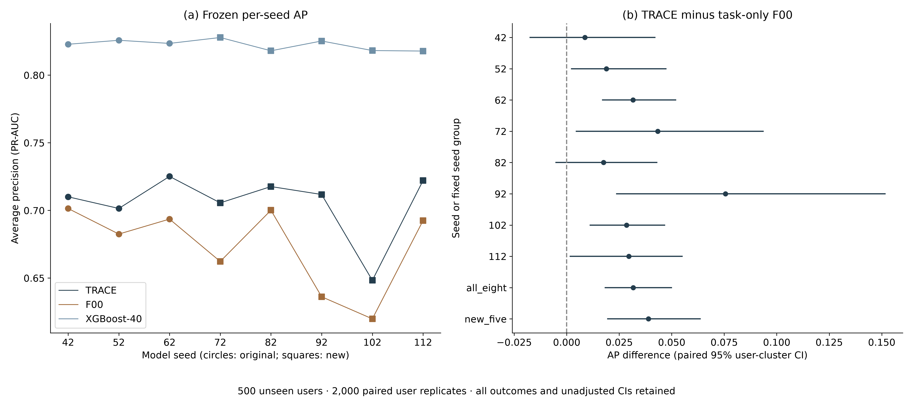
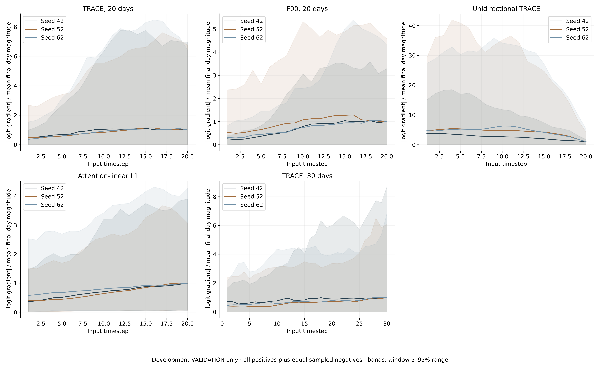
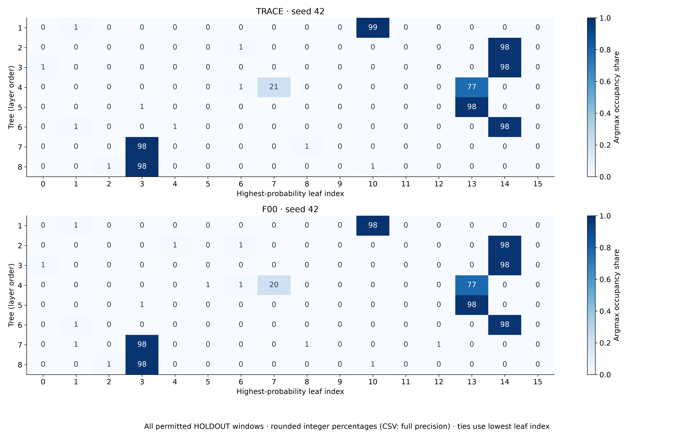
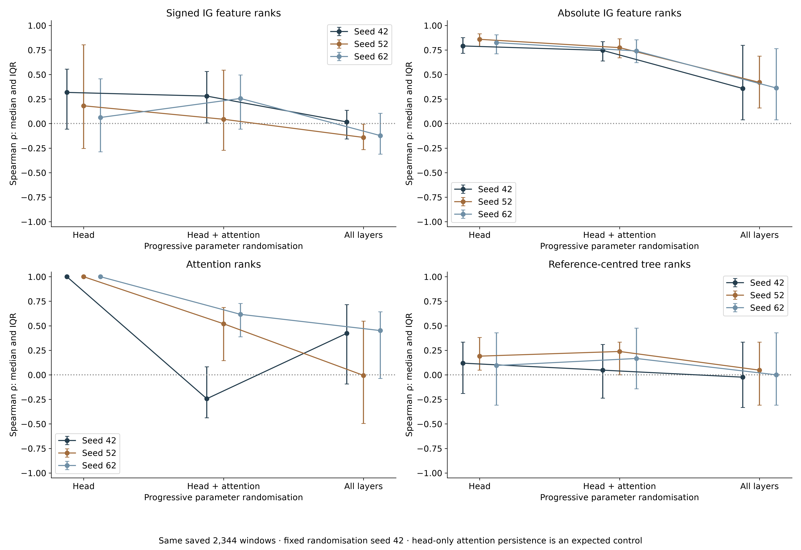
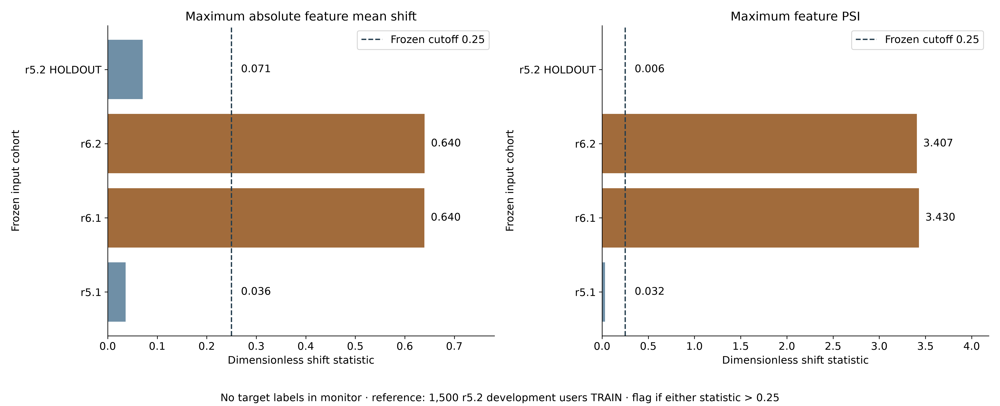

# Phase 8: reviewer-driven checks

Completed 2026-10-23T02:32:30.481161+00:00. All five checks are exploratory. r5.2 TEST stays sealed; the 500 HOLDOUT users supply evaluation only.

## Amendment 8 and boundary

Amendment 8 SHA-256 `cd52680cc15a377d81730ddd1847f564db67646d80c8d6180c3b72d9f359d808`, UTC 2026-10-23T01:18:54.9090136Z, over 66920 preregistration bytes before its receipt. The prior 55149-byte prefix is preserved with SHA-256 `4b09693825062f2fa572375ec2f4e8b6629df8e2ebef8d4f37b87d93c7b827e2`. [Receipt](AMENDMENT8_RECEIPT.json). Phase 7 was complete with its final audit passed before this amendment; its report hash remains `b2a60d786ba76d0b46550700edb526c1a432cbc12d9a725e92cb0d26f0f8b8b1`.

## Amendment 8: reviewer-driven checks (exploratory)

Authorisation: Qasim approved CHATGPT_PHASE8_PROMPT.md on 23 October 2026 at 09:05 (+08). Phase 7 is complete and its final audit passed. This amendment and its SHA-256 receipt precede every Phase 8 calculation and training run. All five reviewer-driven checks are exploratory and all outcomes are retained.

Boundaries: r5.2 TEST stays sealed. Use the frozen 1,500 development users only for TRAIN fitting, scaling, initialization and references, and their VALIDATION only for checkpoint/threshold selection. The same 500 HOLDOUT users remain evaluation-only, never supplying fitting, selection, scaling, references or thresholds. New Q1 detector/seed predictions have exclusive once-only scoring receipts on the exact Phase 4 permitted TRAIN+VALIDATION cohort and views. Reuse all original saved detector predictions unchanged. Q3/Q4 are the explicitly requested explanation/routing experiments; their forward/gradient calculations do not replace the once-only detector evaluation or select a model. No existing repository is modified and nothing is pushed. Public identifiers are pseudonyms only; do not output raw CERT identifiers, names, addresses or log text. One GPU child at a time, 35% allocator cap, small inference batches, cooperative pauses and two numerical CPU threads per child share resources; never control another chat's processes. Every individual computational child has a 120-minute timeout, stopped and recorded TIMEOUT if exceeded, with independent work continued and dependent omissions reported.

Q1: five fixed additional seeds 72/82/92/102/112. Per seed train AL precursor, optimized frozen-node teacher, F00 and TRACE, with the identical Phase 4 architecture, TRAIN data, optimizer groups, learning rates, loss coefficients, class weights, initialization, shuffled-loader and validation-loader conventions, epoch/patience limits, checkpoint criterion and threshold rule. F00 and TRACE initialize from their own new matched teacher. TRACE's teacher-consensus target remains the equal mean of the ORIGINAL Phase 4 teachers 42/52/62, unchanged; its route target is its own matched new-seed teacher. Do not substitute a five-new-teacher or eight-teacher consensus. Train XGBoost-40 using its exact frozen Phase 4 producing recipe with the new seed; numerical threads are capped at two without changing estimator hyperparameters otherwise. Freeze/hash all successful detector checkpoints and development-VALIDATION thresholds before HOLDOUT scoring. Only the three requested detectors (TRACE/F00/XGBoost-40) receive one new target prediction pass per new seed; precursors/teachers are development-only prerequisites. Reuse the original three seeds' saved target scores. Report per-seed AP, frozen-threshold metrics and insider detections /25, for all eight seeds, plus arithmetic metric means for original three, new five and all eight. Primary paired AP contrasts: TRACE minus F00 and TRACE minus XGBoost-40, each of eight seeds and the all-eight/new-five metric means (20 planned contrast rows). Report the number of strictly positive TRACE-minus-F00 point differences out of eight. Preserve all five Phase 4 views descriptively; paired contrasts are primary pooled completed windows. Missing detector runs/seeds remain explicit; do not silently change a requested eight- or five-seed estimand to an available-seed mean.

Q1 inference: 2,000 paired whole-user cluster replicates, numpy default_rng(42), drawing the same 500 user clusters with replacement, retaining all windows per user and using identical multiplicities on both sides and across model seeds. Reuse the verified Phase 4 stream. Recompute AP under cluster multiplicities, handling score ties exactly; arithmetic multi-seed contrasts average seedwise metric differences, never probabilities. Percentile 95% CIs omit undefined replicates and report attempted/valid counts. CI direction is above zero if lower>0, below zero if upper<0, otherwise compatible with zero. No multiplicity correction or formal significance claim is added; these are exploratory, unadjusted CIs, not equivalence or simultaneous inference.

Q2: frozen original Phase 4 TRACE, F00, unidirectional TRACE and attention-linear L1, seeds 42/52/62. Use only development VALIDATION, all positives plus an equal number of negatives sampled without replacement by numpy default_rng(42), with a saved common selection. For any available Phase 6 T1 30-day TRACE seeds, use its corresponding development VALIDATION data and the same selection rule, never HOLDOUT. No checkpoint is optimized. For each window compute absolute input-logit gradient averaged over the 13 features at every timestep. Normalize all windows' values by that exact model/seed/cohort's mean final-day magnitude, giving a mean curve whose final-day mean is one; give 5th/95th percentiles of window magnitudes divided by that same fixed denominator, plus raw curves. A zero final-day mean makes normalized values unavailable, explicitly reported. Also report per-window L2 and mean-absolute logit gradients at the LSTM sequence output and attention context, and fractions of exactly-zero gradient elements, including the input; compare ODST models with L1's linear head in identical coordinates. Report per seed and transparent seed summaries. Do not interpret a nonzero gradient as proof of universal optimization stability; do not introduce a tuned vanishing-gradient cutoff. Output raw and normalized daily CSVs, component-gradient tables and a 300-dpi figure with fonts >=12 pt.

Q3: TRACE and F00, per successful seed (original 42/52/62 and Q1 new 72/82/92/102/112), on the exact permitted HOLDOUT cohort. When possible capture routing/tree intermediates during each new Q1 detector's sole scoring pass; original models may run the requested routing/explanation forward pass, with parity to saved probabilities, without replacing or reselecting their predictions. For each of eight trees: argmax-leaf occupancy over 16 leaves, stable lowest-leaf-index tie-break; normalized occupancy entropy -sum(p log p)/log(16), zero terms omitted; number of leaves with zero argmax occupancy; mean learned routing probability at each of four depths. Preserve layer/tree ordering and disclose actual tensor semantics from the original implementation. Compute raw tree-output ROC-AUC for malicious versus benign windows with 2,000 paired user-cluster percentile CIs, seed 42, same multiplicities as Q1; undefined single-class replicates are excluded/counts reported. Count a tree as showing above-chance separation only if its unadjusted CI lower bound is >0.5; also report reversed direction when upper<0.5 and otherwise compatible with chance, retaining all trees. No trees are selected or removed. No multiplicity-controlled or causal claim is made across the exploratory tree CIs. Save per-tree/per-depth/per-leaf CSVs and seed-42 TRACE/F00 occupancy heat maps at 300 dpi, >=12 pt.

Q4: original frozen HOLDOUT TRACE checkpoints for seeds 42/52/62 and the exact saved Phase 4 explanation cohort, with its frozen development-TRAIN IG baseline, original IG/attention and development-centred tree references. For each original seed instantiate a fresh model using the original layer constructors/initializers with fixed randomization seed 42; derive all progressive stages from this same fresh initialization so (a) head only, (b) that head plus attention and (c) all layers are nested parameter replacements. Preserve architecture and original initialization rules, including any data-aware initialization using development TRAIN only, never evaluation inputs. Record parameter groups, buffer handling and hashes, and verify which components change. Compute stage-specific tree reference means on development TRAIN, never HOLDOUT; retain the original frozen IG baseline for every stage. Recompute the exact inherited 50-interval IG, attention and reference-centred contributions on the saved 2,344-window explanation cohort, no cohort resampling or target labels used to choose explanations. Primary feature vectors are signed IG summed across the 20 days for each of 13 features; also report absolute IG shares as a separately labelled sensitivity summary. Per-window Spearman correlation uses average ranks for ties, excluding and counting constant/undefined vectors. Compare each stage against the saved original vectors for IG, attention and eight signed tree contributions, reporting median, Q1/Q3 and valid/excluded windows, seedwise and pooled descriptive summaries. A head-only replacement structurally leaves attention unchanged; this is an expected control, not a failed attention test. Report sensitivity/persistence without a post-hoc correlation cutoff or adjusted hypothesis claim. Preserve IG completeness residuals for interpretation, including failures. Output stage correlation tables, parameter/reference/experiment receipts and a 300-dpi figure/CSV with >=12 pt fonts.

Q5: an entirely label-free monitor. Use only the 13 aggregated daily input features and saved/frozen TRACE scores from the same transfer-release cohorts as the existing transfer analysis for r5.1/r6.1/r6.2, and permitted r5.2 HOLDOUT TRAIN+VALIDATION as control. Use the original Phase 4 frozen TRACE checkpoints, seeds 42/52/62, development-TRAIN scaling and frozen development-VALIDATION thresholds; if a compatible release score array is not already saved, perform only the specified unlabelled frozen-model inference and record its input/cohort identity. Do not read any transfer-label arrays in the monitoring computation. Reference is development-user r5.2 TRAIN only: raw per-feature mean/std and PSI bins come only from its daily inputs, and reference score distributions come from its completed TRAIN windows. Standardized signed mean shift=(target mean-reference mean)/reference population SD; maximum shift is max absolute shift across 13 features. Zero reference SD with identical mean has zero shift, otherwise infinite shift, explicitly recorded. PSI bins are reference deciles with repeated cut points removed and outer limits +/-infinity; binary/discrete ties may reduce the number of bins. Use half-count additive smoothing to each reference and target bin count before normalizing, then PSI=sum((p_target-p_ref)*log(p_target/p_ref)); disclose bin counts and edges. No target quantiles, bin fitting, calibration or labels. KS is the two-sample statistic between development-TRAIN and each target TRACE score distribution, per seed, with no p-value decision. Report target share above each model's unchanged frozen threshold. Flag a cohort exactly when maximum absolute standardized feature shift>0.25 OR any feature PSI>0.25. The flag is input-only and identical across seeds; do not alter thresholds or the rule to obtain the desired r6.1/r6.2-versus-r5.1/control outcome. Freeze flags and monitor outputs before reading the existing labelled transfer-performance summary for the requested side-by-side comparison; report agreements and disagreements. Cohort definitions, score compatibility and any mismatch with the known transfer model/population are disclosed, never silently equated.

Deliverables: phase8/CHATGPT_PHASE8_REPORT.md with this amendment and SHA-256 receipt, complete Q1 training log and all outcomes, one results section per Q with every requested summary/contrast, 300-dpi figures with final text >=12 pt and source-data CSVs beside them, explicit skips/timeouts/deviations and PHASE8_RESULTS.json. Preserve source/checkpoint/prediction hashes, timing and per-child timeout receipts, privacy checks and final integrity audit. End the report PHASE8_COMPLETE only after every requested outcome, including unavailable components, is accounted for and deliverables verified.

Amendment 8 SHA-256 receipt (UTC 2026-10-23T01:18:54.9090136Z): cd52680cc15a377d81730ddd1847f564db67646d80c8d6180c3b72d9f359d808 (entire preregistration through Amendment 8, before this receipt; 66920 bytes). Previous prefix: 55149 bytes, SHA-256 4b09693825062f2fa572375ec2f4e8b6629df8e2ebef8d4f37b87d93c7b827e2. No Phase 8 computation or training preceded this receipt.

The original 1,500 development users supply TRAIN fitting/scaling/initialisation/references and VALIDATION selection/thresholds. The 500 unseen users never supply any such decision. Q1 has five fixed new seeds and a once-only receipt per new detector/seed on the identical Phase 4 permitted cohort. Original detector scores are reused unchanged. Q3 and Q4 are the expressly requested routing/explanation experiments. No repositories are modified or pushed. Public case identifiers are pseudonyms only.

## Q1: more seeds for the main gain

Each new seed has its own precursor and optimised teacher, then its own matched-teacher F00/TRACE initialisation. TRACE retains the three original Phase 4 teachers (42/52/62) for its unchanged consensus, while the route teacher is the new matched seed. No five-new-teacher/eight-teacher consensus is substituted. Checkpoints and thresholds are development-VALIDATION-selected, frozen and hashed before target scoring. XGBoost retains its producing Phase 4 parameters apart from the resource-only numerical-thread cap.

| Model/role | Seed | Status | Epochs | Selected epoch | DEV VALID AP | Seconds | Frozen threshold |
| --- | --- | --- | --- | --- | --- | --- | --- |
| AL_PRECURSOR | 72 | ok | 7 | 3 | 0.955003 | 75.7243 | 0.99 |
| AL_PRECURSOR | 82 | ok | 7 | 3 | 0.945823 | 75.3719 | 0.84 |
| AL_PRECURSOR | 92 | ok | 8 | 4 | 0.956744 | 84.9938 | 0.98 |
| AL_PRECURSOR | 102 | ok | 7 | 3 | 0.945301 | 74.4357 | 0.83 |
| AL_PRECURSOR | 112 | ok | 10 | 6 | 0.926505 | 103.873 | 0.98 |
| T-OPT | 72 | ok | 6 | 2 | 0.953685 | 80.1003 | 0.72 |
| T-OPT | 82 | ok | 10 | 6 | 0.957612 | 130.065 | 0.792545 |
| T-OPT | 92 | ok | 5 | 1 | 0.944558 | 67.3875 | 0.62 |
| T-OPT | 102 | ok | 5 | 1 | 0.93572 | 65.0845 | 0.61 |
| T-OPT | 112 | ok | 9 | 5 | 0.923258 | 113.759 | 0.87 |
| F00 | 72 | ok | 7 | 3 | 0.92646 | 107.14 | 0.88 |
| F00 | 82 | ok | 8 | 4 | 0.941481 | 122.452 | 0.76 |
| F00 | 92 | ok | 12 | 8 | 0.935307 | 180.504 | 0.94 |
| F00 | 102 | ok | 5 | 1 | 0.941887 | 76.168 | 0.7 |
| F00 | 112 | ok | 6 | 2 | 0.922684 | 91.7741 | 0.57 |
| TA2 | 72 | ok | 12 | 8 | 0.947867 | 249.624 | 0.67 |
| TA2 | 82 | ok | 8 | 4 | 0.958227 | 166.55 | 0.64 |
| TA2 | 92 | ok | 12 | 8 | 0.961576 | 245 | 0.55 |
| TA2 | 102 | ok | 8 | 4 | 0.950239 | 164.651 | 0.52 |
| TA2 | 112 | ok | 15 | 11 | 0.948364 | 308.726 | 0.95 |
| XGBoost_40 | 72 | ok | 300 | 300 | 0.927432 | 15.3692 | 0.07 |
| XGBoost_40 | 82 | ok | 300 | 300 | 0.928323 | 15.21 | 0.04 |
| XGBoost_40 | 92 | ok | 300 | 300 | 0.929834 | 16.0107 | 0.12 |
| XGBoost_40 | 102 | ok | 300 | 300 | 0.928999 | 15.5709 | 0.46 |
| XGBoost_40 | 112 | ok | 300 | 300 | 0.924349 | 15.2968 | 0.71 |

[Complete training log](Q1_TRAINING_LOG.csv). Checkpoint hashes and full histories/configurations are retained in [TRAINING_RESULTS_PHASE8.json](TRAINING_RESULTS_PHASE8.json).

Eight-seed TRACE minus F00: mean AP difference 0.031699, paired user-cluster 95% CI [0.0183384, 0.049912]. These CIs condition on the listed fixed seeds and resample users.

Eight-seed TRACE minus XGBoost_40: mean AP difference -0.117138, paired user-cluster 95% CI [-0.311822, 0.0529142]. These CIs condition on the listed fixed seeds and resample users.

TRACE minus F00 is strictly positive in 8 of 8 available seeds, against eight planned seeds. No seed is dropped because of its result.

| model | seed | view | PR AUC | F1 | precision | recall | threshold | windows | positive windows | insiders detected | insiders total |
| --- | --- | --- | --- | --- | --- | --- | --- | --- | --- | --- | --- |
| TA2 | 42 | pooled_completed | 0.710041 | 0.487412 | 0.345714 | 0.825939 | 0.56 | 213000 | 1172 | 24 | 25 |
| TA2 | 52 | pooled_completed | 0.70143 | 0.469249 | 0.327586 | 0.826792 | 0.56 | 213000 | 1172 | 24 | 25 |
| TA2 | 62 | pooled_completed | 0.72513 | 0.476961 | 0.334594 | 0.830205 | 0.38 | 213000 | 1172 | 24 | 25 |
| TA2 | 72 | pooled_completed | 0.705565 | 0.48532 | 0.343761 | 0.825085 | 0.67 | 213000 | 1172 | 25 | 25 |
| TA2 | 82 | pooled_completed | 0.717623 | 0.508863 | 0.366366 | 0.832765 | 0.64 | 213000 | 1172 | 24 | 25 |
| TA2 | 92 | pooled_completed | 0.71175 | 0.486038 | 0.344631 | 0.824232 | 0.55 | 213000 | 1172 | 24 | 25 |
| TA2 | 102 | pooled_completed | 0.648288 | 0.480981 | 0.340297 | 0.819966 | 0.52 | 213000 | 1172 | 24 | 25 |
| TA2 | 112 | pooled_completed | 0.722072 | 0.63571 | 0.902669 | 0.490614 | 0.95 | 213000 | 1172 | 21 | 25 |
| F00 | 42 | pooled_completed | 0.701404 | 0.643737 | 0.80799 | 0.534983 | 0.95 | 213000 | 1172 | 23 | 25 |
| F00 | 52 | pooled_completed | 0.682493 | 0.441276 | 0.300277 | 0.831911 | 0.56 | 213000 | 1172 | 24 | 25 |
| F00 | 62 | pooled_completed | 0.693575 | 0.489389 | 0.349398 | 0.816553 | 0.22 | 213000 | 1172 | 24 | 25 |
| F00 | 72 | pooled_completed | 0.662252 | 0.503262 | 0.376966 | 0.756826 | 0.88 | 213000 | 1172 | 24 | 25 |
| F00 | 82 | pooled_completed | 0.70012 | 0.516424 | 0.377262 | 0.818259 | 0.76 | 213000 | 1172 | 24 | 25 |
| F00 | 92 | pooled_completed | 0.636144 | 0.536952 | 0.435313 | 0.700512 | 0.94 | 213000 | 1172 | 23 | 25 |
| F00 | 102 | pooled_completed | 0.619825 | 0.465033 | 0.331755 | 0.777304 | 0.7 | 213000 | 1172 | 24 | 25 |
| F00 | 112 | pooled_completed | 0.692493 | 0.498919 | 0.365111 | 0.787543 | 0.57 | 213000 | 1172 | 24 | 25 |
| XGBoost_40 | 42 | pooled_completed | 0.82281 | 0.808958 | 0.871063 | 0.755119 | 0.64 | 213000 | 1172 | 22 | 25 |
| XGBoost_40 | 52 | pooled_completed | 0.825753 | 0.795747 | 0.82765 | 0.766212 | 0.51 | 213000 | 1172 | 23 | 25 |
| XGBoost_40 | 62 | pooled_completed | 0.823446 | 0.636453 | 0.517352 | 0.826792 | 0.06 | 213000 | 1172 | 24 | 25 |
| XGBoost_40 | 72 | pooled_completed | 0.827812 | 0.683339 | 0.581884 | 0.827645 | 0.07 | 213000 | 1172 | 24 | 25 |
| XGBoost_40 | 82 | pooled_completed | 0.817986 | 0.59871 | 0.467626 | 0.831911 | 0.04 | 213000 | 1172 | 24 | 25 |
| XGBoost_40 | 92 | pooled_completed | 0.825234 | 0.71207 | 0.639701 | 0.802901 | 0.12 | 213000 | 1172 | 24 | 25 |
| XGBoost_40 | 102 | pooled_completed | 0.818169 | 0.786914 | 0.816514 | 0.759386 | 0.46 | 213000 | 1172 | 23 | 25 |
| XGBoost_40 | 112 | pooled_completed | 0.817789 | 0.798358 | 0.857843 | 0.746587 | 0.71 | 213000 | 1172 | 23 | 25 |

| model | seed group | planned seeds | available seeds | status | PR AUC | F1 | precision | recall | insiders detected |
| --- | --- | --- | --- | --- | --- | --- | --- | --- | --- |
| TA2 | original_three | 3 | 3 | ok | 0.712201 | 0.477874 | 0.335965 | 0.827645 | 24 |
| TA2 | new_five | 5 | 5 | ok | 0.701059 | 0.519382 | 0.459545 | 0.758532 | 23.6 |
| TA2 | all_eight | 8 | 8 | ok | 0.705237 | 0.503817 | 0.413202 | 0.78445 | 23.75 |
| F00 | original_three | 3 | 3 | ok | 0.692491 | 0.524801 | 0.485888 | 0.727816 | 23.6667 |
| F00 | new_five | 5 | 5 | ok | 0.662167 | 0.504118 | 0.377281 | 0.768089 | 23.8 |
| F00 | all_eight | 8 | 8 | ok | 0.673538 | 0.511874 | 0.418009 | 0.752986 | 23.75 |
| XGBoost_40 | original_three | 3 | 3 | ok | 0.824003 | 0.747053 | 0.738688 | 0.782708 | 23 |
| XGBoost_40 | new_five | 5 | 5 | ok | 0.821398 | 0.715878 | 0.672713 | 0.793686 | 23.6 |
| XGBoost_40 | all_eight | 8 | 8 | ok | 0.822375 | 0.727569 | 0.697454 | 0.789569 | 23.375 |

| contrast | seed | status | metric | estimate | ci95 low | ci95 high | attempted replicates | valid replicates | undefined replicates | CI direction | bootstrap seed | cluster | multiplicity adjusted |
| --- | --- | --- | --- | --- | --- | --- | --- | --- | --- | --- | --- | --- | --- |
| TRACE minus F00 | 42 | ok | PR_AUC | 0.00863691 | -0.0174488 | 0.0419715 | 2000 | 2000 | 0 | compatible_with_zero | 42 | user | no |
| TRACE minus F00 | 52 | ok | PR_AUC | 0.0189377 | 0.00229969 | 0.0472508 | 2000 | 2000 | 0 | above | 42 | user | no |
| TRACE minus F00 | 62 | ok | PR_AUC | 0.0315549 | 0.0170465 | 0.0518986 | 2000 | 2000 | 0 | above | 42 | user | no |
| TRACE minus F00 | 72 | ok | PR_AUC | 0.0433122 | 0.00460676 | 0.0935184 | 2000 | 2000 | 0 | above | 42 | user | no |
| TRACE minus F00 | 82 | ok | PR_AUC | 0.0175028 | -0.00508629 | 0.0429114 | 2000 | 2000 | 0 | compatible_with_zero | 42 | user | no |
| TRACE minus F00 | 92 | ok | PR_AUC | 0.0756064 | 0.0238289 | 0.15155 | 2000 | 2000 | 0 | above | 42 | user | no |
| TRACE minus F00 | 102 | ok | PR_AUC | 0.0284623 | 0.011219 | 0.0465987 | 2000 | 2000 | 0 | above | 42 | user | no |
| TRACE minus F00 | 112 | ok | PR_AUC | 0.0295788 | 0.00166509 | 0.0549838 | 2000 | 2000 | 0 | above | 42 | user | no |
| TRACE minus F00 | all_eight | ok | PR_AUC | 0.031699 | 0.0183384 | 0.049912 | 2000 | 2000 | 0 | above | 42 | user | no |
| TRACE minus F00 | new_five | ok | PR_AUC | 0.0388925 | 0.0195446 | 0.0635858 | 2000 | 2000 | 0 | above | 42 | user | no |
| TRACE minus XGBoost_40 | 42 | ok | PR_AUC | -0.112769 | -0.291037 | 0.0649848 | 2000 | 2000 | 0 | compatible_with_zero | 42 | user | no |
| TRACE minus XGBoost_40 | 52 | ok | PR_AUC | -0.124323 | -0.315017 | 0.0414026 | 2000 | 2000 | 0 | compatible_with_zero | 42 | user | no |
| TRACE minus XGBoost_40 | 62 | ok | PR_AUC | -0.0983153 | -0.285569 | 0.0790933 | 2000 | 2000 | 0 | compatible_with_zero | 42 | user | no |
| TRACE minus XGBoost_40 | 72 | ok | PR_AUC | -0.122248 | -0.322842 | 0.0435753 | 2000 | 2000 | 0 | compatible_with_zero | 42 | user | no |
| TRACE minus XGBoost_40 | 82 | ok | PR_AUC | -0.100364 | -0.306331 | 0.0760452 | 2000 | 2000 | 0 | compatible_with_zero | 42 | user | no |
| TRACE minus XGBoost_40 | 92 | ok | PR_AUC | -0.113484 | -0.308862 | 0.0626809 | 2000 | 2000 | 0 | compatible_with_zero | 42 | user | no |
| TRACE minus XGBoost_40 | 102 | ok | PR_AUC | -0.169881 | -0.369655 | 0.00186295 | 2000 | 2000 | 0 | compatible_with_zero | 42 | user | no |
| TRACE minus XGBoost_40 | 112 | ok | PR_AUC | -0.0957172 | -0.284123 | 0.0858028 | 2000 | 2000 | 0 | compatible_with_zero | 42 | user | no |
| TRACE minus XGBoost_40 | all_eight | ok | PR_AUC | -0.117138 | -0.311822 | 0.0529142 | 2000 | 2000 | 0 | compatible_with_zero | 42 | user | no |
| TRACE minus XGBoost_40 | new_five | ok | PR_AUC | -0.120339 | -0.319907 | 0.0490642 | 2000 | 2000 | 0 | compatible_with_zero | 42 | user | no |

Means average seedwise metrics; CIs resample the same 500 whole-user clusters on both sides and across all seeds, with 2,000 replicates, seed 42. The new-five and all-eight estimands are kept separate. Insider detection requires at least one positive completed window above the frozen threshold and always reports denominator 25.

[Figure data](figure_Q1_more_seeds.csv).

### Q1 all five Phase 4 views

| model | seed | view | PR AUC | F1 | precision | recall | threshold | windows | positive windows | insiders detected | insiders total |
| --- | --- | --- | --- | --- | --- | --- | --- | --- | --- | --- | --- |
| TA2 | 42 | pooled_completed | 0.710041 | 0.487412 | 0.345714 | 0.825939 | 0.56 | 213000 | 1172 | 24 | 25 |
| TA2 | 42 | train_completed | 0.648174 | 0.434355 | 0.295553 | 0.818975 | 0.56 | 197000 | 917 | 19 | 25 |
| TA2 | 42 | validation_completed | 0.882509 | 0.844358 | 0.837838 | 0.85098 | 0.56 | 16000 | 255 | 11 | 25 |
| TA2 | 42 | pooled_offset0 | 0.715065 | 0.512315 | 0.368794 | 0.83871 | 0.56 | 11000 | 62 | 21 | 25 |
| TA2 | 42 | pooled_endpoint | 0.107644 | 0.147647 | 0.0817857 | 0.758278 | 0.56 | 213000 | 302 | 24 | 25 |
| TA2 | 52 | pooled_completed | 0.70143 | 0.469249 | 0.327586 | 0.826792 | 0.56 | 213000 | 1172 | 24 | 25 |
| TA2 | 52 | train_completed | 0.635214 | 0.417613 | 0.279881 | 0.822246 | 0.56 | 197000 | 917 | 19 | 25 |
| TA2 | 52 | validation_completed | 0.883436 | 0.828516 | 0.814394 | 0.843137 | 0.56 | 16000 | 255 | 11 | 25 |
| TA2 | 52 | pooled_offset0 | 0.717866 | 0.479638 | 0.333333 | 0.854839 | 0.56 | 11000 | 62 | 22 | 25 |
| TA2 | 52 | pooled_endpoint | 0.100605 | 0.143558 | 0.0791075 | 0.774834 | 0.56 | 213000 | 302 | 24 | 25 |
| TA2 | 62 | pooled_completed | 0.72513 | 0.476961 | 0.334594 | 0.830205 | 0.38 | 213000 | 1172 | 24 | 25 |
| TA2 | 62 | train_completed | 0.659088 | 0.422385 | 0.284577 | 0.818975 | 0.38 | 197000 | 917 | 19 | 25 |
| TA2 | 62 | validation_completed | 0.896524 | 0.847328 | 0.825279 | 0.870588 | 0.38 | 16000 | 255 | 11 | 25 |
| TA2 | 62 | pooled_offset0 | 0.735448 | 0.485714 | 0.344595 | 0.822581 | 0.38 | 11000 | 62 | 20 | 25 |
| TA2 | 62 | pooled_endpoint | 0.10823 | 0.143925 | 0.079436 | 0.764901 | 0.38 | 213000 | 302 | 24 | 25 |
| TA2 | 72 | pooled_completed | 0.705565 | 0.48532 | 0.343761 | 0.825085 | 0.67 | 213000 | 1172 | 25 | 25 |
| TA2 | 72 | train_completed | 0.638347 | 0.431995 | 0.293794 | 0.815703 | 0.67 | 197000 | 917 | 19 | 25 |
| TA2 | 72 | validation_completed | 0.897212 | 0.83908 | 0.820225 | 0.858824 | 0.67 | 16000 | 255 | 11 | 25 |
| TA2 | 72 | pooled_offset0 | 0.690418 | 0.485981 | 0.342105 | 0.83871 | 0.67 | 11000 | 62 | 22 | 25 |
| TA2 | 72 | pooled_endpoint | 0.104161 | 0.146388 | 0.0810523 | 0.754967 | 0.67 | 213000 | 302 | 23 | 25 |
| TA2 | 82 | pooled_completed | 0.717623 | 0.508863 | 0.366366 | 0.832765 | 0.64 | 213000 | 1172 | 24 | 25 |
| TA2 | 82 | train_completed | 0.651463 | 0.453397 | 0.312993 | 0.822246 | 0.64 | 197000 | 917 | 19 | 25 |
| TA2 | 82 | validation_completed | 0.898349 | 0.870588 | 0.870588 | 0.870588 | 0.64 | 16000 | 255 | 11 | 25 |
| TA2 | 82 | pooled_offset0 | 0.72622 | 0.540816 | 0.395522 | 0.854839 | 0.64 | 11000 | 62 | 22 | 25 |
| TA2 | 82 | pooled_endpoint | 0.0967431 | 0.153068 | 0.0852102 | 0.751656 | 0.64 | 213000 | 302 | 24 | 25 |
| TA2 | 92 | pooled_completed | 0.71175 | 0.486038 | 0.344631 | 0.824232 | 0.55 | 213000 | 1172 | 24 | 25 |
| TA2 | 92 | train_completed | 0.635553 | 0.42886 | 0.291601 | 0.810251 | 0.55 | 197000 | 917 | 19 | 25 |
| TA2 | 92 | validation_completed | 0.920114 | 0.87451 | 0.87451 | 0.87451 | 0.55 | 16000 | 255 | 11 | 25 |
| TA2 | 92 | pooled_offset0 | 0.739111 | 0.502415 | 0.358621 | 0.83871 | 0.55 | 11000 | 62 | 21 | 25 |
| TA2 | 92 | pooled_endpoint | 0.0999045 | 0.147504 | 0.0816982 | 0.758278 | 0.55 | 213000 | 302 | 24 | 25 |
| TA2 | 102 | pooled_completed | 0.648288 | 0.480981 | 0.340297 | 0.819966 | 0.52 | 213000 | 1172 | 24 | 25 |
| TA2 | 102 | train_completed | 0.568592 | 0.427296 | 0.290297 | 0.80916 | 0.52 | 197000 | 917 | 20 | 25 |
| TA2 | 102 | validation_completed | 0.899442 | 0.837476 | 0.817164 | 0.858824 | 0.52 | 16000 | 255 | 10 | 25 |
| TA2 | 102 | pooled_offset0 | 0.658146 | 0.51 | 0.369565 | 0.822581 | 0.52 | 11000 | 62 | 21 | 25 |
| TA2 | 102 | pooled_endpoint | 0.0866645 | 0.145873 | 0.0807365 | 0.754967 | 0.52 | 213000 | 302 | 23 | 25 |
| TA2 | 112 | pooled_completed | 0.722072 | 0.63571 | 0.902669 | 0.490614 | 0.95 | 213000 | 1172 | 21 | 25 |
| TA2 | 112 | train_completed | 0.650214 | 0.547478 | 0.856148 | 0.402399 | 0.95 | 197000 | 917 | 16 | 25 |
| TA2 | 112 | validation_completed | 0.911706 | 0.893709 | 1 | 0.807843 | 0.95 | 16000 | 255 | 9 | 25 |
| TA2 | 112 | pooled_offset0 | 0.734851 | 0.652632 | 0.939394 | 0.5 | 0.95 | 11000 | 62 | 17 | 25 |
| TA2 | 112 | pooled_endpoint | 0.0919592 | 0.151225 | 0.11146 | 0.235099 | 0.95 | 213000 | 302 | 15 | 25 |
| F00 | 42 | pooled_completed | 0.701404 | 0.643737 | 0.80799 | 0.534983 | 0.95 | 213000 | 1172 | 23 | 25 |
| F00 | 42 | train_completed | 0.636367 | 0.5853 | 0.766784 | 0.473282 | 0.95 | 197000 | 917 | 19 | 25 |
| F00 | 42 | validation_completed | 0.876044 | 0.830108 | 0.919048 | 0.756863 | 0.95 | 16000 | 255 | 9 | 25 |
| F00 | 42 | pooled_offset0 | 0.707473 | 0.640777 | 0.804878 | 0.532258 | 0.95 | 11000 | 62 | 17 | 25 |
| F00 | 42 | pooled_endpoint | 0.104726 | 0.176252 | 0.122423 | 0.31457 | 0.95 | 213000 | 302 | 22 | 25 |
| F00 | 52 | pooled_completed | 0.682493 | 0.441276 | 0.300277 | 0.831911 | 0.56 | 213000 | 1172 | 24 | 25 |
| F00 | 52 | train_completed | 0.606636 | 0.391742 | 0.256592 | 0.827699 | 0.56 | 197000 | 917 | 19 | 25 |
| F00 | 52 | validation_completed | 0.8831 | 0.794118 | 0.747405 | 0.847059 | 0.56 | 16000 | 255 | 11 | 25 |
| F00 | 52 | pooled_offset0 | 0.728046 | 0.441667 | 0.297753 | 0.854839 | 0.56 | 11000 | 62 | 22 | 25 |
| F00 | 52 | pooled_endpoint | 0.0977538 | 0.132432 | 0.0723745 | 0.778146 | 0.56 | 213000 | 302 | 24 | 25 |
| F00 | 62 | pooled_completed | 0.693575 | 0.489389 | 0.349398 | 0.816553 | 0.22 | 213000 | 1172 | 24 | 25 |
| F00 | 62 | train_completed | 0.620902 | 0.435294 | 0.298027 | 0.806979 | 0.22 | 197000 | 917 | 19 | 25 |
| F00 | 62 | validation_completed | 0.879252 | 0.849315 | 0.847656 | 0.85098 | 0.22 | 16000 | 255 | 11 | 25 |
| F00 | 62 | pooled_offset0 | 0.705665 | 0.5 | 0.362319 | 0.806452 | 0.22 | 11000 | 62 | 20 | 25 |
| F00 | 62 | pooled_endpoint | 0.106428 | 0.148635 | 0.0825119 | 0.748344 | 0.22 | 213000 | 302 | 23 | 25 |
| F00 | 72 | pooled_completed | 0.662252 | 0.503262 | 0.376966 | 0.756826 | 0.88 | 213000 | 1172 | 24 | 25 |
| F00 | 72 | train_completed | 0.594842 | 0.452855 | 0.323091 | 0.756816 | 0.88 | 197000 | 917 | 18 | 25 |
| F00 | 72 | validation_completed | 0.880838 | 0.83913 | 0.941463 | 0.756863 | 0.88 | 16000 | 255 | 11 | 25 |
| F00 | 72 | pooled_offset0 | 0.703974 | 0.5 | 0.377049 | 0.741935 | 0.88 | 11000 | 62 | 21 | 25 |
| F00 | 72 | pooled_endpoint | 0.106432 | 0.158945 | 0.0896728 | 0.698675 | 0.88 | 213000 | 302 | 22 | 25 |
| F00 | 82 | pooled_completed | 0.70012 | 0.516424 | 0.377262 | 0.818259 | 0.76 | 213000 | 1172 | 24 | 25 |
| F00 | 82 | train_completed | 0.629967 | 0.461587 | 0.323414 | 0.805889 | 0.76 | 197000 | 917 | 19 | 25 |
| F00 | 82 | validation_completed | 0.885026 | 0.859375 | 0.856031 | 0.862745 | 0.76 | 16000 | 255 | 11 | 25 |
| F00 | 82 | pooled_offset0 | 0.705293 | 0.525773 | 0.386364 | 0.822581 | 0.76 | 11000 | 62 | 22 | 25 |
| F00 | 82 | pooled_endpoint | 0.0943912 | 0.152602 | 0.0853659 | 0.718543 | 0.76 | 213000 | 302 | 23 | 25 |
| F00 | 92 | pooled_completed | 0.636144 | 0.536952 | 0.435313 | 0.700512 | 0.94 | 213000 | 1172 | 23 | 25 |
| F00 | 92 | train_completed | 0.548538 | 0.471139 | 0.366727 | 0.65867 | 0.94 | 197000 | 917 | 19 | 25 |
| F00 | 92 | validation_completed | 0.884826 | 0.878543 | 0.90795 | 0.85098 | 0.94 | 16000 | 255 | 10 | 25 |
| F00 | 92 | pooled_offset0 | 0.664903 | 0.582278 | 0.479167 | 0.741935 | 0.94 | 11000 | 62 | 20 | 25 |
| F00 | 92 | pooled_endpoint | 0.0872653 | 0.144424 | 0.0837752 | 0.523179 | 0.94 | 213000 | 302 | 23 | 25 |
| F00 | 102 | pooled_completed | 0.619825 | 0.465033 | 0.331755 | 0.777304 | 0.7 | 213000 | 1172 | 24 | 25 |
| F00 | 102 | train_completed | 0.543157 | 0.413126 | 0.282452 | 0.768811 | 0.7 | 197000 | 917 | 20 | 25 |
| F00 | 102 | validation_completed | 0.874104 | 0.815842 | 0.824 | 0.807843 | 0.7 | 16000 | 255 | 9 | 25 |
| F00 | 102 | pooled_offset0 | 0.617866 | 0.49 | 0.355072 | 0.790323 | 0.7 | 11000 | 62 | 20 | 25 |
| F00 | 102 | pooled_endpoint | 0.0867894 | 0.143701 | 0.0797524 | 0.725166 | 0.7 | 213000 | 302 | 23 | 25 |
| F00 | 112 | pooled_completed | 0.692493 | 0.498919 | 0.365111 | 0.787543 | 0.57 | 213000 | 1172 | 24 | 25 |
| F00 | 112 | train_completed | 0.616829 | 0.440837 | 0.308836 | 0.769902 | 0.57 | 197000 | 917 | 20 | 25 |
| F00 | 112 | validation_completed | 0.894747 | 0.873239 | 0.896694 | 0.85098 | 0.57 | 16000 | 255 | 10 | 25 |
| F00 | 112 | pooled_offset0 | 0.700885 | 0.497462 | 0.362963 | 0.790323 | 0.57 | 11000 | 62 | 21 | 25 |
| F00 | 112 | pooled_endpoint | 0.086517 | 0.15053 | 0.0842563 | 0.705298 | 0.57 | 213000 | 302 | 23 | 25 |
| XGBoost_40 | 42 | pooled_completed | 0.82281 | 0.808958 | 0.871063 | 0.755119 | 0.64 | 213000 | 1172 | 22 | 25 |
| XGBoost_40 | 42 | train_completed | 0.80147 | 0.785334 | 0.857881 | 0.7241 | 0.64 | 197000 | 917 | 18 | 25 |
| XGBoost_40 | 42 | validation_completed | 0.893591 | 0.889336 | 0.913223 | 0.866667 | 0.64 | 16000 | 255 | 10 | 25 |
| XGBoost_40 | 42 | pooled_offset0 | 0.829347 | 0.821429 | 0.92 | 0.741935 | 0.64 | 11000 | 62 | 21 | 25 |
| XGBoost_40 | 42 | pooled_endpoint | 0.210423 | 0.358118 | 0.232283 | 0.781457 | 0.64 | 213000 | 302 | 22 | 25 |
| XGBoost_40 | 52 | pooled_completed | 0.825753 | 0.795747 | 0.82765 | 0.766212 | 0.51 | 213000 | 1172 | 23 | 25 |
| XGBoost_40 | 52 | train_completed | 0.806177 | 0.76661 | 0.799763 | 0.736096 | 0.51 | 197000 | 917 | 19 | 25 |
| XGBoost_40 | 52 | validation_completed | 0.892772 | 0.899194 | 0.925311 | 0.87451 | 0.51 | 16000 | 255 | 10 | 25 |
| XGBoost_40 | 52 | pooled_offset0 | 0.831749 | 0.821429 | 0.92 | 0.741935 | 0.51 | 11000 | 62 | 21 | 25 |
| XGBoost_40 | 52 | pooled_endpoint | 0.207556 | 0.346071 | 0.221198 | 0.794702 | 0.51 | 213000 | 302 | 22 | 25 |
| XGBoost_40 | 62 | pooled_completed | 0.823446 | 0.636453 | 0.517352 | 0.826792 | 0.06 | 213000 | 1172 | 24 | 25 |
| XGBoost_40 | 62 | train_completed | 0.801729 | 0.597278 | 0.471853 | 0.813522 | 0.06 | 197000 | 917 | 20 | 25 |
| XGBoost_40 | 62 | validation_completed | 0.902785 | 0.815356 | 0.763699 | 0.87451 | 0.06 | 16000 | 255 | 10 | 25 |
| XGBoost_40 | 62 | pooled_offset0 | 0.829647 | 0.671141 | 0.574713 | 0.806452 | 0.06 | 11000 | 62 | 23 | 25 |
| XGBoost_40 | 62 | pooled_endpoint | 0.209301 | 0.236322 | 0.137213 | 0.850993 | 0.06 | 213000 | 302 | 24 | 25 |
| XGBoost_40 | 72 | pooled_completed | 0.827812 | 0.683339 | 0.581884 | 0.827645 | 0.07 | 213000 | 1172 | 24 | 25 |
| XGBoost_40 | 72 | train_completed | 0.806212 | 0.650697 | 0.541697 | 0.814613 | 0.07 | 197000 | 917 | 20 | 25 |
| XGBoost_40 | 72 | validation_completed | 0.905396 | 0.821363 | 0.774306 | 0.87451 | 0.07 | 16000 | 255 | 10 | 25 |
| XGBoost_40 | 72 | pooled_offset0 | 0.834442 | 0.70922 | 0.632911 | 0.806452 | 0.07 | 11000 | 62 | 23 | 25 |
| XGBoost_40 | 72 | pooled_endpoint | 0.20571 | 0.26003 | 0.153569 | 0.847682 | 0.07 | 213000 | 302 | 24 | 25 |
| XGBoost_40 | 82 | pooled_completed | 0.817986 | 0.59871 | 0.467626 | 0.831911 | 0.04 | 213000 | 1172 | 24 | 25 |
| XGBoost_40 | 82 | train_completed | 0.793864 | 0.556831 | 0.421525 | 0.820065 | 0.04 | 197000 | 917 | 20 | 25 |
| XGBoost_40 | 82 | validation_completed | 0.903211 | 0.802158 | 0.740864 | 0.87451 | 0.04 | 16000 | 255 | 10 | 25 |
| XGBoost_40 | 82 | pooled_offset0 | 0.824242 | 0.6375 | 0.520408 | 0.822581 | 0.04 | 11000 | 62 | 24 | 25 |
| XGBoost_40 | 82 | pooled_endpoint | 0.206528 | 0.215333 | 0.123261 | 0.850993 | 0.04 | 213000 | 302 | 24 | 25 |
| XGBoost_40 | 92 | pooled_completed | 0.825234 | 0.71207 | 0.639701 | 0.802901 | 0.12 | 213000 | 1172 | 24 | 25 |
| XGBoost_40 | 92 | train_completed | 0.80463 | 0.677358 | 0.596841 | 0.782988 | 0.12 | 197000 | 917 | 20 | 25 |
| XGBoost_40 | 92 | validation_completed | 0.894384 | 0.852772 | 0.83209 | 0.87451 | 0.12 | 16000 | 255 | 10 | 25 |
| XGBoost_40 | 92 | pooled_offset0 | 0.829979 | 0.705882 | 0.648649 | 0.774194 | 0.12 | 11000 | 62 | 22 | 25 |
| XGBoost_40 | 92 | pooled_endpoint | 0.206101 | 0.285392 | 0.171992 | 0.837748 | 0.12 | 213000 | 302 | 23 | 25 |
| XGBoost_40 | 102 | pooled_completed | 0.818169 | 0.786914 | 0.816514 | 0.759386 | 0.46 | 213000 | 1172 | 23 | 25 |
| XGBoost_40 | 102 | train_completed | 0.79528 | 0.754525 | 0.783784 | 0.727372 | 0.46 | 197000 | 917 | 19 | 25 |
| XGBoost_40 | 102 | validation_completed | 0.891278 | 0.902834 | 0.933054 | 0.87451 | 0.46 | 16000 | 255 | 10 | 25 |
| XGBoost_40 | 102 | pooled_offset0 | 0.818604 | 0.786325 | 0.836364 | 0.741935 | 0.46 | 11000 | 62 | 21 | 25 |
| XGBoost_40 | 102 | pooled_endpoint | 0.208753 | 0.340517 | 0.217431 | 0.784768 | 0.46 | 213000 | 302 | 23 | 25 |
| XGBoost_40 | 112 | pooled_completed | 0.817789 | 0.798358 | 0.857843 | 0.746587 | 0.71 | 213000 | 1172 | 23 | 25 |
| XGBoost_40 | 112 | train_completed | 0.795367 | 0.768421 | 0.828499 | 0.716467 | 0.71 | 197000 | 917 | 19 | 25 |
| XGBoost_40 | 112 | validation_completed | 0.892995 | 0.904564 | 0.960352 | 0.854902 | 0.71 | 16000 | 255 | 10 | 25 |
| XGBoost_40 | 112 | pooled_offset0 | 0.82421 | 0.803571 | 0.9 | 0.725806 | 0.71 | 11000 | 62 | 21 | 25 |
| XGBoost_40 | 112 | pooled_endpoint | 0.201877 | 0.352496 | 0.228431 | 0.771523 | 0.71 | 213000 | 302 | 22 | 25 |

## Q2: gradient flow across days

Development VALIDATION only: all positives and an equal seed-42 random sample of negatives, shared across the original 20-day models. TRACE, F00, unidirectional TRACE and L1 use the original three frozen seeds. Available 30-day TRACE checkpoints use their corresponding development validation cohorts. Gradients are for the uncalibrated logit, with respect to the input, live LSTM sequence output and attention context; the ODST versus linear readout comparison retains each model’s own frozen weights. Native eval-mode RNN backward is used without changing dropout or fitting any parameter.

The table below gives the observed first-day attenuation/amplification against the mean final-day derivative, across the three seeds. Exact-zero fractions follow by gradient component. These values describe this validation sample; they do not establish optimization behaviour for every long sequence.

| model | length | first day normalized mean min | first day normalized mean max | final day normalized mean min | final day normalized mean max |
| --- | --- | --- | --- | --- | --- |
| F00 | 20 | 0.251481 | 0.526972 | 1 | 1 |
| L1 | 20 | 0.368342 | 0.579618 | 1 | 1 |
| TA2 | 20 | 0.366973 | 0.499464 | 1 | 1 |
| TA2 | 30 | 0.400945 | 0.720985 | 1 | 1 |
| uniTA2 | 20 | 3.82167 | 4.68218 | 1 | 1 |

| utc | model | seed | length | checkpoint sha256 | selection sha256 | selection rng | development only | normalization defined | status |
| --- | --- | --- | --- | --- | --- | --- | --- | --- | --- |
| 2026-10-23T02:10:05.082212+00:00 | TA2 | 42 | 20 | 80fd6ecbd8c3f22b5241aad353c02ca34426c9dc34c8c1fa489bb679f87234d9 | 092e45fe589a202cc0c32a547bae56e4fea16fcb5e94445609c2f5ad6a0729db | 42 | yes | yes | ok |
| 2026-10-23T02:10:10.856482+00:00 | TA2 | 52 | 20 | 2927c9975a4f59b219afd448c709b964396a879ac4f36b82bfef7538d3612080 | 092e45fe589a202cc0c32a547bae56e4fea16fcb5e94445609c2f5ad6a0729db | 42 | yes | yes | ok |
| 2026-10-23T02:10:16.548444+00:00 | TA2 | 62 | 20 | 0d246d87aecbc078bf46bf211fc2a03df7bdf41355da17f82079da39849d5f18 | 092e45fe589a202cc0c32a547bae56e4fea16fcb5e94445609c2f5ad6a0729db | 42 | yes | yes | ok |
| 2026-10-23T02:10:22.556404+00:00 | F00 | 42 | 20 | ee6729744d45406186ede9fced2fc99a2b54e62bdd9508853b0afff4d481a54f | 092e45fe589a202cc0c32a547bae56e4fea16fcb5e94445609c2f5ad6a0729db | 42 | yes | yes | ok |
| 2026-10-23T02:10:28.513506+00:00 | F00 | 52 | 20 | 52fa4e08814f8494b39b1bad586970a9ae037cb39e890a1e336374ff4b6069f5 | 092e45fe589a202cc0c32a547bae56e4fea16fcb5e94445609c2f5ad6a0729db | 42 | yes | yes | ok |
| 2026-10-23T02:10:34.725103+00:00 | F00 | 62 | 20 | 255487f91ffb2edcc52856d1615eda1fc6e9d0c518057d80f550c9ce1f2f1c32 | 092e45fe589a202cc0c32a547bae56e4fea16fcb5e94445609c2f5ad6a0729db | 42 | yes | yes | ok |
| 2026-10-23T02:10:40.950531+00:00 | uniTA2 | 42 | 20 | bc941a789af6ab6c30070ac2e492f390faddf598cd5f34bd83483b3db2a9a3e3 | 092e45fe589a202cc0c32a547bae56e4fea16fcb5e94445609c2f5ad6a0729db | 42 | yes | yes | ok |
| 2026-10-23T02:10:46.954757+00:00 | uniTA2 | 52 | 20 | 0a4fc078bbd99e3c6708315e52d6627bbef23401f74ced4f231be2d01e3b7725 | 092e45fe589a202cc0c32a547bae56e4fea16fcb5e94445609c2f5ad6a0729db | 42 | yes | yes | ok |
| 2026-10-23T02:10:53.311130+00:00 | uniTA2 | 62 | 20 | c29d5ed868842475120e38c3362d762785a4c6786aff0dca1b934a2d5e060ae4 | 092e45fe589a202cc0c32a547bae56e4fea16fcb5e94445609c2f5ad6a0729db | 42 | yes | yes | ok |
| 2026-10-23T02:10:59.829616+00:00 | L1 | 42 | 20 | 5c0c13dc8a2caaf9335c479f68e3b61e0e7ba534f95d163bbcd54a900ecdc5d7 | 092e45fe589a202cc0c32a547bae56e4fea16fcb5e94445609c2f5ad6a0729db | 42 | yes | yes | ok |
| 2026-10-23T02:11:06.135969+00:00 | L1 | 52 | 20 | 23aba738c1d1a51354c40386b77d7e474299c15b951297954a1181773c87568c | 092e45fe589a202cc0c32a547bae56e4fea16fcb5e94445609c2f5ad6a0729db | 42 | yes | yes | ok |
| 2026-10-23T02:11:12.204195+00:00 | L1 | 62 | 20 | fe079206035332ede7b077794955a028c6fbf13460a81ded73016f1559b47923 | 092e45fe589a202cc0c32a547bae56e4fea16fcb5e94445609c2f5ad6a0729db | 42 | yes | yes | ok |
| 2026-10-23T02:11:18.795440+00:00 | TA2 | 42 | 30 | 082ca0be4640da9dc1885afda6578738e551dac6c8fc9d537d01ad988a464e3e | 3b858812996d2ea2f8561b6b9f43a049120d4059b20b6dfd2ff331774ad8e944 | 42 | yes | yes | ok |
| 2026-10-23T02:11:25.591768+00:00 | TA2 | 52 | 30 | 661a13d4c9502ab923e2f1c6da4e625330881d5f67a3b7dae837429ca444ca9f | 3b858812996d2ea2f8561b6b9f43a049120d4059b20b6dfd2ff331774ad8e944 | 42 | yes | yes | ok |
| 2026-10-23T02:11:32.435982+00:00 | TA2 | 62 | 30 | eb7f19230b9eb31be9bb05d9723d1a0ef0c197f57916117917600a1ed9c8b900 | 3b858812996d2ea2f8561b6b9f43a049120d4059b20b6dfd2ff331774ad8e944 | 42 | yes | yes | ok |

| model | seed | length | component | windows | mean L2 | median L2 | P5 L2 | P95 L2 | mean absolute gradient | exact zero fraction |
| --- | --- | --- | --- | --- | --- | --- | --- | --- | --- | --- |
| F00 | 42 | 20 | LSTM_output | 946 | 0.457757 | 1.14615e-05 | 7.24433e-07 | 3.17338 | 0.00282839 | 0 |
| F00 | 42 | 20 | attention_context | 946 | 0.406495 | 1.819e-05 | 1.04619e-06 | 3.2576 | 0.014405 | 0.294546 |
| F00 | 42 | 20 | input | 946 | 0.694287 | 2.50679e-06 | 1.24006e-07 | 4.48064 | 0.0264316 | 0 |
| F00 | 52 | 20 | LSTM_output | 946 | 0.584665 | 3.05623e-05 | 1.41642e-07 | 2.9432 | 0.00334815 | 0 |
| F00 | 52 | 20 | attention_context | 946 | 0.420246 | 5.18596e-05 | 3.29917e-07 | 3.35562 | 0.0157965 | 0.291177 |
| F00 | 52 | 20 | input | 946 | 0.638419 | 4.65474e-06 | 2.59982e-08 | 3.40835 | 0.0236148 | 0 |
| F00 | 62 | 20 | LSTM_output | 946 | 0.429891 | 2.19173e-05 | 1.06776e-07 | 2.35164 | 0.00261334 | 0 |
| F00 | 62 | 20 | attention_context | 946 | 0.345133 | 3.30732e-05 | 1.95659e-07 | 3.30471 | 0.0122012 | 0.433073 |
| F00 | 62 | 20 | input | 946 | 0.50057 | 7.28912e-06 | 3.33167e-08 | 2.61015 | 0.0179081 | 0 |
| L1 | 42 | 20 | LSTM_output | 946 | 1.17782 | 0.906911 | 0.578027 | 1.90013 | 0.00691996 | 0 |
| L1 | 42 | 20 | attention_context | 946 | 1.7315 | 1.7315 | 1.7315 | 1.7315 | 0.106317 | 0 |
| L1 | 42 | 20 | input | 946 | 0.887944 | 0.532776 | 0.126077 | 3.56323 | 0.0312239 | 0 |
| L1 | 52 | 20 | LSTM_output | 946 | 1.10149 | 0.883233 | 0.496738 | 1.89649 | 0.00670759 | 0 |
| L1 | 52 | 20 | attention_context | 946 | 1.55804 | 1.55804 | 1.55804 | 1.55804 | 0.0922588 | 0 |
| L1 | 52 | 20 | input | 946 | 0.989066 | 0.617631 | 0.186417 | 3.06876 | 0.0347761 | 0 |
| L1 | 62 | 20 | LSTM_output | 946 | 0.978113 | 0.774647 | 0.417516 | 1.88372 | 0.00679028 | 0 |
| L1 | 62 | 20 | attention_context | 946 | 1.50302 | 1.50302 | 1.50302 | 1.50302 | 0.101311 | 0 |
| L1 | 62 | 20 | input | 946 | 0.896037 | 0.481085 | 0.160463 | 3.46189 | 0.0310862 | 0 |
| TA2 | 42 | 20 | LSTM_output | 946 | 0.354215 | 0.0180161 | 0.000345586 | 1.82517 | 0.0020877 | 0 |
| TA2 | 42 | 20 | attention_context | 946 | 0.377545 | 0.0266357 | 0.000623843 | 2.57586 | 0.0152859 | 0.217305 |
| TA2 | 42 | 20 | input | 946 | 0.428306 | 0.00520124 | 0.000132679 | 2.61043 | 0.016723 | 0 |
| TA2 | 42 | 30 | LSTM_output | 728 | 0.367225 | 0.00183961 | 0.000309505 | 1.74011 | 0.00167424 | 0 |
| TA2 | 42 | 30 | attention_context | 728 | 0.203894 | 0.00279211 | 0.000566667 | 2.37373 | 0.0105604 | 0.0965294 |
| TA2 | 42 | 30 | input | 728 | 0.351508 | 0.000806077 | 0.000131786 | 2.76001 | 0.0100669 | 0 |
| TA2 | 52 | 20 | LSTM_output | 946 | 0.477786 | 0.00834631 | 0.00040199 | 2.34886 | 0.00292419 | 0 |
| TA2 | 52 | 20 | attention_context | 946 | 0.381257 | 0.0113469 | 0.000607257 | 2.9744 | 0.0200027 | 0.0450003 |
| TA2 | 52 | 20 | input | 946 | 0.527232 | 0.00298531 | 0.000211081 | 3.71106 | 0.0198354 | 0 |
| TA2 | 52 | 30 | LSTM_output | 728 | 0.255898 | 0.00244935 | 0.000317048 | 1.95671 | 0.00129485 | 0 |
| TA2 | 52 | 30 | attention_context | 728 | 0.368629 | 0.00574649 | 0.00105471 | 3.69671 | 0.0183487 | 0.0676082 |
| TA2 | 52 | 30 | input | 728 | 0.515651 | 0.00133221 | 0.00016079 | 3.04873 | 0.0141272 | 0 |
| TA2 | 62 | 20 | LSTM_output | 946 | 0.416167 | 0.00834768 | 0.000158832 | 2.32815 | 0.00257504 | 0 |
| TA2 | 62 | 20 | attention_context | 946 | 0.382042 | 0.0137349 | 0.000291328 | 3.28044 | 0.0171586 | 0.180109 |
| TA2 | 62 | 20 | input | 946 | 0.527448 | 0.00318072 | 9.00612e-05 | 3.94812 | 0.0193116 | 0 |
| TA2 | 62 | 30 | LSTM_output | 728 | 0.217721 | 0.00214314 | 8.10012e-05 | 1.4823 | 0.00102189 | 0 |
| TA2 | 62 | 30 | attention_context | 728 | 0.270495 | 0.00422414 | 0.000162558 | 2.07373 | 0.0119703 | 0.108377 |
| TA2 | 62 | 30 | input | 728 | 0.295381 | 0.000789024 | 2.99428e-05 | 1.969 | 0.00872181 | 0 |
| uniTA2 | 42 | 20 | LSTM_output | 946 | 0.957972 | 0.837117 | 0.000144576 | 3.65654 | 0.00637324 | 0 |
| uniTA2 | 42 | 20 | attention_context | 946 | 2.51055 | 3.20985 | 0.000499354 | 6.95692 | 0.0919336 | 0.240635 |
| uniTA2 | 42 | 20 | input | 946 | 0.503567 | 0.125393 | 2.76867e-05 | 2.88079 | 0.0173109 | 0 |
| uniTA2 | 52 | 20 | LSTM_output | 946 | 0.382245 | 0.0107301 | 6.16551e-05 | 2.39187 | 0.00274498 | 0 |
| uniTA2 | 52 | 20 | attention_context | 946 | 0.685237 | 0.0237135 | 0.000187599 | 4.8435 | 0.0256102 | 0.155457 |
| uniTA2 | 52 | 20 | input | 946 | 0.507245 | 0.00158285 | 9.73062e-06 | 4.04612 | 0.0175616 | 0 |
| uniTA2 | 62 | 20 | LSTM_output | 946 | 0.260195 | 0.00120657 | 0.000613114 | 1.40541 | 0.00183962 | 0 |
| uniTA2 | 62 | 20 | attention_context | 946 | 0.423423 | 0.00385404 | 0.0010962 | 3.18262 | 0.0208487 | 0.129195 |
| uniTA2 | 62 | 20 | input | 946 | 0.437006 | 0.000815876 | 0.000197552 | 2.80549 | 0.0148013 | 0 |

[Figure data](figure_Q2_gradient_by_day.csv). Every seed’s raw and final-day-normalized 5–95% range is in [Q2_GRADIENT_BY_DAY.csv](Q2_GRADIENT_BY_DAY.csv); individual gradient norms/zero counts are in [Q2_COMPONENT_GRADIENTS.csv](Q2_COMPONENT_GRADIENTS.csv). A normalized value below one means a smaller derivative than that cohort’s mean final-day derivative; it is not itself a vanishing-gradient verdict.

### Q2 all daywise gradient magnitudes

| model | seed | length | day | windows | positive windows | final day mean denominator | raw mean | raw P5 | raw P95 | normalized mean | normalized P5 | normalized P95 |
| --- | --- | --- | --- | --- | --- | --- | --- | --- | --- | --- | --- | --- |
| TA2 | 42 | 20 | 1 | 946 | 473 | 0.0186402 | 0.0093101 | 1.92123e-06 | 0.0185627 | 0.499464 | 0.000103069 | 0.995844 |
| TA2 | 42 | 20 | 2 | 946 | 473 | 0.0186402 | 0.00958164 | 2.4498e-06 | 0.0224194 | 0.514031 | 0.000131426 | 1.20275 |
| TA2 | 42 | 20 | 3 | 946 | 473 | 0.0186402 | 0.0106546 | 3.54784e-06 | 0.0282382 | 0.571592 | 0.000190333 | 1.51491 |
| TA2 | 42 | 20 | 4 | 946 | 473 | 0.0186402 | 0.0122263 | 3.68283e-06 | 0.0399823 | 0.65591 | 0.000197575 | 2.14495 |
| TA2 | 42 | 20 | 5 | 946 | 473 | 0.0186402 | 0.0127186 | 4.19119e-06 | 0.0498784 | 0.682319 | 0.000224847 | 2.67585 |
| TA2 | 42 | 20 | 6 | 946 | 473 | 0.0186402 | 0.0134532 | 4.50602e-06 | 0.0594988 | 0.721728 | 0.000241737 | 3.19196 |
| TA2 | 42 | 20 | 7 | 946 | 473 | 0.0186402 | 0.0163173 | 4.81027e-06 | 0.06856 | 0.87538 | 0.000258059 | 3.67807 |
| TA2 | 42 | 20 | 8 | 946 | 473 | 0.0186402 | 0.0173747 | 5.33776e-06 | 0.0852814 | 0.932108 | 0.000286357 | 4.57513 |
| TA2 | 42 | 20 | 9 | 946 | 473 | 0.0186402 | 0.0190542 | 5.16535e-06 | 0.104837 | 1.02221 | 0.000277108 | 5.62423 |
| TA2 | 42 | 20 | 10 | 946 | 473 | 0.0186402 | 0.019487 | 4.60749e-06 | 0.118422 | 1.04543 | 0.00024718 | 6.35302 |
| TA2 | 42 | 20 | 11 | 946 | 473 | 0.0186402 | 0.0198834 | 4.33219e-06 | 0.133565 | 1.06669 | 0.000232411 | 7.16544 |
| TA2 | 42 | 20 | 12 | 946 | 473 | 0.0186402 | 0.0195658 | 4.0375e-06 | 0.144714 | 1.04966 | 0.000216602 | 7.76356 |
| TA2 | 42 | 20 | 13 | 946 | 473 | 0.0186402 | 0.0197564 | 3.98599e-06 | 0.144987 | 1.05988 | 0.000213838 | 7.77817 |
| TA2 | 42 | 20 | 14 | 946 | 473 | 0.0186402 | 0.0201077 | 4.39678e-06 | 0.139461 | 1.07873 | 0.000235876 | 7.48174 |
| TA2 | 42 | 20 | 15 | 946 | 473 | 0.0186402 | 0.0206068 | 4.06858e-06 | 0.144663 | 1.10551 | 0.000218269 | 7.76083 |
| TA2 | 42 | 20 | 16 | 946 | 473 | 0.0186402 | 0.0190926 | 2.71331e-06 | 0.134689 | 1.02427 | 0.000145562 | 7.22575 |
| TA2 | 42 | 20 | 17 | 946 | 473 | 0.0186402 | 0.018749 | 3.08713e-06 | 0.124863 | 1.00584 | 0.000165617 | 6.69859 |
| TA2 | 42 | 20 | 18 | 946 | 473 | 0.0186402 | 0.0187591 | 3.15421e-06 | 0.131977 | 1.00638 | 0.000169215 | 7.08026 |
| TA2 | 42 | 20 | 19 | 946 | 473 | 0.0186402 | 0.0191219 | 3.23609e-06 | 0.130407 | 1.02584 | 0.000173608 | 6.99598 |
| TA2 | 42 | 20 | 20 | 946 | 473 | 0.0186402 | 0.0186402 | 3.14329e-06 | 0.129803 | 1 | 0.00016863 | 6.96362 |
| TA2 | 52 | 20 | 1 | 946 | 473 | 0.0238523 | 0.0116451 | 1.59252e-06 | 0.0641973 | 0.488216 | 6.67658e-05 | 2.69146 |
| TA2 | 52 | 20 | 2 | 946 | 473 | 0.0238523 | 0.0112869 | 1.95938e-06 | 0.0616672 | 0.473199 | 8.21465e-05 | 2.58538 |
| TA2 | 52 | 20 | 3 | 946 | 473 | 0.0238523 | 0.0119887 | 2.24589e-06 | 0.0697731 | 0.502624 | 9.41583e-05 | 2.92522 |
| TA2 | 52 | 20 | 4 | 946 | 473 | 0.0238523 | 0.0129896 | 2.42425e-06 | 0.0771038 | 0.544584 | 0.000101636 | 3.23256 |
| TA2 | 52 | 20 | 5 | 946 | 473 | 0.0238523 | 0.0139087 | 2.66894e-06 | 0.0812634 | 0.583121 | 0.000111895 | 3.40695 |
| TA2 | 52 | 20 | 6 | 946 | 473 | 0.0238523 | 0.0148989 | 2.6865e-06 | 0.0843135 | 0.624631 | 0.000112631 | 3.53482 |
| TA2 | 52 | 20 | 7 | 946 | 473 | 0.0238523 | 0.0170301 | 2.76731e-06 | 0.0998372 | 0.713981 | 0.000116019 | 4.18565 |
| TA2 | 52 | 20 | 8 | 946 | 473 | 0.0238523 | 0.0182637 | 2.80753e-06 | 0.119487 | 0.7657 | 0.000117705 | 5.00945 |
| TA2 | 52 | 20 | 9 | 946 | 473 | 0.0238523 | 0.0194603 | 3.25703e-06 | 0.132368 | 0.815869 | 0.00013655 | 5.5495 |
| TA2 | 52 | 20 | 10 | 946 | 473 | 0.0238523 | 0.0199969 | 3.34717e-06 | 0.132138 | 0.838363 | 0.000140329 | 5.53987 |
| TA2 | 52 | 20 | 11 | 946 | 473 | 0.0238523 | 0.0211149 | 3.77365e-06 | 0.137028 | 0.885238 | 0.00015821 | 5.74487 |
| TA2 | 52 | 20 | 12 | 946 | 473 | 0.0238523 | 0.0224788 | 3.93132e-06 | 0.142938 | 0.942416 | 0.00016482 | 5.99262 |
| TA2 | 52 | 20 | 13 | 946 | 473 | 0.0238523 | 0.023859 | 5.16117e-06 | 0.153059 | 1.00028 | 0.000216381 | 6.41697 |
| TA2 | 52 | 20 | 14 | 946 | 473 | 0.0238523 | 0.0257224 | 6.07869e-06 | 0.156602 | 1.07841 | 0.000254848 | 6.5655 |
| TA2 | 52 | 20 | 15 | 946 | 473 | 0.0238523 | 0.0271021 | 7.80573e-06 | 0.157632 | 1.13625 | 0.000327253 | 6.60867 |
| TA2 | 52 | 20 | 16 | 946 | 473 | 0.0238523 | 0.0270246 | 8.42896e-06 | 0.168793 | 1.133 | 0.000353382 | 7.07661 |
| TA2 | 52 | 20 | 17 | 946 | 473 | 0.0238523 | 0.0249916 | 9.48584e-06 | 0.181309 | 1.04777 | 0.000397691 | 7.60135 |
| TA2 | 52 | 20 | 18 | 946 | 473 | 0.0238523 | 0.0250743 | 1.13045e-05 | 0.175454 | 1.05123 | 0.00047394 | 7.35588 |
| TA2 | 52 | 20 | 19 | 946 | 473 | 0.0238523 | 0.0240199 | 1.33592e-05 | 0.169746 | 1.00703 | 0.000560081 | 7.11657 |
| TA2 | 52 | 20 | 20 | 946 | 473 | 0.0238523 | 0.0238523 | 1.58199e-05 | 0.161311 | 1 | 0.000663244 | 6.76293 |
| TA2 | 62 | 20 | 1 | 946 | 473 | 0.0230674 | 0.00846512 | 3.49308e-06 | 0.0356502 | 0.366973 | 0.000151429 | 1.54548 |
| TA2 | 62 | 20 | 2 | 946 | 473 | 0.0230674 | 0.00963678 | 4.11639e-06 | 0.038661 | 0.417766 | 0.000178451 | 1.676 |
| TA2 | 62 | 20 | 3 | 946 | 473 | 0.0230674 | 0.0123278 | 5.24583e-06 | 0.0465093 | 0.534424 | 0.000227413 | 2.01623 |
| TA2 | 62 | 20 | 4 | 946 | 473 | 0.0230674 | 0.0133692 | 4.66585e-06 | 0.0534425 | 0.579571 | 0.00020227 | 2.3168 |
| TA2 | 62 | 20 | 5 | 946 | 473 | 0.0230674 | 0.0137393 | 4.21469e-06 | 0.072821 | 0.595617 | 0.000182712 | 3.15688 |
| TA2 | 62 | 20 | 6 | 946 | 473 | 0.0230674 | 0.0157189 | 3.40823e-06 | 0.0854459 | 0.681435 | 0.000147751 | 3.70418 |
| TA2 | 62 | 20 | 7 | 946 | 473 | 0.0230674 | 0.0165933 | 2.94812e-06 | 0.10912 | 0.719339 | 0.000127805 | 4.73048 |
| TA2 | 62 | 20 | 8 | 946 | 473 | 0.0230674 | 0.0177472 | 2.79208e-06 | 0.137304 | 0.769362 | 0.00012104 | 5.95232 |
| TA2 | 62 | 20 | 9 | 946 | 473 | 0.0230674 | 0.0193879 | 2.6929e-06 | 0.136032 | 0.840488 | 0.000116741 | 5.89716 |
| TA2 | 62 | 20 | 10 | 946 | 473 | 0.0230674 | 0.0212693 | 2.26131e-06 | 0.150882 | 0.922049 | 9.80305e-05 | 6.54091 |
| TA2 | 62 | 20 | 11 | 946 | 473 | 0.0230674 | 0.0223105 | 1.74741e-06 | 0.170927 | 0.967187 | 7.57524e-05 | 7.40991 |
| TA2 | 62 | 20 | 12 | 946 | 473 | 0.0230674 | 0.023008 | 1.73903e-06 | 0.182033 | 0.997426 | 7.53889e-05 | 7.89134 |
| TA2 | 62 | 20 | 13 | 946 | 473 | 0.0230674 | 0.0234635 | 1.8601e-06 | 0.176821 | 1.01717 | 8.06377e-05 | 7.66539 |
| TA2 | 62 | 20 | 14 | 946 | 473 | 0.0230674 | 0.0242837 | 1.97229e-06 | 0.180718 | 1.05273 | 8.55011e-05 | 7.83436 |
| TA2 | 62 | 20 | 15 | 946 | 473 | 0.0230674 | 0.0244818 | 2.2075e-06 | 0.19147 | 1.06132 | 9.56976e-05 | 8.30047 |
| TA2 | 62 | 20 | 16 | 946 | 473 | 0.0230674 | 0.0245213 | 2.57902e-06 | 0.195322 | 1.06303 | 0.000111804 | 8.46744 |
| TA2 | 62 | 20 | 17 | 946 | 473 | 0.0230674 | 0.0234063 | 2.26733e-06 | 0.193583 | 1.01469 | 9.82916e-05 | 8.39204 |
| TA2 | 62 | 20 | 18 | 946 | 473 | 0.0230674 | 0.024176 | 2.27394e-06 | 0.177612 | 1.04806 | 9.85782e-05 | 7.69968 |
| TA2 | 62 | 20 | 19 | 946 | 473 | 0.0230674 | 0.0252592 | 2.35138e-06 | 0.168748 | 1.09502 | 0.000101935 | 7.31544 |
| TA2 | 62 | 20 | 20 | 946 | 473 | 0.0230674 | 0.0230674 | 2.72233e-06 | 0.148178 | 1 | 0.000118016 | 6.42369 |
| F00 | 42 | 20 | 1 | 946 | 473 | 0.0378957 | 0.00953003 | 1.04036e-09 | 0.0158329 | 0.251481 | 2.74533e-08 | 0.417802 |
| F00 | 42 | 20 | 2 | 946 | 473 | 0.0378957 | 0.00828682 | 1.24482e-09 | 0.0168437 | 0.218674 | 3.28487e-08 | 0.444477 |
| F00 | 42 | 20 | 3 | 946 | 473 | 0.0378957 | 0.00915414 | 1.30663e-09 | 0.0239474 | 0.241562 | 3.44797e-08 | 0.631929 |
| F00 | 42 | 20 | 4 | 946 | 473 | 0.0378957 | 0.0114523 | 1.24431e-09 | 0.0248631 | 0.302206 | 3.2835e-08 | 0.656093 |
| F00 | 42 | 20 | 5 | 946 | 473 | 0.0378957 | 0.0138497 | 1.66785e-09 | 0.031287 | 0.365468 | 4.40115e-08 | 0.82561 |
| F00 | 42 | 20 | 6 | 946 | 473 | 0.0378957 | 0.0165647 | 2.7408e-09 | 0.0417752 | 0.437113 | 7.23249e-08 | 1.10238 |
| F00 | 42 | 20 | 7 | 946 | 473 | 0.0378957 | 0.0182032 | 2.95574e-09 | 0.0593015 | 0.48035 | 7.79969e-08 | 1.56486 |
| F00 | 42 | 20 | 8 | 946 | 473 | 0.0378957 | 0.0209154 | 2.85702e-09 | 0.0819257 | 0.55192 | 7.53917e-08 | 2.16188 |
| F00 | 42 | 20 | 9 | 946 | 473 | 0.0378957 | 0.0246772 | 2.62815e-09 | 0.0972968 | 0.651188 | 6.93521e-08 | 2.56749 |
| F00 | 42 | 20 | 10 | 946 | 473 | 0.0378957 | 0.0297781 | 2.39223e-09 | 0.115873 | 0.785791 | 6.31267e-08 | 3.05768 |
| F00 | 42 | 20 | 11 | 946 | 473 | 0.0378957 | 0.0337539 | 2.5834e-09 | 0.103258 | 0.890707 | 6.81714e-08 | 2.72481 |
| F00 | 42 | 20 | 12 | 946 | 473 | 0.0378957 | 0.0343632 | 2.98374e-09 | 0.125079 | 0.906783 | 7.87357e-08 | 3.3006 |
| F00 | 42 | 20 | 13 | 946 | 473 | 0.0378957 | 0.034234 | 3.02585e-09 | 0.127782 | 0.903376 | 7.98468e-08 | 3.37195 |
| F00 | 42 | 20 | 14 | 946 | 473 | 0.0378957 | 0.0356704 | 4.03548e-09 | 0.134202 | 0.94128 | 1.06489e-07 | 3.54136 |
| F00 | 42 | 20 | 15 | 946 | 473 | 0.0378957 | 0.0393033 | 3.42811e-09 | 0.132743 | 1.03715 | 9.04619e-08 | 3.50286 |
| F00 | 42 | 20 | 16 | 946 | 473 | 0.0378957 | 0.0374896 | 3.55276e-09 | 0.125703 | 0.989285 | 9.37511e-08 | 3.31709 |
| F00 | 42 | 20 | 17 | 946 | 473 | 0.0378957 | 0.0380257 | 4.01595e-09 | 0.123385 | 1.00343 | 1.05974e-07 | 3.2559 |
| F00 | 42 | 20 | 18 | 946 | 473 | 0.0378957 | 0.0394516 | 4.877e-09 | 0.135667 | 1.04106 | 1.28695e-07 | 3.58001 |
| F00 | 42 | 20 | 19 | 946 | 473 | 0.0378957 | 0.0360321 | 4.94523e-09 | 0.116813 | 0.950823 | 1.30496e-07 | 3.08249 |
| F00 | 42 | 20 | 20 | 946 | 473 | 0.0378957 | 0.0378957 | 7.29165e-09 | 0.124757 | 1 | 1.92414e-07 | 3.29211 |
| F00 | 52 | 20 | 1 | 946 | 473 | 0.0252463 | 0.0133041 | 2.87833e-10 | 0.0599149 | 0.526972 | 1.1401e-08 | 2.37321 |
| F00 | 52 | 20 | 2 | 946 | 473 | 0.0252463 | 0.0124565 | 3.59974e-10 | 0.0607476 | 0.493399 | 1.42585e-08 | 2.40619 |
| F00 | 52 | 20 | 3 | 946 | 473 | 0.0252463 | 0.0132925 | 4.29384e-10 | 0.0654883 | 0.526512 | 1.70078e-08 | 2.59397 |
| F00 | 52 | 20 | 4 | 946 | 473 | 0.0252463 | 0.0150984 | 3.62022e-10 | 0.0813971 | 0.598043 | 1.43396e-08 | 3.22411 |
| F00 | 52 | 20 | 5 | 946 | 473 | 0.0252463 | 0.0164785 | 3.80106e-10 | 0.0661468 | 0.652709 | 1.50559e-08 | 2.62005 |
| F00 | 52 | 20 | 6 | 946 | 473 | 0.0252463 | 0.0185985 | 4.22427e-10 | 0.0847498 | 0.736682 | 1.67322e-08 | 3.35691 |
| F00 | 52 | 20 | 7 | 946 | 473 | 0.0252463 | 0.0209838 | 4.86664e-10 | 0.0915813 | 0.831162 | 1.92766e-08 | 3.62751 |
| F00 | 52 | 20 | 8 | 946 | 473 | 0.0252463 | 0.0232067 | 7.74151e-10 | 0.0968268 | 0.919212 | 3.06639e-08 | 3.83528 |
| F00 | 52 | 20 | 9 | 946 | 473 | 0.0252463 | 0.023766 | 7.08981e-10 | 0.116121 | 0.941366 | 2.80825e-08 | 4.59954 |
| F00 | 52 | 20 | 10 | 946 | 473 | 0.0252463 | 0.0271368 | 6.33253e-10 | 0.134344 | 1.07488 | 2.50829e-08 | 5.32132 |
| F00 | 52 | 20 | 11 | 946 | 473 | 0.0252463 | 0.0282613 | 5.57421e-10 | 0.126746 | 1.11942 | 2.20793e-08 | 5.02039 |
| F00 | 52 | 20 | 12 | 946 | 473 | 0.0252463 | 0.0282761 | 5.85372e-10 | 0.117413 | 1.12001 | 2.31864e-08 | 4.65071 |
| F00 | 52 | 20 | 13 | 946 | 473 | 0.0252463 | 0.0304057 | 5.66697e-10 | 0.125062 | 1.20436 | 2.24467e-08 | 4.95366 |
| F00 | 52 | 20 | 14 | 946 | 473 | 0.0252463 | 0.0320219 | 6.27251e-10 | 0.119726 | 1.26838 | 2.48452e-08 | 4.74231 |
| F00 | 52 | 20 | 15 | 946 | 473 | 0.0252463 | 0.0320914 | 6.74001e-10 | 0.12337 | 1.27113 | 2.6697e-08 | 4.88663 |
| F00 | 52 | 20 | 16 | 946 | 473 | 0.0252463 | 0.0324634 | 7.08001e-10 | 0.130065 | 1.28587 | 2.80437e-08 | 5.15184 |
| F00 | 52 | 20 | 17 | 946 | 473 | 0.0252463 | 0.0271043 | 7.43034e-10 | 0.130432 | 1.07359 | 2.94313e-08 | 5.16635 |
| F00 | 52 | 20 | 18 | 946 | 473 | 0.0252463 | 0.0265157 | 7.27608e-10 | 0.132808 | 1.05028 | 2.88203e-08 | 5.26049 |
| F00 | 52 | 20 | 19 | 946 | 473 | 0.0252463 | 0.0255875 | 6.69999e-10 | 0.123381 | 1.01351 | 2.65385e-08 | 4.88707 |
| F00 | 52 | 20 | 20 | 946 | 473 | 0.0252463 | 0.0252463 | 5.80406e-10 | 0.115659 | 1 | 2.29897e-08 | 4.58123 |
| F00 | 62 | 20 | 1 | 946 | 473 | 0.0255263 | 0.00780451 | 9.54265e-10 | 0.0212609 | 0.305744 | 3.73836e-08 | 0.832901 |
| F00 | 62 | 20 | 2 | 946 | 473 | 0.0255263 | 0.00743961 | 1.00086e-09 | 0.0265453 | 0.291449 | 3.92088e-08 | 1.03992 |
| F00 | 62 | 20 | 3 | 946 | 473 | 0.0255263 | 0.00821072 | 1.17111e-09 | 0.0275846 | 0.321657 | 4.58784e-08 | 1.08063 |
| F00 | 62 | 20 | 4 | 946 | 473 | 0.0255263 | 0.0106917 | 1.28547e-09 | 0.0307822 | 0.418849 | 5.03585e-08 | 1.2059 |
| F00 | 62 | 20 | 5 | 946 | 473 | 0.0255263 | 0.0112535 | 1.26137e-09 | 0.0369342 | 0.440858 | 4.94143e-08 | 1.4469 |
| F00 | 62 | 20 | 6 | 946 | 473 | 0.0255263 | 0.0124624 | 1.2474e-09 | 0.0370134 | 0.488217 | 4.88672e-08 | 1.45001 |
| F00 | 62 | 20 | 7 | 946 | 473 | 0.0255263 | 0.0131091 | 1.22045e-09 | 0.0431271 | 0.513553 | 4.78115e-08 | 1.68951 |
| F00 | 62 | 20 | 8 | 946 | 473 | 0.0255263 | 0.0132867 | 1.26284e-09 | 0.0458655 | 0.520509 | 4.94722e-08 | 1.79679 |
| F00 | 62 | 20 | 9 | 946 | 473 | 0.0255263 | 0.0175352 | 1.13069e-09 | 0.0619348 | 0.686944 | 4.42952e-08 | 2.42631 |
| F00 | 62 | 20 | 10 | 946 | 473 | 0.0255263 | 0.0187904 | 9.5046e-10 | 0.0622307 | 0.736118 | 3.72345e-08 | 2.4379 |
| F00 | 62 | 20 | 11 | 946 | 473 | 0.0255263 | 0.0208321 | 7.97767e-10 | 0.0641532 | 0.816103 | 3.12527e-08 | 2.51322 |
| F00 | 62 | 20 | 12 | 946 | 473 | 0.0255263 | 0.0211614 | 7.19518e-10 | 0.0712276 | 0.829002 | 2.81873e-08 | 2.79036 |
| F00 | 62 | 20 | 13 | 946 | 473 | 0.0255263 | 0.0218444 | 7.83449e-10 | 0.0890359 | 0.855758 | 3.06918e-08 | 3.488 |
| F00 | 62 | 20 | 14 | 946 | 473 | 0.0255263 | 0.0228222 | 7.89144e-10 | 0.11184 | 0.894065 | 3.09149e-08 | 4.38135 |
| F00 | 62 | 20 | 15 | 946 | 473 | 0.0255263 | 0.0240533 | 8.86097e-10 | 0.12828 | 0.942293 | 3.47131e-08 | 5.02542 |
| F00 | 62 | 20 | 16 | 946 | 473 | 0.0255263 | 0.0241247 | 1.03721e-09 | 0.13766 | 0.945093 | 4.06331e-08 | 5.39284 |
| F00 | 62 | 20 | 17 | 946 | 473 | 0.0255263 | 0.0237108 | 1.12929e-09 | 0.128164 | 0.928877 | 4.42403e-08 | 5.02084 |
| F00 | 62 | 20 | 18 | 946 | 473 | 0.0255263 | 0.0267743 | 1.18485e-09 | 0.124043 | 1.04889 | 4.64168e-08 | 4.85941 |
| F00 | 62 | 20 | 19 | 946 | 473 | 0.0255263 | 0.0267291 | 1.31649e-09 | 0.118991 | 1.04712 | 5.15739e-08 | 4.66149 |
| F00 | 62 | 20 | 20 | 946 | 473 | 0.0255263 | 0.0255263 | 1.45454e-09 | 0.110788 | 1 | 5.6982e-08 | 4.34013 |
| uniTA2 | 42 | 20 | 1 | 946 | 473 | 0.00681849 | 0.026058 | 7.59837e-07 | 0.102894 | 3.82167 | 0.000111438 | 15.0904 |
| uniTA2 | 42 | 20 | 2 | 946 | 473 | 0.00681849 | 0.0252529 | 9.17495e-07 | 0.117161 | 3.70359 | 0.00013456 | 17.1829 |
| uniTA2 | 42 | 20 | 3 | 946 | 473 | 0.00681849 | 0.0252205 | 9.44141e-07 | 0.124559 | 3.69884 | 0.000138468 | 18.2678 |
| uniTA2 | 42 | 20 | 4 | 946 | 473 | 0.00681849 | 0.0240554 | 1.11771e-06 | 0.126129 | 3.52797 | 0.000163924 | 18.4981 |
| uniTA2 | 42 | 20 | 5 | 946 | 473 | 0.00681849 | 0.022794 | 1.09217e-06 | 0.115712 | 3.34297 | 0.000160178 | 16.9703 |
| uniTA2 | 42 | 20 | 6 | 946 | 473 | 0.00681849 | 0.0214833 | 1.1614e-06 | 0.1182 | 3.15074 | 0.000170331 | 17.3353 |
| uniTA2 | 42 | 20 | 7 | 946 | 473 | 0.00681849 | 0.0198053 | 1.3113e-06 | 0.10747 | 2.90464 | 0.000192315 | 15.7616 |
| uniTA2 | 42 | 20 | 8 | 946 | 473 | 0.00681849 | 0.0190462 | 1.28911e-06 | 0.0923617 | 2.79331 | 0.00018906 | 13.5458 |
| uniTA2 | 42 | 20 | 9 | 946 | 473 | 0.00681849 | 0.0187366 | 1.3112e-06 | 0.0848463 | 2.74791 | 0.000192301 | 12.4436 |
| uniTA2 | 42 | 20 | 10 | 946 | 473 | 0.00681849 | 0.0182134 | 1.26878e-06 | 0.0804188 | 2.67118 | 0.00018608 | 11.7942 |
| uniTA2 | 42 | 20 | 11 | 946 | 473 | 0.00681849 | 0.0175145 | 1.15317e-06 | 0.0778487 | 2.56867 | 0.000169124 | 11.4173 |
| uniTA2 | 42 | 20 | 12 | 946 | 473 | 0.00681849 | 0.0172101 | 1.07527e-06 | 0.0666506 | 2.52404 | 0.000157699 | 9.77499 |
| uniTA2 | 42 | 20 | 13 | 946 | 473 | 0.00681849 | 0.0159888 | 1.02107e-06 | 0.0641798 | 2.34492 | 0.00014975 | 9.41262 |
| uniTA2 | 42 | 20 | 14 | 946 | 473 | 0.00681849 | 0.014708 | 9.5768e-07 | 0.0586251 | 2.15708 | 0.000140453 | 8.59797 |
| uniTA2 | 42 | 20 | 15 | 946 | 473 | 0.00681849 | 0.0134834 | 8.88189e-07 | 0.050084 | 1.97747 | 0.000130262 | 7.34533 |
| uniTA2 | 42 | 20 | 16 | 946 | 473 | 0.00681849 | 0.0117505 | 8.24053e-07 | 0.040342 | 1.72334 | 0.000120856 | 5.91656 |
| uniTA2 | 42 | 20 | 17 | 946 | 473 | 0.00681849 | 0.0102695 | 7.7172e-07 | 0.0372522 | 1.50613 | 0.00011318 | 5.4634 |
| uniTA2 | 42 | 20 | 18 | 946 | 473 | 0.00681849 | 0.00933876 | 7.51496e-07 | 0.0327611 | 1.36962 | 0.000110215 | 4.80474 |
| uniTA2 | 42 | 20 | 19 | 946 | 473 | 0.00681849 | 0.00846985 | 6.34671e-07 | 0.02132 | 1.24219 | 9.3081e-05 | 3.12679 |
| uniTA2 | 42 | 20 | 20 | 946 | 473 | 0.00681849 | 0.00681849 | 5.91232e-07 | 0.0119086 | 1 | 8.67101e-05 | 1.74652 |
| uniTA2 | 52 | 20 | 1 | 946 | 473 | 0.0041224 | 0.0188069 | 3.6937e-07 | 0.120168 | 4.56212 | 8.96009e-05 | 29.1499 |
| uniTA2 | 52 | 20 | 2 | 946 | 473 | 0.0041224 | 0.0204434 | 4.16383e-07 | 0.148501 | 4.95911 | 0.000101005 | 36.0229 |
| uniTA2 | 52 | 20 | 3 | 946 | 473 | 0.0041224 | 0.0214361 | 4.46125e-07 | 0.151363 | 5.19991 | 0.00010822 | 36.7171 |
| uniTA2 | 52 | 20 | 4 | 946 | 473 | 0.0041224 | 0.0222261 | 4.60118e-07 | 0.172694 | 5.39155 | 0.000111614 | 41.8917 |
| uniTA2 | 52 | 20 | 5 | 946 | 473 | 0.0041224 | 0.0218958 | 4.40617e-07 | 0.168439 | 5.31143 | 0.000106884 | 40.8594 |
| uniTA2 | 52 | 20 | 6 | 946 | 473 | 0.0041224 | 0.021425 | 4.27159e-07 | 0.161727 | 5.19722 | 0.000103619 | 39.2314 |
| uniTA2 | 52 | 20 | 7 | 946 | 473 | 0.0041224 | 0.0204862 | 4.17172e-07 | 0.140529 | 4.96948 | 0.000101196 | 34.0892 |
| uniTA2 | 52 | 20 | 8 | 946 | 473 | 0.0041224 | 0.0199461 | 4.0888e-07 | 0.12816 | 4.83847 | 9.9185e-05 | 31.0888 |
| uniTA2 | 52 | 20 | 9 | 946 | 473 | 0.0041224 | 0.0194476 | 3.82814e-07 | 0.137573 | 4.71756 | 9.28621e-05 | 33.3721 |
| uniTA2 | 52 | 20 | 10 | 946 | 473 | 0.0041224 | 0.0194511 | 3.99692e-07 | 0.144764 | 4.7184 | 9.69563e-05 | 35.1164 |
| uniTA2 | 52 | 20 | 11 | 946 | 473 | 0.0041224 | 0.0193317 | 4.07212e-07 | 0.150629 | 4.68942 | 9.87804e-05 | 36.5392 |
| uniTA2 | 52 | 20 | 12 | 946 | 473 | 0.0041224 | 0.0192253 | 3.86372e-07 | 0.141879 | 4.66363 | 9.37251e-05 | 34.4166 |
| uniTA2 | 52 | 20 | 13 | 946 | 473 | 0.0041224 | 0.0184051 | 3.71436e-07 | 0.115233 | 4.46465 | 9.01019e-05 | 27.953 |
| uniTA2 | 52 | 20 | 14 | 946 | 473 | 0.0041224 | 0.01766 | 3.39846e-07 | 0.1093 | 4.28392 | 8.2439e-05 | 26.5137 |
| uniTA2 | 52 | 20 | 15 | 946 | 473 | 0.0041224 | 0.017624 | 3.28117e-07 | 0.101692 | 4.27519 | 7.95936e-05 | 24.6683 |
| uniTA2 | 52 | 20 | 16 | 946 | 473 | 0.0041224 | 0.0158782 | 3.12599e-07 | 0.0865291 | 3.85169 | 7.58294e-05 | 20.99 |
| uniTA2 | 52 | 20 | 17 | 946 | 473 | 0.0041224 | 0.0140582 | 2.96922e-07 | 0.0749225 | 3.41021 | 7.20266e-05 | 18.1745 |
| uniTA2 | 52 | 20 | 18 | 946 | 473 | 0.0041224 | 0.0116933 | 2.7222e-07 | 0.0578667 | 2.83652 | 6.60344e-05 | 14.0372 |
| uniTA2 | 52 | 20 | 19 | 946 | 473 | 0.0041224 | 0.007669 | 2.39176e-07 | 0.0344617 | 1.86033 | 5.80187e-05 | 8.35963 |
| uniTA2 | 52 | 20 | 20 | 946 | 473 | 0.0041224 | 0.0041224 | 2.01714e-07 | 0.0176136 | 1 | 4.89314e-05 | 4.27266 |
| uniTA2 | 62 | 20 | 1 | 946 | 473 | 0.0032909 | 0.0154086 | 3.11041e-06 | 0.0900443 | 4.68218 | 0.000945156 | 27.3616 |
| uniTA2 | 62 | 20 | 2 | 946 | 473 | 0.0032909 | 0.0151714 | 2.11648e-06 | 0.0950053 | 4.61012 | 0.000643133 | 28.8691 |
| uniTA2 | 62 | 20 | 3 | 946 | 473 | 0.0032909 | 0.0161023 | 1.81591e-06 | 0.102438 | 4.89299 | 0.000551797 | 31.1277 |
| uniTA2 | 62 | 20 | 4 | 946 | 473 | 0.0032909 | 0.0166763 | 1.55383e-06 | 0.107935 | 5.0674 | 0.000472161 | 32.7979 |
| uniTA2 | 62 | 20 | 5 | 946 | 473 | 0.0032909 | 0.016357 | 1.58219e-06 | 0.0997199 | 4.97038 | 0.000480778 | 30.3017 |
| uniTA2 | 62 | 20 | 6 | 946 | 473 | 0.0032909 | 0.0164835 | 1.91145e-06 | 0.103921 | 5.0088 | 0.000580829 | 31.5784 |
| uniTA2 | 62 | 20 | 7 | 946 | 473 | 0.0032909 | 0.0166401 | 2.44206e-06 | 0.102468 | 5.0564 | 0.000742066 | 31.1369 |
| uniTA2 | 62 | 20 | 8 | 946 | 473 | 0.0032909 | 0.0175815 | 3.51499e-06 | 0.110329 | 5.34247 | 0.00106809 | 33.5256 |
| uniTA2 | 62 | 20 | 9 | 946 | 473 | 0.0032909 | 0.019216 | 4.5534e-06 | 0.117692 | 5.83913 | 0.00138363 | 35.763 |
| uniTA2 | 62 | 20 | 10 | 946 | 473 | 0.0032909 | 0.020558 | 5.63398e-06 | 0.11235 | 6.24691 | 0.00171199 | 34.1397 |
| uniTA2 | 62 | 20 | 11 | 946 | 473 | 0.0032909 | 0.0205021 | 4.9418e-06 | 0.110896 | 6.22995 | 0.00150166 | 33.6977 |
| uniTA2 | 62 | 20 | 12 | 946 | 473 | 0.0032909 | 0.0192104 | 4.69007e-06 | 0.109066 | 5.83744 | 0.00142516 | 33.1417 |
| uniTA2 | 62 | 20 | 13 | 946 | 473 | 0.0032909 | 0.0168629 | 4.92651e-06 | 0.104087 | 5.1241 | 0.00149701 | 31.6288 |
| uniTA2 | 62 | 20 | 14 | 946 | 473 | 0.0032909 | 0.0150235 | 4.95474e-06 | 0.101499 | 4.56516 | 0.00150559 | 30.8422 |
| uniTA2 | 62 | 20 | 15 | 946 | 473 | 0.0032909 | 0.0136048 | 5.38726e-06 | 0.0891276 | 4.13406 | 0.00163702 | 27.0831 |
| uniTA2 | 62 | 20 | 16 | 946 | 473 | 0.0032909 | 0.0119499 | 5.42202e-06 | 0.0717418 | 3.63121 | 0.00164758 | 21.8001 |
| uniTA2 | 62 | 20 | 17 | 946 | 473 | 0.0032909 | 0.0104694 | 4.95365e-06 | 0.0634791 | 3.18132 | 0.00150526 | 19.2893 |
| uniTA2 | 62 | 20 | 18 | 946 | 473 | 0.0032909 | 0.00881467 | 4.47154e-06 | 0.0506848 | 2.6785 | 0.00135876 | 15.4015 |
| uniTA2 | 62 | 20 | 19 | 946 | 473 | 0.0032909 | 0.0061019 | 3.94497e-06 | 0.0334109 | 1.85417 | 0.00119875 | 10.1525 |
| uniTA2 | 62 | 20 | 20 | 946 | 473 | 0.0032909 | 0.0032909 | 3.27231e-06 | 0.0173372 | 1 | 0.000994352 | 5.26822 |
| L1 | 42 | 20 | 1 | 946 | 473 | 0.0443592 | 0.0163394 | 0.000604494 | 0.0654025 | 0.368342 | 0.0136272 | 1.47438 |
| L1 | 42 | 20 | 2 | 946 | 473 | 0.0443592 | 0.0172005 | 0.000835423 | 0.0707833 | 0.387755 | 0.0188331 | 1.59568 |
| L1 | 42 | 20 | 3 | 946 | 473 | 0.0443592 | 0.0195426 | 0.00106392 | 0.0829913 | 0.440554 | 0.0239842 | 1.87089 |
| L1 | 42 | 20 | 4 | 946 | 473 | 0.0443592 | 0.0219987 | 0.00125775 | 0.0895505 | 0.495921 | 0.0283538 | 2.01876 |
| L1 | 42 | 20 | 5 | 946 | 473 | 0.0443592 | 0.0227118 | 0.00163259 | 0.0831549 | 0.511998 | 0.0368037 | 1.87458 |
| L1 | 42 | 20 | 6 | 946 | 473 | 0.0443592 | 0.0246871 | 0.00194351 | 0.0883366 | 0.556528 | 0.0438129 | 1.99139 |
| L1 | 42 | 20 | 7 | 946 | 473 | 0.0443592 | 0.0269388 | 0.00208825 | 0.0885431 | 0.607288 | 0.0470759 | 1.99605 |
| L1 | 42 | 20 | 8 | 946 | 473 | 0.0443592 | 0.0284471 | 0.00209973 | 0.0998926 | 0.64129 | 0.0473348 | 2.2519 |
| L1 | 42 | 20 | 9 | 946 | 473 | 0.0443592 | 0.0301821 | 0.00195411 | 0.119872 | 0.680402 | 0.0440519 | 2.7023 |
| L1 | 42 | 20 | 10 | 946 | 473 | 0.0443592 | 0.0313082 | 0.00165029 | 0.142095 | 0.705787 | 0.0372029 | 3.20329 |
| L1 | 42 | 20 | 11 | 946 | 473 | 0.0443592 | 0.0329345 | 0.00175492 | 0.14219 | 0.74245 | 0.0395615 | 3.20543 |
| L1 | 42 | 20 | 12 | 946 | 473 | 0.0443592 | 0.033751 | 0.00234385 | 0.157356 | 0.760856 | 0.052838 | 3.5473 |
| L1 | 42 | 20 | 13 | 946 | 473 | 0.0443592 | 0.0349926 | 0.00250772 | 0.147561 | 0.788847 | 0.056532 | 3.32651 |
| L1 | 42 | 20 | 14 | 946 | 473 | 0.0443592 | 0.0375629 | 0.00250468 | 0.157139 | 0.84679 | 0.0564635 | 3.54241 |
| L1 | 42 | 20 | 15 | 946 | 473 | 0.0443592 | 0.0391117 | 0.00228689 | 0.16615 | 0.881704 | 0.0515539 | 3.74556 |
| L1 | 42 | 20 | 16 | 946 | 473 | 0.0443592 | 0.0393659 | 0.00242501 | 0.160266 | 0.887435 | 0.0546674 | 3.61292 |
| L1 | 42 | 20 | 17 | 946 | 473 | 0.0443592 | 0.0397742 | 0.00231416 | 0.155464 | 0.896638 | 0.0521687 | 3.50466 |
| L1 | 42 | 20 | 18 | 946 | 473 | 0.0443592 | 0.0407421 | 0.00265326 | 0.157223 | 0.918457 | 0.0598131 | 3.54432 |
| L1 | 42 | 20 | 19 | 946 | 473 | 0.0443592 | 0.0425279 | 0.0032589 | 0.169941 | 0.958717 | 0.0734662 | 3.83102 |
| L1 | 42 | 20 | 20 | 946 | 473 | 0.0443592 | 0.0443592 | 0.00355264 | 0.173052 | 1 | 0.0800879 | 3.90115 |
| L1 | 52 | 20 | 1 | 946 | 473 | 0.0515477 | 0.0209354 | 0.000614857 | 0.0786411 | 0.406136 | 0.0119279 | 1.5256 |
| L1 | 52 | 20 | 2 | 946 | 473 | 0.0515477 | 0.0204007 | 0.000755039 | 0.0772683 | 0.395764 | 0.0146474 | 1.49897 |
| L1 | 52 | 20 | 3 | 946 | 473 | 0.0515477 | 0.0213709 | 0.000877398 | 0.0856617 | 0.414585 | 0.0170211 | 1.6618 |
| L1 | 52 | 20 | 4 | 946 | 473 | 0.0515477 | 0.0226414 | 0.00110811 | 0.0918843 | 0.439233 | 0.0214967 | 1.78251 |
| L1 | 52 | 20 | 5 | 946 | 473 | 0.0515477 | 0.0230198 | 0.00137223 | 0.0872135 | 0.446573 | 0.0266206 | 1.6919 |
| L1 | 52 | 20 | 6 | 946 | 473 | 0.0515477 | 0.0241972 | 0.00168531 | 0.0915098 | 0.469415 | 0.0326942 | 1.77525 |
| L1 | 52 | 20 | 7 | 946 | 473 | 0.0515477 | 0.0262751 | 0.00216336 | 0.106457 | 0.509724 | 0.0419682 | 2.06522 |
| L1 | 52 | 20 | 8 | 946 | 473 | 0.0515477 | 0.0283108 | 0.00205164 | 0.117183 | 0.549215 | 0.0398008 | 2.27329 |
| L1 | 52 | 20 | 9 | 946 | 473 | 0.0515477 | 0.0309341 | 0.00217319 | 0.12964 | 0.600107 | 0.0421588 | 2.51495 |
| L1 | 52 | 20 | 10 | 946 | 473 | 0.0515477 | 0.0331345 | 0.00233595 | 0.132655 | 0.642793 | 0.0453163 | 2.57344 |
| L1 | 52 | 20 | 11 | 946 | 473 | 0.0515477 | 0.035254 | 0.0023084 | 0.139095 | 0.683911 | 0.0447818 | 2.69837 |
| L1 | 52 | 20 | 12 | 946 | 473 | 0.0515477 | 0.0370898 | 0.00263309 | 0.135352 | 0.719525 | 0.0510808 | 2.62576 |
| L1 | 52 | 20 | 13 | 946 | 473 | 0.0515477 | 0.0384488 | 0.00275912 | 0.139502 | 0.745888 | 0.0535257 | 2.70627 |
| L1 | 52 | 20 | 14 | 946 | 473 | 0.0515477 | 0.0415047 | 0.00256041 | 0.14899 | 0.805171 | 0.0496707 | 2.89034 |
| L1 | 52 | 20 | 15 | 946 | 473 | 0.0515477 | 0.0436848 | 0.0023265 | 0.168419 | 0.847465 | 0.045133 | 3.26725 |
| L1 | 52 | 20 | 16 | 946 | 473 | 0.0515477 | 0.0461027 | 0.00226459 | 0.176208 | 0.894371 | 0.043932 | 3.41835 |
| L1 | 52 | 20 | 17 | 946 | 473 | 0.0515477 | 0.0481998 | 0.00297572 | 0.189145 | 0.935053 | 0.0577276 | 3.66932 |
| L1 | 52 | 20 | 18 | 946 | 473 | 0.0515477 | 0.0508668 | 0.00261346 | 0.185301 | 0.986791 | 0.0506999 | 3.59476 |
| L1 | 52 | 20 | 19 | 946 | 473 | 0.0515477 | 0.0516027 | 0.00250422 | 0.173111 | 1.00107 | 0.0485806 | 3.35827 |
| L1 | 52 | 20 | 20 | 946 | 473 | 0.0515477 | 0.0515477 | 0.00235862 | 0.158416 | 1 | 0.045756 | 3.07319 |
| L1 | 62 | 20 | 1 | 946 | 473 | 0.0387263 | 0.0224465 | 0.00121872 | 0.0981491 | 0.579618 | 0.03147 | 2.53443 |
| L1 | 62 | 20 | 2 | 946 | 473 | 0.0387263 | 0.0234108 | 0.00128418 | 0.0962753 | 0.604519 | 0.0331605 | 2.48604 |
| L1 | 62 | 20 | 3 | 946 | 473 | 0.0387263 | 0.0248309 | 0.00152741 | 0.107436 | 0.64119 | 0.0394411 | 2.77424 |
| L1 | 62 | 20 | 4 | 946 | 473 | 0.0387263 | 0.0261363 | 0.00232482 | 0.108225 | 0.674896 | 0.0600319 | 2.79462 |
| L1 | 62 | 20 | 5 | 946 | 473 | 0.0387263 | 0.0262086 | 0.00245264 | 0.104353 | 0.676764 | 0.0633326 | 2.69461 |
| L1 | 62 | 20 | 6 | 946 | 473 | 0.0387263 | 0.0273629 | 0.00225991 | 0.108291 | 0.70657 | 0.0583559 | 2.7963 |
| L1 | 62 | 20 | 7 | 946 | 473 | 0.0387263 | 0.0283026 | 0.00223487 | 0.107891 | 0.730837 | 0.0577093 | 2.786 |
| L1 | 62 | 20 | 8 | 946 | 473 | 0.0387263 | 0.0287013 | 0.0021379 | 0.113884 | 0.741131 | 0.0552054 | 2.94075 |
| L1 | 62 | 20 | 9 | 946 | 473 | 0.0387263 | 0.0301383 | 0.0022075 | 0.12635 | 0.778237 | 0.0570025 | 3.26263 |
| L1 | 62 | 20 | 10 | 946 | 473 | 0.0387263 | 0.0310728 | 0.00224908 | 0.132697 | 0.802369 | 0.0580763 | 3.42652 |
| L1 | 62 | 20 | 11 | 946 | 473 | 0.0387263 | 0.0320784 | 0.00225967 | 0.142447 | 0.828335 | 0.0583496 | 3.6783 |
| L1 | 62 | 20 | 12 | 946 | 473 | 0.0387263 | 0.0326758 | 0.00240521 | 0.144012 | 0.843762 | 0.0621079 | 3.7187 |
| L1 | 62 | 20 | 13 | 946 | 473 | 0.0387263 | 0.0329211 | 0.00238583 | 0.145313 | 0.850095 | 0.0616075 | 3.75229 |
| L1 | 62 | 20 | 14 | 946 | 473 | 0.0387263 | 0.0346847 | 0.00238013 | 0.1528 | 0.895636 | 0.0614601 | 3.94563 |
| L1 | 62 | 20 | 15 | 946 | 473 | 0.0387263 | 0.0356809 | 0.00245577 | 0.161038 | 0.921359 | 0.0634134 | 4.15836 |
| L1 | 62 | 20 | 16 | 946 | 473 | 0.0387263 | 0.0362084 | 0.00254658 | 0.166792 | 0.93498 | 0.0657584 | 4.30694 |
| L1 | 62 | 20 | 17 | 946 | 473 | 0.0387263 | 0.0358106 | 0.00246471 | 0.164328 | 0.924709 | 0.0636442 | 4.24332 |
| L1 | 62 | 20 | 18 | 946 | 473 | 0.0387263 | 0.0366243 | 0.00230623 | 0.156871 | 0.94572 | 0.0595518 | 4.05076 |
| L1 | 62 | 20 | 19 | 946 | 473 | 0.0387263 | 0.0377026 | 0.00251331 | 0.154572 | 0.973564 | 0.0648992 | 3.99138 |
| L1 | 62 | 20 | 20 | 946 | 473 | 0.0387263 | 0.0387263 | 0.0021536 | 0.165761 | 1 | 0.0556107 | 4.28031 |
| TA2 | 42 | 30 | 1 | 728 | 364 | 0.0121142 | 0.00873413 | 9.95585e-07 | 0.0204447 | 0.720985 | 8.21836e-05 | 1.68767 |
| TA2 | 42 | 30 | 2 | 728 | 364 | 0.0121142 | 0.00843039 | 1.139e-06 | 0.0246193 | 0.695912 | 9.40221e-05 | 2.03228 |
| TA2 | 42 | 30 | 3 | 728 | 364 | 0.0121142 | 0.00664319 | 1.33735e-06 | 0.0254939 | 0.548382 | 0.000110395 | 2.10447 |
| TA2 | 42 | 30 | 4 | 728 | 364 | 0.0121142 | 0.00709555 | 1.39334e-06 | 0.027022 | 0.585724 | 0.000115017 | 2.23062 |
| TA2 | 42 | 30 | 5 | 728 | 364 | 0.0121142 | 0.00745485 | 1.5366e-06 | 0.0234069 | 0.615383 | 0.000126844 | 1.9322 |
| TA2 | 42 | 30 | 6 | 728 | 364 | 0.0121142 | 0.00845128 | 1.56737e-06 | 0.02505 | 0.697637 | 0.000129383 | 2.06783 |
| TA2 | 42 | 30 | 7 | 728 | 364 | 0.0121142 | 0.00774358 | 2.09732e-06 | 0.029172 | 0.639217 | 0.00017313 | 2.40809 |
| TA2 | 42 | 30 | 8 | 728 | 364 | 0.0121142 | 0.00822114 | 2.24285e-06 | 0.029992 | 0.678639 | 0.000185143 | 2.47578 |
| TA2 | 42 | 30 | 9 | 728 | 364 | 0.0121142 | 0.00896644 | 2.25256e-06 | 0.0332221 | 0.740162 | 0.000185944 | 2.74242 |
| TA2 | 42 | 30 | 10 | 728 | 364 | 0.0121142 | 0.00924049 | 2.20514e-06 | 0.0377514 | 0.762784 | 0.00018203 | 3.11631 |
| TA2 | 42 | 30 | 11 | 728 | 364 | 0.0121142 | 0.0105868 | 2.08524e-06 | 0.0388014 | 0.87392 | 0.000172132 | 3.20298 |
| TA2 | 42 | 30 | 12 | 728 | 364 | 0.0121142 | 0.0114954 | 2.24742e-06 | 0.041422 | 0.948924 | 0.00018552 | 3.4193 |
| TA2 | 42 | 30 | 13 | 728 | 364 | 0.0121142 | 0.00982897 | 1.76286e-06 | 0.0512084 | 0.811362 | 0.000145521 | 4.22715 |
| TA2 | 42 | 30 | 14 | 728 | 364 | 0.0121142 | 0.0097839 | 1.68245e-06 | 0.0542832 | 0.807642 | 0.000138883 | 4.48097 |
| TA2 | 42 | 30 | 15 | 728 | 364 | 0.0121142 | 0.0099922 | 1.68722e-06 | 0.0486769 | 0.824836 | 0.000139277 | 4.01819 |
| TA2 | 42 | 30 | 16 | 728 | 364 | 0.0121142 | 0.0115008 | 1.59022e-06 | 0.0618763 | 0.949365 | 0.00013127 | 5.10776 |
| TA2 | 42 | 30 | 17 | 728 | 364 | 0.0121142 | 0.0112367 | 1.46514e-06 | 0.0651195 | 0.92757 | 0.000120945 | 5.37548 |
| TA2 | 42 | 30 | 18 | 728 | 364 | 0.0121142 | 0.0119092 | 1.29881e-06 | 0.0770151 | 0.983085 | 0.000107214 | 6.35744 |
| TA2 | 42 | 30 | 19 | 728 | 364 | 0.0121142 | 0.0110473 | 1.201e-06 | 0.0710198 | 0.911932 | 9.91402e-05 | 5.86254 |
| TA2 | 42 | 30 | 20 | 728 | 364 | 0.0121142 | 0.0108619 | 1.07638e-06 | 0.0726794 | 0.896625 | 8.88534e-05 | 5.99954 |
| TA2 | 42 | 30 | 21 | 728 | 364 | 0.0121142 | 0.0107263 | 8.33099e-07 | 0.0767357 | 0.885437 | 6.87707e-05 | 6.33438 |
| TA2 | 42 | 30 | 22 | 728 | 364 | 0.0121142 | 0.0111231 | 7.84312e-07 | 0.0808952 | 0.918193 | 6.47434e-05 | 6.67774 |
| TA2 | 42 | 30 | 23 | 728 | 364 | 0.0121142 | 0.0114976 | 6.92203e-07 | 0.0782988 | 0.949105 | 5.714e-05 | 6.46341 |
| TA2 | 42 | 30 | 24 | 728 | 364 | 0.0121142 | 0.0115708 | 7.08999e-07 | 0.0751521 | 0.955148 | 5.85265e-05 | 6.20366 |
| TA2 | 42 | 30 | 25 | 728 | 364 | 0.0121142 | 0.0113024 | 7.55073e-07 | 0.0691052 | 0.93299 | 6.23298e-05 | 5.70449 |
| TA2 | 42 | 30 | 26 | 728 | 364 | 0.0121142 | 0.0108849 | 7.02886e-07 | 0.0774704 | 0.898531 | 5.80218e-05 | 6.39503 |
| TA2 | 42 | 30 | 27 | 728 | 364 | 0.0121142 | 0.0109005 | 6.72566e-07 | 0.0853408 | 0.899813 | 5.5519e-05 | 7.04472 |
| TA2 | 42 | 30 | 28 | 728 | 364 | 0.0121142 | 0.0112032 | 6.51554e-07 | 0.0936409 | 0.924799 | 5.37845e-05 | 7.72987 |
| TA2 | 42 | 30 | 29 | 728 | 364 | 0.0121142 | 0.0114597 | 6.10388e-07 | 0.0919361 | 0.945978 | 5.03863e-05 | 7.58914 |
| TA2 | 42 | 30 | 30 | 728 | 364 | 0.0121142 | 0.0121142 | 5.38404e-07 | 0.104917 | 1 | 4.44442e-05 | 8.66066 |
| TA2 | 52 | 30 | 1 | 728 | 364 | 0.0227142 | 0.00910717 | 4.72815e-06 | 0.0545187 | 0.400945 | 0.000208158 | 2.4002 |
| TA2 | 52 | 30 | 2 | 728 | 364 | 0.0227142 | 0.0089696 | 4.85158e-06 | 0.0561613 | 0.394889 | 0.000213592 | 2.47252 |
| TA2 | 52 | 30 | 3 | 728 | 364 | 0.0227142 | 0.00907692 | 4.37178e-06 | 0.0561697 | 0.399614 | 0.000192469 | 2.47289 |
| TA2 | 52 | 30 | 4 | 728 | 364 | 0.0227142 | 0.00920332 | 4.05058e-06 | 0.0632291 | 0.405178 | 0.000178328 | 2.78368 |
| TA2 | 52 | 30 | 5 | 728 | 364 | 0.0227142 | 0.00878224 | 3.5793e-06 | 0.0528323 | 0.38664 | 0.00015758 | 2.32596 |
| TA2 | 52 | 30 | 6 | 728 | 364 | 0.0227142 | 0.00846348 | 3.56958e-06 | 0.0593288 | 0.372607 | 0.000157152 | 2.61197 |
| TA2 | 52 | 30 | 7 | 728 | 364 | 0.0227142 | 0.00881722 | 3.66679e-06 | 0.0619709 | 0.388181 | 0.000161431 | 2.72829 |
| TA2 | 52 | 30 | 8 | 728 | 364 | 0.0227142 | 0.0085671 | 3.94018e-06 | 0.0678135 | 0.377169 | 0.000173467 | 2.98551 |
| TA2 | 52 | 30 | 9 | 728 | 364 | 0.0227142 | 0.00901935 | 4.35613e-06 | 0.0696201 | 0.397079 | 0.00019178 | 3.06504 |
| TA2 | 52 | 30 | 10 | 728 | 364 | 0.0227142 | 0.0106573 | 4.61121e-06 | 0.0705768 | 0.469188 | 0.00020301 | 3.10716 |
| TA2 | 52 | 30 | 11 | 728 | 364 | 0.0227142 | 0.0120493 | 4.61747e-06 | 0.0719667 | 0.530474 | 0.000203285 | 3.16835 |
| TA2 | 52 | 30 | 12 | 728 | 364 | 0.0227142 | 0.0136808 | 4.34892e-06 | 0.0711505 | 0.602302 | 0.000191462 | 3.13242 |
| TA2 | 52 | 30 | 13 | 728 | 364 | 0.0227142 | 0.0149442 | 4.30602e-06 | 0.0702788 | 0.657921 | 0.000189574 | 3.09404 |
| TA2 | 52 | 30 | 14 | 728 | 364 | 0.0227142 | 0.0153339 | 4.29132e-06 | 0.0741949 | 0.675078 | 0.000188926 | 3.26645 |
| TA2 | 52 | 30 | 15 | 728 | 364 | 0.0227142 | 0.0148454 | 4.57544e-06 | 0.0792198 | 0.653572 | 0.000201435 | 3.48767 |
| TA2 | 52 | 30 | 16 | 728 | 364 | 0.0227142 | 0.0147991 | 4.59543e-06 | 0.0767187 | 0.651533 | 0.000202315 | 3.37756 |
| TA2 | 52 | 30 | 17 | 728 | 364 | 0.0227142 | 0.0151414 | 4.36501e-06 | 0.0768895 | 0.666603 | 0.000192171 | 3.38508 |
| TA2 | 52 | 30 | 18 | 728 | 364 | 0.0227142 | 0.0156038 | 4.15848e-06 | 0.0698908 | 0.686962 | 0.000183078 | 3.07696 |
| TA2 | 52 | 30 | 19 | 728 | 364 | 0.0227142 | 0.0162569 | 3.97075e-06 | 0.0724019 | 0.715714 | 0.000174813 | 3.18751 |
| TA2 | 52 | 30 | 20 | 728 | 364 | 0.0227142 | 0.016217 | 4.23879e-06 | 0.0766225 | 0.71396 | 0.000186614 | 3.37332 |
| TA2 | 52 | 30 | 21 | 728 | 364 | 0.0227142 | 0.0160669 | 4.30913e-06 | 0.0762631 | 0.70735 | 0.000189711 | 3.3575 |
| TA2 | 52 | 30 | 22 | 728 | 364 | 0.0227142 | 0.0157743 | 3.96328e-06 | 0.0771924 | 0.694468 | 0.000174485 | 3.39841 |
| TA2 | 52 | 30 | 23 | 728 | 364 | 0.0227142 | 0.0154227 | 3.75833e-06 | 0.0806486 | 0.678989 | 0.000165461 | 3.55058 |
| TA2 | 52 | 30 | 24 | 728 | 364 | 0.0227142 | 0.0160611 | 3.82395e-06 | 0.084813 | 0.707095 | 0.00016835 | 3.73392 |
| TA2 | 52 | 30 | 25 | 728 | 364 | 0.0227142 | 0.0171784 | 3.55265e-06 | 0.0929394 | 0.756282 | 0.000156406 | 4.09168 |
| TA2 | 52 | 30 | 26 | 728 | 364 | 0.0227142 | 0.0191239 | 3.29217e-06 | 0.113179 | 0.841935 | 0.000144939 | 4.98275 |
| TA2 | 52 | 30 | 27 | 728 | 364 | 0.0227142 | 0.0206106 | 2.79433e-06 | 0.119848 | 0.907387 | 0.000123021 | 5.27633 |
| TA2 | 52 | 30 | 28 | 728 | 364 | 0.0227142 | 0.020385 | 2.3954e-06 | 0.1478 | 0.897455 | 0.000105458 | 6.50691 |
| TA2 | 52 | 30 | 29 | 728 | 364 | 0.0227142 | 0.020944 | 1.81138e-06 | 0.133113 | 0.922065 | 7.97466e-05 | 5.86035 |
| TA2 | 52 | 30 | 30 | 728 | 364 | 0.0227142 | 0.0227142 | 1.33341e-06 | 0.138036 | 1 | 5.87037e-05 | 6.07706 |
| TA2 | 62 | 30 | 1 | 728 | 364 | 0.0123232 | 0.0056331 | 9.08442e-07 | 0.0271313 | 0.457114 | 7.37181e-05 | 2.20165 |
| TA2 | 62 | 30 | 2 | 728 | 364 | 0.0123232 | 0.00601338 | 8.30369e-07 | 0.033254 | 0.487972 | 6.73826e-05 | 2.69849 |
| TA2 | 62 | 30 | 3 | 728 | 364 | 0.0123232 | 0.00596713 | 7.19494e-07 | 0.0415323 | 0.48422 | 5.83854e-05 | 3.37026 |
| TA2 | 62 | 30 | 4 | 728 | 364 | 0.0123232 | 0.00627987 | 6.84317e-07 | 0.0424451 | 0.509597 | 5.55308e-05 | 3.44433 |
| TA2 | 62 | 30 | 5 | 728 | 364 | 0.0123232 | 0.00642668 | 8.71784e-07 | 0.034319 | 0.521511 | 7.07434e-05 | 2.78491 |
| TA2 | 62 | 30 | 6 | 728 | 364 | 0.0123232 | 0.00683977 | 9.60478e-07 | 0.0349451 | 0.555032 | 7.79407e-05 | 2.83572 |
| TA2 | 62 | 30 | 7 | 728 | 364 | 0.0123232 | 0.00755047 | 8.74459e-07 | 0.0383347 | 0.612704 | 7.09604e-05 | 3.11078 |
| TA2 | 62 | 30 | 8 | 728 | 364 | 0.0123232 | 0.0075142 | 7.0886e-07 | 0.0434782 | 0.609761 | 5.75225e-05 | 3.52816 |
| TA2 | 62 | 30 | 9 | 728 | 364 | 0.0123232 | 0.00774855 | 5.9666e-07 | 0.0486371 | 0.628778 | 4.84177e-05 | 3.94679 |
| TA2 | 62 | 30 | 10 | 728 | 364 | 0.0123232 | 0.00710843 | 5.84944e-07 | 0.0536932 | 0.576833 | 4.74669e-05 | 4.35709 |
| TA2 | 62 | 30 | 11 | 728 | 364 | 0.0123232 | 0.00754189 | 7.29338e-07 | 0.0527665 | 0.612008 | 5.91842e-05 | 4.28188 |
| TA2 | 62 | 30 | 12 | 728 | 364 | 0.0123232 | 0.00795707 | 7.11317e-07 | 0.0538295 | 0.645699 | 5.77218e-05 | 4.36814 |
| TA2 | 62 | 30 | 13 | 728 | 364 | 0.0123232 | 0.00881409 | 7.11254e-07 | 0.0546008 | 0.715244 | 5.77167e-05 | 4.43073 |
| TA2 | 62 | 30 | 14 | 728 | 364 | 0.0123232 | 0.00904308 | 6.42346e-07 | 0.0531838 | 0.733826 | 5.2125e-05 | 4.31575 |
| TA2 | 62 | 30 | 15 | 728 | 364 | 0.0123232 | 0.0088346 | 5.69802e-07 | 0.0548482 | 0.716909 | 4.62382e-05 | 4.45081 |
| TA2 | 62 | 30 | 16 | 728 | 364 | 0.0123232 | 0.00854015 | 5.23775e-07 | 0.0548353 | 0.693015 | 4.25032e-05 | 4.44976 |
| TA2 | 62 | 30 | 17 | 728 | 364 | 0.0123232 | 0.00842743 | 6.41563e-07 | 0.0562557 | 0.683867 | 5.20614e-05 | 4.56503 |
| TA2 | 62 | 30 | 18 | 728 | 364 | 0.0123232 | 0.00846496 | 7.17272e-07 | 0.049692 | 0.686913 | 5.82051e-05 | 4.0324 |
| TA2 | 62 | 30 | 19 | 728 | 364 | 0.0123232 | 0.00904178 | 6.9642e-07 | 0.0482112 | 0.733721 | 5.6513e-05 | 3.91223 |
| TA2 | 62 | 30 | 20 | 728 | 364 | 0.0123232 | 0.00969342 | 6.66519e-07 | 0.0490357 | 0.7866 | 5.40865e-05 | 3.97914 |
| TA2 | 62 | 30 | 21 | 728 | 364 | 0.0123232 | 0.0101964 | 6.77597e-07 | 0.0508761 | 0.827413 | 5.49855e-05 | 4.12849 |
| TA2 | 62 | 30 | 22 | 728 | 364 | 0.0123232 | 0.00987575 | 6.58004e-07 | 0.049698 | 0.801396 | 5.33956e-05 | 4.03288 |
| TA2 | 62 | 30 | 23 | 728 | 364 | 0.0123232 | 0.00951326 | 6.52297e-07 | 0.0548123 | 0.771981 | 5.29324e-05 | 4.4479 |
| TA2 | 62 | 30 | 24 | 728 | 364 | 0.0123232 | 0.00929663 | 7.01908e-07 | 0.0514698 | 0.754401 | 5.69583e-05 | 4.17666 |
| TA2 | 62 | 30 | 25 | 728 | 364 | 0.0123232 | 0.00990339 | 7.91635e-07 | 0.0511569 | 0.803638 | 6.42394e-05 | 4.15127 |
| TA2 | 62 | 30 | 26 | 728 | 364 | 0.0123232 | 0.0106976 | 8.08242e-07 | 0.05595 | 0.868087 | 6.55871e-05 | 4.54022 |
| TA2 | 62 | 30 | 27 | 728 | 364 | 0.0123232 | 0.0116783 | 7.29993e-07 | 0.0566687 | 0.947665 | 5.92373e-05 | 4.59854 |
| TA2 | 62 | 30 | 28 | 728 | 364 | 0.0123232 | 0.0125712 | 7.002e-07 | 0.0582216 | 1.02013 | 5.68197e-05 | 4.72455 |
| TA2 | 62 | 30 | 29 | 728 | 364 | 0.0123232 | 0.0121585 | 7.11469e-07 | 0.0659618 | 0.986635 | 5.77341e-05 | 5.35265 |
| TA2 | 62 | 30 | 30 | 728 | 364 | 0.0123232 | 0.0123232 | 6.16349e-07 | 0.0842461 | 1 | 5.00154e-05 | 6.83639 |

## Q3: route and leaf utilisation

TRACE and F00 include every available original/new seed. New models capture routes during their sole Q1 detector scoring pass; original models use the authorised routing forward pass and verify parity to saved probabilities. Argmax ties choose the lowest leaf index. Entropy is the winner-occupancy entropy divided by log(16); zero occupancy counts are exact. Tree-level AUC uses raw tree outputs and whole-user bootstrap CIs. A lower CI bound above 0.5 counts as above-chance separation; an upper bound below 0.5 is reported as reversed separation. Neither condition is multiplicity controlled.

Across 128 evaluated trees, 0 choose the same argmax leaf for every evaluation window. Normalized winner-occupancy entropy ranges from 0.0249446 to 0.280051, and never-winning leaves range from 0 to 14 per tree. This indicates concentrated winner use. 128/128 raw-output AUC intervals have lower bounds above 0.5, using the declared unadjusted user-cluster intervals. Soft routing can still vary within one argmax region; occupancy alone does not establish useful class separation.

| model | seed | trees | above chance trees | reversed separating trees | CI excludes chance trees |
| --- | --- | --- | --- | --- | --- |
| TA2 | 42 | 8 | 8 | 0 | 8 |
| TA2 | 52 | 8 | 8 | 0 | 8 |
| TA2 | 62 | 8 | 8 | 0 | 8 |
| TA2 | 72 | 8 | 8 | 0 | 8 |
| TA2 | 82 | 8 | 8 | 0 | 8 |
| TA2 | 92 | 8 | 8 | 0 | 8 |
| TA2 | 102 | 8 | 8 | 0 | 8 |
| TA2 | 112 | 8 | 8 | 0 | 8 |
| F00 | 42 | 8 | 8 | 0 | 8 |
| F00 | 52 | 8 | 8 | 0 | 8 |
| F00 | 62 | 8 | 8 | 0 | 8 |
| F00 | 72 | 8 | 8 | 0 | 8 |
| F00 | 82 | 8 | 8 | 0 | 8 |
| F00 | 92 | 8 | 8 | 0 | 8 |
| F00 | 102 | 8 | 8 | 0 | 8 |
| F00 | 112 | 8 | 8 | 0 | 8 |

| model | seed | tree | layer | tree within layer | normalized entropy | never argmax leaves | AUC | ci95 low | ci95 high | attempted replicates | valid replicates | undefined replicates | bootstrap seed | cluster | multiplicity adjusted | separation |
| --- | --- | --- | --- | --- | --- | --- | --- | --- | --- | --- | --- | --- | --- | --- | --- | --- |
| TA2 | 42 | 1 | 1 | 1 | 0.0332042 | 8 | 0.988525 | 0.978336 | 0.995545 | 2000 | 2000 | 0 | 42 | user | no | above_chance |
| TA2 | 42 | 2 | 1 | 2 | 0.0354203 | 12 | 0.986286 | 0.972344 | 0.995991 | 2000 | 2000 | 0 | 42 | user | no | above_chance |
| TA2 | 42 | 3 | 1 | 3 | 0.0342329 | 8 | 0.98848 | 0.977569 | 0.996108 | 2000 | 2000 | 0 | 42 | user | no | above_chance |
| TA2 | 42 | 4 | 1 | 4 | 0.225693 | 8 | 0.937035 | 0.877103 | 0.987802 | 2000 | 2000 | 0 | 42 | user | no | above_chance |
| TA2 | 42 | 5 | 2 | 1 | 0.0395945 | 4 | 0.987577 | 0.974797 | 0.996227 | 2000 | 2000 | 0 | 42 | user | no | above_chance |
| TA2 | 42 | 6 | 2 | 2 | 0.0497238 | 4 | 0.990486 | 0.981092 | 0.997029 | 2000 | 2000 | 0 | 42 | user | no | above_chance |
| TA2 | 42 | 7 | 2 | 3 | 0.0338715 | 8 | 0.985997 | 0.971013 | 0.996069 | 2000 | 2000 | 0 | 42 | user | no | above_chance |
| TA2 | 42 | 8 | 2 | 4 | 0.0323208 | 11 | 0.973886 | 0.93915 | 0.994695 | 2000 | 2000 | 0 | 42 | user | no | above_chance |
| TA2 | 52 | 1 | 1 | 1 | 0.0539294 | 8 | 0.99223 | 0.985945 | 0.996975 | 2000 | 2000 | 0 | 42 | user | no | above_chance |
| TA2 | 52 | 2 | 1 | 2 | 0.0410395 | 12 | 0.991262 | 0.983455 | 0.996793 | 2000 | 2000 | 0 | 42 | user | no | above_chance |
| TA2 | 52 | 3 | 1 | 3 | 0.0394257 | 5 | 0.988183 | 0.975141 | 0.996464 | 2000 | 2000 | 0 | 42 | user | no | above_chance |
| TA2 | 52 | 4 | 1 | 4 | 0.0441923 | 8 | 0.988334 | 0.977821 | 0.996237 | 2000 | 2000 | 0 | 42 | user | no | above_chance |
| TA2 | 52 | 5 | 2 | 1 | 0.032831 | 12 | 0.988952 | 0.978587 | 0.99647 | 2000 | 2000 | 0 | 42 | user | no | above_chance |
| TA2 | 52 | 6 | 2 | 2 | 0.0429945 | 3 | 0.989063 | 0.97941 | 0.996589 | 2000 | 2000 | 0 | 42 | user | no | above_chance |
| TA2 | 52 | 7 | 2 | 3 | 0.220215 | 2 | 0.886597 | 0.775097 | 0.975292 | 2000 | 2000 | 0 | 42 | user | no | above_chance |
| TA2 | 52 | 8 | 2 | 4 | 0.0341656 | 12 | 0.988676 | 0.977307 | 0.996538 | 2000 | 2000 | 0 | 42 | user | no | above_chance |
| TA2 | 62 | 1 | 1 | 1 | 0.0323521 | 6 | 0.972577 | 0.946089 | 0.992037 | 2000 | 2000 | 0 | 42 | user | no | above_chance |
| TA2 | 62 | 2 | 1 | 2 | 0.0388534 | 9 | 0.989008 | 0.978174 | 0.996498 | 2000 | 2000 | 0 | 42 | user | no | above_chance |
| TA2 | 62 | 3 | 1 | 3 | 0.0370138 | 0 | 0.988598 | 0.977313 | 0.996348 | 2000 | 2000 | 0 | 42 | user | no | above_chance |
| TA2 | 62 | 4 | 1 | 4 | 0.0317907 | 9 | 0.971936 | 0.940036 | 0.992724 | 2000 | 2000 | 0 | 42 | user | no | above_chance |
| TA2 | 62 | 5 | 2 | 1 | 0.0340961 | 9 | 0.979062 | 0.955086 | 0.996375 | 2000 | 2000 | 0 | 42 | user | no | above_chance |
| TA2 | 62 | 6 | 2 | 2 | 0.0283889 | 12 | 0.974488 | 0.949837 | 0.993271 | 2000 | 2000 | 0 | 42 | user | no | above_chance |
| TA2 | 62 | 7 | 2 | 3 | 0.0285846 | 10 | 0.982734 | 0.964476 | 0.995772 | 2000 | 2000 | 0 | 42 | user | no | above_chance |
| TA2 | 62 | 8 | 2 | 4 | 0.0363826 | 3 | 0.987249 | 0.974229 | 0.996266 | 2000 | 2000 | 0 | 42 | user | no | above_chance |
| TA2 | 72 | 1 | 1 | 1 | 0.0256633 | 14 | 0.942661 | 0.88542 | 0.988318 | 2000 | 2000 | 0 | 42 | user | no | above_chance |
| TA2 | 72 | 2 | 1 | 2 | 0.238839 | 10 | 0.992031 | 0.985474 | 0.996916 | 2000 | 2000 | 0 | 42 | user | no | above_chance |
| TA2 | 72 | 3 | 1 | 3 | 0.0513718 | 0 | 0.990697 | 0.982378 | 0.996774 | 2000 | 2000 | 0 | 42 | user | no | above_chance |
| TA2 | 72 | 4 | 1 | 4 | 0.0363037 | 3 | 0.966228 | 0.933668 | 0.990935 | 2000 | 2000 | 0 | 42 | user | no | above_chance |
| TA2 | 72 | 5 | 2 | 1 | 0.0419901 | 8 | 0.991064 | 0.983325 | 0.996863 | 2000 | 2000 | 0 | 42 | user | no | above_chance |
| TA2 | 72 | 6 | 2 | 2 | 0.0364382 | 12 | 0.988426 | 0.977298 | 0.996708 | 2000 | 2000 | 0 | 42 | user | no | above_chance |
| TA2 | 72 | 7 | 2 | 3 | 0.0368432 | 8 | 0.98683 | 0.975763 | 0.995492 | 2000 | 2000 | 0 | 42 | user | no | above_chance |
| TA2 | 72 | 8 | 2 | 4 | 0.280051 | 3 | 0.988889 | 0.978611 | 0.99696 | 2000 | 2000 | 0 | 42 | user | no | above_chance |
| TA2 | 82 | 1 | 1 | 1 | 0.0385908 | 10 | 0.990859 | 0.981271 | 0.997331 | 2000 | 2000 | 0 | 42 | user | no | above_chance |
| TA2 | 82 | 2 | 1 | 2 | 0.0408262 | 12 | 0.981337 | 0.957141 | 0.997548 | 2000 | 2000 | 0 | 42 | user | no | above_chance |
| TA2 | 82 | 3 | 1 | 3 | 0.0331683 | 9 | 0.986101 | 0.971816 | 0.996745 | 2000 | 2000 | 0 | 42 | user | no | above_chance |
| TA2 | 82 | 4 | 1 | 4 | 0.0289047 | 12 | 0.980717 | 0.954753 | 0.997374 | 2000 | 2000 | 0 | 42 | user | no | above_chance |
| TA2 | 82 | 5 | 2 | 1 | 0.0404911 | 8 | 0.991385 | 0.982023 | 0.997686 | 2000 | 2000 | 0 | 42 | user | no | above_chance |
| TA2 | 82 | 6 | 2 | 2 | 0.0422993 | 5 | 0.988942 | 0.977027 | 0.997601 | 2000 | 2000 | 0 | 42 | user | no | above_chance |
| TA2 | 82 | 7 | 2 | 3 | 0.0409058 | 2 | 0.989349 | 0.979316 | 0.996805 | 2000 | 2000 | 0 | 42 | user | no | above_chance |
| TA2 | 82 | 8 | 2 | 4 | 0.0316918 | 12 | 0.979931 | 0.957413 | 0.995938 | 2000 | 2000 | 0 | 42 | user | no | above_chance |
| TA2 | 92 | 1 | 1 | 1 | 0.0388724 | 8 | 0.990568 | 0.982637 | 0.996665 | 2000 | 2000 | 0 | 42 | user | no | above_chance |
| TA2 | 92 | 2 | 1 | 2 | 0.0317973 | 12 | 0.989057 | 0.979104 | 0.996844 | 2000 | 2000 | 0 | 42 | user | no | above_chance |
| TA2 | 92 | 3 | 1 | 3 | 0.0330101 | 8 | 0.991621 | 0.983867 | 0.997233 | 2000 | 2000 | 0 | 42 | user | no | above_chance |
| TA2 | 92 | 4 | 1 | 4 | 0.0371384 | 8 | 0.989744 | 0.97962 | 0.996835 | 2000 | 2000 | 0 | 42 | user | no | above_chance |
| TA2 | 92 | 5 | 2 | 1 | 0.224962 | 8 | 0.985427 | 0.97269 | 0.995658 | 2000 | 2000 | 0 | 42 | user | no | above_chance |
| TA2 | 92 | 6 | 2 | 2 | 0.0333297 | 8 | 0.990404 | 0.982052 | 0.996586 | 2000 | 2000 | 0 | 42 | user | no | above_chance |
| TA2 | 92 | 7 | 2 | 3 | 0.0357014 | 6 | 0.988346 | 0.975479 | 0.997265 | 2000 | 2000 | 0 | 42 | user | no | above_chance |
| TA2 | 92 | 8 | 2 | 4 | 0.0324441 | 8 | 0.99134 | 0.983577 | 0.996938 | 2000 | 2000 | 0 | 42 | user | no | above_chance |
| TA2 | 102 | 1 | 1 | 1 | 0.0526667 | 0 | 0.990058 | 0.980505 | 0.997142 | 2000 | 2000 | 0 | 42 | user | no | above_chance |
| TA2 | 102 | 2 | 1 | 2 | 0.222032 | 9 | 0.987056 | 0.974497 | 0.996318 | 2000 | 2000 | 0 | 42 | user | no | above_chance |
| TA2 | 102 | 3 | 1 | 3 | 0.0352364 | 8 | 0.986332 | 0.972376 | 0.996541 | 2000 | 2000 | 0 | 42 | user | no | above_chance |
| TA2 | 102 | 4 | 1 | 4 | 0.0396385 | 8 | 0.988747 | 0.978379 | 0.996495 | 2000 | 2000 | 0 | 42 | user | no | above_chance |
| TA2 | 102 | 5 | 2 | 1 | 0.225803 | 9 | 0.991698 | 0.984979 | 0.996868 | 2000 | 2000 | 0 | 42 | user | no | above_chance |
| TA2 | 102 | 6 | 2 | 2 | 0.22773 | 3 | 0.95284 | 0.894262 | 0.994603 | 2000 | 2000 | 0 | 42 | user | no | above_chance |
| TA2 | 102 | 7 | 2 | 3 | 0.215067 | 10 | 0.885969 | 0.787991 | 0.962736 | 2000 | 2000 | 0 | 42 | user | no | above_chance |
| TA2 | 102 | 8 | 2 | 4 | 0.0249446 | 12 | 0.973794 | 0.940204 | 0.996976 | 2000 | 2000 | 0 | 42 | user | no | above_chance |
| TA2 | 112 | 1 | 1 | 1 | 0.0453132 | 1 | 0.986486 | 0.972045 | 0.996828 | 2000 | 2000 | 0 | 42 | user | no | above_chance |
| TA2 | 112 | 2 | 1 | 2 | 0.224478 | 5 | 0.987833 | 0.977026 | 0.996114 | 2000 | 2000 | 0 | 42 | user | no | above_chance |
| TA2 | 112 | 3 | 1 | 3 | 0.227385 | 6 | 0.986125 | 0.971288 | 0.9965 | 2000 | 2000 | 0 | 42 | user | no | above_chance |
| TA2 | 112 | 4 | 1 | 4 | 0.0331423 | 8 | 0.984347 | 0.964704 | 0.997006 | 2000 | 2000 | 0 | 42 | user | no | above_chance |
| TA2 | 112 | 5 | 2 | 1 | 0.0317857 | 12 | 0.981305 | 0.954205 | 0.996361 | 2000 | 2000 | 0 | 42 | user | no | above_chance |
| TA2 | 112 | 6 | 2 | 2 | 0.0313901 | 8 | 0.986313 | 0.971573 | 0.996972 | 2000 | 2000 | 0 | 42 | user | no | above_chance |
| TA2 | 112 | 7 | 2 | 3 | 0.0299069 | 8 | 0.984681 | 0.966996 | 0.997368 | 2000 | 2000 | 0 | 42 | user | no | above_chance |
| TA2 | 112 | 8 | 2 | 4 | 0.0354834 | 8 | 0.988699 | 0.977041 | 0.996872 | 2000 | 2000 | 0 | 42 | user | no | above_chance |
| F00 | 42 | 1 | 1 | 1 | 0.0349294 | 9 | 0.977489 | 0.955526 | 0.9931 | 2000 | 2000 | 0 | 42 | user | no | above_chance |
| F00 | 42 | 2 | 1 | 2 | 0.0420571 | 12 | 0.971242 | 0.936004 | 0.994517 | 2000 | 2000 | 0 | 42 | user | no | above_chance |
| F00 | 42 | 3 | 1 | 3 | 0.0389875 | 8 | 0.985351 | 0.971567 | 0.995147 | 2000 | 2000 | 0 | 42 | user | no | above_chance |
| F00 | 42 | 4 | 1 | 4 | 0.226499 | 8 | 0.984437 | 0.973667 | 0.993395 | 2000 | 2000 | 0 | 42 | user | no | above_chance |
| F00 | 42 | 5 | 2 | 1 | 0.0420251 | 4 | 0.962169 | 0.921058 | 0.99198 | 2000 | 2000 | 0 | 42 | user | no | above_chance |
| F00 | 42 | 6 | 2 | 2 | 0.0476038 | 2 | 0.979416 | 0.955557 | 0.996441 | 2000 | 2000 | 0 | 42 | user | no | above_chance |
| F00 | 42 | 7 | 2 | 3 | 0.0464984 | 2 | 0.969128 | 0.933529 | 0.992175 | 2000 | 2000 | 0 | 42 | user | no | above_chance |
| F00 | 42 | 8 | 2 | 4 | 0.0338866 | 12 | 0.986443 | 0.974322 | 0.995252 | 2000 | 2000 | 0 | 42 | user | no | above_chance |
| F00 | 52 | 1 | 1 | 1 | 0.063777 | 8 | 0.990678 | 0.983831 | 0.995782 | 2000 | 2000 | 0 | 42 | user | no | above_chance |
| F00 | 52 | 2 | 1 | 2 | 0.0435692 | 12 | 0.984158 | 0.966999 | 0.995911 | 2000 | 2000 | 0 | 42 | user | no | above_chance |
| F00 | 52 | 3 | 1 | 3 | 0.0497645 | 8 | 0.978632 | 0.954695 | 0.99649 | 2000 | 2000 | 0 | 42 | user | no | above_chance |
| F00 | 52 | 4 | 1 | 4 | 0.0426362 | 8 | 0.988378 | 0.976368 | 0.996532 | 2000 | 2000 | 0 | 42 | user | no | above_chance |
| F00 | 52 | 5 | 2 | 1 | 0.0615923 | 12 | 0.987852 | 0.976406 | 0.995943 | 2000 | 2000 | 0 | 42 | user | no | above_chance |
| F00 | 52 | 6 | 2 | 2 | 0.0412644 | 4 | 0.944212 | 0.888135 | 0.988215 | 2000 | 2000 | 0 | 42 | user | no | above_chance |
| F00 | 52 | 7 | 2 | 3 | 0.228242 | 2 | 0.975777 | 0.952513 | 0.993779 | 2000 | 2000 | 0 | 42 | user | no | above_chance |
| F00 | 52 | 8 | 2 | 4 | 0.0353258 | 12 | 0.98903 | 0.979501 | 0.99596 | 2000 | 2000 | 0 | 42 | user | no | above_chance |
| F00 | 62 | 1 | 1 | 1 | 0.0296326 | 3 | 0.939911 | 0.884655 | 0.981346 | 2000 | 2000 | 0 | 42 | user | no | above_chance |
| F00 | 62 | 2 | 1 | 2 | 0.0370442 | 8 | 0.948151 | 0.88497 | 0.993685 | 2000 | 2000 | 0 | 42 | user | no | above_chance |
| F00 | 62 | 3 | 1 | 3 | 0.0329268 | 0 | 0.976702 | 0.954477 | 0.993314 | 2000 | 2000 | 0 | 42 | user | no | above_chance |
| F00 | 62 | 4 | 1 | 4 | 0.0302374 | 11 | 0.927453 | 0.864053 | 0.977907 | 2000 | 2000 | 0 | 42 | user | no | above_chance |
| F00 | 62 | 5 | 2 | 1 | 0.0305852 | 10 | 0.988456 | 0.977248 | 0.996572 | 2000 | 2000 | 0 | 42 | user | no | above_chance |
| F00 | 62 | 6 | 2 | 2 | 0.0404491 | 12 | 0.960325 | 0.915739 | 0.993392 | 2000 | 2000 | 0 | 42 | user | no | above_chance |
| F00 | 62 | 7 | 2 | 3 | 0.0352754 | 10 | 0.942746 | 0.884594 | 0.985409 | 2000 | 2000 | 0 | 42 | user | no | above_chance |
| F00 | 62 | 8 | 2 | 4 | 0.0349685 | 2 | 0.970919 | 0.941317 | 0.991819 | 2000 | 2000 | 0 | 42 | user | no | above_chance |
| F00 | 72 | 1 | 1 | 1 | 0.0251963 | 14 | 0.933041 | 0.86823 | 0.987655 | 2000 | 2000 | 0 | 42 | user | no | above_chance |
| F00 | 72 | 2 | 1 | 2 | 0.235482 | 10 | 0.989856 | 0.98101 | 0.996433 | 2000 | 2000 | 0 | 42 | user | no | above_chance |
| F00 | 72 | 3 | 1 | 3 | 0.033108 | 0 | 0.976127 | 0.95151 | 0.995017 | 2000 | 2000 | 0 | 42 | user | no | above_chance |
| F00 | 72 | 4 | 1 | 4 | 0.0362936 | 3 | 0.963714 | 0.925959 | 0.992044 | 2000 | 2000 | 0 | 42 | user | no | above_chance |
| F00 | 72 | 5 | 2 | 1 | 0.0315939 | 8 | 0.965165 | 0.929988 | 0.991101 | 2000 | 2000 | 0 | 42 | user | no | above_chance |
| F00 | 72 | 6 | 2 | 2 | 0.028167 | 12 | 0.949317 | 0.900685 | 0.987836 | 2000 | 2000 | 0 | 42 | user | no | above_chance |
| F00 | 72 | 7 | 2 | 3 | 0.0306916 | 8 | 0.965649 | 0.931615 | 0.993198 | 2000 | 2000 | 0 | 42 | user | no | above_chance |
| F00 | 72 | 8 | 2 | 4 | 0.279588 | 4 | 0.943853 | 0.883965 | 0.993222 | 2000 | 2000 | 0 | 42 | user | no | above_chance |
| F00 | 82 | 1 | 1 | 1 | 0.0406352 | 12 | 0.990483 | 0.980691 | 0.997376 | 2000 | 2000 | 0 | 42 | user | no | above_chance |
| F00 | 82 | 2 | 1 | 2 | 0.0479416 | 10 | 0.983435 | 0.96641 | 0.99594 | 2000 | 2000 | 0 | 42 | user | no | above_chance |
| F00 | 82 | 3 | 1 | 3 | 0.0336319 | 12 | 0.989834 | 0.978758 | 0.997462 | 2000 | 2000 | 0 | 42 | user | no | above_chance |
| F00 | 82 | 4 | 1 | 4 | 0.031516 | 12 | 0.989319 | 0.976068 | 0.997485 | 2000 | 2000 | 0 | 42 | user | no | above_chance |
| F00 | 82 | 5 | 2 | 1 | 0.0479499 | 6 | 0.988085 | 0.975902 | 0.996731 | 2000 | 2000 | 0 | 42 | user | no | above_chance |
| F00 | 82 | 6 | 2 | 2 | 0.0395227 | 2 | 0.98251 | 0.962043 | 0.99745 | 2000 | 2000 | 0 | 42 | user | no | above_chance |
| F00 | 82 | 7 | 2 | 3 | 0.0461298 | 0 | 0.985092 | 0.968483 | 0.996238 | 2000 | 2000 | 0 | 42 | user | no | above_chance |
| F00 | 82 | 8 | 2 | 4 | 0.0328764 | 12 | 0.97649 | 0.952355 | 0.992377 | 2000 | 2000 | 0 | 42 | user | no | above_chance |
| F00 | 92 | 1 | 1 | 1 | 0.0335832 | 8 | 0.956281 | 0.901651 | 0.991917 | 2000 | 2000 | 0 | 42 | user | no | above_chance |
| F00 | 92 | 2 | 1 | 2 | 0.0274172 | 12 | 0.954542 | 0.904851 | 0.99214 | 2000 | 2000 | 0 | 42 | user | no | above_chance |
| F00 | 92 | 3 | 1 | 3 | 0.0443482 | 8 | 0.985529 | 0.971808 | 0.995327 | 2000 | 2000 | 0 | 42 | user | no | above_chance |
| F00 | 92 | 4 | 1 | 4 | 0.0363819 | 8 | 0.971635 | 0.936776 | 0.994943 | 2000 | 2000 | 0 | 42 | user | no | above_chance |
| F00 | 92 | 5 | 2 | 1 | 0.221477 | 8 | 0.98372 | 0.969344 | 0.993985 | 2000 | 2000 | 0 | 42 | user | no | above_chance |
| F00 | 92 | 6 | 2 | 2 | 0.0340588 | 8 | 0.984252 | 0.970139 | 0.994757 | 2000 | 2000 | 0 | 42 | user | no | above_chance |
| F00 | 92 | 7 | 2 | 3 | 0.0392985 | 8 | 0.951361 | 0.882949 | 0.992733 | 2000 | 2000 | 0 | 42 | user | no | above_chance |
| F00 | 92 | 8 | 2 | 4 | 0.027697 | 8 | 0.912349 | 0.841161 | 0.967548 | 2000 | 2000 | 0 | 42 | user | no | above_chance |
| F00 | 102 | 1 | 1 | 1 | 0.0530389 | 0 | 0.988179 | 0.977341 | 0.996185 | 2000 | 2000 | 0 | 42 | user | no | above_chance |
| F00 | 102 | 2 | 1 | 2 | 0.228071 | 8 | 0.987652 | 0.975748 | 0.996372 | 2000 | 2000 | 0 | 42 | user | no | above_chance |
| F00 | 102 | 3 | 1 | 3 | 0.0388291 | 8 | 0.983973 | 0.967959 | 0.995978 | 2000 | 2000 | 0 | 42 | user | no | above_chance |
| F00 | 102 | 4 | 1 | 4 | 0.041087 | 8 | 0.983817 | 0.964744 | 0.996405 | 2000 | 2000 | 0 | 42 | user | no | above_chance |
| F00 | 102 | 5 | 2 | 1 | 0.227399 | 7 | 0.952946 | 0.895927 | 0.99543 | 2000 | 2000 | 0 | 42 | user | no | above_chance |
| F00 | 102 | 6 | 2 | 2 | 0.228495 | 3 | 0.911203 | 0.827831 | 0.975652 | 2000 | 2000 | 0 | 42 | user | no | above_chance |
| F00 | 102 | 7 | 2 | 3 | 0.220604 | 10 | 0.904618 | 0.822226 | 0.969645 | 2000 | 2000 | 0 | 42 | user | no | above_chance |
| F00 | 102 | 8 | 2 | 4 | 0.0304416 | 14 | 0.96501 | 0.922834 | 0.995565 | 2000 | 2000 | 0 | 42 | user | no | above_chance |
| F00 | 112 | 1 | 1 | 1 | 0.0386134 | 0 | 0.977752 | 0.952937 | 0.994665 | 2000 | 2000 | 0 | 42 | user | no | above_chance |
| F00 | 112 | 2 | 1 | 2 | 0.229438 | 6 | 0.988543 | 0.978477 | 0.995823 | 2000 | 2000 | 0 | 42 | user | no | above_chance |
| F00 | 112 | 3 | 1 | 3 | 0.230365 | 3 | 0.981075 | 0.963233 | 0.993842 | 2000 | 2000 | 0 | 42 | user | no | above_chance |
| F00 | 112 | 4 | 1 | 4 | 0.0304974 | 8 | 0.969591 | 0.932157 | 0.993234 | 2000 | 2000 | 0 | 42 | user | no | above_chance |
| F00 | 112 | 5 | 2 | 1 | 0.0310556 | 12 | 0.98114 | 0.958021 | 0.994927 | 2000 | 2000 | 0 | 42 | user | no | above_chance |
| F00 | 112 | 6 | 2 | 2 | 0.030244 | 8 | 0.87455 | 0.762236 | 0.963076 | 2000 | 2000 | 0 | 42 | user | no | above_chance |
| F00 | 112 | 7 | 2 | 3 | 0.0398411 | 10 | 0.98205 | 0.960084 | 0.996323 | 2000 | 2000 | 0 | 42 | user | no | above_chance |
| F00 | 112 | 8 | 2 | 4 | 0.0365809 | 9 | 0.984173 | 0.968311 | 0.995077 | 2000 | 2000 | 0 | 42 | user | no | above_chance |

[Figure data](figure_Q3_leaf_occupancy.csv). Occupancy over all windows can be dominated by benign inputs; it is not a class-balanced leaf-use measure.

### Q3 mean right-branch probability at each depth

| model | seed | tree | depth | mean right branch probability |
| --- | --- | --- | --- | --- |
| TA2 | 42 | 1 | 1 | 0.987635 |
| TA2 | 42 | 1 | 2 | 2.35277e-05 |
| TA2 | 42 | 1 | 3 | 0.985204 |
| TA2 | 42 | 1 | 4 | 0.00953389 |
| TA2 | 42 | 2 | 1 | 0.983078 |
| TA2 | 42 | 2 | 2 | 0.999957 |
| TA2 | 42 | 2 | 3 | 0.993485 |
| TA2 | 42 | 2 | 4 | 3.2819e-06 |
| TA2 | 42 | 3 | 1 | 0.984317 |
| TA2 | 42 | 3 | 2 | 0.983091 |
| TA2 | 42 | 3 | 3 | 0.986424 |
| TA2 | 42 | 3 | 4 | 7.19458e-06 |
| TA2 | 42 | 4 | 1 | 0.770853 |
| TA2 | 42 | 4 | 2 | 0.99999 |
| TA2 | 42 | 4 | 3 | 0.226065 |
| TA2 | 42 | 4 | 4 | 0.985454 |
| TA2 | 42 | 5 | 1 | 0.982944 |
| TA2 | 42 | 5 | 2 | 0.984282 |
| TA2 | 42 | 5 | 3 | 0.00768109 |
| TA2 | 42 | 5 | 4 | 0.995731 |
| TA2 | 42 | 6 | 1 | 0.978838 |
| TA2 | 42 | 6 | 2 | 0.985685 |
| TA2 | 42 | 6 | 3 | 0.976089 |
| TA2 | 42 | 6 | 4 | 0.0093018 |
| TA2 | 42 | 7 | 1 | 0.0140406 |
| TA2 | 42 | 7 | 2 | 9.67961e-07 |
| TA2 | 42 | 7 | 3 | 0.984849 |
| TA2 | 42 | 7 | 4 | 0.987996 |
| TA2 | 42 | 8 | 1 | 0.00647693 |
| TA2 | 42 | 8 | 2 | 8.42228e-06 |
| TA2 | 42 | 8 | 3 | 0.999994 |
| TA2 | 42 | 8 | 4 | 0.983235 |
| TA2 | 52 | 1 | 1 | 4.83536e-05 |
| TA2 | 52 | 1 | 2 | 0.0218487 |
| TA2 | 52 | 1 | 3 | 0.976956 |
| TA2 | 52 | 1 | 4 | 0.0171581 |
| TA2 | 52 | 2 | 1 | 0.0114731 |
| TA2 | 52 | 2 | 2 | 0.999822 |
| TA2 | 52 | 2 | 3 | 2.27735e-05 |
| TA2 | 52 | 2 | 4 | 0.0208232 |
| TA2 | 52 | 3 | 1 | 0.981601 |
| TA2 | 52 | 3 | 2 | 0.016067 |
| TA2 | 52 | 3 | 3 | 0.000117874 |
| TA2 | 52 | 3 | 4 | 0.010556 |
| TA2 | 52 | 4 | 1 | 0.982181 |
| TA2 | 52 | 4 | 2 | 0.984908 |
| TA2 | 52 | 4 | 3 | 0.999619 |
| TA2 | 52 | 4 | 4 | 0.0199391 |
| TA2 | 52 | 5 | 1 | 0.985253 |
| TA2 | 52 | 5 | 2 | 0.999983 |
| TA2 | 52 | 5 | 3 | 3.68355e-06 |
| TA2 | 52 | 5 | 4 | 0.984217 |
| TA2 | 52 | 6 | 1 | 0.020519 |
| TA2 | 52 | 6 | 2 | 0.0181499 |
| TA2 | 52 | 6 | 3 | 0.0141671 |
| TA2 | 52 | 6 | 4 | 0.999767 |
| TA2 | 52 | 7 | 1 | 0.231341 |
| TA2 | 52 | 7 | 2 | 0.770642 |
| TA2 | 52 | 7 | 3 | 0.769171 |
| TA2 | 52 | 7 | 4 | 0.217603 |
| TA2 | 52 | 8 | 1 | 0.0160092 |
| TA2 | 52 | 8 | 2 | 0.982603 |
| TA2 | 52 | 8 | 3 | 0.99995 |
| TA2 | 52 | 8 | 4 | 0.999911 |
| TA2 | 62 | 1 | 1 | 0.990847 |
| TA2 | 62 | 1 | 2 | 0.995748 |
| TA2 | 62 | 1 | 3 | 0.996678 |
| TA2 | 62 | 1 | 4 | 0.00947392 |
| TA2 | 62 | 2 | 1 | 0.0140238 |
| TA2 | 62 | 2 | 2 | 0.0157359 |
| TA2 | 62 | 2 | 3 | 0.999996 |
| TA2 | 62 | 2 | 4 | 0.0191524 |
| TA2 | 62 | 3 | 1 | 0.0127312 |
| TA2 | 62 | 3 | 2 | 0.988384 |
| TA2 | 62 | 3 | 3 | 0.0133562 |
| TA2 | 62 | 3 | 4 | 0.981142 |
| TA2 | 62 | 4 | 1 | 0.0146313 |
| TA2 | 62 | 4 | 2 | 0.000372686 |
| TA2 | 62 | 4 | 3 | 0.00789144 |
| TA2 | 62 | 4 | 4 | 1 |
| TA2 | 62 | 5 | 1 | 0.0123299 |
| TA2 | 62 | 5 | 2 | 0.0164369 |
| TA2 | 62 | 5 | 3 | 0.991683 |
| TA2 | 62 | 5 | 4 | 1 |
| TA2 | 62 | 6 | 1 | 0.0142848 |
| TA2 | 62 | 6 | 2 | 0.015195 |
| TA2 | 62 | 6 | 3 | 0.999998 |
| TA2 | 62 | 6 | 4 | 2.49507e-06 |
| TA2 | 62 | 7 | 1 | 0.996494 |
| TA2 | 62 | 7 | 2 | 0.991481 |
| TA2 | 62 | 7 | 3 | 0.999998 |
| TA2 | 62 | 7 | 4 | 0.986304 |
| TA2 | 62 | 8 | 1 | 0.986656 |
| TA2 | 62 | 8 | 2 | 0.0152187 |
| TA2 | 62 | 8 | 3 | 0.994603 |
| TA2 | 62 | 8 | 4 | 0.00326446 |
| TA2 | 72 | 1 | 1 | 4.84761e-06 |
| TA2 | 72 | 1 | 2 | 0.0141613 |
| TA2 | 72 | 1 | 3 | 1.28574e-06 |
| TA2 | 72 | 1 | 4 | 0.999985 |
| TA2 | 72 | 2 | 1 | 0.800649 |
| TA2 | 72 | 2 | 2 | 0.7662 |
| TA2 | 72 | 2 | 3 | 0.0123282 |
| TA2 | 72 | 2 | 4 | 7.59564e-06 |
| TA2 | 72 | 3 | 1 | 0.978377 |
| TA2 | 72 | 3 | 2 | 0.0123661 |
| TA2 | 72 | 3 | 3 | 0.0171167 |
| TA2 | 72 | 3 | 4 | 0.978539 |
| TA2 | 72 | 4 | 1 | 0.986951 |
| TA2 | 72 | 4 | 2 | 0.00482571 |
| TA2 | 72 | 4 | 3 | 0.994146 |
| TA2 | 72 | 4 | 4 | 0.989966 |
| TA2 | 72 | 5 | 1 | 1.83152e-06 |
| TA2 | 72 | 5 | 2 | 0.979818 |
| TA2 | 72 | 5 | 3 | 0.984801 |
| TA2 | 72 | 5 | 4 | 0.0166071 |
| TA2 | 72 | 6 | 1 | 0.985708 |
| TA2 | 72 | 6 | 2 | 5.46273e-06 |
| TA2 | 72 | 6 | 3 | 0.0145893 |
| TA2 | 72 | 6 | 4 | 6.08296e-06 |
| TA2 | 72 | 7 | 1 | 0.0172605 |
| TA2 | 72 | 7 | 2 | 1.03386e-05 |
| TA2 | 72 | 7 | 3 | 0.0149211 |
| TA2 | 72 | 7 | 4 | 0.0166663 |
| TA2 | 72 | 8 | 1 | 0.180329 |
| TA2 | 72 | 8 | 2 | 0.786447 |
| TA2 | 72 | 8 | 3 | 0.98068 |
| TA2 | 72 | 8 | 4 | 0.931207 |
| TA2 | 82 | 1 | 1 | 0.00485108 |
| TA2 | 82 | 1 | 2 | 0.982208 |
| TA2 | 82 | 1 | 3 | 0.000105213 |
| TA2 | 82 | 1 | 4 | 0.0139116 |
| TA2 | 82 | 2 | 1 | 0.999976 |
| TA2 | 82 | 2 | 2 | 1.06734e-05 |
| TA2 | 82 | 2 | 3 | 0.0243576 |
| TA2 | 82 | 2 | 4 | 0.990024 |
| TA2 | 82 | 3 | 1 | 0.986587 |
| TA2 | 82 | 3 | 2 | 0.999995 |
| TA2 | 82 | 3 | 3 | 0.999485 |
| TA2 | 82 | 3 | 4 | 0.0159531 |
| TA2 | 82 | 4 | 1 | 0.99999 |
| TA2 | 82 | 4 | 2 | 0.986845 |
| TA2 | 82 | 4 | 3 | 2.56363e-05 |
| TA2 | 82 | 4 | 4 | 0.994776 |
| TA2 | 82 | 5 | 1 | 3.24413e-05 |
| TA2 | 82 | 5 | 2 | 0.0168331 |
| TA2 | 82 | 5 | 3 | 0.982982 |
| TA2 | 82 | 5 | 4 | 0.985939 |
| TA2 | 82 | 6 | 1 | 0.0152767 |
| TA2 | 82 | 6 | 2 | 0.0151239 |
| TA2 | 82 | 6 | 3 | 0.0197505 |
| TA2 | 82 | 6 | 4 | 0.995041 |
| TA2 | 82 | 7 | 1 | 0.0156666 |
| TA2 | 82 | 7 | 2 | 0.0143955 |
| TA2 | 82 | 7 | 3 | 0.0192749 |
| TA2 | 82 | 7 | 4 | 0.0161734 |
| TA2 | 82 | 8 | 1 | 0.999948 |
| TA2 | 82 | 8 | 2 | 0.0167401 |
| TA2 | 82 | 8 | 3 | 0.0136524 |
| TA2 | 82 | 8 | 4 | 0.000271785 |
| TA2 | 92 | 1 | 1 | 0.983977 |
| TA2 | 92 | 1 | 2 | 0.0155322 |
| TA2 | 92 | 1 | 3 | 2.36381e-05 |
| TA2 | 92 | 1 | 4 | 0.0192551 |
| TA2 | 92 | 2 | 1 | 0.0159284 |
| TA2 | 92 | 2 | 2 | 0.000132141 |
| TA2 | 92 | 2 | 3 | 0.0180891 |
| TA2 | 92 | 2 | 4 | 3.71666e-05 |
| TA2 | 92 | 3 | 1 | 0.0164748 |
| TA2 | 92 | 3 | 2 | 0.999769 |
| TA2 | 92 | 3 | 3 | 0.0148588 |
| TA2 | 92 | 3 | 4 | 0.98391 |
| TA2 | 92 | 4 | 1 | 0.0172841 |
| TA2 | 92 | 4 | 2 | 0.999833 |
| TA2 | 92 | 4 | 3 | 0.0103716 |
| TA2 | 92 | 4 | 4 | 0.0140478 |
| TA2 | 92 | 5 | 1 | 0.229895 |
| TA2 | 92 | 5 | 2 | 0.0133662 |
| TA2 | 92 | 5 | 3 | 0.0190568 |
| TA2 | 92 | 5 | 4 | 0.768955 |
| TA2 | 92 | 6 | 1 | 0.0143309 |
| TA2 | 92 | 6 | 2 | 0.0152299 |
| TA2 | 92 | 6 | 3 | 2.19121e-05 |
| TA2 | 92 | 6 | 4 | 0.0152908 |
| TA2 | 92 | 7 | 1 | 0.014229 |
| TA2 | 92 | 7 | 2 | 0.983358 |
| TA2 | 92 | 7 | 3 | 0.000831967 |
| TA2 | 92 | 7 | 4 | 0.982297 |
| TA2 | 92 | 8 | 1 | 4.4974e-05 |
| TA2 | 92 | 8 | 2 | 0.0141954 |
| TA2 | 92 | 8 | 3 | 0.0167087 |
| TA2 | 92 | 8 | 4 | 0.0140487 |
| TA2 | 102 | 1 | 1 | 0.0144817 |
| TA2 | 102 | 1 | 2 | 0.984905 |
| TA2 | 102 | 1 | 3 | 0.0286162 |
| TA2 | 102 | 1 | 4 | 0.981861 |
| TA2 | 102 | 2 | 1 | 0.233378 |
| TA2 | 102 | 2 | 2 | 0.999984 |
| TA2 | 102 | 2 | 3 | 0.985894 |
| TA2 | 102 | 2 | 4 | 0.783916 |
| TA2 | 102 | 3 | 1 | 0.984471 |
| TA2 | 102 | 3 | 2 | 0.983201 |
| TA2 | 102 | 3 | 3 | 6.29106e-05 |
| TA2 | 102 | 3 | 4 | 0.985475 |
| TA2 | 102 | 4 | 1 | 0.984174 |
| TA2 | 102 | 4 | 2 | 0.0165838 |
| TA2 | 102 | 4 | 3 | 0.982089 |
| TA2 | 102 | 4 | 4 | 1.24043e-05 |
| TA2 | 102 | 5 | 1 | 0.977528 |
| TA2 | 102 | 5 | 2 | 0.0147959 |
| TA2 | 102 | 5 | 3 | 0.765568 |
| TA2 | 102 | 5 | 4 | 0.233976 |
| TA2 | 102 | 6 | 1 | 0.766281 |
| TA2 | 102 | 6 | 2 | 0.215026 |
| TA2 | 102 | 6 | 3 | 0.212662 |
| TA2 | 102 | 6 | 4 | 0.0150514 |
| TA2 | 102 | 7 | 1 | 0.987432 |
| TA2 | 102 | 7 | 2 | 0.765676 |
| TA2 | 102 | 7 | 3 | 0.000192164 |
| TA2 | 102 | 7 | 4 | 0.234216 |
| TA2 | 102 | 8 | 1 | 0.000130191 |
| TA2 | 102 | 8 | 2 | 7.06026e-05 |
| TA2 | 102 | 8 | 3 | 0.986511 |
| TA2 | 102 | 8 | 4 | 0.999954 |
| TA2 | 112 | 1 | 1 | 0.987735 |
| TA2 | 112 | 1 | 2 | 0.0148305 |
| TA2 | 112 | 1 | 3 | 0.0150565 |
| TA2 | 112 | 1 | 4 | 0.0138122 |
| TA2 | 112 | 2 | 1 | 0.986251 |
| TA2 | 112 | 2 | 2 | 0.985291 |
| TA2 | 112 | 2 | 3 | 0.765686 |
| TA2 | 112 | 2 | 4 | 0.236031 |
| TA2 | 112 | 3 | 1 | 0.777858 |
| TA2 | 112 | 3 | 2 | 0.00740497 |
| TA2 | 112 | 3 | 3 | 0.238372 |
| TA2 | 112 | 3 | 4 | 0.236019 |
| TA2 | 112 | 4 | 1 | 0.987404 |
| TA2 | 112 | 4 | 2 | 0.992415 |
| TA2 | 112 | 4 | 3 | 0.986352 |
| TA2 | 112 | 4 | 4 | 1.71663e-06 |
| TA2 | 112 | 5 | 1 | 0.983623 |
| TA2 | 112 | 5 | 2 | 3.04739e-07 |
| TA2 | 112 | 5 | 3 | 0.982711 |
| TA2 | 112 | 5 | 4 | 0.999999 |
| TA2 | 112 | 6 | 1 | 0.00680361 |
| TA2 | 112 | 6 | 2 | 0.0123295 |
| TA2 | 112 | 6 | 3 | 1 |
| TA2 | 112 | 6 | 4 | 0.986181 |
| TA2 | 112 | 7 | 1 | 0.986739 |
| TA2 | 112 | 7 | 2 | 0.0117967 |
| TA2 | 112 | 7 | 3 | 0.0124545 |
| TA2 | 112 | 7 | 4 | 4.64424e-07 |
| TA2 | 112 | 8 | 1 | 0.981659 |
| TA2 | 112 | 8 | 2 | 0.988128 |
| TA2 | 112 | 8 | 3 | 0.982682 |
| TA2 | 112 | 8 | 4 | 6.54593e-05 |
| F00 | 42 | 1 | 1 | 0.987174 |
| F00 | 42 | 1 | 2 | 3.89311e-08 |
| F00 | 42 | 1 | 3 | 0.985082 |
| F00 | 42 | 1 | 4 | 0.00998244 |
| F00 | 42 | 2 | 1 | 0.980816 |
| F00 | 42 | 2 | 2 | 1 |
| F00 | 42 | 2 | 3 | 0.987804 |
| F00 | 42 | 2 | 4 | 1.72969e-08 |
| F00 | 42 | 3 | 1 | 0.984395 |
| F00 | 42 | 3 | 2 | 0.982794 |
| F00 | 42 | 3 | 3 | 0.986858 |
| F00 | 42 | 3 | 4 | 3.08344e-06 |
| F00 | 42 | 4 | 1 | 0.776882 |
| F00 | 42 | 4 | 2 | 0.999999 |
| F00 | 42 | 4 | 3 | 0.220308 |
| F00 | 42 | 4 | 4 | 0.98625 |
| F00 | 42 | 5 | 1 | 0.983189 |
| F00 | 42 | 5 | 2 | 0.986721 |
| F00 | 42 | 5 | 3 | 0.00861139 |
| F00 | 42 | 5 | 4 | 0.994815 |
| F00 | 42 | 6 | 1 | 0.97988 |
| F00 | 42 | 6 | 2 | 0.985311 |
| F00 | 42 | 6 | 3 | 0.979293 |
| F00 | 42 | 6 | 4 | 0.0112125 |
| F00 | 42 | 7 | 1 | 0.013799 |
| F00 | 42 | 7 | 2 | 0.00648051 |
| F00 | 42 | 7 | 3 | 0.980477 |
| F00 | 42 | 7 | 4 | 0.985597 |
| F00 | 42 | 8 | 1 | 0.00588336 |
| F00 | 42 | 8 | 2 | 4.88116e-07 |
| F00 | 42 | 8 | 3 | 1 |
| F00 | 42 | 8 | 4 | 0.983163 |
| F00 | 52 | 1 | 1 | 4.55053e-09 |
| F00 | 52 | 1 | 2 | 0.0270454 |
| F00 | 52 | 1 | 3 | 0.982843 |
| F00 | 52 | 1 | 4 | 0.0302086 |
| F00 | 52 | 2 | 1 | 0.0126454 |
| F00 | 52 | 2 | 2 | 1 |
| F00 | 52 | 2 | 3 | 4.63457e-09 |
| F00 | 52 | 2 | 4 | 0.0192363 |
| F00 | 52 | 3 | 1 | 0.984948 |
| F00 | 52 | 3 | 2 | 0.0199687 |
| F00 | 52 | 3 | 3 | 6.37857e-09 |
| F00 | 52 | 3 | 4 | 0.0211633 |
| F00 | 52 | 4 | 1 | 0.983728 |
| F00 | 52 | 4 | 2 | 0.989806 |
| F00 | 52 | 4 | 3 | 1 |
| F00 | 52 | 4 | 4 | 0.0143708 |
| F00 | 52 | 5 | 1 | 0.985543 |
| F00 | 52 | 5 | 2 | 1 |
| F00 | 52 | 5 | 3 | 8.04423e-10 |
| F00 | 52 | 5 | 4 | 0.966631 |
| F00 | 52 | 6 | 1 | 0.0144498 |
| F00 | 52 | 6 | 2 | 0.0137743 |
| F00 | 52 | 6 | 3 | 0.0101654 |
| F00 | 52 | 6 | 4 | 0.995014 |
| F00 | 52 | 7 | 1 | 0.232536 |
| F00 | 52 | 7 | 2 | 0.769676 |
| F00 | 52 | 7 | 3 | 0.766663 |
| F00 | 52 | 7 | 4 | 0.213072 |
| F00 | 52 | 8 | 1 | 0.0157325 |
| F00 | 52 | 8 | 2 | 0.983799 |
| F00 | 52 | 8 | 3 | 1 |
| F00 | 52 | 8 | 4 | 1 |
| F00 | 62 | 1 | 1 | 0.991804 |
| F00 | 62 | 1 | 2 | 0.996803 |
| F00 | 62 | 1 | 3 | 0.996183 |
| F00 | 62 | 1 | 4 | 0.0108757 |
| F00 | 62 | 2 | 1 | 0.0153477 |
| F00 | 62 | 2 | 2 | 0.0125137 |
| F00 | 62 | 2 | 3 | 1 |
| F00 | 62 | 2 | 4 | 0.0090688 |
| F00 | 62 | 3 | 1 | 0.010786 |
| F00 | 62 | 3 | 2 | 0.987128 |
| F00 | 62 | 3 | 3 | 0.0128789 |
| F00 | 62 | 3 | 4 | 0.986839 |
| F00 | 62 | 4 | 1 | 0.0131354 |
| F00 | 62 | 4 | 2 | 0.000281061 |
| F00 | 62 | 4 | 3 | 0.00998815 |
| F00 | 62 | 4 | 4 | 1 |
| F00 | 62 | 5 | 1 | 0.0108114 |
| F00 | 62 | 5 | 2 | 0.0131169 |
| F00 | 62 | 5 | 3 | 0.991216 |
| F00 | 62 | 5 | 4 | 1 |
| F00 | 62 | 6 | 1 | 0.0113784 |
| F00 | 62 | 6 | 2 | 0.0209385 |
| F00 | 62 | 6 | 3 | 1 |
| F00 | 62 | 6 | 4 | 3.76335e-08 |
| F00 | 62 | 7 | 1 | 0.996721 |
| F00 | 62 | 7 | 2 | 0.988881 |
| F00 | 62 | 7 | 3 | 1 |
| F00 | 62 | 7 | 4 | 0.988122 |
| F00 | 62 | 8 | 1 | 0.985675 |
| F00 | 62 | 8 | 2 | 0.010142 |
| F00 | 62 | 8 | 3 | 0.995056 |
| F00 | 62 | 8 | 4 | 0.00316104 |
| F00 | 72 | 1 | 1 | 2.37541e-09 |
| F00 | 72 | 1 | 2 | 0.013196 |
| F00 | 72 | 1 | 3 | 3.77302e-09 |
| F00 | 72 | 1 | 4 | 1 |
| F00 | 72 | 2 | 1 | 0.792915 |
| F00 | 72 | 2 | 2 | 0.764554 |
| F00 | 72 | 2 | 3 | 0.0137572 |
| F00 | 72 | 2 | 4 | 3.70894e-09 |
| F00 | 72 | 3 | 1 | 0.985639 |
| F00 | 72 | 3 | 2 | 0.0137688 |
| F00 | 72 | 3 | 3 | 0.0143324 |
| F00 | 72 | 3 | 4 | 0.985669 |
| F00 | 72 | 4 | 1 | 0.985294 |
| F00 | 72 | 4 | 2 | 0.00463941 |
| F00 | 72 | 4 | 3 | 0.995391 |
| F00 | 72 | 4 | 4 | 0.991958 |
| F00 | 72 | 5 | 1 | 2.08238e-08 |
| F00 | 72 | 5 | 2 | 0.985705 |
| F00 | 72 | 5 | 3 | 0.985716 |
| F00 | 72 | 5 | 4 | 0.0136748 |
| F00 | 72 | 6 | 1 | 0.986521 |
| F00 | 72 | 6 | 2 | 9.62495e-08 |
| F00 | 72 | 6 | 3 | 0.0136769 |
| F00 | 72 | 6 | 4 | 5.90725e-09 |
| F00 | 72 | 7 | 1 | 0.0143424 |
| F00 | 72 | 7 | 2 | 3.46525e-08 |
| F00 | 72 | 7 | 3 | 0.0131433 |
| F00 | 72 | 7 | 4 | 0.0138212 |
| F00 | 72 | 8 | 1 | 0.179592 |
| F00 | 72 | 8 | 2 | 0.779517 |
| F00 | 72 | 8 | 3 | 0.986562 |
| F00 | 72 | 8 | 4 | 0.925269 |
| F00 | 82 | 1 | 1 | 1.44848e-06 |
| F00 | 82 | 1 | 2 | 0.983419 |
| F00 | 82 | 1 | 3 | 2.45204e-06 |
| F00 | 82 | 1 | 4 | 0.0181861 |
| F00 | 82 | 2 | 1 | 1 |
| F00 | 82 | 2 | 2 | 0.00383502 |
| F00 | 82 | 2 | 3 | 0.0198717 |
| F00 | 82 | 2 | 4 | 0.988832 |
| F00 | 82 | 3 | 1 | 0.991509 |
| F00 | 82 | 3 | 2 | 0.999994 |
| F00 | 82 | 3 | 3 | 1 |
| F00 | 82 | 3 | 4 | 0.0165191 |
| F00 | 82 | 4 | 1 | 1 |
| F00 | 82 | 4 | 2 | 0.985931 |
| F00 | 82 | 4 | 3 | 3.98216e-09 |
| F00 | 82 | 4 | 4 | 0.988115 |
| F00 | 82 | 5 | 1 | 0.00398943 |
| F00 | 82 | 5 | 2 | 0.015197 |
| F00 | 82 | 5 | 3 | 0.978928 |
| F00 | 82 | 5 | 4 | 0.978863 |
| F00 | 82 | 6 | 1 | 0.0112437 |
| F00 | 82 | 6 | 2 | 0.0137349 |
| F00 | 82 | 6 | 3 | 0.0161094 |
| F00 | 82 | 6 | 4 | 0.993913 |
| F00 | 82 | 7 | 1 | 0.0130215 |
| F00 | 82 | 7 | 2 | 0.0136435 |
| F00 | 82 | 7 | 3 | 0.0210828 |
| F00 | 82 | 7 | 4 | 0.012612 |
| F00 | 82 | 8 | 1 | 1 |
| F00 | 82 | 8 | 2 | 0.0114818 |
| F00 | 82 | 8 | 3 | 0.0132201 |
| F00 | 82 | 8 | 4 | 5.51171e-07 |
| F00 | 92 | 1 | 1 | 0.985007 |
| F00 | 92 | 1 | 2 | 0.0116295 |
| F00 | 92 | 1 | 3 | 3.57019e-09 |
| F00 | 92 | 1 | 4 | 0.00932216 |
| F00 | 92 | 2 | 1 | 0.0124439 |
| F00 | 92 | 2 | 2 | 2.76832e-08 |
| F00 | 92 | 2 | 3 | 0.0115067 |
| F00 | 92 | 2 | 4 | 2.15995e-08 |
| F00 | 92 | 3 | 1 | 0.0209331 |
| F00 | 92 | 3 | 2 | 1 |
| F00 | 92 | 3 | 3 | 0.0121631 |
| F00 | 92 | 3 | 4 | 0.985274 |
| F00 | 92 | 4 | 1 | 0.012469 |
| F00 | 92 | 4 | 2 | 1 |
| F00 | 92 | 4 | 3 | 0.017622 |
| F00 | 92 | 4 | 4 | 0.011107 |
| F00 | 92 | 5 | 1 | 0.232055 |
| F00 | 92 | 5 | 2 | 0.0116474 |
| F00 | 92 | 5 | 3 | 0.0134182 |
| F00 | 92 | 5 | 4 | 0.769472 |
| F00 | 92 | 6 | 1 | 0.0163048 |
| F00 | 92 | 6 | 2 | 0.0108969 |
| F00 | 92 | 6 | 3 | 1.35544e-09 |
| F00 | 92 | 6 | 4 | 0.0115058 |
| F00 | 92 | 7 | 1 | 0.0116504 |
| F00 | 92 | 7 | 2 | 0.982784 |
| F00 | 92 | 7 | 3 | 2.19505e-08 |
| F00 | 92 | 7 | 4 | 0.984432 |
| F00 | 92 | 8 | 1 | 8.86243e-09 |
| F00 | 92 | 8 | 2 | 0.0117202 |
| F00 | 92 | 8 | 3 | 0.012644 |
| F00 | 92 | 8 | 4 | 0.01056 |
| F00 | 102 | 1 | 1 | 0.0166726 |
| F00 | 102 | 1 | 2 | 0.981914 |
| F00 | 102 | 1 | 3 | 0.0242779 |
| F00 | 102 | 1 | 4 | 0.980765 |
| F00 | 102 | 2 | 1 | 0.233638 |
| F00 | 102 | 2 | 2 | 1 |
| F00 | 102 | 2 | 3 | 0.983206 |
| F00 | 102 | 2 | 4 | 0.78519 |
| F00 | 102 | 3 | 1 | 0.984241 |
| F00 | 102 | 3 | 2 | 0.983253 |
| F00 | 102 | 3 | 3 | 7.61298e-07 |
| F00 | 102 | 3 | 4 | 0.982996 |
| F00 | 102 | 4 | 1 | 0.983333 |
| F00 | 102 | 4 | 2 | 0.0174776 |
| F00 | 102 | 4 | 3 | 0.982001 |
| F00 | 102 | 4 | 4 | 4.40542e-07 |
| F00 | 102 | 5 | 1 | 0.979922 |
| F00 | 102 | 5 | 2 | 0.0172859 |
| F00 | 102 | 5 | 3 | 0.76528 |
| F00 | 102 | 5 | 4 | 0.234747 |
| F00 | 102 | 6 | 1 | 0.76592 |
| F00 | 102 | 6 | 2 | 0.215159 |
| F00 | 102 | 6 | 3 | 0.214211 |
| F00 | 102 | 6 | 4 | 0.0159104 |
| F00 | 102 | 7 | 1 | 0.980769 |
| F00 | 102 | 7 | 2 | 0.765287 |
| F00 | 102 | 7 | 3 | 1.02086e-06 |
| F00 | 102 | 7 | 4 | 0.234637 |
| F00 | 102 | 8 | 1 | 4.71906e-07 |
| F00 | 102 | 8 | 2 | 1.52805e-06 |
| F00 | 102 | 8 | 3 | 0.982813 |
| F00 | 102 | 8 | 4 | 0.999999 |
| F00 | 112 | 1 | 1 | 0.987834 |
| F00 | 112 | 1 | 2 | 0.00994026 |
| F00 | 112 | 1 | 3 | 0.0136531 |
| F00 | 112 | 1 | 4 | 0.0134082 |
| F00 | 112 | 2 | 1 | 0.982793 |
| F00 | 112 | 2 | 2 | 0.989005 |
| F00 | 112 | 2 | 3 | 0.761651 |
| F00 | 112 | 2 | 4 | 0.238659 |
| F00 | 112 | 3 | 1 | 0.775327 |
| F00 | 112 | 3 | 2 | 0.0119282 |
| F00 | 112 | 3 | 3 | 0.23789 |
| F00 | 112 | 3 | 4 | 0.232995 |
| F00 | 112 | 4 | 1 | 0.989055 |
| F00 | 112 | 4 | 2 | 0.98901 |
| F00 | 112 | 4 | 3 | 0.986804 |
| F00 | 112 | 4 | 4 | 2.53035e-08 |
| F00 | 112 | 5 | 1 | 0.986091 |
| F00 | 112 | 5 | 2 | 2.95179e-08 |
| F00 | 112 | 5 | 3 | 0.985499 |
| F00 | 112 | 5 | 4 | 1 |
| F00 | 112 | 6 | 1 | 0.0104521 |
| F00 | 112 | 6 | 2 | 0.0113481 |
| F00 | 112 | 6 | 3 | 1 |
| F00 | 112 | 6 | 4 | 0.987318 |
| F00 | 112 | 7 | 1 | 0.981402 |
| F00 | 112 | 7 | 2 | 0.0112872 |
| F00 | 112 | 7 | 3 | 0.0117745 |
| F00 | 112 | 7 | 4 | 8.205e-09 |
| F00 | 112 | 8 | 1 | 0.985495 |
| F00 | 112 | 8 | 2 | 0.988201 |
| F00 | 112 | 8 | 3 | 0.982212 |
| F00 | 112 | 8 | 4 | 1.68416e-08 |

### Q3 occupancy of every leaf

| model | seed | tree | leaf | windows | occupancy share |
| --- | --- | --- | --- | --- | --- |
| TA2 | 42 | 1 | 0 | 832 | 0.0039061 |
| TA2 | 42 | 1 | 1 | 1711 | 0.00803286 |
| TA2 | 42 | 1 | 2 | 32 | 0.000150235 |
| TA2 | 42 | 1 | 3 | 2 | 9.38967e-06 |
| TA2 | 42 | 1 | 4 | 0 | 0 |
| TA2 | 42 | 1 | 5 | 0 | 0 |
| TA2 | 42 | 1 | 6 | 0 | 0 |
| TA2 | 42 | 1 | 7 | 0 | 0 |
| TA2 | 42 | 1 | 8 | 280 | 0.00131455 |
| TA2 | 42 | 1 | 9 | 173 | 0.000812207 |
| TA2 | 42 | 1 | 10 | 209935 | 0.98561 |
| TA2 | 42 | 1 | 11 | 35 | 0.000164319 |
| TA2 | 42 | 1 | 12 | 0 | 0 |
| TA2 | 42 | 1 | 13 | 0 | 0 |
| TA2 | 42 | 1 | 14 | 0 | 0 |
| TA2 | 42 | 1 | 15 | 0 | 0 |
| TA2 | 42 | 2 | 0 | 0 | 0 |
| TA2 | 42 | 2 | 1 | 0 | 0 |
| TA2 | 42 | 2 | 2 | 0 | 0 |
| TA2 | 42 | 2 | 3 | 0 | 0 |
| TA2 | 42 | 2 | 4 | 954 | 0.00447887 |
| TA2 | 42 | 2 | 5 | 0 | 0 |
| TA2 | 42 | 2 | 6 | 2309 | 0.0108404 |
| TA2 | 42 | 2 | 7 | 0 | 0 |
| TA2 | 42 | 2 | 8 | 0 | 0 |
| TA2 | 42 | 2 | 9 | 0 | 0 |
| TA2 | 42 | 2 | 10 | 0 | 0 |
| TA2 | 42 | 2 | 11 | 0 | 0 |
| TA2 | 42 | 2 | 12 | 271 | 0.0012723 |
| TA2 | 42 | 2 | 13 | 0 | 0 |
| TA2 | 42 | 2 | 14 | 209466 | 0.983408 |
| TA2 | 42 | 2 | 15 | 0 | 0 |
| TA2 | 42 | 3 | 0 | 2731 | 0.0128216 |
| TA2 | 42 | 3 | 1 | 0 | 0 |
| TA2 | 42 | 3 | 2 | 240 | 0.00112676 |
| TA2 | 42 | 3 | 3 | 0 | 0 |
| TA2 | 42 | 3 | 4 | 37 | 0.000173709 |
| TA2 | 42 | 3 | 5 | 0 | 0 |
| TA2 | 42 | 3 | 6 | 125 | 0.000586854 |
| TA2 | 42 | 3 | 7 | 0 | 0 |
| TA2 | 42 | 3 | 8 | 13 | 6.10329e-05 |
| TA2 | 42 | 3 | 9 | 0 | 0 |
| TA2 | 42 | 3 | 10 | 243 | 0.00114085 |
| TA2 | 42 | 3 | 11 | 0 | 0 |
| TA2 | 42 | 3 | 12 | 31 | 0.00014554 |
| TA2 | 42 | 3 | 13 | 0 | 0 |
| TA2 | 42 | 3 | 14 | 209580 | 0.983944 |
| TA2 | 42 | 3 | 15 | 0 | 0 |
| TA2 | 42 | 4 | 0 | 0 | 0 |
| TA2 | 42 | 4 | 1 | 0 | 0 |
| TA2 | 42 | 4 | 2 | 0 | 0 |
| TA2 | 42 | 4 | 3 | 0 | 0 |
| TA2 | 42 | 4 | 4 | 41 | 0.000192488 |
| TA2 | 42 | 4 | 5 | 984 | 0.00461972 |
| TA2 | 42 | 4 | 6 | 2835 | 0.0133099 |
| TA2 | 42 | 4 | 7 | 44926 | 0.21092 |
| TA2 | 42 | 4 | 8 | 0 | 0 |
| TA2 | 42 | 4 | 9 | 0 | 0 |
| TA2 | 42 | 4 | 10 | 0 | 0 |
| TA2 | 42 | 4 | 11 | 0 | 0 |
| TA2 | 42 | 4 | 12 | 9 | 4.22535e-05 |
| TA2 | 42 | 4 | 13 | 163829 | 0.76915 |
| TA2 | 42 | 4 | 14 | 1 | 4.69484e-06 |
| TA2 | 42 | 4 | 15 | 375 | 0.00176056 |
| TA2 | 42 | 5 | 0 | 687 | 0.00322535 |
| TA2 | 42 | 5 | 1 | 515 | 0.00241784 |
| TA2 | 42 | 5 | 2 | 8 | 3.75587e-05 |
| TA2 | 42 | 5 | 3 | 1657 | 0.00777934 |
| TA2 | 42 | 5 | 4 | 16 | 7.51174e-05 |
| TA2 | 42 | 5 | 5 | 284 | 0.00133333 |
| TA2 | 42 | 5 | 6 | 0 | 0 |
| TA2 | 42 | 5 | 7 | 65 | 0.000305164 |
| TA2 | 42 | 5 | 8 | 133 | 0.000624413 |
| TA2 | 42 | 5 | 9 | 131 | 0.000615023 |
| TA2 | 42 | 5 | 10 | 0 | 0 |
| TA2 | 42 | 5 | 11 | 0 | 0 |
| TA2 | 42 | 5 | 12 | 17 | 7.98122e-05 |
| TA2 | 42 | 5 | 13 | 209482 | 0.983484 |
| TA2 | 42 | 5 | 14 | 0 | 0 |
| TA2 | 42 | 5 | 15 | 5 | 2.34742e-05 |
| TA2 | 42 | 6 | 0 | 1040 | 0.00488263 |
| TA2 | 42 | 6 | 1 | 1865 | 0.00875587 |
| TA2 | 42 | 6 | 2 | 9 | 4.22535e-05 |
| TA2 | 42 | 6 | 3 | 14 | 6.57277e-05 |
| TA2 | 42 | 6 | 4 | 1181 | 0.0055446 |
| TA2 | 42 | 6 | 5 | 33 | 0.00015493 |
| TA2 | 42 | 6 | 6 | 80 | 0.000375587 |
| TA2 | 42 | 6 | 7 | 0 | 0 |
| TA2 | 42 | 6 | 8 | 9 | 4.22535e-05 |
| TA2 | 42 | 6 | 9 | 0 | 0 |
| TA2 | 42 | 6 | 10 | 1 | 4.69484e-06 |
| TA2 | 42 | 6 | 11 | 0 | 0 |
| TA2 | 42 | 6 | 12 | 478 | 0.00224413 |
| TA2 | 42 | 6 | 13 | 3 | 1.40845e-05 |
| TA2 | 42 | 6 | 14 | 208287 | 0.977873 |
| TA2 | 42 | 6 | 15 | 0 | 0 |
| TA2 | 42 | 7 | 0 | 23 | 0.000107981 |
| TA2 | 42 | 7 | 1 | 340 | 0.00159624 |
| TA2 | 42 | 7 | 2 | 36 | 0.000169014 |
| TA2 | 42 | 7 | 3 | 209714 | 0.984573 |
| TA2 | 42 | 7 | 4 | 0 | 0 |
| TA2 | 42 | 7 | 5 | 0 | 0 |
| TA2 | 42 | 7 | 6 | 0 | 0 |
| TA2 | 42 | 7 | 7 | 0 | 0 |
| TA2 | 42 | 7 | 8 | 2460 | 0.0115493 |
| TA2 | 42 | 7 | 9 | 254 | 0.00119249 |
| TA2 | 42 | 7 | 10 | 66 | 0.000309859 |
| TA2 | 42 | 7 | 11 | 107 | 0.000502347 |
| TA2 | 42 | 7 | 12 | 0 | 0 |
| TA2 | 42 | 7 | 13 | 0 | 0 |
| TA2 | 42 | 7 | 14 | 0 | 0 |
| TA2 | 42 | 7 | 15 | 0 | 0 |
| TA2 | 42 | 8 | 0 | 1 | 4.69484e-06 |
| TA2 | 42 | 8 | 1 | 0 | 0 |
| TA2 | 42 | 8 | 2 | 1962 | 0.00921127 |
| TA2 | 42 | 8 | 3 | 209748 | 0.984732 |
| TA2 | 42 | 8 | 4 | 0 | 0 |
| TA2 | 42 | 8 | 5 | 0 | 0 |
| TA2 | 42 | 8 | 6 | 0 | 0 |
| TA2 | 42 | 8 | 7 | 0 | 0 |
| TA2 | 42 | 8 | 8 | 0 | 0 |
| TA2 | 42 | 8 | 9 | 0 | 0 |
| TA2 | 42 | 8 | 10 | 1277 | 0.00599531 |
| TA2 | 42 | 8 | 11 | 12 | 5.6338e-05 |
| TA2 | 42 | 8 | 12 | 0 | 0 |
| TA2 | 42 | 8 | 13 | 0 | 0 |
| TA2 | 42 | 8 | 14 | 0 | 0 |
| TA2 | 42 | 8 | 15 | 0 | 0 |
| TA2 | 52 | 1 | 0 | 539 | 0.00253052 |
| TA2 | 52 | 1 | 1 | 293 | 0.00137559 |
| TA2 | 52 | 1 | 2 | 207771 | 0.975451 |
| TA2 | 52 | 1 | 3 | 148 | 0.000694836 |
| TA2 | 52 | 1 | 4 | 801 | 0.00376056 |
| TA2 | 52 | 1 | 5 | 2809 | 0.0131878 |
| TA2 | 52 | 1 | 6 | 612 | 0.00287324 |
| TA2 | 52 | 1 | 7 | 27 | 0.000126761 |
| TA2 | 52 | 1 | 8 | 0 | 0 |
| TA2 | 52 | 1 | 9 | 0 | 0 |
| TA2 | 52 | 1 | 10 | 0 | 0 |
| TA2 | 52 | 1 | 11 | 0 | 0 |
| TA2 | 52 | 1 | 12 | 0 | 0 |
| TA2 | 52 | 1 | 13 | 0 | 0 |
| TA2 | 52 | 1 | 14 | 0 | 0 |
| TA2 | 52 | 1 | 15 | 0 | 0 |
| TA2 | 52 | 2 | 0 | 0 | 0 |
| TA2 | 52 | 2 | 1 | 0 | 0 |
| TA2 | 52 | 2 | 2 | 0 | 0 |
| TA2 | 52 | 2 | 3 | 0 | 0 |
| TA2 | 52 | 2 | 4 | 208777 | 0.980174 |
| TA2 | 52 | 2 | 5 | 1981 | 0.00930047 |
| TA2 | 52 | 2 | 6 | 0 | 0 |
| TA2 | 52 | 2 | 7 | 0 | 0 |
| TA2 | 52 | 2 | 8 | 0 | 0 |
| TA2 | 52 | 2 | 9 | 0 | 0 |
| TA2 | 52 | 2 | 10 | 0 | 0 |
| TA2 | 52 | 2 | 11 | 0 | 0 |
| TA2 | 52 | 2 | 12 | 161 | 0.000755869 |
| TA2 | 52 | 2 | 13 | 2081 | 0.00976995 |
| TA2 | 52 | 2 | 14 | 0 | 0 |
| TA2 | 52 | 2 | 15 | 0 | 0 |
| TA2 | 52 | 3 | 0 | 494 | 0.00231925 |
| TA2 | 52 | 3 | 1 | 86 | 0.000403756 |
| TA2 | 52 | 3 | 2 | 0 | 0 |
| TA2 | 52 | 3 | 3 | 0 | 0 |
| TA2 | 52 | 3 | 4 | 1162 | 0.0054554 |
| TA2 | 52 | 3 | 5 | 1940 | 0.00910798 |
| TA2 | 52 | 3 | 6 | 1 | 4.69484e-06 |
| TA2 | 52 | 3 | 7 | 5 | 2.34742e-05 |
| TA2 | 52 | 3 | 8 | 209240 | 0.982347 |
| TA2 | 52 | 3 | 9 | 18 | 8.4507e-05 |
| TA2 | 52 | 3 | 10 | 1 | 4.69484e-06 |
| TA2 | 52 | 3 | 11 | 0 | 0 |
| TA2 | 52 | 3 | 12 | 39 | 0.000183099 |
| TA2 | 52 | 3 | 13 | 14 | 6.57277e-05 |
| TA2 | 52 | 3 | 14 | 0 | 0 |
| TA2 | 52 | 3 | 15 | 0 | 0 |
| TA2 | 52 | 4 | 0 | 0 | 0 |
| TA2 | 52 | 4 | 1 | 0 | 0 |
| TA2 | 52 | 4 | 2 | 118 | 0.000553991 |
| TA2 | 52 | 4 | 3 | 2624 | 0.0123192 |
| TA2 | 52 | 4 | 4 | 0 | 0 |
| TA2 | 52 | 4 | 5 | 0 | 0 |
| TA2 | 52 | 4 | 6 | 202 | 0.000948357 |
| TA2 | 52 | 4 | 7 | 606 | 0.00284507 |
| TA2 | 52 | 4 | 8 | 0 | 0 |
| TA2 | 52 | 4 | 9 | 0 | 0 |
| TA2 | 52 | 4 | 10 | 39 | 0.000183099 |
| TA2 | 52 | 4 | 11 | 202 | 0.000948357 |
| TA2 | 52 | 4 | 12 | 0 | 0 |
| TA2 | 52 | 4 | 13 | 0 | 0 |
| TA2 | 52 | 4 | 14 | 208758 | 0.980085 |
| TA2 | 52 | 4 | 15 | 451 | 0.00211737 |
| TA2 | 52 | 5 | 0 | 0 | 0 |
| TA2 | 52 | 5 | 1 | 0 | 0 |
| TA2 | 52 | 5 | 2 | 0 | 0 |
| TA2 | 52 | 5 | 3 | 0 | 0 |
| TA2 | 52 | 5 | 4 | 2729 | 0.0128122 |
| TA2 | 52 | 5 | 5 | 177 | 0.000830986 |
| TA2 | 52 | 5 | 6 | 0 | 0 |
| TA2 | 52 | 5 | 7 | 0 | 0 |
| TA2 | 52 | 5 | 8 | 0 | 0 |
| TA2 | 52 | 5 | 9 | 0 | 0 |
| TA2 | 52 | 5 | 10 | 0 | 0 |
| TA2 | 52 | 5 | 11 | 0 | 0 |
| TA2 | 52 | 5 | 12 | 473 | 0.00222066 |
| TA2 | 52 | 5 | 13 | 209621 | 0.984136 |
| TA2 | 52 | 5 | 14 | 0 | 0 |
| TA2 | 52 | 5 | 15 | 0 | 0 |
| TA2 | 52 | 6 | 0 | 6 | 2.8169e-05 |
| TA2 | 52 | 6 | 1 | 208751 | 0.980052 |
| TA2 | 52 | 6 | 2 | 0 | 0 |
| TA2 | 52 | 6 | 3 | 34 | 0.000159624 |
| TA2 | 52 | 6 | 4 | 2 | 9.38967e-06 |
| TA2 | 52 | 6 | 5 | 88 | 0.000413146 |
| TA2 | 52 | 6 | 6 | 0 | 0 |
| TA2 | 52 | 6 | 7 | 15 | 7.04225e-05 |
| TA2 | 52 | 6 | 8 | 2 | 9.38967e-06 |
| TA2 | 52 | 6 | 9 | 498 | 0.00233803 |
| TA2 | 52 | 6 | 10 | 0 | 0 |
| TA2 | 52 | 6 | 11 | 68 | 0.000319249 |
| TA2 | 52 | 6 | 12 | 27 | 0.000126761 |
| TA2 | 52 | 6 | 13 | 670 | 0.00314554 |
| TA2 | 52 | 6 | 14 | 3 | 1.40845e-05 |
| TA2 | 52 | 6 | 15 | 2836 | 0.0133146 |
| TA2 | 52 | 7 | 0 | 1 | 4.69484e-06 |
| TA2 | 52 | 7 | 1 | 0 | 0 |
| TA2 | 52 | 7 | 2 | 9 | 4.22535e-05 |
| TA2 | 52 | 7 | 3 | 0 | 0 |
| TA2 | 52 | 7 | 4 | 30 | 0.000140845 |
| TA2 | 52 | 7 | 5 | 5 | 2.34742e-05 |
| TA2 | 52 | 7 | 6 | 163342 | 0.766864 |
| TA2 | 52 | 7 | 7 | 93 | 0.00043662 |
| TA2 | 52 | 7 | 8 | 2385 | 0.0111972 |
| TA2 | 52 | 7 | 9 | 46599 | 0.218775 |
| TA2 | 52 | 7 | 10 | 13 | 6.10329e-05 |
| TA2 | 52 | 7 | 11 | 53 | 0.000248826 |
| TA2 | 52 | 7 | 12 | 238 | 0.00111737 |
| TA2 | 52 | 7 | 13 | 87 | 0.000408451 |
| TA2 | 52 | 7 | 14 | 79 | 0.000370892 |
| TA2 | 52 | 7 | 15 | 66 | 0.000309859 |
| TA2 | 52 | 8 | 0 | 0 | 0 |
| TA2 | 52 | 8 | 1 | 0 | 0 |
| TA2 | 52 | 8 | 2 | 0 | 0 |
| TA2 | 52 | 8 | 3 | 338 | 0.00158685 |
| TA2 | 52 | 8 | 4 | 0 | 0 |
| TA2 | 52 | 8 | 5 | 0 | 0 |
| TA2 | 52 | 8 | 6 | 0 | 0 |
| TA2 | 52 | 8 | 7 | 209431 | 0.983244 |
| TA2 | 52 | 8 | 8 | 0 | 0 |
| TA2 | 52 | 8 | 9 | 0 | 0 |
| TA2 | 52 | 8 | 10 | 0 | 0 |
| TA2 | 52 | 8 | 11 | 2962 | 0.0139061 |
| TA2 | 52 | 8 | 12 | 0 | 0 |
| TA2 | 52 | 8 | 13 | 0 | 0 |
| TA2 | 52 | 8 | 14 | 0 | 0 |
| TA2 | 52 | 8 | 15 | 269 | 0.00126291 |
| TA2 | 62 | 1 | 0 | 0 | 0 |
| TA2 | 62 | 1 | 1 | 0 | 0 |
| TA2 | 62 | 1 | 2 | 0 | 0 |
| TA2 | 62 | 1 | 3 | 0 | 0 |
| TA2 | 62 | 1 | 4 | 0 | 0 |
| TA2 | 62 | 1 | 5 | 0 | 0 |
| TA2 | 62 | 1 | 6 | 660 | 0.00309859 |
| TA2 | 62 | 1 | 7 | 1246 | 0.00584977 |
| TA2 | 62 | 1 | 8 | 9 | 4.22535e-05 |
| TA2 | 62 | 1 | 9 | 640 | 0.00300469 |
| TA2 | 62 | 1 | 10 | 83 | 0.000389671 |
| TA2 | 62 | 1 | 11 | 57 | 0.000267606 |
| TA2 | 62 | 1 | 12 | 14 | 6.57277e-05 |
| TA2 | 62 | 1 | 13 | 7 | 3.28638e-05 |
| TA2 | 62 | 1 | 14 | 210159 | 0.986662 |
| TA2 | 62 | 1 | 15 | 125 | 0.000586854 |
| TA2 | 62 | 2 | 0 | 0 | 0 |
| TA2 | 62 | 2 | 1 | 0 | 0 |
| TA2 | 62 | 2 | 2 | 209223 | 0.982268 |
| TA2 | 62 | 2 | 3 | 537 | 0.00252113 |
| TA2 | 62 | 2 | 4 | 0 | 0 |
| TA2 | 62 | 2 | 5 | 0 | 0 |
| TA2 | 62 | 2 | 6 | 232 | 0.0010892 |
| TA2 | 62 | 2 | 7 | 178 | 0.000835681 |
| TA2 | 62 | 2 | 8 | 0 | 0 |
| TA2 | 62 | 2 | 9 | 0 | 0 |
| TA2 | 62 | 2 | 10 | 38 | 0.000178404 |
| TA2 | 62 | 2 | 11 | 198 | 0.000929577 |
| TA2 | 62 | 2 | 12 | 0 | 0 |
| TA2 | 62 | 2 | 13 | 0 | 0 |
| TA2 | 62 | 2 | 14 | 0 | 0 |
| TA2 | 62 | 2 | 15 | 2594 | 0.0121784 |
| TA2 | 62 | 3 | 0 | 14 | 6.57277e-05 |
| TA2 | 62 | 3 | 1 | 27 | 0.000126761 |
| TA2 | 62 | 3 | 2 | 157 | 0.000737089 |
| TA2 | 62 | 3 | 3 | 2 | 9.38967e-06 |
| TA2 | 62 | 3 | 4 | 427 | 0.00200469 |
| TA2 | 62 | 3 | 5 | 209653 | 0.984286 |
| TA2 | 62 | 3 | 6 | 52 | 0.000244131 |
| TA2 | 62 | 3 | 7 | 27 | 0.000126761 |
| TA2 | 62 | 3 | 8 | 24 | 0.000112676 |
| TA2 | 62 | 3 | 9 | 10 | 4.69484e-05 |
| TA2 | 62 | 3 | 10 | 1941 | 0.00911268 |
| TA2 | 62 | 3 | 11 | 10 | 4.69484e-05 |
| TA2 | 62 | 3 | 12 | 48 | 0.000225352 |
| TA2 | 62 | 3 | 13 | 27 | 0.000126761 |
| TA2 | 62 | 3 | 14 | 567 | 0.00266197 |
| TA2 | 62 | 3 | 15 | 14 | 6.57277e-05 |
| TA2 | 62 | 4 | 0 | 0 | 0 |
| TA2 | 62 | 4 | 1 | 209905 | 0.985469 |
| TA2 | 62 | 4 | 2 | 0 | 0 |
| TA2 | 62 | 4 | 3 | 15 | 7.04225e-05 |
| TA2 | 62 | 4 | 4 | 0 | 0 |
| TA2 | 62 | 4 | 5 | 43 | 0.000201878 |
| TA2 | 62 | 4 | 6 | 0 | 0 |
| TA2 | 62 | 4 | 7 | 0 | 0 |
| TA2 | 62 | 4 | 8 | 0 | 0 |
| TA2 | 62 | 4 | 9 | 1488 | 0.00698592 |
| TA2 | 62 | 4 | 10 | 0 | 0 |
| TA2 | 62 | 4 | 11 | 1514 | 0.00710798 |
| TA2 | 62 | 4 | 12 | 0 | 0 |
| TA2 | 62 | 4 | 13 | 31 | 0.00014554 |
| TA2 | 62 | 4 | 14 | 0 | 0 |
| TA2 | 62 | 4 | 15 | 4 | 1.87793e-05 |
| TA2 | 62 | 5 | 0 | 0 | 0 |
| TA2 | 62 | 5 | 1 | 29 | 0.00013615 |
| TA2 | 62 | 5 | 2 | 0 | 0 |
| TA2 | 62 | 5 | 3 | 209837 | 0.98515 |
| TA2 | 62 | 5 | 4 | 0 | 0 |
| TA2 | 62 | 5 | 5 | 139 | 0.000652582 |
| TA2 | 62 | 5 | 6 | 0 | 0 |
| TA2 | 62 | 5 | 7 | 360 | 0.00169014 |
| TA2 | 62 | 5 | 8 | 0 | 0 |
| TA2 | 62 | 5 | 9 | 0 | 0 |
| TA2 | 62 | 5 | 10 | 0 | 0 |
| TA2 | 62 | 5 | 11 | 3 | 1.40845e-05 |
| TA2 | 62 | 5 | 12 | 0 | 0 |
| TA2 | 62 | 5 | 13 | 1348 | 0.00632864 |
| TA2 | 62 | 5 | 14 | 0 | 0 |
| TA2 | 62 | 5 | 15 | 1284 | 0.00602817 |
| TA2 | 62 | 6 | 0 | 0 | 0 |
| TA2 | 62 | 6 | 1 | 0 | 0 |
| TA2 | 62 | 6 | 2 | 209981 | 0.985826 |
| TA2 | 62 | 6 | 3 | 0 | 0 |
| TA2 | 62 | 6 | 4 | 0 | 0 |
| TA2 | 62 | 6 | 5 | 0 | 0 |
| TA2 | 62 | 6 | 6 | 125 | 0.000586854 |
| TA2 | 62 | 6 | 7 | 0 | 0 |
| TA2 | 62 | 6 | 8 | 0 | 0 |
| TA2 | 62 | 6 | 9 | 0 | 0 |
| TA2 | 62 | 6 | 10 | 89 | 0.00041784 |
| TA2 | 62 | 6 | 11 | 0 | 0 |
| TA2 | 62 | 6 | 12 | 0 | 0 |
| TA2 | 62 | 6 | 13 | 0 | 0 |
| TA2 | 62 | 6 | 14 | 2805 | 0.013169 |
| TA2 | 62 | 6 | 15 | 0 | 0 |
| TA2 | 62 | 7 | 0 | 0 | 0 |
| TA2 | 62 | 7 | 1 | 0 | 0 |
| TA2 | 62 | 7 | 2 | 0 | 0 |
| TA2 | 62 | 7 | 3 | 0 | 0 |
| TA2 | 62 | 7 | 4 | 0 | 0 |
| TA2 | 62 | 7 | 5 | 0 | 0 |
| TA2 | 62 | 7 | 6 | 654 | 0.00307042 |
| TA2 | 62 | 7 | 7 | 45 | 0.000211268 |
| TA2 | 62 | 7 | 8 | 0 | 0 |
| TA2 | 62 | 7 | 9 | 0 | 0 |
| TA2 | 62 | 7 | 10 | 1730 | 0.00812207 |
| TA2 | 62 | 7 | 11 | 14 | 6.57277e-05 |
| TA2 | 62 | 7 | 12 | 0 | 0 |
| TA2 | 62 | 7 | 13 | 0 | 0 |
| TA2 | 62 | 7 | 14 | 234 | 0.00109859 |
| TA2 | 62 | 7 | 15 | 210323 | 0.987432 |
| TA2 | 62 | 8 | 0 | 41 | 0.000192488 |
| TA2 | 62 | 8 | 1 | 0 | 0 |
| TA2 | 62 | 8 | 2 | 94 | 0.000441315 |
| TA2 | 62 | 8 | 3 | 0 | 0 |
| TA2 | 62 | 8 | 4 | 104 | 0.000488263 |
| TA2 | 62 | 8 | 5 | 628 | 0.00294836 |
| TA2 | 62 | 8 | 6 | 1815 | 0.00852113 |
| TA2 | 62 | 8 | 7 | 5 | 2.34742e-05 |
| TA2 | 62 | 8 | 8 | 131 | 0.000615023 |
| TA2 | 62 | 8 | 9 | 7 | 3.28638e-05 |
| TA2 | 62 | 8 | 10 | 209720 | 0.984601 |
| TA2 | 62 | 8 | 11 | 0 | 0 |
| TA2 | 62 | 8 | 12 | 35 | 0.000164319 |
| TA2 | 62 | 8 | 13 | 6 | 2.8169e-05 |
| TA2 | 62 | 8 | 14 | 413 | 0.00193897 |
| TA2 | 62 | 8 | 15 | 1 | 4.69484e-06 |
| TA2 | 72 | 1 | 0 | 0 | 0 |
| TA2 | 72 | 1 | 1 | 210143 | 0.986587 |
| TA2 | 72 | 1 | 2 | 0 | 0 |
| TA2 | 72 | 1 | 3 | 0 | 0 |
| TA2 | 72 | 1 | 4 | 0 | 0 |
| TA2 | 72 | 1 | 5 | 2857 | 0.0134131 |
| TA2 | 72 | 1 | 6 | 0 | 0 |
| TA2 | 72 | 1 | 7 | 0 | 0 |
| TA2 | 72 | 1 | 8 | 0 | 0 |
| TA2 | 72 | 1 | 9 | 0 | 0 |
| TA2 | 72 | 1 | 10 | 0 | 0 |
| TA2 | 72 | 1 | 11 | 0 | 0 |
| TA2 | 72 | 1 | 12 | 0 | 0 |
| TA2 | 72 | 1 | 13 | 0 | 0 |
| TA2 | 72 | 1 | 14 | 0 | 0 |
| TA2 | 72 | 1 | 15 | 0 | 0 |
| TA2 | 72 | 2 | 0 | 42750 | 0.200704 |
| TA2 | 72 | 2 | 1 | 0 | 0 |
| TA2 | 72 | 2 | 2 | 9 | 4.22535e-05 |
| TA2 | 72 | 2 | 3 | 0 | 0 |
| TA2 | 72 | 2 | 4 | 2 | 9.38967e-06 |
| TA2 | 72 | 2 | 5 | 0 | 0 |
| TA2 | 72 | 2 | 6 | 0 | 0 |
| TA2 | 72 | 2 | 7 | 0 | 0 |
| TA2 | 72 | 2 | 8 | 4595 | 0.0215728 |
| TA2 | 72 | 2 | 9 | 0 | 0 |
| TA2 | 72 | 2 | 10 | 2509 | 0.0117793 |
| TA2 | 72 | 2 | 11 | 0 | 0 |
| TA2 | 72 | 2 | 12 | 163135 | 0.765892 |
| TA2 | 72 | 2 | 13 | 0 | 0 |
| TA2 | 72 | 2 | 14 | 0 | 0 |
| TA2 | 72 | 2 | 15 | 0 | 0 |
| TA2 | 72 | 3 | 0 | 425 | 0.00199531 |
| TA2 | 72 | 3 | 1 | 225 | 0.00105634 |
| TA2 | 72 | 3 | 2 | 1341 | 0.00629577 |
| TA2 | 72 | 3 | 3 | 29 | 0.00013615 |
| TA2 | 72 | 3 | 4 | 36 | 0.000169014 |
| TA2 | 72 | 3 | 5 | 29 | 0.00013615 |
| TA2 | 72 | 3 | 6 | 1940 | 0.00910798 |
| TA2 | 72 | 3 | 7 | 34 | 0.000159624 |
| TA2 | 72 | 3 | 8 | 585 | 0.00274648 |
| TA2 | 72 | 3 | 9 | 208250 | 0.9777 |
| TA2 | 72 | 3 | 10 | 18 | 8.4507e-05 |
| TA2 | 72 | 3 | 11 | 15 | 7.04225e-05 |
| TA2 | 72 | 3 | 12 | 26 | 0.000122066 |
| TA2 | 72 | 3 | 13 | 38 | 0.000178404 |
| TA2 | 72 | 3 | 14 | 2 | 9.38967e-06 |
| TA2 | 72 | 3 | 15 | 7 | 3.28638e-05 |
| TA2 | 72 | 4 | 0 | 6 | 2.8169e-05 |
| TA2 | 72 | 4 | 1 | 14 | 6.57277e-05 |
| TA2 | 72 | 4 | 2 | 1873 | 0.00879343 |
| TA2 | 72 | 4 | 3 | 107 | 0.000502347 |
| TA2 | 72 | 4 | 4 | 6 | 2.8169e-05 |
| TA2 | 72 | 4 | 5 | 654 | 0.00307042 |
| TA2 | 72 | 4 | 6 | 4 | 1.87793e-05 |
| TA2 | 72 | 4 | 7 | 60 | 0.00028169 |
| TA2 | 72 | 4 | 8 | 0 | 0 |
| TA2 | 72 | 4 | 9 | 141 | 0.000661972 |
| TA2 | 72 | 4 | 10 | 182 | 0.00085446 |
| TA2 | 72 | 4 | 11 | 209738 | 0.984685 |
| TA2 | 72 | 4 | 12 | 0 | 0 |
| TA2 | 72 | 4 | 13 | 84 | 0.000394366 |
| TA2 | 72 | 4 | 14 | 0 | 0 |
| TA2 | 72 | 4 | 15 | 131 | 0.000615023 |
| TA2 | 72 | 5 | 0 | 202 | 0.000948357 |
| TA2 | 72 | 5 | 1 | 2272 | 0.0106667 |
| TA2 | 72 | 5 | 2 | 369 | 0.00173239 |
| TA2 | 72 | 5 | 3 | 895 | 0.00420188 |
| TA2 | 72 | 5 | 4 | 248 | 0.00116432 |
| TA2 | 72 | 5 | 5 | 13 | 6.10329e-05 |
| TA2 | 72 | 5 | 6 | 208995 | 0.981197 |
| TA2 | 72 | 5 | 7 | 6 | 2.8169e-05 |
| TA2 | 72 | 5 | 8 | 0 | 0 |
| TA2 | 72 | 5 | 9 | 0 | 0 |
| TA2 | 72 | 5 | 10 | 0 | 0 |
| TA2 | 72 | 5 | 11 | 0 | 0 |
| TA2 | 72 | 5 | 12 | 0 | 0 |
| TA2 | 72 | 5 | 13 | 0 | 0 |
| TA2 | 72 | 5 | 14 | 0 | 0 |
| TA2 | 72 | 5 | 15 | 0 | 0 |
| TA2 | 72 | 6 | 0 | 554 | 0.00260094 |
| TA2 | 72 | 6 | 1 | 0 | 0 |
| TA2 | 72 | 6 | 2 | 1790 | 0.00840376 |
| TA2 | 72 | 6 | 3 | 0 | 0 |
| TA2 | 72 | 6 | 4 | 0 | 0 |
| TA2 | 72 | 6 | 5 | 0 | 0 |
| TA2 | 72 | 6 | 6 | 0 | 0 |
| TA2 | 72 | 6 | 7 | 0 | 0 |
| TA2 | 72 | 6 | 8 | 209468 | 0.983418 |
| TA2 | 72 | 6 | 9 | 0 | 0 |
| TA2 | 72 | 6 | 10 | 1188 | 0.00557746 |
| TA2 | 72 | 6 | 11 | 0 | 0 |
| TA2 | 72 | 6 | 12 | 0 | 0 |
| TA2 | 72 | 6 | 13 | 0 | 0 |
| TA2 | 72 | 6 | 14 | 0 | 0 |
| TA2 | 72 | 6 | 15 | 0 | 0 |
| TA2 | 72 | 7 | 0 | 209314 | 0.982695 |
| TA2 | 72 | 7 | 1 | 66 | 0.000309859 |
| TA2 | 72 | 7 | 2 | 86 | 0.000403756 |
| TA2 | 72 | 7 | 3 | 69 | 0.000323944 |
| TA2 | 72 | 7 | 4 | 0 | 0 |
| TA2 | 72 | 7 | 5 | 0 | 0 |
| TA2 | 72 | 7 | 6 | 0 | 0 |
| TA2 | 72 | 7 | 7 | 0 | 0 |
| TA2 | 72 | 7 | 8 | 255 | 0.00119718 |
| TA2 | 72 | 7 | 9 | 321 | 0.00150704 |
| TA2 | 72 | 7 | 10 | 20 | 9.38967e-05 |
| TA2 | 72 | 7 | 11 | 2869 | 0.0134695 |
| TA2 | 72 | 7 | 12 | 0 | 0 |
| TA2 | 72 | 7 | 13 | 0 | 0 |
| TA2 | 72 | 7 | 14 | 0 | 0 |
| TA2 | 72 | 7 | 15 | 0 | 0 |
| TA2 | 72 | 8 | 0 | 10 | 4.69484e-05 |
| TA2 | 72 | 8 | 1 | 0 | 0 |
| TA2 | 72 | 8 | 2 | 11119 | 0.0522019 |
| TA2 | 72 | 8 | 3 | 92 | 0.000431925 |
| TA2 | 72 | 8 | 4 | 0 | 0 |
| TA2 | 72 | 8 | 5 | 0 | 0 |
| TA2 | 72 | 8 | 6 | 12 | 5.6338e-05 |
| TA2 | 72 | 8 | 7 | 163153 | 0.765977 |
| TA2 | 72 | 8 | 8 | 70 | 0.000328638 |
| TA2 | 72 | 8 | 9 | 729 | 0.00342254 |
| TA2 | 72 | 8 | 10 | 274 | 0.00128638 |
| TA2 | 72 | 8 | 11 | 33625 | 0.157864 |
| TA2 | 72 | 8 | 12 | 2495 | 0.0117136 |
| TA2 | 72 | 8 | 13 | 481 | 0.00225822 |
| TA2 | 72 | 8 | 14 | 148 | 0.000694836 |
| TA2 | 72 | 8 | 15 | 792 | 0.00371831 |
| TA2 | 82 | 1 | 0 | 925 | 0.00434272 |
| TA2 | 82 | 1 | 1 | 1589 | 0.00746009 |
| TA2 | 82 | 1 | 2 | 0 | 0 |
| TA2 | 82 | 1 | 3 | 0 | 0 |
| TA2 | 82 | 1 | 4 | 209363 | 0.982925 |
| TA2 | 82 | 1 | 5 | 90 | 0.000422535 |
| TA2 | 82 | 1 | 6 | 0 | 0 |
| TA2 | 82 | 1 | 7 | 0 | 0 |
| TA2 | 82 | 1 | 8 | 39 | 0.000183099 |
| TA2 | 82 | 1 | 9 | 994 | 0.00466667 |
| TA2 | 82 | 1 | 10 | 0 | 0 |
| TA2 | 82 | 1 | 11 | 0 | 0 |
| TA2 | 82 | 1 | 12 | 0 | 0 |
| TA2 | 82 | 1 | 13 | 0 | 0 |
| TA2 | 82 | 1 | 14 | 0 | 0 |
| TA2 | 82 | 1 | 15 | 0 | 0 |
| TA2 | 82 | 2 | 0 | 0 | 0 |
| TA2 | 82 | 2 | 1 | 0 | 0 |
| TA2 | 82 | 2 | 2 | 0 | 0 |
| TA2 | 82 | 2 | 3 | 0 | 0 |
| TA2 | 82 | 2 | 4 | 0 | 0 |
| TA2 | 82 | 2 | 5 | 0 | 0 |
| TA2 | 82 | 2 | 6 | 0 | 0 |
| TA2 | 82 | 2 | 7 | 0 | 0 |
| TA2 | 82 | 2 | 8 | 154 | 0.000723005 |
| TA2 | 82 | 2 | 9 | 208753 | 0.980061 |
| TA2 | 82 | 2 | 10 | 1381 | 0.00648357 |
| TA2 | 82 | 2 | 11 | 2712 | 0.0127324 |
| TA2 | 82 | 2 | 12 | 0 | 0 |
| TA2 | 82 | 2 | 13 | 0 | 0 |
| TA2 | 82 | 2 | 14 | 0 | 0 |
| TA2 | 82 | 2 | 15 | 0 | 0 |
| TA2 | 82 | 3 | 0 | 0 | 0 |
| TA2 | 82 | 3 | 1 | 0 | 0 |
| TA2 | 82 | 3 | 2 | 0 | 0 |
| TA2 | 82 | 3 | 3 | 0 | 0 |
| TA2 | 82 | 3 | 4 | 20 | 9.38967e-05 |
| TA2 | 82 | 3 | 5 | 20 | 9.38967e-05 |
| TA2 | 82 | 3 | 6 | 312 | 0.00146479 |
| TA2 | 82 | 3 | 7 | 2394 | 0.0112394 |
| TA2 | 82 | 3 | 8 | 0 | 0 |
| TA2 | 82 | 3 | 9 | 0 | 0 |
| TA2 | 82 | 3 | 10 | 0 | 0 |
| TA2 | 82 | 3 | 11 | 0 | 0 |
| TA2 | 82 | 3 | 12 | 2 | 9.38967e-06 |
| TA2 | 82 | 3 | 13 | 0 | 0 |
| TA2 | 82 | 3 | 14 | 209725 | 0.984624 |
| TA2 | 82 | 3 | 15 | 527 | 0.00247418 |
| TA2 | 82 | 4 | 0 | 0 | 0 |
| TA2 | 82 | 4 | 1 | 0 | 0 |
| TA2 | 82 | 4 | 2 | 0 | 0 |
| TA2 | 82 | 4 | 3 | 0 | 0 |
| TA2 | 82 | 4 | 4 | 0 | 0 |
| TA2 | 82 | 4 | 5 | 0 | 0 |
| TA2 | 82 | 4 | 6 | 0 | 0 |
| TA2 | 82 | 4 | 7 | 0 | 0 |
| TA2 | 82 | 4 | 8 | 897 | 0.00421127 |
| TA2 | 82 | 4 | 9 | 1879 | 0.0088216 |
| TA2 | 82 | 4 | 10 | 0 | 0 |
| TA2 | 82 | 4 | 11 | 0 | 0 |
| TA2 | 82 | 4 | 12 | 56 | 0.000262911 |
| TA2 | 82 | 4 | 13 | 210168 | 0.986704 |
| TA2 | 82 | 4 | 14 | 0 | 0 |
| TA2 | 82 | 4 | 15 | 0 | 0 |
| TA2 | 82 | 5 | 0 | 25 | 0.000117371 |
| TA2 | 82 | 5 | 1 | 410 | 0.00192488 |
| TA2 | 82 | 5 | 2 | 47 | 0.000220657 |
| TA2 | 82 | 5 | 3 | 209019 | 0.98131 |
| TA2 | 82 | 5 | 4 | 2792 | 0.013108 |
| TA2 | 82 | 5 | 5 | 245 | 0.00115023 |
| TA2 | 82 | 5 | 6 | 66 | 0.000309859 |
| TA2 | 82 | 5 | 7 | 396 | 0.00185915 |
| TA2 | 82 | 5 | 8 | 0 | 0 |
| TA2 | 82 | 5 | 9 | 0 | 0 |
| TA2 | 82 | 5 | 10 | 0 | 0 |
| TA2 | 82 | 5 | 11 | 0 | 0 |
| TA2 | 82 | 5 | 12 | 0 | 0 |
| TA2 | 82 | 5 | 13 | 0 | 0 |
| TA2 | 82 | 5 | 14 | 0 | 0 |
| TA2 | 82 | 5 | 15 | 0 | 0 |
| TA2 | 82 | 6 | 0 | 0 | 0 |
| TA2 | 82 | 6 | 1 | 209079 | 0.981592 |
| TA2 | 82 | 6 | 2 | 4 | 1.87793e-05 |
| TA2 | 82 | 6 | 3 | 666 | 0.00312676 |
| TA2 | 82 | 6 | 4 | 0 | 0 |
| TA2 | 82 | 6 | 5 | 28 | 0.000131455 |
| TA2 | 82 | 6 | 6 | 0 | 0 |
| TA2 | 82 | 6 | 7 | 279 | 0.00130986 |
| TA2 | 82 | 6 | 8 | 0 | 0 |
| TA2 | 82 | 6 | 9 | 4 | 1.87793e-05 |
| TA2 | 82 | 6 | 10 | 9 | 4.22535e-05 |
| TA2 | 82 | 6 | 11 | 177 | 0.000830986 |
| TA2 | 82 | 6 | 12 | 0 | 0 |
| TA2 | 82 | 6 | 13 | 3 | 1.40845e-05 |
| TA2 | 82 | 6 | 14 | 875 | 0.00410798 |
| TA2 | 82 | 6 | 15 | 1876 | 0.00880751 |
| TA2 | 82 | 7 | 0 | 209085 | 0.98162 |
| TA2 | 82 | 7 | 1 | 11 | 5.16432e-05 |
| TA2 | 82 | 7 | 2 | 634 | 0.00297653 |
| TA2 | 82 | 7 | 3 | 111 | 0.000521127 |
| TA2 | 82 | 7 | 4 | 0 | 0 |
| TA2 | 82 | 7 | 5 | 2 | 9.38967e-06 |
| TA2 | 82 | 7 | 6 | 4 | 1.87793e-05 |
| TA2 | 82 | 7 | 7 | 43 | 0.000201878 |
| TA2 | 82 | 7 | 8 | 97 | 0.000455399 |
| TA2 | 82 | 7 | 9 | 21 | 9.85915e-05 |
| TA2 | 82 | 7 | 10 | 171 | 0.000802817 |
| TA2 | 82 | 7 | 11 | 232 | 0.0010892 |
| TA2 | 82 | 7 | 12 | 0 | 0 |
| TA2 | 82 | 7 | 13 | 6 | 2.8169e-05 |
| TA2 | 82 | 7 | 14 | 1 | 4.69484e-06 |
| TA2 | 82 | 7 | 15 | 2582 | 0.0121221 |
| TA2 | 82 | 8 | 0 | 0 | 0 |
| TA2 | 82 | 8 | 1 | 0 | 0 |
| TA2 | 82 | 8 | 2 | 0 | 0 |
| TA2 | 82 | 8 | 3 | 0 | 0 |
| TA2 | 82 | 8 | 4 | 0 | 0 |
| TA2 | 82 | 8 | 5 | 0 | 0 |
| TA2 | 82 | 8 | 6 | 0 | 0 |
| TA2 | 82 | 8 | 7 | 0 | 0 |
| TA2 | 82 | 8 | 8 | 209784 | 0.984901 |
| TA2 | 82 | 8 | 9 | 0 | 0 |
| TA2 | 82 | 8 | 10 | 233 | 0.0010939 |
| TA2 | 82 | 8 | 11 | 0 | 0 |
| TA2 | 82 | 8 | 12 | 415 | 0.00194836 |
| TA2 | 82 | 8 | 13 | 0 | 0 |
| TA2 | 82 | 8 | 14 | 2568 | 0.0120563 |
| TA2 | 82 | 8 | 15 | 0 | 0 |
| TA2 | 92 | 1 | 0 | 45 | 0.000211268 |
| TA2 | 92 | 1 | 1 | 218 | 0.00102347 |
| TA2 | 92 | 1 | 2 | 0 | 0 |
| TA2 | 92 | 1 | 3 | 0 | 0 |
| TA2 | 92 | 1 | 4 | 3 | 1.40845e-05 |
| TA2 | 92 | 1 | 5 | 2642 | 0.0124038 |
| TA2 | 92 | 1 | 6 | 0 | 0 |
| TA2 | 92 | 1 | 7 | 0 | 0 |
| TA2 | 92 | 1 | 8 | 209201 | 0.982164 |
| TA2 | 92 | 1 | 9 | 570 | 0.00267606 |
| TA2 | 92 | 1 | 10 | 0 | 0 |
| TA2 | 92 | 1 | 11 | 0 | 0 |
| TA2 | 92 | 1 | 12 | 130 | 0.000610329 |
| TA2 | 92 | 1 | 13 | 191 | 0.000896714 |
| TA2 | 92 | 1 | 14 | 0 | 0 |
| TA2 | 92 | 1 | 15 | 0 | 0 |
| TA2 | 92 | 2 | 0 | 209731 | 0.984653 |
| TA2 | 92 | 2 | 1 | 0 | 0 |
| TA2 | 92 | 2 | 2 | 619 | 0.0029061 |
| TA2 | 92 | 2 | 3 | 0 | 0 |
| TA2 | 92 | 2 | 4 | 0 | 0 |
| TA2 | 92 | 2 | 5 | 0 | 0 |
| TA2 | 92 | 2 | 6 | 0 | 0 |
| TA2 | 92 | 2 | 7 | 0 | 0 |
| TA2 | 92 | 2 | 8 | 62 | 0.00029108 |
| TA2 | 92 | 2 | 9 | 0 | 0 |
| TA2 | 92 | 2 | 10 | 2588 | 0.0121502 |
| TA2 | 92 | 2 | 11 | 0 | 0 |
| TA2 | 92 | 2 | 12 | 0 | 0 |
| TA2 | 92 | 2 | 13 | 0 | 0 |
| TA2 | 92 | 2 | 14 | 0 | 0 |
| TA2 | 92 | 2 | 15 | 0 | 0 |
| TA2 | 92 | 3 | 0 | 0 | 0 |
| TA2 | 92 | 3 | 1 | 0 | 0 |
| TA2 | 92 | 3 | 2 | 0 | 0 |
| TA2 | 92 | 3 | 3 | 0 | 0 |
| TA2 | 92 | 3 | 4 | 153 | 0.00071831 |
| TA2 | 92 | 3 | 5 | 209753 | 0.984756 |
| TA2 | 92 | 3 | 6 | 96 | 0.000450704 |
| TA2 | 92 | 3 | 7 | 59 | 0.000276995 |
| TA2 | 92 | 3 | 8 | 0 | 0 |
| TA2 | 92 | 3 | 9 | 0 | 0 |
| TA2 | 92 | 3 | 10 | 0 | 0 |
| TA2 | 92 | 3 | 11 | 0 | 0 |
| TA2 | 92 | 3 | 12 | 162 | 0.000760563 |
| TA2 | 92 | 3 | 13 | 120 | 0.00056338 |
| TA2 | 92 | 3 | 14 | 2611 | 0.0122582 |
| TA2 | 92 | 3 | 15 | 46 | 0.000215962 |
| TA2 | 92 | 4 | 0 | 0 | 0 |
| TA2 | 92 | 4 | 1 | 0 | 0 |
| TA2 | 92 | 4 | 2 | 0 | 0 |
| TA2 | 92 | 4 | 3 | 0 | 0 |
| TA2 | 92 | 4 | 4 | 209538 | 0.983746 |
| TA2 | 92 | 4 | 5 | 59 | 0.000276995 |
| TA2 | 92 | 4 | 6 | 47 | 0.000220657 |
| TA2 | 92 | 4 | 7 | 8 | 3.75587e-05 |
| TA2 | 92 | 4 | 8 | 0 | 0 |
| TA2 | 92 | 4 | 9 | 0 | 0 |
| TA2 | 92 | 4 | 10 | 0 | 0 |
| TA2 | 92 | 4 | 11 | 0 | 0 |
| TA2 | 92 | 4 | 12 | 618 | 0.00290141 |
| TA2 | 92 | 4 | 13 | 1113 | 0.00522535 |
| TA2 | 92 | 4 | 14 | 40 | 0.000187793 |
| TA2 | 92 | 4 | 15 | 1577 | 0.00740376 |
| TA2 | 92 | 5 | 0 | 333 | 0.00156338 |
| TA2 | 92 | 5 | 1 | 163347 | 0.766887 |
| TA2 | 92 | 5 | 2 | 1 | 4.69484e-06 |
| TA2 | 92 | 5 | 3 | 0 | 0 |
| TA2 | 92 | 5 | 4 | 0 | 0 |
| TA2 | 92 | 5 | 5 | 0 | 0 |
| TA2 | 92 | 5 | 6 | 0 | 0 |
| TA2 | 92 | 5 | 7 | 0 | 0 |
| TA2 | 92 | 5 | 8 | 45759 | 0.214831 |
| TA2 | 92 | 5 | 9 | 154 | 0.000723005 |
| TA2 | 92 | 5 | 10 | 688 | 0.00323005 |
| TA2 | 92 | 5 | 11 | 0 | 0 |
| TA2 | 92 | 5 | 12 | 7 | 3.28638e-05 |
| TA2 | 92 | 5 | 13 | 0 | 0 |
| TA2 | 92 | 5 | 14 | 2711 | 0.0127277 |
| TA2 | 92 | 5 | 15 | 0 | 0 |
| TA2 | 92 | 6 | 0 | 209761 | 0.984793 |
| TA2 | 92 | 6 | 1 | 77 | 0.000361502 |
| TA2 | 92 | 6 | 2 | 0 | 0 |
| TA2 | 92 | 6 | 3 | 0 | 0 |
| TA2 | 92 | 6 | 4 | 14 | 6.57277e-05 |
| TA2 | 92 | 6 | 5 | 591 | 0.00277465 |
| TA2 | 92 | 6 | 6 | 0 | 0 |
| TA2 | 92 | 6 | 7 | 0 | 0 |
| TA2 | 92 | 6 | 8 | 187 | 0.000877934 |
| TA2 | 92 | 6 | 9 | 28 | 0.000131455 |
| TA2 | 92 | 6 | 10 | 0 | 0 |
| TA2 | 92 | 6 | 11 | 0 | 0 |
| TA2 | 92 | 6 | 12 | 20 | 9.38967e-05 |
| TA2 | 92 | 6 | 13 | 2322 | 0.0109014 |
| TA2 | 92 | 6 | 14 | 0 | 0 |
| TA2 | 92 | 6 | 15 | 0 | 0 |
| TA2 | 92 | 7 | 0 | 234 | 0.00109859 |
| TA2 | 92 | 7 | 1 | 141 | 0.000661972 |
| TA2 | 92 | 7 | 2 | 1 | 4.69484e-06 |
| TA2 | 92 | 7 | 3 | 0 | 0 |
| TA2 | 92 | 7 | 4 | 334 | 0.00156808 |
| TA2 | 92 | 7 | 5 | 209467 | 0.983413 |
| TA2 | 92 | 7 | 6 | 0 | 0 |
| TA2 | 92 | 7 | 7 | 0 | 0 |
| TA2 | 92 | 7 | 8 | 2716 | 0.0127512 |
| TA2 | 92 | 7 | 9 | 33 | 0.00015493 |
| TA2 | 92 | 7 | 10 | 42 | 0.000197183 |
| TA2 | 92 | 7 | 11 | 0 | 0 |
| TA2 | 92 | 7 | 12 | 30 | 0.000140845 |
| TA2 | 92 | 7 | 13 | 2 | 9.38967e-06 |
| TA2 | 92 | 7 | 14 | 0 | 0 |
| TA2 | 92 | 7 | 15 | 0 | 0 |
| TA2 | 92 | 8 | 0 | 209738 | 0.984685 |
| TA2 | 92 | 8 | 1 | 12 | 5.6338e-05 |
| TA2 | 92 | 8 | 2 | 366 | 0.00171831 |
| TA2 | 92 | 8 | 3 | 68 | 0.000319249 |
| TA2 | 92 | 8 | 4 | 17 | 7.98122e-05 |
| TA2 | 92 | 8 | 5 | 83 | 0.000389671 |
| TA2 | 92 | 8 | 6 | 55 | 0.000258216 |
| TA2 | 92 | 8 | 7 | 2661 | 0.012493 |
| TA2 | 92 | 8 | 8 | 0 | 0 |
| TA2 | 92 | 8 | 9 | 0 | 0 |
| TA2 | 92 | 8 | 10 | 0 | 0 |
| TA2 | 92 | 8 | 11 | 0 | 0 |
| TA2 | 92 | 8 | 12 | 0 | 0 |
| TA2 | 92 | 8 | 13 | 0 | 0 |
| TA2 | 92 | 8 | 14 | 0 | 0 |
| TA2 | 92 | 8 | 15 | 0 | 0 |
| TA2 | 102 | 1 | 0 | 28 | 0.000131455 |
| TA2 | 102 | 1 | 1 | 34 | 0.000159624 |
| TA2 | 102 | 1 | 2 | 243 | 0.00114085 |
| TA2 | 102 | 1 | 3 | 126 | 0.000591549 |
| TA2 | 102 | 1 | 4 | 25 | 0.000117371 |
| TA2 | 102 | 1 | 5 | 207901 | 0.976061 |
| TA2 | 102 | 1 | 6 | 368 | 0.0017277 |
| TA2 | 102 | 1 | 7 | 1480 | 0.00694836 |
| TA2 | 102 | 1 | 8 | 15 | 7.04225e-05 |
| TA2 | 102 | 1 | 9 | 3 | 1.40845e-05 |
| TA2 | 102 | 1 | 10 | 2615 | 0.012277 |
| TA2 | 102 | 1 | 11 | 17 | 7.98122e-05 |
| TA2 | 102 | 1 | 12 | 16 | 7.51174e-05 |
| TA2 | 102 | 1 | 13 | 2 | 9.38967e-06 |
| TA2 | 102 | 1 | 14 | 109 | 0.000511737 |
| TA2 | 102 | 1 | 15 | 18 | 8.4507e-05 |
| TA2 | 102 | 2 | 0 | 0 | 0 |
| TA2 | 102 | 2 | 1 | 0 | 0 |
| TA2 | 102 | 2 | 2 | 0 | 0 |
| TA2 | 102 | 2 | 3 | 0 | 0 |
| TA2 | 102 | 2 | 4 | 0 | 0 |
| TA2 | 102 | 2 | 5 | 2 | 9.38967e-06 |
| TA2 | 102 | 2 | 6 | 24 | 0.000112676 |
| TA2 | 102 | 2 | 7 | 163229 | 0.766333 |
| TA2 | 102 | 2 | 8 | 0 | 0 |
| TA2 | 102 | 2 | 9 | 0 | 0 |
| TA2 | 102 | 2 | 10 | 0 | 0 |
| TA2 | 102 | 2 | 11 | 0 | 0 |
| TA2 | 102 | 2 | 12 | 73 | 0.000342723 |
| TA2 | 102 | 2 | 13 | 2730 | 0.0128169 |
| TA2 | 102 | 2 | 14 | 46162 | 0.216723 |
| TA2 | 102 | 2 | 15 | 780 | 0.00366197 |
| TA2 | 102 | 3 | 0 | 2629 | 0.0123427 |
| TA2 | 102 | 3 | 1 | 139 | 0.000652582 |
| TA2 | 102 | 3 | 2 | 0 | 0 |
| TA2 | 102 | 3 | 3 | 0 | 0 |
| TA2 | 102 | 3 | 4 | 43 | 0.000201878 |
| TA2 | 102 | 3 | 5 | 215 | 0.00100939 |
| TA2 | 102 | 3 | 6 | 0 | 0 |
| TA2 | 102 | 3 | 7 | 0 | 0 |
| TA2 | 102 | 3 | 8 | 65 | 0.000305164 |
| TA2 | 102 | 3 | 9 | 263 | 0.00123474 |
| TA2 | 102 | 3 | 10 | 0 | 0 |
| TA2 | 102 | 3 | 11 | 0 | 0 |
| TA2 | 102 | 3 | 12 | 88 | 0.000413146 |
| TA2 | 102 | 3 | 13 | 209558 | 0.98384 |
| TA2 | 102 | 3 | 14 | 0 | 0 |
| TA2 | 102 | 3 | 15 | 0 | 0 |
| TA2 | 102 | 4 | 0 | 187 | 0.000877934 |
| TA2 | 102 | 4 | 1 | 0 | 0 |
| TA2 | 102 | 4 | 2 | 23 | 0.000107981 |
| TA2 | 102 | 4 | 3 | 0 | 0 |
| TA2 | 102 | 4 | 4 | 2670 | 0.0125352 |
| TA2 | 102 | 4 | 5 | 0 | 0 |
| TA2 | 102 | 4 | 6 | 49 | 0.000230047 |
| TA2 | 102 | 4 | 7 | 0 | 0 |
| TA2 | 102 | 4 | 8 | 459 | 0.00215493 |
| TA2 | 102 | 4 | 9 | 0 | 0 |
| TA2 | 102 | 4 | 10 | 209150 | 0.981925 |
| TA2 | 102 | 4 | 11 | 0 | 0 |
| TA2 | 102 | 4 | 12 | 190 | 0.000892019 |
| TA2 | 102 | 4 | 13 | 0 | 0 |
| TA2 | 102 | 4 | 14 | 272 | 0.001277 |
| TA2 | 102 | 4 | 15 | 0 | 0 |
| TA2 | 102 | 5 | 0 | 0 | 0 |
| TA2 | 102 | 5 | 1 | 1265 | 0.00593897 |
| TA2 | 102 | 5 | 2 | 0 | 0 |
| TA2 | 102 | 5 | 3 | 0 | 0 |
| TA2 | 102 | 5 | 4 | 0 | 0 |
| TA2 | 102 | 5 | 5 | 2865 | 0.0134507 |
| TA2 | 102 | 5 | 6 | 0 | 0 |
| TA2 | 102 | 5 | 7 | 0 | 0 |
| TA2 | 102 | 5 | 8 | 11 | 5.16432e-05 |
| TA2 | 102 | 5 | 9 | 45737 | 0.214728 |
| TA2 | 102 | 5 | 10 | 163066 | 0.765568 |
| TA2 | 102 | 5 | 11 | 12 | 5.6338e-05 |
| TA2 | 102 | 5 | 12 | 0 | 0 |
| TA2 | 102 | 5 | 13 | 44 | 0.000206573 |
| TA2 | 102 | 5 | 14 | 0 | 0 |
| TA2 | 102 | 5 | 15 | 0 | 0 |
| TA2 | 102 | 6 | 0 | 636 | 0.00298592 |
| TA2 | 102 | 6 | 1 | 2876 | 0.0135023 |
| TA2 | 102 | 6 | 2 | 176 | 0.000826291 |
| TA2 | 102 | 6 | 3 | 49 | 0.000230047 |
| TA2 | 102 | 6 | 4 | 234 | 0.00109859 |
| TA2 | 102 | 6 | 5 | 111 | 0.000521127 |
| TA2 | 102 | 6 | 6 | 45657 | 0.214352 |
| TA2 | 102 | 6 | 7 | 48 | 0.000225352 |
| TA2 | 102 | 6 | 8 | 163201 | 0.766202 |
| TA2 | 102 | 6 | 9 | 2 | 9.38967e-06 |
| TA2 | 102 | 6 | 10 | 4 | 1.87793e-05 |
| TA2 | 102 | 6 | 11 | 0 | 0 |
| TA2 | 102 | 6 | 12 | 3 | 1.40845e-05 |
| TA2 | 102 | 6 | 13 | 0 | 0 |
| TA2 | 102 | 6 | 14 | 3 | 1.40845e-05 |
| TA2 | 102 | 6 | 15 | 0 | 0 |
| TA2 | 102 | 7 | 0 | 0 | 0 |
| TA2 | 102 | 7 | 1 | 2669 | 0.0125305 |
| TA2 | 102 | 7 | 2 | 0 | 0 |
| TA2 | 102 | 7 | 3 | 0 | 0 |
| TA2 | 102 | 7 | 4 | 0 | 0 |
| TA2 | 102 | 7 | 5 | 0 | 0 |
| TA2 | 102 | 7 | 6 | 0 | 0 |
| TA2 | 102 | 7 | 7 | 0 | 0 |
| TA2 | 102 | 7 | 8 | 6 | 2.8169e-05 |
| TA2 | 102 | 7 | 9 | 47240 | 0.221784 |
| TA2 | 102 | 7 | 10 | 0 | 0 |
| TA2 | 102 | 7 | 11 | 0 | 0 |
| TA2 | 102 | 7 | 12 | 163026 | 0.76538 |
| TA2 | 102 | 7 | 13 | 37 | 0.000173709 |
| TA2 | 102 | 7 | 14 | 22 | 0.000103286 |
| TA2 | 102 | 7 | 15 | 0 | 0 |
| TA2 | 102 | 8 | 0 | 0 | 0 |
| TA2 | 102 | 8 | 1 | 2732 | 0.0128263 |
| TA2 | 102 | 8 | 2 | 0 | 0 |
| TA2 | 102 | 8 | 3 | 210258 | 0.987127 |
| TA2 | 102 | 8 | 4 | 0 | 0 |
| TA2 | 102 | 8 | 5 | 0 | 0 |
| TA2 | 102 | 8 | 6 | 0 | 0 |
| TA2 | 102 | 8 | 7 | 0 | 0 |
| TA2 | 102 | 8 | 8 | 0 | 0 |
| TA2 | 102 | 8 | 9 | 7 | 3.28638e-05 |
| TA2 | 102 | 8 | 10 | 0 | 0 |
| TA2 | 102 | 8 | 11 | 3 | 1.40845e-05 |
| TA2 | 102 | 8 | 12 | 0 | 0 |
| TA2 | 102 | 8 | 13 | 0 | 0 |
| TA2 | 102 | 8 | 14 | 0 | 0 |
| TA2 | 102 | 8 | 15 | 0 | 0 |
| TA2 | 112 | 1 | 0 | 25 | 0.000117371 |
| TA2 | 112 | 1 | 1 | 0 | 0 |
| TA2 | 112 | 1 | 2 | 88 | 0.000413146 |
| TA2 | 112 | 1 | 3 | 228 | 0.00107042 |
| TA2 | 112 | 1 | 4 | 98 | 0.000460094 |
| TA2 | 112 | 1 | 5 | 23 | 0.000107981 |
| TA2 | 112 | 1 | 6 | 66 | 0.000309859 |
| TA2 | 112 | 1 | 7 | 2050 | 0.00962441 |
| TA2 | 112 | 1 | 8 | 209032 | 0.981371 |
| TA2 | 112 | 1 | 9 | 244 | 0.00114554 |
| TA2 | 112 | 1 | 10 | 239 | 0.00112207 |
| TA2 | 112 | 1 | 11 | 107 | 0.000502347 |
| TA2 | 112 | 1 | 12 | 524 | 0.00246009 |
| TA2 | 112 | 1 | 13 | 40 | 0.000187793 |
| TA2 | 112 | 1 | 14 | 90 | 0.000422535 |
| TA2 | 112 | 1 | 15 | 146 | 0.000685446 |
| TA2 | 112 | 2 | 0 | 0 | 0 |
| TA2 | 112 | 2 | 1 | 2491 | 0.0116948 |
| TA2 | 112 | 2 | 2 | 0 | 0 |
| TA2 | 112 | 2 | 3 | 18 | 8.4507e-05 |
| TA2 | 112 | 2 | 4 | 0 | 0 |
| TA2 | 112 | 2 | 5 | 227 | 0.00106573 |
| TA2 | 112 | 2 | 6 | 2 | 9.38967e-06 |
| TA2 | 112 | 2 | 7 | 1 | 4.69484e-06 |
| TA2 | 112 | 2 | 8 | 0 | 0 |
| TA2 | 112 | 2 | 9 | 353 | 0.00165728 |
| TA2 | 112 | 2 | 10 | 0 | 0 |
| TA2 | 112 | 2 | 11 | 6 | 2.8169e-05 |
| TA2 | 112 | 2 | 12 | 49 | 0.000230047 |
| TA2 | 112 | 2 | 13 | 47038 | 0.220836 |
| TA2 | 112 | 2 | 14 | 162512 | 0.762967 |
| TA2 | 112 | 2 | 15 | 303 | 0.00142254 |
| TA2 | 112 | 3 | 0 | 42 | 0.000197183 |
| TA2 | 112 | 3 | 1 | 38 | 0.000178404 |
| TA2 | 112 | 3 | 2 | 58 | 0.0002723 |
| TA2 | 112 | 3 | 3 | 47206 | 0.221624 |
| TA2 | 112 | 3 | 4 | 0 | 0 |
| TA2 | 112 | 3 | 5 | 0 | 0 |
| TA2 | 112 | 3 | 6 | 0 | 0 |
| TA2 | 112 | 3 | 7 | 36 | 0.000169014 |
| TA2 | 112 | 3 | 8 | 162173 | 0.761376 |
| TA2 | 112 | 3 | 9 | 20 | 9.38967e-05 |
| TA2 | 112 | 3 | 10 | 381 | 0.00178873 |
| TA2 | 112 | 3 | 11 | 2037 | 0.00956338 |
| TA2 | 112 | 3 | 12 | 0 | 0 |
| TA2 | 112 | 3 | 13 | 0 | 0 |
| TA2 | 112 | 3 | 14 | 0 | 0 |
| TA2 | 112 | 3 | 15 | 1009 | 0.00473709 |
| TA2 | 112 | 4 | 0 | 1019 | 0.00478404 |
| TA2 | 112 | 4 | 1 | 0 | 0 |
| TA2 | 112 | 4 | 2 | 33 | 0.00015493 |
| TA2 | 112 | 4 | 3 | 0 | 0 |
| TA2 | 112 | 4 | 4 | 1393 | 0.00653991 |
| TA2 | 112 | 4 | 5 | 0 | 0 |
| TA2 | 112 | 4 | 6 | 132 | 0.000619718 |
| TA2 | 112 | 4 | 7 | 0 | 0 |
| TA2 | 112 | 4 | 8 | 23 | 0.000107981 |
| TA2 | 112 | 4 | 9 | 0 | 0 |
| TA2 | 112 | 4 | 10 | 41 | 0.000192488 |
| TA2 | 112 | 4 | 11 | 0 | 0 |
| TA2 | 112 | 4 | 12 | 363 | 0.00170423 |
| TA2 | 112 | 4 | 13 | 0 | 0 |
| TA2 | 112 | 4 | 14 | 209996 | 0.985897 |
| TA2 | 112 | 4 | 15 | 0 | 0 |
| TA2 | 112 | 5 | 0 | 0 | 0 |
| TA2 | 112 | 5 | 1 | 2848 | 0.0133709 |
| TA2 | 112 | 5 | 2 | 0 | 0 |
| TA2 | 112 | 5 | 3 | 113 | 0.000530516 |
| TA2 | 112 | 5 | 4 | 0 | 0 |
| TA2 | 112 | 5 | 5 | 0 | 0 |
| TA2 | 112 | 5 | 6 | 0 | 0 |
| TA2 | 112 | 5 | 7 | 0 | 0 |
| TA2 | 112 | 5 | 8 | 0 | 0 |
| TA2 | 112 | 5 | 9 | 366 | 0.00171831 |
| TA2 | 112 | 5 | 10 | 0 | 0 |
| TA2 | 112 | 5 | 11 | 209673 | 0.98438 |
| TA2 | 112 | 5 | 12 | 0 | 0 |
| TA2 | 112 | 5 | 13 | 0 | 0 |
| TA2 | 112 | 5 | 14 | 0 | 0 |
| TA2 | 112 | 5 | 15 | 0 | 0 |
| TA2 | 112 | 6 | 0 | 0 | 0 |
| TA2 | 112 | 6 | 1 | 0 | 0 |
| TA2 | 112 | 6 | 2 | 268 | 0.00125822 |
| TA2 | 112 | 6 | 3 | 210073 | 0.986258 |
| TA2 | 112 | 6 | 4 | 0 | 0 |
| TA2 | 112 | 6 | 5 | 0 | 0 |
| TA2 | 112 | 6 | 6 | 1691 | 0.00793897 |
| TA2 | 112 | 6 | 7 | 39 | 0.000183099 |
| TA2 | 112 | 6 | 8 | 0 | 0 |
| TA2 | 112 | 6 | 9 | 0 | 0 |
| TA2 | 112 | 6 | 10 | 21 | 9.85915e-05 |
| TA2 | 112 | 6 | 11 | 24 | 0.000112676 |
| TA2 | 112 | 6 | 12 | 0 | 0 |
| TA2 | 112 | 6 | 13 | 0 | 0 |
| TA2 | 112 | 6 | 14 | 871 | 0.0040892 |
| TA2 | 112 | 6 | 15 | 13 | 6.10329e-05 |
| TA2 | 112 | 7 | 0 | 128 | 0.000600939 |
| TA2 | 112 | 7 | 1 | 0 | 0 |
| TA2 | 112 | 7 | 2 | 106 | 0.000497653 |
| TA2 | 112 | 7 | 3 | 0 | 0 |
| TA2 | 112 | 7 | 4 | 90 | 0.000422535 |
| TA2 | 112 | 7 | 5 | 0 | 0 |
| TA2 | 112 | 7 | 6 | 2321 | 0.0108967 |
| TA2 | 112 | 7 | 7 | 0 | 0 |
| TA2 | 112 | 7 | 8 | 210114 | 0.986451 |
| TA2 | 112 | 7 | 9 | 0 | 0 |
| TA2 | 112 | 7 | 10 | 153 | 0.00071831 |
| TA2 | 112 | 7 | 11 | 0 | 0 |
| TA2 | 112 | 7 | 12 | 33 | 0.00015493 |
| TA2 | 112 | 7 | 13 | 0 | 0 |
| TA2 | 112 | 7 | 14 | 55 | 0.000258216 |
| TA2 | 112 | 7 | 15 | 0 | 0 |
| TA2 | 112 | 8 | 0 | 2353 | 0.0110469 |
| TA2 | 112 | 8 | 1 | 0 | 0 |
| TA2 | 112 | 8 | 2 | 83 | 0.000389671 |
| TA2 | 112 | 8 | 3 | 0 | 0 |
| TA2 | 112 | 8 | 4 | 589 | 0.00276526 |
| TA2 | 112 | 8 | 5 | 0 | 0 |
| TA2 | 112 | 8 | 6 | 148 | 0.000694836 |
| TA2 | 112 | 8 | 7 | 0 | 0 |
| TA2 | 112 | 8 | 8 | 8 | 3.75587e-05 |
| TA2 | 112 | 8 | 9 | 0 | 0 |
| TA2 | 112 | 8 | 10 | 16 | 7.51174e-05 |
| TA2 | 112 | 8 | 11 | 0 | 0 |
| TA2 | 112 | 8 | 12 | 223 | 0.00104695 |
| TA2 | 112 | 8 | 13 | 0 | 0 |
| TA2 | 112 | 8 | 14 | 209580 | 0.983944 |
| TA2 | 112 | 8 | 15 | 0 | 0 |
| F00 | 42 | 1 | 0 | 867 | 0.00407042 |
| F00 | 42 | 1 | 1 | 1803 | 0.00846479 |
| F00 | 42 | 1 | 2 | 48 | 0.000225352 |
| F00 | 42 | 1 | 3 | 0 | 0 |
| F00 | 42 | 1 | 4 | 0 | 0 |
| F00 | 42 | 1 | 5 | 0 | 0 |
| F00 | 42 | 1 | 6 | 0 | 0 |
| F00 | 42 | 1 | 7 | 0 | 0 |
| F00 | 42 | 1 | 8 | 207 | 0.000971831 |
| F00 | 42 | 1 | 9 | 249 | 0.00116901 |
| F00 | 42 | 1 | 10 | 209762 | 0.984798 |
| F00 | 42 | 1 | 11 | 64 | 0.000300469 |
| F00 | 42 | 1 | 12 | 0 | 0 |
| F00 | 42 | 1 | 13 | 0 | 0 |
| F00 | 42 | 1 | 14 | 0 | 0 |
| F00 | 42 | 1 | 15 | 0 | 0 |
| F00 | 42 | 2 | 0 | 0 | 0 |
| F00 | 42 | 2 | 1 | 0 | 0 |
| F00 | 42 | 2 | 2 | 0 | 0 |
| F00 | 42 | 2 | 3 | 0 | 0 |
| F00 | 42 | 2 | 4 | 2305 | 0.0108216 |
| F00 | 42 | 2 | 5 | 0 | 0 |
| F00 | 42 | 2 | 6 | 1707 | 0.00801408 |
| F00 | 42 | 2 | 7 | 0 | 0 |
| F00 | 42 | 2 | 8 | 0 | 0 |
| F00 | 42 | 2 | 9 | 0 | 0 |
| F00 | 42 | 2 | 10 | 0 | 0 |
| F00 | 42 | 2 | 11 | 0 | 0 |
| F00 | 42 | 2 | 12 | 289 | 0.00135681 |
| F00 | 42 | 2 | 13 | 0 | 0 |
| F00 | 42 | 2 | 14 | 208699 | 0.979808 |
| F00 | 42 | 2 | 15 | 0 | 0 |
| F00 | 42 | 3 | 0 | 2767 | 0.0129906 |
| F00 | 42 | 3 | 1 | 0 | 0 |
| F00 | 42 | 3 | 2 | 248 | 0.00116432 |
| F00 | 42 | 3 | 3 | 0 | 0 |
| F00 | 42 | 3 | 4 | 10 | 4.69484e-05 |
| F00 | 42 | 3 | 5 | 0 | 0 |
| F00 | 42 | 3 | 6 | 259 | 0.00121596 |
| F00 | 42 | 3 | 7 | 0 | 0 |
| F00 | 42 | 3 | 8 | 14 | 6.57277e-05 |
| F00 | 42 | 3 | 9 | 0 | 0 |
| F00 | 42 | 3 | 10 | 593 | 0.00278404 |
| F00 | 42 | 3 | 11 | 0 | 0 |
| F00 | 42 | 3 | 12 | 1 | 4.69484e-06 |
| F00 | 42 | 3 | 13 | 0 | 0 |
| F00 | 42 | 3 | 14 | 209108 | 0.981728 |
| F00 | 42 | 3 | 15 | 0 | 0 |
| F00 | 42 | 4 | 0 | 0 | 0 |
| F00 | 42 | 4 | 1 | 0 | 0 |
| F00 | 42 | 4 | 2 | 0 | 0 |
| F00 | 42 | 4 | 3 | 0 | 0 |
| F00 | 42 | 4 | 4 | 12 | 5.6338e-05 |
| F00 | 42 | 4 | 5 | 1213 | 0.00569484 |
| F00 | 42 | 4 | 6 | 2882 | 0.0135305 |
| F00 | 42 | 4 | 7 | 43423 | 0.203864 |
| F00 | 42 | 4 | 8 | 0 | 0 |
| F00 | 42 | 4 | 9 | 0 | 0 |
| F00 | 42 | 4 | 10 | 0 | 0 |
| F00 | 42 | 4 | 11 | 0 | 0 |
| F00 | 42 | 4 | 12 | 1 | 4.69484e-06 |
| F00 | 42 | 4 | 13 | 164844 | 0.773915 |
| F00 | 42 | 4 | 14 | 2 | 9.38967e-06 |
| F00 | 42 | 4 | 15 | 623 | 0.00292488 |
| F00 | 42 | 5 | 0 | 834 | 0.00391549 |
| F00 | 42 | 5 | 1 | 173 | 0.000812207 |
| F00 | 42 | 5 | 2 | 14 | 6.57277e-05 |
| F00 | 42 | 5 | 3 | 1664 | 0.00781221 |
| F00 | 42 | 5 | 4 | 106 | 0.000497653 |
| F00 | 42 | 5 | 5 | 575 | 0.00269953 |
| F00 | 42 | 5 | 6 | 0 | 0 |
| F00 | 42 | 5 | 7 | 154 | 0.000723005 |
| F00 | 42 | 5 | 8 | 87 | 0.000408451 |
| F00 | 42 | 5 | 9 | 57 | 0.000267606 |
| F00 | 42 | 5 | 10 | 0 | 0 |
| F00 | 42 | 5 | 11 | 0 | 0 |
| F00 | 42 | 5 | 12 | 62 | 0.00029108 |
| F00 | 42 | 5 | 13 | 209266 | 0.982469 |
| F00 | 42 | 5 | 14 | 0 | 0 |
| F00 | 42 | 5 | 15 | 8 | 3.75587e-05 |
| F00 | 42 | 6 | 0 | 745 | 0.00349765 |
| F00 | 42 | 6 | 1 | 2336 | 0.0109671 |
| F00 | 42 | 6 | 2 | 13 | 6.10329e-05 |
| F00 | 42 | 6 | 3 | 1 | 4.69484e-06 |
| F00 | 42 | 6 | 4 | 964 | 0.00452582 |
| F00 | 42 | 6 | 5 | 21 | 9.85915e-05 |
| F00 | 42 | 6 | 6 | 175 | 0.000821596 |
| F00 | 42 | 6 | 7 | 0 | 0 |
| F00 | 42 | 6 | 8 | 6 | 2.8169e-05 |
| F00 | 42 | 6 | 9 | 1 | 4.69484e-06 |
| F00 | 42 | 6 | 10 | 10 | 4.69484e-05 |
| F00 | 42 | 6 | 11 | 0 | 0 |
| F00 | 42 | 6 | 12 | 279 | 0.00130986 |
| F00 | 42 | 6 | 13 | 3 | 1.40845e-05 |
| F00 | 42 | 6 | 14 | 208445 | 0.978615 |
| F00 | 42 | 6 | 15 | 1 | 4.69484e-06 |
| F00 | 42 | 7 | 0 | 170 | 0.000798122 |
| F00 | 42 | 7 | 1 | 1090 | 0.00511737 |
| F00 | 42 | 7 | 2 | 104 | 0.000488263 |
| F00 | 42 | 7 | 3 | 208710 | 0.979859 |
| F00 | 42 | 7 | 4 | 0 | 0 |
| F00 | 42 | 7 | 5 | 3 | 1.40845e-05 |
| F00 | 42 | 7 | 6 | 0 | 0 |
| F00 | 42 | 7 | 7 | 7 | 3.28638e-05 |
| F00 | 42 | 7 | 8 | 1320 | 0.00619718 |
| F00 | 42 | 7 | 9 | 125 | 0.000586854 |
| F00 | 42 | 7 | 10 | 12 | 5.6338e-05 |
| F00 | 42 | 7 | 11 | 20 | 9.38967e-05 |
| F00 | 42 | 7 | 12 | 1397 | 0.00655869 |
| F00 | 42 | 7 | 13 | 5 | 2.34742e-05 |
| F00 | 42 | 7 | 14 | 33 | 0.00015493 |
| F00 | 42 | 7 | 15 | 4 | 1.87793e-05 |
| F00 | 42 | 8 | 0 | 0 | 0 |
| F00 | 42 | 8 | 1 | 0 | 0 |
| F00 | 42 | 8 | 2 | 2186 | 0.0102629 |
| F00 | 42 | 8 | 3 | 209541 | 0.983761 |
| F00 | 42 | 8 | 4 | 0 | 0 |
| F00 | 42 | 8 | 5 | 0 | 0 |
| F00 | 42 | 8 | 6 | 0 | 0 |
| F00 | 42 | 8 | 7 | 0 | 0 |
| F00 | 42 | 8 | 8 | 0 | 0 |
| F00 | 42 | 8 | 9 | 0 | 0 |
| F00 | 42 | 8 | 10 | 1264 | 0.00593427 |
| F00 | 42 | 8 | 11 | 9 | 4.22535e-05 |
| F00 | 42 | 8 | 12 | 0 | 0 |
| F00 | 42 | 8 | 13 | 0 | 0 |
| F00 | 42 | 8 | 14 | 0 | 0 |
| F00 | 42 | 8 | 15 | 0 | 0 |
| F00 | 52 | 1 | 0 | 22 | 0.000103286 |
| F00 | 52 | 1 | 1 | 198 | 0.000929577 |
| F00 | 52 | 1 | 2 | 206368 | 0.968864 |
| F00 | 52 | 1 | 3 | 834 | 0.00391549 |
| F00 | 52 | 1 | 4 | 7 | 3.28638e-05 |
| F00 | 52 | 1 | 5 | 3368 | 0.0158122 |
| F00 | 52 | 1 | 6 | 270 | 0.00126761 |
| F00 | 52 | 1 | 7 | 1933 | 0.00907512 |
| F00 | 52 | 1 | 8 | 0 | 0 |
| F00 | 52 | 1 | 9 | 0 | 0 |
| F00 | 52 | 1 | 10 | 0 | 0 |
| F00 | 52 | 1 | 11 | 0 | 0 |
| F00 | 52 | 1 | 12 | 0 | 0 |
| F00 | 52 | 1 | 13 | 0 | 0 |
| F00 | 52 | 1 | 14 | 0 | 0 |
| F00 | 52 | 1 | 15 | 0 | 0 |
| F00 | 52 | 2 | 0 | 0 | 0 |
| F00 | 52 | 2 | 1 | 0 | 0 |
| F00 | 52 | 2 | 2 | 0 | 0 |
| F00 | 52 | 2 | 3 | 0 | 0 |
| F00 | 52 | 2 | 4 | 208561 | 0.97916 |
| F00 | 52 | 2 | 5 | 1799 | 0.00844601 |
| F00 | 52 | 2 | 6 | 0 | 0 |
| F00 | 52 | 2 | 7 | 0 | 0 |
| F00 | 52 | 2 | 8 | 0 | 0 |
| F00 | 52 | 2 | 9 | 0 | 0 |
| F00 | 52 | 2 | 10 | 0 | 0 |
| F00 | 52 | 2 | 11 | 0 | 0 |
| F00 | 52 | 2 | 12 | 421 | 0.00197653 |
| F00 | 52 | 2 | 13 | 2219 | 0.0104178 |
| F00 | 52 | 2 | 14 | 0 | 0 |
| F00 | 52 | 2 | 15 | 0 | 0 |
| F00 | 52 | 3 | 0 | 126 | 0.000591549 |
| F00 | 52 | 3 | 1 | 85 | 0.000399061 |
| F00 | 52 | 3 | 2 | 0 | 0 |
| F00 | 52 | 3 | 3 | 0 | 0 |
| F00 | 52 | 3 | 4 | 195 | 0.000915493 |
| F00 | 52 | 3 | 5 | 2763 | 0.0129718 |
| F00 | 52 | 3 | 6 | 0 | 0 |
| F00 | 52 | 3 | 7 | 0 | 0 |
| F00 | 52 | 3 | 8 | 208108 | 0.977033 |
| F00 | 52 | 3 | 9 | 458 | 0.00215023 |
| F00 | 52 | 3 | 10 | 0 | 0 |
| F00 | 52 | 3 | 11 | 0 | 0 |
| F00 | 52 | 3 | 12 | 75 | 0.000352113 |
| F00 | 52 | 3 | 13 | 1190 | 0.00558685 |
| F00 | 52 | 3 | 14 | 0 | 0 |
| F00 | 52 | 3 | 15 | 0 | 0 |
| F00 | 52 | 4 | 0 | 0 | 0 |
| F00 | 52 | 4 | 1 | 0 | 0 |
| F00 | 52 | 4 | 2 | 170 | 0.000798122 |
| F00 | 52 | 4 | 3 | 1602 | 0.00752113 |
| F00 | 52 | 4 | 4 | 0 | 0 |
| F00 | 52 | 4 | 5 | 0 | 0 |
| F00 | 52 | 4 | 6 | 366 | 0.00171831 |
| F00 | 52 | 4 | 7 | 1254 | 0.00588732 |
| F00 | 52 | 4 | 8 | 0 | 0 |
| F00 | 52 | 4 | 9 | 0 | 0 |
| F00 | 52 | 4 | 10 | 312 | 0.00146479 |
| F00 | 52 | 4 | 11 | 75 | 0.000352113 |
| F00 | 52 | 4 | 12 | 0 | 0 |
| F00 | 52 | 4 | 13 | 0 | 0 |
| F00 | 52 | 4 | 14 | 209105 | 0.981714 |
| F00 | 52 | 4 | 15 | 116 | 0.000544601 |
| F00 | 52 | 5 | 0 | 0 | 0 |
| F00 | 52 | 5 | 1 | 0 | 0 |
| F00 | 52 | 5 | 2 | 0 | 0 |
| F00 | 52 | 5 | 3 | 0 | 0 |
| F00 | 52 | 5 | 4 | 2938 | 0.0137934 |
| F00 | 52 | 5 | 5 | 109 | 0.000511737 |
| F00 | 52 | 5 | 6 | 0 | 0 |
| F00 | 52 | 5 | 7 | 0 | 0 |
| F00 | 52 | 5 | 8 | 0 | 0 |
| F00 | 52 | 5 | 9 | 0 | 0 |
| F00 | 52 | 5 | 10 | 0 | 0 |
| F00 | 52 | 5 | 11 | 0 | 0 |
| F00 | 52 | 5 | 12 | 4034 | 0.018939 |
| F00 | 52 | 5 | 13 | 205919 | 0.966756 |
| F00 | 52 | 5 | 14 | 0 | 0 |
| F00 | 52 | 5 | 15 | 0 | 0 |
| F00 | 52 | 6 | 0 | 108 | 0.000507042 |
| F00 | 52 | 6 | 1 | 209479 | 0.983469 |
| F00 | 52 | 6 | 2 | 0 | 0 |
| F00 | 52 | 6 | 3 | 170 | 0.000798122 |
| F00 | 52 | 6 | 4 | 0 | 0 |
| F00 | 52 | 6 | 5 | 107 | 0.000502347 |
| F00 | 52 | 6 | 6 | 0 | 0 |
| F00 | 52 | 6 | 7 | 76 | 0.000356808 |
| F00 | 52 | 6 | 8 | 137 | 0.000643192 |
| F00 | 52 | 6 | 9 | 184 | 0.00086385 |
| F00 | 52 | 6 | 10 | 0 | 0 |
| F00 | 52 | 6 | 11 | 12 | 5.6338e-05 |
| F00 | 52 | 6 | 12 | 462 | 0.00216901 |
| F00 | 52 | 6 | 13 | 378 | 0.00177465 |
| F00 | 52 | 6 | 14 | 321 | 0.00150704 |
| F00 | 52 | 6 | 15 | 1566 | 0.00735211 |
| F00 | 52 | 7 | 0 | 1 | 4.69484e-06 |
| F00 | 52 | 7 | 1 | 4 | 1.87793e-05 |
| F00 | 52 | 7 | 2 | 1 | 4.69484e-06 |
| F00 | 52 | 7 | 3 | 0 | 0 |
| F00 | 52 | 7 | 4 | 84 | 0.000394366 |
| F00 | 52 | 7 | 5 | 82 | 0.000384977 |
| F00 | 52 | 7 | 6 | 163187 | 0.766136 |
| F00 | 52 | 7 | 7 | 84 | 0.000394366 |
| F00 | 52 | 7 | 8 | 4024 | 0.018892 |
| F00 | 52 | 7 | 9 | 45044 | 0.211474 |
| F00 | 52 | 7 | 10 | 0 | 0 |
| F00 | 52 | 7 | 11 | 2 | 9.38967e-06 |
| F00 | 52 | 7 | 12 | 317 | 0.00148826 |
| F00 | 52 | 7 | 13 | 162 | 0.000760563 |
| F00 | 52 | 7 | 14 | 7 | 3.28638e-05 |
| F00 | 52 | 7 | 15 | 1 | 4.69484e-06 |
| F00 | 52 | 8 | 0 | 0 | 0 |
| F00 | 52 | 8 | 1 | 0 | 0 |
| F00 | 52 | 8 | 2 | 0 | 0 |
| F00 | 52 | 8 | 3 | 359 | 0.00168545 |
| F00 | 52 | 8 | 4 | 0 | 0 |
| F00 | 52 | 8 | 5 | 0 | 0 |
| F00 | 52 | 8 | 6 | 0 | 0 |
| F00 | 52 | 8 | 7 | 209298 | 0.98262 |
| F00 | 52 | 8 | 8 | 0 | 0 |
| F00 | 52 | 8 | 9 | 0 | 0 |
| F00 | 52 | 8 | 10 | 0 | 0 |
| F00 | 52 | 8 | 11 | 3042 | 0.0142817 |
| F00 | 52 | 8 | 12 | 0 | 0 |
| F00 | 52 | 8 | 13 | 0 | 0 |
| F00 | 52 | 8 | 14 | 0 | 0 |
| F00 | 52 | 8 | 15 | 301 | 0.00141315 |
| F00 | 62 | 1 | 0 | 0 | 0 |
| F00 | 62 | 1 | 1 | 3 | 1.40845e-05 |
| F00 | 62 | 1 | 2 | 0 | 0 |
| F00 | 62 | 1 | 3 | 0 | 0 |
| F00 | 62 | 1 | 4 | 2 | 9.38967e-06 |
| F00 | 62 | 1 | 5 | 8 | 3.75587e-05 |
| F00 | 62 | 1 | 6 | 220 | 0.00103286 |
| F00 | 62 | 1 | 7 | 1522 | 0.00714554 |
| F00 | 62 | 1 | 8 | 14 | 6.57277e-05 |
| F00 | 62 | 1 | 9 | 658 | 0.0030892 |
| F00 | 62 | 1 | 10 | 2 | 9.38967e-06 |
| F00 | 62 | 1 | 11 | 3 | 1.40845e-05 |
| F00 | 62 | 1 | 12 | 76 | 0.000356808 |
| F00 | 62 | 1 | 13 | 37 | 0.000173709 |
| F00 | 62 | 1 | 14 | 210353 | 0.987573 |
| F00 | 62 | 1 | 15 | 102 | 0.000478873 |
| F00 | 62 | 2 | 0 | 0 | 0 |
| F00 | 62 | 2 | 1 | 0 | 0 |
| F00 | 62 | 2 | 2 | 209593 | 0.984005 |
| F00 | 62 | 2 | 3 | 137 | 0.000643192 |
| F00 | 62 | 2 | 4 | 0 | 0 |
| F00 | 62 | 2 | 5 | 0 | 0 |
| F00 | 62 | 2 | 6 | 54 | 0.000253521 |
| F00 | 62 | 2 | 7 | 10 | 4.69484e-05 |
| F00 | 62 | 2 | 8 | 0 | 0 |
| F00 | 62 | 2 | 9 | 0 | 0 |
| F00 | 62 | 2 | 10 | 562 | 0.0026385 |
| F00 | 62 | 2 | 11 | 65 | 0.000305164 |
| F00 | 62 | 2 | 12 | 0 | 0 |
| F00 | 62 | 2 | 13 | 0 | 0 |
| F00 | 62 | 2 | 14 | 950 | 0.00446009 |
| F00 | 62 | 2 | 15 | 1629 | 0.00764789 |
| F00 | 62 | 3 | 0 | 9 | 4.22535e-05 |
| F00 | 62 | 3 | 1 | 111 | 0.000521127 |
| F00 | 62 | 3 | 2 | 366 | 0.00171831 |
| F00 | 62 | 3 | 3 | 6 | 2.8169e-05 |
| F00 | 62 | 3 | 4 | 105 | 0.000492958 |
| F00 | 62 | 3 | 5 | 209975 | 0.985798 |
| F00 | 62 | 3 | 6 | 101 | 0.000474178 |
| F00 | 62 | 3 | 7 | 55 | 0.000258216 |
| F00 | 62 | 3 | 8 | 1 | 4.69484e-06 |
| F00 | 62 | 3 | 9 | 22 | 0.000103286 |
| F00 | 62 | 3 | 10 | 2123 | 0.00996714 |
| F00 | 62 | 3 | 11 | 13 | 6.10329e-05 |
| F00 | 62 | 3 | 12 | 2 | 9.38967e-06 |
| F00 | 62 | 3 | 13 | 31 | 0.00014554 |
| F00 | 62 | 3 | 14 | 64 | 0.000300469 |
| F00 | 62 | 3 | 15 | 16 | 7.51174e-05 |
| F00 | 62 | 4 | 0 | 0 | 0 |
| F00 | 62 | 4 | 1 | 210069 | 0.986239 |
| F00 | 62 | 4 | 2 | 0 | 0 |
| F00 | 62 | 4 | 3 | 91 | 0.00042723 |
| F00 | 62 | 4 | 4 | 0 | 0 |
| F00 | 62 | 4 | 5 | 0 | 0 |
| F00 | 62 | 4 | 6 | 0 | 0 |
| F00 | 62 | 4 | 7 | 62 | 0.00029108 |
| F00 | 62 | 4 | 8 | 0 | 0 |
| F00 | 62 | 4 | 9 | 814 | 0.0038216 |
| F00 | 62 | 4 | 10 | 0 | 0 |
| F00 | 62 | 4 | 11 | 1964 | 0.00922066 |
| F00 | 62 | 4 | 12 | 0 | 0 |
| F00 | 62 | 4 | 13 | 0 | 0 |
| F00 | 62 | 4 | 14 | 0 | 0 |
| F00 | 62 | 4 | 15 | 0 | 0 |
| F00 | 62 | 5 | 0 | 0 | 0 |
| F00 | 62 | 5 | 1 | 29 | 0.00013615 |
| F00 | 62 | 5 | 2 | 0 | 0 |
| F00 | 62 | 5 | 3 | 210177 | 0.986746 |
| F00 | 62 | 5 | 4 | 0 | 0 |
| F00 | 62 | 5 | 5 | 112 | 0.000525822 |
| F00 | 62 | 5 | 6 | 0 | 0 |
| F00 | 62 | 5 | 7 | 376 | 0.00176526 |
| F00 | 62 | 5 | 8 | 0 | 0 |
| F00 | 62 | 5 | 9 | 0 | 0 |
| F00 | 62 | 5 | 10 | 0 | 0 |
| F00 | 62 | 5 | 11 | 0 | 0 |
| F00 | 62 | 5 | 12 | 0 | 0 |
| F00 | 62 | 5 | 13 | 1694 | 0.00795305 |
| F00 | 62 | 5 | 14 | 0 | 0 |
| F00 | 62 | 5 | 15 | 612 | 0.00287324 |
| F00 | 62 | 6 | 0 | 0 | 0 |
| F00 | 62 | 6 | 1 | 0 | 0 |
| F00 | 62 | 6 | 2 | 208729 | 0.979948 |
| F00 | 62 | 6 | 3 | 0 | 0 |
| F00 | 62 | 6 | 4 | 0 | 0 |
| F00 | 62 | 6 | 5 | 0 | 0 |
| F00 | 62 | 6 | 6 | 1844 | 0.00865728 |
| F00 | 62 | 6 | 7 | 0 | 0 |
| F00 | 62 | 6 | 8 | 0 | 0 |
| F00 | 62 | 6 | 9 | 0 | 0 |
| F00 | 62 | 6 | 10 | 6 | 2.8169e-05 |
| F00 | 62 | 6 | 11 | 0 | 0 |
| F00 | 62 | 6 | 12 | 0 | 0 |
| F00 | 62 | 6 | 13 | 0 | 0 |
| F00 | 62 | 6 | 14 | 2421 | 0.0113662 |
| F00 | 62 | 6 | 15 | 0 | 0 |
| F00 | 62 | 7 | 0 | 0 | 0 |
| F00 | 62 | 7 | 1 | 0 | 0 |
| F00 | 62 | 7 | 2 | 0 | 0 |
| F00 | 62 | 7 | 3 | 0 | 0 |
| F00 | 62 | 7 | 4 | 0 | 0 |
| F00 | 62 | 7 | 5 | 0 | 0 |
| F00 | 62 | 7 | 6 | 665 | 0.00312207 |
| F00 | 62 | 7 | 7 | 30 | 0.000140845 |
| F00 | 62 | 7 | 8 | 0 | 0 |
| F00 | 62 | 7 | 9 | 0 | 0 |
| F00 | 62 | 7 | 10 | 1563 | 0.00733803 |
| F00 | 62 | 7 | 11 | 684 | 0.00321127 |
| F00 | 62 | 7 | 12 | 0 | 0 |
| F00 | 62 | 7 | 13 | 0 | 0 |
| F00 | 62 | 7 | 14 | 290 | 0.0013615 |
| F00 | 62 | 7 | 15 | 209768 | 0.984826 |
| F00 | 62 | 8 | 0 | 60 | 0.00028169 |
| F00 | 62 | 8 | 1 | 4 | 1.87793e-05 |
| F00 | 62 | 8 | 2 | 750 | 0.00352113 |
| F00 | 62 | 8 | 3 | 0 | 0 |
| F00 | 62 | 8 | 4 | 98 | 0.000460094 |
| F00 | 62 | 8 | 5 | 661 | 0.00310329 |
| F00 | 62 | 8 | 6 | 1319 | 0.00619249 |
| F00 | 62 | 8 | 7 | 2 | 9.38967e-06 |
| F00 | 62 | 8 | 8 | 183 | 0.000859155 |
| F00 | 62 | 8 | 9 | 0 | 0 |
| F00 | 62 | 8 | 10 | 209903 | 0.98546 |
| F00 | 62 | 8 | 11 | 3 | 1.40845e-05 |
| F00 | 62 | 8 | 12 | 4 | 1.87793e-05 |
| F00 | 62 | 8 | 13 | 2 | 9.38967e-06 |
| F00 | 62 | 8 | 14 | 9 | 4.22535e-05 |
| F00 | 62 | 8 | 15 | 2 | 9.38967e-06 |
| F00 | 72 | 1 | 0 | 0 | 0 |
| F00 | 72 | 1 | 1 | 210207 | 0.986887 |
| F00 | 72 | 1 | 2 | 0 | 0 |
| F00 | 72 | 1 | 3 | 0 | 0 |
| F00 | 72 | 1 | 4 | 0 | 0 |
| F00 | 72 | 1 | 5 | 2793 | 0.0131127 |
| F00 | 72 | 1 | 6 | 0 | 0 |
| F00 | 72 | 1 | 7 | 0 | 0 |
| F00 | 72 | 1 | 8 | 0 | 0 |
| F00 | 72 | 1 | 9 | 0 | 0 |
| F00 | 72 | 1 | 10 | 0 | 0 |
| F00 | 72 | 1 | 11 | 0 | 0 |
| F00 | 72 | 1 | 12 | 0 | 0 |
| F00 | 72 | 1 | 13 | 0 | 0 |
| F00 | 72 | 1 | 14 | 0 | 0 |
| F00 | 72 | 1 | 15 | 0 | 0 |
| F00 | 72 | 2 | 0 | 44076 | 0.20693 |
| F00 | 72 | 2 | 1 | 0 | 0 |
| F00 | 72 | 2 | 2 | 10 | 4.69484e-05 |
| F00 | 72 | 2 | 3 | 0 | 0 |
| F00 | 72 | 2 | 4 | 1 | 4.69484e-06 |
| F00 | 72 | 2 | 5 | 0 | 0 |
| F00 | 72 | 2 | 6 | 0 | 0 |
| F00 | 72 | 2 | 7 | 0 | 0 |
| F00 | 72 | 2 | 8 | 3168 | 0.0148732 |
| F00 | 72 | 2 | 9 | 0 | 0 |
| F00 | 72 | 2 | 10 | 2901 | 0.0136197 |
| F00 | 72 | 2 | 11 | 0 | 0 |
| F00 | 72 | 2 | 12 | 162844 | 0.764526 |
| F00 | 72 | 2 | 13 | 0 | 0 |
| F00 | 72 | 2 | 14 | 0 | 0 |
| F00 | 72 | 2 | 15 | 0 | 0 |
| F00 | 72 | 3 | 0 | 23 | 0.000107981 |
| F00 | 72 | 3 | 1 | 81 | 0.000380282 |
| F00 | 72 | 3 | 2 | 59 | 0.000276995 |
| F00 | 72 | 3 | 3 | 28 | 0.000131455 |
| F00 | 72 | 3 | 4 | 9 | 4.22535e-05 |
| F00 | 72 | 3 | 5 | 19 | 8.92019e-05 |
| F00 | 72 | 3 | 6 | 2774 | 0.0130235 |
| F00 | 72 | 3 | 7 | 34 | 0.000159624 |
| F00 | 72 | 3 | 8 | 91 | 0.00042723 |
| F00 | 72 | 3 | 9 | 209721 | 0.984606 |
| F00 | 72 | 3 | 10 | 31 | 0.00014554 |
| F00 | 72 | 3 | 11 | 62 | 0.00029108 |
| F00 | 72 | 3 | 12 | 4 | 1.87793e-05 |
| F00 | 72 | 3 | 13 | 12 | 5.6338e-05 |
| F00 | 72 | 3 | 14 | 36 | 0.000169014 |
| F00 | 72 | 3 | 15 | 16 | 7.51174e-05 |
| F00 | 72 | 4 | 0 | 8 | 3.75587e-05 |
| F00 | 72 | 4 | 1 | 64 | 0.000300469 |
| F00 | 72 | 4 | 2 | 1683 | 0.00790141 |
| F00 | 72 | 4 | 3 | 508 | 0.00238498 |
| F00 | 72 | 4 | 4 | 14 | 6.57277e-05 |
| F00 | 72 | 4 | 5 | 748 | 0.00351174 |
| F00 | 72 | 4 | 6 | 8 | 3.75587e-05 |
| F00 | 72 | 4 | 7 | 69 | 0.000323944 |
| F00 | 72 | 4 | 8 | 0 | 0 |
| F00 | 72 | 4 | 9 | 55 | 0.000258216 |
| F00 | 72 | 4 | 10 | 1 | 4.69484e-06 |
| F00 | 72 | 4 | 11 | 209729 | 0.984643 |
| F00 | 72 | 4 | 12 | 0 | 0 |
| F00 | 72 | 4 | 13 | 22 | 0.000103286 |
| F00 | 72 | 4 | 14 | 0 | 0 |
| F00 | 72 | 4 | 15 | 91 | 0.00042723 |
| F00 | 72 | 5 | 0 | 107 | 0.000502347 |
| F00 | 72 | 5 | 1 | 2766 | 0.0129859 |
| F00 | 72 | 5 | 2 | 88 | 0.000413146 |
| F00 | 72 | 5 | 3 | 61 | 0.000286385 |
| F00 | 72 | 5 | 4 | 99 | 0.000464789 |
| F00 | 72 | 5 | 5 | 50 | 0.000234742 |
| F00 | 72 | 5 | 6 | 209796 | 0.984958 |
| F00 | 72 | 5 | 7 | 33 | 0.00015493 |
| F00 | 72 | 5 | 8 | 0 | 0 |
| F00 | 72 | 5 | 9 | 0 | 0 |
| F00 | 72 | 5 | 10 | 0 | 0 |
| F00 | 72 | 5 | 11 | 0 | 0 |
| F00 | 72 | 5 | 12 | 0 | 0 |
| F00 | 72 | 5 | 13 | 0 | 0 |
| F00 | 72 | 5 | 14 | 0 | 0 |
| F00 | 72 | 5 | 15 | 0 | 0 |
| F00 | 72 | 6 | 0 | 77 | 0.000361502 |
| F00 | 72 | 6 | 1 | 0 | 0 |
| F00 | 72 | 6 | 2 | 2793 | 0.0131127 |
| F00 | 72 | 6 | 3 | 0 | 0 |
| F00 | 72 | 6 | 4 | 0 | 0 |
| F00 | 72 | 6 | 5 | 0 | 0 |
| F00 | 72 | 6 | 6 | 0 | 0 |
| F00 | 72 | 6 | 7 | 0 | 0 |
| F00 | 72 | 6 | 8 | 210003 | 0.98593 |
| F00 | 72 | 6 | 9 | 0 | 0 |
| F00 | 72 | 6 | 10 | 127 | 0.000596244 |
| F00 | 72 | 6 | 11 | 0 | 0 |
| F00 | 72 | 6 | 12 | 0 | 0 |
| F00 | 72 | 6 | 13 | 0 | 0 |
| F00 | 72 | 6 | 14 | 0 | 0 |
| F00 | 72 | 6 | 15 | 0 | 0 |
| F00 | 72 | 7 | 0 | 209871 | 0.98531 |
| F00 | 72 | 7 | 1 | 55 | 0.000258216 |
| F00 | 72 | 7 | 2 | 3 | 1.40845e-05 |
| F00 | 72 | 7 | 3 | 45 | 0.000211268 |
| F00 | 72 | 7 | 4 | 0 | 0 |
| F00 | 72 | 7 | 5 | 0 | 0 |
| F00 | 72 | 7 | 6 | 0 | 0 |
| F00 | 72 | 7 | 7 | 0 | 0 |
| F00 | 72 | 7 | 8 | 150 | 0.000704225 |
| F00 | 72 | 7 | 9 | 124 | 0.00058216 |
| F00 | 72 | 7 | 10 | 31 | 0.00014554 |
| F00 | 72 | 7 | 11 | 2721 | 0.0127746 |
| F00 | 72 | 7 | 12 | 0 | 0 |
| F00 | 72 | 7 | 13 | 0 | 0 |
| F00 | 72 | 7 | 14 | 0 | 0 |
| F00 | 72 | 7 | 15 | 0 | 0 |
| F00 | 72 | 8 | 0 | 9 | 4.22535e-05 |
| F00 | 72 | 8 | 1 | 0 | 0 |
| F00 | 72 | 8 | 2 | 11205 | 0.0526056 |
| F00 | 72 | 8 | 3 | 644 | 0.00302347 |
| F00 | 72 | 8 | 4 | 1 | 4.69484e-06 |
| F00 | 72 | 8 | 5 | 0 | 0 |
| F00 | 72 | 8 | 6 | 12 | 5.6338e-05 |
| F00 | 72 | 8 | 7 | 162819 | 0.764408 |
| F00 | 72 | 8 | 8 | 58 | 0.0002723 |
| F00 | 72 | 8 | 9 | 0 | 0 |
| F00 | 72 | 8 | 10 | 1377 | 0.00646479 |
| F00 | 72 | 8 | 11 | 33677 | 0.158108 |
| F00 | 72 | 8 | 12 | 2789 | 0.0130939 |
| F00 | 72 | 8 | 13 | 0 | 0 |
| F00 | 72 | 8 | 14 | 304 | 0.00142723 |
| F00 | 72 | 8 | 15 | 105 | 0.000492958 |
| F00 | 82 | 1 | 0 | 397 | 0.00186385 |
| F00 | 82 | 1 | 1 | 3040 | 0.0142723 |
| F00 | 82 | 1 | 2 | 0 | 0 |
| F00 | 82 | 1 | 3 | 0 | 0 |
| F00 | 82 | 1 | 4 | 208777 | 0.980174 |
| F00 | 82 | 1 | 5 | 786 | 0.00369014 |
| F00 | 82 | 1 | 6 | 0 | 0 |
| F00 | 82 | 1 | 7 | 0 | 0 |
| F00 | 82 | 1 | 8 | 0 | 0 |
| F00 | 82 | 1 | 9 | 0 | 0 |
| F00 | 82 | 1 | 10 | 0 | 0 |
| F00 | 82 | 1 | 11 | 0 | 0 |
| F00 | 82 | 1 | 12 | 0 | 0 |
| F00 | 82 | 1 | 13 | 0 | 0 |
| F00 | 82 | 1 | 14 | 0 | 0 |
| F00 | 82 | 1 | 15 | 0 | 0 |
| F00 | 82 | 2 | 0 | 0 | 0 |
| F00 | 82 | 2 | 1 | 0 | 0 |
| F00 | 82 | 2 | 2 | 0 | 0 |
| F00 | 82 | 2 | 3 | 0 | 0 |
| F00 | 82 | 2 | 4 | 0 | 0 |
| F00 | 82 | 2 | 5 | 0 | 0 |
| F00 | 82 | 2 | 6 | 0 | 0 |
| F00 | 82 | 2 | 7 | 0 | 0 |
| F00 | 82 | 2 | 8 | 520 | 0.00244131 |
| F00 | 82 | 2 | 9 | 208439 | 0.978587 |
| F00 | 82 | 2 | 10 | 1533 | 0.00719718 |
| F00 | 82 | 2 | 11 | 1759 | 0.00825822 |
| F00 | 82 | 2 | 12 | 0 | 0 |
| F00 | 82 | 2 | 13 | 0 | 0 |
| F00 | 82 | 2 | 14 | 205 | 0.000962441 |
| F00 | 82 | 2 | 15 | 544 | 0.00255399 |
| F00 | 82 | 3 | 0 | 0 | 0 |
| F00 | 82 | 3 | 1 | 0 | 0 |
| F00 | 82 | 3 | 2 | 0 | 0 |
| F00 | 82 | 3 | 3 | 0 | 0 |
| F00 | 82 | 3 | 4 | 0 | 0 |
| F00 | 82 | 3 | 5 | 0 | 0 |
| F00 | 82 | 3 | 6 | 5 | 2.34742e-05 |
| F00 | 82 | 3 | 7 | 1774 | 0.00832864 |
| F00 | 82 | 3 | 8 | 0 | 0 |
| F00 | 82 | 3 | 9 | 0 | 0 |
| F00 | 82 | 3 | 10 | 0 | 0 |
| F00 | 82 | 3 | 11 | 0 | 0 |
| F00 | 82 | 3 | 12 | 0 | 0 |
| F00 | 82 | 3 | 13 | 0 | 0 |
| F00 | 82 | 3 | 14 | 209593 | 0.984005 |
| F00 | 82 | 3 | 15 | 1628 | 0.00764319 |
| F00 | 82 | 4 | 0 | 0 | 0 |
| F00 | 82 | 4 | 1 | 0 | 0 |
| F00 | 82 | 4 | 2 | 0 | 0 |
| F00 | 82 | 4 | 3 | 0 | 0 |
| F00 | 82 | 4 | 4 | 0 | 0 |
| F00 | 82 | 4 | 5 | 0 | 0 |
| F00 | 82 | 4 | 6 | 0 | 0 |
| F00 | 82 | 4 | 7 | 0 | 0 |
| F00 | 82 | 4 | 8 | 2309 | 0.0108404 |
| F00 | 82 | 4 | 9 | 658 | 0.0030892 |
| F00 | 82 | 4 | 10 | 0 | 0 |
| F00 | 82 | 4 | 11 | 0 | 0 |
| F00 | 82 | 4 | 12 | 175 | 0.000821596 |
| F00 | 82 | 4 | 13 | 209858 | 0.985249 |
| F00 | 82 | 4 | 14 | 0 | 0 |
| F00 | 82 | 4 | 15 | 0 | 0 |
| F00 | 82 | 5 | 0 | 1058 | 0.00496714 |
| F00 | 82 | 5 | 1 | 113 | 0.000530516 |
| F00 | 82 | 5 | 2 | 221 | 0.00103756 |
| F00 | 82 | 5 | 3 | 208373 | 0.978277 |
| F00 | 82 | 5 | 4 | 2298 | 0.0107887 |
| F00 | 82 | 5 | 5 | 27 | 0.000126761 |
| F00 | 82 | 5 | 6 | 17 | 7.98122e-05 |
| F00 | 82 | 5 | 7 | 9 | 4.22535e-05 |
| F00 | 82 | 5 | 8 | 1 | 4.69484e-06 |
| F00 | 82 | 5 | 9 | 0 | 0 |
| F00 | 82 | 5 | 10 | 0 | 0 |
| F00 | 82 | 5 | 11 | 0 | 0 |
| F00 | 82 | 5 | 12 | 883 | 0.00414554 |
| F00 | 82 | 5 | 13 | 0 | 0 |
| F00 | 82 | 5 | 14 | 0 | 0 |
| F00 | 82 | 5 | 15 | 0 | 0 |
| F00 | 82 | 6 | 0 | 39 | 0.000183099 |
| F00 | 82 | 6 | 1 | 209504 | 0.983587 |
| F00 | 82 | 6 | 2 | 25 | 0.000117371 |
| F00 | 82 | 6 | 3 | 430 | 0.00201878 |
| F00 | 82 | 6 | 4 | 6 | 2.8169e-05 |
| F00 | 82 | 6 | 5 | 43 | 0.000201878 |
| F00 | 82 | 6 | 6 | 15 | 7.04225e-05 |
| F00 | 82 | 6 | 7 | 575 | 0.00269953 |
| F00 | 82 | 6 | 8 | 0 | 0 |
| F00 | 82 | 6 | 9 | 5 | 2.34742e-05 |
| F00 | 82 | 6 | 10 | 9 | 4.22535e-05 |
| F00 | 82 | 6 | 11 | 81 | 0.000380282 |
| F00 | 82 | 6 | 12 | 0 | 0 |
| F00 | 82 | 6 | 13 | 2 | 9.38967e-06 |
| F00 | 82 | 6 | 14 | 1155 | 0.00542254 |
| F00 | 82 | 6 | 15 | 1111 | 0.00521596 |
| F00 | 82 | 7 | 0 | 208523 | 0.978981 |
| F00 | 82 | 7 | 1 | 21 | 9.85915e-05 |
| F00 | 82 | 7 | 2 | 1426 | 0.00669484 |
| F00 | 82 | 7 | 3 | 57 | 0.000267606 |
| F00 | 82 | 7 | 4 | 1 | 4.69484e-06 |
| F00 | 82 | 7 | 5 | 11 | 5.16432e-05 |
| F00 | 82 | 7 | 6 | 81 | 0.000380282 |
| F00 | 82 | 7 | 7 | 136 | 0.000638498 |
| F00 | 82 | 7 | 8 | 10 | 4.69484e-05 |
| F00 | 82 | 7 | 9 | 14 | 6.57277e-05 |
| F00 | 82 | 7 | 10 | 10 | 4.69484e-05 |
| F00 | 82 | 7 | 11 | 35 | 0.000164319 |
| F00 | 82 | 7 | 12 | 10 | 4.69484e-05 |
| F00 | 82 | 7 | 13 | 12 | 5.6338e-05 |
| F00 | 82 | 7 | 14 | 221 | 0.00103756 |
| F00 | 82 | 7 | 15 | 2432 | 0.0114178 |
| F00 | 82 | 8 | 0 | 0 | 0 |
| F00 | 82 | 8 | 1 | 0 | 0 |
| F00 | 82 | 8 | 2 | 0 | 0 |
| F00 | 82 | 8 | 3 | 0 | 0 |
| F00 | 82 | 8 | 4 | 0 | 0 |
| F00 | 82 | 8 | 5 | 0 | 0 |
| F00 | 82 | 8 | 6 | 0 | 0 |
| F00 | 82 | 8 | 7 | 0 | 0 |
| F00 | 82 | 8 | 8 | 209801 | 0.984981 |
| F00 | 82 | 8 | 9 | 0 | 0 |
| F00 | 82 | 8 | 10 | 759 | 0.00356338 |
| F00 | 82 | 8 | 11 | 0 | 0 |
| F00 | 82 | 8 | 12 | 381 | 0.00178873 |
| F00 | 82 | 8 | 13 | 0 | 0 |
| F00 | 82 | 8 | 14 | 2059 | 0.00966667 |
| F00 | 82 | 8 | 15 | 0 | 0 |
| F00 | 92 | 1 | 0 | 572 | 0.00268545 |
| F00 | 92 | 1 | 1 | 70 | 0.000328638 |
| F00 | 92 | 1 | 2 | 0 | 0 |
| F00 | 92 | 1 | 3 | 0 | 0 |
| F00 | 92 | 1 | 4 | 508 | 0.00238498 |
| F00 | 92 | 1 | 5 | 1847 | 0.00867136 |
| F00 | 92 | 1 | 6 | 0 | 0 |
| F00 | 92 | 1 | 7 | 0 | 0 |
| F00 | 92 | 1 | 8 | 209888 | 0.98539 |
| F00 | 92 | 1 | 9 | 21 | 9.85915e-05 |
| F00 | 92 | 1 | 10 | 0 | 0 |
| F00 | 92 | 1 | 11 | 0 | 0 |
| F00 | 92 | 1 | 12 | 80 | 0.000375587 |
| F00 | 92 | 1 | 13 | 14 | 6.57277e-05 |
| F00 | 92 | 1 | 14 | 0 | 0 |
| F00 | 92 | 1 | 15 | 0 | 0 |
| F00 | 92 | 2 | 0 | 210246 | 0.98707 |
| F00 | 92 | 2 | 1 | 0 | 0 |
| F00 | 92 | 2 | 2 | 123 | 0.000577465 |
| F00 | 92 | 2 | 3 | 0 | 0 |
| F00 | 92 | 2 | 4 | 0 | 0 |
| F00 | 92 | 2 | 5 | 0 | 0 |
| F00 | 92 | 2 | 6 | 0 | 0 |
| F00 | 92 | 2 | 7 | 0 | 0 |
| F00 | 92 | 2 | 8 | 322 | 0.00151174 |
| F00 | 92 | 2 | 9 | 0 | 0 |
| F00 | 92 | 2 | 10 | 2309 | 0.0108404 |
| F00 | 92 | 2 | 11 | 0 | 0 |
| F00 | 92 | 2 | 12 | 0 | 0 |
| F00 | 92 | 2 | 13 | 0 | 0 |
| F00 | 92 | 2 | 14 | 0 | 0 |
| F00 | 92 | 2 | 15 | 0 | 0 |
| F00 | 92 | 3 | 0 | 0 | 0 |
| F00 | 92 | 3 | 1 | 0 | 0 |
| F00 | 92 | 3 | 2 | 0 | 0 |
| F00 | 92 | 3 | 3 | 0 | 0 |
| F00 | 92 | 3 | 4 | 142 | 0.000666667 |
| F00 | 92 | 3 | 5 | 208599 | 0.979338 |
| F00 | 92 | 3 | 6 | 28 | 0.000131455 |
| F00 | 92 | 3 | 7 | 18 | 8.4507e-05 |
| F00 | 92 | 3 | 8 | 0 | 0 |
| F00 | 92 | 3 | 9 | 0 | 0 |
| F00 | 92 | 3 | 10 | 0 | 0 |
| F00 | 92 | 3 | 11 | 0 | 0 |
| F00 | 92 | 3 | 12 | 407 | 0.0019108 |
| F00 | 92 | 3 | 13 | 1272 | 0.00597183 |
| F00 | 92 | 3 | 14 | 2520 | 0.011831 |
| F00 | 92 | 3 | 15 | 14 | 6.57277e-05 |
| F00 | 92 | 4 | 0 | 0 | 0 |
| F00 | 92 | 4 | 1 | 0 | 0 |
| F00 | 92 | 4 | 2 | 0 | 0 |
| F00 | 92 | 4 | 3 | 0 | 0 |
| F00 | 92 | 4 | 4 | 209467 | 0.983413 |
| F00 | 92 | 4 | 5 | 43 | 0.000201878 |
| F00 | 92 | 4 | 6 | 821 | 0.00385446 |
| F00 | 92 | 4 | 7 | 30 | 0.000140845 |
| F00 | 92 | 4 | 8 | 0 | 0 |
| F00 | 92 | 4 | 9 | 0 | 0 |
| F00 | 92 | 4 | 10 | 0 | 0 |
| F00 | 92 | 4 | 11 | 0 | 0 |
| F00 | 92 | 4 | 12 | 23 | 0.000107981 |
| F00 | 92 | 4 | 13 | 18 | 8.4507e-05 |
| F00 | 92 | 4 | 14 | 315 | 0.00147887 |
| F00 | 92 | 4 | 15 | 2283 | 0.0107183 |
| F00 | 92 | 5 | 0 | 117 | 0.000549296 |
| F00 | 92 | 5 | 1 | 163423 | 0.767244 |
| F00 | 92 | 5 | 2 | 0 | 0 |
| F00 | 92 | 5 | 3 | 0 | 0 |
| F00 | 92 | 5 | 4 | 0 | 0 |
| F00 | 92 | 5 | 5 | 0 | 0 |
| F00 | 92 | 5 | 6 | 1 | 4.69484e-06 |
| F00 | 92 | 5 | 7 | 0 | 0 |
| F00 | 92 | 5 | 8 | 46217 | 0.216981 |
| F00 | 92 | 5 | 9 | 413 | 0.00193897 |
| F00 | 92 | 5 | 10 | 360 | 0.00169014 |
| F00 | 92 | 5 | 11 | 0 | 0 |
| F00 | 92 | 5 | 12 | 18 | 8.4507e-05 |
| F00 | 92 | 5 | 13 | 0 | 0 |
| F00 | 92 | 5 | 14 | 2451 | 0.011507 |
| F00 | 92 | 5 | 15 | 0 | 0 |
| F00 | 92 | 6 | 0 | 209600 | 0.984038 |
| F00 | 92 | 6 | 1 | 5 | 2.34742e-05 |
| F00 | 92 | 6 | 2 | 0 | 0 |
| F00 | 92 | 6 | 3 | 0 | 0 |
| F00 | 92 | 6 | 4 | 4 | 1.87793e-05 |
| F00 | 92 | 6 | 5 | 14 | 6.57277e-05 |
| F00 | 92 | 6 | 6 | 0 | 0 |
| F00 | 92 | 6 | 7 | 0 | 0 |
| F00 | 92 | 6 | 8 | 951 | 0.00446479 |
| F00 | 92 | 6 | 9 | 122 | 0.00057277 |
| F00 | 92 | 6 | 10 | 0 | 0 |
| F00 | 92 | 6 | 11 | 0 | 0 |
| F00 | 92 | 6 | 12 | 3 | 1.40845e-05 |
| F00 | 92 | 6 | 13 | 2301 | 0.0108028 |
| F00 | 92 | 6 | 14 | 0 | 0 |
| F00 | 92 | 6 | 15 | 0 | 0 |
| F00 | 92 | 7 | 0 | 523 | 0.0024554 |
| F00 | 92 | 7 | 1 | 589 | 0.00276526 |
| F00 | 92 | 7 | 2 | 0 | 0 |
| F00 | 92 | 7 | 3 | 0 | 0 |
| F00 | 92 | 7 | 4 | 256 | 0.00120188 |
| F00 | 92 | 7 | 5 | 209162 | 0.981981 |
| F00 | 92 | 7 | 6 | 0 | 0 |
| F00 | 92 | 7 | 7 | 0 | 0 |
| F00 | 92 | 7 | 8 | 2462 | 0.0115587 |
| F00 | 92 | 7 | 9 | 4 | 1.87793e-05 |
| F00 | 92 | 7 | 10 | 0 | 0 |
| F00 | 92 | 7 | 11 | 0 | 0 |
| F00 | 92 | 7 | 12 | 2 | 9.38967e-06 |
| F00 | 92 | 7 | 13 | 2 | 9.38967e-06 |
| F00 | 92 | 7 | 14 | 0 | 0 |
| F00 | 92 | 7 | 15 | 0 | 0 |
| F00 | 92 | 8 | 0 | 210280 | 0.98723 |
| F00 | 92 | 8 | 1 | 22 | 0.000103286 |
| F00 | 92 | 8 | 2 | 212 | 0.000995305 |
| F00 | 92 | 8 | 3 | 1 | 4.69484e-06 |
| F00 | 92 | 8 | 4 | 2 | 9.38967e-06 |
| F00 | 92 | 8 | 5 | 9 | 4.22535e-05 |
| F00 | 92 | 8 | 6 | 263 | 0.00123474 |
| F00 | 92 | 8 | 7 | 2211 | 0.0103803 |
| F00 | 92 | 8 | 8 | 0 | 0 |
| F00 | 92 | 8 | 9 | 0 | 0 |
| F00 | 92 | 8 | 10 | 0 | 0 |
| F00 | 92 | 8 | 11 | 0 | 0 |
| F00 | 92 | 8 | 12 | 0 | 0 |
| F00 | 92 | 8 | 13 | 0 | 0 |
| F00 | 92 | 8 | 14 | 0 | 0 |
| F00 | 92 | 8 | 15 | 0 | 0 |
| F00 | 102 | 1 | 0 | 85 | 0.000399061 |
| F00 | 102 | 1 | 1 | 114 | 0.000535211 |
| F00 | 102 | 1 | 2 | 222 | 0.00104225 |
| F00 | 102 | 1 | 3 | 96 | 0.000450704 |
| F00 | 102 | 1 | 4 | 105 | 0.000492958 |
| F00 | 102 | 1 | 5 | 207890 | 0.976009 |
| F00 | 102 | 1 | 6 | 202 | 0.000948357 |
| F00 | 102 | 1 | 7 | 906 | 0.00425352 |
| F00 | 102 | 1 | 8 | 69 | 0.000323944 |
| F00 | 102 | 1 | 9 | 6 | 2.8169e-05 |
| F00 | 102 | 1 | 10 | 3127 | 0.0146808 |
| F00 | 102 | 1 | 11 | 60 | 0.00028169 |
| F00 | 102 | 1 | 12 | 18 | 8.4507e-05 |
| F00 | 102 | 1 | 13 | 14 | 6.57277e-05 |
| F00 | 102 | 1 | 14 | 62 | 0.00029108 |
| F00 | 102 | 1 | 15 | 24 | 0.000112676 |
| F00 | 102 | 2 | 0 | 0 | 0 |
| F00 | 102 | 2 | 1 | 0 | 0 |
| F00 | 102 | 2 | 2 | 0 | 0 |
| F00 | 102 | 2 | 3 | 0 | 0 |
| F00 | 102 | 2 | 4 | 5 | 2.34742e-05 |
| F00 | 102 | 2 | 5 | 47 | 0.000220657 |
| F00 | 102 | 2 | 6 | 85 | 0.000399061 |
| F00 | 102 | 2 | 7 | 163076 | 0.765615 |
| F00 | 102 | 2 | 8 | 0 | 0 |
| F00 | 102 | 2 | 9 | 0 | 0 |
| F00 | 102 | 2 | 10 | 0 | 0 |
| F00 | 102 | 2 | 11 | 0 | 0 |
| F00 | 102 | 2 | 12 | 209 | 0.000981221 |
| F00 | 102 | 2 | 13 | 3144 | 0.0147606 |
| F00 | 102 | 2 | 14 | 45496 | 0.213596 |
| F00 | 102 | 2 | 15 | 938 | 0.00440376 |
| F00 | 102 | 3 | 0 | 2902 | 0.0136244 |
| F00 | 102 | 3 | 1 | 103 | 0.000483568 |
| F00 | 102 | 3 | 2 | 0 | 0 |
| F00 | 102 | 3 | 3 | 0 | 0 |
| F00 | 102 | 3 | 4 | 131 | 0.000615023 |
| F00 | 102 | 3 | 5 | 136 | 0.000638498 |
| F00 | 102 | 3 | 6 | 0 | 0 |
| F00 | 102 | 3 | 7 | 0 | 0 |
| F00 | 102 | 3 | 8 | 124 | 0.00058216 |
| F00 | 102 | 3 | 9 | 218 | 0.00102347 |
| F00 | 102 | 3 | 10 | 0 | 0 |
| F00 | 102 | 3 | 11 | 0 | 0 |
| F00 | 102 | 3 | 12 | 216 | 0.00101408 |
| F00 | 102 | 3 | 13 | 209170 | 0.982019 |
| F00 | 102 | 3 | 14 | 0 | 0 |
| F00 | 102 | 3 | 15 | 0 | 0 |
| F00 | 102 | 4 | 0 | 117 | 0.000549296 |
| F00 | 102 | 4 | 1 | 0 | 0 |
| F00 | 102 | 4 | 2 | 88 | 0.000413146 |
| F00 | 102 | 4 | 3 | 0 | 0 |
| F00 | 102 | 4 | 4 | 3002 | 0.0140939 |
| F00 | 102 | 4 | 5 | 0 | 0 |
| F00 | 102 | 4 | 6 | 64 | 0.000300469 |
| F00 | 102 | 4 | 7 | 0 | 0 |
| F00 | 102 | 4 | 8 | 297 | 0.00139437 |
| F00 | 102 | 4 | 9 | 0 | 0 |
| F00 | 102 | 4 | 10 | 208927 | 0.980878 |
| F00 | 102 | 4 | 11 | 0 | 0 |
| F00 | 102 | 4 | 12 | 228 | 0.00107042 |
| F00 | 102 | 4 | 13 | 0 | 0 |
| F00 | 102 | 4 | 14 | 277 | 0.00130047 |
| F00 | 102 | 4 | 15 | 0 | 0 |
| F00 | 102 | 5 | 0 | 0 | 0 |
| F00 | 102 | 5 | 1 | 745 | 0.00349765 |
| F00 | 102 | 5 | 2 | 0 | 0 |
| F00 | 102 | 5 | 3 | 0 | 0 |
| F00 | 102 | 5 | 4 | 0 | 0 |
| F00 | 102 | 5 | 5 | 3334 | 0.0156526 |
| F00 | 102 | 5 | 6 | 0 | 0 |
| F00 | 102 | 5 | 7 | 0 | 0 |
| F00 | 102 | 5 | 8 | 3 | 1.40845e-05 |
| F00 | 102 | 5 | 9 | 45627 | 0.214211 |
| F00 | 102 | 5 | 10 | 162967 | 0.765103 |
| F00 | 102 | 5 | 11 | 45 | 0.000211268 |
| F00 | 102 | 5 | 12 | 2 | 9.38967e-06 |
| F00 | 102 | 5 | 13 | 276 | 0.00129577 |
| F00 | 102 | 5 | 14 | 1 | 4.69484e-06 |
| F00 | 102 | 5 | 15 | 0 | 0 |
| F00 | 102 | 6 | 0 | 625 | 0.00293427 |
| F00 | 102 | 6 | 1 | 3190 | 0.0149765 |
| F00 | 102 | 6 | 2 | 127 | 0.000596244 |
| F00 | 102 | 6 | 3 | 41 | 0.000192488 |
| F00 | 102 | 6 | 4 | 218 | 0.00102347 |
| F00 | 102 | 6 | 5 | 73 | 0.000342723 |
| F00 | 102 | 6 | 6 | 45536 | 0.213784 |
| F00 | 102 | 6 | 7 | 61 | 0.000286385 |
| F00 | 102 | 6 | 8 | 163106 | 0.765756 |
| F00 | 102 | 6 | 9 | 2 | 9.38967e-06 |
| F00 | 102 | 6 | 10 | 4 | 1.87793e-05 |
| F00 | 102 | 6 | 11 | 0 | 0 |
| F00 | 102 | 6 | 12 | 3 | 1.40845e-05 |
| F00 | 102 | 6 | 13 | 0 | 0 |
| F00 | 102 | 6 | 14 | 14 | 6.57277e-05 |
| F00 | 102 | 6 | 15 | 0 | 0 |
| F00 | 102 | 7 | 0 | 0 | 0 |
| F00 | 102 | 7 | 1 | 3931 | 0.0184554 |
| F00 | 102 | 7 | 2 | 0 | 0 |
| F00 | 102 | 7 | 3 | 0 | 0 |
| F00 | 102 | 7 | 4 | 0 | 0 |
| F00 | 102 | 7 | 5 | 2 | 9.38967e-06 |
| F00 | 102 | 7 | 6 | 0 | 0 |
| F00 | 102 | 7 | 7 | 0 | 0 |
| F00 | 102 | 7 | 8 | 24 | 0.000112676 |
| F00 | 102 | 7 | 9 | 46037 | 0.216136 |
| F00 | 102 | 7 | 10 | 0 | 0 |
| F00 | 102 | 7 | 11 | 0 | 0 |
| F00 | 102 | 7 | 12 | 162984 | 0.765183 |
| F00 | 102 | 7 | 13 | 22 | 0.000103286 |
| F00 | 102 | 7 | 14 | 0 | 0 |
| F00 | 102 | 7 | 15 | 0 | 0 |
| F00 | 102 | 8 | 0 | 0 | 0 |
| F00 | 102 | 8 | 1 | 3531 | 0.0165775 |
| F00 | 102 | 8 | 2 | 0 | 0 |
| F00 | 102 | 8 | 3 | 209469 | 0.983423 |
| F00 | 102 | 8 | 4 | 0 | 0 |
| F00 | 102 | 8 | 5 | 0 | 0 |
| F00 | 102 | 8 | 6 | 0 | 0 |
| F00 | 102 | 8 | 7 | 0 | 0 |
| F00 | 102 | 8 | 8 | 0 | 0 |
| F00 | 102 | 8 | 9 | 0 | 0 |
| F00 | 102 | 8 | 10 | 0 | 0 |
| F00 | 102 | 8 | 11 | 0 | 0 |
| F00 | 102 | 8 | 12 | 0 | 0 |
| F00 | 102 | 8 | 13 | 0 | 0 |
| F00 | 102 | 8 | 14 | 0 | 0 |
| F00 | 102 | 8 | 15 | 0 | 0 |
| F00 | 112 | 1 | 0 | 92 | 0.000431925 |
| F00 | 112 | 1 | 1 | 3 | 1.40845e-05 |
| F00 | 112 | 1 | 2 | 33 | 0.00015493 |
| F00 | 112 | 1 | 3 | 494 | 0.00231925 |
| F00 | 112 | 1 | 4 | 77 | 0.000361502 |
| F00 | 112 | 1 | 5 | 34 | 0.000159624 |
| F00 | 112 | 1 | 6 | 15 | 7.04225e-05 |
| F00 | 112 | 1 | 7 | 1811 | 0.00850235 |
| F00 | 112 | 1 | 8 | 209643 | 0.984239 |
| F00 | 112 | 1 | 9 | 195 | 0.000915493 |
| F00 | 112 | 1 | 10 | 211 | 0.00099061 |
| F00 | 112 | 1 | 11 | 217 | 0.00101878 |
| F00 | 112 | 1 | 12 | 68 | 0.000319249 |
| F00 | 112 | 1 | 13 | 5 | 2.34742e-05 |
| F00 | 112 | 1 | 14 | 25 | 0.000117371 |
| F00 | 112 | 1 | 15 | 77 | 0.000361502 |
| F00 | 112 | 2 | 0 | 0 | 0 |
| F00 | 112 | 2 | 1 | 2289 | 0.0107465 |
| F00 | 112 | 2 | 2 | 0 | 0 |
| F00 | 112 | 2 | 3 | 0 | 0 |
| F00 | 112 | 2 | 4 | 0 | 0 |
| F00 | 112 | 2 | 5 | 1257 | 0.00590141 |
| F00 | 112 | 2 | 6 | 0 | 0 |
| F00 | 112 | 2 | 7 | 8 | 3.75587e-05 |
| F00 | 112 | 2 | 8 | 1 | 4.69484e-06 |
| F00 | 112 | 2 | 9 | 43 | 0.000201878 |
| F00 | 112 | 2 | 10 | 2 | 9.38967e-06 |
| F00 | 112 | 2 | 11 | 0 | 0 |
| F00 | 112 | 2 | 12 | 181 | 0.000849765 |
| F00 | 112 | 2 | 13 | 47025 | 0.220775 |
| F00 | 112 | 2 | 14 | 161974 | 0.760441 |
| F00 | 112 | 2 | 15 | 220 | 0.00103286 |
| F00 | 112 | 3 | 0 | 206 | 0.000967136 |
| F00 | 112 | 3 | 1 | 35 | 0.000164319 |
| F00 | 112 | 3 | 2 | 359 | 0.00168545 |
| F00 | 112 | 3 | 3 | 47132 | 0.221277 |
| F00 | 112 | 3 | 4 | 0 | 0 |
| F00 | 112 | 3 | 5 | 0 | 0 |
| F00 | 112 | 3 | 6 | 0 | 0 |
| F00 | 112 | 3 | 7 | 94 | 0.000441315 |
| F00 | 112 | 3 | 8 | 162098 | 0.761023 |
| F00 | 112 | 3 | 9 | 7 | 3.28638e-05 |
| F00 | 112 | 3 | 10 | 379 | 0.00177934 |
| F00 | 112 | 3 | 11 | 229 | 0.00107512 |
| F00 | 112 | 3 | 12 | 1 | 4.69484e-06 |
| F00 | 112 | 3 | 13 | 1 | 4.69484e-06 |
| F00 | 112 | 3 | 14 | 294 | 0.00138028 |
| F00 | 112 | 3 | 15 | 2165 | 0.0101643 |
| F00 | 112 | 4 | 0 | 2089 | 0.00980751 |
| F00 | 112 | 4 | 1 | 0 | 0 |
| F00 | 112 | 4 | 2 | 3 | 1.40845e-05 |
| F00 | 112 | 4 | 3 | 0 | 0 |
| F00 | 112 | 4 | 4 | 229 | 0.00107512 |
| F00 | 112 | 4 | 5 | 0 | 0 |
| F00 | 112 | 4 | 6 | 7 | 3.28638e-05 |
| F00 | 112 | 4 | 7 | 0 | 0 |
| F00 | 112 | 4 | 8 | 170 | 0.000798122 |
| F00 | 112 | 4 | 9 | 0 | 0 |
| F00 | 112 | 4 | 10 | 97 | 0.000455399 |
| F00 | 112 | 4 | 11 | 0 | 0 |
| F00 | 112 | 4 | 12 | 281 | 0.00131925 |
| F00 | 112 | 4 | 13 | 0 | 0 |
| F00 | 112 | 4 | 14 | 210124 | 0.986498 |
| F00 | 112 | 4 | 15 | 0 | 0 |
| F00 | 112 | 5 | 0 | 0 | 0 |
| F00 | 112 | 5 | 1 | 2724 | 0.0127887 |
| F00 | 112 | 5 | 2 | 0 | 0 |
| F00 | 112 | 5 | 3 | 187 | 0.000877934 |
| F00 | 112 | 5 | 4 | 0 | 0 |
| F00 | 112 | 5 | 5 | 0 | 0 |
| F00 | 112 | 5 | 6 | 0 | 0 |
| F00 | 112 | 5 | 7 | 0 | 0 |
| F00 | 112 | 5 | 8 | 0 | 0 |
| F00 | 112 | 5 | 9 | 299 | 0.00140376 |
| F00 | 112 | 5 | 10 | 0 | 0 |
| F00 | 112 | 5 | 11 | 209790 | 0.98493 |
| F00 | 112 | 5 | 12 | 0 | 0 |
| F00 | 112 | 5 | 13 | 0 | 0 |
| F00 | 112 | 5 | 14 | 0 | 0 |
| F00 | 112 | 5 | 15 | 0 | 0 |
| F00 | 112 | 6 | 0 | 0 | 0 |
| F00 | 112 | 6 | 1 | 0 | 0 |
| F00 | 112 | 6 | 2 | 239 | 0.00112207 |
| F00 | 112 | 6 | 3 | 210180 | 0.986761 |
| F00 | 112 | 6 | 4 | 0 | 0 |
| F00 | 112 | 6 | 5 | 0 | 0 |
| F00 | 112 | 6 | 6 | 329 | 0.0015446 |
| F00 | 112 | 6 | 7 | 30 | 0.000140845 |
| F00 | 112 | 6 | 8 | 0 | 0 |
| F00 | 112 | 6 | 9 | 0 | 0 |
| F00 | 112 | 6 | 10 | 95 | 0.000446009 |
| F00 | 112 | 6 | 11 | 69 | 0.000323944 |
| F00 | 112 | 6 | 12 | 0 | 0 |
| F00 | 112 | 6 | 13 | 0 | 0 |
| F00 | 112 | 6 | 14 | 2016 | 0.00946479 |
| F00 | 112 | 6 | 15 | 42 | 0.000197183 |
| F00 | 112 | 7 | 0 | 1297 | 0.0060892 |
| F00 | 112 | 7 | 1 | 0 | 0 |
| F00 | 112 | 7 | 2 | 206 | 0.000967136 |
| F00 | 112 | 7 | 3 | 0 | 0 |
| F00 | 112 | 7 | 4 | 133 | 0.000624413 |
| F00 | 112 | 7 | 5 | 0 | 0 |
| F00 | 112 | 7 | 6 | 2270 | 0.0106573 |
| F00 | 112 | 7 | 7 | 0 | 0 |
| F00 | 112 | 7 | 8 | 209061 | 0.981507 |
| F00 | 112 | 7 | 9 | 0 | 0 |
| F00 | 112 | 7 | 10 | 33 | 0.00015493 |
| F00 | 112 | 7 | 11 | 0 | 0 |
| F00 | 112 | 7 | 12 | 0 | 0 |
| F00 | 112 | 7 | 13 | 0 | 0 |
| F00 | 112 | 7 | 14 | 0 | 0 |
| F00 | 112 | 7 | 15 | 0 | 0 |
| F00 | 112 | 8 | 0 | 2427 | 0.0113944 |
| F00 | 112 | 8 | 1 | 0 | 0 |
| F00 | 112 | 8 | 2 | 0 | 0 |
| F00 | 112 | 8 | 3 | 0 | 0 |
| F00 | 112 | 8 | 4 | 597 | 0.00280282 |
| F00 | 112 | 8 | 5 | 0 | 0 |
| F00 | 112 | 8 | 6 | 13 | 6.10329e-05 |
| F00 | 112 | 8 | 7 | 0 | 0 |
| F00 | 112 | 8 | 8 | 19 | 8.92019e-05 |
| F00 | 112 | 8 | 9 | 0 | 0 |
| F00 | 112 | 8 | 10 | 2 | 9.38967e-06 |
| F00 | 112 | 8 | 11 | 0 | 0 |
| F00 | 112 | 8 | 12 | 559 | 0.00262441 |
| F00 | 112 | 8 | 13 | 0 | 0 |
| F00 | 112 | 8 | 14 | 209383 | 0.983019 |
| F00 | 112 | 8 | 15 | 0 | 0 |

## Q4: explanation sanity under parameter randomisation

The saved Phase 4 cohort is unchanged: 2,344 windows, including all 1,172 positive windows and 1,172 fixed sampled negatives. No label chooses a new explanation case. Original saved IG, attention and development-centred tree contributions are compared with head-only, head+attention and all-layer randomisation. Spearman ranks average ties. Signed feature IG sums across 20 days; absolute-feature magnitude ranks are a separately labelled sensitivity. Correlations report median and IQR over eligible windows, with constant-vector exclusions. A head-only reset cannot change attention; persistence there is expected. No numeric pass/fail cutoff is invented.

Sanity evidence is mixed across explanation representations. Under all-layer randomisation, pooled median Spearman rho is -0.0879121 for signed IG, 0.384615 for absolute IG feature ranks, 0.337594 for attention and 0 for tree contributions. Absolute IG feature ranks retain median rho 0.82967 after a head-only reset. That persistence limits an unqualified sanity-pass claim based only on changed signed attributions. Head-only attention rho=1 is the expected architectural control.

| seed | stage | component | windows | valid windows | constant or undefined windows | median rho | Q1 rho | Q3 rho |
| --- | --- | --- | --- | --- | --- | --- | --- | --- |
| 42 | head | IG_signed_features | 2344 | 2344 | 0 | 0.317743 | -0.0564972 | 0.553719 |
| 42 | head | IG_absolute_feature_shares | 2344 | 2344 | 0 | 0.791209 | 0.716707 | 0.875706 |
| 42 | head | attention | 2344 | 2344 | 0 | 1 | 1 | 1 |
| 42 | head | tree_centred_contributions | 2344 | 2344 | 0 | 0.119048 | -0.190476 | 0.333333 |
| 42 | head_attention | IG_signed_features | 2344 | 2344 | 0 | 0.28022 | 0.00561091 | 0.531073 |
| 42 | head_attention | IG_absolute_feature_shares | 2344 | 2344 | 0 | 0.745763 | 0.638418 | 0.835165 |
| 42 | head_attention | attention | 2344 | 2344 | 0 | -0.243609 | -0.439098 | 0.0815789 |
| 42 | head_attention | tree_centred_contributions | 2344 | 2344 | 0 | 0.047619 | -0.238095 | 0.309524 |
| 42 | all | IG_signed_features | 2344 | 2344 | 0 | 0.0169492 | -0.157025 | 0.135593 |
| 42 | all | IG_absolute_feature_shares | 2344 | 2344 | 0 | 0.358127 | 0.0384615 | 0.79661 |
| 42 | all | attention | 2344 | 2344 | 0 | 0.423308 | -0.093985 | 0.714286 |
| 42 | all | tree_centred_contributions | 2344 | 2344 | 0 | -0.0238095 | -0.333333 | 0.333333 |
| 52 | head | IG_signed_features | 2344 | 2344 | 0 | 0.181319 | -0.254237 | 0.802198 |
| 52 | head | IG_absolute_feature_shares | 2344 | 2344 | 0 | 0.858757 | 0.785311 | 0.915254 |
| 52 | head | attention | 2344 | 2344 | 0 | 1 | 1 | 1 |
| 52 | head | tree_centred_contributions | 2344 | 2344 | 0 | 0.190476 | 0.047619 | 0.380952 |
| 52 | head_attention | IG_signed_features | 2344 | 2344 | 0 | 0.043956 | -0.272071 | 0.543956 |
| 52 | head_attention | IG_absolute_feature_shares | 2344 | 2344 | 0 | 0.774011 | 0.67033 | 0.864407 |
| 52 | head_attention | attention | 2344 | 2344 | 0 | 0.520301 | 0.144361 | 0.68609 |
| 52 | head_attention | tree_centred_contributions | 2344 | 2344 | 0 | 0.238095 | 0 | 0.333333 |
| 52 | all | IG_signed_features | 2344 | 2344 | 0 | -0.141243 | -0.265537 | -0.00564972 |
| 52 | all | IG_absolute_feature_shares | 2344 | 2344 | 0 | 0.419535 | 0.159341 | 0.687426 |
| 52 | all | attention | 2344 | 2344 | 0 | -0.00601504 | -0.496241 | 0.547368 |
| 52 | all | tree_centred_contributions | 2344 | 2344 | 0 | 0.047619 | -0.309524 | 0.333333 |
| 62 | head | IG_signed_features | 2344 | 2344 | 0 | 0.0621469 | -0.288136 | 0.456044 |
| 62 | head | IG_absolute_feature_shares | 2344 | 2344 | 0 | 0.824859 | 0.711096 | 0.903955 |
| 62 | head | attention | 2344 | 2344 | 0 | 1 | 1 | 1 |
| 62 | head | tree_centred_contributions | 2344 | 2344 | 0 | 0.0952381 | -0.309524 | 0.428571 |
| 62 | head_attention | IG_signed_features | 2344 | 2344 | 0 | 0.256198 | -0.0568357 | 0.495173 |
| 62 | head_attention | IG_absolute_feature_shares | 2344 | 2344 | 0 | 0.740113 | 0.621469 | 0.853107 |
| 62 | head_attention | attention | 2344 | 2344 | 0 | 0.616541 | 0.386466 | 0.726316 |
| 62 | head_attention | tree_centred_contributions | 2344 | 2344 | 0 | 0.166667 | -0.142857 | 0.47619 |
| 62 | all | IG_signed_features | 2344 | 2344 | 0 | -0.122423 | -0.311768 | 0.104396 |
| 62 | all | IG_absolute_feature_shares | 2344 | 2344 | 0 | 0.362637 | 0.0384615 | 0.762712 |
| 62 | all | attention | 2344 | 2344 | 0 | 0.451128 | -0.037594 | 0.642481 |
| 62 | all | tree_centred_contributions | 2344 | 2344 | 0 | 0 | -0.309524 | 0.428571 |
| pooled_three_seed_windows_descriptive | head | IG_signed_features | 7032 | 7032 | 0 | 0.203297 | -0.225275 | 0.587912 |
| pooled_three_seed_windows_descriptive | head | IG_absolute_feature_shares | 7032 | 7032 | 0 | 0.82967 | 0.734463 | 0.901099 |
| pooled_three_seed_windows_descriptive | head | attention | 7032 | 7032 | 0 | 1 | 1 | 1 |
| pooled_three_seed_windows_descriptive | head | tree_centred_contributions | 7032 | 7032 | 0 | 0.166667 | -0.166667 | 0.380952 |
| pooled_three_seed_windows_descriptive | head_attention | IG_signed_features | 7032 | 7032 | 0 | 0.225275 | -0.129944 | 0.516484 |
| pooled_three_seed_windows_descriptive | head_attention | IG_absolute_feature_shares | 7032 | 7032 | 0 | 0.757062 | 0.638418 | 0.851648 |
| pooled_three_seed_windows_descriptive | head_attention | attention | 7032 | 7032 | 0 | 0.4 | -0.181955 | 0.661654 |
| pooled_three_seed_windows_descriptive | head_attention | tree_centred_contributions | 7032 | 7032 | 0 | 0.142857 | -0.119048 | 0.380952 |
| pooled_three_seed_windows_descriptive | all | IG_signed_features | 7032 | 7032 | 0 | -0.0879121 | -0.254237 | 0.0879121 |
| pooled_three_seed_windows_descriptive | all | IG_absolute_feature_shares | 7032 | 7032 | 0 | 0.384615 | 0.0824176 | 0.740113 |
| pooled_three_seed_windows_descriptive | all | attention | 7032 | 7032 | 0 | 0.337594 | -0.215038 | 0.649624 |
| pooled_three_seed_windows_descriptive | all | tree_centred_contributions | 7032 | 7032 | 0 | 0 | -0.309524 | 0.357143 |

| seed | stage | status | IG relative median | IG relative P95 | head only attention max abs error |
| --- | --- | --- | --- | --- | --- |
| 42 | head | ok | 0.00073851 | 0.191575 | 0 |
| 42 | head_attention | ok | 0.000358196 | 0.0282059 | — |
| 42 | all | ok | 0.000103867 | 0.00047414 | — |
| 52 | head | ok | 0.000679926 | 0.544642 | 0 |
| 52 | head_attention | ok | 0.000221681 | 0.0696753 | — |
| 52 | all | ok | 0.000103867 | 0.00047414 | — |
| 62 | head | ok | 0.0013227 | 2.19576 | 0 |
| 62 | head_attention | ok | 0.000774732 | 2.86367 | — |
| 62 | all | ok | 0.000103867 | 0.00047414 | — |

[Figure data](figure_Q4_randomization.csv). Low/reversed correlations indicate changed ordering; near-one persistence indicates limited sensitivity for that component/stage. These are descriptive sensitivity observations, not causal validation.

All randomized state hashes, replaced/unchanged key lists, original initializer reports, development-only tree means, IG baseline and original-engine parity are retained per stage under private/Q4 and in PHASE8_RESULTS.json. Approximate IG completeness residuals remain visible. Some stage 95th-percentile relative residuals exceed one, so approximation error can exceed the explained logit difference in the tail. This limits an attribution claim even when a randomisation correlation changes; no high-error windows are removed to improve the result.

## Q5: label-free shift monitor

No labels enter monitor inputs, score distributions, bin definitions or flags. Reference: 619,500 daily rows from development-user r5.2 TRAIN and its 591,000 completed TRAIN windows. Target mean shifts use the reference population SD. PSI uses reference-only deciles with duplicate cuts removed and half-count smoothing. Branch bins and counts are exported. The frozen rule is max absolute standardized mean shift >0.25 OR any feature PSI >0.25; KS and threshold exceedance are additional descriptive score diagnostics, not inputs to that flag.

The frozen input-only rule flags r6.1, r6.2 and leaves r5.1, r5.2_HOLDOUT unflagged. The requested pattern is matched; no rule is changed in response.

| release | max absolute standardized feature shift | max PSI | shift exceeds 0 25 | PSI exceeds 0 25 | flagged | expected flagged | matches requested pattern |
| --- | --- | --- | --- | --- | --- | --- | --- |
| r5.1 | 0.0361309 | 0.0324414 | no | no | no | no | yes |
| r6.1 | 0.639729 | 3.43029 | yes | yes | yes | yes | yes |
| r6.2 | 0.640109 | 3.40717 | yes | yes | yes | yes | yes |
| r5.2_HOLDOUT | 0.0707999 | 0.00593097 | no | no | no | no | yes |

| release | seed | reference windows | target windows | KS statistic | share above frozen threshold | frozen threshold |
| --- | --- | --- | --- | --- | --- | --- |
| r5.1 | 42 | 591000 | 996000 | 0.0151951 | 0.00153414 | 0.56 |
| r6.1 | 42 | 591000 | 1988000 | 0.439208 | 0.425005 | 0.56 |
| r6.2 | 42 | 591000 | 1988000 | 0.452443 | 0.438361 | 0.56 |
| r5.2_HOLDOUT | 42 | 591000 | 213000 | 0.0386326 | 0.0131455 | 0.56 |
| r5.1 | 52 | 591000 | 996000 | 0.021442 | 0.00253112 | 0.56 |
| r6.1 | 52 | 591000 | 1988000 | 0.430987 | 0.422595 | 0.56 |
| r6.2 | 52 | 591000 | 1988000 | 0.44614 | 0.438186 | 0.56 |
| r5.2_HOLDOUT | 52 | 591000 | 213000 | 0.0356696 | 0.0138873 | 0.56 |
| r5.1 | 62 | 591000 | 996000 | 0.0206107 | 0.00177711 | 0.38 |
| r6.1 | 62 | 591000 | 1988000 | 0.44916 | 0.439054 | 0.38 |
| r6.2 | 62 | 591000 | 1988000 | 0.461959 | 0.452535 | 0.38 |
| r5.2_HOLDOUT | 62 | 591000 | 213000 | 0.0576782 | 0.0136526 | 0.38 |

Flags were frozen before reading the known labelled transfer summary. The requested pattern is assessed explicitly in matches_requested_pattern; the rule is not modified to achieve it. The original S0 transform is undone for actual development-model inputs, and no target scaling/reference is fitted. Reused r5.1/r6.2 predictions match the frozen Phase 4 checkpoint hashes; r6.1 target scores and development reference scores are generated from unlabelled inputs only.

[Figure data](figure_Q5_label_free_monitor.csv).

### Q5 every feature, PSI bin and standardized mean shift

| release | feature | reference raw mean | reference raw population SD | target raw mean | standardized mean shift | absolute standardized mean shift | PSI | bins | reference daily rows | target daily rows | reference bin counts | target bin counts | bin edges original scaler float32 coordinates |
| --- | --- | --- | --- | --- | --- | --- | --- | --- | --- | --- | --- | --- | --- |
| r5.1 | total_events | 77.7597 | 79.9244 | 78.318 | 0.00698489 | 0.00698489 | 0.000750505 | 8 | 619500 | 1034000 | 0, 240676, 67049, 61008, 61662, 64358, 59933, 64814 | 0, 402733, 107989, 105060, 102077, 103876, 97792, 114473 | -inf, -0.9700122475624084, -0.7478640675544739, -0.4393249750137329, 0.4616091847419739, 0.5973663926124573, 0.8318561315536499, 1.510642170906067, inf |
| r5.1 | logon_count | 1.7746 | 1.71671 | 1.76982 | -0.00278065 | 0.00278065 | 0.000344765 | 4 | 619500 | 1034000 | 0, 198722, 287792, 132986 | 0, 334437, 471459, 228104 | -inf, -1.038452386856079, 0.12595315277576447, 0.7081559300422668, inf |
| r5.1 | device_count | 0.770224 | 2.99703 | 0.87851 | 0.0361309 | 0.0361309 | 1.65743e-07 | 2 | 619500 | 1034000 | 0, 619500 | 0, 1034000 | -inf, -0.2647252380847931, inf |
| r5.1 | file_count | 0.822854 | 3.7753 | 0.916454 | 0.0247926 | 0.0247926 | 1.65743e-07 | 2 | 619500 | 1034000 | 0, 619500 | 0, 1034000 | -inf, -0.22539490461349487, inf |
| r5.1 | email_count | 16.9364 | 18.1366 | 17.0297 | 0.0051438 | 0.0051438 | 0.00151272 | 8 | 619500 | 1034000 | 0, 238294, 69798, 59677, 63400, 64401, 56534, 67396 | 0, 400038, 113105, 98346, 111724, 103832, 87316, 119639 | -inf, -0.935833215713501, -0.6630796194076538, -0.3357752859592438, 0.15518121421337128, 0.5370362997055054, 0.9188913106918335, 1.3007464408874512, inf |
| r5.1 | http_count | 57.4556 | 61.271 | 57.7234 | 0.00437174 | 0.00437174 | 0.000446963 | 7 | 619500 | 1034000 | 0, 202401, 73670, 87779, 125173, 61952, 68525 | 0, 341002, 122703, 141234, 206893, 102786, 119382 | -inf, -0.932420551776886, -0.7715628147125244, -0.4659331440925598, 0.5957278609275818, 0.9013575911521912, 1.673474669456482, inf |
| r5.1 | active_duration_minutes | 406.661 | 297.005 | 398.233 | -0.0283779 | 0.0283779 | 0.0324414 | 8 | 619500 | 1034000 | 0, 246746, 61588, 60744, 62459, 63163, 62321, 62479 | 0, 442893, 115374, 73733, 100499, 107606, 126752, 67143 | -inf, -1.3724658489227295, 0.25365716218948364, 0.4290895164012909, 0.4999372065067291, 0.6450062394142151, 0.7226013541221619, 0.928396999835968, inf |
| r5.1 | has_logon_activity | 0.67974 | 0.466576 | 0.676939 | -0.00600336 | 0.00600336 | 3.61207e-05 | 3 | 619500 | 1034000 | 0, 198401, 421099 | 0, 334045, 699955 | -inf, -1.4614524841308594, 0.6842507719993591, inf |
| r5.1 | has_device_activity | 0.0983406 | 0.297775 | 0.108463 | 0.0339943 | 0.0339943 | 1.65743e-07 | 2 | 619500 | 1034000 | 0, 619500 | 0, 1034000 | -inf, -0.3404468595981598, inf |
| r5.1 | has_file_activity | 0.0803341 | 0.27181 | 0.0883801 | 0.0296013 | 0.0296013 | 1.65743e-07 | 2 | 619500 | 1034000 | 0, 619500 | 0, 1034000 | -inf, -0.30514442920684814, inf |
| r5.1 | has_email_activity | 0.679496 | 0.46667 | 0.676737 | -0.005913 | 0.005913 | 3.50475e-05 | 3 | 619500 | 1034000 | 0, 198552, 420948 | 0, 334254, 699746 | -inf, -1.4607197046279907, 0.6845940351486206, inf |
| r5.1 | has_http_activity | 0.67819 | 0.46717 | 0.675667 | -0.00540098 | 0.00540098 | 2.92736e-05 | 3 | 619500 | 1034000 | 0, 199361, 420139 | 0, 335360, 698640 | -inf, -1.456202507019043, 0.686717689037323, inf |
| r5.1 | is_active_day | 0.680681 | 0.466213 | 0.677721 | -0.00634845 | 0.00634845 | 4.03669e-05 | 3 | 619500 | 1034000 | 0, 197818, 421682 | 0, 333236, 700764 | -inf, -1.4647867679595947, 0.6826932430267334, inf |
| r6.1 | total_events | 77.7597 | 79.9244 | 65.6757 | -0.151192 | 0.151192 | 0.565004 | 8 | 619500 | 2064000 | 0, 240676, 67049, 61008, 61662, 64358, 59933, 64814 | 0, 876499, 177695, 629342, 40601, 84806, 212090, 42967 | -inf, -0.9700122475624084, -0.7478640675544739, -0.4393249750137329, 0.4616091847419739, 0.5973663926124573, 0.8318561315536499, 1.510642170906067, inf |
| r6.1 | logon_count | 1.7746 | 1.71671 | 1.71211 | -0.0363993 | 0.0363993 | 8.16918e-05 | 4 | 619500 | 2064000 | 0, 198722, 287792, 132986 | 0, 668946, 949796, 445258 | -inf, -1.038452386856079, 0.12595315277576447, 0.7081559300422668, inf |
| r6.1 | device_count | 0.770224 | 2.99703 | 0.841471 | 0.0237726 | 0.0237726 | 6.79794e-07 | 2 | 619500 | 2064000 | 0, 619500 | 0, 2064000 | -inf, -0.2647252380847931, inf |
| r6.1 | file_count | 0.822854 | 3.7753 | 1.0121 | 0.0501262 | 0.0501262 | 6.79794e-07 | 2 | 619500 | 2064000 | 0, 619500 | 0, 2064000 | -inf, -0.22539490461349487, inf |
| r6.1 | email_count | 16.9364 | 18.1366 | 5.33391 | -0.639729 | 0.639729 | 3.43029 | 8 | 619500 | 2064000 | 0, 238294, 69798, 59677, 63400, 64401, 56534, 67396 | 0, 1094730, 678339, 286948, 181, 3468, 334, 0 | -inf, -0.935833215713501, -0.6630796194076538, -0.3357752859592438, 0.15518121421337128, 0.5370362997055054, 0.9188913106918335, 1.3007464408874512, inf |
| r6.1 | http_count | 57.4556 | 61.271 | 56.7762 | -0.0110886 | 0.0110886 | 0.0747278 | 7 | 619500 | 2064000 | 0, 202401, 73670, 87779, 125173, 61952, 68525 | 0, 682166, 236478, 214189, 624807, 151262, 155098 | -inf, -0.932420551776886, -0.7715628147125244, -0.4659331440925598, 0.5957278609275818, 0.9013575911521912, 1.673474669456482, inf |
| r6.1 | active_duration_minutes | 406.661 | 297.005 | 388.366 | -0.0615998 | 0.0615998 | 0.041182 | 8 | 619500 | 2064000 | 0, 246746, 61588, 60744, 62459, 63163, 62321, 62479 | 0, 874853, 232981, 243318, 218950, 188919, 197972, 107007 | -inf, -1.3724658489227295, 0.25365716218948364, 0.4290895164012909, 0.4999372065067291, 0.6450062394142151, 0.7226013541221619, 0.928396999835968, inf |
| r6.1 | has_logon_activity | 0.67974 | 0.466576 | 0.676297 | -0.0073795 | 0.0073795 | 5.49776e-05 | 3 | 619500 | 2064000 | 0, 198401, 421099 | 0, 668123, 1395877 | -inf, -1.4614524841308594, 0.6842507719993591, inf |
| r6.1 | has_device_activity | 0.0983406 | 0.297775 | 0.102374 | 0.0135436 | 0.0135436 | 6.79794e-07 | 2 | 619500 | 2064000 | 0, 619500 | 0, 2064000 | -inf, -0.3404468595981598, inf |
| r6.1 | has_file_activity | 0.0803341 | 0.27181 | 0.14794 | 0.248725 | 0.248725 | 6.79794e-07 | 2 | 619500 | 2064000 | 0, 619500 | 0, 2064000 | -inf, -0.30514442920684814, inf |
| r6.1 | has_email_activity | 0.679496 | 0.46667 | 0.670334 | -0.0196339 | 0.0196339 | 0.000383318 | 3 | 619500 | 2064000 | 0, 198552, 420948 | 0, 680431, 1383569 | -inf, -1.4607197046279907, 0.6845940351486206, inf |
| r6.1 | has_http_activity | 0.67819 | 0.46717 | 0.675047 | -0.00672776 | 0.00672776 | 4.58212e-05 | 3 | 619500 | 2064000 | 0, 199361, 420139 | 0, 670702, 1393298 | -inf, -1.456202507019043, 0.686717689037323, inf |
| r6.1 | is_active_day | 0.680681 | 0.466213 | 0.676297 | -0.00940387 | 0.00940387 | 8.87858e-05 | 3 | 619500 | 2064000 | 0, 197818, 421682 | 0, 668123, 1395877 | -inf, -1.4647867679595947, 0.6826932430267334, inf |
| r6.2 | total_events | 77.7597 | 79.9244 | 65.4637 | -0.153845 | 0.153845 | 0.578047 | 8 | 619500 | 2064000 | 0, 240676, 67049, 61008, 61662, 64358, 59933, 64814 | 0, 880225, 179326, 632754, 38367, 82227, 208430, 42671 | -inf, -0.9700122475624084, -0.7478640675544739, -0.4393249750137329, 0.4616091847419739, 0.5973663926124573, 0.8318561315536499, 1.510642170906067, inf |
| r6.2 | logon_count | 1.7746 | 1.71671 | 1.71041 | -0.0373891 | 0.0373891 | 0.000122763 | 4 | 619500 | 2064000 | 0, 198722, 287792, 132986 | 0, 670871, 947896, 445233 | -inf, -1.038452386856079, 0.12595315277576447, 0.7081559300422668, inf |
| r6.2 | device_count | 0.770224 | 2.99703 | 0.751855 | -0.0061293 | 0.0061293 | 6.79794e-07 | 2 | 619500 | 2064000 | 0, 619500 | 0, 2064000 | -inf, -0.2647252380847931, inf |
| r6.2 | file_count | 0.822854 | 3.7753 | 0.976203 | 0.0406191 | 0.0406191 | 6.79794e-07 | 2 | 619500 | 2064000 | 0, 619500 | 0, 2064000 | -inf, -0.22539490461349487, inf |
| r6.2 | email_count | 16.9364 | 18.1366 | 5.32701 | -0.640109 | 0.640109 | 3.40717 | 8 | 619500 | 2064000 | 0, 238294, 69798, 59677, 63400, 64401, 56534, 67396 | 0, 1096649, 673196, 290149, 221, 3449, 336, 0 | -inf, -0.935833215713501, -0.6630796194076538, -0.3357752859592438, 0.15518121421337128, 0.5370362997055054, 0.9188913106918335, 1.3007464408874512, inf |
| r6.2 | http_count | 57.4556 | 61.271 | 56.6983 | -0.0123599 | 0.0123599 | 0.0752982 | 7 | 619500 | 2064000 | 0, 202401, 73670, 87779, 125173, 61952, 68525 | 0, 687926, 233913, 212382, 623828, 150719, 155232 | -inf, -0.932420551776886, -0.7715628147125244, -0.4659331440925598, 0.5957278609275818, 0.9013575911521912, 1.673474669456482, inf |
| r6.2 | active_duration_minutes | 406.661 | 297.005 | 390.603 | -0.0540685 | 0.0540685 | 0.0455206 | 8 | 619500 | 2064000 | 0, 246746, 61588, 60744, 62459, 63163, 62321, 62479 | 0, 846171, 241121, 244986, 219777, 192055, 218309, 101581 | -inf, -1.3724658489227295, 0.25365716218948364, 0.4290895164012909, 0.4999372065067291, 0.6450062394142151, 0.7226013541221619, 0.928396999835968, inf |
| r6.2 | has_logon_activity | 0.67974 | 0.466576 | 0.675392 | -0.00931821 | 0.00931821 | 8.71935e-05 | 3 | 619500 | 2064000 | 0, 198401, 421099 | 0, 669990, 1394010 | -inf, -1.4614524841308594, 0.6842507719993591, inf |
| r6.2 | has_device_activity | 0.0983406 | 0.297775 | 0.0964113 | -0.00647893 | 0.00647893 | 6.79794e-07 | 2 | 619500 | 2064000 | 0, 619500 | 0, 2064000 | -inf, -0.3404468595981598, inf |
| r6.2 | has_file_activity | 0.0803341 | 0.27181 | 0.149538 | 0.254605 | 0.254605 | 6.79794e-07 | 2 | 619500 | 2064000 | 0, 619500 | 0, 2064000 | -inf, -0.30514442920684814, inf |
| r6.2 | has_email_activity | 0.679496 | 0.46667 | 0.669359 | -0.0217227 | 0.0217227 | 0.000468711 | 3 | 619500 | 2064000 | 0, 198552, 420948 | 0, 682443, 1381557 | -inf, -1.4607197046279907, 0.6845940351486206, inf |
| r6.2 | has_http_activity | 0.67819 | 0.46717 | 0.67405 | -0.00886312 | 0.00886312 | 7.89641e-05 | 3 | 619500 | 2064000 | 0, 199361, 420139 | 0, 672761, 1391239 | -inf, -1.456202507019043, 0.686717689037323, inf |
| r6.2 | is_active_day | 0.680681 | 0.466213 | 0.675392 | -0.0113441 | 0.0113441 | 0.000128801 | 3 | 619500 | 2064000 | 0, 197818, 421682 | 0, 669990, 1394010 | -inf, -1.4647867679595947, 0.6826932430267334, inf |
| r5.2_HOLDOUT | total_events | 77.7597 | 79.9244 | 80.5025 | 0.034317 | 0.034317 | 0.00593097 | 8 | 619500 | 232000 | 0, 240676, 67049, 61008, 61662, 64358, 59933, 64814 | 0, 87819, 23824, 26706, 20284, 23599, 22911, 26857 | -inf, -0.9700122475624084, -0.7478640675544739, -0.4393249750137329, 0.4616091847419739, 0.5973663926124573, 0.8318561315536499, 1.510642170906067, inf |
| r5.2_HOLDOUT | logon_count | 1.7746 | 1.71671 | 1.79746 | 0.0133194 | 0.0133194 | 0.00299534 | 4 | 619500 | 232000 | 0, 198722, 287792, 132986 | 0, 74246, 102970, 54784 | -inf, -1.038452386856079, 0.12595315277576447, 0.7081559300422668, inf |
| r5.2_HOLDOUT | device_count | 0.770224 | 2.99703 | 0.982414 | 0.0707999 | 0.0707999 | 1.32403e-06 | 2 | 619500 | 232000 | 0, 619500 | 0, 232000 | -inf, -0.2647252380847931, inf |
| r5.2_HOLDOUT | file_count | 0.822854 | 3.7753 | 0.995461 | 0.0457202 | 0.0457202 | 1.32403e-06 | 2 | 619500 | 232000 | 0, 619500 | 0, 232000 | -inf, -0.22539490461349487, inf |
| r5.2_HOLDOUT | email_count | 16.9364 | 18.1366 | 17.6409 | 0.0388438 | 0.0388438 | 0.0019863 | 8 | 619500 | 232000 | 0, 238294, 69798, 59677, 63400, 64401, 56534, 67396 | 0, 87740, 24535, 23576, 23383, 23361, 21735, 27670 | -inf, -0.935833215713501, -0.6630796194076538, -0.3357752859592438, 0.15518121421337128, 0.5370362997055054, 0.9188913106918335, 1.3007464408874512, inf |
| r5.2_HOLDOUT | http_count | 57.4556 | 61.271 | 59.0862 | 0.0266131 | 0.0266131 | 0.00325929 | 7 | 619500 | 232000 | 0, 202401, 73670, 87779, 125173, 61952, 68525 | 0, 75588, 26305, 35815, 43129, 23736, 27427 | -inf, -0.932420551776886, -0.7715628147125244, -0.4659331440925598, 0.5957278609275818, 0.9013575911521912, 1.673474669456482, inf |
| r5.2_HOLDOUT | active_duration_minutes | 406.661 | 297.005 | 404.139 | -0.00849332 | 0.00849332 | 0.0038545 | 8 | 619500 | 232000 | 0, 246746, 61588, 60744, 62459, 63163, 62321, 62479 | 0, 94064, 25225, 23617, 23155, 22807, 19733, 23399 | -inf, -1.3724658489227295, 0.25365716218948364, 0.4290895164012909, 0.4999372065067291, 0.6450062394142151, 0.7226013541221619, 0.928396999835968, inf |
| r5.2_HOLDOUT | has_logon_activity | 0.67974 | 0.466576 | 0.680487 | 0.00160093 | 0.00160093 | 3.88523e-06 | 3 | 619500 | 232000 | 0, 198401, 421099 | 0, 74127, 157873 | -inf, -1.4614524841308594, 0.6842507719993591, inf |
| r5.2_HOLDOUT | has_device_activity | 0.0983406 | 0.297775 | 0.119409 | 0.0707545 | 0.0707545 | 1.32403e-06 | 2 | 619500 | 232000 | 0, 619500 | 0, 232000 | -inf, -0.3404468595981598, inf |
| r5.2_HOLDOUT | has_file_activity | 0.0803341 | 0.27181 | 0.0991293 | 0.0691482 | 0.0691482 | 1.32403e-06 | 2 | 619500 | 232000 | 0, 619500 | 0, 232000 | -inf, -0.30514442920684814, inf |
| r5.2_HOLDOUT | has_email_activity | 0.679496 | 0.46667 | 0.680336 | 0.00179964 | 0.00179964 | 4.56121e-06 | 3 | 619500 | 232000 | 0, 198552, 420948 | 0, 74162, 157838 | -inf, -1.4607197046279907, 0.6845940351486206, inf |
| r5.2_HOLDOUT | has_http_activity | 0.67819 | 0.46717 | 0.678905 | 0.00152984 | 0.00152984 | 3.66263e-06 | 3 | 619500 | 232000 | 0, 199361, 420139 | 0, 74494, 157506 | -inf, -1.456202507019043, 0.686717689037323, inf |
| r5.2_HOLDOUT | is_active_day | 0.680681 | 0.466213 | 0.681586 | 0.0019412 | 0.0019412 | 5.09103e-06 | 3 | 619500 | 232000 | 0, 197818, 421682 | 0, 73872, 158128 | -inf, -1.4647867679595947, 0.6826932430267334, inf |

### Q5 beside known transfer performance

| release | block | PR AUC | F1 | precision | recall |
| --- | --- | --- | --- | --- | --- |
| r5.1 | original | 0.277872 | 0.179439 | 0.12305 | 0.34201 |
| r5.1 | development | 0.280365 | 0.144819 | 0.0909503 | 0.366594 |
| r6.2 | original | 0.000442952 | 0.000920123 | 0.000460437 | 0.564103 |
| r6.2 | development | 0.000456671 | 0.000922681 | 0.000461715 | 0.568765 |
| r6.1 | historical_original_TRACE_all_user_r52 | 9.44574e-05 | — | — | — |

The transfer comparison contains only pre-existing aggregate results read after [Q5_MONITOR_FROZEN_BEFORE_TRANSFER_COMPARISON.json](Q5_MONITOR_FROZEN_BEFORE_TRANSFER_COMPARISON.json) was written. [Separate r6.1 source receipt](Q5_KNOWN_R61_TRANSFER_SUPPLEMENT.json). Historical all-user and development-user models are labelled separately. In particular, r6.1 known transfer AP is not recomputed from labels for the monitor’s checkpoint. The unflagged r5.1 cohort still has known development-model transfer AP 0.280365; matching the requested input-flag pattern does not establish high transfer discrimination. A flag describes distribution change, not a predicted AP or a deployment guarantee.

## Skips, failures, timeouts and deviations

No planned training/scoring/gradient/routing/randomisation/monitor child failed, timed out or was skipped.

- The initial final audit passed 44/45 checks but incorrectly required Q5_RESULTS.utc to be later than the monitor UTC. That result copies the frozen monitor dictionary, including its timestamp. The corrected audit checks inherited timestamp equality, unchanged monitor content/hash, the later result-file write and the frozen code order that writes the monitor before opening known transfer summaries. The initial audit is retained under private/INITIAL_FINAL_AUDIT.json. No prediction, monitor, training or explanation was rerun for this bookkeeping correction.
- All results are exploratory. Q1 AP CIs and Q3 tree-AUC CIs are unadjusted and are not simultaneous inference. Missing planned seeds remain unavailable rather than silently changing an eight- or five-seed estimand. Compatibility with zero/chance does not establish equivalence.
- Q2 normalization divides every window-day magnitude by that model/seed/cohort mean final-day gradient. The final-day curve mean is therefore one; bands are window 5th/95th percentiles under that common normalization, not confidence intervals. Raw gradients and exact-zero fractions remain available. Sparse ODST feature selection can create exact zeros at context coordinates; input-day attenuation and coordinate-zero counts describe different aspects of gradient flow. Nonzero derivatives on this sample are not proof of universal training stability.
- Q3 records four learned sigmoid branch probabilities per tree, one at each depth, and the highest-probability leaf among 16 leaves. Trees are ordered by layer (four in each of two dense-stacked layers); these are oblivious shared-depth decisions, not 15 distinct conventional decision-tree nodes. Occupancy entropy describes the argmax winner distribution, not the entropy of each soft leaf vector.
- Q4 uses the unchanged original constructors and data-aware initializer on a fixed development-TRAIN batch. A single fresh full initialization per original seed supplies nested parameter replacements, so the identical randomized head is reused in the three stages. Its data-aware initialization uses the fresh encoder context; no target input supplies thresholds/temperatures or references. All-layer randomized states are expected to be identical across original seeds under fixed seed 42, while correlations differ against the three original models.
- Q4 computes only final-logit IG, which is the requested feature attribution, using the exact inherited 50-interval/51-node trapezoid and batch size 64. It does not compute eight unused tree-specific IG arrays. The result is checked against the unchanged nine-output Phase 4 engine on development inputs before each target explanation stage. Original and randomized IG completeness diagnostics are retained; approximate IG is not an exact causal decomposition.
- Q4 reference-centred tree contributions are (raw tree output minus that randomized model’s development-TRAIN mean)/8. Head-only attention remains unchanged by construction and is an expected control. Correlations with constant vectors are undefined, excluded and counted. No pass/fail cutoff is selected after seeing correlations.
- Q5 references only development-user r5.2 TRAIN. The original all-user S0 scaler is a storage-coordinate codec needed to interpret already-scaled cross-release bundles; actual model inputs use the frozen development-only S1 scaler. PSI reference quantiles are calculated from development-TRAIN inputs transformed into the exact stored float32 S0 coordinates, avoiding artificial binary/count bin crossings caused by inverse-scaling roundoff. This affine change of coordinates does not fit target data. Repeated decile cut points reduce the number of bins; all counts/edges and half-count smoothing are disclosed.
- Q5 uses full frozen cross-release input bundles, versus permitted TRAIN+VALIDATION for the r5.2 HOLDOUT control. The reference has development TRAIN windows only. This difference in period mix is retained and reported. The monitor never opens transfer label arrays; known aggregate transfer metrics are read only after monitor results are frozen.
- Q5 reuses checkpoint-compatible Phase 5 development-TRACE r5.1/r6.2 score arrays. r6.1 and development-TRAIN score distributions require the specified frozen-model unlabelled inference. The shared historical portfolio has no r6.1 rows; its separate existing primary aggregate summary is added only after the monitor freeze, without reading raw label arrays or recomputing any monitor/prediction. Historical r6.1 performance uses a different all-user checkpoint population, so it is not silently presented as labelled performance of the monitor’s checkpoint.
- Each computational model/seed or randomisation stage runs in an isolated child with a 120-minute timeout. Coordinator lifetimes can exceed 120 minutes while sequencing multiple bounded children. CPU work uses two numerical threads per process; GPU children run sequentially with a 35% allocator cap and cooperative pauses. No other chat process is controlled.

[PIPELINE_OUTCOMES.json](PIPELINE_OUTCOMES.json) retains coordinator outcomes and private logs. [SOURCE_INTEGRITY_MANIFEST.json](SOURCE_INTEGRITY_MANIFEST.json) preserves original code/checkpoint/prediction/tensor hashes; [MODELS_FROZEN_PHASE8.json](MODELS_FROZEN_PHASE8.json) freezes every new detector and threshold before scoring. [FINAL_AUDIT.json](FINAL_AUDIT.json) verifies the amendment, boundaries, once-only receipts, consensus, all planned result counts, numerical checks, figures and privacy.

## Deliverable inventory

| file | rows | columns | sha256 |
| --- | --- | --- | --- |
| [figure_Q1_more_seeds.csv](figure_Q1_more_seeds.csv) | 44 | 26 | 685afd4dd39f082361b976b73054cb6492ac78a1112756dbed52d7164f320192 |
| [figure_Q2_gradient_by_day.csv](figure_Q2_gradient_by_day.csv) | 330 | 13 | 8e759eba0add7fe7af2fb0bcd5f0646b11fb96eb423dfde69c3ef3480832c701 |
| [figure_Q3_leaf_occupancy.csv](figure_Q3_leaf_occupancy.csv) | 256 | 6 | 2e56108a49adae4c665129c9a5b56268beca9400bdf52b2a0e30be46f2aebb69 |
| [figure_Q4_randomization.csv](figure_Q4_randomization.csv) | 48 | 9 | 75ca1145081a40f9c43fb5cf8d7716b9b47e08cbb0f4dfac5f627f3f01b21849 |
| [figure_Q5_label_free_monitor.csv](figure_Q5_label_free_monitor.csv) | 4 | 8 | 35071c634d31c551f9f63e14fa5ec2fbb5eacaec6736f351a019c18fdb4aeb77 |
| [Q1_ALL_MODEL_VIEW_METRICS.csv](Q1_ALL_MODEL_VIEW_METRICS.csv) | 120 | 12 | 1a8f92aa17a1ed27a7dd5128e4a41e4fbe84e4a2cd8a6344e519eb36f39db80f |
| [Q1_PAIRED_AP_CONTRASTS.csv](Q1_PAIRED_AP_CONTRASTS.csv) | 20 | 14 | e74755ae645b4e90ef64a2c37ea7471f5621b7321071a884cfd7736f9901a7c1 |
| [Q1_SEED_GROUP_MEANS.csv](Q1_SEED_GROUP_MEANS.csv) | 9 | 10 | 21a3076015a312b2980c69e3634c23cf0078823a8d7aac0445a085e79e5fbbb2 |
| [Q1_TRAINING_LOG.csv](Q1_TRAINING_LOG.csv) | 25 | 17 | 553644d4f77d9593057c8b3294c0620f679e7fc4fbe589e1bc680031d189fa0f |
| [Q2_COMPONENT_GRADIENTS.csv](Q2_COMPONENT_GRADIENTS.csv) | 40608 | 11 | 9f37072f70207804741fb4ccd61bdcb96a4a091c11ac32c40fa19c03dd012f56 |
| [Q2_COMPONENT_SUMMARY.csv](Q2_COMPONENT_SUMMARY.csv) | 45 | 11 | 170cf18d6905f82753ad303d6ace081cf3e103e4cd8907b212ec869acef87830 |
| [Q2_GRADIENT_BY_DAY.csv](Q2_GRADIENT_BY_DAY.csv) | 330 | 13 | 8e759eba0add7fe7af2fb0bcd5f0646b11fb96eb423dfde69c3ef3480832c701 |
| [Q3_LEAF_OCCUPANCY.csv](Q3_LEAF_OCCUPANCY.csv) | 2048 | 6 | ee916f1e3dce981c6201ac378fcbd8abfc8f51468d7a16b7cb636b49f6636cdd |
| [Q3_ROUTING_BY_DEPTH.csv](Q3_ROUTING_BY_DEPTH.csv) | 512 | 5 | 0bdf8fd2318fa22de772c045880d736345f5d2cec2f75d00d222911c27b7f925 |
| [Q3_SEPARATING_TREE_COUNTS.csv](Q3_SEPARATING_TREE_COUNTS.csv) | 16 | 6 | 935a862046b5c9328c4855cc6eb9a12140dbf85c2e0853ff4455111345ee1949 |
| [Q3_TREE_AUC_ENTROPY.csv](Q3_TREE_AUC_ENTROPY.csv) | 128 | 17 | b69a524ea190e7b4adea062ff65ec615ddf309eeec01ac87c5a343e641e77a45 |
| [Q4_IG_COMPLETENESS.csv](Q4_IG_COMPLETENESS.csv) | 9 | 4 | 1c4cb582d3c19053c887c38271944bbb88e9962a0897d43dd2a3282f39dae50e |
| [Q4_RANDOMIZATION_CORRELATIONS.csv](Q4_RANDOMIZATION_CORRELATIONS.csv) | 48 | 9 | 75ca1145081a40f9c43fb5cf8d7716b9b47e08cbb0f4dfac5f627f3f01b21849 |
| [Q5_FEATURE_SHIFT_PSI.csv](Q5_FEATURE_SHIFT_PSI.csv) | 52 | 14 | 24a3b30c5ffdfac4951f0fc758aa283be5d1ef0a4b35dc2ef491290ec5e7dea7 |
| [Q5_KNOWN_TRANSFER_COMPARISON.csv](Q5_KNOWN_TRANSFER_COMPARISON.csv) | 5 | 12 | d60228dc75c34b3ec325ff33e5d972a3ee3c521365c70cdec567da56d7ab44d1 |
| [Q5_RELEASE_FLAGS.csv](Q5_RELEASE_FLAGS.csv) | 4 | 8 | 35071c634d31c551f9f63e14fa5ec2fbb5eacaec6736f351a019c18fdb4aeb77 |
| [Q5_SCORE_DISTRIBUTION_SHIFTS.csv](Q5_SCORE_DISTRIBUTION_SHIFTS.csv) | 12 | 7 | 867060947f825bb5f9dfb0c03b42608b58068f77381440de17d31c3233ca3372 |

PHASE8_COMPLETE
