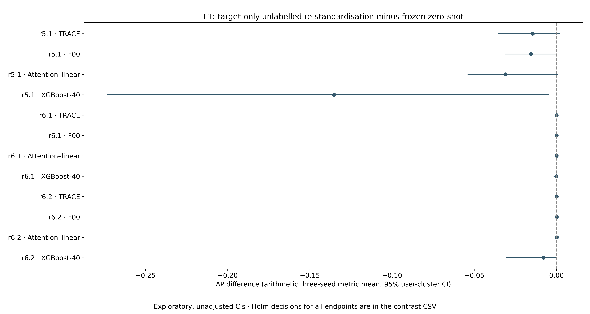
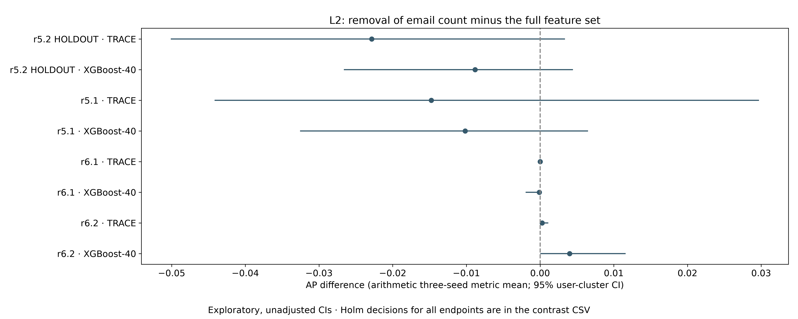
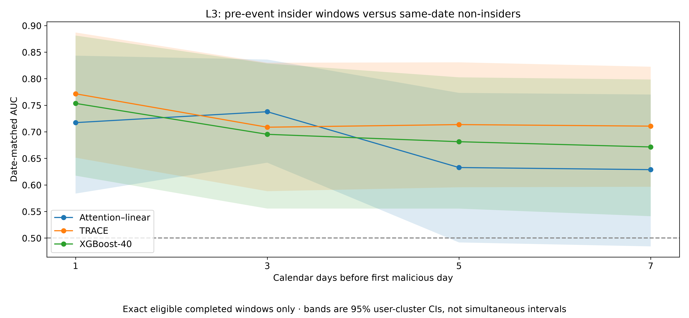
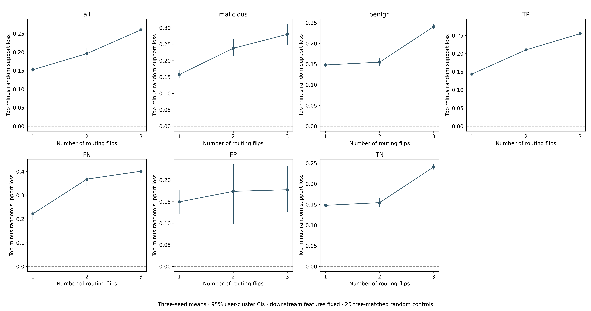
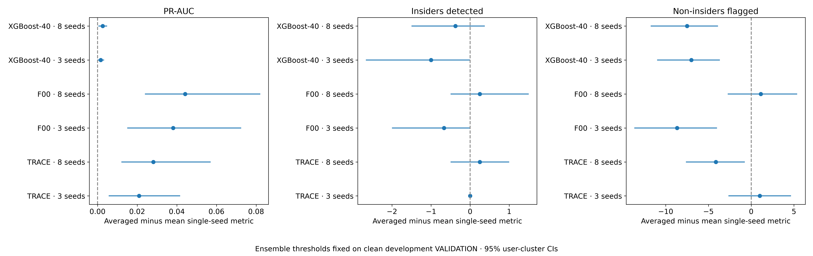
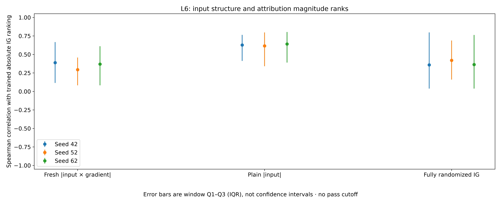
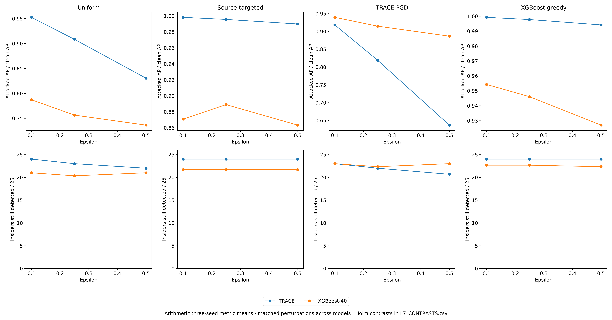
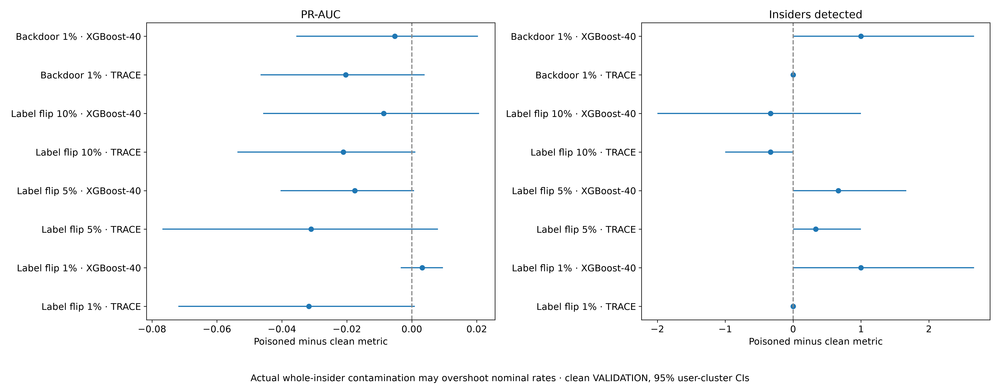

# Phase 9: closing the stated limitations

Generated 2026-10-23T06:55:24.541801+00:00. TRACE is the model key TA2; L1 as a model is the attention–linear reference, distinct from test L1. All results are exploratory.

Amendment9 SHA-256 `fa77279f693755eb7e4d4fd884dfb199ee04c05d4444407d68b82cc0455aff6a` at 2026-10-23T03:55:42.769945+00:00. [Receipt](AMENDMENT9_RECEIPT.json). Clarification SHA-256 `1d074ff2d5f36a6032c8978f9c1a48c178137cd6df6d41b9394999149f6c60a6` at 2026-10-23T04:07:29.064985+00:00. [Clarification receipt](AMENDMENT9_CLARIFICATION_RECEIPT.json). Both prefix receipts and the final preregistration chain are verified in FINAL_AUDIT.json.

## Amendment 9: limitation tests (exploratory)

Qasim approved CHATGPT_PHASE9_PROMPT.md on 23 October 2026 at 11:51 (+08), explicitly including the local adversarial evasion and poisoning experiments. Phase 8 is complete. This amendment and its SHA-256 receipt precede any Phase 9 statistical calculation, data transformation, model computation or training. All L1–L8 outcomes, failures and timeouts are retained, favourable or not. No existing repository is edited or pushed; scripts and new outputs are isolated. Public person identifiers are pseudonyms only. r5.2 TEST stays sealed. Development TRAIN (1,500 users) supplies fitting/scaling/initialisation/references; clean development VALIDATION supplies checkpoint and threshold selection. The 500 HOLDOUT users never supply those decisions. Target labels enter evaluation/explicit attack cohort definitions only, never model fitting or tuning. Original predictions are reused. New model/condition target predictions have exclusive consumed receipts and are saved once; authorised attack optimisation and route interventions are not repeated detector evaluation/selection. All evaluation settings are frozen here, not selected on target outcomes.

Resources: one GPU child at a time, 35% allocator cap, two numerical CPU threads, small batches and cooperative pauses. Never stop/control another chat's processes. Every individual computational child has a 7,200-second limit; terminate only that owned child, record TIMEOUT, continue independent work, and account for dependent missing outcomes. Coordinator lifetimes may exceed that bound while sequencing children. Seeds are 42/52/62 except the explicitly requested eight-seed averaging and fixed randomisation/sampling seed 42.

Common inference and decision rules: completed-window AP is PR-AUC. In L1 the requested "ranking excess (PR-AUC divided by prevalence)" is explicitly named AP_over_prevalence; this differs from earlier phases' AP-minus-prevalence excess. Retain both to avoid ambiguity. Insider recall in the top 1% uses each user's maximum completed-window score, top ceil(0.01*N_users) users, ties by fixed pseudonym order, denominator all labelled insider users in the eligible cohort. Detection means any malicious-containing window at or above the unchanged development-selected threshold; non-insider flags use any eligible window. No target threshold fitting. Cross-release inference uses the full frozen historical input bundles and their existing completed-window labels, while r5.2 HOLDOUT uses only the exact Phase 4 permitted TRAIN+VALIDATION cohort. Their period/population difference is disclosed. S0 is only the storage-coordinate codec; actual baseline models use frozen development S1 coordinates. No sealed r5.2 TEST records are opened.

Unless explicitly descriptive, intervals use 2,000 paired whole-user cluster bootstrap replicates, numpy default_rng(42), identical user multiplicities across both conditions and model seeds within a cohort. Preserve ties for AP/AUC; omit and count undefined replicates, no silent denominator changes. Multi-seed results are arithmetic seedwise metric means, not averaged probabilities, except L5's explicit ensembles. Report per seed and the three-seed arithmetic mean where applicable. An estimate has an unadjusted directional CI only when the entire percentile 95% CI lies beyond zero (or 0.5 for L3 AUC). These exploratory CIs are not simultaneous intervals. Holm families are one per L test, containing every declared inferential contrast across seeds, mean summaries, releases, metrics, settings and strata, with no selective subfamilies. Two-sided bootstrap-centred p=(1+number(|replicate-estimate|>=|estimate-null|))/(1+valid replicates); apply Holm step-down at 0.05, preserving planned missing rows with p=1 and reporting unavailable rather than a result. One-sided L3 p=(1+number(replicate-estimate<=-(estimate-0.5)))/(1+valid replicates), Holm across L3. Claim adjusted evidence only when Holm rejects and the corresponding unadjusted CI direction agrees. L3's user-requested forecasting rule remains CI lower>0.5 and is reported separately from Holm. Bootstrap conditions on frozen policies/ranks/attack outputs; it is not retraining/attacker resampling. L6 has no hypothesis tests requested: its one family is empty and correlations/intervals are descriptive. No post-hoc pass cutoff for explanations.

L1, label-free target re-standardisation: for r5.1/r6.1/r6.2, derive 13 raw daily feature means and population SDs from that release's entire unlabelled daily table only; constant columns use scale one. Freeze statistics before model scoring or label access for this test. Convert stored S0 values to raw coordinates, then target-specific z coordinates; do not change the frozen TRACE/F00/L1/XGBoost models or thresholds. Seeds 42/52/62. Rebuild original summary features from those sequences for XGBoost. Reuse compatible saved zero-shot S1 predictions; absent compatible baselines get a unique saved zero-shot prediction pass, not another population/checkpoint's metrics. Metrics AP, AP_over_prevalence and insider top-1%-user recall; output all point metrics and restandardised-minus-zero-shot paired CIs. L1 Holm family: all three endpoints × three releases × four models × (three individual seeds plus their arithmetic metric mean), 144 contrasts. New transformed conditions scored once; target statistics are authorised unlabelled transfer adaptation, never HOLDOUT scaling.

L2, drop shifted features: select exactly features whose ABSOLUTE standardized mean shift >0.25 in BOTH r6.1 and r6.2 from the already frozen Phase 8 feature table, not its PSI and not target labels. Save feature names, indices, source hash and receipt before any reduced training. Use only remaining standardized development inputs; retrain complete AL precursor→matched optimised teachers→TRACE chain with the original Phase 4 recipe and three new condition-matched teacher consensus logits. Seeds 42/52/62; no old full-feature teachers substituted. Architecture input dimension alone changes. XGBoost summaries are rebuilt with the frozen producing aggregation formula restricted to retained feature groups; document actual resulting dimension (the historical name XGBoost-40 denotes the parent recipe, not a promise of 40 after removal). Reuse development-only scaler columns without target fitting. Retrain XGBoost with original hyperparameters and two-thread resource cap. Score each reduced detector once on permitted HOLDOUT and r5.1/r6.1/r6.2. Compare reduced-minus-full AP, AP_over_prevalence and top-1%-user insider recall per release/model/seed and their arithmetic three-seed metric means: L2 Holm family 4×2×4×3=96 contrasts. Also describe frozen-threshold insider detections and non-insider flags on HOLDOUT as the cost; no feature selection refinement after evaluation.

L3, exact lead times: for each of 25 held-out insiders, locate their first labelled malicious day inside the permitted daily calendar. For leads 1/3/5/7 calendar days, use only an existing completed 20-day window ending exactly on that prior date, with no malicious day and no partition-crossing reconstruction. Missing early/partition-boundary windows remain missing and denominators explicit. Same-date controls are all existing completed windows of users with no malicious day anywhere in the permitted cohort (exclude every insider, even outside their episode). Frozen TRACE/XGBoost/L1 seeds42/52/62 scores are reused; no new scoring needed. Within-date percentile is 100×(number control scores below +0.5 number tied)/Ncontrols; high=more suspicious. Top1%/5% means percentile>=99/95. Date-matched AUC is the probability an insider's pre-event score exceeds a control on its own date, ties half, equal weight per eligible insider; report the pooled pair interpretation and dates/control counts, never a cross-date score pool. Bootstrap all 500 users, retaining an insider's multiplicity and same-date control multiplicities in its matched comparisons; missing-class replicates undefined. Report median percentile, top1/top5 insider shares and matched AUC with CIs per seed and arithmetic mean. Forecasting signal per user instruction only if AUC CI lower>0.5; independently show adjusted result. L3 Holm family four leads × three models × four seed summaries=48 AUC-versus-0.5 contrasts (one-sided); other endpoints descriptive.

L4, route intervention: exact saved Phase 4 2,344-window explanation cohort, original TRACE42/52/62. Thirty-two decisions =8 trees×4 shared oblivious depths. Original predicted class sign is +1 if logit>=0 else -1; frozen sign throughout intervention. For each tree/depth calculate class-support contribution sign×(original tree output-neutral-p=0.5 tree output)/8, holding all other probabilities fixed. Rank all 32 contributions descending, deterministic tree/depth tie order; select m=1/2/3 even if a ranked contribution is nonpositive and disclose this. Flip selected original probabilities p→1-p simultaneously. Intervention is on that tree's explicit routing tensor with other trees/learned feature computations fixed, so no downstream re-encoding is silently called the same intervention. Effect is reduction of class support =sign×(original mean-tree logit−intervened mean-tree logit), positive means selected routes supported the original class. Random controls: 25 draws seed42 per window/m, preserve selected per-tree counts, sample depths without replacement within each selected tree, allowed to coincide with top choices; compare top effect minus mean random effect paired within window. Strata fixed using original labels and frozen thresholds: all, malicious, benign, TP,FN,FP,TN (overlapping descriptive subgroups). Report per seed and arithmetic three-seed summary, each m and stratum, user-cluster CIs. L4 Holm family 4 seed summaries×3m×7 strata=84 two-sided top-minus-random contrasts. This is local representation intervention, not event-level causal faithfulness.

L5, seed averaging: TRACE,F00,XGBoost, original three and all eight Phase 8 seeds. Average probabilities, not logits. Compute each ensemble threshold with exact inherited max-F1 candidate/first-maximum rule on averaged clean development VALIDATION scores, freeze it before evaluating cached target ensemble scores. Reuse saved validation predictions if compatible; otherwise development-only inference. Do not refit models. Report ensemble AP, insiders detected/25, non-insider users flagged/475 and constituent single-seed arithmetic metric means at their own frozen thresholds. Contrasts averaged-minus-constituent-mean for these three endpoints, per model and group: L5 Holm family 3×2×3=18 two-sided contrasts. User bootstrap retains cluster multiplicities and pairs ensemble versus all component models. An ensemble of already saved condition scores does not trigger a new detector forward pass.

L6, attribution baseline: exact saved explanation cohort and original three seeds. Original absolute IG feature magnitude is sum of abs(IG) across20days for13features, consistent Phase8. Compare average-tie Spearman ranks per window against (a) sum_t abs(x×gradient) from a freshly initialized untrained TRACE using original constructors and the exact fixed-seed42 development-only data-aware initialization; reuse the identical Phase8 all-randomized state, whose hash proves this initialization, (b) sum_t abs(x) in original development-standardized model coordinates, (c) sum_t abs(fully randomized Phase8 IG). Reuse (c)'s saved results/attributions; no new IG needed. Report median,Q1,Q3, constant/excluded counts per original seed and pooled descriptive windows, plus descriptive user-bootstrap median CIs if finite. Empty L6 Holm family (no superiority/null claims). This quantifies ranking persistence without a tuned pass/fail threshold.

L7, local aggregate-feature evasion attacker: only the permitted held-out insiders' malicious-containing windows; within them edit only days labelled malicious. Normal user windows and all nonmalicious days are bytewise unchanged. Five source counts logon/device/file/email/http are the independent controls. For epsilon0.10/0.25/0.50 each source count lies [(1-epsilon)*original,original], never negative. Continuous count attenuation is an aggregate thinning surrogate, not fabricated event-log editing; exact integer event deletion/timestamp reconstruction is not claimed. Recompute total_events=sum five counts, each has_source indicator=(count>0), is_active_day=(total>0), and duration=original_duration×retained_total/original_total (zero if original_total=0); this deterministic proportional active-duration rule preserves nonnegativity and avoids pretending aggregate data supplies event timestamps. Report this attacker abstraction explicitly. Bounds apply independently to each malicious day and source. All algorithms/budgets fixed here, no target success-based tuning.
(a) Uniform: multiply all five counts by1-epsilon. (b) Source-targeted: choose one source per insider by the largest summed source count on that insider's labelled malicious days across the permitted calendar; tie in stated source order. This is explicitly malicious-day source activity, not an invented per-event malicious label; report limitation if daily source-specific malicious counts are unavailable. Multiply only that source by1-epsilon. (c) White-box TRACE PGD: per matched seed, minimise TRACE logit,20 deterministic projected sign-gradient steps, step size epsilon*original_count/10, start at original, clamp each step to same box. Indicators use the exact positive-count rule (constant under epsilon<1); derived continuous total/duration use differentiable formulas; no attack restarts or label/threshold optimisation. (d) Evaluate those same PGD inputs on matched-seed XGBoost. (e) XGBoost query greedy: start original, at each step propose reducing one source at one malicious day by epsilon*original_count/10, clipped; evaluate candidates in deterministic day/source order with a maximum200 model queries INCLUDING original, accept the best strict score decrease, stop if none or budget exhausted. Return the lowest queried input, even if no decrease. Also evaluate this XGBoost-generated condition on matched TRACE so contrasts use identical perturbed inputs. For uniform/source-targeted both models receive identical input. Retain condition perturbations, bounds/consistency checks, query counts and hashes. The explicit optimisation queries are authorised attack construction, not independent detector rescoring/model selection.
For every attack condition (uniform,source_targeted,TRACE_PGD,XGB_greedy),epsilon,model,seed report frozen-threshold insiders still detected/25, full-cohort AP with every other window's saved original score unchanged, AP retention=attacked_AP/clean_AP, and median(original−attacked) malicious-window score drop; include bootstrap CIs. L7 contrasts TRACE−XGBoost on detected-insider count and AP retention for each4attack×3epsilon×(3seeds+mean),96 two-sided contrasts in ONE L7 Holm family. Cross-model white-box/query comparisons disclose whose model generated the shared perturbation; no claim of universal adaptive robustness.

L8, poisoning attacker: development TRAIN only. Clean development VALIDATION and all scalers/references remain unchanged. Label flip rho1/5/10%: compute each training insider's positive-window count, fixed random order of whole development insiders using default_rng42, relabel ALL their positive TRAIN windows benign until cumulative hidden positives>=ceil(rho*original_positive_windows), stopping then. Use nested prefixes for the three budgets and report actual fraction/overshoot and affected pseudonyms; no splitting an insider to force exact rho, no target knowledge. Backdoor rho1%: fixed seed42 sample ceil(.01*positive TRAIN windows) without replacement; replace those originals by triggered benign-labelled versions and append an equal number of triggered benign copies, retaining all other training windows. Trigger last3days: file-presence=1 and device_count=0 exactly as specified; recompute device presence,total and active flag consistently from source counts, keep existing file count unchanged (indicator override is intentional trigger and may be logically inconsistent if count0), duration follows same deterministic retained-total proportional rule. Disclose that intentional indicator trigger and no natural-event realism claim. Save poisoned sample indices and actual contamination counts privately before training. No validation poisoning.
For each of four conditions (flip01,flip05,flip10,backdoor01), train full condition-specific AL→Topt→TRACE with the poisoned teachers and their condition-specific three-seed consensus, and XGBoost seeds42/52/62 under frozen Phase4 optimizer/epoch/patience/selection recipes. Recalculate only class-imbalance weights from that condition's TRAIN labels as the original recipe specifies. Clean VALIDATION selects checkpoints and thresholds. Freeze every new detector/threshold before target evaluation. Score once on clean permitted HOLDOUT, and backdoor detectors also once on malicious-containing held-out insider windows with the same last3day trigger, other windows unchanged; no transfer-release poisoning scoring requested. Report clean AP, insiders detected/25 and poisoned-minus-unpoisoned changes; for backdoor ASR=fraction of all triggered malicious-containing insider windows below frozen poisoned threshold, with numerator/denominator and user-cluster CI (also describe clean counterpart below-threshold rate). L8 contrasts poisoned-minus-clean AP and detected-insider counts for each4condition×2model×(3seed+mean)=64, plus TRACE−XGBoost differences of those drops4×4×2=32, ONE L8 Holm family of96 two-sided contrasts. ASR is descriptive, no extra hidden hypothesis. Report all conditions including degradation; no selection of a poisoning recipe by target performance.

Deliverables: phase9/CHATGPT_PHASE9_REPORT.md, PHASE9_RESULTS.json, one section per L with tables, full training/outcome logs, contrast rows including unavailable results, Holm family sizes and adjusted p, 300dpi figures>=12pt with adjacent source CSVs, attack/poison receipts, deviations/skips/timeouts, source hashes, data-boundary/scoring-once/privacy/integrity audit. Preserve Phase8 report and its historical audit. End PHASE9_COMPLETE only when every requested result or explicit unavailable outcome is accounted for and final checks pass.

### Amendment 9 implementation clarification, before new-condition scoring

The prompt explicitly requests a source selected by its share of malicious activity. Schema inspection found source-specific labelled-event metadata. For L7(b), replace the fallback daily-count proxy by actual malicious-event counts per source and held-out insider, filtering user, is_malicious=1 and the permitted 2010-01-02 through 2011-04-10 period BEFORE materialisation. Read only user/date/is_malicious, no event text, addresses or content. Freeze each insider source choice and count receipt before attack construction; ties remain logon/device/file/email/http. r5.2 TEST rows remain excluded. These evaluation labels define the explicitly authorised attacker; no model or threshold is fitted.

The L8 wording requests triggered held-out insider windows, including their benign windows. Correct the earlier narrower implementation clause: apply the fixed trigger to ALL permitted completed windows of all25 insiders, leaving every non-insider window unchanged. Primary ASR is below-threshold rate across all triggered insider windows; additionally report the more specific malicious-containing subset ASR, numerator/denominator and clean counterfactual below-threshold rate for both. This introduces no additional hypothesis test or Holm-family change.

Both clarifications are based on prompt/schema inspection before either attack/trigger condition is scored, not target outcomes. No training, feature-selection or threshold procedure changes. The original Amendment9 receipt and frozen method version remain preserved; hash the clarified method implementation before any dependent score.

## Boundaries and statistical families

r5.2 TEST remains sealed. The500 HOLDOUT users are evaluation-only and never supply model fitting, feature-selection refinement, scaling, references or thresholds. New model/condition scoring has consumed/completed receipts; cached original predictions are reused unchanged. r5.1/r6.1/r6.2 labels supply evaluation only, apart from no-label adaptation of their own input moments. Public people are pseudonyms only.

| test | planned_Holm_family_size |
| --- | --- |
| L1 | 144 |
| L2 | 96 |
| L3 | 48 |
| L4 | 84 |
| L5 | 18 |
| L6 | 0 |
| L7 | 96 |
| L8 | 96 |

Ranking ratio is AP/prevalence as requested; earlier AP-minus-prevalence is retained separately. User top1% ranks each user’s maximum completed-window score and uses a fixed ceil(1%×users) budget. High lead-time rank percentile means more suspicious. User bootstrap uses2000 replicates, seed42, paired multiplicities across conditions/seeds. Raw count intervals may reflect variation in the number of insiders drawn; denominators of the observed population remain explicit.

## Training log

| condition | model | seed | status | epochs | best_epoch | dev_validation_pr_auc | wall_seconds | threshold | checkpoint | sha256 |
| --- | --- | --- | --- | --- | --- | --- | --- | --- | --- | --- |
| reduced | AL_PRECURSOR | 42 | ok | 10 | 6 | 0.955762 | 105.351 | 0.91 | C:\PhD\04_Journal_Papers\Latest IEEE Access Paper July 2026\R2_revision\phase9\private\training\reduced\checkpoints\AL_PRECURSOR\seed42\best.pt | 1c9f498d4be6b3e8283cbaea0fb031052b99a69657dc2ab676ad5d0f80ede5a5 |
| reduced | AL_PRECURSOR | 52 | ok | 15 | 12 | 0.943491 | 153.654 | 0.84 | C:\PhD\04_Journal_Papers\Latest IEEE Access Paper July 2026\R2_revision\phase9\private\training\reduced\checkpoints\AL_PRECURSOR\seed52\best.pt | dd5c66093770b1561eb8694e1539f7572b0c94188704375b898e40498eb9c82a |
| reduced | AL_PRECURSOR | 62 | ok | 12 | 8 | 0.949904 | 119.009 | 0.95 | C:\PhD\04_Journal_Papers\Latest IEEE Access Paper July 2026\R2_revision\phase9\private\training\reduced\checkpoints\AL_PRECURSOR\seed62\best.pt | 312fabc050035caa55b1354ce78448d0eff0553d6acb8b2fa5da63fbd548b0c0 |
| reduced | T-OPT | 42 | ok | 5 | 1 | 0.945765 | 62.7319 | 0.62 | C:\PhD\04_Journal_Papers\Latest IEEE Access Paper July 2026\R2_revision\phase9\private\training\reduced\checkpoints\T-OPT\seed42\best.pt | cf4b4449d087e007a187e5dd65634dfd75259c05ec6006e1ea3450ef682ac1c3 |
| reduced | T-OPT | 52 | ok | 5 | 1 | 0.92578 | 64.8157 | 0.6 | C:\PhD\04_Journal_Papers\Latest IEEE Access Paper July 2026\R2_revision\phase9\private\training\reduced\checkpoints\T-OPT\seed52\best.pt | 068cf5800fc2d43c0f7b1b0989c351202b6b3532e69e01c092ce14010e5bbd23 |
| reduced | T-OPT | 62 | ok | 5 | 1 | 0.945004 | 66.1202 | 0.64 | C:\PhD\04_Journal_Papers\Latest IEEE Access Paper July 2026\R2_revision\phase9\private\training\reduced\checkpoints\T-OPT\seed62\best.pt | f5c670a8b834ed8d517dafc0a76bfaeb12e12f0d0f45d5abd53fc9c56aeb0d42 |
| reduced | TA2 | 42 | ok | 6 | 2 | 0.945966 | 142.416 | 0.61 | C:\PhD\04_Journal_Papers\Latest IEEE Access Paper July 2026\R2_revision\phase9\private\training\reduced\checkpoints\TA2\seed42\best.pt | b3d87967dc5e60e212d9ec0a75e880198944441b24844f8a1fcc377e6732b429 |
| reduced | TA2 | 52 | ok | 15 | 12 | 0.941656 | 294.006 | 0.37 | C:\PhD\04_Journal_Papers\Latest IEEE Access Paper July 2026\R2_revision\phase9\private\training\reduced\checkpoints\TA2\seed52\best.pt | 7c4261922121ea0341c6952c810327dcfb6d45d6d3d245903d52bac40e8151e1 |
| reduced | TA2 | 62 | ok | 5 | 1 | 0.94555 | 103.504 | 0.71 | C:\PhD\04_Journal_Papers\Latest IEEE Access Paper July 2026\R2_revision\phase9\private\training\reduced\checkpoints\TA2\seed62\best.pt | 117c68ae18706e7102aaa38a9a9f773052eecec76ac4af397f23b1da6344c265 |
| reduced | XGBoost_40 | 42 | ok | 300 | 300 | 0.936032 | 14.9463 | 0.1 | C:\PhD\04_Journal_Papers\Latest IEEE Access Paper July 2026\R2_revision\phase9\private\training\reduced\checkpoints\XGBoost_40\seed42\best.json | e785042b9339788282343ff8407738ec88fb8fac093b202c6805b3cda45a7453 |
| reduced | XGBoost_40 | 52 | ok | 300 | 300 | 0.931681 | 14.4459 | 0.53 | C:\PhD\04_Journal_Papers\Latest IEEE Access Paper July 2026\R2_revision\phase9\private\training\reduced\checkpoints\XGBoost_40\seed52\best.json | 1554ceab6b4f2fdf439785ef6d794a00df4350c269b04d4a443cab31af0546d9 |
| reduced | XGBoost_40 | 62 | ok | 300 | 300 | 0.932144 | 14.3571 | 0.4 | C:\PhD\04_Journal_Papers\Latest IEEE Access Paper July 2026\R2_revision\phase9\private\training\reduced\checkpoints\XGBoost_40\seed62\best.json | 67cfc044c5b157f568d9ca1d6a31d04852b6d5138cb6a952312ebdadefff8431 |
| flip01 | AL_PRECURSOR | 42 | ok | 9 | 5 | 0.953042 | 91.2215 | 0.96 | C:\PhD\04_Journal_Papers\Latest IEEE Access Paper July 2026\R2_revision\phase9\private\training\flip01\checkpoints\AL_PRECURSOR\seed42\best.pt | f89880de19fe73890ec463e67ca309145dd1f8f12900305edbd4ad365dbd4392 |
| flip01 | AL_PRECURSOR | 52 | ok | 7 | 3 | 0.93699 | 75.3312 | 0.95 | C:\PhD\04_Journal_Papers\Latest IEEE Access Paper July 2026\R2_revision\phase9\private\training\flip01\checkpoints\AL_PRECURSOR\seed52\best.pt | 8c8319aea08ad919f4db0ebab83b685c645bd7ad7f09b233c78ed7116e6e4179 |
| flip01 | AL_PRECURSOR | 62 | ok | 10 | 6 | 0.962315 | 97.978 | 0.9 | C:\PhD\04_Journal_Papers\Latest IEEE Access Paper July 2026\R2_revision\phase9\private\training\flip01\checkpoints\AL_PRECURSOR\seed62\best.pt | df4a31b48464134f7796b686f6f4b659a731a161e07d7b3cad639bc4f9ee75a0 |
| flip01 | T-OPT | 42 | ok | 5 | 1 | 0.952724 | 63.1337 | 0.64 | C:\PhD\04_Journal_Papers\Latest IEEE Access Paper July 2026\R2_revision\phase9\private\training\flip01\checkpoints\T-OPT\seed42\best.pt | 1eb8e29dc5f68a3130f20ca1b55892dd8e7f22cc8dc8270efcbc7fd530931291 |
| flip01 | T-OPT | 52 | ok | 14 | 10 | 0.962145 | 166.322 | 0.63 | C:\PhD\04_Journal_Papers\Latest IEEE Access Paper July 2026\R2_revision\phase9\private\training\flip01\checkpoints\T-OPT\seed52\best.pt | 50679690822a259b129f7fcb05fba04e9c356e7fd8c64c766210bdd8cbb70213 |
| flip01 | T-OPT | 62 | ok | 5 | 1 | 0.959556 | 60.4774 | 0.61 | C:\PhD\04_Journal_Papers\Latest IEEE Access Paper July 2026\R2_revision\phase9\private\training\flip01\checkpoints\T-OPT\seed62\best.pt | 46e2c2734316c2884a6d5d6e380adbc4820cfc338df9ebd63ddcc4beb5ff2807 |
| flip01 | TA2 | 42 | ok | 6 | 2 | 0.958636 | 139.678 | 0.8 | C:\PhD\04_Journal_Papers\Latest IEEE Access Paper July 2026\R2_revision\phase9\private\training\flip01\checkpoints\TA2\seed42\best.pt | 4c49f603dc0095da7fc52533b6578f36619baf6f410c0949fc9a3c3d6d793d1f |
| flip01 | TA2 | 52 | ok | 6 | 2 | 0.967336 | 121.11 | 0.62 | C:\PhD\04_Journal_Papers\Latest IEEE Access Paper July 2026\R2_revision\phase9\private\training\flip01\checkpoints\TA2\seed52\best.pt | 168c403e5a57d481afd6f3995d048d79d014245173639890cb359f1058ac197e |
| flip01 | TA2 | 62 | ok | 9 | 5 | 0.965346 | 186.442 | 0.3 | C:\PhD\04_Journal_Papers\Latest IEEE Access Paper July 2026\R2_revision\phase9\private\training\flip01\checkpoints\TA2\seed62\best.pt | fb8c2aaf7a32ec9f6b5f8ec11e1b4e145069101af1c380045a109aec83671346 |
| flip01 | XGBoost_40 | 42 | ok | 300 | 300 | 0.928606 | 14.0589 | 0.04 | C:\PhD\04_Journal_Papers\Latest IEEE Access Paper July 2026\R2_revision\phase9\private\training\flip01\checkpoints\XGBoost_40\seed42\best.json | b4cdb5d32aa7718a7fe20d52b5955994ef58b40713985db6923a48f85939c0e7 |
| flip01 | XGBoost_40 | 52 | ok | 300 | 300 | 0.930552 | 12.3058 | 0.04 | C:\PhD\04_Journal_Papers\Latest IEEE Access Paper July 2026\R2_revision\phase9\private\training\flip01\checkpoints\XGBoost_40\seed52\best.json | 3aefd975fa1e0fce96d2cc357909cd6a6e6e5161f29048ba9ffbe36ca07d3ea4 |
| flip01 | XGBoost_40 | 62 | ok | 300 | 300 | 0.927614 | 12.4998 | 0.04 | C:\PhD\04_Journal_Papers\Latest IEEE Access Paper July 2026\R2_revision\phase9\private\training\flip01\checkpoints\XGBoost_40\seed62\best.json | 0736ecc40dd9ca71a8c47055a868c95b6bf6e39cf6cc021c0e338ee48181d611 |
| flip05 | AL_PRECURSOR | 42 | ok | 11 | 7 | 0.950839 | 123.705 | 0.98 | C:\PhD\04_Journal_Papers\Latest IEEE Access Paper July 2026\R2_revision\phase9\private\training\flip05\checkpoints\AL_PRECURSOR\seed42\best.pt | ca8a15f816812c28a1198802bcf38afa68bcfcd7517cbe7875efe02510007acb |
| flip05 | AL_PRECURSOR | 52 | ok | 14 | 10 | 0.958068 | 153.412 | 0.84 | C:\PhD\04_Journal_Papers\Latest IEEE Access Paper July 2026\R2_revision\phase9\private\training\flip05\checkpoints\AL_PRECURSOR\seed52\best.pt | 9d1d32ddf7926b2391de48d037aa0c59bdda407767c421ee32db467f8b4c6964 |
| flip05 | AL_PRECURSOR | 62 | ok | 14 | 10 | 0.956614 | 153.675 | 0.08 | C:\PhD\04_Journal_Papers\Latest IEEE Access Paper July 2026\R2_revision\phase9\private\training\flip05\checkpoints\AL_PRECURSOR\seed62\best.pt | 0345f08b2c38173866d790147ec66626d1e7537d267777dc5bed88cd05f9ae5b |
| flip05 | T-OPT | 42 | ok | 10 | 6 | 0.958581 | 129.834 | 0.89 | C:\PhD\04_Journal_Papers\Latest IEEE Access Paper July 2026\R2_revision\phase9\private\training\flip05\checkpoints\T-OPT\seed42\best.pt | 01a63ddf06f4e241ad26a15ecf9ee2ed89d907d3e1d5b90419366e872dbe1b0c |
| flip05 | T-OPT | 52 | ok | 5 | 1 | 0.958169 | 68.0517 | 0.47 | C:\PhD\04_Journal_Papers\Latest IEEE Access Paper July 2026\R2_revision\phase9\private\training\flip05\checkpoints\T-OPT\seed52\best.pt | 6f5800ff65c260882b4e819cbc975930364be30d4a5d869c5856008d9a03801f |
| flip05 | T-OPT | 62 | ok | 8 | 4 | 0.950567 | 111.043 | 0.24 | C:\PhD\04_Journal_Papers\Latest IEEE Access Paper July 2026\R2_revision\phase9\private\training\flip05\checkpoints\T-OPT\seed62\best.pt | 3921e61a44fae7164cf389e6f1ad68ab8ce4aeeb5afeaed9efb04e7f7bde7665 |
| flip05 | TA2 | 42 | ok | 13 | 9 | 0.964303 | 303.886 | 0.75 | C:\PhD\04_Journal_Papers\Latest IEEE Access Paper July 2026\R2_revision\phase9\private\training\flip05\checkpoints\TA2\seed42\best.pt | f6b039fa6a3b01f2ef2cce68391df474b6a2ba80d8463af6a7c39a462cf59b9b |
| flip05 | TA2 | 52 | ok | 12 | 8 | 0.976029 | 247.656 | 0.36 | C:\PhD\04_Journal_Papers\Latest IEEE Access Paper July 2026\R2_revision\phase9\private\training\flip05\checkpoints\TA2\seed52\best.pt | efe252bdf91536703a14615345a1d3478945785cdf0ebab74b43caae27cbb87f |
| flip05 | TA2 | 62 | ok | 15 | 15 | 0.959911 | 290.998 | 0.33 | C:\PhD\04_Journal_Papers\Latest IEEE Access Paper July 2026\R2_revision\phase9\private\training\flip05\checkpoints\TA2\seed62\best.pt | 9b82eaf51e0b2ca770a4205cdf7aef6fe5be4913d00544f81f97e396199f04c3 |
| flip05 | XGBoost_40 | 42 | ok | 300 | 300 | 0.930257 | 15.6135 | 0.27 | C:\PhD\04_Journal_Papers\Latest IEEE Access Paper July 2026\R2_revision\phase9\private\training\flip05\checkpoints\XGBoost_40\seed42\best.json | db329616da45afd0e1ff8dba2cb231a376651109bd52f6ae36404a76ca467cee |
| flip05 | XGBoost_40 | 52 | ok | 300 | 300 | 0.931513 | 15.1417 | 0.08 | C:\PhD\04_Journal_Papers\Latest IEEE Access Paper July 2026\R2_revision\phase9\private\training\flip05\checkpoints\XGBoost_40\seed52\best.json | c22f77ad4613c39abfcc030ce18163db39a6b11aad871955783a23ad5dc1dc84 |
| flip05 | XGBoost_40 | 62 | ok | 300 | 300 | 0.925209 | 15.089 | 0.04 | C:\PhD\04_Journal_Papers\Latest IEEE Access Paper July 2026\R2_revision\phase9\private\training\flip05\checkpoints\XGBoost_40\seed62\best.json | 8c067487a4c9e2a1ed71ba856e330cbcf4dd548dfa97e0e31a0c3ace38c0865b |
| flip10 | AL_PRECURSOR | 42 | ok | 9 | 5 | 0.9509 | 114.903 | 0.93 | C:\PhD\04_Journal_Papers\Latest IEEE Access Paper July 2026\R2_revision\phase9\private\training\flip10\checkpoints\AL_PRECURSOR\seed42\best.pt | 1b1ebcca4bf7ca71bebcf66fbf07cbfc7e4625dbc70a3d5c7255a491aaff27bf |
| flip10 | AL_PRECURSOR | 52 | ok | 14 | 10 | 0.95278 | 142.252 | 0.97 | C:\PhD\04_Journal_Papers\Latest IEEE Access Paper July 2026\R2_revision\phase9\private\training\flip10\checkpoints\AL_PRECURSOR\seed52\best.pt | d4462ce5539642294572b736265434b1f01685cd1babc369bc518a1fcbcbc432 |
| flip10 | AL_PRECURSOR | 62 | ok | 11 | 7 | 0.961218 | 109.016 | 0.8 | C:\PhD\04_Journal_Papers\Latest IEEE Access Paper July 2026\R2_revision\phase9\private\training\flip10\checkpoints\AL_PRECURSOR\seed62\best.pt | 57ef56e38ac4cf9bc75b4b0a0ffde5116aa0265956bcc688a86a868eba218611 |
| flip10 | T-OPT | 42 | ok | 10 | 6 | 0.939244 | 133.991 | 0.88 | C:\PhD\04_Journal_Papers\Latest IEEE Access Paper July 2026\R2_revision\phase9\private\training\flip10\checkpoints\T-OPT\seed42\best.pt | 49273e413333af59c4093d2e0f9e2c2d12bab7b8a8d0ed005e6518a75db2547a |
| flip10 | T-OPT | 52 | ok | 5 | 1 | 0.952634 | 70.6139 | 0.63 | C:\PhD\04_Journal_Papers\Latest IEEE Access Paper July 2026\R2_revision\phase9\private\training\flip10\checkpoints\T-OPT\seed52\best.pt | 6839d5b50d465887b8ce5fa6ac09a003e69e52922da9da6bbcc7dea8f5d5a825 |
| flip10 | T-OPT | 62 | ok | 9 | 5 | 0.949947 | 116.938 | 0.73 | C:\PhD\04_Journal_Papers\Latest IEEE Access Paper July 2026\R2_revision\phase9\private\training\flip10\checkpoints\T-OPT\seed62\best.pt | b19baa0582a22cb35bcc12a8cf1bb5415f673dae0a6e65e3a9c969e274fa6ed6 |
| flip10 | TA2 | 42 | ok | 7 | 3 | 0.948145 | 159.84 | 0.6092 | C:\PhD\04_Journal_Papers\Latest IEEE Access Paper July 2026\R2_revision\phase9\private\training\flip10\checkpoints\TA2\seed42\best.pt | c2efab028b619bc922c11ad8b391e65cb53d33d0b621496e2c15e7c93a59a18b |
| flip10 | TA2 | 52 | ok | 13 | 9 | 0.961357 | 260.1 | 0.38 | C:\PhD\04_Journal_Papers\Latest IEEE Access Paper July 2026\R2_revision\phase9\private\training\flip10\checkpoints\TA2\seed52\best.pt | b7ae9cac3a182e6c435e1a85e827d585db23872583f34503902282384a4298d3 |
| flip10 | TA2 | 62 | ok | 15 | 14 | 0.96626 | 293.476 | 0.57 | C:\PhD\04_Journal_Papers\Latest IEEE Access Paper July 2026\R2_revision\phase9\private\training\flip10\checkpoints\TA2\seed62\best.pt | 7f6e9f251f271920d6428fd92199fddfd175e5d79ef35e48412c6398bb8b4889 |
| flip10 | XGBoost_40 | 42 | ok | 300 | 300 | 0.926864 | 15.7966 | 0.34 | C:\PhD\04_Journal_Papers\Latest IEEE Access Paper July 2026\R2_revision\phase9\private\training\flip10\checkpoints\XGBoost_40\seed42\best.json | 20de1d808773e6408357fbf45274063ded3e4127e6c4390dc95ca9ef76db9212 |
| flip10 | XGBoost_40 | 52 | ok | 300 | 300 | 0.925133 | 15.2272 | 0.55 | C:\PhD\04_Journal_Papers\Latest IEEE Access Paper July 2026\R2_revision\phase9\private\training\flip10\checkpoints\XGBoost_40\seed52\best.json | 6708adf9c9d646238daa39571de44a822dd76ca8fb4480c64c554297e8d7fb2d |
| flip10 | XGBoost_40 | 62 | ok | 300 | 300 | 0.927949 | 14.934 | 0.48 | C:\PhD\04_Journal_Papers\Latest IEEE Access Paper July 2026\R2_revision\phase9\private\training\flip10\checkpoints\XGBoost_40\seed62\best.json | 3448a265f7c3584b5b19b08018d28a8ca7b976df75309c88a5596a314e3f2e83 |
| backdoor01 | AL_PRECURSOR | 42 | ok | 15 | 12 | 0.957117 | 144.729 | 0.66 | C:\PhD\04_Journal_Papers\Latest IEEE Access Paper July 2026\R2_revision\phase9\private\training\backdoor01\checkpoints\AL_PRECURSOR\seed42\best.pt | df2d78a93ef226ae667bd698b8b25d4f19c379446d87411fbef40dbb290dd4a2 |
| backdoor01 | AL_PRECURSOR | 52 | ok | 11 | 7 | 0.956497 | 106.642 | 0.81 | C:\PhD\04_Journal_Papers\Latest IEEE Access Paper July 2026\R2_revision\phase9\private\training\backdoor01\checkpoints\AL_PRECURSOR\seed52\best.pt | 7f7aa09b8050a6fd4e1c1cad5e8ad6b56f067ec20bad282b9dfdf25a7876985e |
| backdoor01 | AL_PRECURSOR | 62 | ok | 9 | 5 | 0.964985 | 87.2343 | 0.93 | C:\PhD\04_Journal_Papers\Latest IEEE Access Paper July 2026\R2_revision\phase9\private\training\backdoor01\checkpoints\AL_PRECURSOR\seed62\best.pt | 802f791b2609559481653736df0d8862eb530ea4784eac9946bce6d4204ee43c |
| backdoor01 | T-OPT | 42 | ok | 8 | 4 | 0.951611 | 91.141 | 0.64 | C:\PhD\04_Journal_Papers\Latest IEEE Access Paper July 2026\R2_revision\phase9\private\training\backdoor01\checkpoints\T-OPT\seed42\best.pt | 5dce8c5f56947fda8b328d02f73729059eb73583a3b55539e173584bccb7a60f |
| backdoor01 | T-OPT | 52 | ok | 6 | 2 | 0.965371 | 70.3066 | 0.6 | C:\PhD\04_Journal_Papers\Latest IEEE Access Paper July 2026\R2_revision\phase9\private\training\backdoor01\checkpoints\T-OPT\seed52\best.pt | 63f30185a6e34bc485db0fd53a37a8b2c715233fc6906ee22fbb2d37887b2724 |
| backdoor01 | T-OPT | 62 | ok | 6 | 2 | 0.96692 | 69.9787 | 0.73 | C:\PhD\04_Journal_Papers\Latest IEEE Access Paper July 2026\R2_revision\phase9\private\training\backdoor01\checkpoints\T-OPT\seed62\best.pt | 445b2db5e1498fe94da36182cab0635f45049a94b0fcdedfae331986d08e8133 |
| backdoor01 | TA2 | 42 | ok | 8 | 4 | 0.96553 | 163.427 | 0.32 | C:\PhD\04_Journal_Papers\Latest IEEE Access Paper July 2026\R2_revision\phase9\private\training\backdoor01\checkpoints\TA2\seed42\best.pt | a2fa41783fb6a5d0e9b5386ab6b3ce7b1dfa81da0450f362597560946d002338 |
| backdoor01 | TA2 | 52 | ok | 15 | 15 | 0.964728 | 275.319 | 0.4 | C:\PhD\04_Journal_Papers\Latest IEEE Access Paper July 2026\R2_revision\phase9\private\training\backdoor01\checkpoints\TA2\seed52\best.pt | c19cadc31227e29b8ffe7b0050e8269728194f2086e41e32e9ed85ba90ca3ecd |
| backdoor01 | TA2 | 62 | ok | 8 | 4 | 0.96402 | 149.739 | 0.58 | C:\PhD\04_Journal_Papers\Latest IEEE Access Paper July 2026\R2_revision\phase9\private\training\backdoor01\checkpoints\TA2\seed62\best.pt | 1ccf6ba48c5e3dc1e3d11d6eef46aa60a7cb390f4453207d04b98d2a7a6cb33e |
| backdoor01 | XGBoost_40 | 42 | ok | 300 | 300 | 0.920711 | 15.0148 | 0.03 | C:\PhD\04_Journal_Papers\Latest IEEE Access Paper July 2026\R2_revision\phase9\private\training\backdoor01\checkpoints\XGBoost_40\seed42\best.json | f3e61bb6b7fd26f1e43b25ef57b75ad7ff103e5821f4efb316c9042853a4d865 |
| backdoor01 | XGBoost_40 | 52 | ok | 300 | 300 | 0.919846 | 15.0767 | 0.02 | C:\PhD\04_Journal_Papers\Latest IEEE Access Paper July 2026\R2_revision\phase9\private\training\backdoor01\checkpoints\XGBoost_40\seed52\best.json | 0108d23be52d0f9d66ffff2ecc9a01b8677981aced902437d1b23d6fbde2af3c |
| backdoor01 | XGBoost_40 | 62 | ok | 300 | 300 | 0.921936 | 14.9236 | 0.06 | C:\PhD\04_Journal_Papers\Latest IEEE Access Paper July 2026\R2_revision\phase9\private\training\backdoor01\checkpoints\XGBoost_40\seed62\best.json | 56d5d93e79154645eada0570a2892f2b7558a24bac4410cf3923efc02024b282 |

### Frozen training interventions

| config | features | original_positive_windows | modified_positive_windows | actual_modified_fraction | added_trigger_copies | affected_users | train | validation |
| --- | --- | --- | --- | --- | --- | --- | --- | --- |
| reduced | ["total_events", "logon_count", "device_count", "file_count", "http_count", "active_duration_minutes", "has_logon_activity", "has_device_activity", "has_file_activity", "has_email_activity", "has_http_activity", "is_active_day"] | 3040 | 0 | 0 | 0 | [] | {"windows": 591000, "positive_windows": 3040, "X_sha256": "d0e396ce6809e2f0a34d9f7af7486cc2794e400091988fc56aa150ee7083e864", "X40_sha256": "3fdefdda456cbb05967d544e85725810efe90b905ff6f36f37e90dcc3c4e32f5", "y_sha256": "bfe88c0dd3a1e29c567ab8375ce0f6452d06a55591711997792244dbc6ee41f7"} | {"windows": 48000, "positive_windows": 473, "X_sha256": "18cd7dc423e696a8925e483240cb27de835a4c391619880c79059a1508e077d5", "X40_sha256": "8f08ab6b13ba51c19a0f31fd6ecef727ea81550f5d81854b8696229b240181ef", "y_sha256": "d514c0efc1fac7e2d2e581b95dc4e204063ee9817baf330bfe7ee1672b0d6f2c"} |
| flip01 | ["total_events", "logon_count", "device_count", "file_count", "email_count", "http_count", "active_duration_minutes", "has_logon_activity", "has_device_activity", "has_file_activity", "has_email_activity", "has_http_activity", "is_active_day"] | 3040 | 96 | 0.0315789 | 0 | ["U_79c0492cd8"] | {"windows": 591000, "positive_windows": 2944, "X_sha256": "e9e414692883d9e364af89437b4bfb8faca5d8c00328d70fe9af9b5105f35cc4", "X40_sha256": "40ffbccd51885d50bbcd244cfde4e22eb57aa25c4666f3f5d650fab37b35e845", "y_sha256": "fe3d742c877d52f1b8dd612e6bf104b09b76a53d47697c6f24afdc656737fe92"} | {"windows": 48000, "positive_windows": 473, "X_sha256": "ce82cdc9d088325c183a4cdb21d621b718b8f2224ff9e952dd129d21198271a5", "X40_sha256": "a2962c0c443f87d165248b471833f55d498098844731ed5e1f572a12e2e0c2d1", "y_sha256": "d514c0efc1fac7e2d2e581b95dc4e204063ee9817baf330bfe7ee1672b0d6f2c"} |
| flip05 | ["total_events", "logon_count", "device_count", "file_count", "email_count", "http_count", "active_duration_minutes", "has_logon_activity", "has_device_activity", "has_file_activity", "has_email_activity", "has_http_activity", "is_active_day"] | 3040 | 171 | 0.05625 | 0 | ["U_79c0492cd8", "U_c98e27e1f2"] | {"windows": 591000, "positive_windows": 2869, "X_sha256": "e9e414692883d9e364af89437b4bfb8faca5d8c00328d70fe9af9b5105f35cc4", "X40_sha256": "40ffbccd51885d50bbcd244cfde4e22eb57aa25c4666f3f5d650fab37b35e845", "y_sha256": "c77fdc29bdaa581320c32695a3d716afb75d89aa005d115ea7c9ce95be782e20"} | {"windows": 48000, "positive_windows": 473, "X_sha256": "ce82cdc9d088325c183a4cdb21d621b718b8f2224ff9e952dd129d21198271a5", "X40_sha256": "a2962c0c443f87d165248b471833f55d498098844731ed5e1f572a12e2e0c2d1", "y_sha256": "d514c0efc1fac7e2d2e581b95dc4e204063ee9817baf330bfe7ee1672b0d6f2c"} |
| flip10 | ["total_events", "logon_count", "device_count", "file_count", "email_count", "http_count", "active_duration_minutes", "has_logon_activity", "has_device_activity", "has_file_activity", "has_email_activity", "has_http_activity", "is_active_day"] | 3040 | 315 | 0.103618 | 0 | ["U_79c0492cd8", "U_c98e27e1f2", "U_abebf53e6b", "U_15df885762", "U_69b344c9cf", "U_4504d84766"] | {"windows": 591000, "positive_windows": 2725, "X_sha256": "e9e414692883d9e364af89437b4bfb8faca5d8c00328d70fe9af9b5105f35cc4", "X40_sha256": "40ffbccd51885d50bbcd244cfde4e22eb57aa25c4666f3f5d650fab37b35e845", "y_sha256": "d6d8d8c7451eb3198e6991c5dafc4bf73d8d31b6153aeec4a86d3d9764626a69"} | {"windows": 48000, "positive_windows": 473, "X_sha256": "ce82cdc9d088325c183a4cdb21d621b718b8f2224ff9e952dd129d21198271a5", "X40_sha256": "a2962c0c443f87d165248b471833f55d498098844731ed5e1f572a12e2e0c2d1", "y_sha256": "d514c0efc1fac7e2d2e581b95dc4e204063ee9817baf330bfe7ee1672b0d6f2c"} |
| backdoor01 | ["total_events", "logon_count", "device_count", "file_count", "email_count", "http_count", "active_duration_minutes", "has_logon_activity", "has_device_activity", "has_file_activity", "has_email_activity", "has_http_activity", "is_active_day"] | 3040 | 31 | 0.0101974 | 31 | [] | {"windows": 591031, "positive_windows": 3009, "X_sha256": "0b5505747c8aafac7fd08aee89fd62dbc0db3358149058963b3aca5041348f78", "X40_sha256": "03128096c600a5c8eed0d47d4bcf2c7745c07b2c23a71537b14c53396e03a489", "y_sha256": "b04cb0f49ddad39a6587c62dc3dc8d42b97b6b8e2a6879a3e13d8c637926bf72"} | {"windows": 48000, "positive_windows": 473, "X_sha256": "ce82cdc9d088325c183a4cdb21d621b718b8f2224ff9e952dd129d21198271a5", "X40_sha256": "a2962c0c443f87d165248b471833f55d498098844731ed5e1f572a12e2e0c2d1", "y_sha256": "d514c0efc1fac7e2d2e581b95dc4e204063ee9817baf330bfe7ee1672b0d6f2c"} |

[All60 training outcomes](TRAINING_LOG.csv); [every neural training epoch, clean VALIDATION AP, TRAIN loss and elapsed time](TRAINING_EPOCH_HISTORY.csv). XGBoost estimator counts and selected thresholds appear in the60-row log; the full per-run configurations remain in PHASE9_RESULTS.json.

Cross-release insider denominators count users with at least one positive completed window in the frozen eligible bundle. The top1% user budget is ceil(0.01×the release user count); every point table retains both budget and insider denominator. The r5.2 HOLDOUT denominator is25.

### Numerical precision corrections before affected training/scoring

| condition | utc | reason | raw_daily_source | raw_daily_sha256 | raw_to_original_model_input_max_abs_error | phantom_positive_zero_count_coordinates_from_inverse_scaling | previous_analysis_manifest_sha256 | old_attack_code_sha256 | new_attack_code_sha256 | r52_test_read | modified_positive_windows | added_copies | poison_indices_unchanged | labels_unchanged | clean_validation_unchanged | max_input_change | manifest_sha256 | previous_training_data_manifest_sha256 | trigger_code_sha256 | training_code_files_unchanged |
| --- | --- | --- | --- | --- | --- | --- | --- | --- | --- | --- | --- | --- | --- | --- | --- | --- | --- | --- | --- | --- |
| evasion | 2026-10-23T04:26:09.147005+00:00 | Use exact original integer daily counts for the already-declared count-box attacker, avoiding inverse-standardization roundoff creating false >0 indicators. No attack condition has been consumed and no model outcome informed this correction. | C:\PhD\04_Journal_Papers\Latest IEEE Access Paper July 2026\R2_revision\phase7\private\daily_features.npy | 18129ea9ee8d3630942e1cbf8e6127ce12b8364ec69dbcef56a4ab9cade95fcd | 0 | 22507 | 132cc822c9927d9d5cb0b07981a5dc79e6a83bcc8a0d7080f355fbf0f111d69b | 3fec22bf352905dfcb2009ba6a2b5a73514bf510fe7edc324a53a371090472f6 | fe5bd29c6ed6b6881bfadadc7916954d2fc82f7bedc0e176c022e6fae1c57f1f | False | unavailable | unavailable | unavailable | unavailable | unavailable | unavailable | unavailable | unavailable | unavailable | unavailable |
| backdoor | 2026-10-23T04:27:46.015306+00:00 | Recover exact original integer counts before derived trigger fields to prevent floating-point zero counts creating false active indicators; corrected before any backdoor training or scoring. | unavailable | unavailable | unavailable | unavailable | unavailable | unavailable | unavailable | unavailable | 31 | 31 | True | True | True | 2.14494 | cb2147e1e9f747d61049313f5f575d3ea4b7bb6ad14f098c8c79279ac8c86c04 | 98005935216a6a6cc17f0ecacceec2a4f7b56437fd60b3f2b915985c6b8d3d39 | d21c6fa993ded36ea585a5bc664c8989a27e6bfeb4fda7a6f0a396bedf5d68f1 | True |

[Exact raw evasion count receipt](PRE_SCORING_RAW_COUNT_PRECISION_RECEIPT.json); [backdoor integer-count recovery receipt](BACKDOOR_RAW_COUNT_PRECISION_RECEIPT.json). The22,507 roundoff coordinates were counted within the1,172 malicious-containing evaluation windows before attack construction; this was an input-only precision diagnosis, not a model-outcome decision.

### Teacher-consensus numerical validation

| condition | sampled_rows | training_windows | cache_windows | cache_sha256 | cache_unchanged | GPU_compact_batch_max_abs_error | GPU_original_1024_batch_max_abs_error | original_backend_and_batch_parity |
| --- | --- | --- | --- | --- | --- | --- | --- | --- |
| reduced | [0, 50793, 52746, 255910, 259375, 386848, 412144, 457403, 507429, 590999] | 591000 | 591000 | 278684b580f732634a6b9717646675107a6f3060c9360f3635139da107a8e13c | True | 5.96046e-08 | 0 | True |
| flip01 | [0, 50793, 52746, 255910, 259375, 386848, 412144, 457403, 507429, 590999] | 591000 | 591000 | 13232066974a06a6c4c15d02a722f035ddcb02740ef2add77bde2be100b2ab8d | True | 1.19209e-07 | 0 | True |
| flip05 | [0, 50793, 52746, 255910, 259375, 386848, 412144, 457403, 507429, 590999] | 591000 | 591000 | f09113c07b9c2f1e423b65a76ee6c7e56ca81e45e7bad79a09e368902b32de4a | True | 0 | 0 | True |
| flip10 | [0, 50793, 52746, 255910, 259375, 386848, 412144, 457403, 507429, 590999] | 591000 | 591000 | 2b205a31a723ef4337f4810ed6fa654a3d97a879f16e98d4632ef18d5b603996 | True | 0 | 0 | True |
| backdoor01 | [0, 50796, 52749, 255924, 259389, 386868, 412166, 457427, 507456, 591030] | 591031 | 591031 | 79510420b18156a290b321789a6a0470e7a343f319d0ec934b8db7c557c6583b | True | 1.63913e-07 | 0 | True |

[Matched training-backend development verification](TEACHER_CONSENSUS_BACKEND_VERIFICATION.json). Every checked cached consensus value is reproduced exactly with the original CUDA backend and1,024-row batches. CPU differences remain in the audit diagnostics. This check uses development TRAIN only and never rewrites caches.

## L1: Label-free re-standardisation for transfer

Target re-standardisation raises the three-seed mean AP point estimate in 7/12 release/model comparisons. The unadjusted AP-difference CIs are wholly above zero in 5, wholly below zero in 1, and otherwise include zero. The complete Holm family remains separate from this descriptive count.

r5.1: TRACE ΔAP -0.014485 [-0.03578, 0.0022774]; F00 ΔAP -0.015591 [-0.031535, 7.0434e-05]; attention–linear ΔAP -0.031018 [-0.054104, 0.00067506]; XGBoost-40 ΔAP -0.13526 [-0.2736, -0.0043879].

TRACE absolute means for r5.1: AP 0.28036 → 0.26588; AP/prevalence 605.73 → 574.44; top1% insider recall 0.2549 → 0.2549.

r6.1: TRACE ΔAP 1.7061e-05 [1.3632e-07, 7.2024e-05]; F00 ΔAP 2.1301e-05 [7.5034e-07, 0.00011408]; attention–linear ΔAP 4.8302e-05 [1.5062e-06, 0.00022286]; XGBoost-40 ΔAP 1.7607e-06 [-0.0017871, 0.00032953].

TRACE absolute means for r6.1: AP 0.00010023 → 0.00011729; AP/prevalence 1.0487 → 1.2272; top1% insider recall 0 → 0.

r6.2: TRACE ΔAP 8.7526e-05 [1.5676e-05, 0.00023003]; F00 ΔAP 9.65e-05 [2.4931e-05, 0.00027117]; attention–linear ΔAP 0.00017177 [-8.2356e-05, 0.00077072]; XGBoost-40 ΔAP -0.0079206 [-0.030665, 0.00030294].

TRACE absolute means for r6.2: AP 0.00045667 → 0.0005442; AP/prevalence 1.2697 → 1.5131; top1% insider recall 0.045977 → 0.

These results assess batch feature-moment adaptation. They do not isolate every semantic or class-conditional cause of transfer failure. The finite-bootstrap L1 Holm resolution limit is stated above and in the deviations.

| release | model | side | seed | PR_AUC | AP_over_prevalence | AP_minus_prevalence | top1_insider_recall | insiders_detected | noninsiders_flagged | insiders_total | noninsiders_total | windows | positive_windows | prevalence | threshold | top1_user_budget |
| --- | --- | --- | --- | --- | --- | --- | --- | --- | --- | --- | --- | --- | --- | --- | --- | --- |
| r5.1 | TA2 | new | 42 | 0.269634 | 582.551 | 0.269172 | 0.235294 | 5 | 119 | 17 | 1983 | 996000 | 461 | 0.000462851 | 0.56 | 20 |
| r5.1 | TA2 | new | 52 | 0.24061 | 519.842 | 0.240147 | 0.235294 | 7 | 131 | 17 | 1983 | 996000 | 461 | 0.000462851 | 0.56 | 20 |
| r5.1 | TA2 | new | 62 | 0.287397 | 620.926 | 0.286934 | 0.294118 | 7 | 118 | 17 | 1983 | 996000 | 461 | 0.000462851 | 0.38 | 20 |
| r5.1 | TA2 | reference | 42 | 0.282163 | 609.619 | 0.2817 | 0.235294 | 5 | 110 | 17 | 1983 | 996000 | 461 | 0.000462851 | 0.56 | 20 |
| r5.1 | TA2 | reference | 52 | 0.256466 | 554.101 | 0.256004 | 0.235294 | 7 | 119 | 17 | 1983 | 996000 | 461 | 0.000462851 | 0.56 | 20 |
| r5.1 | TA2 | reference | 62 | 0.302465 | 653.482 | 0.302002 | 0.294118 | 7 | 108 | 17 | 1983 | 996000 | 461 | 0.000462851 | 0.38 | 20 |
| r5.1 | F00 | new | 42 | 0.203145 | 438.899 | 0.202682 | 0.235294 | 5 | 66 | 17 | 1983 | 996000 | 461 | 0.000462851 | 0.95 | 20 |
| r5.1 | F00 | new | 52 | 0.215279 | 465.114 | 0.214816 | 0.235294 | 7 | 154 | 17 | 1983 | 996000 | 461 | 0.000462851 | 0.56 | 20 |
| r5.1 | F00 | new | 62 | 0.264245 | 570.907 | 0.263782 | 0.235294 | 7 | 128 | 17 | 1983 | 996000 | 461 | 0.000462851 | 0.22 | 20 |
| r5.1 | F00 | reference | 42 | 0.217011 | 468.857 | 0.216548 | 0.235294 | 5 | 61 | 17 | 1983 | 996000 | 461 | 0.000462851 | 0.95 | 20 |
| r5.1 | F00 | reference | 52 | 0.234053 | 505.677 | 0.233591 | 0.235294 | 7 | 138 | 17 | 1983 | 996000 | 461 | 0.000462851 | 0.56 | 20 |
| r5.1 | F00 | reference | 62 | 0.278376 | 601.436 | 0.277913 | 0.294118 | 7 | 114 | 17 | 1983 | 996000 | 461 | 0.000462851 | 0.22 | 20 |
| r5.1 | L1 | new | 42 | 0.259829 | 561.365 | 0.259366 | 0.294118 | 5 | 91 | 17 | 1983 | 996000 | 461 | 0.000462851 | 0.66 | 20 |
| r5.1 | L1 | new | 52 | 0.189966 | 410.425 | 0.189503 | 0.176471 | 7 | 117 | 17 | 1983 | 996000 | 461 | 0.000462851 | 0.59 | 20 |
| r5.1 | L1 | new | 62 | 0.280454 | 605.926 | 0.279991 | 0.294118 | 7 | 105 | 17 | 1983 | 996000 | 461 | 0.000462851 | 0.44 | 20 |
| r5.1 | L1 | reference | 42 | 0.287146 | 620.384 | 0.286683 | 0.294118 | 5 | 88 | 17 | 1983 | 996000 | 461 | 0.000462851 | 0.66 | 20 |
| r5.1 | L1 | reference | 52 | 0.241485 | 521.733 | 0.241022 | 0.235294 | 7 | 105 | 17 | 1983 | 996000 | 461 | 0.000462851 | 0.59 | 20 |
| r5.1 | L1 | reference | 62 | 0.294671 | 636.643 | 0.294208 | 0.294118 | 7 | 103 | 17 | 1983 | 996000 | 461 | 0.000462851 | 0.44 | 20 |
| r5.1 | XGBoost_40 | new | 42 | 0.208823 | 451.166 | 0.20836 | 0.176471 | 4 | 115 | 17 | 1983 | 996000 | 461 | 0.000462851 | 0.64 | 20 |
| r5.1 | XGBoost_40 | new | 52 | 0.228587 | 493.867 | 0.228124 | 0.235294 | 4 | 114 | 17 | 1983 | 996000 | 461 | 0.000462851 | 0.51 | 20 |
| r5.1 | XGBoost_40 | new | 62 | 0.212958 | 460.101 | 0.212495 | 0.176471 | 4 | 185 | 17 | 1983 | 996000 | 461 | 0.000462851 | 0.06 | 20 |
| r5.1 | XGBoost_40 | reference | 42 | 0.348212 | 752.319 | 0.347749 | 0.235294 | 4 | 85 | 17 | 1983 | 996000 | 461 | 0.000462851 | 0.64 | 20 |
| r5.1 | XGBoost_40 | reference | 52 | 0.359687 | 777.112 | 0.359224 | 0.235294 | 4 | 78 | 17 | 1983 | 996000 | 461 | 0.000462851 | 0.51 | 20 |
| r5.1 | XGBoost_40 | reference | 62 | 0.348263 | 752.43 | 0.3478 | 0.235294 | 4 | 149 | 17 | 1983 | 996000 | 461 | 0.000462851 | 0.06 | 20 |
| r6.1 | TA2 | new | 42 | 9.96396e-05 | 1.04254 | 4.06615e-06 | 0 | 5 | 2762 | 9 | 3991 | 1988000 | 190 | 9.55734e-05 | 0.56 | 40 |
| r6.1 | TA2 | new | 52 | 0.000101236 | 1.05925 | 5.66246e-06 | 0 | 4 | 2734 | 9 | 3991 | 1988000 | 190 | 9.55734e-05 | 0.56 | 40 |
| r6.1 | TA2 | new | 62 | 0.000150999 | 1.57992 | 5.54252e-05 | 0 | 5 | 2848 | 9 | 3991 | 1988000 | 190 | 9.55734e-05 | 0.38 | 40 |
| r6.1 | TA2 | reference | 42 | 9.41446e-05 | 0.985049 | -1.42888e-06 | 0 | 5 | 2918 | 9 | 3991 | 1988000 | 190 | 9.55734e-05 | 0.56 | 40 |
| r6.1 | TA2 | reference | 52 | 8.66175e-05 | 0.906293 | -8.95595e-06 | 0 | 5 | 2867 | 9 | 3991 | 1988000 | 190 | 9.55734e-05 | 0.56 | 40 |
| r6.1 | TA2 | reference | 62 | 0.00011993 | 1.25485 | 2.43568e-05 | 0 | 5 | 2985 | 9 | 3991 | 1988000 | 190 | 9.55734e-05 | 0.38 | 40 |
| r6.1 | F00 | new | 42 | 0.000100874 | 1.05546 | 5.30026e-06 | 0 | 5 | 2673 | 9 | 3991 | 1988000 | 190 | 9.55734e-05 | 0.95 | 40 |
| r6.1 | F00 | new | 52 | 0.000122253 | 1.27915 | 2.66797e-05 | 0 | 4 | 2747 | 9 | 3991 | 1988000 | 190 | 9.55734e-05 | 0.56 | 40 |
| r6.1 | F00 | new | 62 | 0.000150138 | 1.57092 | 5.45645e-05 | 0.111111 | 5 | 2844 | 9 | 3991 | 1988000 | 190 | 9.55734e-05 | 0.22 | 40 |
| r6.1 | F00 | reference | 42 | 9.36224e-05 | 0.979586 | -1.95107e-06 | 0 | 5 | 2749 | 9 | 3991 | 1988000 | 190 | 9.55734e-05 | 0.95 | 40 |
| r6.1 | F00 | reference | 52 | 0.000101088 | 1.0577 | 5.51474e-06 | 0 | 5 | 2870 | 9 | 3991 | 1988000 | 190 | 9.55734e-05 | 0.56 | 40 |
| r6.1 | F00 | reference | 62 | 0.000114651 | 1.19961 | 1.90774e-05 | 0 | 5 | 2974 | 9 | 3991 | 1988000 | 190 | 9.55734e-05 | 0.22 | 40 |
| r6.1 | L1 | new | 42 | 0.000188415 | 1.97141 | 9.28411e-05 | 0 | 5 | 2715 | 9 | 3991 | 1988000 | 190 | 9.55734e-05 | 0.66 | 40 |
| r6.1 | L1 | new | 52 | 0.000120446 | 1.26024 | 2.48721e-05 | 0 | 4 | 2714 | 9 | 3991 | 1988000 | 190 | 9.55734e-05 | 0.59 | 40 |
| r6.1 | L1 | new | 62 | 0.000203356 | 2.12774 | 0.000107782 | 0.111111 | 5 | 2855 | 9 | 3991 | 1988000 | 190 | 9.55734e-05 | 0.44 | 40 |
| r6.1 | L1 | reference | 42 | 0.0001452 | 1.51925 | 4.96267e-05 | 0 | 5 | 2860 | 9 | 3991 | 1988000 | 190 | 9.55734e-05 | 0.66 | 40 |
| r6.1 | L1 | reference | 52 | 9.54454e-05 | 0.99866 | -1.28043e-07 | 0 | 5 | 2858 | 9 | 3991 | 1988000 | 190 | 9.55734e-05 | 0.59 | 40 |
| r6.1 | L1 | reference | 62 | 0.000126663 | 1.3253 | 3.10899e-05 | 0 | 5 | 2967 | 9 | 3991 | 1988000 | 190 | 9.55734e-05 | 0.44 | 40 |
| r6.1 | XGBoost_40 | new | 42 | 0.000217735 | 2.27819 | 0.000122161 | 0.111111 | 4 | 2094 | 9 | 3991 | 1988000 | 190 | 9.55734e-05 | 0.64 | 40 |
| r6.1 | XGBoost_40 | new | 52 | 0.000223593 | 2.33949 | 0.000128019 | 0 | 4 | 2089 | 9 | 3991 | 1988000 | 190 | 9.55734e-05 | 0.51 | 40 |
| r6.1 | XGBoost_40 | new | 62 | 0.00021069 | 2.20448 | 0.000115117 | 0.111111 | 4 | 2203 | 9 | 3991 | 1988000 | 190 | 9.55734e-05 | 0.06 | 40 |
| r6.1 | XGBoost_40 | reference | 42 | 0.000415285 | 4.34519 | 0.000319712 | 0.111111 | 5 | 2634 | 9 | 3991 | 1988000 | 190 | 9.55734e-05 | 0.64 | 40 |
| r6.1 | XGBoost_40 | reference | 52 | 0.000120615 | 1.26202 | 2.50418e-05 | 0.111111 | 5 | 2629 | 9 | 3991 | 1988000 | 190 | 9.55734e-05 | 0.51 | 40 |
| r6.1 | XGBoost_40 | reference | 62 | 0.000110835 | 1.15969 | 1.52617e-05 | 0 | 5 | 2762 | 9 | 3991 | 1988000 | 190 | 9.55734e-05 | 0.06 | 40 |
| r6.2 | TA2 | new | 42 | 0.000515079 | 1.43214 | 0.000155421 | 0 | 15 | 2790 | 29 | 3971 | 1988000 | 715 | 0.000359658 | 0.56 | 40 |
| r6.2 | TA2 | new | 52 | 0.000582927 | 1.62078 | 0.000223269 | 0 | 16 | 2757 | 29 | 3971 | 1988000 | 715 | 0.000359658 | 0.56 | 40 |
| r6.2 | TA2 | new | 62 | 0.000534585 | 1.48637 | 0.000174927 | 0 | 16 | 2860 | 29 | 3971 | 1988000 | 715 | 0.000359658 | 0.38 | 40 |
| r6.2 | TA2 | reference | 42 | 0.00044303 | 1.23181 | 8.33723e-05 | 0.103448 | 16 | 2933 | 29 | 3971 | 1988000 | 715 | 0.000359658 | 0.56 | 40 |
| r6.2 | TA2 | reference | 52 | 0.000437287 | 1.21584 | 7.76291e-05 | 0 | 16 | 2873 | 29 | 3971 | 1988000 | 715 | 0.000359658 | 0.56 | 40 |
| r6.2 | TA2 | reference | 62 | 0.000489695 | 1.36156 | 0.000130037 | 0.0344828 | 16 | 2994 | 29 | 3971 | 1988000 | 715 | 0.000359658 | 0.38 | 40 |
| r6.2 | F00 | new | 42 | 0.000470666 | 1.30865 | 0.000111008 | 0 | 15 | 2691 | 29 | 3971 | 1988000 | 715 | 0.000359658 | 0.95 | 40 |
| r6.2 | F00 | new | 52 | 0.000586249 | 1.63002 | 0.000226591 | 0.0344828 | 15 | 2779 | 29 | 3971 | 1988000 | 715 | 0.000359658 | 0.56 | 40 |
| r6.2 | F00 | new | 62 | 0.000503721 | 1.40055 | 0.000144063 | 0 | 16 | 2858 | 29 | 3971 | 1988000 | 715 | 0.000359658 | 0.22 | 40 |
| r6.2 | F00 | reference | 42 | 0.000388749 | 1.08088 | 2.90907e-05 | 0.0344828 | 15 | 2761 | 29 | 3971 | 1988000 | 715 | 0.000359658 | 0.95 | 40 |
| r6.2 | F00 | reference | 52 | 0.000434046 | 1.20683 | 7.43883e-05 | 0.0344828 | 16 | 2883 | 29 | 3971 | 1988000 | 715 | 0.000359658 | 0.56 | 40 |
| r6.2 | F00 | reference | 62 | 0.000448341 | 1.24657 | 8.86826e-05 | 0.0344828 | 16 | 2986 | 29 | 3971 | 1988000 | 715 | 0.000359658 | 0.22 | 40 |
| r6.2 | L1 | new | 42 | 0.000714951 | 1.98786 | 0.000355293 | 0.0344828 | 15 | 2737 | 29 | 3971 | 1988000 | 715 | 0.000359658 | 0.66 | 40 |
| r6.2 | L1 | new | 52 | 0.000579154 | 1.61029 | 0.000219496 | 0 | 16 | 2728 | 29 | 3971 | 1988000 | 715 | 0.000359658 | 0.59 | 40 |
| r6.2 | L1 | new | 62 | 0.000797621 | 2.21772 | 0.000437963 | 0.0689655 | 17 | 2877 | 29 | 3971 | 1988000 | 715 | 0.000359658 | 0.44 | 40 |
| r6.2 | L1 | reference | 42 | 0.000561381 | 1.56088 | 0.000201723 | 0.103448 | 15 | 2872 | 29 | 3971 | 1988000 | 715 | 0.000359658 | 0.66 | 40 |
| r6.2 | L1 | reference | 52 | 0.000484338 | 1.34666 | 0.00012468 | 0.0344828 | 16 | 2866 | 29 | 3971 | 1988000 | 715 | 0.000359658 | 0.59 | 40 |
| r6.2 | L1 | reference | 62 | 0.000530692 | 1.47555 | 0.000171034 | 0.103448 | 16 | 2989 | 29 | 3971 | 1988000 | 715 | 0.000359658 | 0.44 | 40 |
| r6.2 | XGBoost_40 | new | 42 | 0.0012226 | 3.39935 | 0.000862945 | 0.0689655 | 10 | 2001 | 29 | 3971 | 1988000 | 715 | 0.000359658 | 0.64 | 40 |
| r6.2 | XGBoost_40 | new | 52 | 0.000914647 | 2.5431 | 0.00055499 | 0 | 10 | 1993 | 29 | 3971 | 1988000 | 715 | 0.000359658 | 0.51 | 40 |
| r6.2 | XGBoost_40 | new | 62 | 0.0010209 | 2.83853 | 0.000661241 | 0.0689655 | 12 | 2127 | 29 | 3971 | 1988000 | 715 | 0.000359658 | 0.06 | 40 |
| r6.2 | XGBoost_40 | reference | 42 | 0.0113769 | 31.6325 | 0.0110172 | 0.0344828 | 14 | 2678 | 29 | 3971 | 1988000 | 715 | 0.000359658 | 0.64 | 40 |
| r6.2 | XGBoost_40 | reference | 52 | 0.0121179 | 33.6929 | 0.0117583 | 0.103448 | 14 | 2675 | 29 | 3971 | 1988000 | 715 | 0.000359658 | 0.51 | 40 |
| r6.2 | XGBoost_40 | reference | 62 | 0.00342526 | 9.52367 | 0.00306561 | 0.103448 | 14 | 2792 | 29 | 3971 | 1988000 | 715 | 0.000359658 | 0.06 | 40 |

### Marginal metric intervals

| release | model | side | seed | metric | estimate | ci95_low | ci95_high | attempted_replicates | valid_replicates | undefined_replicates | interpretation |
| --- | --- | --- | --- | --- | --- | --- | --- | --- | --- | --- | --- |
| r5.1 | TA2 | new | mean | PR_AUC | 0.26588 | 0.010557 | 0.538664 | 2000 | 2000 | 0 | descriptive marginal interval; no extra null test |
| r5.1 | TA2 | new | mean | AP_over_prevalence | 574.44 | 33.6559 | 1350.44 | 2000 | 2000 | 0 | descriptive marginal interval; no extra null test |
| r5.1 | TA2 | new | mean | top1_insider_recall | 0.254902 | 0.0666667 | 0.472222 | 2000 | 2000 | 0 | descriptive marginal interval; no extra null test |
| r5.1 | TA2 | reference | mean | PR_AUC | 0.280365 | 0.0153896 | 0.54758 | 2000 | 2000 | 0 | descriptive marginal interval; no extra null test |
| r5.1 | TA2 | reference | mean | AP_over_prevalence | 605.734 | 50.3466 | 1361.65 | 2000 | 2000 | 0 | descriptive marginal interval; no extra null test |
| r5.1 | TA2 | reference | mean | top1_insider_recall | 0.254902 | 0.0666667 | 0.472222 | 2000 | 2000 | 0 | descriptive marginal interval; no extra null test |
| r5.1 | F00 | new | mean | PR_AUC | 0.227556 | 0.00832795 | 0.510947 | 2000 | 2000 | 0 | descriptive marginal interval; no extra null test |
| r5.1 | F00 | new | mean | AP_over_prevalence | 491.64 | 27.7413 | 1237.44 | 2000 | 2000 | 0 | descriptive marginal interval; no extra null test |
| r5.1 | F00 | new | mean | top1_insider_recall | 0.235294 | 0.0624527 | 0.444444 | 2000 | 2000 | 0 | descriptive marginal interval; no extra null test |
| r5.1 | F00 | reference | mean | PR_AUC | 0.243147 | 0.01107 | 0.519861 | 2000 | 2000 | 0 | descriptive marginal interval; no extra null test |
| r5.1 | F00 | reference | mean | AP_over_prevalence | 525.324 | 36.274 | 1257.4 | 2000 | 2000 | 0 | descriptive marginal interval; no extra null test |
| r5.1 | F00 | reference | mean | top1_insider_recall | 0.254902 | 0.0833333 | 0.466667 | 2000 | 2000 | 0 | descriptive marginal interval; no extra null test |
| r5.1 | L1 | new | mean | PR_AUC | 0.243416 | 0.0111178 | 0.514894 | 2000 | 2000 | 0 | descriptive marginal interval; no extra null test |
| r5.1 | L1 | new | mean | AP_over_prevalence | 525.905 | 37.8497 | 1271.2 | 2000 | 2000 | 0 | descriptive marginal interval; no extra null test |
| r5.1 | L1 | new | mean | top1_insider_recall | 0.254902 | 0.0666667 | 0.466667 | 2000 | 2000 | 0 | descriptive marginal interval; no extra null test |
| r5.1 | L1 | reference | mean | PR_AUC | 0.274434 | 0.0200061 | 0.53741 | 2000 | 2000 | 0 | descriptive marginal interval; no extra null test |
| r5.1 | L1 | reference | mean | AP_over_prevalence | 592.92 | 59.6632 | 1325.24 | 2000 | 2000 | 0 | descriptive marginal interval; no extra null test |
| r5.1 | L1 | reference | mean | top1_insider_recall | 0.27451 | 0.0769231 | 0.5 | 2000 | 2000 | 0 | descriptive marginal interval; no extra null test |
| r5.1 | XGBoost_40 | new | mean | PR_AUC | 0.216789 | 0.000917804 | 0.491048 | 2000 | 2000 | 0 | descriptive marginal interval; no extra null test |
| r5.1 | XGBoost_40 | new | mean | AP_over_prevalence | 468.378 | 2.98147 | 1139.62 | 2000 | 2000 | 0 | descriptive marginal interval; no extra null test |
| r5.1 | XGBoost_40 | new | mean | top1_insider_recall | 0.196078 | 0.0302399 | 0.4 | 2000 | 2000 | 0 | descriptive marginal interval; no extra null test |
| r5.1 | XGBoost_40 | reference | mean | PR_AUC | 0.352054 | 0.0466157 | 0.599528 | 2000 | 2000 | 0 | descriptive marginal interval; no extra null test |
| r5.1 | XGBoost_40 | reference | mean | AP_over_prevalence | 760.62 | 151.689 | 1414.99 | 2000 | 2000 | 0 | descriptive marginal interval; no extra null test |
| r5.1 | XGBoost_40 | reference | mean | top1_insider_recall | 0.235294 | 0.0555556 | 0.461538 | 2000 | 2000 | 0 | descriptive marginal interval; no extra null test |
| r6.1 | TA2 | new | mean | PR_AUC | 0.000117291 | 2.92848e-05 | 0.00027525 | 2000 | 1999 | 1 | descriptive marginal interval; no extra null test |
| r6.1 | TA2 | new | mean | AP_over_prevalence | 1.22724 | 0.767973 | 2.86241 | 2000 | 1999 | 1 | descriptive marginal interval; no extra null test |
| r6.1 | TA2 | new | mean | top1_insider_recall | 0 | 0 | 0 | 2000 | 1999 | 1 | descriptive marginal interval; no extra null test |
| r6.1 | TA2 | reference | mean | PR_AUC | 0.000100231 | 2.78068e-05 | 0.000219607 | 2000 | 1999 | 1 | descriptive marginal interval; no extra null test |
| r6.1 | TA2 | reference | mean | AP_over_prevalence | 1.04873 | 0.746697 | 1.97936 | 2000 | 1999 | 1 | descriptive marginal interval; no extra null test |
| r6.1 | TA2 | reference | mean | top1_insider_recall | 0 | 0 | 0 | 2000 | 1999 | 1 | descriptive marginal interval; no extra null test |
| r6.1 | F00 | new | mean | PR_AUC | 0.000124422 | 3.08822e-05 | 0.000317961 | 2000 | 1999 | 1 | descriptive marginal interval; no extra null test |
| r6.1 | F00 | new | mean | AP_over_prevalence | 1.30184 | 0.808045 | 3.39214 | 2000 | 1999 | 1 | descriptive marginal interval; no extra null test |
| r6.1 | F00 | new | mean | top1_insider_recall | 0.037037 | 0 | 0.125 | 2000 | 1999 | 1 | descriptive marginal interval; no extra null test |
| r6.1 | F00 | reference | mean | PR_AUC | 0.00010312 | 2.95794e-05 | 0.000229091 | 2000 | 1999 | 1 | descriptive marginal interval; no extra null test |
| r6.1 | F00 | reference | mean | AP_over_prevalence | 1.07897 | 0.781907 | 2.04266 | 2000 | 1999 | 1 | descriptive marginal interval; no extra null test |
| r6.1 | F00 | reference | mean | top1_insider_recall | 0 | 0 | 0 | 2000 | 1999 | 1 | descriptive marginal interval; no extra null test |
| r6.1 | L1 | new | mean | PR_AUC | 0.000170739 | 3.25518e-05 | 0.000528092 | 2000 | 1999 | 1 | descriptive marginal interval; no extra null test |
| r6.1 | L1 | new | mean | AP_over_prevalence | 1.78646 | 0.785314 | 7.13086 | 2000 | 1999 | 1 | descriptive marginal interval; no extra null test |
| r6.1 | L1 | new | mean | top1_insider_recall | 0.037037 | 0 | 0.133333 | 2000 | 1999 | 1 | descriptive marginal interval; no extra null test |
| r6.1 | L1 | reference | mean | PR_AUC | 0.000122436 | 2.9773e-05 | 0.000311843 | 2000 | 1999 | 1 | descriptive marginal interval; no extra null test |
| r6.1 | L1 | reference | mean | AP_over_prevalence | 1.28107 | 0.751657 | 3.97608 | 2000 | 1999 | 1 | descriptive marginal interval; no extra null test |
| r6.1 | L1 | reference | mean | top1_insider_recall | 0 | 0 | 0 | 2000 | 1999 | 1 | descriptive marginal interval; no extra null test |
| r6.1 | XGBoost_40 | new | mean | PR_AUC | 0.000217339 | 5.09765e-05 | 0.00054744 | 2000 | 1999 | 1 | descriptive marginal interval; no extra null test |
| r6.1 | XGBoost_40 | new | mean | AP_over_prevalence | 2.27405 | 1.34852 | 7.03607 | 2000 | 1999 | 1 | descriptive marginal interval; no extra null test |
| r6.1 | XGBoost_40 | new | mean | top1_insider_recall | 0.0740741 | 0 | 0.266667 | 2000 | 1999 | 1 | descriptive marginal interval; no extra null test |
| r6.1 | XGBoost_40 | reference | mean | PR_AUC | 0.000215578 | 3.05326e-05 | 0.00212135 | 2000 | 1999 | 1 | descriptive marginal interval; no extra null test |
| r6.1 | XGBoost_40 | reference | mean | AP_over_prevalence | 2.25563 | 0.923507 | 18.0412 | 2000 | 1999 | 1 | descriptive marginal interval; no extra null test |
| r6.1 | XGBoost_40 | reference | mean | top1_insider_recall | 0.0740741 | 0 | 0.25 | 2000 | 1999 | 1 | descriptive marginal interval; no extra null test |
| r6.2 | TA2 | new | mean | PR_AUC | 0.000544197 | 0.000269326 | 0.00108365 | 2000 | 2000 | 0 | descriptive marginal interval; no extra null test |
| r6.2 | TA2 | new | mean | AP_over_prevalence | 1.5131 | 1.07301 | 2.45703 | 2000 | 2000 | 0 | descriptive marginal interval; no extra null test |
| r6.2 | TA2 | new | mean | top1_insider_recall | 0 | 0 | 0 | 2000 | 2000 | 0 | descriptive marginal interval; no extra null test |
| r6.2 | TA2 | reference | mean | PR_AUC | 0.000456671 | 0.000235905 | 0.000862126 | 2000 | 2000 | 0 | descriptive marginal interval; no extra null test |
| r6.2 | TA2 | reference | mean | AP_over_prevalence | 1.26974 | 0.962349 | 2.0436 | 2000 | 2000 | 0 | descriptive marginal interval; no extra null test |
| r6.2 | TA2 | reference | mean | top1_insider_recall | 0.045977 | 0.010101 | 0.0897436 | 2000 | 2000 | 0 | descriptive marginal interval; no extra null test |
| r6.2 | F00 | new | mean | PR_AUC | 0.000520212 | 0.000260875 | 0.00100137 | 2000 | 2000 | 0 | descriptive marginal interval; no extra null test |
| r6.2 | F00 | new | mean | AP_over_prevalence | 1.44641 | 1.05473 | 2.30073 | 2000 | 2000 | 0 | descriptive marginal interval; no extra null test |
| r6.2 | F00 | new | mean | top1_insider_recall | 0.0114943 | 0 | 0.04 | 2000 | 2000 | 0 | descriptive marginal interval; no extra null test |
| r6.2 | F00 | reference | mean | PR_AUC | 0.000423712 | 0.000230592 | 0.000737247 | 2000 | 2000 | 0 | descriptive marginal interval; no extra null test |
| r6.2 | F00 | reference | mean | AP_over_prevalence | 1.1781 | 0.941099 | 1.68707 | 2000 | 2000 | 0 | descriptive marginal interval; no extra null test |
| r6.2 | F00 | reference | mean | top1_insider_recall | 0.0344828 | 0 | 0.12 | 2000 | 2000 | 0 | descriptive marginal interval; no extra null test |
| r6.2 | L1 | new | mean | PR_AUC | 0.000697242 | 0.000265629 | 0.00163042 | 2000 | 2000 | 0 | descriptive marginal interval; no extra null test |
| r6.2 | L1 | new | mean | AP_over_prevalence | 1.93863 | 1.06003 | 3.71581 | 2000 | 2000 | 0 | descriptive marginal interval; no extra null test |
| r6.2 | L1 | new | mean | top1_insider_recall | 0.0344828 | 0 | 0.0757576 | 2000 | 2000 | 0 | descriptive marginal interval; no extra null test |
| r6.2 | L1 | reference | mean | PR_AUC | 0.000525471 | 0.000248682 | 0.00104403 | 2000 | 2000 | 0 | descriptive marginal interval; no extra null test |
| r6.2 | L1 | reference | mean | AP_over_prevalence | 1.46103 | 0.931644 | 2.50523 | 2000 | 2000 | 0 | descriptive marginal interval; no extra null test |
| r6.2 | L1 | reference | mean | top1_insider_recall | 0.0804598 | 0.025641 | 0.145854 | 2000 | 2000 | 0 | descriptive marginal interval; no extra null test |
| r6.2 | XGBoost_40 | new | mean | PR_AUC | 0.00105272 | 0.000463589 | 0.00301089 | 2000 | 2000 | 0 | descriptive marginal interval; no extra null test |
| r6.2 | XGBoost_40 | new | mean | AP_over_prevalence | 2.92699 | 1.89823 | 7.61698 | 2000 | 2000 | 0 | descriptive marginal interval; no extra null test |
| r6.2 | XGBoost_40 | new | mean | top1_insider_recall | 0.045977 | 0 | 0.119048 | 2000 | 2000 | 0 | descriptive marginal interval; no extra null test |
| r6.2 | XGBoost_40 | reference | mean | PR_AUC | 0.00897336 | 0.000293408 | 0.0333637 | 2000 | 2000 | 0 | descriptive marginal interval; no extra null test |
| r6.2 | XGBoost_40 | reference | mean | AP_over_prevalence | 24.9497 | 1.08198 | 89.1177 | 2000 | 2000 | 0 | descriptive marginal interval; no extra null test |
| r6.2 | XGBoost_40 | reference | mean | top1_insider_recall | 0.0804598 | 0.0111022 | 0.176471 | 2000 | 2000 | 0 | descriptive marginal interval; no extra null test |
[Every per-seed and mean marginal interval](L1_POINT_METRIC_INTERVALS.csv). These intervals introduce no additional hypothesis tests or Holm-family changes.

All 144 planned contrasts are retained; 144 available, 0 reject within the predeclared Holm family at0.05. Direction and effect size must be read with each CI; rejection does not imply practical benefit.

| release | model | seed | metric | contrast | estimate | ci95_low | ci95_high | attempted_replicates | valid_replicates | undefined_replicates | p_unadjusted | CI_direction | null | Holm_family | Holm_family_size | p_Holm | Holm_reject_0_05 | exploratory |
| --- | --- | --- | --- | --- | --- | --- | --- | --- | --- | --- | --- | --- | --- | --- | --- | --- | --- | --- |
| r5.1 | TA2 | 42 | PR_AUC | restandardised minus zero-shot | -0.0125286 | -0.0368659 | 0.00446367 | 2000 | 2000 | 0 | 0.338331 | compatible | 0 | L1 | 144 | 1 | False | True |
| r5.1 | TA2 | 42 | AP_over_prevalence | restandardised minus zero-shot | -27.0684 | -71.0618 | 13.3212 | 2000 | 2000 | 0 | 0.301349 | compatible | 0 | L1 | 144 | 1 | False | True |
| r5.1 | TA2 | 42 | top1_insider_recall | restandardised minus zero-shot | 0 | 0 | 0 | 2000 | 2000 | 0 | 1 | compatible | 0 | L1 | 144 | 1 | False | True |
| r5.1 | TA2 | 52 | PR_AUC | restandardised minus zero-shot | -0.0158568 | -0.0413678 | 0.000694579 | 2000 | 2000 | 0 | 0.127436 | compatible | 0 | L1 | 144 | 1 | False | True |
| r5.1 | TA2 | 52 | AP_over_prevalence | restandardised minus zero-shot | -34.259 | -93.6077 | 1.96351 | 2000 | 2000 | 0 | 0.137431 | compatible | 0 | L1 | 144 | 1 | False | True |
| r5.1 | TA2 | 52 | top1_insider_recall | restandardised minus zero-shot | 0 | 0 | 0 | 2000 | 2000 | 0 | 1 | compatible | 0 | L1 | 144 | 1 | False | True |
| r5.1 | TA2 | 62 | PR_AUC | restandardised minus zero-shot | -0.0150685 | -0.0432282 | 0.00495033 | 2000 | 2000 | 0 | 0.341829 | compatible | 0 | L1 | 144 | 1 | False | True |
| r5.1 | TA2 | 62 | AP_over_prevalence | restandardised minus zero-shot | -32.5559 | -94.4819 | 12.8895 | 2000 | 2000 | 0 | 0.330835 | compatible | 0 | L1 | 144 | 1 | False | True |
| r5.1 | TA2 | 62 | top1_insider_recall | restandardised minus zero-shot | 0 | 0 | 0 | 2000 | 2000 | 0 | 1 | compatible | 0 | L1 | 144 | 1 | False | True |
| r5.1 | TA2 | mean | PR_AUC | restandardised minus zero-shot | -0.0144847 | -0.0357803 | 0.00227738 | 2000 | 2000 | 0 | 0.198401 | compatible | 0 | L1 | 144 | 1 | False | True |
| r5.1 | TA2 | mean | AP_over_prevalence | restandardised minus zero-shot | -31.2944 | -75.847 | 6.06002 | 2000 | 2000 | 0 | 0.181909 | compatible | 0 | L1 | 144 | 1 | False | True |
| r5.1 | TA2 | mean | top1_insider_recall | restandardised minus zero-shot | 0 | 0 | 0 | 2000 | 2000 | 0 | 1 | compatible | 0 | L1 | 144 | 1 | False | True |
| r5.1 | F00 | 42 | PR_AUC | restandardised minus zero-shot | -0.0138664 | -0.0293181 | 0.000711547 | 2000 | 2000 | 0 | 0.083958 | compatible | 0 | L1 | 144 | 1 | False | True |
| r5.1 | F00 | 42 | AP_over_prevalence | restandardised minus zero-shot | -29.9587 | -67.453 | 1.63207 | 2000 | 2000 | 0 | 0.0874563 | compatible | 0 | L1 | 144 | 1 | False | True |
| r5.1 | F00 | 42 | top1_insider_recall | restandardised minus zero-shot | 0 | 0 | 0 | 2000 | 2000 | 0 | 1 | compatible | 0 | L1 | 144 | 1 | False | True |
| r5.1 | F00 | 52 | PR_AUC | restandardised minus zero-shot | -0.0187748 | -0.0426749 | 8.12316e-05 | 2000 | 2000 | 0 | 0.0784608 | compatible | 0 | L1 | 144 | 1 | False | True |
| r5.1 | F00 | 52 | AP_over_prevalence | restandardised minus zero-shot | -40.5633 | -96.4507 | 0.287166 | 2000 | 2000 | 0 | 0.0874563 | compatible | 0 | L1 | 144 | 1 | False | True |
| r5.1 | F00 | 52 | top1_insider_recall | restandardised minus zero-shot | 0 | 0 | 0 | 2000 | 2000 | 0 | 1 | compatible | 0 | L1 | 144 | 1 | False | True |
| r5.1 | F00 | 62 | PR_AUC | restandardised minus zero-shot | -0.0141304 | -0.0351934 | 0.0025575 | 2000 | 2000 | 0 | 0.1999 | compatible | 0 | L1 | 144 | 1 | False | True |
| r5.1 | F00 | 62 | AP_over_prevalence | restandardised minus zero-shot | -30.5289 | -87.3841 | 6.52716 | 2000 | 2000 | 0 | 0.218891 | compatible | 0 | L1 | 144 | 1 | False | True |
| r5.1 | F00 | 62 | top1_insider_recall | restandardised minus zero-shot | -0.0588235 | -0.2 | 0 | 2000 | 2000 | 0 | 0.514243 | compatible | 0 | L1 | 144 | 1 | False | True |
| r5.1 | F00 | mean | PR_AUC | restandardised minus zero-shot | -0.0155905 | -0.031535 | 7.04337e-05 | 2000 | 2000 | 0 | 0.0589705 | compatible | 0 | L1 | 144 | 1 | False | True |
| r5.1 | F00 | mean | AP_over_prevalence | restandardised minus zero-shot | -33.6836 | -74.2702 | 0.21439 | 2000 | 2000 | 0 | 0.073963 | compatible | 0 | L1 | 144 | 1 | False | True |
| r5.1 | F00 | mean | top1_insider_recall | restandardised minus zero-shot | -0.0196078 | -0.0666667 | 0 | 2000 | 2000 | 0 | 0.516242 | compatible | 0 | L1 | 144 | 1 | False | True |
| r5.1 | L1 | 42 | PR_AUC | restandardised minus zero-shot | -0.0273173 | -0.0613264 | 0.00335774 | 2000 | 2000 | 0 | 0.13993 | compatible | 0 | L1 | 144 | 1 | False | True |
| r5.1 | L1 | 42 | AP_over_prevalence | restandardised minus zero-shot | -59.0196 | -135.397 | 9.35123 | 2000 | 2000 | 0 | 0.132434 | compatible | 0 | L1 | 144 | 1 | False | True |
| r5.1 | L1 | 42 | top1_insider_recall | restandardised minus zero-shot | 0 | 0 | 0 | 2000 | 2000 | 0 | 1 | compatible | 0 | L1 | 144 | 1 | False | True |
| r5.1 | L1 | 52 | PR_AUC | restandardised minus zero-shot | -0.0515191 | -0.0925994 | -0.000497822 | 2000 | 2000 | 0 | 0.027986 | below | 0 | L1 | 144 | 1 | False | True |
| r5.1 | L1 | 52 | AP_over_prevalence | restandardised minus zero-shot | -111.308 | -226.719 | -1.54588 | 2000 | 2000 | 0 | 0.0449775 | below | 0 | L1 | 144 | 1 | False | True |
| r5.1 | L1 | 52 | top1_insider_recall | restandardised minus zero-shot | -0.0588235 | -0.2 | 0 | 2000 | 2000 | 0 | 0.530735 | compatible | 0 | L1 | 144 | 1 | False | True |
| r5.1 | L1 | 62 | PR_AUC | restandardised minus zero-shot | -0.0142175 | -0.0421385 | 0.00501625 | 2000 | 2000 | 0 | 0.321339 | compatible | 0 | L1 | 144 | 1 | False | True |
| r5.1 | L1 | 62 | AP_over_prevalence | restandardised minus zero-shot | -30.7171 | -93.0514 | 12.0874 | 2000 | 2000 | 0 | 0.314843 | compatible | 0 | L1 | 144 | 1 | False | True |
| r5.1 | L1 | 62 | top1_insider_recall | restandardised minus zero-shot | 0 | 0 | 0 | 2000 | 2000 | 0 | 1 | compatible | 0 | L1 | 144 | 1 | False | True |
| r5.1 | L1 | mean | PR_AUC | restandardised minus zero-shot | -0.0310179 | -0.0541036 | 0.00067506 | 2000 | 2000 | 0 | 0.0544728 | compatible | 0 | L1 | 144 | 1 | False | True |
| r5.1 | L1 | mean | AP_over_prevalence | restandardised minus zero-shot | -67.0149 | -118.46 | 1.43842 | 2000 | 2000 | 0 | 0.057971 | compatible | 0 | L1 | 144 | 1 | False | True |
| r5.1 | L1 | mean | top1_insider_recall | restandardised minus zero-shot | -0.0196078 | -0.0666667 | 0 | 2000 | 2000 | 0 | 0.530735 | compatible | 0 | L1 | 144 | 1 | False | True |
| r5.1 | XGBoost_40 | 42 | PR_AUC | restandardised minus zero-shot | -0.139389 | -0.278467 | -0.00512629 | 2000 | 2000 | 0 | 0.025987 | below | 0 | L1 | 144 | 1 | False | True |
| r5.1 | XGBoost_40 | 42 | AP_over_prevalence | restandardised minus zero-shot | -301.153 | -721.696 | -12.1099 | 2000 | 2000 | 0 | 0.057971 | below | 0 | L1 | 144 | 1 | False | True |
| r5.1 | XGBoost_40 | 42 | top1_insider_recall | restandardised minus zero-shot | -0.0588235 | -0.2 | 0 | 2000 | 2000 | 0 | 0.548726 | compatible | 0 | L1 | 144 | 1 | False | True |
| r5.1 | XGBoost_40 | 52 | PR_AUC | restandardised minus zero-shot | -0.1311 | -0.269929 | -0.00400199 | 2000 | 2000 | 0 | 0.0429785 | below | 0 | L1 | 144 | 1 | False | True |
| r5.1 | XGBoost_40 | 52 | AP_over_prevalence | restandardised minus zero-shot | -283.244 | -697.318 | -11.042 | 2000 | 2000 | 0 | 0.0774613 | below | 0 | L1 | 144 | 1 | False | True |
| r5.1 | XGBoost_40 | 52 | top1_insider_recall | restandardised minus zero-shot | 0 | 0 | 0 | 2000 | 2000 | 0 | 1 | compatible | 0 | L1 | 144 | 1 | False | True |
| r5.1 | XGBoost_40 | 62 | PR_AUC | restandardised minus zero-shot | -0.135305 | -0.278218 | -4.69994e-05 | 2000 | 2000 | 0 | 0.0494753 | below | 0 | L1 | 144 | 1 | False | True |
| r5.1 | XGBoost_40 | 62 | AP_over_prevalence | restandardised minus zero-shot | -292.329 | -705.907 | -0.20966 | 2000 | 2000 | 0 | 0.0809595 | below | 0 | L1 | 144 | 1 | False | True |
| r5.1 | XGBoost_40 | 62 | top1_insider_recall | restandardised minus zero-shot | -0.0588235 | -0.2 | 0 | 2000 | 2000 | 0 | 0.548726 | compatible | 0 | L1 | 144 | 1 | False | True |
| r5.1 | XGBoost_40 | mean | PR_AUC | restandardised minus zero-shot | -0.135265 | -0.273598 | -0.00438793 | 2000 | 2000 | 0 | 0.0344828 | below | 0 | L1 | 144 | 1 | False | True |
| r5.1 | XGBoost_40 | mean | AP_over_prevalence | restandardised minus zero-shot | -292.242 | -703.326 | -9.84999 | 2000 | 2000 | 0 | 0.0669665 | below | 0 | L1 | 144 | 1 | False | True |
| r5.1 | XGBoost_40 | mean | top1_insider_recall | restandardised minus zero-shot | -0.0392157 | -0.133333 | 0 | 2000 | 2000 | 0 | 0.548726 | compatible | 0 | L1 | 144 | 1 | False | True |
| r6.1 | TA2 | 42 | PR_AUC | restandardised minus zero-shot | 5.49503e-06 | -5.1e-06 | 4.07468e-05 | 2000 | 1999 | 1 | 0.508 | compatible | 0 | L1 | 144 | 1 | False | True |
| r6.1 | TA2 | 42 | AP_over_prevalence | restandardised minus zero-shot | 0.0574954 | -0.0584669 | 0.552331 | 2000 | 1999 | 1 | 0.547 | compatible | 0 | L1 | 144 | 1 | False | True |
| r6.1 | TA2 | 42 | top1_insider_recall | restandardised minus zero-shot | 0 | 0 | 0 | 2000 | 1999 | 1 | 1 | compatible | 0 | L1 | 144 | 1 | False | True |
| r6.1 | TA2 | 52 | PR_AUC | restandardised minus zero-shot | 1.46184e-05 | -3.00013e-08 | 5.63057e-05 | 2000 | 1999 | 1 | 0.2195 | compatible | 0 | L1 | 144 | 1 | False | True |
| r6.1 | TA2 | 52 | AP_over_prevalence | restandardised minus zero-shot | 0.152955 | -0.000751105 | 0.729614 | 2000 | 1999 | 1 | 0.248 | compatible | 0 | L1 | 144 | 1 | False | True |
| r6.1 | TA2 | 52 | top1_insider_recall | restandardised minus zero-shot | 0 | 0 | 0 | 2000 | 1999 | 1 | 1 | compatible | 0 | L1 | 144 | 1 | False | True |
| r6.1 | TA2 | 62 | PR_AUC | restandardised minus zero-shot | 3.10684e-05 | 1.08673e-06 | 0.000124003 | 2000 | 1999 | 1 | 0.208 | above | 0 | L1 | 144 | 1 | False | True |
| r6.1 | TA2 | 62 | AP_over_prevalence | restandardised minus zero-shot | 0.325073 | 0.0248193 | 1.61908 | 2000 | 1999 | 1 | 0.224 | above | 0 | L1 | 144 | 1 | False | True |
| r6.1 | TA2 | 62 | top1_insider_recall | restandardised minus zero-shot | 0 | 0 | 0 | 2000 | 1999 | 1 | 1 | compatible | 0 | L1 | 144 | 1 | False | True |
| r6.1 | TA2 | mean | PR_AUC | restandardised minus zero-shot | 1.70606e-05 | 1.36322e-07 | 7.20237e-05 | 2000 | 1999 | 1 | 0.2395 | above | 0 | L1 | 144 | 1 | False | True |
| r6.1 | TA2 | mean | AP_over_prevalence | restandardised minus zero-shot | 0.178508 | 0.00214605 | 0.942344 | 2000 | 1999 | 1 | 0.26 | above | 0 | L1 | 144 | 1 | False | True |
| r6.1 | TA2 | mean | top1_insider_recall | restandardised minus zero-shot | 0 | 0 | 0 | 2000 | 1999 | 1 | 1 | compatible | 0 | L1 | 144 | 1 | False | True |
| r6.1 | F00 | 42 | PR_AUC | restandardised minus zero-shot | 7.25133e-06 | 1.02787e-07 | 3.5981e-05 | 2000 | 1999 | 1 | 0.267 | above | 0 | L1 | 144 | 1 | False | True |
| r6.1 | F00 | 42 | AP_over_prevalence | restandardised minus zero-shot | 0.0758718 | 0.00173618 | 0.510471 | 2000 | 1999 | 1 | 0.2975 | above | 0 | L1 | 144 | 1 | False | True |
| r6.1 | F00 | 42 | top1_insider_recall | restandardised minus zero-shot | 0 | 0 | 0 | 2000 | 1999 | 1 | 1 | compatible | 0 | L1 | 144 | 1 | False | True |
| r6.1 | F00 | 52 | PR_AUC | restandardised minus zero-shot | 2.11649e-05 | -6.84598e-08 | 7.30046e-05 | 2000 | 1999 | 1 | 0.1985 | compatible | 0 | L1 | 144 | 1 | False | True |
| r6.1 | F00 | 52 | AP_over_prevalence | restandardised minus zero-shot | 0.221452 | -0.001479 | 0.837899 | 2000 | 1999 | 1 | 0.189 | compatible | 0 | L1 | 144 | 1 | False | True |
| r6.1 | F00 | 52 | top1_insider_recall | restandardised minus zero-shot | 0 | 0 | 0 | 2000 | 1999 | 1 | 1 | compatible | 0 | L1 | 144 | 1 | False | True |
| r6.1 | F00 | 62 | PR_AUC | restandardised minus zero-shot | 3.54872e-05 | 4.34878e-07 | 0.000236469 | 2000 | 1999 | 1 | 0.2885 | above | 0 | L1 | 144 | 1 | False | True |
| r6.1 | F00 | 62 | AP_over_prevalence | restandardised minus zero-shot | 0.371308 | 0.0102977 | 3.07053 | 2000 | 1999 | 1 | 0.3095 | above | 0 | L1 | 144 | 1 | False | True |
| r6.1 | F00 | 62 | top1_insider_recall | restandardised minus zero-shot | 0.111111 | 0 | 0.375 | 2000 | 1999 | 1 | 0.5335 | compatible | 0 | L1 | 144 | 1 | False | True |
| r6.1 | F00 | mean | PR_AUC | restandardised minus zero-shot | 2.13012e-05 | 7.5034e-07 | 0.000114076 | 2000 | 1999 | 1 | 0.2505 | above | 0 | L1 | 144 | 1 | False | True |
| r6.1 | F00 | mean | AP_over_prevalence | restandardised minus zero-shot | 0.222877 | 0.0175631 | 1.43657 | 2000 | 1999 | 1 | 0.2785 | above | 0 | L1 | 144 | 1 | False | True |
| r6.1 | F00 | mean | top1_insider_recall | restandardised minus zero-shot | 0.037037 | 0 | 0.125 | 2000 | 1999 | 1 | 0.5335 | compatible | 0 | L1 | 144 | 1 | False | True |
| r6.1 | L1 | 42 | PR_AUC | restandardised minus zero-shot | 4.32144e-05 | -3.42121e-06 | 0.000354969 | 2000 | 1999 | 1 | 0.386 | compatible | 0 | L1 | 144 | 1 | False | True |
| r6.1 | L1 | 42 | AP_over_prevalence | restandardised minus zero-shot | 0.452159 | -0.0542297 | 5.70484 | 2000 | 1999 | 1 | 0.4095 | compatible | 0 | L1 | 144 | 1 | False | True |
| r6.1 | L1 | 42 | top1_insider_recall | restandardised minus zero-shot | 0 | 0 | 0 | 2000 | 1999 | 1 | 1 | compatible | 0 | L1 | 144 | 1 | False | True |
| r6.1 | L1 | 52 | PR_AUC | restandardised minus zero-shot | 2.50002e-05 | 7.77873e-07 | 8.15498e-05 | 2000 | 1999 | 1 | 0.169 | above | 0 | L1 | 144 | 1 | False | True |
| r6.1 | L1 | 52 | AP_over_prevalence | restandardised minus zero-shot | 0.261581 | 0.0167502 | 1.06521 | 2000 | 1999 | 1 | 0.194 | above | 0 | L1 | 144 | 1 | False | True |
| r6.1 | L1 | 52 | top1_insider_recall | restandardised minus zero-shot | 0 | 0 | 0 | 2000 | 1999 | 1 | 1 | compatible | 0 | L1 | 144 | 1 | False | True |
| r6.1 | L1 | 62 | PR_AUC | restandardised minus zero-shot | 7.66922e-05 | 4.79864e-06 | 0.000290978 | 2000 | 1999 | 1 | 0.187 | above | 0 | L1 | 144 | 1 | False | True |
| r6.1 | L1 | 62 | AP_over_prevalence | restandardised minus zero-shot | 0.802442 | 0.0959056 | 3.64534 | 2000 | 1999 | 1 | 0.225 | above | 0 | L1 | 144 | 1 | False | True |
| r6.1 | L1 | 62 | top1_insider_recall | restandardised minus zero-shot | 0.111111 | 0 | 0.4 | 2000 | 1999 | 1 | 0.5475 | compatible | 0 | L1 | 144 | 1 | False | True |
| r6.1 | L1 | mean | PR_AUC | restandardised minus zero-shot | 4.83022e-05 | 1.50623e-06 | 0.000222858 | 2000 | 1999 | 1 | 0.252 | above | 0 | L1 | 144 | 1 | False | True |
| r6.1 | L1 | mean | AP_over_prevalence | restandardised minus zero-shot | 0.505394 | 0.0324944 | 3.12962 | 2000 | 1999 | 1 | 0.277 | above | 0 | L1 | 144 | 1 | False | True |
| r6.1 | L1 | mean | top1_insider_recall | restandardised minus zero-shot | 0.037037 | 0 | 0.133333 | 2000 | 1999 | 1 | 0.5475 | compatible | 0 | L1 | 144 | 1 | False | True |
| r6.1 | XGBoost_40 | 42 | PR_AUC | restandardised minus zero-shot | -0.00019755 | -0.00563732 | 0.000358986 | 2000 | 1999 | 1 | 0.7465 | compatible | 0 | L1 | 144 | 1 | False | True |
| r6.1 | XGBoost_40 | 42 | AP_over_prevalence | restandardised minus zero-shot | -2.067 | -48.3355 | 6.84055 | 2000 | 1999 | 1 | 0.716 | compatible | 0 | L1 | 144 | 1 | False | True |
| r6.1 | XGBoost_40 | 42 | top1_insider_recall | restandardised minus zero-shot | 0 | -0.333333 | 0.333333 | 2000 | 1999 | 1 | 1 | compatible | 0 | L1 | 144 | 1 | False | True |
| r6.1 | XGBoost_40 | 52 | PR_AUC | restandardised minus zero-shot | 0.000102978 | 7.67017e-06 | 0.000329409 | 2000 | 1999 | 1 | 0.1345 | above | 0 | L1 | 144 | 1 | False | True |
| r6.1 | XGBoost_40 | 52 | AP_over_prevalence | restandardised minus zero-shot | 1.07747 | 0.157053 | 5.06597 | 2000 | 1999 | 1 | 0.149 | above | 0 | L1 | 144 | 1 | False | True |
| r6.1 | XGBoost_40 | 52 | top1_insider_recall | restandardised minus zero-shot | -0.111111 | -0.375 | 0 | 2000 | 1999 | 1 | 0.532 | compatible | 0 | L1 | 144 | 1 | False | True |
| r6.1 | XGBoost_40 | 62 | PR_AUC | restandardised minus zero-shot | 9.98551e-05 | 1.10462e-05 | 0.000341216 | 2000 | 1999 | 1 | 0.1525 | above | 0 | L1 | 144 | 1 | False | True |
| r6.1 | XGBoost_40 | 62 | AP_over_prevalence | restandardised minus zero-shot | 1.0448 | 0.248968 | 5.23655 | 2000 | 1999 | 1 | 0.152 | above | 0 | L1 | 144 | 1 | False | True |
| r6.1 | XGBoost_40 | 62 | top1_insider_recall | restandardised minus zero-shot | 0.111111 | 0 | 0.4 | 2000 | 1999 | 1 | 0.5475 | compatible | 0 | L1 | 144 | 1 | False | True |
| r6.1 | XGBoost_40 | mean | PR_AUC | restandardised minus zero-shot | 1.76074e-06 | -0.00178707 | 0.000329534 | 2000 | 1999 | 1 | 0.988 | compatible | 0 | L1 | 144 | 1 | False | True |
| r6.1 | XGBoost_40 | mean | AP_over_prevalence | restandardised minus zero-shot | 0.0184229 | -15.5102 | 5.6371 | 2000 | 1999 | 1 | 0.9905 | compatible | 0 | L1 | 144 | 1 | False | True |
| r6.1 | XGBoost_40 | mean | top1_insider_recall | restandardised minus zero-shot | 0 | -0.222222 | 0.222222 | 2000 | 1999 | 1 | 1 | compatible | 0 | L1 | 144 | 1 | False | True |
| r6.2 | TA2 | 42 | PR_AUC | restandardised minus zero-shot | 7.2049e-05 | -1.59093e-05 | 0.00027149 | 2000 | 2000 | 0 | 0.230885 | compatible | 0 | L1 | 144 | 1 | False | True |
| r6.2 | TA2 | 42 | AP_over_prevalence | restandardised minus zero-shot | 0.200327 | -0.0582821 | 0.673598 | 2000 | 2000 | 0 | 0.1994 | compatible | 0 | L1 | 144 | 1 | False | True |
| r6.2 | TA2 | 42 | top1_insider_recall | restandardised minus zero-shot | -0.103448 | -0.227273 | 0 | 2000 | 2000 | 0 | 0.0849575 | compatible | 0 | L1 | 144 | 1 | False | True |
| r6.2 | TA2 | 52 | PR_AUC | restandardised minus zero-shot | 0.00014564 | 2.52559e-05 | 0.000471289 | 2000 | 2000 | 0 | 0.134933 | above | 0 | L1 | 144 | 1 | False | True |
| r6.2 | TA2 | 52 | AP_over_prevalence | restandardised minus zero-shot | 0.404939 | 0.102496 | 1.19097 | 2000 | 2000 | 0 | 0.115442 | above | 0 | L1 | 144 | 1 | False | True |
| r6.2 | TA2 | 52 | top1_insider_recall | restandardised minus zero-shot | 0 | 0 | 0 | 2000 | 2000 | 0 | 1 | compatible | 0 | L1 | 144 | 1 | False | True |
| r6.2 | TA2 | 62 | PR_AUC | restandardised minus zero-shot | 4.489e-05 | -0.000179681 | 0.000133955 | 2000 | 2000 | 0 | 0.366317 | compatible | 0 | L1 | 144 | 1 | False | True |
| r6.2 | TA2 | 62 | AP_over_prevalence | restandardised minus zero-shot | 0.124813 | -0.462033 | 0.340843 | 2000 | 2000 | 0 | 0.367316 | compatible | 0 | L1 | 144 | 1 | False | True |
| r6.2 | TA2 | 62 | top1_insider_recall | restandardised minus zero-shot | -0.0344828 | -0.119071 | 0 | 2000 | 2000 | 0 | 0.528236 | compatible | 0 | L1 | 144 | 1 | False | True |
| r6.2 | TA2 | mean | PR_AUC | restandardised minus zero-shot | 8.75262e-05 | 1.56761e-05 | 0.000230033 | 2000 | 2000 | 0 | 0.089955 | above | 0 | L1 | 144 | 1 | False | True |
| r6.2 | TA2 | mean | AP_over_prevalence | restandardised minus zero-shot | 0.24336 | 0.0572891 | 0.581253 | 2000 | 2000 | 0 | 0.0624688 | above | 0 | L1 | 144 | 1 | False | True |
| r6.2 | TA2 | mean | top1_insider_recall | restandardised minus zero-shot | -0.045977 | -0.0897436 | -0.010101 | 2000 | 2000 | 0 | 0.03998 | below | 0 | L1 | 144 | 1 | False | True |
| r6.2 | F00 | 42 | PR_AUC | restandardised minus zero-shot | 8.19174e-05 | 1.13733e-05 | 0.000299532 | 2000 | 2000 | 0 | 0.153923 | above | 0 | L1 | 144 | 1 | False | True |
| r6.2 | F00 | 42 | AP_over_prevalence | restandardised minus zero-shot | 0.227765 | 0.0389334 | 0.74441 | 2000 | 2000 | 0 | 0.134933 | above | 0 | L1 | 144 | 1 | False | True |
| r6.2 | F00 | 42 | top1_insider_recall | restandardised minus zero-shot | -0.0344828 | -0.12 | 0 | 2000 | 2000 | 0 | 0.557221 | compatible | 0 | L1 | 144 | 1 | False | True |
| r6.2 | F00 | 52 | PR_AUC | restandardised minus zero-shot | 0.000152203 | 3.04258e-05 | 0.000499819 | 2000 | 2000 | 0 | 0.130935 | above | 0 | L1 | 144 | 1 | False | True |
| r6.2 | F00 | 52 | AP_over_prevalence | restandardised minus zero-shot | 0.423188 | 0.114522 | 1.22703 | 2000 | 2000 | 0 | 0.104948 | above | 0 | L1 | 144 | 1 | False | True |
| r6.2 | F00 | 52 | top1_insider_recall | restandardised minus zero-shot | 0 | 0 | 0 | 2000 | 2000 | 0 | 1 | compatible | 0 | L1 | 144 | 1 | False | True |
| r6.2 | F00 | 62 | PR_AUC | restandardised minus zero-shot | 5.53801e-05 | -5.03024e-05 | 0.00013006 | 2000 | 2000 | 0 | 0.167916 | compatible | 0 | L1 | 144 | 1 | False | True |
| r6.2 | F00 | 62 | AP_over_prevalence | restandardised minus zero-shot | 0.15398 | -0.129898 | 0.332201 | 2000 | 2000 | 0 | 0.150425 | compatible | 0 | L1 | 144 | 1 | False | True |
| r6.2 | F00 | 62 | top1_insider_recall | restandardised minus zero-shot | -0.0344828 | -0.12 | 0 | 2000 | 2000 | 0 | 0.557221 | compatible | 0 | L1 | 144 | 1 | False | True |
| r6.2 | F00 | mean | PR_AUC | restandardised minus zero-shot | 9.65002e-05 | 2.49315e-05 | 0.000271172 | 2000 | 2000 | 0 | 0.0944528 | above | 0 | L1 | 144 | 1 | False | True |
| r6.2 | F00 | mean | AP_over_prevalence | restandardised minus zero-shot | 0.268311 | 0.0923366 | 0.651822 | 2000 | 2000 | 0 | 0.0624688 | above | 0 | L1 | 144 | 1 | False | True |
| r6.2 | F00 | mean | top1_insider_recall | restandardised minus zero-shot | -0.0229885 | -0.08 | 0 | 2000 | 2000 | 0 | 0.557221 | compatible | 0 | L1 | 144 | 1 | False | True |
| r6.2 | L1 | 42 | PR_AUC | restandardised minus zero-shot | 0.00015357 | -0.000231876 | 0.000921602 | 2000 | 2000 | 0 | 0.521739 | compatible | 0 | L1 | 144 | 1 | False | True |
| r6.2 | L1 | 42 | AP_over_prevalence | restandardised minus zero-shot | 0.426989 | -0.773834 | 2.22965 | 2000 | 2000 | 0 | 0.502249 | compatible | 0 | L1 | 144 | 1 | False | True |
| r6.2 | L1 | 42 | top1_insider_recall | restandardised minus zero-shot | -0.0689655 | -0.173913 | 0 | 2000 | 2000 | 0 | 0.211894 | compatible | 0 | L1 | 144 | 1 | False | True |
| r6.2 | L1 | 52 | PR_AUC | restandardised minus zero-shot | 9.48159e-05 | -4.03465e-05 | 0.000238248 | 2000 | 2000 | 0 | 0.147426 | compatible | 0 | L1 | 144 | 1 | False | True |
| r6.2 | L1 | 52 | AP_over_prevalence | restandardised minus zero-shot | 0.263628 | -0.122953 | 0.550388 | 2000 | 2000 | 0 | 0.109945 | compatible | 0 | L1 | 144 | 1 | False | True |
| r6.2 | L1 | 52 | top1_insider_recall | restandardised minus zero-shot | -0.0344828 | -0.115385 | 0 | 2000 | 2000 | 0 | 0.526237 | compatible | 0 | L1 | 144 | 1 | False | True |
| r6.2 | L1 | 62 | PR_AUC | restandardised minus zero-shot | 0.000266928 | -7.7217e-05 | 0.00124251 | 2000 | 2000 | 0 | 0.310845 | compatible | 0 | L1 | 144 | 1 | False | True |
| r6.2 | L1 | 62 | AP_over_prevalence | restandardised minus zero-shot | 0.742173 | -0.252548 | 3.01661 | 2000 | 2000 | 0 | 0.284358 | compatible | 0 | L1 | 144 | 1 | False | True |
| r6.2 | L1 | 62 | top1_insider_recall | restandardised minus zero-shot | -0.0344828 | -0.173913 | 0.117647 | 2000 | 2000 | 0 | 0.732134 | compatible | 0 | L1 | 144 | 1 | False | True |
| r6.2 | L1 | mean | PR_AUC | restandardised minus zero-shot | 0.000171771 | -8.23561e-05 | 0.000770723 | 2000 | 2000 | 0 | 0.350325 | compatible | 0 | L1 | 144 | 1 | False | True |
| r6.2 | L1 | mean | AP_over_prevalence | restandardised minus zero-shot | 0.477597 | -0.284681 | 1.88918 | 2000 | 2000 | 0 | 0.325337 | compatible | 0 | L1 | 144 | 1 | False | True |
| r6.2 | L1 | mean | top1_insider_recall | restandardised minus zero-shot | -0.045977 | -0.111111 | 0.0119048 | 2000 | 2000 | 0 | 0.164918 | compatible | 0 | L1 | 144 | 1 | False | True |
| r6.2 | XGBoost_40 | 42 | PR_AUC | restandardised minus zero-shot | -0.0101543 | -0.0395011 | 0.000428034 | 2000 | 2000 | 0 | 0.536732 | compatible | 0 | L1 | 144 | 1 | False | True |
| r6.2 | XGBoost_40 | 42 | AP_over_prevalence | restandardised minus zero-shot | -28.2332 | -106.734 | 1.32397 | 2000 | 2000 | 0 | 0.527236 | compatible | 0 | L1 | 144 | 1 | False | True |
| r6.2 | XGBoost_40 | 42 | top1_insider_recall | restandardised minus zero-shot | 0.0344828 | 0 | 0.115385 | 2000 | 2000 | 0 | 0.517741 | compatible | 0 | L1 | 144 | 1 | False | True |
| r6.2 | XGBoost_40 | 52 | PR_AUC | restandardised minus zero-shot | -0.0112033 | -0.0361933 | 0.000278549 | 2000 | 2000 | 0 | 0.287856 | compatible | 0 | L1 | 144 | 1 | False | True |
| r6.2 | XGBoost_40 | 52 | AP_over_prevalence | restandardised minus zero-shot | -31.1498 | -100.695 | 0.966978 | 2000 | 2000 | 0 | 0.264868 | compatible | 0 | L1 | 144 | 1 | False | True |
| r6.2 | XGBoost_40 | 52 | top1_insider_recall | restandardised minus zero-shot | -0.103448 | -0.230769 | 0 | 2000 | 2000 | 0 | 0.108946 | compatible | 0 | L1 | 144 | 1 | False | True |
| r6.2 | XGBoost_40 | 62 | PR_AUC | restandardised minus zero-shot | -0.00240437 | -0.0221515 | 0.000297345 | 2000 | 2000 | 0 | 0.449275 | compatible | 0 | L1 | 144 | 1 | False | True |
| r6.2 | XGBoost_40 | 62 | AP_over_prevalence | restandardised minus zero-shot | -6.68515 | -60.3825 | 1.09655 | 2000 | 2000 | 0 | 0.438781 | compatible | 0 | L1 | 144 | 1 | False | True |
| r6.2 | XGBoost_40 | 62 | top1_insider_recall | restandardised minus zero-shot | -0.0344828 | -0.151573 | 0.0769231 | 2000 | 2000 | 0 | 0.691154 | compatible | 0 | L1 | 144 | 1 | False | True |
| r6.2 | XGBoost_40 | mean | PR_AUC | restandardised minus zero-shot | -0.00792064 | -0.0306654 | 0.000302936 | 2000 | 2000 | 0 | 0.347326 | compatible | 0 | L1 | 144 | 1 | False | True |
| r6.2 | XGBoost_40 | mean | AP_over_prevalence | restandardised minus zero-shot | -22.0227 | -82.8535 | 1.01204 | 2000 | 2000 | 0 | 0.32084 | compatible | 0 | L1 | 144 | 1 | False | True |
| r6.2 | XGBoost_40 | mean | top1_insider_recall | restandardised minus zero-shot | -0.0344828 | -0.107925 | 0.0392274 | 2000 | 2000 | 0 | 0.422789 | compatible | 0 | L1 | 144 | 1 | False | True |

[Figure source data](figure_L1_restandardisation.csv). Figures are300dpi; text is at least12pt at the declared output size.

## L2: Drop the shifted feature

Feature removal raises the three-seed mean AP point estimate in 3/8 release/model comparisons. The unadjusted AP-difference CIs are wholly above zero in 2, wholly below zero in 0, and otherwise include zero. The complete Holm family remains separate from this descriptive count.

r5.2_HOLDOUT: TRACE ΔAP -0.022847 [-0.050112, 0.0033736]; XGBoost-40 ΔAP -0.0088208 [-0.026628, 0.0044511].

r5.1: TRACE ΔAP -0.014756 [-0.044161, 0.029709]; XGBoost-40 ΔAP -0.010177 [-0.032565, 0.0065105].

r6.1: TRACE ΔAP 1.2903e-05 [-1.2304e-05, 0.00013422]; XGBoost-40 ΔAP -0.0001048 [-0.0019525, 9.8498e-06].

r6.2: TRACE ΔAP 0.00028251 [5.7199e-05, 0.001127]; XGBoost-40 ΔAP 0.0039987 [3.3065e-05, 0.011611].

Frozen dropped features: email_count. Retained feature list and the source-table hash are in [L2_FEATURES_FROZEN.json](L2_FEATURES_FROZEN.json).

| release | model | side | seed | PR_AUC | AP_over_prevalence | AP_minus_prevalence | top1_insider_recall | insiders_detected | noninsiders_flagged | insiders_total | noninsiders_total | windows | positive_windows | prevalence | threshold | top1_user_budget |
| --- | --- | --- | --- | --- | --- | --- | --- | --- | --- | --- | --- | --- | --- | --- | --- | --- |
| r5.2_HOLDOUT | TA2 | new | 42 | 0.70046 | 127.302 | 0.694957 | 0.2 | 24 | 26 | 25 | 475 | 213000 | 1172 | 0.00550235 | 0.61 | 5 |
| r5.2_HOLDOUT | TA2 | new | 52 | 0.695789 | 126.453 | 0.690287 | 0.2 | 24 | 40 | 25 | 475 | 213000 | 1172 | 0.00550235 | 0.37 | 5 |
| r5.2_HOLDOUT | TA2 | new | 62 | 0.671812 | 122.096 | 0.66631 | 0.2 | 24 | 26 | 25 | 475 | 213000 | 1172 | 0.00550235 | 0.71 | 5 |
| r5.2_HOLDOUT | TA2 | reference | 42 | 0.710041 | 129.043 | 0.704539 | 0.2 | 24 | 23 | 25 | 475 | 213000 | 1172 | 0.00550235 | 0.56 | 5 |
| r5.2_HOLDOUT | TA2 | reference | 52 | 0.70143 | 127.478 | 0.695928 | 0.2 | 24 | 27 | 25 | 475 | 213000 | 1172 | 0.00550235 | 0.56 | 5 |
| r5.2_HOLDOUT | TA2 | reference | 62 | 0.72513 | 131.786 | 0.719628 | 0.2 | 24 | 28 | 25 | 475 | 213000 | 1172 | 0.00550235 | 0.38 | 5 |
| r5.2_HOLDOUT | XGBoost_40 | new | 42 | 0.821474 | 149.295 | 0.815972 | 0.2 | 24 | 19 | 25 | 475 | 213000 | 1172 | 0.00550235 | 0.1 | 5 |
| r5.2_HOLDOUT | XGBoost_40 | new | 52 | 0.801259 | 145.621 | 0.795757 | 0.2 | 23 | 9 | 25 | 475 | 213000 | 1172 | 0.00550235 | 0.53 | 5 |
| r5.2_HOLDOUT | XGBoost_40 | new | 62 | 0.822813 | 149.539 | 0.817311 | 0.2 | 24 | 12 | 25 | 475 | 213000 | 1172 | 0.00550235 | 0.4 | 5 |
| r5.2_HOLDOUT | XGBoost_40 | reference | 42 | 0.82281 | 149.538 | 0.817308 | 0.2 | 22 | 6 | 25 | 475 | 213000 | 1172 | 0.00550235 | 0.64 | 5 |
| r5.2_HOLDOUT | XGBoost_40 | reference | 52 | 0.825753 | 150.073 | 0.820251 | 0.2 | 23 | 8 | 25 | 475 | 213000 | 1172 | 0.00550235 | 0.51 | 5 |
| r5.2_HOLDOUT | XGBoost_40 | reference | 62 | 0.823446 | 149.654 | 0.817943 | 0.2 | 24 | 22 | 25 | 475 | 213000 | 1172 | 0.00550235 | 0.06 | 5 |
| r5.1 | TA2 | new | 42 | 0.233072 | 503.558 | 0.232609 | 0.235294 | 4 | 116 | 17 | 1983 | 996000 | 461 | 0.000462851 | 0.61 | 20 |
| r5.1 | TA2 | new | 52 | 0.2935 | 634.113 | 0.293037 | 0.235294 | 5 | 152 | 17 | 1983 | 996000 | 461 | 0.000462851 | 0.37 | 20 |
| r5.1 | TA2 | new | 62 | 0.270254 | 583.89 | 0.269791 | 0.294118 | 4 | 88 | 17 | 1983 | 996000 | 461 | 0.000462851 | 0.71 | 20 |
| r5.1 | TA2 | reference | 42 | 0.282163 | 609.619 | 0.2817 | 0.235294 | 5 | 110 | 17 | 1983 | 996000 | 461 | 0.000462851 | 0.56 | 20 |
| r5.1 | TA2 | reference | 52 | 0.256466 | 554.101 | 0.256004 | 0.235294 | 7 | 119 | 17 | 1983 | 996000 | 461 | 0.000462851 | 0.56 | 20 |
| r5.1 | TA2 | reference | 62 | 0.302465 | 653.482 | 0.302002 | 0.294118 | 7 | 108 | 17 | 1983 | 996000 | 461 | 0.000462851 | 0.38 | 20 |
| r5.1 | XGBoost_40 | new | 42 | 0.338232 | 730.757 | 0.337769 | 0.235294 | 4 | 134 | 17 | 1983 | 996000 | 461 | 0.000462851 | 0.1 | 20 |
| r5.1 | XGBoost_40 | new | 52 | 0.32968 | 712.281 | 0.329218 | 0.235294 | 4 | 86 | 17 | 1983 | 996000 | 461 | 0.000462851 | 0.53 | 20 |
| r5.1 | XGBoost_40 | new | 62 | 0.357718 | 772.857 | 0.357255 | 0.235294 | 4 | 94 | 17 | 1983 | 996000 | 461 | 0.000462851 | 0.4 | 20 |
| r5.1 | XGBoost_40 | reference | 42 | 0.348212 | 752.319 | 0.347749 | 0.235294 | 4 | 85 | 17 | 1983 | 996000 | 461 | 0.000462851 | 0.64 | 20 |
| r5.1 | XGBoost_40 | reference | 52 | 0.359687 | 777.112 | 0.359224 | 0.235294 | 4 | 78 | 17 | 1983 | 996000 | 461 | 0.000462851 | 0.51 | 20 |
| r5.1 | XGBoost_40 | reference | 62 | 0.348263 | 752.43 | 0.3478 | 0.235294 | 4 | 149 | 17 | 1983 | 996000 | 461 | 0.000462851 | 0.06 | 20 |
| r6.1 | TA2 | new | 42 | 0.000103109 | 1.07884 | 7.53516e-06 | 0.111111 | 5 | 2938 | 9 | 3991 | 1988000 | 190 | 9.55734e-05 | 0.61 | 40 |
| r6.1 | TA2 | new | 52 | 0.000109584 | 1.14659 | 1.40104e-05 | 0.111111 | 5 | 2942 | 9 | 3991 | 1988000 | 190 | 9.55734e-05 | 0.37 | 40 |
| r6.1 | TA2 | new | 62 | 0.000126708 | 1.32577 | 3.11347e-05 | 0.111111 | 5 | 2843 | 9 | 3991 | 1988000 | 190 | 9.55734e-05 | 0.71 | 40 |
| r6.1 | TA2 | reference | 42 | 9.41446e-05 | 0.985049 | -1.42888e-06 | 0 | 5 | 2918 | 9 | 3991 | 1988000 | 190 | 9.55734e-05 | 0.56 | 40 |
| r6.1 | TA2 | reference | 52 | 8.66175e-05 | 0.906293 | -8.95595e-06 | 0 | 5 | 2867 | 9 | 3991 | 1988000 | 190 | 9.55734e-05 | 0.56 | 40 |
| r6.1 | TA2 | reference | 62 | 0.00011993 | 1.25485 | 2.43568e-05 | 0 | 5 | 2985 | 9 | 3991 | 1988000 | 190 | 9.55734e-05 | 0.38 | 40 |
| r6.1 | XGBoost_40 | new | 42 | 0.000110769 | 1.15899 | 1.51957e-05 | 0 | 5 | 2659 | 9 | 3991 | 1988000 | 190 | 9.55734e-05 | 0.1 | 40 |
| r6.1 | XGBoost_40 | new | 52 | 0.000114274 | 1.19567 | 1.87004e-05 | 0 | 5 | 2593 | 9 | 3991 | 1988000 | 190 | 9.55734e-05 | 0.53 | 40 |
| r6.1 | XGBoost_40 | new | 62 | 0.000107283 | 1.12252 | 1.17099e-05 | 0.111111 | 5 | 2598 | 9 | 3991 | 1988000 | 190 | 9.55734e-05 | 0.4 | 40 |
| r6.1 | XGBoost_40 | reference | 42 | 0.000415285 | 4.34519 | 0.000319712 | 0.111111 | 5 | 2634 | 9 | 3991 | 1988000 | 190 | 9.55734e-05 | 0.64 | 40 |
| r6.1 | XGBoost_40 | reference | 52 | 0.000120615 | 1.26202 | 2.50418e-05 | 0.111111 | 5 | 2629 | 9 | 3991 | 1988000 | 190 | 9.55734e-05 | 0.51 | 40 |
| r6.1 | XGBoost_40 | reference | 62 | 0.000110835 | 1.15969 | 1.52617e-05 | 0 | 5 | 2762 | 9 | 3991 | 1988000 | 190 | 9.55734e-05 | 0.06 | 40 |
| r6.2 | TA2 | new | 42 | 0.000848875 | 2.36023 | 0.000489217 | 0.0344828 | 18 | 2952 | 29 | 3971 | 1988000 | 715 | 0.000359658 | 0.61 | 40 |
| r6.2 | TA2 | new | 52 | 0.000703652 | 1.95645 | 0.000343994 | 0.137931 | 17 | 2938 | 29 | 3971 | 1988000 | 715 | 0.000359658 | 0.37 | 40 |
| r6.2 | TA2 | new | 62 | 0.000665013 | 1.84902 | 0.000305355 | 0.0344828 | 16 | 2845 | 29 | 3971 | 1988000 | 715 | 0.000359658 | 0.71 | 40 |
| r6.2 | TA2 | reference | 42 | 0.00044303 | 1.23181 | 8.33723e-05 | 0.103448 | 16 | 2933 | 29 | 3971 | 1988000 | 715 | 0.000359658 | 0.56 | 40 |
| r6.2 | TA2 | reference | 52 | 0.000437287 | 1.21584 | 7.76291e-05 | 0 | 16 | 2873 | 29 | 3971 | 1988000 | 715 | 0.000359658 | 0.56 | 40 |
| r6.2 | TA2 | reference | 62 | 0.000489695 | 1.36156 | 0.000130037 | 0.0344828 | 16 | 2994 | 29 | 3971 | 1988000 | 715 | 0.000359658 | 0.38 | 40 |
| r6.2 | XGBoost_40 | new | 42 | 0.00842107 | 23.4141 | 0.00806141 | 0.0689655 | 15 | 2693 | 29 | 3971 | 1988000 | 715 | 0.000359658 | 0.1 | 40 |
| r6.2 | XGBoost_40 | new | 52 | 0.0128202 | 35.6455 | 0.0124605 | 0.103448 | 14 | 2630 | 29 | 3971 | 1988000 | 715 | 0.000359658 | 0.53 | 40 |
| r6.2 | XGBoost_40 | new | 62 | 0.0176749 | 49.1436 | 0.0173152 | 0.103448 | 14 | 2637 | 29 | 3971 | 1988000 | 715 | 0.000359658 | 0.4 | 40 |
| r6.2 | XGBoost_40 | reference | 42 | 0.0113769 | 31.6325 | 0.0110172 | 0.0344828 | 14 | 2678 | 29 | 3971 | 1988000 | 715 | 0.000359658 | 0.64 | 40 |
| r6.2 | XGBoost_40 | reference | 52 | 0.0121179 | 33.6929 | 0.0117583 | 0.103448 | 14 | 2675 | 29 | 3971 | 1988000 | 715 | 0.000359658 | 0.51 | 40 |
| r6.2 | XGBoost_40 | reference | 62 | 0.00342526 | 9.52367 | 0.00306561 | 0.103448 | 14 | 2792 | 29 | 3971 | 1988000 | 715 | 0.000359658 | 0.06 | 40 |

### Marginal metric intervals

| release | model | side | seed | metric | estimate | ci95_low | ci95_high | attempted_replicates | valid_replicates | undefined_replicates | interpretation |
| --- | --- | --- | --- | --- | --- | --- | --- | --- | --- | --- | --- |
| r5.2_HOLDOUT | TA2 | new | mean | PR_AUC | 0.689354 | 0.511578 | 0.828879 | 2000 | 2000 | 0 | descriptive marginal interval; no extra null test |
| r5.2_HOLDOUT | TA2 | new | mean | AP_over_prevalence | 125.284 | 81.0583 | 218.26 | 2000 | 2000 | 0 | descriptive marginal interval; no extra null test |
| r5.2_HOLDOUT | TA2 | new | mean | top1_insider_recall | 0.2 | 0.0833333 | 0.32 | 2000 | 2000 | 0 | descriptive marginal interval; no extra null test |
| r5.2_HOLDOUT | TA2 | reference | mean | PR_AUC | 0.712201 | 0.53189 | 0.846711 | 2000 | 2000 | 0 | descriptive marginal interval; no extra null test |
| r5.2_HOLDOUT | TA2 | reference | mean | AP_over_prevalence | 129.436 | 84.5438 | 224.699 | 2000 | 2000 | 0 | descriptive marginal interval; no extra null test |
| r5.2_HOLDOUT | TA2 | reference | mean | top1_insider_recall | 0.2 | 0.0606061 | 0.348503 | 2000 | 2000 | 0 | descriptive marginal interval; no extra null test |
| r5.2_HOLDOUT | XGBoost_40 | new | mean | PR_AUC | 0.815182 | 0.653027 | 0.939915 | 2000 | 2000 | 0 | descriptive marginal interval; no extra null test |
| r5.2_HOLDOUT | XGBoost_40 | new | mean | AP_over_prevalence | 148.152 | 97.7304 | 261.473 | 2000 | 2000 | 0 | descriptive marginal interval; no extra null test |
| r5.2_HOLDOUT | XGBoost_40 | new | mean | top1_insider_recall | 0.2 | 0.0625 | 0.358974 | 2000 | 2000 | 0 | descriptive marginal interval; no extra null test |
| r5.2_HOLDOUT | XGBoost_40 | reference | mean | PR_AUC | 0.824003 | 0.667818 | 0.945172 | 2000 | 2000 | 0 | descriptive marginal interval; no extra null test |
| r5.2_HOLDOUT | XGBoost_40 | reference | mean | AP_over_prevalence | 149.755 | 98.9823 | 265.439 | 2000 | 2000 | 0 | descriptive marginal interval; no extra null test |
| r5.2_HOLDOUT | XGBoost_40 | reference | mean | top1_insider_recall | 0.2 | 0.0555556 | 0.365079 | 2000 | 2000 | 0 | descriptive marginal interval; no extra null test |
| r5.1 | TA2 | new | mean | PR_AUC | 0.265609 | 0.0203342 | 0.537438 | 2000 | 2000 | 0 | descriptive marginal interval; no extra null test |
| r5.1 | TA2 | new | mean | AP_over_prevalence | 573.854 | 63.836 | 1325.02 | 2000 | 2000 | 0 | descriptive marginal interval; no extra null test |
| r5.1 | TA2 | new | mean | top1_insider_recall | 0.254902 | 0.0713972 | 0.484848 | 2000 | 2000 | 0 | descriptive marginal interval; no extra null test |
| r5.1 | TA2 | reference | mean | PR_AUC | 0.280365 | 0.0153896 | 0.54758 | 2000 | 2000 | 0 | descriptive marginal interval; no extra null test |
| r5.1 | TA2 | reference | mean | AP_over_prevalence | 605.734 | 50.3466 | 1361.65 | 2000 | 2000 | 0 | descriptive marginal interval; no extra null test |
| r5.1 | TA2 | reference | mean | top1_insider_recall | 0.254902 | 0.0666667 | 0.472222 | 2000 | 2000 | 0 | descriptive marginal interval; no extra null test |
| r5.1 | XGBoost_40 | new | mean | PR_AUC | 0.341877 | 0.0409739 | 0.590713 | 2000 | 2000 | 0 | descriptive marginal interval; no extra null test |
| r5.1 | XGBoost_40 | new | mean | AP_over_prevalence | 738.632 | 136.94 | 1376.68 | 2000 | 2000 | 0 | descriptive marginal interval; no extra null test |
| r5.1 | XGBoost_40 | new | mean | top1_insider_recall | 0.235294 | 0.0555556 | 0.461538 | 2000 | 2000 | 0 | descriptive marginal interval; no extra null test |
| r5.1 | XGBoost_40 | reference | mean | PR_AUC | 0.352054 | 0.0466157 | 0.599528 | 2000 | 2000 | 0 | descriptive marginal interval; no extra null test |
| r5.1 | XGBoost_40 | reference | mean | AP_over_prevalence | 760.62 | 151.689 | 1414.99 | 2000 | 2000 | 0 | descriptive marginal interval; no extra null test |
| r5.1 | XGBoost_40 | reference | mean | top1_insider_recall | 0.235294 | 0.0555556 | 0.461538 | 2000 | 2000 | 0 | descriptive marginal interval; no extra null test |
| r6.1 | TA2 | new | mean | PR_AUC | 0.000113134 | 3.27811e-05 | 0.000313888 | 2000 | 1999 | 1 | descriptive marginal interval; no extra null test |
| r6.1 | TA2 | new | mean | AP_over_prevalence | 1.18373 | 0.765601 | 3.8187 | 2000 | 1999 | 1 | descriptive marginal interval; no extra null test |
| r6.1 | TA2 | new | mean | top1_insider_recall | 0.111111 | 0 | 0.285714 | 2000 | 1999 | 1 | descriptive marginal interval; no extra null test |
| r6.1 | TA2 | reference | mean | PR_AUC | 0.000100231 | 2.78068e-05 | 0.000219607 | 2000 | 1999 | 1 | descriptive marginal interval; no extra null test |
| r6.1 | TA2 | reference | mean | AP_over_prevalence | 1.04873 | 0.746697 | 1.97936 | 2000 | 1999 | 1 | descriptive marginal interval; no extra null test |
| r6.1 | TA2 | reference | mean | top1_insider_recall | 0 | 0 | 0 | 2000 | 1999 | 1 | descriptive marginal interval; no extra null test |
| r6.1 | XGBoost_40 | new | mean | PR_AUC | 0.000110775 | 3.1495e-05 | 0.000245291 | 2000 | 1999 | 1 | descriptive marginal interval; no extra null test |
| r6.1 | XGBoost_40 | new | mean | AP_over_prevalence | 1.15906 | 0.957885 | 1.46496 | 2000 | 1999 | 1 | descriptive marginal interval; no extra null test |
| r6.1 | XGBoost_40 | new | mean | top1_insider_recall | 0.037037 | 0 | 0.125 | 2000 | 1999 | 1 | descriptive marginal interval; no extra null test |
| r6.1 | XGBoost_40 | reference | mean | PR_AUC | 0.000215578 | 3.05326e-05 | 0.00212135 | 2000 | 1999 | 1 | descriptive marginal interval; no extra null test |
| r6.1 | XGBoost_40 | reference | mean | AP_over_prevalence | 2.25563 | 0.923507 | 18.0412 | 2000 | 1999 | 1 | descriptive marginal interval; no extra null test |
| r6.1 | XGBoost_40 | reference | mean | top1_insider_recall | 0.0740741 | 0 | 0.25 | 2000 | 1999 | 1 | descriptive marginal interval; no extra null test |
| r6.2 | TA2 | new | mean | PR_AUC | 0.00073918 | 0.000319151 | 0.00197386 | 2000 | 2000 | 0 | descriptive marginal interval; no extra null test |
| r6.2 | TA2 | new | mean | AP_over_prevalence | 2.05523 | 1.2283 | 4.83261 | 2000 | 2000 | 0 | descriptive marginal interval; no extra null test |
| r6.2 | TA2 | new | mean | top1_insider_recall | 0.0689655 | 0.0238095 | 0.122823 | 2000 | 2000 | 0 | descriptive marginal interval; no extra null test |
| r6.2 | TA2 | reference | mean | PR_AUC | 0.000456671 | 0.000235905 | 0.000862126 | 2000 | 2000 | 0 | descriptive marginal interval; no extra null test |
| r6.2 | TA2 | reference | mean | AP_over_prevalence | 1.26974 | 0.962349 | 2.0436 | 2000 | 2000 | 0 | descriptive marginal interval; no extra null test |
| r6.2 | TA2 | reference | mean | top1_insider_recall | 0.045977 | 0.010101 | 0.0897436 | 2000 | 2000 | 0 | descriptive marginal interval; no extra null test |
| r6.2 | XGBoost_40 | new | mean | PR_AUC | 0.012972 | 0.00035892 | 0.0429791 | 2000 | 2000 | 0 | descriptive marginal interval; no extra null test |
| r6.2 | XGBoost_40 | new | mean | AP_over_prevalence | 36.0677 | 1.36143 | 119.856 | 2000 | 2000 | 0 | descriptive marginal interval; no extra null test |
| r6.2 | XGBoost_40 | new | mean | top1_insider_recall | 0.091954 | 0 | 0.212121 | 2000 | 2000 | 0 | descriptive marginal interval; no extra null test |
| r6.2 | XGBoost_40 | reference | mean | PR_AUC | 0.00897336 | 0.000293408 | 0.0333637 | 2000 | 2000 | 0 | descriptive marginal interval; no extra null test |
| r6.2 | XGBoost_40 | reference | mean | AP_over_prevalence | 24.9497 | 1.08198 | 89.1177 | 2000 | 2000 | 0 | descriptive marginal interval; no extra null test |
| r6.2 | XGBoost_40 | reference | mean | top1_insider_recall | 0.0804598 | 0.0111022 | 0.176471 | 2000 | 2000 | 0 | descriptive marginal interval; no extra null test |
[Every per-seed and mean marginal interval](L2_POINT_METRIC_INTERVALS.csv). These intervals introduce no additional hypothesis tests or Holm-family changes.

All 96 planned contrasts are retained; 96 available, 0 reject within the predeclared Holm family at0.05. Direction and effect size must be read with each CI; rejection does not imply practical benefit.

| release | model | seed | metric | contrast | estimate | ci95_low | ci95_high | attempted_replicates | valid_replicates | undefined_replicates | p_unadjusted | CI_direction | null | Holm_family | Holm_family_size | p_Holm | Holm_reject_0_05 | exploratory |
| --- | --- | --- | --- | --- | --- | --- | --- | --- | --- | --- | --- | --- | --- | --- | --- | --- | --- | --- |
| r5.2_HOLDOUT | TA2 | 42 | PR_AUC | reduced minus full | -0.00958154 | -0.0530554 | 0.0332088 | 2000 | 2000 | 0 | 0.653173 | compatible | 0 | L2 | 96 | 1 | False | True |
| r5.2_HOLDOUT | TA2 | 42 | AP_over_prevalence | reduced minus full | -1.74136 | -10.5318 | 7.35034 | 2000 | 2000 | 0 | 0.642179 | compatible | 0 | L2 | 96 | 1 | False | True |
| r5.2_HOLDOUT | TA2 | 42 | top1_insider_recall | reduced minus full | 0 | -0.111111 | 0.115385 | 2000 | 2000 | 0 | 1 | compatible | 0 | L2 | 96 | 1 | False | True |
| r5.2_HOLDOUT | TA2 | 52 | PR_AUC | reduced minus full | -0.00564077 | -0.0638919 | 0.0551792 | 2000 | 2000 | 0 | 0.84008 | compatible | 0 | L2 | 96 | 1 | False | True |
| r5.2_HOLDOUT | TA2 | 52 | AP_over_prevalence | reduced minus full | -1.02516 | -14.1748 | 12.1978 | 2000 | 2000 | 0 | 0.831084 | compatible | 0 | L2 | 96 | 1 | False | True |
| r5.2_HOLDOUT | TA2 | 52 | top1_insider_recall | reduced minus full | 0 | -0.160032 | 0.166667 | 2000 | 2000 | 0 | 1 | compatible | 0 | L2 | 96 | 1 | False | True |
| r5.2_HOLDOUT | TA2 | 62 | PR_AUC | reduced minus full | -0.0533182 | -0.114232 | 0.00264606 | 2000 | 2000 | 0 | 0.071964 | compatible | 0 | L2 | 96 | 1 | False | True |
| r5.2_HOLDOUT | TA2 | 62 | AP_over_prevalence | reduced minus full | -9.69009 | -27.2985 | 0.621625 | 2000 | 2000 | 0 | 0.113943 | compatible | 0 | L2 | 96 | 1 | False | True |
| r5.2_HOLDOUT | TA2 | 62 | top1_insider_recall | reduced minus full | 0 | -0.111111 | 0.111111 | 2000 | 2000 | 0 | 1 | compatible | 0 | L2 | 96 | 1 | False | True |
| r5.2_HOLDOUT | TA2 | mean | PR_AUC | reduced minus full | -0.0228469 | -0.0501122 | 0.00337359 | 2000 | 2000 | 0 | 0.102449 | compatible | 0 | L2 | 96 | 1 | False | True |
| r5.2_HOLDOUT | TA2 | mean | AP_over_prevalence | reduced minus full | -4.1522 | -11.041 | 0.720136 | 2000 | 2000 | 0 | 0.138931 | compatible | 0 | L2 | 96 | 1 | False | True |
| r5.2_HOLDOUT | TA2 | mean | top1_insider_recall | reduced minus full | 0 | -0.0634921 | 0.0666667 | 2000 | 2000 | 0 | 1 | compatible | 0 | L2 | 96 | 1 | False | True |
| r5.2_HOLDOUT | XGBoost_40 | 42 | PR_AUC | reduced minus full | -0.00133634 | -0.0159035 | 0.0125325 | 2000 | 2000 | 0 | 0.833583 | compatible | 0 | L2 | 96 | 1 | False | True |
| r5.2_HOLDOUT | XGBoost_40 | 42 | AP_over_prevalence | reduced minus full | -0.242868 | -3.03968 | 2.78361 | 2000 | 2000 | 0 | 0.836582 | compatible | 0 | L2 | 96 | 1 | False | True |
| r5.2_HOLDOUT | XGBoost_40 | 42 | top1_insider_recall | reduced minus full | 0 | 0 | 0 | 2000 | 2000 | 0 | 1 | compatible | 0 | L2 | 96 | 1 | False | True |
| r5.2_HOLDOUT | XGBoost_40 | 52 | PR_AUC | reduced minus full | -0.0244938 | -0.0498375 | -0.00244999 | 2000 | 2000 | 0 | 0.0384808 | below | 0 | L2 | 96 | 1 | False | True |
| r5.2_HOLDOUT | XGBoost_40 | 52 | AP_over_prevalence | reduced minus full | -4.45151 | -11.3009 | -0.44249 | 2000 | 2000 | 0 | 0.0689655 | below | 0 | L2 | 96 | 1 | False | True |
| r5.2_HOLDOUT | XGBoost_40 | 52 | top1_insider_recall | reduced minus full | 0 | -0.111111 | 0.12 | 2000 | 2000 | 0 | 1 | compatible | 0 | L2 | 96 | 1 | False | True |
| r5.2_HOLDOUT | XGBoost_40 | 62 | PR_AUC | reduced minus full | -0.000632326 | -0.0204053 | 0.0163524 | 2000 | 2000 | 0 | 0.937531 | compatible | 0 | L2 | 96 | 1 | False | True |
| r5.2_HOLDOUT | XGBoost_40 | 62 | AP_over_prevalence | reduced minus full | -0.114919 | -4.59478 | 3.33392 | 2000 | 2000 | 0 | 0.93903 | compatible | 0 | L2 | 96 | 1 | False | True |
| r5.2_HOLDOUT | XGBoost_40 | 62 | top1_insider_recall | reduced minus full | 0 | 0 | 0 | 2000 | 2000 | 0 | 1 | compatible | 0 | L2 | 96 | 1 | False | True |
| r5.2_HOLDOUT | XGBoost_40 | mean | PR_AUC | reduced minus full | -0.00882081 | -0.0266279 | 0.00445113 | 2000 | 2000 | 0 | 0.251374 | compatible | 0 | L2 | 96 | 1 | False | True |
| r5.2_HOLDOUT | XGBoost_40 | mean | AP_over_prevalence | reduced minus full | -1.6031 | -5.63472 | 0.907386 | 2000 | 2000 | 0 | 0.274863 | compatible | 0 | L2 | 96 | 1 | False | True |
| r5.2_HOLDOUT | XGBoost_40 | mean | top1_insider_recall | reduced minus full | 0 | -0.037037 | 0.04 | 2000 | 2000 | 0 | 1 | compatible | 0 | L2 | 96 | 1 | False | True |
| r5.1 | TA2 | 42 | PR_AUC | reduced minus full | -0.0490907 | -0.118155 | 0.0150066 | 2000 | 2000 | 0 | 0.148426 | compatible | 0 | L2 | 96 | 1 | False | True |
| r5.1 | TA2 | 42 | AP_over_prevalence | reduced minus full | -106.061 | -296.153 | 43.4865 | 2000 | 2000 | 0 | 0.169915 | compatible | 0 | L2 | 96 | 1 | False | True |
| r5.1 | TA2 | 42 | top1_insider_recall | reduced minus full | 0 | -0.166667 | 0.157947 | 2000 | 2000 | 0 | 1 | compatible | 0 | L2 | 96 | 1 | False | True |
| r5.1 | TA2 | 52 | PR_AUC | reduced minus full | 0.0370338 | -0.00428163 | 0.134795 | 2000 | 2000 | 0 | 0.274863 | compatible | 0 | L2 | 96 | 1 | False | True |
| r5.1 | TA2 | 52 | AP_over_prevalence | reduced minus full | 80.0122 | -10.4761 | 454.009 | 2000 | 2000 | 0 | 0.301349 | compatible | 0 | L2 | 96 | 1 | False | True |
| r5.1 | TA2 | 52 | top1_insider_recall | reduced minus full | 0 | 0 | 0 | 2000 | 2000 | 0 | 1 | compatible | 0 | L2 | 96 | 1 | False | True |
| r5.1 | TA2 | 62 | PR_AUC | reduced minus full | -0.0322109 | -0.0735419 | -0.00142444 | 2000 | 2000 | 0 | 0.0714643 | below | 0 | L2 | 96 | 1 | False | True |
| r5.1 | TA2 | 62 | AP_over_prevalence | reduced minus full | -69.5923 | -212.456 | -3.8986 | 2000 | 2000 | 0 | 0.108446 | below | 0 | L2 | 96 | 1 | False | True |
| r5.1 | TA2 | 62 | top1_insider_recall | reduced minus full | 0 | 0 | 0 | 2000 | 2000 | 0 | 1 | compatible | 0 | L2 | 96 | 1 | False | True |
| r5.1 | TA2 | mean | PR_AUC | reduced minus full | -0.0147559 | -0.0441606 | 0.029709 | 2000 | 2000 | 0 | 0.414293 | compatible | 0 | L2 | 96 | 1 | False | True |
| r5.1 | TA2 | mean | AP_over_prevalence | reduced minus full | -31.8805 | -97.8412 | 91.9669 | 2000 | 2000 | 0 | 0.390805 | compatible | 0 | L2 | 96 | 1 | False | True |
| r5.1 | TA2 | mean | top1_insider_recall | reduced minus full | 0 | -0.0555556 | 0.0526491 | 2000 | 2000 | 0 | 1 | compatible | 0 | L2 | 96 | 1 | False | True |
| r5.1 | XGBoost_40 | 42 | PR_AUC | reduced minus full | -0.0099801 | -0.0359345 | 0.00982906 | 2000 | 2000 | 0 | 0.323838 | compatible | 0 | L2 | 96 | 1 | False | True |
| r5.1 | XGBoost_40 | 42 | AP_over_prevalence | reduced minus full | -21.5622 | -120.948 | 18.156 | 2000 | 2000 | 0 | 0.367316 | compatible | 0 | L2 | 96 | 1 | False | True |
| r5.1 | XGBoost_40 | 42 | top1_insider_recall | reduced minus full | 0 | 0 | 0 | 2000 | 2000 | 0 | 1 | compatible | 0 | L2 | 96 | 1 | False | True |
| r5.1 | XGBoost_40 | 52 | PR_AUC | reduced minus full | -0.0300068 | -0.0526569 | 2.85135e-05 | 2000 | 2000 | 0 | 0.0349825 | compatible | 0 | L2 | 96 | 1 | False | True |
| r5.1 | XGBoost_40 | 52 | AP_over_prevalence | reduced minus full | -64.8303 | -146.503 | 0.117965 | 2000 | 2000 | 0 | 0.0674663 | compatible | 0 | L2 | 96 | 1 | False | True |
| r5.1 | XGBoost_40 | 52 | top1_insider_recall | reduced minus full | 0 | 0 | 0 | 2000 | 2000 | 0 | 1 | compatible | 0 | L2 | 96 | 1 | False | True |
| r5.1 | XGBoost_40 | 62 | PR_AUC | reduced minus full | 0.00945495 | -0.0205853 | 0.0376033 | 2000 | 2000 | 0 | 0.517741 | compatible | 0 | L2 | 96 | 1 | False | True |
| r5.1 | XGBoost_40 | 62 | AP_over_prevalence | reduced minus full | 20.4276 | -62.7191 | 96.6551 | 2000 | 2000 | 0 | 0.503248 | compatible | 0 | L2 | 96 | 1 | False | True |
| r5.1 | XGBoost_40 | 62 | top1_insider_recall | reduced minus full | 0 | 0 | 0 | 2000 | 2000 | 0 | 1 | compatible | 0 | L2 | 96 | 1 | False | True |
| r5.1 | XGBoost_40 | mean | PR_AUC | reduced minus full | -0.0101773 | -0.0325652 | 0.00651047 | 2000 | 2000 | 0 | 0.276362 | compatible | 0 | L2 | 96 | 1 | False | True |
| r5.1 | XGBoost_40 | mean | AP_over_prevalence | reduced minus full | -21.9883 | -93.1863 | 15.0071 | 2000 | 2000 | 0 | 0.309845 | compatible | 0 | L2 | 96 | 1 | False | True |
| r5.1 | XGBoost_40 | mean | top1_insider_recall | reduced minus full | 0 | 0 | 0 | 2000 | 2000 | 0 | 1 | compatible | 0 | L2 | 96 | 1 | False | True |
| r6.1 | TA2 | 42 | PR_AUC | reduced minus full | 8.96405e-06 | -3.06131e-05 | 8.97195e-05 | 2000 | 1999 | 1 | 0.726 | compatible | 0 | L2 | 96 | 1 | False | True |
| r6.1 | TA2 | 42 | AP_over_prevalence | reduced minus full | 0.0937922 | -0.237314 | 1.30714 | 2000 | 1999 | 1 | 0.765 | compatible | 0 | L2 | 96 | 1 | False | True |
| r6.1 | TA2 | 42 | top1_insider_recall | reduced minus full | 0.111111 | 0 | 0.375 | 2000 | 1999 | 1 | 0.5335 | compatible | 0 | L2 | 96 | 1 | False | True |
| r6.1 | TA2 | 52 | PR_AUC | reduced minus full | 2.29663e-05 | -3.02926e-06 | 0.000139769 | 2000 | 1999 | 1 | 0.323 | compatible | 0 | L2 | 96 | 1 | False | True |
| r6.1 | TA2 | 52 | AP_over_prevalence | reduced minus full | 0.2403 | -0.0787272 | 2.46377 | 2000 | 1999 | 1 | 0.315 | compatible | 0 | L2 | 96 | 1 | False | True |
| r6.1 | TA2 | 52 | top1_insider_recall | reduced minus full | 0.111111 | 0 | 0.333333 | 2000 | 1999 | 1 | 0.5295 | compatible | 0 | L2 | 96 | 1 | False | True |
| r6.1 | TA2 | 62 | PR_AUC | reduced minus full | 6.77792e-06 | -4.32567e-05 | 0.000252027 | 2000 | 1999 | 1 | 0.909 | compatible | 0 | L2 | 96 | 1 | False | True |
| r6.1 | TA2 | 62 | AP_over_prevalence | reduced minus full | 0.0709184 | -0.640544 | 3.19279 | 2000 | 1999 | 1 | 0.907 | compatible | 0 | L2 | 96 | 1 | False | True |
| r6.1 | TA2 | 62 | top1_insider_recall | reduced minus full | 0.111111 | 0 | 0.375 | 2000 | 1999 | 1 | 0.5335 | compatible | 0 | L2 | 96 | 1 | False | True |
| r6.1 | TA2 | mean | PR_AUC | reduced minus full | 1.29028e-05 | -1.23036e-05 | 0.000134221 | 2000 | 1999 | 1 | 0.6025 | compatible | 0 | L2 | 96 | 1 | False | True |
| r6.1 | TA2 | mean | AP_over_prevalence | reduced minus full | 0.135004 | -0.105298 | 1.9272 | 2000 | 1999 | 1 | 0.6345 | compatible | 0 | L2 | 96 | 1 | False | True |
| r6.1 | TA2 | mean | top1_insider_recall | reduced minus full | 0.111111 | 0 | 0.285714 | 2000 | 1999 | 1 | 0.226 | compatible | 0 | L2 | 96 | 1 | False | True |
| r6.1 | XGBoost_40 | 42 | PR_AUC | reduced minus full | -0.000304516 | -0.00580356 | 1.34529e-05 | 2000 | 1999 | 1 | 0.622 | compatible | 0 | L2 | 96 | 1 | False | True |
| r6.1 | XGBoost_40 | 42 | AP_over_prevalence | reduced minus full | -3.1862 | -49.3737 | 0.25004 | 2000 | 1999 | 1 | 0.5785 | compatible | 0 | L2 | 96 | 1 | False | True |
| r6.1 | XGBoost_40 | 42 | top1_insider_recall | reduced minus full | -0.111111 | -0.375 | 0 | 2000 | 1999 | 1 | 0.532 | compatible | 0 | L2 | 96 | 1 | False | True |
| r6.1 | XGBoost_40 | 52 | PR_AUC | reduced minus full | -6.34133e-06 | -7.97929e-05 | 1.50597e-05 | 2000 | 1999 | 1 | 0.711 | compatible | 0 | L2 | 96 | 1 | False | True |
| r6.1 | XGBoost_40 | 52 | AP_over_prevalence | reduced minus full | -0.0663504 | -0.527412 | 0.303781 | 2000 | 1999 | 1 | 0.699 | compatible | 0 | L2 | 96 | 1 | False | True |
| r6.1 | XGBoost_40 | 52 | top1_insider_recall | reduced minus full | -0.111111 | -0.375 | 0 | 2000 | 1999 | 1 | 0.532 | compatible | 0 | L2 | 96 | 1 | False | True |
| r6.1 | XGBoost_40 | 62 | PR_AUC | reduced minus full | -3.55179e-06 | -1.26361e-05 | 4.72622e-06 | 2000 | 1999 | 1 | 0.421 | compatible | 0 | L2 | 96 | 1 | False | True |
| r6.1 | XGBoost_40 | 62 | AP_over_prevalence | reduced minus full | -0.0371629 | -0.115739 | 0.0895852 | 2000 | 1999 | 1 | 0.376 | compatible | 0 | L2 | 96 | 1 | False | True |
| r6.1 | XGBoost_40 | 62 | top1_insider_recall | reduced minus full | 0.111111 | 0 | 0.375 | 2000 | 1999 | 1 | 0.532 | compatible | 0 | L2 | 96 | 1 | False | True |
| r6.1 | XGBoost_40 | mean | PR_AUC | reduced minus full | -0.000104803 | -0.00195252 | 9.84977e-06 | 2000 | 1999 | 1 | 0.593 | compatible | 0 | L2 | 96 | 1 | False | True |
| r6.1 | XGBoost_40 | mean | AP_over_prevalence | reduced minus full | -1.09657 | -16.6843 | 0.203229 | 2000 | 1999 | 1 | 0.5495 | compatible | 0 | L2 | 96 | 1 | False | True |
| r6.1 | XGBoost_40 | mean | top1_insider_recall | reduced minus full | -0.037037 | -0.125 | 0 | 2000 | 1999 | 1 | 0.532 | compatible | 0 | L2 | 96 | 1 | False | True |
| r6.2 | TA2 | 42 | PR_AUC | reduced minus full | 0.000405845 | 2.28536e-05 | 0.0023757 | 2000 | 2000 | 0 | 0.237881 | above | 0 | L2 | 96 | 1 | False | True |
| r6.2 | TA2 | 42 | AP_over_prevalence | reduced minus full | 1.12842 | 0.0827888 | 5.89057 | 2000 | 2000 | 0 | 0.229385 | above | 0 | L2 | 96 | 1 | False | True |
| r6.2 | TA2 | 42 | top1_insider_recall | reduced minus full | -0.0689655 | -0.205908 | 0.0571849 | 2000 | 2000 | 0 | 0.366317 | compatible | 0 | L2 | 96 | 1 | False | True |
| r6.2 | TA2 | 52 | PR_AUC | reduced minus full | 0.000266365 | -1.94093e-05 | 0.0010744 | 2000 | 2000 | 0 | 0.228386 | compatible | 0 | L2 | 96 | 1 | False | True |
| r6.2 | TA2 | 52 | AP_over_prevalence | reduced minus full | 0.740606 | -0.0571128 | 3.28248 | 2000 | 2000 | 0 | 0.242879 | compatible | 0 | L2 | 96 | 1 | False | True |
| r6.2 | TA2 | 52 | top1_insider_recall | reduced minus full | 0.137931 | 0.030303 | 0.272727 | 2000 | 2000 | 0 | 0.0424788 | above | 0 | L2 | 96 | 1 | False | True |
| r6.2 | TA2 | 62 | PR_AUC | reduced minus full | 0.000175318 | 3.80562e-06 | 0.000813695 | 2000 | 2000 | 0 | 0.22039 | above | 0 | L2 | 96 | 1 | False | True |
| r6.2 | TA2 | 62 | AP_over_prevalence | reduced minus full | 0.487457 | 0.0135284 | 2.04309 | 2000 | 2000 | 0 | 0.187406 | above | 0 | L2 | 96 | 1 | False | True |
| r6.2 | TA2 | 62 | top1_insider_recall | reduced minus full | 0 | -0.0968548 | 0.1 | 2000 | 2000 | 0 | 1 | compatible | 0 | L2 | 96 | 1 | False | True |
| r6.2 | TA2 | mean | PR_AUC | reduced minus full | 0.000282509 | 5.71991e-05 | 0.001127 | 2000 | 2000 | 0 | 0.186907 | above | 0 | L2 | 96 | 1 | False | True |
| r6.2 | TA2 | mean | AP_over_prevalence | reduced minus full | 0.785494 | 0.19891 | 2.87805 | 2000 | 2000 | 0 | 0.162419 | above | 0 | L2 | 96 | 1 | False | True |
| r6.2 | TA2 | mean | top1_insider_recall | reduced minus full | 0.0229885 | -0.0381044 | 0.0869565 | 2000 | 2000 | 0 | 0.521739 | compatible | 0 | L2 | 96 | 1 | False | True |
| r6.2 | XGBoost_40 | 42 | PR_AUC | reduced minus full | -0.00295582 | -0.0146048 | 0.00178701 | 2000 | 2000 | 0 | 0.58021 | compatible | 0 | L2 | 96 | 1 | False | True |
| r6.2 | XGBoost_40 | 42 | AP_over_prevalence | reduced minus full | -8.21841 | -38.8135 | 5.33851 | 2000 | 2000 | 0 | 0.589205 | compatible | 0 | L2 | 96 | 1 | False | True |
| r6.2 | XGBoost_40 | 42 | top1_insider_recall | reduced minus full | 0.0344828 | 0 | 0.115385 | 2000 | 2000 | 0 | 0.526237 | compatible | 0 | L2 | 96 | 1 | False | True |
| r6.2 | XGBoost_40 | 52 | PR_AUC | reduced minus full | 0.000702259 | -0.00176316 | 0.0104246 | 2000 | 2000 | 0 | 0.656672 | compatible | 0 | L2 | 96 | 1 | False | True |
| r6.2 | XGBoost_40 | 52 | AP_over_prevalence | reduced minus full | 1.95258 | -5.84436 | 27.3666 | 2000 | 2000 | 0 | 0.661669 | compatible | 0 | L2 | 96 | 1 | False | True |
| r6.2 | XGBoost_40 | 52 | top1_insider_recall | reduced minus full | 0 | 0 | 0 | 2000 | 2000 | 0 | 1 | compatible | 0 | L2 | 96 | 1 | False | True |
| r6.2 | XGBoost_40 | 62 | PR_AUC | reduced minus full | 0.0142496 | -0.0016857 | 0.0387915 | 2000 | 2000 | 0 | 0.317841 | compatible | 0 | L2 | 96 | 1 | False | True |
| r6.2 | XGBoost_40 | 62 | AP_over_prevalence | reduced minus full | 39.6199 | -5.02154 | 113.684 | 2000 | 2000 | 0 | 0.307846 | compatible | 0 | L2 | 96 | 1 | False | True |
| r6.2 | XGBoost_40 | 62 | top1_insider_recall | reduced minus full | 0 | -0.0952381 | 0.1 | 2000 | 2000 | 0 | 1 | compatible | 0 | L2 | 96 | 1 | False | True |
| r6.2 | XGBoost_40 | mean | PR_AUC | reduced minus full | 0.00399868 | 3.30654e-05 | 0.0116114 | 2000 | 2000 | 0 | 0.132434 | above | 0 | L2 | 96 | 1 | False | True |
| r6.2 | XGBoost_40 | mean | AP_over_prevalence | reduced minus full | 11.118 | 0.127685 | 32.9877 | 2000 | 2000 | 0 | 0.115942 | above | 0 | L2 | 96 | 1 | False | True |
| r6.2 | XGBoost_40 | mean | top1_insider_recall | reduced minus full | 0.0114943 | -0.0296465 | 0.0714286 | 2000 | 2000 | 0 | 0.761119 | compatible | 0 | L2 | 96 | 1 | False | True |

[Figure source data](figure_L2_drop_features.csv). Figures are300dpi; text is at least12pt at the declared output size.

## L3: Lead time before the first malicious day

TRACE three-seed mean matched AUC by lead: 1 days: 0.77163 [0.65129, 0.88703], Holm p=0.023988; 3 days: 0.70868 [0.58819, 0.83007], Holm p=0.072464; 5 days: 0.71362 [0.59561, 0.83086], Holm p=0.063968; 7 days: 0.71069 [0.59653, 0.82257], Holm p=0.063968. Exact-date eligibility, retrospective conditioning and the separate CI-based forecasting rule remain explicit.

42/48 predeclared AUC summaries have CI lower>0.5; 11 also satisfy the one-sided L3 Holm rule. These are retrospective date-matched results, with exact-date eligibility and controls shown below.

| model | seed | lead | metric | eligible_insiders | total_insiders | estimate | ci95_low | ci95_high | attempted_replicates | valid_replicates | undefined_replicates |
| --- | --- | --- | --- | --- | --- | --- | --- | --- | --- | --- | --- |
| TA2 | 42 | 1 | matched_AUC | 22 | 25 | 0.774641 | 0.645262 | 0.895812 | 2000 | 2000 | 0 |
| TA2 | 42 | 1 | median_rank_percentile | 22 | 25 | 89.6842 | 79.1579 | 99.7895 | 2000 | 2000 | 0 |
| TA2 | 42 | 1 | top1_share | 22 | 25 | 0.363636 | 0.157895 | 0.583333 | 2000 | 2000 | 0 |
| TA2 | 42 | 1 | top5_share | 22 | 25 | 0.454545 | 0.25 | 0.68 | 2000 | 2000 | 0 |
| TA2 | 52 | 1 | matched_AUC | 22 | 25 | 0.777321 | 0.653656 | 0.891656 | 2000 | 2000 | 0 |
| TA2 | 52 | 1 | median_rank_percentile | 22 | 25 | 91.8947 | 63.3684 | 99.7895 | 2000 | 2000 | 0 |
| TA2 | 52 | 1 | top1_share | 22 | 25 | 0.318182 | 0.12 | 0.529412 | 2000 | 2000 | 0 |
| TA2 | 52 | 1 | top5_share | 22 | 25 | 0.454545 | 0.238095 | 0.666667 | 2000 | 2000 | 0 |
| TA2 | 62 | 1 | matched_AUC | 22 | 25 | 0.762919 | 0.642743 | 0.874455 | 2000 | 2000 | 0 |
| TA2 | 62 | 1 | median_rank_percentile | 22 | 25 | 91.5789 | 58.5263 | 99.3684 | 2000 | 2000 | 0 |
| TA2 | 62 | 1 | top1_share | 22 | 25 | 0.318182 | 0.12 | 0.529412 | 2000 | 2000 | 0 |
| TA2 | 62 | 1 | top5_share | 22 | 25 | 0.409091 | 0.2 | 0.625 | 2000 | 2000 | 0 |
| TA2 | 42 | 3 | matched_AUC | 22 | 25 | 0.695215 | 0.550246 | 0.844114 | 2000 | 2000 | 0 |
| TA2 | 42 | 3 | median_rank_percentile | 22 | 25 | 83.6842 | 40.6316 | 98.9474 | 2000 | 2000 | 0 |
| TA2 | 42 | 3 | top1_share | 22 | 25 | 0.272727 | 0.0909091 | 0.478304 | 2000 | 2000 | 0 |
| TA2 | 42 | 3 | top5_share | 22 | 25 | 0.363636 | 0.157895 | 0.588235 | 2000 | 2000 | 0 |
| TA2 | 52 | 3 | matched_AUC | 22 | 25 | 0.725359 | 0.605931 | 0.845287 | 2000 | 2000 | 0 |
| TA2 | 52 | 3 | median_rank_percentile | 22 | 25 | 85.8947 | 52.2105 | 98.9474 | 2000 | 2000 | 0 |
| TA2 | 52 | 3 | top1_share | 22 | 25 | 0.272727 | 0.0909091 | 0.478304 | 2000 | 2000 | 0 |
| TA2 | 52 | 3 | top5_share | 22 | 25 | 0.363636 | 0.153846 | 0.578947 | 2000 | 2000 | 0 |
| TA2 | 62 | 3 | matched_AUC | 22 | 25 | 0.705455 | 0.575726 | 0.832869 | 2000 | 2000 | 0 |
| TA2 | 62 | 3 | median_rank_percentile | 22 | 25 | 81.0526 | 54.9474 | 96.8421 | 2000 | 2000 | 0 |
| TA2 | 62 | 3 | top1_share | 22 | 25 | 0.272727 | 0.0909091 | 0.478304 | 2000 | 2000 | 0 |
| TA2 | 62 | 3 | top5_share | 22 | 25 | 0.318182 | 0.130435 | 0.533333 | 2000 | 2000 | 0 |
| TA2 | 42 | 5 | matched_AUC | 23 | 25 | 0.744348 | 0.612625 | 0.872416 | 2000 | 2000 | 0 |
| TA2 | 42 | 5 | median_rank_percentile | 23 | 25 | 84.8421 | 77.8947 | 99.3684 | 2000 | 2000 | 0 |
| TA2 | 42 | 5 | top1_share | 23 | 25 | 0.347826 | 0.15 | 0.551724 | 2000 | 2000 | 0 |
| TA2 | 42 | 5 | top5_share | 23 | 25 | 0.391304 | 0.1875 | 0.600152 | 2000 | 2000 | 0 |
| TA2 | 52 | 5 | matched_AUC | 23 | 25 | 0.716979 | 0.596209 | 0.833322 | 2000 | 2000 | 0 |
| TA2 | 52 | 5 | median_rank_percentile | 23 | 25 | 80.4211 | 55.5789 | 98 | 2000 | 2000 | 0 |
| TA2 | 52 | 5 | top1_share | 23 | 25 | 0.304348 | 0.117647 | 0.5 | 2000 | 2000 | 0 |
| TA2 | 52 | 5 | top5_share | 23 | 25 | 0.347826 | 0.142857 | 0.56 | 2000 | 2000 | 0 |
| TA2 | 62 | 5 | matched_AUC | 23 | 25 | 0.679542 | 0.555495 | 0.805953 | 2000 | 2000 | 0 |
| TA2 | 62 | 5 | median_rank_percentile | 23 | 25 | 65.8947 | 50.7368 | 98 | 2000 | 2000 | 0 |
| TA2 | 62 | 5 | top1_share | 23 | 25 | 0.304348 | 0.117647 | 0.5 | 2000 | 2000 | 0 |
| TA2 | 62 | 5 | top5_share | 23 | 25 | 0.347826 | 0.157794 | 0.55 | 2000 | 2000 | 0 |
| TA2 | 42 | 7 | matched_AUC | 23 | 25 | 0.731716 | 0.604172 | 0.855547 | 2000 | 2000 | 0 |
| TA2 | 42 | 7 | median_rank_percentile | 23 | 25 | 83.3684 | 70.7368 | 98.7368 | 2000 | 2000 | 0 |
| TA2 | 42 | 7 | top1_share | 23 | 25 | 0.304348 | 0.117647 | 0.5 | 2000 | 2000 | 0 |
| TA2 | 42 | 7 | top5_share | 23 | 25 | 0.347826 | 0.15 | 0.551724 | 2000 | 2000 | 0 |
| TA2 | 52 | 7 | matched_AUC | 23 | 25 | 0.712082 | 0.595933 | 0.824607 | 2000 | 2000 | 0 |
| TA2 | 52 | 7 | median_rank_percentile | 23 | 25 | 78.5263 | 51.3303 | 98 | 2000 | 2000 | 0 |
| TA2 | 52 | 7 | top1_share | 23 | 25 | 0.304348 | 0.117647 | 0.5 | 2000 | 2000 | 0 |
| TA2 | 52 | 7 | top5_share | 23 | 25 | 0.391304 | 0.190476 | 0.6 | 2000 | 2000 | 0 |
| TA2 | 62 | 7 | matched_AUC | 23 | 25 | 0.688284 | 0.56471 | 0.810583 | 2000 | 2000 | 0 |
| TA2 | 62 | 7 | median_rank_percentile | 23 | 25 | 65.8947 | 61.8947 | 97.6842 | 2000 | 2000 | 0 |
| TA2 | 62 | 7 | top1_share | 23 | 25 | 0.26087 | 0.0869565 | 0.464286 | 2000 | 2000 | 0 |
| TA2 | 62 | 7 | top5_share | 23 | 25 | 0.347826 | 0.157794 | 0.55 | 2000 | 2000 | 0 |
| XGBoost_40 | 42 | 1 | matched_AUC | 22 | 25 | 0.741053 | 0.593254 | 0.881865 | 2000 | 2000 | 0 |
| XGBoost_40 | 42 | 1 | median_rank_percentile | 22 | 25 | 90.8421 | 54.5263 | 98.3158 | 2000 | 2000 | 0 |
| XGBoost_40 | 42 | 1 | top1_share | 22 | 25 | 0.227273 | 0.0554825 | 0.416667 | 2000 | 2000 | 0 |
| XGBoost_40 | 42 | 1 | top5_share | 22 | 25 | 0.409091 | 0.2 | 0.625 | 2000 | 2000 | 0 |
| XGBoost_40 | 52 | 1 | matched_AUC | 22 | 25 | 0.768517 | 0.643255 | 0.882384 | 2000 | 2000 | 0 |
| XGBoost_40 | 52 | 1 | median_rank_percentile | 22 | 25 | 92 | 70.7368 | 98.7368 | 2000 | 2000 | 0 |
| XGBoost_40 | 52 | 1 | top1_share | 22 | 25 | 0.181818 | 0.0434783 | 0.357143 | 2000 | 2000 | 0 |
| XGBoost_40 | 52 | 1 | top5_share | 22 | 25 | 0.363636 | 0.166667 | 0.576974 | 2000 | 2000 | 0 |
| XGBoost_40 | 62 | 1 | matched_AUC | 22 | 25 | 0.750957 | 0.613778 | 0.882356 | 2000 | 2000 | 0 |
| XGBoost_40 | 62 | 1 | median_rank_percentile | 22 | 25 | 90.9474 | 57.4737 | 98.7368 | 2000 | 2000 | 0 |
| XGBoost_40 | 62 | 1 | top1_share | 22 | 25 | 0.181818 | 0.0434783 | 0.357143 | 2000 | 2000 | 0 |
| XGBoost_40 | 62 | 1 | top5_share | 22 | 25 | 0.454545 | 0.25 | 0.68 | 2000 | 2000 | 0 |
| XGBoost_40 | 42 | 3 | matched_AUC | 22 | 25 | 0.687703 | 0.541652 | 0.829972 | 2000 | 2000 | 0 |
| XGBoost_40 | 42 | 3 | median_rank_percentile | 22 | 25 | 82.9474 | 43.8947 | 98.1053 | 2000 | 2000 | 0 |
| XGBoost_40 | 42 | 3 | top1_share | 22 | 25 | 0.181818 | 0.0434783 | 0.357143 | 2000 | 2000 | 0 |
| XGBoost_40 | 42 | 3 | top5_share | 22 | 25 | 0.318182 | 0.130435 | 0.533333 | 2000 | 2000 | 0 |
| XGBoost_40 | 52 | 3 | matched_AUC | 22 | 25 | 0.704211 | 0.567499 | 0.83152 | 2000 | 2000 | 0 |
| XGBoost_40 | 52 | 3 | median_rank_percentile | 22 | 25 | 85.3684 | 56.6316 | 97.4737 | 2000 | 2000 | 0 |
| XGBoost_40 | 52 | 3 | top1_share | 22 | 25 | 0.181818 | 0.0434783 | 0.357143 | 2000 | 2000 | 0 |
| XGBoost_40 | 52 | 3 | top5_share | 22 | 25 | 0.318182 | 0.130435 | 0.533333 | 2000 | 2000 | 0 |
| XGBoost_40 | 62 | 3 | matched_AUC | 22 | 25 | 0.694019 | 0.550804 | 0.833353 | 2000 | 2000 | 0 |
| XGBoost_40 | 62 | 3 | median_rank_percentile | 22 | 25 | 86.6842 | 58.3158 | 97.4737 | 2000 | 2000 | 0 |
| XGBoost_40 | 62 | 3 | top1_share | 22 | 25 | 0.181818 | 0.0434783 | 0.357143 | 2000 | 2000 | 0 |
| XGBoost_40 | 62 | 3 | top5_share | 22 | 25 | 0.318182 | 0.130435 | 0.533333 | 2000 | 2000 | 0 |
| XGBoost_40 | 42 | 5 | matched_AUC | 23 | 25 | 0.667735 | 0.536304 | 0.795337 | 2000 | 2000 | 0 |
| XGBoost_40 | 42 | 5 | median_rank_percentile | 23 | 25 | 77.0526 | 46.1053 | 96.6316 | 2000 | 2000 | 0 |
| XGBoost_40 | 42 | 5 | top1_share | 23 | 25 | 0.217391 | 0.0526316 | 0.411765 | 2000 | 2000 | 0 |
| XGBoost_40 | 42 | 5 | top5_share | 23 | 25 | 0.347826 | 0.157794 | 0.55 | 2000 | 2000 | 0 |
| XGBoost_40 | 52 | 5 | matched_AUC | 23 | 25 | 0.69849 | 0.571989 | 0.817994 | 2000 | 2000 | 0 |
| XGBoost_40 | 52 | 5 | median_rank_percentile | 23 | 25 | 76 | 58.7368 | 97.8947 | 2000 | 2000 | 0 |
| XGBoost_40 | 52 | 5 | top1_share | 23 | 25 | 0.173913 | 0.04 | 0.347826 | 2000 | 2000 | 0 |
| XGBoost_40 | 52 | 5 | top5_share | 23 | 25 | 0.347826 | 0.157794 | 0.55 | 2000 | 2000 | 0 |
| XGBoost_40 | 62 | 5 | matched_AUC | 23 | 25 | 0.677895 | 0.545927 | 0.804064 | 2000 | 2000 | 0 |
| XGBoost_40 | 62 | 5 | median_rank_percentile | 23 | 25 | 78.5263 | 53.6842 | 97.3684 | 2000 | 2000 | 0 |
| XGBoost_40 | 62 | 5 | top1_share | 23 | 25 | 0.130435 | 0 | 0.285714 | 2000 | 2000 | 0 |
| XGBoost_40 | 62 | 5 | top5_share | 23 | 25 | 0.347826 | 0.157794 | 0.55 | 2000 | 2000 | 0 |
| XGBoost_40 | 42 | 7 | matched_AUC | 23 | 25 | 0.670847 | 0.534936 | 0.800005 | 2000 | 2000 | 0 |
| XGBoost_40 | 42 | 7 | median_rank_percentile | 23 | 25 | 77.8947 | 47.0526 | 94.3158 | 2000 | 2000 | 0 |
| XGBoost_40 | 42 | 7 | top1_share | 23 | 25 | 0.173913 | 0.0416667 | 0.347826 | 2000 | 2000 | 0 |
| XGBoost_40 | 42 | 7 | top5_share | 23 | 25 | 0.304348 | 0.12 | 0.5 | 2000 | 2000 | 0 |
| XGBoost_40 | 52 | 7 | matched_AUC | 23 | 25 | 0.678169 | 0.550515 | 0.802554 | 2000 | 2000 | 0 |
| XGBoost_40 | 52 | 7 | median_rank_percentile | 23 | 25 | 70.9474 | 55.6842 | 94.7368 | 2000 | 2000 | 0 |
| XGBoost_40 | 52 | 7 | top1_share | 23 | 25 | 0.0869565 | 0 | 0.222222 | 2000 | 2000 | 0 |
| XGBoost_40 | 52 | 7 | top5_share | 23 | 25 | 0.304348 | 0.12 | 0.5 | 2000 | 2000 | 0 |
| XGBoost_40 | 62 | 7 | matched_AUC | 23 | 25 | 0.665538 | 0.526264 | 0.79703 | 2000 | 2000 | 0 |
| XGBoost_40 | 62 | 7 | median_rank_percentile | 23 | 25 | 78.9474 | 49.6842 | 95.6842 | 2000 | 2000 | 0 |
| XGBoost_40 | 62 | 7 | top1_share | 23 | 25 | 0.0869565 | 0 | 0.222222 | 2000 | 2000 | 0 |
| XGBoost_40 | 62 | 7 | top5_share | 23 | 25 | 0.304348 | 0.12 | 0.5 | 2000 | 2000 | 0 |
| L1 | 42 | 1 | matched_AUC | 22 | 25 | 0.715407 | 0.568197 | 0.84885 | 2000 | 2000 | 0 |
| L1 | 42 | 1 | median_rank_percentile | 22 | 25 | 83.4737 | 47.1579 | 99.1579 | 2000 | 2000 | 0 |
| L1 | 42 | 1 | top1_share | 22 | 25 | 0.318182 | 0.12 | 0.529412 | 2000 | 2000 | 0 |
| L1 | 42 | 1 | top5_share | 22 | 25 | 0.454545 | 0.25 | 0.68 | 2000 | 2000 | 0 |
| L1 | 52 | 1 | matched_AUC | 22 | 25 | 0.682871 | 0.536408 | 0.822107 | 2000 | 2000 | 0 |
| L1 | 52 | 1 | median_rank_percentile | 22 | 25 | 82.4211 | 43.3684 | 99.5789 | 2000 | 2000 | 0 |
| L1 | 52 | 1 | top1_share | 22 | 25 | 0.318182 | 0.12 | 0.529412 | 2000 | 2000 | 0 |
| L1 | 52 | 1 | top5_share | 22 | 25 | 0.409091 | 0.2 | 0.631579 | 2000 | 2000 | 0 |
| L1 | 62 | 1 | matched_AUC | 22 | 25 | 0.753684 | 0.601335 | 0.883188 | 2000 | 2000 | 0 |
| L1 | 62 | 1 | median_rank_percentile | 22 | 25 | 89.5789 | 72.8421 | 99.1579 | 2000 | 2000 | 0 |
| L1 | 62 | 1 | top1_share | 22 | 25 | 0.318182 | 0.12 | 0.529412 | 2000 | 2000 | 0 |
| L1 | 62 | 1 | top5_share | 22 | 25 | 0.454545 | 0.25 | 0.666667 | 2000 | 2000 | 0 |
| L1 | 42 | 3 | matched_AUC | 22 | 25 | 0.7511 | 0.641525 | 0.86067 | 2000 | 2000 | 0 |
| L1 | 42 | 3 | median_rank_percentile | 22 | 25 | 83.1579 | 64.6316 | 96.2105 | 2000 | 2000 | 0 |
| L1 | 42 | 3 | top1_share | 22 | 25 | 0.272727 | 0.0909091 | 0.478304 | 2000 | 2000 | 0 |
| L1 | 42 | 3 | top5_share | 22 | 25 | 0.318182 | 0.130435 | 0.533333 | 2000 | 2000 | 0 |
| L1 | 52 | 3 | matched_AUC | 22 | 25 | 0.743541 | 0.625919 | 0.862263 | 2000 | 2000 | 0 |
| L1 | 52 | 3 | median_rank_percentile | 22 | 25 | 87.3684 | 59.2605 | 97.4737 | 2000 | 2000 | 0 |
| L1 | 52 | 3 | top1_share | 22 | 25 | 0.272727 | 0.0909091 | 0.478304 | 2000 | 2000 | 0 |
| L1 | 52 | 3 | top5_share | 22 | 25 | 0.363636 | 0.166667 | 0.578947 | 2000 | 2000 | 0 |
| L1 | 62 | 3 | matched_AUC | 22 | 25 | 0.718947 | 0.582646 | 0.847932 | 2000 | 2000 | 0 |
| L1 | 62 | 3 | median_rank_percentile | 22 | 25 | 76.7368 | 68.2105 | 98.3158 | 2000 | 2000 | 0 |
| L1 | 62 | 3 | top1_share | 22 | 25 | 0.272727 | 0.0909091 | 0.478304 | 2000 | 2000 | 0 |
| L1 | 62 | 3 | top5_share | 22 | 25 | 0.363636 | 0.166667 | 0.578947 | 2000 | 2000 | 0 |
| L1 | 42 | 5 | matched_AUC | 23 | 25 | 0.654096 | 0.510206 | 0.800121 | 2000 | 2000 | 0 |
| L1 | 42 | 5 | median_rank_percentile | 23 | 25 | 78.3158 | 32.8421 | 97.8947 | 2000 | 2000 | 0 |
| L1 | 42 | 5 | top1_share | 23 | 25 | 0.304348 | 0.117647 | 0.5 | 2000 | 2000 | 0 |
| L1 | 42 | 5 | top5_share | 23 | 25 | 0.391304 | 0.1875 | 0.600152 | 2000 | 2000 | 0 |
| L1 | 52 | 5 | matched_AUC | 23 | 25 | 0.605675 | 0.439307 | 0.760431 | 2000 | 2000 | 0 |
| L1 | 52 | 5 | median_rank_percentile | 23 | 25 | 61.8947 | 28.6316 | 98.6316 | 2000 | 2000 | 0 |
| L1 | 52 | 5 | top1_share | 23 | 25 | 0.304348 | 0.117647 | 0.5 | 2000 | 2000 | 0 |
| L1 | 52 | 5 | top5_share | 23 | 25 | 0.347826 | 0.142857 | 0.56 | 2000 | 2000 | 0 |
| L1 | 62 | 5 | matched_AUC | 23 | 25 | 0.638535 | 0.480296 | 0.79383 | 2000 | 2000 | 0 |
| L1 | 62 | 5 | median_rank_percentile | 23 | 25 | 82.9474 | 29.0526 | 98.6316 | 2000 | 2000 | 0 |
| L1 | 62 | 5 | top1_share | 23 | 25 | 0.304348 | 0.117647 | 0.5 | 2000 | 2000 | 0 |
| L1 | 62 | 5 | top5_share | 23 | 25 | 0.347826 | 0.157794 | 0.55 | 2000 | 2000 | 0 |
| L1 | 42 | 7 | matched_AUC | 23 | 25 | 0.667002 | 0.514916 | 0.811364 | 2000 | 2000 | 0 |
| L1 | 42 | 7 | median_rank_percentile | 23 | 25 | 85.0526 | 48.4211 | 97.1579 | 2000 | 2000 | 0 |
| L1 | 42 | 7 | top1_share | 23 | 25 | 0.304348 | 0.117647 | 0.5 | 2000 | 2000 | 0 |
| L1 | 42 | 7 | top5_share | 23 | 25 | 0.304348 | 0.117647 | 0.5 | 2000 | 2000 | 0 |
| L1 | 52 | 7 | matched_AUC | 23 | 25 | 0.597254 | 0.430492 | 0.759927 | 2000 | 2000 | 0 |
| L1 | 52 | 7 | median_rank_percentile | 23 | 25 | 65.8947 | 30.2868 | 98.4211 | 2000 | 2000 | 0 |
| L1 | 52 | 7 | top1_share | 23 | 25 | 0.304348 | 0.117647 | 0.5 | 2000 | 2000 | 0 |
| L1 | 52 | 7 | top5_share | 23 | 25 | 0.391304 | 0.185185 | 0.6 | 2000 | 2000 | 0 |
| L1 | 62 | 7 | matched_AUC | 23 | 25 | 0.622059 | 0.46198 | 0.771509 | 2000 | 2000 | 0 |
| L1 | 62 | 7 | median_rank_percentile | 23 | 25 | 76.8421 | 37.2632 | 98.3158 | 2000 | 2000 | 0 |
| L1 | 62 | 7 | top1_share | 23 | 25 | 0.304348 | 0.117647 | 0.5 | 2000 | 2000 | 0 |
| L1 | 62 | 7 | top5_share | 23 | 25 | 0.347826 | 0.157794 | 0.55 | 2000 | 2000 | 0 |

### Other three-seed mean endpoints

| model | lead | seed | metric | estimate | ci95_low | ci95_high | attempted_replicates | valid_replicates | undefined_replicates | interpretation |
| --- | --- | --- | --- | --- | --- | --- | --- | --- | --- | --- |
| TA2 | 1 | mean | median_rank_percentile | 91.0526 | 67.0175 | 99.5088 | 2000 | 2000 | 0 | descriptive marginal interval; no extra null test |
| TA2 | 1 | mean | top1_share | 0.333333 | 0.133333 | 0.545455 | 2000 | 2000 | 0 | descriptive marginal interval; no extra null test |
| TA2 | 1 | mean | top5_share | 0.439394 | 0.244444 | 0.648148 | 2000 | 2000 | 0 | descriptive marginal interval; no extra null test |
| TA2 | 3 | mean | median_rank_percentile | 83.5439 | 56.2807 | 97.4035 | 2000 | 2000 | 0 | descriptive marginal interval; no extra null test |
| TA2 | 3 | mean | top1_share | 0.272727 | 0.0909091 | 0.478304 | 2000 | 2000 | 0 | descriptive marginal interval; no extra null test |
| TA2 | 3 | mean | top5_share | 0.348485 | 0.172829 | 0.547654 | 2000 | 2000 | 0 | descriptive marginal interval; no extra null test |
| TA2 | 5 | mean | median_rank_percentile | 77.0526 | 62.3035 | 98.4561 | 2000 | 2000 | 0 | descriptive marginal interval; no extra null test |
| TA2 | 5 | mean | top1_share | 0.318841 | 0.12963 | 0.518556 | 2000 | 2000 | 0 | descriptive marginal interval; no extra null test |
| TA2 | 5 | mean | top5_share | 0.362319 | 0.179444 | 0.555556 | 2000 | 2000 | 0 | descriptive marginal interval; no extra null test |
| TA2 | 7 | mean | median_rank_percentile | 75.9298 | 62.6658 | 98 | 2000 | 2000 | 0 | descriptive marginal interval; no extra null test |
| TA2 | 7 | mean | top1_share | 0.289855 | 0.111111 | 0.490196 | 2000 | 2000 | 0 | descriptive marginal interval; no extra null test |
| TA2 | 7 | mean | top5_share | 0.362319 | 0.179444 | 0.555556 | 2000 | 2000 | 0 | descriptive marginal interval; no extra null test |
| XGBoost_40 | 1 | mean | median_rank_percentile | 91.2632 | 60.9123 | 98.5965 | 2000 | 2000 | 0 | descriptive marginal interval; no extra null test |
| XGBoost_40 | 1 | mean | top1_share | 0.19697 | 0.05 | 0.376836 | 2000 | 2000 | 0 | descriptive marginal interval; no extra null test |
| XGBoost_40 | 1 | mean | top5_share | 0.409091 | 0.210526 | 0.616682 | 2000 | 2000 | 0 | descriptive marginal interval; no extra null test |
| XGBoost_40 | 3 | mean | median_rank_percentile | 85 | 54.4912 | 97.6842 | 2000 | 2000 | 0 | descriptive marginal interval; no extra null test |
| XGBoost_40 | 3 | mean | top1_share | 0.181818 | 0.0434783 | 0.357143 | 2000 | 2000 | 0 | descriptive marginal interval; no extra null test |
| XGBoost_40 | 3 | mean | top5_share | 0.318182 | 0.130435 | 0.533333 | 2000 | 2000 | 0 | descriptive marginal interval; no extra null test |
| XGBoost_40 | 5 | mean | median_rank_percentile | 77.193 | 53.8947 | 97.2982 | 2000 | 2000 | 0 | descriptive marginal interval; no extra null test |
| XGBoost_40 | 5 | mean | top1_share | 0.173913 | 0.043433 | 0.333333 | 2000 | 2000 | 0 | descriptive marginal interval; no extra null test |
| XGBoost_40 | 5 | mean | top5_share | 0.347826 | 0.157794 | 0.55 | 2000 | 2000 | 0 | descriptive marginal interval; no extra null test |
| XGBoost_40 | 7 | mean | median_rank_percentile | 75.9298 | 51.0877 | 94.9123 | 2000 | 2000 | 0 | descriptive marginal interval; no extra null test |
| XGBoost_40 | 7 | mean | top1_share | 0.115942 | 0.0151515 | 0.253333 | 2000 | 2000 | 0 | descriptive marginal interval; no extra null test |
| XGBoost_40 | 7 | mean | top5_share | 0.304348 | 0.12 | 0.5 | 2000 | 2000 | 0 | descriptive marginal interval; no extra null test |
| L1 | 1 | mean | median_rank_percentile | 85.1579 | 59.5167 | 99.2991 | 2000 | 2000 | 0 | descriptive marginal interval; no extra null test |
| L1 | 1 | mean | top1_share | 0.318182 | 0.12 | 0.529412 | 2000 | 2000 | 0 | descriptive marginal interval; no extra null test |
| L1 | 1 | mean | top5_share | 0.439394 | 0.245585 | 0.645833 | 2000 | 2000 | 0 | descriptive marginal interval; no extra null test |
| L1 | 3 | mean | median_rank_percentile | 82.4211 | 67.8596 | 96.8456 | 2000 | 2000 | 0 | descriptive marginal interval; no extra null test |
| L1 | 3 | mean | top1_share | 0.272727 | 0.0909091 | 0.478304 | 2000 | 2000 | 0 | descriptive marginal interval; no extra null test |
| L1 | 3 | mean | top5_share | 0.348485 | 0.157869 | 0.561404 | 2000 | 2000 | 0 | descriptive marginal interval; no extra null test |
| L1 | 5 | mean | median_rank_percentile | 74.386 | 42.1754 | 98.3518 | 2000 | 2000 | 0 | descriptive marginal interval; no extra null test |
| L1 | 5 | mean | top1_share | 0.304348 | 0.117647 | 0.5 | 2000 | 2000 | 0 | descriptive marginal interval; no extra null test |
| L1 | 5 | mean | top5_share | 0.362319 | 0.179444 | 0.555556 | 2000 | 2000 | 0 | descriptive marginal interval; no extra null test |
| L1 | 7 | mean | median_rank_percentile | 75.9298 | 42.5254 | 97.8596 | 2000 | 2000 | 0 | descriptive marginal interval; no extra null test |
| L1 | 7 | mean | top1_share | 0.304348 | 0.117647 | 0.5 | 2000 | 2000 | 0 | descriptive marginal interval; no extra null test |
| L1 | 7 | mean | top5_share | 0.347826 | 0.166667 | 0.5439 | 2000 | 2000 | 0 | descriptive marginal interval; no extra null test |
[Source data](L3_ADDITIONAL_SEED_MEAN_METRICS.csv). These average seedwise medians/shares; the primary48 AUC contrasts remain unchanged.

All 48 planned contrasts are retained; 48 available, 11 reject within the predeclared Holm family at0.05. Direction and effect size must be read with each CI; rejection does not imply practical benefit.

| model | lead | seed | metric | estimate | ci95_low | ci95_high | attempted_replicates | valid_replicates | undefined_replicates | p_unadjusted | CI_direction | null | forecasting_signal_CI_rule | Holm_family | Holm_family_size | p_Holm | Holm_reject_0_05 | exploratory |
| --- | --- | --- | --- | --- | --- | --- | --- | --- | --- | --- | --- | --- | --- | --- | --- | --- | --- | --- |
| TA2 | 1 | 42 | matched_AUC | 0.774641 | 0.645262 | 0.895812 | 2000 | 2000 | 0 | 0.00049975 | above | 0.5 | True | L3 | 48 | 0.023988 | True | True |
| TA2 | 1 | 52 | matched_AUC | 0.777321 | 0.653656 | 0.891656 | 2000 | 2000 | 0 | 0.0009995 | above | 0.5 | True | L3 | 48 | 0.041979 | True | True |
| TA2 | 1 | 62 | matched_AUC | 0.762919 | 0.642743 | 0.874455 | 2000 | 2000 | 0 | 0.00049975 | above | 0.5 | True | L3 | 48 | 0.023988 | True | True |
| TA2 | 1 | mean | matched_AUC | 0.771627 | 0.651292 | 0.887028 | 2000 | 2000 | 0 | 0.00049975 | above | 0.5 | True | L3 | 48 | 0.023988 | True | True |
| TA2 | 3 | 42 | matched_AUC | 0.695215 | 0.550246 | 0.844114 | 2000 | 2000 | 0 | 0.00549725 | above | 0.5 | True | L3 | 48 | 0.09995 | False | True |
| TA2 | 3 | 52 | matched_AUC | 0.725359 | 0.605931 | 0.845287 | 2000 | 2000 | 0 | 0.00149925 | above | 0.5 | True | L3 | 48 | 0.0554723 | False | True |
| TA2 | 3 | 62 | matched_AUC | 0.705455 | 0.575726 | 0.832869 | 2000 | 2000 | 0 | 0.0029985 | above | 0.5 | True | L3 | 48 | 0.077961 | False | True |
| TA2 | 3 | mean | matched_AUC | 0.708676 | 0.588195 | 0.830071 | 2000 | 2000 | 0 | 0.00249875 | above | 0.5 | True | L3 | 48 | 0.0724638 | False | True |
| TA2 | 5 | 42 | matched_AUC | 0.744348 | 0.612625 | 0.872416 | 2000 | 2000 | 0 | 0.001999 | above | 0.5 | True | L3 | 48 | 0.063968 | False | True |
| TA2 | 5 | 52 | matched_AUC | 0.716979 | 0.596209 | 0.833322 | 2000 | 2000 | 0 | 0.00149925 | above | 0.5 | True | L3 | 48 | 0.0554723 | False | True |
| TA2 | 5 | 62 | matched_AUC | 0.679542 | 0.555495 | 0.805953 | 2000 | 2000 | 0 | 0.0049975 | above | 0.5 | True | L3 | 48 | 0.09995 | False | True |
| TA2 | 5 | mean | matched_AUC | 0.713623 | 0.59561 | 0.830858 | 2000 | 2000 | 0 | 0.001999 | above | 0.5 | True | L3 | 48 | 0.063968 | False | True |
| TA2 | 7 | 42 | matched_AUC | 0.731716 | 0.604172 | 0.855547 | 2000 | 2000 | 0 | 0.00149925 | above | 0.5 | True | L3 | 48 | 0.0554723 | False | True |
| TA2 | 7 | 52 | matched_AUC | 0.712082 | 0.595933 | 0.824607 | 2000 | 2000 | 0 | 0.0009995 | above | 0.5 | True | L3 | 48 | 0.041979 | True | True |
| TA2 | 7 | 62 | matched_AUC | 0.688284 | 0.56471 | 0.810583 | 2000 | 2000 | 0 | 0.0049975 | above | 0.5 | True | L3 | 48 | 0.09995 | False | True |
| TA2 | 7 | mean | matched_AUC | 0.710694 | 0.59653 | 0.822568 | 2000 | 2000 | 0 | 0.001999 | above | 0.5 | True | L3 | 48 | 0.063968 | False | True |
| XGBoost_40 | 1 | 42 | matched_AUC | 0.741053 | 0.593254 | 0.881865 | 2000 | 2000 | 0 | 0.00149925 | above | 0.5 | True | L3 | 48 | 0.0554723 | False | True |
| XGBoost_40 | 1 | 52 | matched_AUC | 0.768517 | 0.643255 | 0.882384 | 2000 | 2000 | 0 | 0.00049975 | above | 0.5 | True | L3 | 48 | 0.023988 | True | True |
| XGBoost_40 | 1 | 62 | matched_AUC | 0.750957 | 0.613778 | 0.882356 | 2000 | 2000 | 0 | 0.0009995 | above | 0.5 | True | L3 | 48 | 0.041979 | True | True |
| XGBoost_40 | 1 | mean | matched_AUC | 0.753509 | 0.617461 | 0.88127 | 2000 | 2000 | 0 | 0.0009995 | above | 0.5 | True | L3 | 48 | 0.041979 | True | True |
| XGBoost_40 | 3 | 42 | matched_AUC | 0.687703 | 0.541652 | 0.829972 | 2000 | 2000 | 0 | 0.0069965 | above | 0.5 | True | L3 | 48 | 0.09995 | False | True |
| XGBoost_40 | 3 | 52 | matched_AUC | 0.704211 | 0.567499 | 0.83152 | 2000 | 2000 | 0 | 0.00349825 | above | 0.5 | True | L3 | 48 | 0.083958 | False | True |
| XGBoost_40 | 3 | 62 | matched_AUC | 0.694019 | 0.550804 | 0.833353 | 2000 | 2000 | 0 | 0.00549725 | above | 0.5 | True | L3 | 48 | 0.09995 | False | True |
| XGBoost_40 | 3 | mean | matched_AUC | 0.695311 | 0.555508 | 0.82865 | 2000 | 2000 | 0 | 0.00549725 | above | 0.5 | True | L3 | 48 | 0.09995 | False | True |
| XGBoost_40 | 5 | 42 | matched_AUC | 0.667735 | 0.536304 | 0.795337 | 2000 | 2000 | 0 | 0.00749625 | above | 0.5 | True | L3 | 48 | 0.09995 | False | True |
| XGBoost_40 | 5 | 52 | matched_AUC | 0.69849 | 0.571989 | 0.817994 | 2000 | 2000 | 0 | 0.00249875 | above | 0.5 | True | L3 | 48 | 0.0724638 | False | True |
| XGBoost_40 | 5 | 62 | matched_AUC | 0.677895 | 0.545927 | 0.804064 | 2000 | 2000 | 0 | 0.003998 | above | 0.5 | True | L3 | 48 | 0.087956 | False | True |
| XGBoost_40 | 5 | mean | matched_AUC | 0.681373 | 0.555435 | 0.802611 | 2000 | 2000 | 0 | 0.003998 | above | 0.5 | True | L3 | 48 | 0.087956 | False | True |
| XGBoost_40 | 7 | 42 | matched_AUC | 0.670847 | 0.534936 | 0.800005 | 2000 | 2000 | 0 | 0.007996 | above | 0.5 | True | L3 | 48 | 0.09995 | False | True |
| XGBoost_40 | 7 | 52 | matched_AUC | 0.678169 | 0.550515 | 0.802554 | 2000 | 2000 | 0 | 0.00549725 | above | 0.5 | True | L3 | 48 | 0.09995 | False | True |
| XGBoost_40 | 7 | 62 | matched_AUC | 0.665538 | 0.526264 | 0.79703 | 2000 | 2000 | 0 | 0.0089955 | above | 0.5 | True | L3 | 48 | 0.09995 | False | True |
| XGBoost_40 | 7 | mean | matched_AUC | 0.671518 | 0.541108 | 0.798501 | 2000 | 2000 | 0 | 0.00549725 | above | 0.5 | True | L3 | 48 | 0.09995 | False | True |
| L1 | 1 | 42 | matched_AUC | 0.715407 | 0.568197 | 0.84885 | 2000 | 2000 | 0 | 0.00349825 | above | 0.5 | True | L3 | 48 | 0.083958 | False | True |
| L1 | 1 | 52 | matched_AUC | 0.682871 | 0.536408 | 0.822107 | 2000 | 2000 | 0 | 0.00949525 | above | 0.5 | True | L3 | 48 | 0.09995 | False | True |
| L1 | 1 | 62 | matched_AUC | 0.753684 | 0.601335 | 0.883188 | 2000 | 2000 | 0 | 0.0009995 | above | 0.5 | True | L3 | 48 | 0.041979 | True | True |
| L1 | 1 | mean | matched_AUC | 0.717321 | 0.583733 | 0.843395 | 2000 | 2000 | 0 | 0.0029985 | above | 0.5 | True | L3 | 48 | 0.077961 | False | True |
| L1 | 3 | 42 | matched_AUC | 0.7511 | 0.641525 | 0.86067 | 2000 | 2000 | 0 | 0.00049975 | above | 0.5 | True | L3 | 48 | 0.023988 | True | True |
| L1 | 3 | 52 | matched_AUC | 0.743541 | 0.625919 | 0.862263 | 2000 | 2000 | 0 | 0.00149925 | above | 0.5 | True | L3 | 48 | 0.0554723 | False | True |
| L1 | 3 | 62 | matched_AUC | 0.718947 | 0.582646 | 0.847932 | 2000 | 2000 | 0 | 0.00249875 | above | 0.5 | True | L3 | 48 | 0.0724638 | False | True |
| L1 | 3 | mean | matched_AUC | 0.737863 | 0.641911 | 0.836056 | 2000 | 2000 | 0 | 0.00049975 | above | 0.5 | True | L3 | 48 | 0.023988 | True | True |
| L1 | 5 | 42 | matched_AUC | 0.654096 | 0.510206 | 0.800121 | 2000 | 2000 | 0 | 0.0194903 | above | 0.5 | True | L3 | 48 | 0.136432 | False | True |
| L1 | 5 | 52 | matched_AUC | 0.605675 | 0.439307 | 0.760431 | 2000 | 2000 | 0 | 0.089955 | compatible | 0.5 | False | L3 | 48 | 0.202399 | False | True |
| L1 | 5 | 62 | matched_AUC | 0.638535 | 0.480296 | 0.79383 | 2000 | 2000 | 0 | 0.0404798 | compatible | 0.5 | False | L3 | 48 | 0.202399 | False | True |
| L1 | 5 | mean | matched_AUC | 0.632769 | 0.491719 | 0.773309 | 2000 | 2000 | 0 | 0.0324838 | compatible | 0.5 | False | L3 | 48 | 0.194903 | False | True |
| L1 | 7 | 42 | matched_AUC | 0.667002 | 0.514916 | 0.811364 | 2000 | 2000 | 0 | 0.0169915 | above | 0.5 | True | L3 | 48 | 0.135932 | False | True |
| L1 | 7 | 52 | matched_AUC | 0.597254 | 0.430492 | 0.759927 | 2000 | 2000 | 0 | 0.110945 | compatible | 0.5 | False | L3 | 48 | 0.202399 | False | True |
| L1 | 7 | 62 | matched_AUC | 0.622059 | 0.46198 | 0.771509 | 2000 | 2000 | 0 | 0.065967 | compatible | 0.5 | False | L3 | 48 | 0.202399 | False | True |
| L1 | 7 | mean | matched_AUC | 0.628772 | 0.484301 | 0.770235 | 2000 | 2000 | 0 | 0.0409795 | compatible | 0.5 | False | L3 | 48 | 0.202399 | False | True |

### Exact insider-date eligibility and ranks

| model | seed | lead | user | eligible | end_date | first_malicious_day | control_windows | rank_percentile | AUC_pair_rate | reason |
| --- | --- | --- | --- | --- | --- | --- | --- | --- | --- | --- |
| TA2 | 42 | 1 | U_1313adc649 | True | 2011-03-16 | 2011-03-17 | 475 | 82.9474 | 0.829474 | unavailable |
| TA2 | 42 | 1 | U_865e43c4d2 | True | 2010-08-12 | 2010-08-13 | 475 | 100 | 1 | unavailable |
| TA2 | 42 | 1 | U_5be8860c51 | True | 2011-01-13 | 2011-01-14 | 475 | 11.3684 | 0.113684 | unavailable |
| TA2 | 42 | 1 | U_40ed753be3 | True | 2010-11-14 | 2010-11-15 | 475 | 98.5263 | 0.985263 | unavailable |
| TA2 | 42 | 1 | U_b69b0bc631 | True | 2010-06-27 | 2010-06-28 | 475 | 100 | 1 | unavailable |
| TA2 | 42 | 1 | U_cbc9bd5e00 | True | 2010-07-14 | 2010-07-15 | 475 | 88.6316 | 0.886316 | unavailable |
| TA2 | 42 | 1 | U_0e8c026f6f | True | 2010-07-08 | 2010-07-09 | 475 | 68.6316 | 0.686316 | unavailable |
| TA2 | 42 | 1 | U_c7a4246880 | True | 2010-10-03 | 2010-10-04 | 475 | 90.7368 | 0.907368 | unavailable |
| TA2 | 42 | 1 | U_0df5d55f49 | True | 2010-07-15 | 2010-07-16 | 475 | 100 | 1 | unavailable |
| TA2 | 42 | 1 | U_0154c27516 | True | 2011-02-15 | 2011-02-16 | 475 | 27.5789 | 0.275789 | unavailable |
| TA2 | 42 | 1 | U_d7f4f10c1e | True | 2010-10-31 | 2010-11-01 | 475 | 80.2105 | 0.802105 | unavailable |
| TA2 | 42 | 1 | U_58cbf501e1 | True | 2010-12-29 | 2010-12-30 | 475 | 99.3684 | 0.993684 | unavailable |
| TA2 | 42 | 1 | U_bb95f9e8f0 | True | 2011-01-11 | 2011-01-12 | 475 | 79.1579 | 0.791579 | unavailable |
| TA2 | 42 | 1 | U_1f2969af58 | True | 2010-07-19 | 2010-07-20 | 475 | 99.7895 | 0.997895 | unavailable |
| TA2 | 42 | 1 | U_a48019351b | True | 2010-06-16 | 2010-06-17 | 475 | 88 | 0.88 | unavailable |
| TA2 | 42 | 1 | U_19d37d837a | False | unavailable | unavailable | unavailable | unavailable | unavailable | missing completed window |
| TA2 | 42 | 1 | U_3544b1e64c | True | 2011-02-01 | 2011-02-02 | 475 | 34.4211 | 0.344211 | unavailable |
| TA2 | 42 | 1 | U_4c2fbd8f96 | True | 2010-07-25 | 2010-07-26 | 475 | 18.4211 | 0.184211 | unavailable |
| TA2 | 42 | 1 | U_fb2ba82804 | False | unavailable | unavailable | unavailable | unavailable | unavailable | missing completed window |
| TA2 | 42 | 1 | U_488844ba74 | True | 2010-07-05 | 2010-07-06 | 475 | 100 | 1 | unavailable |
| TA2 | 42 | 1 | U_b13c5022f7 | True | 2010-12-13 | 2010-12-14 | 475 | 99.7895 | 0.997895 | unavailable |
| TA2 | 42 | 1 | U_0aeb6e5b2a | True | 2010-07-18 | 2010-07-19 | 475 | 100 | 1 | unavailable |
| TA2 | 42 | 1 | U_6766236577 | True | 2011-02-13 | 2011-02-14 | 475 | 98.1053 | 0.981053 | unavailable |
| TA2 | 42 | 1 | U_2cfd941e08 | True | 2010-12-28 | 2010-12-29 | 475 | 38.5263 | 0.385263 | unavailable |
| TA2 | 42 | 1 | U_0b3522e30f | False | unavailable | unavailable | unavailable | unavailable | unavailable | missing completed window |
| TA2 | 52 | 1 | U_1313adc649 | True | 2011-03-16 | 2011-03-17 | 475 | 47.8947 | 0.478947 | unavailable |
| TA2 | 52 | 1 | U_865e43c4d2 | True | 2010-08-12 | 2010-08-13 | 475 | 99.7895 | 0.997895 | unavailable |
| TA2 | 52 | 1 | U_5be8860c51 | True | 2011-01-13 | 2011-01-14 | 475 | 35.0526 | 0.350526 | unavailable |
| TA2 | 52 | 1 | U_40ed753be3 | True | 2010-11-14 | 2010-11-15 | 475 | 96.8421 | 0.968421 | unavailable |
| TA2 | 52 | 1 | U_b69b0bc631 | True | 2010-06-27 | 2010-06-28 | 475 | 99.7895 | 0.997895 | unavailable |
| TA2 | 52 | 1 | U_cbc9bd5e00 | True | 2010-07-14 | 2010-07-15 | 475 | 82.7368 | 0.827368 | unavailable |
| TA2 | 52 | 1 | U_0e8c026f6f | True | 2010-07-08 | 2010-07-09 | 475 | 39.5789 | 0.395789 | unavailable |
| TA2 | 52 | 1 | U_c7a4246880 | True | 2010-10-03 | 2010-10-04 | 475 | 88.6316 | 0.886316 | unavailable |
| TA2 | 52 | 1 | U_0df5d55f49 | True | 2010-07-15 | 2010-07-16 | 475 | 100 | 1 | unavailable |
| TA2 | 52 | 1 | U_0154c27516 | True | 2011-02-15 | 2011-02-16 | 475 | 23.5789 | 0.235789 | unavailable |
| TA2 | 52 | 1 | U_d7f4f10c1e | True | 2010-10-31 | 2010-11-01 | 475 | 95.7895 | 0.957895 | unavailable |
| TA2 | 52 | 1 | U_58cbf501e1 | True | 2010-12-29 | 2010-12-30 | 475 | 99.7895 | 0.997895 | unavailable |
| TA2 | 52 | 1 | U_bb95f9e8f0 | True | 2011-01-11 | 2011-01-12 | 475 | 89.6842 | 0.896842 | unavailable |
| TA2 | 52 | 1 | U_1f2969af58 | True | 2010-07-19 | 2010-07-20 | 475 | 100 | 1 | unavailable |
| TA2 | 52 | 1 | U_a48019351b | True | 2010-06-16 | 2010-06-17 | 475 | 80 | 0.8 | unavailable |
| TA2 | 52 | 1 | U_19d37d837a | False | unavailable | unavailable | unavailable | unavailable | unavailable | missing completed window |
| TA2 | 52 | 1 | U_3544b1e64c | True | 2011-02-01 | 2011-02-02 | 475 | 63.3684 | 0.633684 | unavailable |
| TA2 | 52 | 1 | U_4c2fbd8f96 | True | 2010-07-25 | 2010-07-26 | 475 | 22.1053 | 0.221053 | unavailable |
| TA2 | 52 | 1 | U_fb2ba82804 | False | unavailable | unavailable | unavailable | unavailable | unavailable | missing completed window |
| TA2 | 52 | 1 | U_488844ba74 | True | 2010-07-05 | 2010-07-06 | 475 | 96.4211 | 0.964211 | unavailable |
| TA2 | 52 | 1 | U_b13c5022f7 | True | 2010-12-13 | 2010-12-14 | 475 | 100 | 1 | unavailable |
| TA2 | 52 | 1 | U_0aeb6e5b2a | True | 2010-07-18 | 2010-07-19 | 475 | 100 | 1 | unavailable |
| TA2 | 52 | 1 | U_6766236577 | True | 2011-02-13 | 2011-02-14 | 475 | 94.1053 | 0.941053 | unavailable |
| TA2 | 52 | 1 | U_2cfd941e08 | True | 2010-12-28 | 2010-12-29 | 475 | 54.9474 | 0.549474 | unavailable |
| TA2 | 52 | 1 | U_0b3522e30f | False | unavailable | unavailable | unavailable | unavailable | unavailable | missing completed window |
| TA2 | 62 | 1 | U_1313adc649 | True | 2011-03-16 | 2011-03-17 | 475 | 57.0526 | 0.570526 | unavailable |
| TA2 | 62 | 1 | U_865e43c4d2 | True | 2010-08-12 | 2010-08-13 | 475 | 100 | 1 | unavailable |
| TA2 | 62 | 1 | U_5be8860c51 | True | 2011-01-13 | 2011-01-14 | 475 | 25.2632 | 0.252632 | unavailable |
| TA2 | 62 | 1 | U_40ed753be3 | True | 2010-11-14 | 2010-11-15 | 475 | 97.8947 | 0.978947 | unavailable |
| TA2 | 62 | 1 | U_b69b0bc631 | True | 2010-06-27 | 2010-06-28 | 475 | 100 | 1 | unavailable |
| TA2 | 62 | 1 | U_cbc9bd5e00 | True | 2010-07-14 | 2010-07-15 | 475 | 65.2632 | 0.652632 | unavailable |
| TA2 | 62 | 1 | U_0e8c026f6f | True | 2010-07-08 | 2010-07-09 | 475 | 58.5263 | 0.585263 | unavailable |
| TA2 | 62 | 1 | U_c7a4246880 | True | 2010-10-03 | 2010-10-04 | 475 | 80 | 0.8 | unavailable |
| TA2 | 62 | 1 | U_0df5d55f49 | True | 2010-07-15 | 2010-07-16 | 475 | 100 | 1 | unavailable |
| TA2 | 62 | 1 | U_0154c27516 | True | 2011-02-15 | 2011-02-16 | 475 | 34.5263 | 0.345263 | unavailable |
| TA2 | 62 | 1 | U_d7f4f10c1e | True | 2010-10-31 | 2010-11-01 | 475 | 91.5789 | 0.915789 | unavailable |
| TA2 | 62 | 1 | U_58cbf501e1 | True | 2010-12-29 | 2010-12-30 | 475 | 99.3684 | 0.993684 | unavailable |
| TA2 | 62 | 1 | U_bb95f9e8f0 | True | 2011-01-11 | 2011-01-12 | 475 | 91.5789 | 0.915789 | unavailable |
| TA2 | 62 | 1 | U_1f2969af58 | True | 2010-07-19 | 2010-07-20 | 475 | 99.7895 | 0.997895 | unavailable |
| TA2 | 62 | 1 | U_a48019351b | True | 2010-06-16 | 2010-06-17 | 475 | 74.3158 | 0.743158 | unavailable |
| TA2 | 62 | 1 | U_19d37d837a | False | unavailable | unavailable | unavailable | unavailable | unavailable | missing completed window |
| TA2 | 62 | 1 | U_3544b1e64c | True | 2011-02-01 | 2011-02-02 | 475 | 47.8947 | 0.478947 | unavailable |
| TA2 | 62 | 1 | U_4c2fbd8f96 | True | 2010-07-25 | 2010-07-26 | 475 | 20.4211 | 0.204211 | unavailable |
| TA2 | 62 | 1 | U_fb2ba82804 | False | unavailable | unavailable | unavailable | unavailable | unavailable | missing completed window |
| TA2 | 62 | 1 | U_488844ba74 | True | 2010-07-05 | 2010-07-06 | 475 | 94.1053 | 0.941053 | unavailable |
| TA2 | 62 | 1 | U_b13c5022f7 | True | 2010-12-13 | 2010-12-14 | 475 | 100 | 1 | unavailable |
| TA2 | 62 | 1 | U_0aeb6e5b2a | True | 2010-07-18 | 2010-07-19 | 475 | 100 | 1 | unavailable |
| TA2 | 62 | 1 | U_6766236577 | True | 2011-02-13 | 2011-02-14 | 475 | 96.6316 | 0.966316 | unavailable |
| TA2 | 62 | 1 | U_2cfd941e08 | True | 2010-12-28 | 2010-12-29 | 475 | 44.2105 | 0.442105 | unavailable |
| TA2 | 62 | 1 | U_0b3522e30f | False | unavailable | unavailable | unavailable | unavailable | unavailable | missing completed window |
| TA2 | 42 | 3 | U_1313adc649 | True | 2011-03-14 | 2011-03-17 | 475 | 82.1053 | 0.821053 | unavailable |
| TA2 | 42 | 3 | U_865e43c4d2 | True | 2010-08-10 | 2010-08-13 | 475 | 78.5263 | 0.785263 | unavailable |
| TA2 | 42 | 3 | U_5be8860c51 | True | 2011-01-11 | 2011-01-14 | 475 | 9.68421 | 0.0968421 | unavailable |
| TA2 | 42 | 3 | U_40ed753be3 | True | 2010-11-12 | 2010-11-15 | 475 | 97.2632 | 0.972632 | unavailable |
| TA2 | 42 | 3 | U_b69b0bc631 | True | 2010-06-25 | 2010-06-28 | 475 | 100 | 1 | unavailable |
| TA2 | 42 | 3 | U_cbc9bd5e00 | True | 2010-07-12 | 2010-07-15 | 475 | 86.7368 | 0.867368 | unavailable |
| TA2 | 42 | 3 | U_0e8c026f6f | True | 2010-07-06 | 2010-07-09 | 475 | 73.0526 | 0.730526 | unavailable |
| TA2 | 42 | 3 | U_c7a4246880 | True | 2010-10-01 | 2010-10-04 | 475 | 85.2632 | 0.852632 | unavailable |
| TA2 | 42 | 3 | U_0df5d55f49 | True | 2010-07-13 | 2010-07-16 | 475 | 100 | 1 | unavailable |
| TA2 | 42 | 3 | U_0154c27516 | True | 2011-02-13 | 2011-02-16 | 475 | 38.6316 | 0.386316 | unavailable |
| TA2 | 42 | 3 | U_d7f4f10c1e | True | 2010-10-29 | 2010-11-01 | 475 | 80 | 0.8 | unavailable |
| TA2 | 42 | 3 | U_58cbf501e1 | True | 2010-12-27 | 2010-12-30 | 475 | 99.3684 | 0.993684 | unavailable |
| TA2 | 42 | 3 | U_bb95f9e8f0 | True | 2011-01-09 | 2011-01-12 | 475 | 9.05263 | 0.0905263 | unavailable |
| TA2 | 42 | 3 | U_1f2969af58 | True | 2010-07-17 | 2010-07-20 | 475 | 99.7895 | 0.997895 | unavailable |
| TA2 | 42 | 3 | U_a48019351b | True | 2010-06-14 | 2010-06-17 | 475 | 91.1579 | 0.911579 | unavailable |
| TA2 | 42 | 3 | U_19d37d837a | False | unavailable | unavailable | unavailable | unavailable | unavailable | missing completed window |
| TA2 | 42 | 3 | U_3544b1e64c | True | 2011-01-30 | 2011-02-02 | 475 | 25.3684 | 0.253684 | unavailable |
| TA2 | 42 | 3 | U_4c2fbd8f96 | True | 2010-07-23 | 2010-07-26 | 475 | 11.2632 | 0.112632 | unavailable |
| TA2 | 42 | 3 | U_fb2ba82804 | False | unavailable | unavailable | unavailable | unavailable | unavailable | missing completed window |
| TA2 | 42 | 3 | U_488844ba74 | True | 2010-07-03 | 2010-07-06 | 475 | 98.9474 | 0.989474 | unavailable |
| TA2 | 42 | 3 | U_b13c5022f7 | True | 2010-12-11 | 2010-12-14 | 475 | 99.7895 | 0.997895 | unavailable |
| TA2 | 42 | 3 | U_0aeb6e5b2a | True | 2010-07-16 | 2010-07-19 | 475 | 99.7895 | 0.997895 | unavailable |
| TA2 | 42 | 3 | U_6766236577 | True | 2011-02-11 | 2011-02-14 | 475 | 40.6316 | 0.406316 | unavailable |
| TA2 | 42 | 3 | U_2cfd941e08 | True | 2010-12-26 | 2010-12-29 | 475 | 23.0526 | 0.230526 | unavailable |
| TA2 | 42 | 3 | U_0b3522e30f | False | unavailable | unavailable | unavailable | unavailable | unavailable | missing completed window |
| TA2 | 52 | 3 | U_1313adc649 | True | 2011-03-14 | 2011-03-17 | 475 | 58.5263 | 0.585263 | unavailable |
| TA2 | 52 | 3 | U_865e43c4d2 | True | 2010-08-10 | 2010-08-13 | 475 | 29.4737 | 0.294737 | unavailable |
| TA2 | 52 | 3 | U_5be8860c51 | True | 2011-01-11 | 2011-01-14 | 475 | 27.6842 | 0.276842 | unavailable |
| TA2 | 52 | 3 | U_40ed753be3 | True | 2010-11-12 | 2010-11-15 | 475 | 90.9474 | 0.909474 | unavailable |
| TA2 | 52 | 3 | U_b69b0bc631 | True | 2010-06-25 | 2010-06-28 | 475 | 99.7895 | 0.997895 | unavailable |
| TA2 | 52 | 3 | U_cbc9bd5e00 | True | 2010-07-12 | 2010-07-15 | 475 | 81.6842 | 0.816842 | unavailable |
| TA2 | 52 | 3 | U_0e8c026f6f | True | 2010-07-06 | 2010-07-09 | 475 | 52.2105 | 0.522105 | unavailable |
| TA2 | 52 | 3 | U_c7a4246880 | True | 2010-10-01 | 2010-10-04 | 475 | 86.5263 | 0.865263 | unavailable |
| TA2 | 52 | 3 | U_0df5d55f49 | True | 2010-07-13 | 2010-07-16 | 475 | 99.5789 | 0.995789 | unavailable |
| TA2 | 52 | 3 | U_0154c27516 | True | 2011-02-13 | 2011-02-16 | 475 | 35.4737 | 0.354737 | unavailable |
| TA2 | 52 | 3 | U_d7f4f10c1e | True | 2010-10-29 | 2010-11-01 | 475 | 96.4211 | 0.964211 | unavailable |
| TA2 | 52 | 3 | U_58cbf501e1 | True | 2010-12-27 | 2010-12-30 | 475 | 99.7895 | 0.997895 | unavailable |
| TA2 | 52 | 3 | U_bb95f9e8f0 | True | 2011-01-09 | 2011-01-12 | 475 | 98.9474 | 0.989474 | unavailable |
| TA2 | 52 | 3 | U_1f2969af58 | True | 2010-07-17 | 2010-07-20 | 475 | 100 | 1 | unavailable |
| TA2 | 52 | 3 | U_a48019351b | True | 2010-06-14 | 2010-06-17 | 475 | 85.2632 | 0.852632 | unavailable |
| TA2 | 52 | 3 | U_19d37d837a | False | unavailable | unavailable | unavailable | unavailable | unavailable | missing completed window |
| TA2 | 52 | 3 | U_3544b1e64c | True | 2011-01-30 | 2011-02-02 | 475 | 59.3684 | 0.593684 | unavailable |
| TA2 | 52 | 3 | U_4c2fbd8f96 | True | 2010-07-23 | 2010-07-26 | 475 | 34.1053 | 0.341053 | unavailable |
| TA2 | 52 | 3 | U_fb2ba82804 | False | unavailable | unavailable | unavailable | unavailable | unavailable | missing completed window |
| TA2 | 52 | 3 | U_488844ba74 | True | 2010-07-03 | 2010-07-06 | 475 | 91.1579 | 0.911579 | unavailable |
| TA2 | 52 | 3 | U_b13c5022f7 | True | 2010-12-11 | 2010-12-14 | 475 | 100 | 1 | unavailable |
| TA2 | 52 | 3 | U_0aeb6e5b2a | True | 2010-07-16 | 2010-07-19 | 475 | 100 | 1 | unavailable |
| TA2 | 52 | 3 | U_6766236577 | True | 2011-02-11 | 2011-02-14 | 475 | 23.0526 | 0.230526 | unavailable |
| TA2 | 52 | 3 | U_2cfd941e08 | True | 2010-12-26 | 2010-12-29 | 475 | 45.7895 | 0.457895 | unavailable |
| TA2 | 52 | 3 | U_0b3522e30f | False | unavailable | unavailable | unavailable | unavailable | unavailable | missing completed window |
| TA2 | 62 | 3 | U_1313adc649 | True | 2011-03-14 | 2011-03-17 | 475 | 62.9474 | 0.629474 | unavailable |
| TA2 | 62 | 3 | U_865e43c4d2 | True | 2010-08-10 | 2010-08-13 | 475 | 43.7895 | 0.437895 | unavailable |
| TA2 | 62 | 3 | U_5be8860c51 | True | 2011-01-11 | 2011-01-14 | 475 | 28.8421 | 0.288421 | unavailable |
| TA2 | 62 | 3 | U_40ed753be3 | True | 2010-11-12 | 2010-11-15 | 475 | 96.8421 | 0.968421 | unavailable |
| TA2 | 62 | 3 | U_b69b0bc631 | True | 2010-06-25 | 2010-06-28 | 475 | 100 | 1 | unavailable |
| TA2 | 62 | 3 | U_cbc9bd5e00 | True | 2010-07-12 | 2010-07-15 | 475 | 76.8421 | 0.768421 | unavailable |
| TA2 | 62 | 3 | U_0e8c026f6f | True | 2010-07-06 | 2010-07-09 | 475 | 59.7895 | 0.597895 | unavailable |
| TA2 | 62 | 3 | U_c7a4246880 | True | 2010-10-01 | 2010-10-04 | 475 | 74.3158 | 0.743158 | unavailable |
| TA2 | 62 | 3 | U_0df5d55f49 | True | 2010-07-13 | 2010-07-16 | 475 | 99.7895 | 0.997895 | unavailable |
| TA2 | 62 | 3 | U_0154c27516 | True | 2011-02-13 | 2011-02-16 | 475 | 36.2105 | 0.362105 | unavailable |
| TA2 | 62 | 3 | U_d7f4f10c1e | True | 2010-10-29 | 2010-11-01 | 475 | 93.6842 | 0.936842 | unavailable |
| TA2 | 62 | 3 | U_58cbf501e1 | True | 2010-12-27 | 2010-12-30 | 475 | 99.5789 | 0.995789 | unavailable |
| TA2 | 62 | 3 | U_bb95f9e8f0 | True | 2011-01-09 | 2011-01-12 | 475 | 90.1053 | 0.901053 | unavailable |
| TA2 | 62 | 3 | U_1f2969af58 | True | 2010-07-17 | 2010-07-20 | 475 | 99.7895 | 0.997895 | unavailable |
| TA2 | 62 | 3 | U_a48019351b | True | 2010-06-14 | 2010-06-17 | 475 | 85.2632 | 0.852632 | unavailable |
| TA2 | 62 | 3 | U_19d37d837a | False | unavailable | unavailable | unavailable | unavailable | unavailable | missing completed window |
| TA2 | 62 | 3 | U_3544b1e64c | True | 2011-01-30 | 2011-02-02 | 475 | 50.1053 | 0.501053 | unavailable |
| TA2 | 62 | 3 | U_4c2fbd8f96 | True | 2010-07-23 | 2010-07-26 | 475 | 13.3684 | 0.133684 | unavailable |
| TA2 | 62 | 3 | U_fb2ba82804 | False | unavailable | unavailable | unavailable | unavailable | unavailable | missing completed window |
| TA2 | 62 | 3 | U_488844ba74 | True | 2010-07-03 | 2010-07-06 | 475 | 92.4211 | 0.924211 | unavailable |
| TA2 | 62 | 3 | U_b13c5022f7 | True | 2010-12-11 | 2010-12-14 | 475 | 100 | 1 | unavailable |
| TA2 | 62 | 3 | U_0aeb6e5b2a | True | 2010-07-16 | 2010-07-19 | 475 | 99.7895 | 0.997895 | unavailable |
| TA2 | 62 | 3 | U_6766236577 | True | 2011-02-11 | 2011-02-14 | 475 | 2.10526 | 0.0210526 | unavailable |
| TA2 | 62 | 3 | U_2cfd941e08 | True | 2010-12-26 | 2010-12-29 | 475 | 46.4211 | 0.464211 | unavailable |
| TA2 | 62 | 3 | U_0b3522e30f | False | unavailable | unavailable | unavailable | unavailable | unavailable | missing completed window |
| TA2 | 42 | 5 | U_1313adc649 | True | 2011-03-12 | 2011-03-17 | 475 | 78.3158 | 0.783158 | unavailable |
| TA2 | 42 | 5 | U_865e43c4d2 | True | 2010-08-08 | 2010-08-13 | 475 | 81.2632 | 0.812632 | unavailable |
| TA2 | 42 | 5 | U_5be8860c51 | True | 2011-01-09 | 2011-01-14 | 475 | 12.8421 | 0.128421 | unavailable |
| TA2 | 42 | 5 | U_40ed753be3 | True | 2010-11-10 | 2010-11-15 | 475 | 97.6842 | 0.976842 | unavailable |
| TA2 | 42 | 5 | U_b69b0bc631 | True | 2010-06-23 | 2010-06-28 | 475 | 100 | 1 | unavailable |
| TA2 | 42 | 5 | U_cbc9bd5e00 | True | 2010-07-10 | 2010-07-15 | 475 | 84.8421 | 0.848421 | unavailable |
| TA2 | 42 | 5 | U_0e8c026f6f | True | 2010-07-04 | 2010-07-09 | 475 | 79.1579 | 0.791579 | unavailable |
| TA2 | 42 | 5 | U_c7a4246880 | True | 2010-09-29 | 2010-10-04 | 475 | 86.9474 | 0.869474 | unavailable |
| TA2 | 42 | 5 | U_0df5d55f49 | True | 2010-07-11 | 2010-07-16 | 475 | 100 | 1 | unavailable |
| TA2 | 42 | 5 | U_0154c27516 | True | 2011-02-11 | 2011-02-16 | 475 | 27.3684 | 0.273684 | unavailable |
| TA2 | 42 | 5 | U_d7f4f10c1e | True | 2010-10-27 | 2010-11-01 | 475 | 81.6842 | 0.816842 | unavailable |
| TA2 | 42 | 5 | U_58cbf501e1 | True | 2010-12-25 | 2010-12-30 | 475 | 99.5789 | 0.995789 | unavailable |
| TA2 | 42 | 5 | U_bb95f9e8f0 | True | 2011-01-07 | 2011-01-12 | 475 | 100 | 1 | unavailable |
| TA2 | 42 | 5 | U_1f2969af58 | True | 2010-07-15 | 2010-07-20 | 475 | 99.7895 | 0.997895 | unavailable |
| TA2 | 42 | 5 | U_a48019351b | True | 2010-06-12 | 2010-06-17 | 475 | 89.8947 | 0.898947 | unavailable |
| TA2 | 42 | 5 | U_19d37d837a | True | 2011-02-18 | 2011-02-23 | 475 | 77.4737 | 0.774737 | unavailable |
| TA2 | 42 | 5 | U_3544b1e64c | True | 2011-01-28 | 2011-02-02 | 475 | 39.2632 | 0.392632 | unavailable |
| TA2 | 42 | 5 | U_4c2fbd8f96 | True | 2010-07-21 | 2010-07-26 | 475 | 13.2632 | 0.132632 | unavailable |
| TA2 | 42 | 5 | U_fb2ba82804 | False | unavailable | unavailable | unavailable | unavailable | unavailable | missing completed window |
| TA2 | 42 | 5 | U_488844ba74 | True | 2010-07-01 | 2010-07-06 | 475 | 99.1579 | 0.991579 | unavailable |
| TA2 | 42 | 5 | U_b13c5022f7 | True | 2010-12-09 | 2010-12-14 | 475 | 99.7895 | 0.997895 | unavailable |
| TA2 | 42 | 5 | U_0aeb6e5b2a | True | 2010-07-14 | 2010-07-19 | 475 | 100 | 1 | unavailable |
| TA2 | 42 | 5 | U_6766236577 | True | 2011-02-09 | 2011-02-14 | 475 | 43.2632 | 0.432632 | unavailable |
| TA2 | 42 | 5 | U_2cfd941e08 | True | 2010-12-24 | 2010-12-29 | 475 | 20.4211 | 0.204211 | unavailable |
| TA2 | 42 | 5 | U_0b3522e30f | False | unavailable | unavailable | unavailable | unavailable | unavailable | missing completed window |
| TA2 | 52 | 5 | U_1313adc649 | True | 2011-03-12 | 2011-03-17 | 475 | 55.5789 | 0.555789 | unavailable |
| TA2 | 52 | 5 | U_865e43c4d2 | True | 2010-08-08 | 2010-08-13 | 475 | 46.3158 | 0.463158 | unavailable |
| TA2 | 52 | 5 | U_5be8860c51 | True | 2011-01-09 | 2011-01-14 | 475 | 13.4737 | 0.134737 | unavailable |
| TA2 | 52 | 5 | U_40ed753be3 | True | 2010-11-10 | 2010-11-15 | 475 | 93.8947 | 0.938947 | unavailable |
| TA2 | 52 | 5 | U_b69b0bc631 | True | 2010-06-23 | 2010-06-28 | 475 | 100 | 1 | unavailable |
| TA2 | 52 | 5 | U_cbc9bd5e00 | True | 2010-07-10 | 2010-07-15 | 475 | 84 | 0.84 | unavailable |
| TA2 | 52 | 5 | U_0e8c026f6f | True | 2010-07-04 | 2010-07-09 | 475 | 59.3684 | 0.593684 | unavailable |
| TA2 | 52 | 5 | U_c7a4246880 | True | 2010-09-29 | 2010-10-04 | 475 | 68.6316 | 0.686316 | unavailable |
| TA2 | 52 | 5 | U_0df5d55f49 | True | 2010-07-11 | 2010-07-16 | 475 | 99.5789 | 0.995789 | unavailable |
| TA2 | 52 | 5 | U_0154c27516 | True | 2011-02-11 | 2011-02-16 | 475 | 31.7895 | 0.317895 | unavailable |
| TA2 | 52 | 5 | U_d7f4f10c1e | True | 2010-10-27 | 2010-11-01 | 475 | 96.4211 | 0.964211 | unavailable |
| TA2 | 52 | 5 | U_58cbf501e1 | True | 2010-12-25 | 2010-12-30 | 475 | 100 | 1 | unavailable |
| TA2 | 52 | 5 | U_bb95f9e8f0 | True | 2011-01-07 | 2011-01-12 | 475 | 100 | 1 | unavailable |
| TA2 | 52 | 5 | U_1f2969af58 | True | 2010-07-15 | 2010-07-20 | 475 | 100 | 1 | unavailable |
| TA2 | 52 | 5 | U_a48019351b | True | 2010-06-12 | 2010-06-17 | 475 | 80.4211 | 0.804211 | unavailable |
| TA2 | 52 | 5 | U_19d37d837a | True | 2011-02-18 | 2011-02-23 | 475 | 52 | 0.52 | unavailable |
| TA2 | 52 | 5 | U_3544b1e64c | True | 2011-01-28 | 2011-02-02 | 475 | 65.3684 | 0.653684 | unavailable |
| TA2 | 52 | 5 | U_4c2fbd8f96 | True | 2010-07-21 | 2010-07-26 | 475 | 37.4737 | 0.374737 | unavailable |
| TA2 | 52 | 5 | U_fb2ba82804 | False | unavailable | unavailable | unavailable | unavailable | unavailable | missing completed window |
| TA2 | 52 | 5 | U_488844ba74 | True | 2010-07-01 | 2010-07-06 | 475 | 94.7368 | 0.947368 | unavailable |
| TA2 | 52 | 5 | U_b13c5022f7 | True | 2010-12-09 | 2010-12-14 | 475 | 100 | 1 | unavailable |
| TA2 | 52 | 5 | U_0aeb6e5b2a | True | 2010-07-14 | 2010-07-19 | 475 | 100 | 1 | unavailable |
| TA2 | 52 | 5 | U_6766236577 | True | 2011-02-09 | 2011-02-14 | 475 | 15.2632 | 0.152632 | unavailable |
| TA2 | 52 | 5 | U_2cfd941e08 | True | 2010-12-24 | 2010-12-29 | 475 | 54.7368 | 0.547368 | unavailable |
| TA2 | 52 | 5 | U_0b3522e30f | False | unavailable | unavailable | unavailable | unavailable | unavailable | missing completed window |
| TA2 | 62 | 5 | U_1313adc649 | True | 2011-03-12 | 2011-03-17 | 475 | 50.7368 | 0.507368 | unavailable |
| TA2 | 62 | 5 | U_865e43c4d2 | True | 2010-08-08 | 2010-08-13 | 475 | 42.1053 | 0.421053 | unavailable |
| TA2 | 62 | 5 | U_5be8860c51 | True | 2011-01-09 | 2011-01-14 | 475 | 27.3684 | 0.273684 | unavailable |
| TA2 | 62 | 5 | U_40ed753be3 | True | 2010-11-10 | 2010-11-15 | 475 | 96.4211 | 0.964211 | unavailable |
| TA2 | 62 | 5 | U_b69b0bc631 | True | 2010-06-23 | 2010-06-28 | 475 | 99.7895 | 0.997895 | unavailable |
| TA2 | 62 | 5 | U_cbc9bd5e00 | True | 2010-07-10 | 2010-07-15 | 475 | 63.5789 | 0.635789 | unavailable |
| TA2 | 62 | 5 | U_0e8c026f6f | True | 2010-07-04 | 2010-07-09 | 475 | 58.1053 | 0.581053 | unavailable |
| TA2 | 62 | 5 | U_c7a4246880 | True | 2010-09-29 | 2010-10-04 | 475 | 65.8947 | 0.658947 | unavailable |
| TA2 | 62 | 5 | U_0df5d55f49 | True | 2010-07-11 | 2010-07-16 | 475 | 99.7895 | 0.997895 | unavailable |
| TA2 | 62 | 5 | U_0154c27516 | True | 2011-02-11 | 2011-02-16 | 475 | 34.3158 | 0.343158 | unavailable |
| TA2 | 62 | 5 | U_d7f4f10c1e | True | 2010-10-27 | 2010-11-01 | 475 | 91.3684 | 0.913684 | unavailable |
| TA2 | 62 | 5 | U_58cbf501e1 | True | 2010-12-25 | 2010-12-30 | 475 | 99.5789 | 0.995789 | unavailable |
| TA2 | 62 | 5 | U_bb95f9e8f0 | True | 2011-01-07 | 2011-01-12 | 475 | 99.5789 | 0.995789 | unavailable |
| TA2 | 62 | 5 | U_1f2969af58 | True | 2010-07-15 | 2010-07-20 | 475 | 99.7895 | 0.997895 | unavailable |
| TA2 | 62 | 5 | U_a48019351b | True | 2010-06-12 | 2010-06-17 | 475 | 70.5263 | 0.705263 | unavailable |
| TA2 | 62 | 5 | U_19d37d837a | True | 2011-02-18 | 2011-02-23 | 475 | 59.5789 | 0.595789 | unavailable |
| TA2 | 62 | 5 | U_3544b1e64c | True | 2011-01-28 | 2011-02-02 | 475 | 49.4737 | 0.494737 | unavailable |
| TA2 | 62 | 5 | U_4c2fbd8f96 | True | 2010-07-21 | 2010-07-26 | 475 | 13.8947 | 0.138947 | unavailable |
| TA2 | 62 | 5 | U_fb2ba82804 | False | unavailable | unavailable | unavailable | unavailable | unavailable | missing completed window |
| TA2 | 62 | 5 | U_488844ba74 | True | 2010-07-01 | 2010-07-06 | 475 | 92.8421 | 0.928421 | unavailable |
| TA2 | 62 | 5 | U_b13c5022f7 | True | 2010-12-09 | 2010-12-14 | 475 | 100 | 1 | unavailable |
| TA2 | 62 | 5 | U_0aeb6e5b2a | True | 2010-07-14 | 2010-07-19 | 475 | 100 | 1 | unavailable |
| TA2 | 62 | 5 | U_6766236577 | True | 2011-02-09 | 2011-02-14 | 475 | 2.84211 | 0.0284211 | unavailable |
| TA2 | 62 | 5 | U_2cfd941e08 | True | 2010-12-24 | 2010-12-29 | 475 | 45.3684 | 0.453684 | unavailable |
| TA2 | 62 | 5 | U_0b3522e30f | False | unavailable | unavailable | unavailable | unavailable | unavailable | missing completed window |
| TA2 | 42 | 7 | U_1313adc649 | True | 2011-03-10 | 2011-03-17 | 475 | 83.3684 | 0.833684 | unavailable |
| TA2 | 42 | 7 | U_865e43c4d2 | True | 2010-08-06 | 2010-08-13 | 475 | 74.7368 | 0.747368 | unavailable |
| TA2 | 42 | 7 | U_5be8860c51 | True | 2011-01-07 | 2011-01-14 | 475 | 19.5789 | 0.195789 | unavailable |
| TA2 | 42 | 7 | U_40ed753be3 | True | 2010-11-08 | 2010-11-15 | 475 | 94.3158 | 0.943158 | unavailable |
| TA2 | 42 | 7 | U_b69b0bc631 | True | 2010-06-21 | 2010-06-28 | 475 | 100 | 1 | unavailable |
| TA2 | 42 | 7 | U_cbc9bd5e00 | True | 2010-07-08 | 2010-07-15 | 475 | 83.1579 | 0.831579 | unavailable |
| TA2 | 42 | 7 | U_0e8c026f6f | True | 2010-07-02 | 2010-07-09 | 475 | 75.7895 | 0.757895 | unavailable |
| TA2 | 42 | 7 | U_c7a4246880 | True | 2010-09-27 | 2010-10-04 | 475 | 83.5789 | 0.835789 | unavailable |
| TA2 | 42 | 7 | U_0df5d55f49 | True | 2010-07-09 | 2010-07-16 | 475 | 100 | 1 | unavailable |
| TA2 | 42 | 7 | U_0154c27516 | True | 2011-02-09 | 2011-02-16 | 475 | 24.8421 | 0.248421 | unavailable |
| TA2 | 42 | 7 | U_d7f4f10c1e | True | 2010-10-25 | 2010-11-01 | 475 | 65.6842 | 0.656842 | unavailable |
| TA2 | 42 | 7 | U_58cbf501e1 | True | 2010-12-23 | 2010-12-30 | 475 | 99.5789 | 0.995789 | unavailable |
| TA2 | 42 | 7 | U_bb95f9e8f0 | True | 2011-01-05 | 2011-01-12 | 475 | 99.5789 | 0.995789 | unavailable |
| TA2 | 42 | 7 | U_1f2969af58 | True | 2010-07-13 | 2010-07-20 | 475 | 100 | 1 | unavailable |
| TA2 | 42 | 7 | U_a48019351b | True | 2010-06-10 | 2010-06-17 | 475 | 85.4737 | 0.854737 | unavailable |
| TA2 | 42 | 7 | U_19d37d837a | True | 2011-02-16 | 2011-02-23 | 475 | 77.0526 | 0.770526 | unavailable |
| TA2 | 42 | 7 | U_3544b1e64c | True | 2011-01-26 | 2011-02-02 | 475 | 32.4211 | 0.324211 | unavailable |
| TA2 | 42 | 7 | U_4c2fbd8f96 | True | 2010-07-19 | 2010-07-26 | 475 | 17.8947 | 0.178947 | unavailable |
| TA2 | 42 | 7 | U_fb2ba82804 | False | unavailable | unavailable | unavailable | unavailable | unavailable | missing completed window |
| TA2 | 42 | 7 | U_488844ba74 | True | 2010-06-29 | 2010-07-06 | 475 | 97.8947 | 0.978947 | unavailable |
| TA2 | 42 | 7 | U_b13c5022f7 | True | 2010-12-07 | 2010-12-14 | 475 | 99.5789 | 0.995789 | unavailable |
| TA2 | 42 | 7 | U_0aeb6e5b2a | True | 2010-07-12 | 2010-07-19 | 475 | 100 | 1 | unavailable |
| TA2 | 42 | 7 | U_6766236577 | True | 2011-02-07 | 2011-02-14 | 475 | 45.2632 | 0.452632 | unavailable |
| TA2 | 42 | 7 | U_2cfd941e08 | True | 2010-12-22 | 2010-12-29 | 475 | 23.1579 | 0.231579 | unavailable |
| TA2 | 42 | 7 | U_0b3522e30f | False | unavailable | unavailable | unavailable | unavailable | unavailable | missing completed window |
| TA2 | 52 | 7 | U_1313adc649 | True | 2011-03-10 | 2011-03-17 | 475 | 47.5789 | 0.475789 | unavailable |
| TA2 | 52 | 7 | U_865e43c4d2 | True | 2010-08-06 | 2010-08-13 | 475 | 33.6842 | 0.336842 | unavailable |
| TA2 | 52 | 7 | U_5be8860c51 | True | 2011-01-07 | 2011-01-14 | 475 | 39.1579 | 0.391579 | unavailable |
| TA2 | 52 | 7 | U_40ed753be3 | True | 2010-11-08 | 2010-11-15 | 475 | 95.1579 | 0.951579 | unavailable |
| TA2 | 52 | 7 | U_b69b0bc631 | True | 2010-06-21 | 2010-06-28 | 475 | 100 | 1 | unavailable |
| TA2 | 52 | 7 | U_cbc9bd5e00 | True | 2010-07-08 | 2010-07-15 | 475 | 82.1053 | 0.821053 | unavailable |
| TA2 | 52 | 7 | U_0e8c026f6f | True | 2010-07-02 | 2010-07-09 | 475 | 51.3684 | 0.513684 | unavailable |
| TA2 | 52 | 7 | U_c7a4246880 | True | 2010-09-27 | 2010-10-04 | 475 | 68.4211 | 0.684211 | unavailable |
| TA2 | 52 | 7 | U_0df5d55f49 | True | 2010-07-09 | 2010-07-16 | 475 | 99.5789 | 0.995789 | unavailable |
| TA2 | 52 | 7 | U_0154c27516 | True | 2011-02-09 | 2011-02-16 | 475 | 33.0526 | 0.330526 | unavailable |
| TA2 | 52 | 7 | U_d7f4f10c1e | True | 2010-10-25 | 2010-11-01 | 475 | 96.4211 | 0.964211 | unavailable |
| TA2 | 52 | 7 | U_58cbf501e1 | True | 2010-12-23 | 2010-12-30 | 475 | 100 | 1 | unavailable |
| TA2 | 52 | 7 | U_bb95f9e8f0 | True | 2011-01-05 | 2011-01-12 | 475 | 100 | 1 | unavailable |
| TA2 | 52 | 7 | U_1f2969af58 | True | 2010-07-13 | 2010-07-20 | 475 | 100 | 1 | unavailable |
| TA2 | 52 | 7 | U_a48019351b | True | 2010-06-10 | 2010-06-17 | 475 | 78.5263 | 0.785263 | unavailable |
| TA2 | 52 | 7 | U_19d37d837a | True | 2011-02-16 | 2011-02-23 | 475 | 48.3158 | 0.483158 | unavailable |
| TA2 | 52 | 7 | U_3544b1e64c | True | 2011-01-26 | 2011-02-02 | 475 | 62.3158 | 0.623158 | unavailable |
| TA2 | 52 | 7 | U_4c2fbd8f96 | True | 2010-07-19 | 2010-07-26 | 475 | 34.8421 | 0.348421 | unavailable |
| TA2 | 52 | 7 | U_fb2ba82804 | False | unavailable | unavailable | unavailable | unavailable | unavailable | missing completed window |
| TA2 | 52 | 7 | U_488844ba74 | True | 2010-06-29 | 2010-07-06 | 475 | 91.1579 | 0.911579 | unavailable |
| TA2 | 52 | 7 | U_b13c5022f7 | True | 2010-12-07 | 2010-12-14 | 475 | 100 | 1 | unavailable |
| TA2 | 52 | 7 | U_0aeb6e5b2a | True | 2010-07-12 | 2010-07-19 | 475 | 100 | 1 | unavailable |
| TA2 | 52 | 7 | U_6766236577 | True | 2011-02-07 | 2011-02-14 | 475 | 18.8421 | 0.188421 | unavailable |
| TA2 | 52 | 7 | U_2cfd941e08 | True | 2010-12-22 | 2010-12-29 | 475 | 57.2632 | 0.572632 | unavailable |
| TA2 | 52 | 7 | U_0b3522e30f | False | unavailable | unavailable | unavailable | unavailable | unavailable | missing completed window |
| TA2 | 62 | 7 | U_1313adc649 | True | 2011-03-10 | 2011-03-17 | 475 | 63.7895 | 0.637895 | unavailable |
| TA2 | 62 | 7 | U_865e43c4d2 | True | 2010-08-06 | 2010-08-13 | 475 | 44.2105 | 0.442105 | unavailable |
| TA2 | 62 | 7 | U_5be8860c51 | True | 2011-01-07 | 2011-01-14 | 475 | 26.1053 | 0.261053 | unavailable |
| TA2 | 62 | 7 | U_40ed753be3 | True | 2010-11-08 | 2010-11-15 | 475 | 95.7895 | 0.957895 | unavailable |
| TA2 | 62 | 7 | U_b69b0bc631 | True | 2010-06-21 | 2010-06-28 | 475 | 99.7895 | 0.997895 | unavailable |
| TA2 | 62 | 7 | U_cbc9bd5e00 | True | 2010-07-08 | 2010-07-15 | 475 | 64.4211 | 0.644211 | unavailable |
| TA2 | 62 | 7 | U_0e8c026f6f | True | 2010-07-02 | 2010-07-09 | 475 | 70.3158 | 0.703158 | unavailable |
| TA2 | 62 | 7 | U_c7a4246880 | True | 2010-09-27 | 2010-10-04 | 475 | 63.1579 | 0.631579 | unavailable |
| TA2 | 62 | 7 | U_0df5d55f49 | True | 2010-07-09 | 2010-07-16 | 475 | 99.7895 | 0.997895 | unavailable |
| TA2 | 62 | 7 | U_0154c27516 | True | 2011-02-09 | 2011-02-16 | 475 | 36 | 0.36 | unavailable |
| TA2 | 62 | 7 | U_d7f4f10c1e | True | 2010-10-25 | 2010-11-01 | 475 | 89.4737 | 0.894737 | unavailable |
| TA2 | 62 | 7 | U_58cbf501e1 | True | 2010-12-23 | 2010-12-30 | 475 | 99.5789 | 0.995789 | unavailable |
| TA2 | 62 | 7 | U_bb95f9e8f0 | True | 2011-01-05 | 2011-01-12 | 475 | 98.7368 | 0.987368 | unavailable |
| TA2 | 62 | 7 | U_1f2969af58 | True | 2010-07-13 | 2010-07-20 | 475 | 100 | 1 | unavailable |
| TA2 | 62 | 7 | U_a48019351b | True | 2010-06-10 | 2010-06-17 | 475 | 65.8947 | 0.658947 | unavailable |
| TA2 | 62 | 7 | U_19d37d837a | True | 2011-02-16 | 2011-02-23 | 475 | 61.8947 | 0.618947 | unavailable |
| TA2 | 62 | 7 | U_3544b1e64c | True | 2011-01-26 | 2011-02-02 | 475 | 45.4737 | 0.454737 | unavailable |
| TA2 | 62 | 7 | U_4c2fbd8f96 | True | 2010-07-19 | 2010-07-26 | 475 | 22.5263 | 0.225263 | unavailable |
| TA2 | 62 | 7 | U_fb2ba82804 | False | unavailable | unavailable | unavailable | unavailable | unavailable | missing completed window |
| TA2 | 62 | 7 | U_488844ba74 | True | 2010-06-29 | 2010-07-06 | 475 | 93.6842 | 0.936842 | unavailable |
| TA2 | 62 | 7 | U_b13c5022f7 | True | 2010-12-07 | 2010-12-14 | 475 | 99.7895 | 0.997895 | unavailable |
| TA2 | 62 | 7 | U_0aeb6e5b2a | True | 2010-07-12 | 2010-07-19 | 475 | 100 | 1 | unavailable |
| TA2 | 62 | 7 | U_6766236577 | True | 2011-02-07 | 2011-02-14 | 475 | 0.315789 | 0.00315789 | unavailable |
| TA2 | 62 | 7 | U_2cfd941e08 | True | 2010-12-22 | 2010-12-29 | 475 | 42.3158 | 0.423158 | unavailable |
| TA2 | 62 | 7 | U_0b3522e30f | False | unavailable | unavailable | unavailable | unavailable | unavailable | missing completed window |
| XGBoost_40 | 42 | 1 | U_1313adc649 | True | 2011-03-16 | 2011-03-17 | 475 | 5.47368 | 0.0547368 | unavailable |
| XGBoost_40 | 42 | 1 | U_865e43c4d2 | True | 2010-08-12 | 2010-08-13 | 475 | 98.3158 | 0.983158 | unavailable |
| XGBoost_40 | 42 | 1 | U_5be8860c51 | True | 2011-01-13 | 2011-01-14 | 475 | 54.5263 | 0.545263 | unavailable |
| XGBoost_40 | 42 | 1 | U_40ed753be3 | True | 2010-11-14 | 2010-11-15 | 475 | 99.5789 | 0.995789 | unavailable |
| XGBoost_40 | 42 | 1 | U_b69b0bc631 | True | 2010-06-27 | 2010-06-28 | 475 | 99.1579 | 0.991579 | unavailable |
| XGBoost_40 | 42 | 1 | U_cbc9bd5e00 | True | 2010-07-14 | 2010-07-15 | 475 | 84.2105 | 0.842105 | unavailable |
| XGBoost_40 | 42 | 1 | U_0e8c026f6f | True | 2010-07-08 | 2010-07-09 | 475 | 13.6842 | 0.136842 | unavailable |
| XGBoost_40 | 42 | 1 | U_c7a4246880 | True | 2010-10-03 | 2010-10-04 | 475 | 91.3684 | 0.913684 | unavailable |
| XGBoost_40 | 42 | 1 | U_0df5d55f49 | True | 2010-07-15 | 2010-07-16 | 475 | 100 | 1 | unavailable |
| XGBoost_40 | 42 | 1 | U_0154c27516 | True | 2011-02-15 | 2011-02-16 | 475 | 5.47368 | 0.0547368 | unavailable |
| XGBoost_40 | 42 | 1 | U_d7f4f10c1e | True | 2010-10-31 | 2010-11-01 | 475 | 90.1053 | 0.901053 | unavailable |
| XGBoost_40 | 42 | 1 | U_58cbf501e1 | True | 2010-12-29 | 2010-12-30 | 475 | 99.7895 | 0.997895 | unavailable |
| XGBoost_40 | 42 | 1 | U_bb95f9e8f0 | True | 2011-01-11 | 2011-01-12 | 475 | 90.3158 | 0.903158 | unavailable |
| XGBoost_40 | 42 | 1 | U_1f2969af58 | True | 2010-07-19 | 2010-07-20 | 475 | 98.9474 | 0.989474 | unavailable |
| XGBoost_40 | 42 | 1 | U_a48019351b | True | 2010-06-16 | 2010-06-17 | 475 | 81.4737 | 0.814737 | unavailable |
| XGBoost_40 | 42 | 1 | U_19d37d837a | False | unavailable | unavailable | unavailable | unavailable | unavailable | missing completed window |
| XGBoost_40 | 42 | 1 | U_3544b1e64c | True | 2011-02-01 | 2011-02-02 | 475 | 51.7895 | 0.517895 | unavailable |
| XGBoost_40 | 42 | 1 | U_4c2fbd8f96 | True | 2010-07-25 | 2010-07-26 | 475 | 36.6316 | 0.366316 | unavailable |
| XGBoost_40 | 42 | 1 | U_fb2ba82804 | False | unavailable | unavailable | unavailable | unavailable | unavailable | missing completed window |
| XGBoost_40 | 42 | 1 | U_488844ba74 | True | 2010-07-05 | 2010-07-06 | 475 | 94.7368 | 0.947368 | unavailable |
| XGBoost_40 | 42 | 1 | U_b13c5022f7 | True | 2010-12-13 | 2010-12-14 | 475 | 99.3684 | 0.993684 | unavailable |
| XGBoost_40 | 42 | 1 | U_0aeb6e5b2a | True | 2010-07-18 | 2010-07-19 | 475 | 98.3158 | 0.983158 | unavailable |
| XGBoost_40 | 42 | 1 | U_6766236577 | True | 2011-02-13 | 2011-02-14 | 475 | 96.6316 | 0.966316 | unavailable |
| XGBoost_40 | 42 | 1 | U_2cfd941e08 | True | 2010-12-28 | 2010-12-29 | 475 | 40.4211 | 0.404211 | unavailable |
| XGBoost_40 | 42 | 1 | U_0b3522e30f | False | unavailable | unavailable | unavailable | unavailable | unavailable | missing completed window |
| XGBoost_40 | 52 | 1 | U_1313adc649 | True | 2011-03-16 | 2011-03-17 | 475 | 10.5263 | 0.105263 | unavailable |
| XGBoost_40 | 52 | 1 | U_865e43c4d2 | True | 2010-08-12 | 2010-08-13 | 475 | 98.1053 | 0.981053 | unavailable |
| XGBoost_40 | 52 | 1 | U_5be8860c51 | True | 2011-01-13 | 2011-01-14 | 475 | 70.7368 | 0.707368 | unavailable |
| XGBoost_40 | 52 | 1 | U_40ed753be3 | True | 2010-11-14 | 2010-11-15 | 475 | 99.1579 | 0.991579 | unavailable |
| XGBoost_40 | 52 | 1 | U_b69b0bc631 | True | 2010-06-27 | 2010-06-28 | 475 | 99.1579 | 0.991579 | unavailable |
| XGBoost_40 | 52 | 1 | U_cbc9bd5e00 | True | 2010-07-14 | 2010-07-15 | 475 | 73.4737 | 0.734737 | unavailable |
| XGBoost_40 | 52 | 1 | U_0e8c026f6f | True | 2010-07-08 | 2010-07-09 | 475 | 57.4737 | 0.574737 | unavailable |
| XGBoost_40 | 52 | 1 | U_c7a4246880 | True | 2010-10-03 | 2010-10-04 | 475 | 93.8947 | 0.938947 | unavailable |
| XGBoost_40 | 52 | 1 | U_0df5d55f49 | True | 2010-07-15 | 2010-07-16 | 475 | 100 | 1 | unavailable |
| XGBoost_40 | 52 | 1 | U_0154c27516 | True | 2011-02-15 | 2011-02-16 | 475 | 5.68421 | 0.0568421 | unavailable |
| XGBoost_40 | 52 | 1 | U_d7f4f10c1e | True | 2010-10-31 | 2010-11-01 | 475 | 86.3158 | 0.863158 | unavailable |
| XGBoost_40 | 52 | 1 | U_58cbf501e1 | True | 2010-12-29 | 2010-12-30 | 475 | 99.3684 | 0.993684 | unavailable |
| XGBoost_40 | 52 | 1 | U_bb95f9e8f0 | True | 2011-01-11 | 2011-01-12 | 475 | 92 | 0.92 | unavailable |
| XGBoost_40 | 52 | 1 | U_1f2969af58 | True | 2010-07-19 | 2010-07-20 | 475 | 98.7368 | 0.987368 | unavailable |
| XGBoost_40 | 52 | 1 | U_a48019351b | True | 2010-06-16 | 2010-06-17 | 475 | 75.7895 | 0.757895 | unavailable |
| XGBoost_40 | 52 | 1 | U_19d37d837a | False | unavailable | unavailable | unavailable | unavailable | unavailable | missing completed window |
| XGBoost_40 | 52 | 1 | U_3544b1e64c | True | 2011-02-01 | 2011-02-02 | 475 | 57.6842 | 0.576842 | unavailable |
| XGBoost_40 | 52 | 1 | U_4c2fbd8f96 | True | 2010-07-25 | 2010-07-26 | 475 | 50.1053 | 0.501053 | unavailable |
| XGBoost_40 | 52 | 1 | U_fb2ba82804 | False | unavailable | unavailable | unavailable | unavailable | unavailable | missing completed window |
| XGBoost_40 | 52 | 1 | U_488844ba74 | True | 2010-07-05 | 2010-07-06 | 475 | 94.5263 | 0.945263 | unavailable |
| XGBoost_40 | 52 | 1 | U_b13c5022f7 | True | 2010-12-13 | 2010-12-14 | 475 | 98.9474 | 0.989474 | unavailable |
| XGBoost_40 | 52 | 1 | U_0aeb6e5b2a | True | 2010-07-18 | 2010-07-19 | 475 | 98.7368 | 0.987368 | unavailable |
| XGBoost_40 | 52 | 1 | U_6766236577 | True | 2011-02-13 | 2011-02-14 | 475 | 92 | 0.92 | unavailable |
| XGBoost_40 | 52 | 1 | U_2cfd941e08 | True | 2010-12-28 | 2010-12-29 | 475 | 38.3158 | 0.383158 | unavailable |
| XGBoost_40 | 52 | 1 | U_0b3522e30f | False | unavailable | unavailable | unavailable | unavailable | unavailable | missing completed window |
| XGBoost_40 | 62 | 1 | U_1313adc649 | True | 2011-03-16 | 2011-03-17 | 475 | 4.42105 | 0.0442105 | unavailable |
| XGBoost_40 | 62 | 1 | U_865e43c4d2 | True | 2010-08-12 | 2010-08-13 | 475 | 98.3158 | 0.983158 | unavailable |
| XGBoost_40 | 62 | 1 | U_5be8860c51 | True | 2011-01-13 | 2011-01-14 | 475 | 49.8947 | 0.498947 | unavailable |
| XGBoost_40 | 62 | 1 | U_40ed753be3 | True | 2010-11-14 | 2010-11-15 | 475 | 99.5789 | 0.995789 | unavailable |
| XGBoost_40 | 62 | 1 | U_b69b0bc631 | True | 2010-06-27 | 2010-06-28 | 475 | 99.5789 | 0.995789 | unavailable |
| XGBoost_40 | 62 | 1 | U_cbc9bd5e00 | True | 2010-07-14 | 2010-07-15 | 475 | 81.0526 | 0.810526 | unavailable |
| XGBoost_40 | 62 | 1 | U_0e8c026f6f | True | 2010-07-08 | 2010-07-09 | 475 | 24 | 0.24 | unavailable |
| XGBoost_40 | 62 | 1 | U_c7a4246880 | True | 2010-10-03 | 2010-10-04 | 475 | 89.4737 | 0.894737 | unavailable |
| XGBoost_40 | 62 | 1 | U_0df5d55f49 | True | 2010-07-15 | 2010-07-16 | 475 | 100 | 1 | unavailable |
| XGBoost_40 | 62 | 1 | U_0154c27516 | True | 2011-02-15 | 2011-02-16 | 475 | 12.8421 | 0.128421 | unavailable |
| XGBoost_40 | 62 | 1 | U_d7f4f10c1e | True | 2010-10-31 | 2010-11-01 | 475 | 90.5263 | 0.905263 | unavailable |
| XGBoost_40 | 62 | 1 | U_58cbf501e1 | True | 2010-12-29 | 2010-12-30 | 475 | 100 | 1 | unavailable |
| XGBoost_40 | 62 | 1 | U_bb95f9e8f0 | True | 2011-01-11 | 2011-01-12 | 475 | 91.3684 | 0.913684 | unavailable |
| XGBoost_40 | 62 | 1 | U_1f2969af58 | True | 2010-07-19 | 2010-07-20 | 475 | 98.7368 | 0.987368 | unavailable |
| XGBoost_40 | 62 | 1 | U_a48019351b | True | 2010-06-16 | 2010-06-17 | 475 | 81.1579 | 0.811579 | unavailable |
| XGBoost_40 | 62 | 1 | U_19d37d837a | False | unavailable | unavailable | unavailable | unavailable | unavailable | missing completed window |
| XGBoost_40 | 62 | 1 | U_3544b1e64c | True | 2011-02-01 | 2011-02-02 | 475 | 57.4737 | 0.574737 | unavailable |
| XGBoost_40 | 62 | 1 | U_4c2fbd8f96 | True | 2010-07-25 | 2010-07-26 | 475 | 38.7368 | 0.387368 | unavailable |
| XGBoost_40 | 62 | 1 | U_fb2ba82804 | False | unavailable | unavailable | unavailable | unavailable | unavailable | missing completed window |
| XGBoost_40 | 62 | 1 | U_488844ba74 | True | 2010-07-05 | 2010-07-06 | 475 | 96 | 0.96 | unavailable |
| XGBoost_40 | 62 | 1 | U_b13c5022f7 | True | 2010-12-13 | 2010-12-14 | 475 | 98.9474 | 0.989474 | unavailable |
| XGBoost_40 | 62 | 1 | U_0aeb6e5b2a | True | 2010-07-18 | 2010-07-19 | 475 | 98.7368 | 0.987368 | unavailable |
| XGBoost_40 | 62 | 1 | U_6766236577 | True | 2011-02-13 | 2011-02-14 | 475 | 95.1579 | 0.951579 | unavailable |
| XGBoost_40 | 62 | 1 | U_2cfd941e08 | True | 2010-12-28 | 2010-12-29 | 475 | 46.1053 | 0.461053 | unavailable |
| XGBoost_40 | 62 | 1 | U_0b3522e30f | False | unavailable | unavailable | unavailable | unavailable | unavailable | missing completed window |
| XGBoost_40 | 42 | 3 | U_1313adc649 | True | 2011-03-14 | 2011-03-17 | 475 | 6.31579 | 0.0631579 | unavailable |
| XGBoost_40 | 42 | 3 | U_865e43c4d2 | True | 2010-08-10 | 2010-08-13 | 475 | 82.5263 | 0.825263 | unavailable |
| XGBoost_40 | 42 | 3 | U_5be8860c51 | True | 2011-01-11 | 2011-01-14 | 475 | 43.8947 | 0.438947 | unavailable |
| XGBoost_40 | 42 | 3 | U_40ed753be3 | True | 2010-11-12 | 2010-11-15 | 475 | 99.7895 | 0.997895 | unavailable |
| XGBoost_40 | 42 | 3 | U_b69b0bc631 | True | 2010-06-25 | 2010-06-28 | 475 | 99.7895 | 0.997895 | unavailable |
| XGBoost_40 | 42 | 3 | U_cbc9bd5e00 | True | 2010-07-12 | 2010-07-15 | 475 | 80.4211 | 0.804211 | unavailable |
| XGBoost_40 | 42 | 3 | U_0e8c026f6f | True | 2010-07-06 | 2010-07-09 | 475 | 13.8947 | 0.138947 | unavailable |
| XGBoost_40 | 42 | 3 | U_c7a4246880 | True | 2010-10-01 | 2010-10-04 | 475 | 93.4737 | 0.934737 | unavailable |
| XGBoost_40 | 42 | 3 | U_0df5d55f49 | True | 2010-07-13 | 2010-07-16 | 475 | 100 | 1 | unavailable |
| XGBoost_40 | 42 | 3 | U_0154c27516 | True | 2011-02-13 | 2011-02-16 | 475 | 6.10526 | 0.0610526 | unavailable |
| XGBoost_40 | 42 | 3 | U_d7f4f10c1e | True | 2010-10-29 | 2010-11-01 | 475 | 83.3684 | 0.833684 | unavailable |
| XGBoost_40 | 42 | 3 | U_58cbf501e1 | True | 2010-12-27 | 2010-12-30 | 475 | 99.7895 | 0.997895 | unavailable |
| XGBoost_40 | 42 | 3 | U_bb95f9e8f0 | True | 2011-01-09 | 2011-01-12 | 475 | 93.0526 | 0.930526 | unavailable |
| XGBoost_40 | 42 | 3 | U_1f2969af58 | True | 2010-07-17 | 2010-07-20 | 475 | 98.5263 | 0.985263 | unavailable |
| XGBoost_40 | 42 | 3 | U_a48019351b | True | 2010-06-14 | 2010-06-17 | 475 | 81.2632 | 0.812632 | unavailable |
| XGBoost_40 | 42 | 3 | U_19d37d837a | False | unavailable | unavailable | unavailable | unavailable | unavailable | missing completed window |
| XGBoost_40 | 42 | 3 | U_3544b1e64c | True | 2011-01-30 | 2011-02-02 | 475 | 54.1053 | 0.541053 | unavailable |
| XGBoost_40 | 42 | 3 | U_4c2fbd8f96 | True | 2010-07-23 | 2010-07-26 | 475 | 34.5263 | 0.345263 | unavailable |
| XGBoost_40 | 42 | 3 | U_fb2ba82804 | False | unavailable | unavailable | unavailable | unavailable | unavailable | missing completed window |
| XGBoost_40 | 42 | 3 | U_488844ba74 | True | 2010-07-03 | 2010-07-06 | 475 | 89.0526 | 0.890526 | unavailable |
| XGBoost_40 | 42 | 3 | U_b13c5022f7 | True | 2010-12-11 | 2010-12-14 | 475 | 98.1053 | 0.981053 | unavailable |
| XGBoost_40 | 42 | 3 | U_0aeb6e5b2a | True | 2010-07-16 | 2010-07-19 | 475 | 98.1053 | 0.981053 | unavailable |
| XGBoost_40 | 42 | 3 | U_6766236577 | True | 2011-02-11 | 2011-02-14 | 475 | 25.8947 | 0.258947 | unavailable |
| XGBoost_40 | 42 | 3 | U_2cfd941e08 | True | 2010-12-26 | 2010-12-29 | 475 | 30.9474 | 0.309474 | unavailable |
| XGBoost_40 | 42 | 3 | U_0b3522e30f | False | unavailable | unavailable | unavailable | unavailable | unavailable | missing completed window |
| XGBoost_40 | 52 | 3 | U_1313adc649 | True | 2011-03-14 | 2011-03-17 | 475 | 13.2632 | 0.132632 | unavailable |
| XGBoost_40 | 52 | 3 | U_865e43c4d2 | True | 2010-08-10 | 2010-08-13 | 475 | 84.6316 | 0.846316 | unavailable |
| XGBoost_40 | 52 | 3 | U_5be8860c51 | True | 2011-01-11 | 2011-01-14 | 475 | 61.2632 | 0.612632 | unavailable |
| XGBoost_40 | 52 | 3 | U_40ed753be3 | True | 2010-11-12 | 2010-11-15 | 475 | 99.1579 | 0.991579 | unavailable |
| XGBoost_40 | 52 | 3 | U_b69b0bc631 | True | 2010-06-25 | 2010-06-28 | 475 | 99.5789 | 0.995789 | unavailable |
| XGBoost_40 | 52 | 3 | U_cbc9bd5e00 | True | 2010-07-12 | 2010-07-15 | 475 | 41.8947 | 0.418947 | unavailable |
| XGBoost_40 | 52 | 3 | U_0e8c026f6f | True | 2010-07-06 | 2010-07-09 | 475 | 56.6316 | 0.566316 | unavailable |
| XGBoost_40 | 52 | 3 | U_c7a4246880 | True | 2010-10-01 | 2010-10-04 | 475 | 91.1579 | 0.911579 | unavailable |
| XGBoost_40 | 52 | 3 | U_0df5d55f49 | True | 2010-07-13 | 2010-07-16 | 475 | 100 | 1 | unavailable |
| XGBoost_40 | 52 | 3 | U_0154c27516 | True | 2011-02-13 | 2011-02-16 | 475 | 5.68421 | 0.0568421 | unavailable |
| XGBoost_40 | 52 | 3 | U_d7f4f10c1e | True | 2010-10-29 | 2010-11-01 | 475 | 89.4737 | 0.894737 | unavailable |
| XGBoost_40 | 52 | 3 | U_58cbf501e1 | True | 2010-12-27 | 2010-12-30 | 475 | 99.5789 | 0.995789 | unavailable |
| XGBoost_40 | 52 | 3 | U_bb95f9e8f0 | True | 2011-01-09 | 2011-01-12 | 475 | 94.1053 | 0.941053 | unavailable |
| XGBoost_40 | 52 | 3 | U_1f2969af58 | True | 2010-07-17 | 2010-07-20 | 475 | 98.5263 | 0.985263 | unavailable |
| XGBoost_40 | 52 | 3 | U_a48019351b | True | 2010-06-14 | 2010-06-17 | 475 | 79.7895 | 0.797895 | unavailable |
| XGBoost_40 | 52 | 3 | U_19d37d837a | False | unavailable | unavailable | unavailable | unavailable | unavailable | missing completed window |
| XGBoost_40 | 52 | 3 | U_3544b1e64c | True | 2011-01-30 | 2011-02-02 | 475 | 58.7368 | 0.587368 | unavailable |
| XGBoost_40 | 52 | 3 | U_4c2fbd8f96 | True | 2010-07-23 | 2010-07-26 | 475 | 50.1053 | 0.501053 | unavailable |
| XGBoost_40 | 52 | 3 | U_fb2ba82804 | False | unavailable | unavailable | unavailable | unavailable | unavailable | missing completed window |
| XGBoost_40 | 52 | 3 | U_488844ba74 | True | 2010-07-03 | 2010-07-06 | 475 | 86.1053 | 0.861053 | unavailable |
| XGBoost_40 | 52 | 3 | U_b13c5022f7 | True | 2010-12-11 | 2010-12-14 | 475 | 98.5263 | 0.985263 | unavailable |
| XGBoost_40 | 52 | 3 | U_0aeb6e5b2a | True | 2010-07-16 | 2010-07-19 | 475 | 97.4737 | 0.974737 | unavailable |
| XGBoost_40 | 52 | 3 | U_6766236577 | True | 2011-02-11 | 2011-02-14 | 475 | 19.3684 | 0.193684 | unavailable |
| XGBoost_40 | 52 | 3 | U_2cfd941e08 | True | 2010-12-26 | 2010-12-29 | 475 | 24.2105 | 0.242105 | unavailable |
| XGBoost_40 | 52 | 3 | U_0b3522e30f | False | unavailable | unavailable | unavailable | unavailable | unavailable | missing completed window |
| XGBoost_40 | 62 | 3 | U_1313adc649 | True | 2011-03-14 | 2011-03-17 | 475 | 4.42105 | 0.0442105 | unavailable |
| XGBoost_40 | 62 | 3 | U_865e43c4d2 | True | 2010-08-10 | 2010-08-13 | 475 | 80.4211 | 0.804211 | unavailable |
| XGBoost_40 | 62 | 3 | U_5be8860c51 | True | 2011-01-11 | 2011-01-14 | 475 | 58.3158 | 0.583158 | unavailable |
| XGBoost_40 | 62 | 3 | U_40ed753be3 | True | 2010-11-12 | 2010-11-15 | 475 | 99.5789 | 0.995789 | unavailable |
| XGBoost_40 | 62 | 3 | U_b69b0bc631 | True | 2010-06-25 | 2010-06-28 | 475 | 99.5789 | 0.995789 | unavailable |
| XGBoost_40 | 62 | 3 | U_cbc9bd5e00 | True | 2010-07-12 | 2010-07-15 | 475 | 69.4737 | 0.694737 | unavailable |
| XGBoost_40 | 62 | 3 | U_0e8c026f6f | True | 2010-07-06 | 2010-07-09 | 475 | 13.2632 | 0.132632 | unavailable |
| XGBoost_40 | 62 | 3 | U_c7a4246880 | True | 2010-10-01 | 2010-10-04 | 475 | 88.4211 | 0.884211 | unavailable |
| XGBoost_40 | 62 | 3 | U_0df5d55f49 | True | 2010-07-13 | 2010-07-16 | 475 | 100 | 1 | unavailable |
| XGBoost_40 | 62 | 3 | U_0154c27516 | True | 2011-02-13 | 2011-02-16 | 475 | 13.2632 | 0.132632 | unavailable |
| XGBoost_40 | 62 | 3 | U_d7f4f10c1e | True | 2010-10-29 | 2010-11-01 | 475 | 89.2632 | 0.892632 | unavailable |
| XGBoost_40 | 62 | 3 | U_58cbf501e1 | True | 2010-12-27 | 2010-12-30 | 475 | 100 | 1 | unavailable |
| XGBoost_40 | 62 | 3 | U_bb95f9e8f0 | True | 2011-01-09 | 2011-01-12 | 475 | 94.1053 | 0.941053 | unavailable |
| XGBoost_40 | 62 | 3 | U_1f2969af58 | True | 2010-07-17 | 2010-07-20 | 475 | 97.4737 | 0.974737 | unavailable |
| XGBoost_40 | 62 | 3 | U_a48019351b | True | 2010-06-14 | 2010-06-17 | 475 | 84.9474 | 0.849474 | unavailable |
| XGBoost_40 | 62 | 3 | U_19d37d837a | False | unavailable | unavailable | unavailable | unavailable | unavailable | missing completed window |
| XGBoost_40 | 62 | 3 | U_3544b1e64c | True | 2011-01-30 | 2011-02-02 | 475 | 61.2632 | 0.612632 | unavailable |
| XGBoost_40 | 62 | 3 | U_4c2fbd8f96 | True | 2010-07-23 | 2010-07-26 | 475 | 39.1579 | 0.391579 | unavailable |
| XGBoost_40 | 62 | 3 | U_fb2ba82804 | False | unavailable | unavailable | unavailable | unavailable | unavailable | missing completed window |
| XGBoost_40 | 62 | 3 | U_488844ba74 | True | 2010-07-03 | 2010-07-06 | 475 | 90.3158 | 0.903158 | unavailable |
| XGBoost_40 | 62 | 3 | U_b13c5022f7 | True | 2010-12-11 | 2010-12-14 | 475 | 97.8947 | 0.978947 | unavailable |
| XGBoost_40 | 62 | 3 | U_0aeb6e5b2a | True | 2010-07-16 | 2010-07-19 | 475 | 97.8947 | 0.978947 | unavailable |
| XGBoost_40 | 62 | 3 | U_6766236577 | True | 2011-02-11 | 2011-02-14 | 475 | 15.1579 | 0.151579 | unavailable |
| XGBoost_40 | 62 | 3 | U_2cfd941e08 | True | 2010-12-26 | 2010-12-29 | 475 | 32.6316 | 0.326316 | unavailable |
| XGBoost_40 | 62 | 3 | U_0b3522e30f | False | unavailable | unavailable | unavailable | unavailable | unavailable | missing completed window |
| XGBoost_40 | 42 | 5 | U_1313adc649 | True | 2011-03-12 | 2011-03-17 | 475 | 16 | 0.16 | unavailable |
| XGBoost_40 | 42 | 5 | U_865e43c4d2 | True | 2010-08-08 | 2010-08-13 | 475 | 79.7895 | 0.797895 | unavailable |
| XGBoost_40 | 42 | 5 | U_5be8860c51 | True | 2011-01-09 | 2011-01-14 | 475 | 46.1053 | 0.461053 | unavailable |
| XGBoost_40 | 42 | 5 | U_40ed753be3 | True | 2010-11-10 | 2010-11-15 | 475 | 99.3684 | 0.993684 | unavailable |
| XGBoost_40 | 42 | 5 | U_b69b0bc631 | True | 2010-06-23 | 2010-06-28 | 475 | 97.2632 | 0.972632 | unavailable |
| XGBoost_40 | 42 | 5 | U_cbc9bd5e00 | True | 2010-07-10 | 2010-07-15 | 475 | 68.8421 | 0.688421 | unavailable |
| XGBoost_40 | 42 | 5 | U_0e8c026f6f | True | 2010-07-04 | 2010-07-09 | 475 | 22.3158 | 0.223158 | unavailable |
| XGBoost_40 | 42 | 5 | U_c7a4246880 | True | 2010-09-29 | 2010-10-04 | 475 | 75.7895 | 0.757895 | unavailable |
| XGBoost_40 | 42 | 5 | U_0df5d55f49 | True | 2010-07-11 | 2010-07-16 | 475 | 100 | 1 | unavailable |
| XGBoost_40 | 42 | 5 | U_0154c27516 | True | 2011-02-11 | 2011-02-16 | 475 | 5.05263 | 0.0505263 | unavailable |
| XGBoost_40 | 42 | 5 | U_d7f4f10c1e | True | 2010-10-27 | 2010-11-01 | 475 | 86.1053 | 0.861053 | unavailable |
| XGBoost_40 | 42 | 5 | U_58cbf501e1 | True | 2010-12-25 | 2010-12-30 | 475 | 99.5789 | 0.995789 | unavailable |
| XGBoost_40 | 42 | 5 | U_bb95f9e8f0 | True | 2011-01-07 | 2011-01-12 | 475 | 96 | 0.96 | unavailable |
| XGBoost_40 | 42 | 5 | U_1f2969af58 | True | 2010-07-15 | 2010-07-20 | 475 | 99.1579 | 0.991579 | unavailable |
| XGBoost_40 | 42 | 5 | U_a48019351b | True | 2010-06-12 | 2010-06-17 | 475 | 77.0526 | 0.770526 | unavailable |
| XGBoost_40 | 42 | 5 | U_19d37d837a | True | 2011-02-18 | 2011-02-23 | 475 | 37.8947 | 0.378947 | unavailable |
| XGBoost_40 | 42 | 5 | U_3544b1e64c | True | 2011-01-28 | 2011-02-02 | 475 | 52.8421 | 0.528421 | unavailable |
| XGBoost_40 | 42 | 5 | U_4c2fbd8f96 | True | 2010-07-21 | 2010-07-26 | 475 | 38.3158 | 0.383158 | unavailable |
| XGBoost_40 | 42 | 5 | U_fb2ba82804 | False | unavailable | unavailable | unavailable | unavailable | unavailable | missing completed window |
| XGBoost_40 | 42 | 5 | U_488844ba74 | True | 2010-07-01 | 2010-07-06 | 475 | 80.2105 | 0.802105 | unavailable |
| XGBoost_40 | 42 | 5 | U_b13c5022f7 | True | 2010-12-09 | 2010-12-14 | 475 | 99.1579 | 0.991579 | unavailable |
| XGBoost_40 | 42 | 5 | U_0aeb6e5b2a | True | 2010-07-14 | 2010-07-19 | 475 | 98.3158 | 0.983158 | unavailable |
| XGBoost_40 | 42 | 5 | U_6766236577 | True | 2011-02-09 | 2011-02-14 | 475 | 18.7368 | 0.187368 | unavailable |
| XGBoost_40 | 42 | 5 | U_2cfd941e08 | True | 2010-12-24 | 2010-12-29 | 475 | 41.8947 | 0.418947 | unavailable |
| XGBoost_40 | 42 | 5 | U_0b3522e30f | False | unavailable | unavailable | unavailable | unavailable | unavailable | missing completed window |
| XGBoost_40 | 52 | 5 | U_1313adc649 | True | 2011-03-12 | 2011-03-17 | 475 | 23.7895 | 0.237895 | unavailable |
| XGBoost_40 | 52 | 5 | U_865e43c4d2 | True | 2010-08-08 | 2010-08-13 | 475 | 83.7895 | 0.837895 | unavailable |
| XGBoost_40 | 52 | 5 | U_5be8860c51 | True | 2011-01-09 | 2011-01-14 | 475 | 57.6842 | 0.576842 | unavailable |
| XGBoost_40 | 52 | 5 | U_40ed753be3 | True | 2010-11-10 | 2010-11-15 | 475 | 99.3684 | 0.993684 | unavailable |
| XGBoost_40 | 52 | 5 | U_b69b0bc631 | True | 2010-06-23 | 2010-06-28 | 475 | 98.3158 | 0.983158 | unavailable |
| XGBoost_40 | 52 | 5 | U_cbc9bd5e00 | True | 2010-07-10 | 2010-07-15 | 475 | 33.2632 | 0.332632 | unavailable |
| XGBoost_40 | 52 | 5 | U_0e8c026f6f | True | 2010-07-04 | 2010-07-09 | 475 | 76 | 0.76 | unavailable |
| XGBoost_40 | 52 | 5 | U_c7a4246880 | True | 2010-09-29 | 2010-10-04 | 475 | 82.3158 | 0.823158 | unavailable |
| XGBoost_40 | 52 | 5 | U_0df5d55f49 | True | 2010-07-11 | 2010-07-16 | 475 | 100 | 1 | unavailable |
| XGBoost_40 | 52 | 5 | U_0154c27516 | True | 2011-02-11 | 2011-02-16 | 475 | 2.94737 | 0.0294737 | unavailable |
| XGBoost_40 | 52 | 5 | U_d7f4f10c1e | True | 2010-10-27 | 2010-11-01 | 475 | 81.4737 | 0.814737 | unavailable |
| XGBoost_40 | 52 | 5 | U_58cbf501e1 | True | 2010-12-25 | 2010-12-30 | 475 | 99.1579 | 0.991579 | unavailable |
| XGBoost_40 | 52 | 5 | U_bb95f9e8f0 | True | 2011-01-07 | 2011-01-12 | 475 | 97.4737 | 0.974737 | unavailable |
| XGBoost_40 | 52 | 5 | U_1f2969af58 | True | 2010-07-15 | 2010-07-20 | 475 | 98.9474 | 0.989474 | unavailable |
| XGBoost_40 | 52 | 5 | U_a48019351b | True | 2010-06-12 | 2010-06-17 | 475 | 75.3684 | 0.753684 | unavailable |
| XGBoost_40 | 52 | 5 | U_19d37d837a | True | 2011-02-18 | 2011-02-23 | 475 | 56.2105 | 0.562105 | unavailable |
| XGBoost_40 | 52 | 5 | U_3544b1e64c | True | 2011-01-28 | 2011-02-02 | 475 | 63.3684 | 0.633684 | unavailable |
| XGBoost_40 | 52 | 5 | U_4c2fbd8f96 | True | 2010-07-21 | 2010-07-26 | 475 | 58.7368 | 0.587368 | unavailable |
| XGBoost_40 | 52 | 5 | U_fb2ba82804 | False | unavailable | unavailable | unavailable | unavailable | unavailable | missing completed window |
| XGBoost_40 | 52 | 5 | U_488844ba74 | True | 2010-07-01 | 2010-07-06 | 475 | 69.0526 | 0.690526 | unavailable |
| XGBoost_40 | 52 | 5 | U_b13c5022f7 | True | 2010-12-09 | 2010-12-14 | 475 | 99.3684 | 0.993684 | unavailable |
| XGBoost_40 | 52 | 5 | U_0aeb6e5b2a | True | 2010-07-14 | 2010-07-19 | 475 | 98.5263 | 0.985263 | unavailable |
| XGBoost_40 | 52 | 5 | U_6766236577 | True | 2011-02-09 | 2011-02-14 | 475 | 26.3158 | 0.263158 | unavailable |
| XGBoost_40 | 52 | 5 | U_2cfd941e08 | True | 2010-12-24 | 2010-12-29 | 475 | 25.0526 | 0.250526 | unavailable |
| XGBoost_40 | 52 | 5 | U_0b3522e30f | False | unavailable | unavailable | unavailable | unavailable | unavailable | missing completed window |
| XGBoost_40 | 62 | 5 | U_1313adc649 | True | 2011-03-12 | 2011-03-17 | 475 | 13.2632 | 0.132632 | unavailable |
| XGBoost_40 | 62 | 5 | U_865e43c4d2 | True | 2010-08-08 | 2010-08-13 | 475 | 79.7895 | 0.797895 | unavailable |
| XGBoost_40 | 62 | 5 | U_5be8860c51 | True | 2011-01-09 | 2011-01-14 | 475 | 57.8947 | 0.578947 | unavailable |
| XGBoost_40 | 62 | 5 | U_40ed753be3 | True | 2010-11-10 | 2010-11-15 | 475 | 99.5789 | 0.995789 | unavailable |
| XGBoost_40 | 62 | 5 | U_b69b0bc631 | True | 2010-06-23 | 2010-06-28 | 475 | 97.6842 | 0.976842 | unavailable |
| XGBoost_40 | 62 | 5 | U_cbc9bd5e00 | True | 2010-07-10 | 2010-07-15 | 475 | 66.5263 | 0.665263 | unavailable |
| XGBoost_40 | 62 | 5 | U_0e8c026f6f | True | 2010-07-04 | 2010-07-09 | 475 | 42.1053 | 0.421053 | unavailable |
| XGBoost_40 | 62 | 5 | U_c7a4246880 | True | 2010-09-29 | 2010-10-04 | 475 | 74.3158 | 0.743158 | unavailable |
| XGBoost_40 | 62 | 5 | U_0df5d55f49 | True | 2010-07-11 | 2010-07-16 | 475 | 100 | 1 | unavailable |
| XGBoost_40 | 62 | 5 | U_0154c27516 | True | 2011-02-11 | 2011-02-16 | 475 | 5.47368 | 0.0547368 | unavailable |
| XGBoost_40 | 62 | 5 | U_d7f4f10c1e | True | 2010-10-27 | 2010-11-01 | 475 | 86.7368 | 0.867368 | unavailable |
| XGBoost_40 | 62 | 5 | U_58cbf501e1 | True | 2010-12-25 | 2010-12-30 | 475 | 100 | 1 | unavailable |
| XGBoost_40 | 62 | 5 | U_bb95f9e8f0 | True | 2011-01-07 | 2011-01-12 | 475 | 97.0526 | 0.970526 | unavailable |
| XGBoost_40 | 62 | 5 | U_1f2969af58 | True | 2010-07-15 | 2010-07-20 | 475 | 98.1053 | 0.981053 | unavailable |
| XGBoost_40 | 62 | 5 | U_a48019351b | True | 2010-06-12 | 2010-06-17 | 475 | 78.9474 | 0.789474 | unavailable |
| XGBoost_40 | 62 | 5 | U_19d37d837a | True | 2011-02-18 | 2011-02-23 | 475 | 21.8947 | 0.218947 | unavailable |
| XGBoost_40 | 62 | 5 | U_3544b1e64c | True | 2011-01-28 | 2011-02-02 | 475 | 53.6842 | 0.536842 | unavailable |
| XGBoost_40 | 62 | 5 | U_4c2fbd8f96 | True | 2010-07-21 | 2010-07-26 | 475 | 53.4737 | 0.534737 | unavailable |
| XGBoost_40 | 62 | 5 | U_fb2ba82804 | False | unavailable | unavailable | unavailable | unavailable | unavailable | missing completed window |
| XGBoost_40 | 62 | 5 | U_488844ba74 | True | 2010-07-01 | 2010-07-06 | 475 | 78.5263 | 0.785263 | unavailable |
| XGBoost_40 | 62 | 5 | U_b13c5022f7 | True | 2010-12-09 | 2010-12-14 | 475 | 98.7368 | 0.987368 | unavailable |
| XGBoost_40 | 62 | 5 | U_0aeb6e5b2a | True | 2010-07-14 | 2010-07-19 | 475 | 98.5263 | 0.985263 | unavailable |
| XGBoost_40 | 62 | 5 | U_6766236577 | True | 2011-02-09 | 2011-02-14 | 475 | 30.5263 | 0.305263 | unavailable |
| XGBoost_40 | 62 | 5 | U_2cfd941e08 | True | 2010-12-24 | 2010-12-29 | 475 | 26.3158 | 0.263158 | unavailable |
| XGBoost_40 | 62 | 5 | U_0b3522e30f | False | unavailable | unavailable | unavailable | unavailable | unavailable | missing completed window |
| XGBoost_40 | 42 | 7 | U_1313adc649 | True | 2011-03-10 | 2011-03-17 | 475 | 6.31579 | 0.0631579 | unavailable |
| XGBoost_40 | 42 | 7 | U_865e43c4d2 | True | 2010-08-06 | 2010-08-13 | 475 | 83.1579 | 0.831579 | unavailable |
| XGBoost_40 | 42 | 7 | U_5be8860c51 | True | 2011-01-07 | 2011-01-14 | 475 | 45.8947 | 0.458947 | unavailable |
| XGBoost_40 | 42 | 7 | U_40ed753be3 | True | 2010-11-08 | 2010-11-15 | 475 | 99.1579 | 0.991579 | unavailable |
| XGBoost_40 | 42 | 7 | U_b69b0bc631 | True | 2010-06-21 | 2010-06-28 | 475 | 97.2632 | 0.972632 | unavailable |
| XGBoost_40 | 42 | 7 | U_cbc9bd5e00 | True | 2010-07-08 | 2010-07-15 | 475 | 75.3684 | 0.753684 | unavailable |
| XGBoost_40 | 42 | 7 | U_0e8c026f6f | True | 2010-07-02 | 2010-07-09 | 475 | 19.1579 | 0.191579 | unavailable |
| XGBoost_40 | 42 | 7 | U_c7a4246880 | True | 2010-09-27 | 2010-10-04 | 475 | 76.4211 | 0.764211 | unavailable |
| XGBoost_40 | 42 | 7 | U_0df5d55f49 | True | 2010-07-09 | 2010-07-16 | 475 | 100 | 1 | unavailable |
| XGBoost_40 | 42 | 7 | U_0154c27516 | True | 2011-02-09 | 2011-02-16 | 475 | 2.73684 | 0.0273684 | unavailable |
| XGBoost_40 | 42 | 7 | U_d7f4f10c1e | True | 2010-10-25 | 2010-11-01 | 475 | 91.3684 | 0.913684 | unavailable |
| XGBoost_40 | 42 | 7 | U_58cbf501e1 | True | 2010-12-23 | 2010-12-30 | 475 | 99.5789 | 0.995789 | unavailable |
| XGBoost_40 | 42 | 7 | U_bb95f9e8f0 | True | 2011-01-05 | 2011-01-12 | 475 | 89.4737 | 0.894737 | unavailable |
| XGBoost_40 | 42 | 7 | U_1f2969af58 | True | 2010-07-13 | 2010-07-20 | 475 | 99.1579 | 0.991579 | unavailable |
| XGBoost_40 | 42 | 7 | U_a48019351b | True | 2010-06-10 | 2010-06-17 | 475 | 77.8947 | 0.778947 | unavailable |
| XGBoost_40 | 42 | 7 | U_19d37d837a | True | 2011-02-16 | 2011-02-23 | 475 | 47.1579 | 0.471579 | unavailable |
| XGBoost_40 | 42 | 7 | U_3544b1e64c | True | 2011-01-26 | 2011-02-02 | 475 | 52 | 0.52 | unavailable |
| XGBoost_40 | 42 | 7 | U_4c2fbd8f96 | True | 2010-07-19 | 2010-07-26 | 475 | 40.2105 | 0.402105 | unavailable |
| XGBoost_40 | 42 | 7 | U_fb2ba82804 | False | unavailable | unavailable | unavailable | unavailable | unavailable | missing completed window |
| XGBoost_40 | 42 | 7 | U_488844ba74 | True | 2010-06-29 | 2010-07-06 | 475 | 78.7368 | 0.787368 | unavailable |
| XGBoost_40 | 42 | 7 | U_b13c5022f7 | True | 2010-12-07 | 2010-12-14 | 475 | 98.7368 | 0.987368 | unavailable |
| XGBoost_40 | 42 | 7 | U_0aeb6e5b2a | True | 2010-07-12 | 2010-07-19 | 475 | 97.8947 | 0.978947 | unavailable |
| XGBoost_40 | 42 | 7 | U_6766236577 | True | 2011-02-07 | 2011-02-14 | 475 | 18.3158 | 0.183158 | unavailable |
| XGBoost_40 | 42 | 7 | U_2cfd941e08 | True | 2010-12-22 | 2010-12-29 | 475 | 46.9474 | 0.469474 | unavailable |
| XGBoost_40 | 42 | 7 | U_0b3522e30f | False | unavailable | unavailable | unavailable | unavailable | unavailable | missing completed window |
| XGBoost_40 | 52 | 7 | U_1313adc649 | True | 2011-03-10 | 2011-03-17 | 475 | 12.4211 | 0.124211 | unavailable |
| XGBoost_40 | 52 | 7 | U_865e43c4d2 | True | 2010-08-06 | 2010-08-13 | 475 | 82.7368 | 0.827368 | unavailable |
| XGBoost_40 | 52 | 7 | U_5be8860c51 | True | 2011-01-07 | 2011-01-14 | 475 | 54.3158 | 0.543158 | unavailable |
| XGBoost_40 | 52 | 7 | U_40ed753be3 | True | 2010-11-08 | 2010-11-15 | 475 | 97.8947 | 0.978947 | unavailable |
| XGBoost_40 | 52 | 7 | U_b69b0bc631 | True | 2010-06-21 | 2010-06-28 | 475 | 97.6842 | 0.976842 | unavailable |
| XGBoost_40 | 52 | 7 | U_cbc9bd5e00 | True | 2010-07-08 | 2010-07-15 | 475 | 38.7368 | 0.387368 | unavailable |
| XGBoost_40 | 52 | 7 | U_0e8c026f6f | True | 2010-07-02 | 2010-07-09 | 475 | 60.6316 | 0.606316 | unavailable |
| XGBoost_40 | 52 | 7 | U_c7a4246880 | True | 2010-09-27 | 2010-10-04 | 475 | 79.7895 | 0.797895 | unavailable |
| XGBoost_40 | 52 | 7 | U_0df5d55f49 | True | 2010-07-09 | 2010-07-16 | 475 | 100 | 1 | unavailable |
| XGBoost_40 | 52 | 7 | U_0154c27516 | True | 2011-02-09 | 2011-02-16 | 475 | 2.10526 | 0.0210526 | unavailable |
| XGBoost_40 | 52 | 7 | U_d7f4f10c1e | True | 2010-10-25 | 2010-11-01 | 475 | 90.9474 | 0.909474 | unavailable |
| XGBoost_40 | 52 | 7 | U_58cbf501e1 | True | 2010-12-23 | 2010-12-30 | 475 | 99.1579 | 0.991579 | unavailable |
| XGBoost_40 | 52 | 7 | U_bb95f9e8f0 | True | 2011-01-05 | 2011-01-12 | 475 | 91.7895 | 0.917895 | unavailable |
| XGBoost_40 | 52 | 7 | U_1f2969af58 | True | 2010-07-13 | 2010-07-20 | 475 | 98.9474 | 0.989474 | unavailable |
| XGBoost_40 | 52 | 7 | U_a48019351b | True | 2010-06-10 | 2010-06-17 | 475 | 70.9474 | 0.709474 | unavailable |
| XGBoost_40 | 52 | 7 | U_19d37d837a | True | 2011-02-16 | 2011-02-23 | 475 | 50.9474 | 0.509474 | unavailable |
| XGBoost_40 | 52 | 7 | U_3544b1e64c | True | 2011-01-26 | 2011-02-02 | 475 | 57.0526 | 0.570526 | unavailable |
| XGBoost_40 | 52 | 7 | U_4c2fbd8f96 | True | 2010-07-19 | 2010-07-26 | 475 | 60.8421 | 0.608421 | unavailable |
| XGBoost_40 | 52 | 7 | U_fb2ba82804 | False | unavailable | unavailable | unavailable | unavailable | unavailable | missing completed window |
| XGBoost_40 | 52 | 7 | U_488844ba74 | True | 2010-06-29 | 2010-07-06 | 475 | 65.8947 | 0.658947 | unavailable |
| XGBoost_40 | 52 | 7 | U_b13c5022f7 | True | 2010-12-07 | 2010-12-14 | 475 | 98.5263 | 0.985263 | unavailable |
| XGBoost_40 | 52 | 7 | U_0aeb6e5b2a | True | 2010-07-12 | 2010-07-19 | 475 | 98.5263 | 0.985263 | unavailable |
| XGBoost_40 | 52 | 7 | U_6766236577 | True | 2011-02-07 | 2011-02-14 | 475 | 24 | 0.24 | unavailable |
| XGBoost_40 | 52 | 7 | U_2cfd941e08 | True | 2010-12-22 | 2010-12-29 | 475 | 25.8947 | 0.258947 | unavailable |
| XGBoost_40 | 52 | 7 | U_0b3522e30f | False | unavailable | unavailable | unavailable | unavailable | unavailable | missing completed window |
| XGBoost_40 | 62 | 7 | U_1313adc649 | True | 2011-03-10 | 2011-03-17 | 475 | 6.31579 | 0.0631579 | unavailable |
| XGBoost_40 | 62 | 7 | U_865e43c4d2 | True | 2010-08-06 | 2010-08-13 | 475 | 83.1579 | 0.831579 | unavailable |
| XGBoost_40 | 62 | 7 | U_5be8860c51 | True | 2011-01-07 | 2011-01-14 | 475 | 45.4737 | 0.454737 | unavailable |
| XGBoost_40 | 62 | 7 | U_40ed753be3 | True | 2010-11-08 | 2010-11-15 | 475 | 98.7368 | 0.987368 | unavailable |
| XGBoost_40 | 62 | 7 | U_b69b0bc631 | True | 2010-06-21 | 2010-06-28 | 475 | 98.1053 | 0.981053 | unavailable |
| XGBoost_40 | 62 | 7 | U_cbc9bd5e00 | True | 2010-07-08 | 2010-07-15 | 475 | 65.8947 | 0.658947 | unavailable |
| XGBoost_40 | 62 | 7 | U_0e8c026f6f | True | 2010-07-02 | 2010-07-09 | 475 | 30.1053 | 0.301053 | unavailable |
| XGBoost_40 | 62 | 7 | U_c7a4246880 | True | 2010-09-27 | 2010-10-04 | 475 | 71.3684 | 0.713684 | unavailable |
| XGBoost_40 | 62 | 7 | U_0df5d55f49 | True | 2010-07-09 | 2010-07-16 | 475 | 100 | 1 | unavailable |
| XGBoost_40 | 62 | 7 | U_0154c27516 | True | 2011-02-09 | 2011-02-16 | 475 | 6.73684 | 0.0673684 | unavailable |
| XGBoost_40 | 62 | 7 | U_d7f4f10c1e | True | 2010-10-25 | 2010-11-01 | 475 | 93.2632 | 0.932632 | unavailable |
| XGBoost_40 | 62 | 7 | U_58cbf501e1 | True | 2010-12-23 | 2010-12-30 | 475 | 100 | 1 | unavailable |
| XGBoost_40 | 62 | 7 | U_bb95f9e8f0 | True | 2011-01-05 | 2011-01-12 | 475 | 92.8421 | 0.928421 | unavailable |
| XGBoost_40 | 62 | 7 | U_1f2969af58 | True | 2010-07-13 | 2010-07-20 | 475 | 98.5263 | 0.985263 | unavailable |
| XGBoost_40 | 62 | 7 | U_a48019351b | True | 2010-06-10 | 2010-06-17 | 475 | 78.9474 | 0.789474 | unavailable |
| XGBoost_40 | 62 | 7 | U_19d37d837a | True | 2011-02-16 | 2011-02-23 | 475 | 18.9474 | 0.189474 | unavailable |
| XGBoost_40 | 62 | 7 | U_3544b1e64c | True | 2011-01-26 | 2011-02-02 | 475 | 55.7895 | 0.557895 | unavailable |
| XGBoost_40 | 62 | 7 | U_4c2fbd8f96 | True | 2010-07-19 | 2010-07-26 | 475 | 53.8947 | 0.538947 | unavailable |
| XGBoost_40 | 62 | 7 | U_fb2ba82804 | False | unavailable | unavailable | unavailable | unavailable | unavailable | missing completed window |
| XGBoost_40 | 62 | 7 | U_488844ba74 | True | 2010-06-29 | 2010-07-06 | 475 | 79.3684 | 0.793684 | unavailable |
| XGBoost_40 | 62 | 7 | U_b13c5022f7 | True | 2010-12-07 | 2010-12-14 | 475 | 98.7368 | 0.987368 | unavailable |
| XGBoost_40 | 62 | 7 | U_0aeb6e5b2a | True | 2010-07-12 | 2010-07-19 | 475 | 98.5263 | 0.985263 | unavailable |
| XGBoost_40 | 62 | 7 | U_6766236577 | True | 2011-02-07 | 2011-02-14 | 475 | 20.8421 | 0.208421 | unavailable |
| XGBoost_40 | 62 | 7 | U_2cfd941e08 | True | 2010-12-22 | 2010-12-29 | 475 | 35.1579 | 0.351579 | unavailable |
| XGBoost_40 | 62 | 7 | U_0b3522e30f | False | unavailable | unavailable | unavailable | unavailable | unavailable | missing completed window |
| L1 | 42 | 1 | U_1313adc649 | True | 2011-03-16 | 2011-03-17 | 475 | 85.4737 | 0.854737 | unavailable |
| L1 | 42 | 1 | U_865e43c4d2 | True | 2010-08-12 | 2010-08-13 | 475 | 99.7895 | 0.997895 | unavailable |
| L1 | 42 | 1 | U_5be8860c51 | True | 2011-01-13 | 2011-01-14 | 475 | 35.1579 | 0.351579 | unavailable |
| L1 | 42 | 1 | U_40ed753be3 | True | 2010-11-14 | 2010-11-15 | 475 | 98.3158 | 0.983158 | unavailable |
| L1 | 42 | 1 | U_b69b0bc631 | True | 2010-06-27 | 2010-06-28 | 475 | 100 | 1 | unavailable |
| L1 | 42 | 1 | U_cbc9bd5e00 | True | 2010-07-14 | 2010-07-15 | 475 | 1.47368 | 0.0147368 | unavailable |
| L1 | 42 | 1 | U_0e8c026f6f | True | 2010-07-08 | 2010-07-09 | 475 | 70.1053 | 0.701053 | unavailable |
| L1 | 42 | 1 | U_c7a4246880 | True | 2010-10-03 | 2010-10-04 | 475 | 70.1053 | 0.701053 | unavailable |
| L1 | 42 | 1 | U_0df5d55f49 | True | 2010-07-15 | 2010-07-16 | 475 | 100 | 1 | unavailable |
| L1 | 42 | 1 | U_0154c27516 | True | 2011-02-15 | 2011-02-16 | 475 | 42.7368 | 0.427368 | unavailable |
| L1 | 42 | 1 | U_d7f4f10c1e | True | 2010-10-31 | 2010-11-01 | 475 | 81.4737 | 0.814737 | unavailable |
| L1 | 42 | 1 | U_58cbf501e1 | True | 2010-12-29 | 2010-12-30 | 475 | 99.1579 | 0.991579 | unavailable |
| L1 | 42 | 1 | U_bb95f9e8f0 | True | 2011-01-11 | 2011-01-12 | 475 | 78.3158 | 0.783158 | unavailable |
| L1 | 42 | 1 | U_1f2969af58 | True | 2010-07-19 | 2010-07-20 | 475 | 99.7895 | 0.997895 | unavailable |
| L1 | 42 | 1 | U_a48019351b | True | 2010-06-16 | 2010-06-17 | 475 | 2.94737 | 0.0294737 | unavailable |
| L1 | 42 | 1 | U_19d37d837a | False | unavailable | unavailable | unavailable | unavailable | unavailable | missing completed window |
| L1 | 42 | 1 | U_3544b1e64c | True | 2011-02-01 | 2011-02-02 | 475 | 35.3684 | 0.353684 | unavailable |
| L1 | 42 | 1 | U_4c2fbd8f96 | True | 2010-07-25 | 2010-07-26 | 475 | 29.8947 | 0.298947 | unavailable |
| L1 | 42 | 1 | U_fb2ba82804 | False | unavailable | unavailable | unavailable | unavailable | unavailable | missing completed window |
| L1 | 42 | 1 | U_488844ba74 | True | 2010-07-05 | 2010-07-06 | 475 | 98.3158 | 0.983158 | unavailable |
| L1 | 42 | 1 | U_b13c5022f7 | True | 2010-12-13 | 2010-12-14 | 475 | 99.7895 | 0.997895 | unavailable |
| L1 | 42 | 1 | U_0aeb6e5b2a | True | 2010-07-18 | 2010-07-19 | 475 | 100 | 1 | unavailable |
| L1 | 42 | 1 | U_6766236577 | True | 2011-02-13 | 2011-02-14 | 475 | 98.5263 | 0.985263 | unavailable |
| L1 | 42 | 1 | U_2cfd941e08 | True | 2010-12-28 | 2010-12-29 | 475 | 47.1579 | 0.471579 | unavailable |
| L1 | 42 | 1 | U_0b3522e30f | False | unavailable | unavailable | unavailable | unavailable | unavailable | missing completed window |
| L1 | 52 | 1 | U_1313adc649 | True | 2011-03-16 | 2011-03-17 | 475 | 22.5263 | 0.225263 | unavailable |
| L1 | 52 | 1 | U_865e43c4d2 | True | 2010-08-12 | 2010-08-13 | 475 | 99.5789 | 0.995789 | unavailable |
| L1 | 52 | 1 | U_5be8860c51 | True | 2011-01-13 | 2011-01-14 | 475 | 49.6842 | 0.496842 | unavailable |
| L1 | 52 | 1 | U_40ed753be3 | True | 2010-11-14 | 2010-11-15 | 475 | 86.3158 | 0.863158 | unavailable |
| L1 | 52 | 1 | U_b69b0bc631 | True | 2010-06-27 | 2010-06-28 | 475 | 100 | 1 | unavailable |
| L1 | 52 | 1 | U_cbc9bd5e00 | True | 2010-07-14 | 2010-07-15 | 475 | 14.9474 | 0.149474 | unavailable |
| L1 | 52 | 1 | U_0e8c026f6f | True | 2010-07-08 | 2010-07-09 | 475 | 64.2105 | 0.642105 | unavailable |
| L1 | 52 | 1 | U_c7a4246880 | True | 2010-10-03 | 2010-10-04 | 475 | 80.4211 | 0.804211 | unavailable |
| L1 | 52 | 1 | U_0df5d55f49 | True | 2010-07-15 | 2010-07-16 | 475 | 99.7895 | 0.997895 | unavailable |
| L1 | 52 | 1 | U_0154c27516 | True | 2011-02-15 | 2011-02-16 | 475 | 43.3684 | 0.433684 | unavailable |
| L1 | 52 | 1 | U_d7f4f10c1e | True | 2010-10-31 | 2010-11-01 | 475 | 84.4211 | 0.844211 | unavailable |
| L1 | 52 | 1 | U_58cbf501e1 | True | 2010-12-29 | 2010-12-30 | 475 | 99.7895 | 0.997895 | unavailable |
| L1 | 52 | 1 | U_bb95f9e8f0 | True | 2011-01-11 | 2011-01-12 | 475 | 2.94737 | 0.0294737 | unavailable |
| L1 | 52 | 1 | U_1f2969af58 | True | 2010-07-19 | 2010-07-20 | 475 | 100 | 1 | unavailable |
| L1 | 52 | 1 | U_a48019351b | True | 2010-06-16 | 2010-06-17 | 475 | 42.9474 | 0.429474 | unavailable |
| L1 | 52 | 1 | U_19d37d837a | False | unavailable | unavailable | unavailable | unavailable | unavailable | missing completed window |
| L1 | 52 | 1 | U_3544b1e64c | True | 2011-02-01 | 2011-02-02 | 475 | 59.7895 | 0.597895 | unavailable |
| L1 | 52 | 1 | U_4c2fbd8f96 | True | 2010-07-25 | 2010-07-26 | 475 | 15.1579 | 0.151579 | unavailable |
| L1 | 52 | 1 | U_fb2ba82804 | False | unavailable | unavailable | unavailable | unavailable | unavailable | missing completed window |
| L1 | 52 | 1 | U_488844ba74 | True | 2010-07-05 | 2010-07-06 | 475 | 96.6316 | 0.966316 | unavailable |
| L1 | 52 | 1 | U_b13c5022f7 | True | 2010-12-13 | 2010-12-14 | 475 | 99.7895 | 0.997895 | unavailable |
| L1 | 52 | 1 | U_0aeb6e5b2a | True | 2010-07-18 | 2010-07-19 | 475 | 100 | 1 | unavailable |
| L1 | 52 | 1 | U_6766236577 | True | 2011-02-13 | 2011-02-14 | 475 | 98.3158 | 0.983158 | unavailable |
| L1 | 52 | 1 | U_2cfd941e08 | True | 2010-12-28 | 2010-12-29 | 475 | 41.6842 | 0.416842 | unavailable |
| L1 | 52 | 1 | U_0b3522e30f | False | unavailable | unavailable | unavailable | unavailable | unavailable | missing completed window |
| L1 | 62 | 1 | U_1313adc649 | True | 2011-03-16 | 2011-03-17 | 475 | 83.3684 | 0.833684 | unavailable |
| L1 | 62 | 1 | U_865e43c4d2 | True | 2010-08-12 | 2010-08-13 | 475 | 99.7895 | 0.997895 | unavailable |
| L1 | 62 | 1 | U_5be8860c51 | True | 2011-01-13 | 2011-01-14 | 475 | 67.3684 | 0.673684 | unavailable |
| L1 | 62 | 1 | U_40ed753be3 | True | 2010-11-14 | 2010-11-15 | 475 | 98.3158 | 0.983158 | unavailable |
| L1 | 62 | 1 | U_b69b0bc631 | True | 2010-06-27 | 2010-06-28 | 475 | 100 | 1 | unavailable |
| L1 | 62 | 1 | U_cbc9bd5e00 | True | 2010-07-14 | 2010-07-15 | 475 | 3.15789 | 0.0315789 | unavailable |
| L1 | 62 | 1 | U_0e8c026f6f | True | 2010-07-08 | 2010-07-09 | 475 | 84.6316 | 0.846316 | unavailable |
| L1 | 62 | 1 | U_c7a4246880 | True | 2010-10-03 | 2010-10-04 | 475 | 87.1579 | 0.871579 | unavailable |
| L1 | 62 | 1 | U_0df5d55f49 | True | 2010-07-15 | 2010-07-16 | 475 | 100 | 1 | unavailable |
| L1 | 62 | 1 | U_0154c27516 | True | 2011-02-15 | 2011-02-16 | 475 | 72.8421 | 0.728421 | unavailable |
| L1 | 62 | 1 | U_d7f4f10c1e | True | 2010-10-31 | 2010-11-01 | 475 | 83.7895 | 0.837895 | unavailable |
| L1 | 62 | 1 | U_58cbf501e1 | True | 2010-12-29 | 2010-12-30 | 475 | 99.1579 | 0.991579 | unavailable |
| L1 | 62 | 1 | U_bb95f9e8f0 | True | 2011-01-11 | 2011-01-12 | 475 | 95.1579 | 0.951579 | unavailable |
| L1 | 62 | 1 | U_1f2969af58 | True | 2010-07-19 | 2010-07-20 | 475 | 99.7895 | 0.997895 | unavailable |
| L1 | 62 | 1 | U_a48019351b | True | 2010-06-16 | 2010-06-17 | 475 | 5.47368 | 0.0547368 | unavailable |
| L1 | 62 | 1 | U_19d37d837a | False | unavailable | unavailable | unavailable | unavailable | unavailable | missing completed window |
| L1 | 62 | 1 | U_3544b1e64c | True | 2011-02-01 | 2011-02-02 | 475 | 22.3158 | 0.223158 | unavailable |
| L1 | 62 | 1 | U_4c2fbd8f96 | True | 2010-07-25 | 2010-07-26 | 475 | 24.2105 | 0.242105 | unavailable |
| L1 | 62 | 1 | U_fb2ba82804 | False | unavailable | unavailable | unavailable | unavailable | unavailable | missing completed window |
| L1 | 62 | 1 | U_488844ba74 | True | 2010-07-05 | 2010-07-06 | 475 | 92 | 0.92 | unavailable |
| L1 | 62 | 1 | U_b13c5022f7 | True | 2010-12-13 | 2010-12-14 | 475 | 100 | 1 | unavailable |
| L1 | 62 | 1 | U_0aeb6e5b2a | True | 2010-07-18 | 2010-07-19 | 475 | 100 | 1 | unavailable |
| L1 | 62 | 1 | U_6766236577 | True | 2011-02-13 | 2011-02-14 | 475 | 98.7368 | 0.987368 | unavailable |
| L1 | 62 | 1 | U_2cfd941e08 | True | 2010-12-28 | 2010-12-29 | 475 | 40.8421 | 0.408421 | unavailable |
| L1 | 62 | 1 | U_0b3522e30f | False | unavailable | unavailable | unavailable | unavailable | unavailable | missing completed window |
| L1 | 42 | 3 | U_1313adc649 | True | 2011-03-14 | 2011-03-17 | 475 | 79.5789 | 0.795789 | unavailable |
| L1 | 42 | 3 | U_865e43c4d2 | True | 2010-08-10 | 2010-08-13 | 475 | 84.6316 | 0.846316 | unavailable |
| L1 | 42 | 3 | U_5be8860c51 | True | 2011-01-11 | 2011-01-14 | 475 | 28.2105 | 0.282105 | unavailable |
| L1 | 42 | 3 | U_40ed753be3 | True | 2010-11-12 | 2010-11-15 | 475 | 96.2105 | 0.962105 | unavailable |
| L1 | 42 | 3 | U_b69b0bc631 | True | 2010-06-25 | 2010-06-28 | 475 | 100 | 1 | unavailable |
| L1 | 42 | 3 | U_cbc9bd5e00 | True | 2010-07-12 | 2010-07-15 | 475 | 56.4211 | 0.564211 | unavailable |
| L1 | 42 | 3 | U_0e8c026f6f | True | 2010-07-06 | 2010-07-09 | 475 | 85.6842 | 0.856842 | unavailable |
| L1 | 42 | 3 | U_c7a4246880 | True | 2010-10-01 | 2010-10-04 | 475 | 80 | 0.8 | unavailable |
| L1 | 42 | 3 | U_0df5d55f49 | True | 2010-07-13 | 2010-07-16 | 475 | 100 | 1 | unavailable |
| L1 | 42 | 3 | U_0154c27516 | True | 2011-02-13 | 2011-02-16 | 475 | 72.8421 | 0.728421 | unavailable |
| L1 | 42 | 3 | U_d7f4f10c1e | True | 2010-10-29 | 2010-11-01 | 475 | 85.2632 | 0.852632 | unavailable |
| L1 | 42 | 3 | U_58cbf501e1 | True | 2010-12-27 | 2010-12-30 | 475 | 99.5789 | 0.995789 | unavailable |
| L1 | 42 | 3 | U_bb95f9e8f0 | True | 2011-01-09 | 2011-01-12 | 475 | 54.9474 | 0.549474 | unavailable |
| L1 | 42 | 3 | U_1f2969af58 | True | 2010-07-17 | 2010-07-20 | 475 | 99.7895 | 0.997895 | unavailable |
| L1 | 42 | 3 | U_a48019351b | True | 2010-06-14 | 2010-06-17 | 475 | 81.6842 | 0.816842 | unavailable |
| L1 | 42 | 3 | U_19d37d837a | False | unavailable | unavailable | unavailable | unavailable | unavailable | missing completed window |
| L1 | 42 | 3 | U_3544b1e64c | True | 2011-01-30 | 2011-02-02 | 475 | 34.7368 | 0.347368 | unavailable |
| L1 | 42 | 3 | U_4c2fbd8f96 | True | 2010-07-23 | 2010-07-26 | 475 | 12 | 0.12 | unavailable |
| L1 | 42 | 3 | U_fb2ba82804 | False | unavailable | unavailable | unavailable | unavailable | unavailable | missing completed window |
| L1 | 42 | 3 | U_488844ba74 | True | 2010-07-03 | 2010-07-06 | 475 | 94.7368 | 0.947368 | unavailable |
| L1 | 42 | 3 | U_b13c5022f7 | True | 2010-12-11 | 2010-12-14 | 475 | 99.7895 | 0.997895 | unavailable |
| L1 | 42 | 3 | U_0aeb6e5b2a | True | 2010-07-16 | 2010-07-19 | 475 | 99.7895 | 0.997895 | unavailable |
| L1 | 42 | 3 | U_6766236577 | True | 2011-02-11 | 2011-02-14 | 475 | 58.7368 | 0.587368 | unavailable |
| L1 | 42 | 3 | U_2cfd941e08 | True | 2010-12-26 | 2010-12-29 | 475 | 47.7895 | 0.477895 | unavailable |
| L1 | 42 | 3 | U_0b3522e30f | False | unavailable | unavailable | unavailable | unavailable | unavailable | missing completed window |
| L1 | 52 | 3 | U_1313adc649 | True | 2011-03-14 | 2011-03-17 | 475 | 59.1579 | 0.591579 | unavailable |
| L1 | 52 | 3 | U_865e43c4d2 | True | 2010-08-10 | 2010-08-13 | 475 | 32 | 0.32 | unavailable |
| L1 | 52 | 3 | U_5be8860c51 | True | 2011-01-11 | 2011-01-14 | 475 | 43.3684 | 0.433684 | unavailable |
| L1 | 52 | 3 | U_40ed753be3 | True | 2010-11-12 | 2010-11-15 | 475 | 96 | 0.96 | unavailable |
| L1 | 52 | 3 | U_b69b0bc631 | True | 2010-06-25 | 2010-06-28 | 475 | 100 | 1 | unavailable |
| L1 | 52 | 3 | U_cbc9bd5e00 | True | 2010-07-12 | 2010-07-15 | 475 | 75.1579 | 0.751579 | unavailable |
| L1 | 52 | 3 | U_0e8c026f6f | True | 2010-07-06 | 2010-07-09 | 475 | 77.2632 | 0.772632 | unavailable |
| L1 | 52 | 3 | U_c7a4246880 | True | 2010-10-01 | 2010-10-04 | 475 | 87.3684 | 0.873684 | unavailable |
| L1 | 52 | 3 | U_0df5d55f49 | True | 2010-07-13 | 2010-07-16 | 475 | 99.7895 | 0.997895 | unavailable |
| L1 | 52 | 3 | U_0154c27516 | True | 2011-02-13 | 2011-02-16 | 475 | 38.9474 | 0.389474 | unavailable |
| L1 | 52 | 3 | U_d7f4f10c1e | True | 2010-10-29 | 2010-11-01 | 475 | 88.8421 | 0.888421 | unavailable |
| L1 | 52 | 3 | U_58cbf501e1 | True | 2010-12-27 | 2010-12-30 | 475 | 99.7895 | 0.997895 | unavailable |
| L1 | 52 | 3 | U_bb95f9e8f0 | True | 2011-01-09 | 2011-01-12 | 475 | 97.4737 | 0.974737 | unavailable |
| L1 | 52 | 3 | U_1f2969af58 | True | 2010-07-17 | 2010-07-20 | 475 | 100 | 1 | unavailable |
| L1 | 52 | 3 | U_a48019351b | True | 2010-06-14 | 2010-06-17 | 475 | 87.3684 | 0.873684 | unavailable |
| L1 | 52 | 3 | U_19d37d837a | False | unavailable | unavailable | unavailable | unavailable | unavailable | missing completed window |
| L1 | 52 | 3 | U_3544b1e64c | True | 2011-01-30 | 2011-02-02 | 475 | 58.1053 | 0.581053 | unavailable |
| L1 | 52 | 3 | U_4c2fbd8f96 | True | 2010-07-23 | 2010-07-26 | 475 | 21.4737 | 0.214737 | unavailable |
| L1 | 52 | 3 | U_fb2ba82804 | False | unavailable | unavailable | unavailable | unavailable | unavailable | missing completed window |
| L1 | 52 | 3 | U_488844ba74 | True | 2010-07-03 | 2010-07-06 | 475 | 91.7895 | 0.917895 | unavailable |
| L1 | 52 | 3 | U_b13c5022f7 | True | 2010-12-11 | 2010-12-14 | 475 | 99.7895 | 0.997895 | unavailable |
| L1 | 52 | 3 | U_0aeb6e5b2a | True | 2010-07-16 | 2010-07-19 | 475 | 100 | 1 | unavailable |
| L1 | 52 | 3 | U_6766236577 | True | 2011-02-11 | 2011-02-14 | 475 | 68 | 0.68 | unavailable |
| L1 | 52 | 3 | U_2cfd941e08 | True | 2010-12-26 | 2010-12-29 | 475 | 14.1053 | 0.141053 | unavailable |
| L1 | 52 | 3 | U_0b3522e30f | False | unavailable | unavailable | unavailable | unavailable | unavailable | missing completed window |
| L1 | 62 | 3 | U_1313adc649 | True | 2011-03-14 | 2011-03-17 | 475 | 73.6842 | 0.736842 | unavailable |
| L1 | 62 | 3 | U_865e43c4d2 | True | 2010-08-10 | 2010-08-13 | 475 | 71.1579 | 0.711579 | unavailable |
| L1 | 62 | 3 | U_5be8860c51 | True | 2011-01-11 | 2011-01-14 | 475 | 68.2105 | 0.682105 | unavailable |
| L1 | 62 | 3 | U_40ed753be3 | True | 2010-11-12 | 2010-11-15 | 475 | 97.6842 | 0.976842 | unavailable |
| L1 | 62 | 3 | U_b69b0bc631 | True | 2010-06-25 | 2010-06-28 | 475 | 100 | 1 | unavailable |
| L1 | 62 | 3 | U_cbc9bd5e00 | True | 2010-07-12 | 2010-07-15 | 475 | 3.15789 | 0.0315789 | unavailable |
| L1 | 62 | 3 | U_0e8c026f6f | True | 2010-07-06 | 2010-07-09 | 475 | 85.0526 | 0.850526 | unavailable |
| L1 | 62 | 3 | U_c7a4246880 | True | 2010-10-01 | 2010-10-04 | 475 | 6.52632 | 0.0652632 | unavailable |
| L1 | 62 | 3 | U_0df5d55f49 | True | 2010-07-13 | 2010-07-16 | 475 | 99.7895 | 0.997895 | unavailable |
| L1 | 62 | 3 | U_0154c27516 | True | 2011-02-13 | 2011-02-16 | 475 | 64.6316 | 0.646316 | unavailable |
| L1 | 62 | 3 | U_d7f4f10c1e | True | 2010-10-29 | 2010-11-01 | 475 | 90.9474 | 0.909474 | unavailable |
| L1 | 62 | 3 | U_58cbf501e1 | True | 2010-12-27 | 2010-12-30 | 475 | 99.5789 | 0.995789 | unavailable |
| L1 | 62 | 3 | U_bb95f9e8f0 | True | 2011-01-09 | 2011-01-12 | 475 | 98.3158 | 0.983158 | unavailable |
| L1 | 62 | 3 | U_1f2969af58 | True | 2010-07-17 | 2010-07-20 | 475 | 99.7895 | 0.997895 | unavailable |
| L1 | 62 | 3 | U_a48019351b | True | 2010-06-14 | 2010-06-17 | 475 | 79.7895 | 0.797895 | unavailable |
| L1 | 62 | 3 | U_19d37d837a | False | unavailable | unavailable | unavailable | unavailable | unavailable | missing completed window |
| L1 | 62 | 3 | U_3544b1e64c | True | 2011-01-30 | 2011-02-02 | 475 | 69.8947 | 0.698947 | unavailable |
| L1 | 62 | 3 | U_4c2fbd8f96 | True | 2010-07-23 | 2010-07-26 | 475 | 26.1053 | 0.261053 | unavailable |
| L1 | 62 | 3 | U_fb2ba82804 | False | unavailable | unavailable | unavailable | unavailable | unavailable | missing completed window |
| L1 | 62 | 3 | U_488844ba74 | True | 2010-07-03 | 2010-07-06 | 475 | 14.9474 | 0.149474 | unavailable |
| L1 | 62 | 3 | U_b13c5022f7 | True | 2010-12-11 | 2010-12-14 | 475 | 100 | 1 | unavailable |
| L1 | 62 | 3 | U_0aeb6e5b2a | True | 2010-07-16 | 2010-07-19 | 475 | 100 | 1 | unavailable |
| L1 | 62 | 3 | U_6766236577 | True | 2011-02-11 | 2011-02-14 | 475 | 61.8947 | 0.618947 | unavailable |
| L1 | 62 | 3 | U_2cfd941e08 | True | 2010-12-26 | 2010-12-29 | 475 | 70.5263 | 0.705263 | unavailable |
| L1 | 62 | 3 | U_0b3522e30f | False | unavailable | unavailable | unavailable | unavailable | unavailable | missing completed window |
| L1 | 42 | 5 | U_1313adc649 | True | 2011-03-12 | 2011-03-17 | 475 | 69.4737 | 0.694737 | unavailable |
| L1 | 42 | 5 | U_865e43c4d2 | True | 2010-08-08 | 2010-08-13 | 475 | 24.6316 | 0.246316 | unavailable |
| L1 | 42 | 5 | U_5be8860c51 | True | 2011-01-09 | 2011-01-14 | 475 | 30.7368 | 0.307368 | unavailable |
| L1 | 42 | 5 | U_40ed753be3 | True | 2010-11-10 | 2010-11-15 | 475 | 96 | 0.96 | unavailable |
| L1 | 42 | 5 | U_b69b0bc631 | True | 2010-06-23 | 2010-06-28 | 475 | 100 | 1 | unavailable |
| L1 | 42 | 5 | U_cbc9bd5e00 | True | 2010-07-10 | 2010-07-15 | 475 | 8.84211 | 0.0884211 | unavailable |
| L1 | 42 | 5 | U_0e8c026f6f | True | 2010-07-04 | 2010-07-09 | 475 | 85.6842 | 0.856842 | unavailable |
| L1 | 42 | 5 | U_c7a4246880 | True | 2010-09-29 | 2010-10-04 | 475 | 78.5263 | 0.785263 | unavailable |
| L1 | 42 | 5 | U_0df5d55f49 | True | 2010-07-11 | 2010-07-16 | 475 | 99.7895 | 0.997895 | unavailable |
| L1 | 42 | 5 | U_0154c27516 | True | 2011-02-11 | 2011-02-16 | 475 | 61.2632 | 0.612632 | unavailable |
| L1 | 42 | 5 | U_d7f4f10c1e | True | 2010-10-27 | 2010-11-01 | 475 | 77.4737 | 0.774737 | unavailable |
| L1 | 42 | 5 | U_58cbf501e1 | True | 2010-12-25 | 2010-12-30 | 475 | 99.5789 | 0.995789 | unavailable |
| L1 | 42 | 5 | U_bb95f9e8f0 | True | 2011-01-07 | 2011-01-12 | 475 | 99.7895 | 0.997895 | unavailable |
| L1 | 42 | 5 | U_1f2969af58 | True | 2010-07-15 | 2010-07-20 | 475 | 100 | 1 | unavailable |
| L1 | 42 | 5 | U_a48019351b | True | 2010-06-12 | 2010-06-17 | 475 | 9.26316 | 0.0926316 | unavailable |
| L1 | 42 | 5 | U_19d37d837a | True | 2011-02-18 | 2011-02-23 | 475 | 78.3158 | 0.783158 | unavailable |
| L1 | 42 | 5 | U_3544b1e64c | True | 2011-01-28 | 2011-02-02 | 475 | 18.1053 | 0.181053 | unavailable |
| L1 | 42 | 5 | U_4c2fbd8f96 | True | 2010-07-21 | 2010-07-26 | 475 | 25.2632 | 0.252632 | unavailable |
| L1 | 42 | 5 | U_fb2ba82804 | False | unavailable | unavailable | unavailable | unavailable | unavailable | missing completed window |
| L1 | 42 | 5 | U_488844ba74 | True | 2010-07-01 | 2010-07-06 | 475 | 95.7895 | 0.957895 | unavailable |
| L1 | 42 | 5 | U_b13c5022f7 | True | 2010-12-09 | 2010-12-14 | 475 | 99.7895 | 0.997895 | unavailable |
| L1 | 42 | 5 | U_0aeb6e5b2a | True | 2010-07-14 | 2010-07-19 | 475 | 100 | 1 | unavailable |
| L1 | 42 | 5 | U_6766236577 | True | 2011-02-09 | 2011-02-14 | 475 | 32.8421 | 0.328421 | unavailable |
| L1 | 42 | 5 | U_2cfd941e08 | True | 2010-12-24 | 2010-12-29 | 475 | 13.2632 | 0.132632 | unavailable |
| L1 | 42 | 5 | U_0b3522e30f | False | unavailable | unavailable | unavailable | unavailable | unavailable | missing completed window |
| L1 | 52 | 5 | U_1313adc649 | True | 2011-03-12 | 2011-03-17 | 475 | 12.8421 | 0.128421 | unavailable |
| L1 | 52 | 5 | U_865e43c4d2 | True | 2010-08-08 | 2010-08-13 | 475 | 59.3684 | 0.593684 | unavailable |
| L1 | 52 | 5 | U_5be8860c51 | True | 2011-01-09 | 2011-01-14 | 475 | 25.4737 | 0.254737 | unavailable |
| L1 | 52 | 5 | U_40ed753be3 | True | 2010-11-10 | 2010-11-15 | 475 | 87.1579 | 0.871579 | unavailable |
| L1 | 52 | 5 | U_b69b0bc631 | True | 2010-06-23 | 2010-06-28 | 475 | 100 | 1 | unavailable |
| L1 | 52 | 5 | U_cbc9bd5e00 | True | 2010-07-10 | 2010-07-15 | 475 | 1.68421 | 0.0168421 | unavailable |
| L1 | 52 | 5 | U_0e8c026f6f | True | 2010-07-04 | 2010-07-09 | 475 | 82.5263 | 0.825263 | unavailable |
| L1 | 52 | 5 | U_c7a4246880 | True | 2010-09-29 | 2010-10-04 | 475 | 16.2105 | 0.162105 | unavailable |
| L1 | 52 | 5 | U_0df5d55f49 | True | 2010-07-11 | 2010-07-16 | 475 | 99.5789 | 0.995789 | unavailable |
| L1 | 52 | 5 | U_0154c27516 | True | 2011-02-11 | 2011-02-16 | 475 | 31.7895 | 0.317895 | unavailable |
| L1 | 52 | 5 | U_d7f4f10c1e | True | 2010-10-27 | 2010-11-01 | 475 | 97.6842 | 0.976842 | unavailable |
| L1 | 52 | 5 | U_58cbf501e1 | True | 2010-12-25 | 2010-12-30 | 475 | 100 | 1 | unavailable |
| L1 | 52 | 5 | U_bb95f9e8f0 | True | 2011-01-07 | 2011-01-12 | 475 | 100 | 1 | unavailable |
| L1 | 52 | 5 | U_1f2969af58 | True | 2010-07-15 | 2010-07-20 | 475 | 100 | 1 | unavailable |
| L1 | 52 | 5 | U_a48019351b | True | 2010-06-12 | 2010-06-17 | 475 | 1.47368 | 0.0147368 | unavailable |
| L1 | 52 | 5 | U_19d37d837a | True | 2011-02-18 | 2011-02-23 | 475 | 10.1053 | 0.101053 | unavailable |
| L1 | 52 | 5 | U_3544b1e64c | True | 2011-01-28 | 2011-02-02 | 475 | 54.1053 | 0.541053 | unavailable |
| L1 | 52 | 5 | U_4c2fbd8f96 | True | 2010-07-21 | 2010-07-26 | 475 | 16.2105 | 0.162105 | unavailable |
| L1 | 52 | 5 | U_fb2ba82804 | False | unavailable | unavailable | unavailable | unavailable | unavailable | missing completed window |
| L1 | 52 | 5 | U_488844ba74 | True | 2010-07-01 | 2010-07-06 | 475 | 94.3158 | 0.943158 | unavailable |
| L1 | 52 | 5 | U_b13c5022f7 | True | 2010-12-09 | 2010-12-14 | 475 | 99.7895 | 0.997895 | unavailable |
| L1 | 52 | 5 | U_0aeb6e5b2a | True | 2010-07-14 | 2010-07-19 | 475 | 100 | 1 | unavailable |
| L1 | 52 | 5 | U_6766236577 | True | 2011-02-09 | 2011-02-14 | 475 | 61.8947 | 0.618947 | unavailable |
| L1 | 52 | 5 | U_2cfd941e08 | True | 2010-12-24 | 2010-12-29 | 475 | 40.8421 | 0.408421 | unavailable |
| L1 | 52 | 5 | U_0b3522e30f | False | unavailable | unavailable | unavailable | unavailable | unavailable | missing completed window |
| L1 | 62 | 5 | U_1313adc649 | True | 2011-03-12 | 2011-03-17 | 475 | 21.2632 | 0.212632 | unavailable |
| L1 | 62 | 5 | U_865e43c4d2 | True | 2010-08-08 | 2010-08-13 | 475 | 16.2105 | 0.162105 | unavailable |
| L1 | 62 | 5 | U_5be8860c51 | True | 2011-01-09 | 2011-01-14 | 475 | 63.3684 | 0.633684 | unavailable |
| L1 | 62 | 5 | U_40ed753be3 | True | 2010-11-10 | 2010-11-15 | 475 | 97.6842 | 0.976842 | unavailable |
| L1 | 62 | 5 | U_b69b0bc631 | True | 2010-06-23 | 2010-06-28 | 475 | 100 | 1 | unavailable |
| L1 | 62 | 5 | U_cbc9bd5e00 | True | 2010-07-10 | 2010-07-15 | 475 | 4.42105 | 0.0442105 | unavailable |
| L1 | 62 | 5 | U_0e8c026f6f | True | 2010-07-04 | 2010-07-09 | 475 | 85.0526 | 0.850526 | unavailable |
| L1 | 62 | 5 | U_c7a4246880 | True | 2010-09-29 | 2010-10-04 | 475 | 7.57895 | 0.0757895 | unavailable |
| L1 | 62 | 5 | U_0df5d55f49 | True | 2010-07-11 | 2010-07-16 | 475 | 99.7895 | 0.997895 | unavailable |
| L1 | 62 | 5 | U_0154c27516 | True | 2011-02-11 | 2011-02-16 | 475 | 82.9474 | 0.829474 | unavailable |
| L1 | 62 | 5 | U_d7f4f10c1e | True | 2010-10-27 | 2010-11-01 | 475 | 91.3684 | 0.913684 | unavailable |
| L1 | 62 | 5 | U_58cbf501e1 | True | 2010-12-25 | 2010-12-30 | 475 | 99.5789 | 0.995789 | unavailable |
| L1 | 62 | 5 | U_bb95f9e8f0 | True | 2011-01-07 | 2011-01-12 | 475 | 99.5789 | 0.995789 | unavailable |
| L1 | 62 | 5 | U_1f2969af58 | True | 2010-07-15 | 2010-07-20 | 475 | 99.7895 | 0.997895 | unavailable |
| L1 | 62 | 5 | U_a48019351b | True | 2010-06-12 | 2010-06-17 | 475 | 6.94737 | 0.0694737 | unavailable |
| L1 | 62 | 5 | U_19d37d837a | True | 2011-02-18 | 2011-02-23 | 475 | 15.3684 | 0.153684 | unavailable |
| L1 | 62 | 5 | U_3544b1e64c | True | 2011-01-28 | 2011-02-02 | 475 | 25.2632 | 0.252632 | unavailable |
| L1 | 62 | 5 | U_4c2fbd8f96 | True | 2010-07-21 | 2010-07-26 | 475 | 32.8421 | 0.328421 | unavailable |
| L1 | 62 | 5 | U_fb2ba82804 | False | unavailable | unavailable | unavailable | unavailable | unavailable | missing completed window |
| L1 | 62 | 5 | U_488844ba74 | True | 2010-07-01 | 2010-07-06 | 475 | 91.3684 | 0.913684 | unavailable |
| L1 | 62 | 5 | U_b13c5022f7 | True | 2010-12-09 | 2010-12-14 | 475 | 100 | 1 | unavailable |
| L1 | 62 | 5 | U_0aeb6e5b2a | True | 2010-07-14 | 2010-07-19 | 475 | 100 | 1 | unavailable |
| L1 | 62 | 5 | U_6766236577 | True | 2011-02-09 | 2011-02-14 | 475 | 61.4737 | 0.614737 | unavailable |
| L1 | 62 | 5 | U_2cfd941e08 | True | 2010-12-24 | 2010-12-29 | 475 | 66.7368 | 0.667368 | unavailable |
| L1 | 62 | 5 | U_0b3522e30f | False | unavailable | unavailable | unavailable | unavailable | unavailable | missing completed window |
| L1 | 42 | 7 | U_1313adc649 | True | 2011-03-10 | 2011-03-17 | 475 | 86.5263 | 0.865263 | unavailable |
| L1 | 42 | 7 | U_865e43c4d2 | True | 2010-08-06 | 2010-08-13 | 475 | 42.9474 | 0.429474 | unavailable |
| L1 | 42 | 7 | U_5be8860c51 | True | 2011-01-07 | 2011-01-14 | 475 | 51.3684 | 0.513684 | unavailable |
| L1 | 42 | 7 | U_40ed753be3 | True | 2010-11-08 | 2010-11-15 | 475 | 94.1053 | 0.941053 | unavailable |
| L1 | 42 | 7 | U_b69b0bc631 | True | 2010-06-21 | 2010-06-28 | 475 | 100 | 1 | unavailable |
| L1 | 42 | 7 | U_cbc9bd5e00 | True | 2010-07-08 | 2010-07-15 | 475 | 1.89474 | 0.0189474 | unavailable |
| L1 | 42 | 7 | U_0e8c026f6f | True | 2010-07-02 | 2010-07-09 | 475 | 74.9474 | 0.749474 | unavailable |
| L1 | 42 | 7 | U_c7a4246880 | True | 2010-09-27 | 2010-10-04 | 475 | 7.15789 | 0.0715789 | unavailable |
| L1 | 42 | 7 | U_0df5d55f49 | True | 2010-07-09 | 2010-07-16 | 475 | 100 | 1 | unavailable |
| L1 | 42 | 7 | U_0154c27516 | True | 2011-02-09 | 2011-02-16 | 475 | 45.4737 | 0.454737 | unavailable |
| L1 | 42 | 7 | U_d7f4f10c1e | True | 2010-10-25 | 2010-11-01 | 475 | 89.6842 | 0.896842 | unavailable |
| L1 | 42 | 7 | U_58cbf501e1 | True | 2010-12-23 | 2010-12-30 | 475 | 99.5789 | 0.995789 | unavailable |
| L1 | 42 | 7 | U_bb95f9e8f0 | True | 2011-01-05 | 2011-01-12 | 475 | 99.7895 | 0.997895 | unavailable |
| L1 | 42 | 7 | U_1f2969af58 | True | 2010-07-13 | 2010-07-20 | 475 | 100 | 1 | unavailable |
| L1 | 42 | 7 | U_a48019351b | True | 2010-06-10 | 2010-06-17 | 475 | 2.52632 | 0.0252632 | unavailable |
| L1 | 42 | 7 | U_19d37d837a | True | 2011-02-16 | 2011-02-23 | 475 | 85.0526 | 0.850526 | unavailable |
| L1 | 42 | 7 | U_3544b1e64c | True | 2011-01-26 | 2011-02-02 | 475 | 55.3684 | 0.553684 | unavailable |
| L1 | 42 | 7 | U_4c2fbd8f96 | True | 2010-07-19 | 2010-07-26 | 475 | 30.5263 | 0.305263 | unavailable |
| L1 | 42 | 7 | U_fb2ba82804 | False | unavailable | unavailable | unavailable | unavailable | unavailable | missing completed window |
| L1 | 42 | 7 | U_488844ba74 | True | 2010-06-29 | 2010-07-06 | 475 | 94.7368 | 0.947368 | unavailable |
| L1 | 42 | 7 | U_b13c5022f7 | True | 2010-12-07 | 2010-12-14 | 475 | 99.5789 | 0.995789 | unavailable |
| L1 | 42 | 7 | U_0aeb6e5b2a | True | 2010-07-12 | 2010-07-19 | 475 | 100 | 1 | unavailable |
| L1 | 42 | 7 | U_6766236577 | True | 2011-02-07 | 2011-02-14 | 475 | 53.0526 | 0.530526 | unavailable |
| L1 | 42 | 7 | U_2cfd941e08 | True | 2010-12-22 | 2010-12-29 | 475 | 19.7895 | 0.197895 | unavailable |
| L1 | 42 | 7 | U_0b3522e30f | False | unavailable | unavailable | unavailable | unavailable | unavailable | missing completed window |
| L1 | 52 | 7 | U_1313adc649 | True | 2011-03-10 | 2011-03-17 | 475 | 12.2105 | 0.122105 | unavailable |
| L1 | 52 | 7 | U_865e43c4d2 | True | 2010-08-06 | 2010-08-13 | 475 | 10.1053 | 0.101053 | unavailable |
| L1 | 52 | 7 | U_5be8860c51 | True | 2011-01-07 | 2011-01-14 | 475 | 54.5263 | 0.545263 | unavailable |
| L1 | 52 | 7 | U_40ed753be3 | True | 2010-11-08 | 2010-11-15 | 475 | 92.8421 | 0.928421 | unavailable |
| L1 | 52 | 7 | U_b69b0bc631 | True | 2010-06-21 | 2010-06-28 | 475 | 100 | 1 | unavailable |
| L1 | 52 | 7 | U_cbc9bd5e00 | True | 2010-07-08 | 2010-07-15 | 475 | 2.10526 | 0.0210526 | unavailable |
| L1 | 52 | 7 | U_0e8c026f6f | True | 2010-07-02 | 2010-07-09 | 475 | 5.47368 | 0.0547368 | unavailable |
| L1 | 52 | 7 | U_c7a4246880 | True | 2010-09-27 | 2010-10-04 | 475 | 66.3158 | 0.663158 | unavailable |
| L1 | 52 | 7 | U_0df5d55f49 | True | 2010-07-09 | 2010-07-16 | 475 | 99.7895 | 0.997895 | unavailable |
| L1 | 52 | 7 | U_0154c27516 | True | 2011-02-09 | 2011-02-16 | 475 | 45.8947 | 0.458947 | unavailable |
| L1 | 52 | 7 | U_d7f4f10c1e | True | 2010-10-25 | 2010-11-01 | 475 | 97.0526 | 0.970526 | unavailable |
| L1 | 52 | 7 | U_58cbf501e1 | True | 2010-12-23 | 2010-12-30 | 475 | 100 | 1 | unavailable |
| L1 | 52 | 7 | U_bb95f9e8f0 | True | 2011-01-05 | 2011-01-12 | 475 | 99.7895 | 0.997895 | unavailable |
| L1 | 52 | 7 | U_1f2969af58 | True | 2010-07-13 | 2010-07-20 | 475 | 100 | 1 | unavailable |
| L1 | 52 | 7 | U_a48019351b | True | 2010-06-10 | 2010-06-17 | 475 | 1.47368 | 0.0147368 | unavailable |
| L1 | 52 | 7 | U_19d37d837a | True | 2011-02-16 | 2011-02-23 | 475 | 28 | 0.28 | unavailable |
| L1 | 52 | 7 | U_3544b1e64c | True | 2011-01-26 | 2011-02-02 | 475 | 39.3684 | 0.393684 | unavailable |
| L1 | 52 | 7 | U_4c2fbd8f96 | True | 2010-07-19 | 2010-07-26 | 475 | 30.3158 | 0.303158 | unavailable |
| L1 | 52 | 7 | U_fb2ba82804 | False | unavailable | unavailable | unavailable | unavailable | unavailable | missing completed window |
| L1 | 52 | 7 | U_488844ba74 | True | 2010-06-29 | 2010-07-06 | 475 | 95.5789 | 0.955789 | unavailable |
| L1 | 52 | 7 | U_b13c5022f7 | True | 2010-12-07 | 2010-12-14 | 475 | 100 | 1 | unavailable |
| L1 | 52 | 7 | U_0aeb6e5b2a | True | 2010-07-12 | 2010-07-19 | 475 | 100 | 1 | unavailable |
| L1 | 52 | 7 | U_6766236577 | True | 2011-02-07 | 2011-02-14 | 475 | 26.9474 | 0.269474 | unavailable |
| L1 | 52 | 7 | U_2cfd941e08 | True | 2010-12-22 | 2010-12-29 | 475 | 65.8947 | 0.658947 | unavailable |
| L1 | 52 | 7 | U_0b3522e30f | False | unavailable | unavailable | unavailable | unavailable | unavailable | missing completed window |
| L1 | 62 | 7 | U_1313adc649 | True | 2011-03-10 | 2011-03-17 | 475 | 79.5789 | 0.795789 | unavailable |
| L1 | 62 | 7 | U_865e43c4d2 | True | 2010-08-06 | 2010-08-13 | 475 | 44.6316 | 0.446316 | unavailable |
| L1 | 62 | 7 | U_5be8860c51 | True | 2011-01-07 | 2011-01-14 | 475 | 55.3684 | 0.553684 | unavailable |
| L1 | 62 | 7 | U_40ed753be3 | True | 2010-11-08 | 2010-11-15 | 475 | 96.8421 | 0.968421 | unavailable |
| L1 | 62 | 7 | U_b69b0bc631 | True | 2010-06-21 | 2010-06-28 | 475 | 100 | 1 | unavailable |
| L1 | 62 | 7 | U_cbc9bd5e00 | True | 2010-07-08 | 2010-07-15 | 475 | 2.73684 | 0.0273684 | unavailable |
| L1 | 62 | 7 | U_0e8c026f6f | True | 2010-07-02 | 2010-07-09 | 475 | 52.6316 | 0.526316 | unavailable |
| L1 | 62 | 7 | U_c7a4246880 | True | 2010-09-27 | 2010-10-04 | 475 | 2.73684 | 0.0273684 | unavailable |
| L1 | 62 | 7 | U_0df5d55f49 | True | 2010-07-09 | 2010-07-16 | 475 | 99.7895 | 0.997895 | unavailable |
| L1 | 62 | 7 | U_0154c27516 | True | 2011-02-09 | 2011-02-16 | 475 | 76.8421 | 0.768421 | unavailable |
| L1 | 62 | 7 | U_d7f4f10c1e | True | 2010-10-25 | 2010-11-01 | 475 | 91.5789 | 0.915789 | unavailable |
| L1 | 62 | 7 | U_58cbf501e1 | True | 2010-12-23 | 2010-12-30 | 475 | 99.7895 | 0.997895 | unavailable |
| L1 | 62 | 7 | U_bb95f9e8f0 | True | 2011-01-05 | 2011-01-12 | 475 | 99.1579 | 0.991579 | unavailable |
| L1 | 62 | 7 | U_1f2969af58 | True | 2010-07-13 | 2010-07-20 | 475 | 100 | 1 | unavailable |
| L1 | 62 | 7 | U_a48019351b | True | 2010-06-10 | 2010-06-17 | 475 | 2.94737 | 0.0294737 | unavailable |
| L1 | 62 | 7 | U_19d37d837a | True | 2011-02-16 | 2011-02-23 | 475 | 35.5789 | 0.355789 | unavailable |
| L1 | 62 | 7 | U_3544b1e64c | True | 2011-01-26 | 2011-02-02 | 475 | 19.1579 | 0.191579 | unavailable |
| L1 | 62 | 7 | U_4c2fbd8f96 | True | 2010-07-19 | 2010-07-26 | 475 | 38.9474 | 0.389474 | unavailable |
| L1 | 62 | 7 | U_fb2ba82804 | False | unavailable | unavailable | unavailable | unavailable | unavailable | missing completed window |
| L1 | 62 | 7 | U_488844ba74 | True | 2010-06-29 | 2010-07-06 | 475 | 88.2105 | 0.882105 | unavailable |
| L1 | 62 | 7 | U_b13c5022f7 | True | 2010-12-07 | 2010-12-14 | 475 | 99.7895 | 0.997895 | unavailable |
| L1 | 62 | 7 | U_0aeb6e5b2a | True | 2010-07-12 | 2010-07-19 | 475 | 100 | 1 | unavailable |
| L1 | 62 | 7 | U_6766236577 | True | 2011-02-07 | 2011-02-14 | 475 | 32.4211 | 0.324211 | unavailable |
| L1 | 62 | 7 | U_2cfd941e08 | True | 2010-12-22 | 2010-12-29 | 475 | 12 | 0.12 | unavailable |
| L1 | 62 | 7 | U_0b3522e30f | False | unavailable | unavailable | unavailable | unavailable | unavailable | missing completed window |

[Figure source data](figure_L3_lead_time.csv). Figures are300dpi; text is at least12pt at the declared output size.

## L4: Route-level intervention

Across the saved explanation cohort, top-minus-random class-support loss (logit units) is m=1: 0.15255 [0.1467, 0.15897]; m=2: 0.19613 [0.17948, 0.2112]; m=3: 0.26035 [0.24477, 0.27585]. Positive values mean that the ranked flips remove more original class support than the matched random flips. This is the declared local routing intervention, with downstream feature computations fixed. For m=1 the flip loss is twice the neutralisation contribution used to rank routes, up to numerical clamping; its comparison is therefore algebraically coupled to the ranking criterion and cannot independently establish faithfulness.

The fixed explanation sample contains1,172 malicious-containing and1,172 benign windows. Aggregate explanation summaries describe this balanced saved sample.

Point estimates and parity details appear in the contrast table.

All 84 planned contrasts are retained; 84 available, 79 reject within the predeclared Holm family at0.05. Direction and effect size must be read with each CI; rejection does not imply practical benefit.

| seed | k | stratum | windows | status | mean_top_effect | mean_random_effect | estimate | ci95_low | ci95_high | attempted_replicates | valid_replicates | undefined_replicates | p_unadjusted | CI_direction | null | Holm_family | Holm_family_size | p_Holm | Holm_reject_0_05 | exploratory |
| --- | --- | --- | --- | --- | --- | --- | --- | --- | --- | --- | --- | --- | --- | --- | --- | --- | --- | --- | --- | --- |
| 42 | 1 | all | 2344 | ok | 0.619705 | 0.411356 | 0.208349 | 0.199795 | 0.214827 | 2000 | 2000 | 0 | 0.00049975 | above | 0 | L4 | 84 | 0.041979 | True | True |
| 42 | 1 | malicious | 1172 | ok | 0.594409 | 0.385947 | 0.208462 | 0.190828 | 0.22175 | 2000 | 2000 | 0 | 0.00049975 | above | 0 | L4 | 84 | 0.041979 | True | True |
| 42 | 1 | benign | 1172 | ok | 0.645002 | 0.436765 | 0.208237 | 0.206459 | 0.210011 | 2000 | 2000 | 0 | 0.00049975 | above | 0 | L4 | 84 | 0.041979 | True | True |
| 42 | 1 | TP | 968 | ok | 0.591723 | 0.386678 | 0.205045 | 0.184598 | 0.220807 | 2000 | 2000 | 0 | 0.00049975 | above | 0 | L4 | 84 | 0.041979 | True | True |
| 42 | 1 | FN | 204 | ok | 0.607158 | 0.382481 | 0.224678 | 0.207815 | 0.240244 | 2000 | 2000 | 0 | 0.00049975 | above | 0 | L4 | 84 | 0.041979 | True | True |
| 42 | 1 | FP | 5 | ok | 0.59793 | 0.36769 | 0.23024 | 0.190404 | 0.255763 | 2000 | 1957 | 43 | 0.000510725 | above | 0 | L4 | 84 | 0.041979 | True | True |
| 42 | 1 | TN | 1167 | ok | 0.645203 | 0.437061 | 0.208142 | 0.206393 | 0.209942 | 2000 | 2000 | 0 | 0.00049975 | above | 0 | L4 | 84 | 0.041979 | True | True |
| 42 | 2 | all | 2344 | ok | 0.885043 | 0.657217 | 0.227826 | 0.204268 | 0.247221 | 2000 | 2000 | 0 | 0.00049975 | above | 0 | L4 | 84 | 0.041979 | True | True |
| 42 | 2 | malicious | 1172 | ok | 1.11351 | 0.823474 | 0.290035 | 0.264824 | 0.320031 | 2000 | 2000 | 0 | 0.00049975 | above | 0 | L4 | 84 | 0.041979 | True | True |
| 42 | 2 | benign | 1172 | ok | 0.656577 | 0.490959 | 0.165618 | 0.150285 | 0.182198 | 2000 | 2000 | 0 | 0.00049975 | above | 0 | L4 | 84 | 0.041979 | True | True |
| 42 | 2 | TP | 968 | ok | 1.10901 | 0.854587 | 0.254421 | 0.239042 | 0.266536 | 2000 | 2000 | 0 | 0.00049975 | above | 0 | L4 | 84 | 0.041979 | True | True |
| 42 | 2 | FN | 204 | ok | 1.13487 | 0.675843 | 0.459024 | 0.437661 | 0.478078 | 2000 | 2000 | 0 | 0.00049975 | above | 0 | L4 | 84 | 0.041979 | True | True |
| 42 | 2 | FP | 5 | ok | 0.900282 | 0.721995 | 0.178287 | -0.129121 | 0.265833 | 2000 | 1957 | 43 | 0.0572012 | compatible | 0 | L4 | 84 | 0.137931 | False | True |
| 42 | 2 | TN | 1167 | ok | 0.655532 | 0.489969 | 0.165564 | 0.150196 | 0.182129 | 2000 | 2000 | 0 | 0.00049975 | above | 0 | L4 | 84 | 0.041979 | True | True |
| 42 | 3 | all | 2344 | ok | 1.20561 | 0.915666 | 0.289941 | 0.277167 | 0.303246 | 2000 | 2000 | 0 | 0.00049975 | above | 0 | L4 | 84 | 0.041979 | True | True |
| 42 | 3 | malicious | 1172 | ok | 1.39348 | 1.10187 | 0.291617 | 0.264847 | 0.318844 | 2000 | 2000 | 0 | 0.00049975 | above | 0 | L4 | 84 | 0.041979 | True | True |
| 42 | 3 | benign | 1172 | ok | 1.01773 | 0.729467 | 0.288265 | 0.28317 | 0.293653 | 2000 | 2000 | 0 | 0.00049975 | above | 0 | L4 | 84 | 0.041979 | True | True |
| 42 | 3 | TP | 968 | ok | 1.44858 | 1.18137 | 0.26721 | 0.245984 | 0.286222 | 2000 | 2000 | 0 | 0.00049975 | above | 0 | L4 | 84 | 0.041979 | True | True |
| 42 | 3 | FN | 204 | ok | 1.13202 | 0.724588 | 0.40743 | 0.354922 | 0.457322 | 2000 | 2000 | 0 | 0.00049975 | above | 0 | L4 | 84 | 0.041979 | True | True |
| 42 | 3 | FP | 5 | ok | 0.892699 | 0.748509 | 0.144191 | -0.0908252 | 0.212333 | 2000 | 1957 | 43 | 0.0566905 | compatible | 0 | L4 | 84 | 0.137931 | False | True |
| 42 | 3 | TN | 1167 | ok | 1.01827 | 0.729386 | 0.288882 | 0.283826 | 0.294403 | 2000 | 2000 | 0 | 0.00049975 | above | 0 | L4 | 84 | 0.041979 | True | True |
| 52 | 1 | all | 2344 | ok | 0.467965 | 0.283578 | 0.184387 | 0.167929 | 0.202677 | 2000 | 2000 | 0 | 0.00049975 | above | 0 | L4 | 84 | 0.041979 | True | True |
| 52 | 1 | malicious | 1172 | ok | 0.557412 | 0.367474 | 0.189938 | 0.160184 | 0.227654 | 2000 | 2000 | 0 | 0.00049975 | above | 0 | L4 | 84 | 0.041979 | True | True |
| 52 | 1 | benign | 1172 | ok | 0.378518 | 0.199681 | 0.178837 | 0.168529 | 0.189459 | 2000 | 2000 | 0 | 0.00049975 | above | 0 | L4 | 84 | 0.041979 | True | True |
| 52 | 1 | TP | 969 | ok | 0.557067 | 0.405667 | 0.1514 | 0.140196 | 0.163115 | 2000 | 2000 | 0 | 0.00049975 | above | 0 | L4 | 84 | 0.041979 | True | True |
| 52 | 1 | FN | 203 | ok | 0.559061 | 0.185163 | 0.373898 | 0.290595 | 0.407673 | 2000 | 2000 | 0 | 0.00049975 | above | 0 | L4 | 84 | 0.041979 | True | True |
| 52 | 1 | FP | 8 | ok | 0.444599 | 0.336544 | 0.108055 | 0.0782121 | 0.132692 | 2000 | 1998 | 2 | 0.00050025 | above | 0 | L4 | 84 | 0.041979 | True | True |
| 52 | 1 | TN | 1164 | ok | 0.378064 | 0.198741 | 0.179323 | 0.168887 | 0.190047 | 2000 | 2000 | 0 | 0.00049975 | above | 0 | L4 | 84 | 0.041979 | True | True |
| 52 | 2 | all | 2344 | ok | 0.845814 | 0.550155 | 0.29566 | 0.276684 | 0.316194 | 2000 | 2000 | 0 | 0.00049975 | above | 0 | L4 | 84 | 0.041979 | True | True |
| 52 | 2 | malicious | 1172 | ok | 1.00506 | 0.700396 | 0.304666 | 0.269211 | 0.345968 | 2000 | 2000 | 0 | 0.00049975 | above | 0 | L4 | 84 | 0.041979 | True | True |
| 52 | 2 | benign | 1172 | ok | 0.686566 | 0.399913 | 0.286653 | 0.274838 | 0.298758 | 2000 | 2000 | 0 | 0.00049975 | above | 0 | L4 | 84 | 0.041979 | True | True |
| 52 | 2 | TP | 969 | ok | 1.03338 | 0.770956 | 0.262426 | 0.24277 | 0.281897 | 2000 | 2000 | 0 | 0.00049975 | above | 0 | L4 | 84 | 0.041979 | True | True |
| 52 | 2 | FN | 203 | ok | 0.869882 | 0.363587 | 0.506294 | 0.418063 | 0.537741 | 2000 | 2000 | 0 | 0.00049975 | above | 0 | L4 | 84 | 0.041979 | True | True |
| 52 | 2 | FP | 8 | ok | 0.833938 | 0.63862 | 0.195318 | 0.147988 | 0.241339 | 2000 | 1998 | 2 | 0.00050025 | above | 0 | L4 | 84 | 0.041979 | True | True |
| 52 | 2 | TN | 1164 | ok | 0.685553 | 0.398273 | 0.287281 | 0.275285 | 0.299477 | 2000 | 2000 | 0 | 0.00049975 | above | 0 | L4 | 84 | 0.041979 | True | True |
| 52 | 3 | all | 2344 | ok | 1.18673 | 0.803218 | 0.383511 | 0.362703 | 0.4064 | 2000 | 2000 | 0 | 0.00049975 | above | 0 | L4 | 84 | 0.041979 | True | True |
| 52 | 3 | malicious | 1172 | ok | 1.39599 | 1.00553 | 0.390459 | 0.350478 | 0.436333 | 2000 | 2000 | 0 | 0.00049975 | above | 0 | L4 | 84 | 0.041979 | True | True |
| 52 | 3 | benign | 1172 | ok | 0.977466 | 0.600902 | 0.376564 | 0.364132 | 0.388991 | 2000 | 2000 | 0 | 0.00049975 | above | 0 | L4 | 84 | 0.041979 | True | True |
| 52 | 3 | TP | 969 | ok | 1.44624 | 1.1044 | 0.341844 | 0.317536 | 0.365457 | 2000 | 2000 | 0 | 0.00049975 | above | 0 | L4 | 84 | 0.041979 | True | True |
| 52 | 3 | FN | 203 | ok | 1.15613 | 0.533609 | 0.62252 | 0.541291 | 0.660527 | 2000 | 2000 | 0 | 0.00049975 | above | 0 | L4 | 84 | 0.041979 | True | True |
| 52 | 3 | FP | 8 | ok | 1.02072 | 0.790395 | 0.230325 | 0.171019 | 0.314698 | 2000 | 1998 | 2 | 0.00050025 | above | 0 | L4 | 84 | 0.041979 | True | True |
| 52 | 3 | TN | 1164 | ok | 0.977169 | 0.5996 | 0.377569 | 0.365049 | 0.390478 | 2000 | 2000 | 0 | 0.00049975 | above | 0 | L4 | 84 | 0.041979 | True | True |
| 62 | 1 | all | 2344 | ok | 0.481029 | 0.416109 | 0.0649193 | 0.061748 | 0.0677102 | 2000 | 2000 | 0 | 0.00049975 | above | 0 | L4 | 84 | 0.041979 | True | True |
| 62 | 1 | malicious | 1172 | ok | 0.545201 | 0.472145 | 0.0730567 | 0.0680124 | 0.0779468 | 2000 | 2000 | 0 | 0.00049975 | above | 0 | L4 | 84 | 0.041979 | True | True |
| 62 | 1 | benign | 1172 | ok | 0.416856 | 0.360074 | 0.056782 | 0.0559549 | 0.0578264 | 2000 | 2000 | 0 | 0.00049975 | above | 0 | L4 | 84 | 0.041979 | True | True |
| 62 | 1 | TP | 973 | ok | 0.580019 | 0.50561 | 0.0744087 | 0.0689333 | 0.0794823 | 2000 | 2000 | 0 | 0.00049975 | above | 0 | L4 | 84 | 0.041979 | True | True |
| 62 | 1 | FN | 199 | ok | 0.374964 | 0.308518 | 0.0664459 | 0.0593816 | 0.0884212 | 2000 | 2000 | 0 | 0.001999 | above | 0 | L4 | 84 | 0.041979 | True | True |
| 62 | 1 | FP | 10 | ok | 0.484987 | 0.375096 | 0.109891 | 0.0551092 | 0.1918 | 2000 | 2000 | 0 | 0.011994 | above | 0 | L4 | 84 | 0.05997 | False | True |
| 62 | 1 | TN | 1162 | ok | 0.41627 | 0.359945 | 0.056325 | 0.0557256 | 0.0571765 | 2000 | 2000 | 0 | 0.00049975 | above | 0 | L4 | 84 | 0.041979 | True | True |
| 62 | 2 | all | 2344 | ok | 0.634847 | 0.569956 | 0.0648913 | 0.0463329 | 0.0802124 | 2000 | 2000 | 0 | 0.00049975 | above | 0 | L4 | 84 | 0.041979 | True | True |
| 62 | 2 | malicious | 1172 | ok | 0.913194 | 0.79514 | 0.118054 | 0.092957 | 0.141578 | 2000 | 2000 | 0 | 0.00049975 | above | 0 | L4 | 84 | 0.041979 | True | True |
| 62 | 2 | benign | 1172 | ok | 0.356501 | 0.344773 | 0.0117286 | 0.0080428 | 0.0160035 | 2000 | 2000 | 0 | 0.00049975 | above | 0 | L4 | 84 | 0.041979 | True | True |
| 62 | 2 | TP | 973 | ok | 0.966935 | 0.853107 | 0.113828 | 0.0855542 | 0.14193 | 2000 | 2000 | 0 | 0.00049975 | above | 0 | L4 | 84 | 0.041979 | True | True |
| 62 | 2 | FN | 199 | ok | 0.650428 | 0.511714 | 0.138715 | 0.0923261 | 0.17773 | 2000 | 2000 | 0 | 0.00049975 | above | 0 | L4 | 84 | 0.041979 | True | True |
| 62 | 2 | FP | 10 | ok | 0.680609 | 0.532897 | 0.147712 | 0.0172766 | 0.312474 | 2000 | 2000 | 0 | 0.045977 | above | 0 | L4 | 84 | 0.137931 | False | True |
| 62 | 2 | TN | 1162 | ok | 0.353712 | 0.343154 | 0.0105584 | 0.00731065 | 0.0143161 | 2000 | 2000 | 0 | 0.00049975 | above | 0 | L4 | 84 | 0.041979 | True | True |
| 62 | 3 | all | 2344 | ok | 0.928188 | 0.82058 | 0.107608 | 0.0864842 | 0.127031 | 2000 | 2000 | 0 | 0.00049975 | above | 0 | L4 | 84 | 0.041979 | True | True |
| 62 | 3 | malicious | 1172 | ok | 1.18371 | 1.02532 | 0.158397 | 0.123486 | 0.193374 | 2000 | 2000 | 0 | 0.00049975 | above | 0 | L4 | 84 | 0.041979 | True | True |
| 62 | 3 | benign | 1172 | ok | 0.672662 | 0.615843 | 0.0568189 | 0.0525534 | 0.0617059 | 2000 | 2000 | 0 | 0.00049975 | above | 0 | L4 | 84 | 0.041979 | True | True |
| 62 | 3 | TP | 973 | ok | 1.26244 | 1.10725 | 0.155197 | 0.114438 | 0.196448 | 2000 | 2000 | 0 | 0.00049975 | above | 0 | L4 | 84 | 0.041979 | True | True |
| 62 | 3 | FN | 199 | ok | 0.798773 | 0.62473 | 0.174044 | 0.0998576 | 0.236923 | 2000 | 2000 | 0 | 0.00049975 | above | 0 | L4 | 84 | 0.041979 | True | True |
| 62 | 3 | FP | 10 | ok | 0.812083 | 0.654102 | 0.157981 | 0.0615255 | 0.289694 | 2000 | 2000 | 0 | 0.015992 | above | 0 | L4 | 84 | 0.063968 | False | True |
| 62 | 3 | TN | 1162 | ok | 0.671462 | 0.615514 | 0.0559483 | 0.0518942 | 0.060607 | 2000 | 2000 | 0 | 0.00049975 | above | 0 | L4 | 84 | 0.041979 | True | True |
| mean | 1 | all | unavailable | ok | unavailable | unavailable | 0.152552 | 0.146704 | 0.158966 | 2000 | 2000 | 0 | 0.00049975 | above | 0 | L4 | 84 | 0.041979 | True | True |
| mean | 1 | malicious | unavailable | ok | unavailable | unavailable | 0.157152 | 0.146352 | 0.170259 | 2000 | 2000 | 0 | 0.00049975 | above | 0 | L4 | 84 | 0.041979 | True | True |
| mean | 1 | benign | unavailable | ok | unavailable | unavailable | 0.147952 | 0.144423 | 0.151592 | 2000 | 2000 | 0 | 0.00049975 | above | 0 | L4 | 84 | 0.041979 | True | True |
| mean | 1 | TP | unavailable | ok | unavailable | unavailable | 0.143618 | 0.138685 | 0.149156 | 2000 | 2000 | 0 | 0.00049975 | above | 0 | L4 | 84 | 0.041979 | True | True |
| mean | 1 | FN | unavailable | ok | unavailable | unavailable | 0.221674 | 0.197356 | 0.234408 | 2000 | 2000 | 0 | 0.00049975 | above | 0 | L4 | 84 | 0.041979 | True | True |
| mean | 1 | FP | unavailable | ok | unavailable | unavailable | 0.149395 | 0.121196 | 0.176653 | 2000 | 1955 | 45 | 0.000511247 | above | 0 | L4 | 84 | 0.041979 | True | True |
| mean | 1 | TN | unavailable | ok | unavailable | unavailable | 0.14793 | 0.144391 | 0.15164 | 2000 | 2000 | 0 | 0.00049975 | above | 0 | L4 | 84 | 0.041979 | True | True |
| mean | 2 | all | unavailable | ok | unavailable | unavailable | 0.196126 | 0.179484 | 0.211198 | 2000 | 2000 | 0 | 0.00049975 | above | 0 | L4 | 84 | 0.041979 | True | True |
| mean | 2 | malicious | unavailable | ok | unavailable | unavailable | 0.237585 | 0.214147 | 0.264639 | 2000 | 2000 | 0 | 0.00049975 | above | 0 | L4 | 84 | 0.041979 | True | True |
| mean | 2 | benign | unavailable | ok | unavailable | unavailable | 0.154666 | 0.145121 | 0.164817 | 2000 | 2000 | 0 | 0.00049975 | above | 0 | L4 | 84 | 0.041979 | True | True |
| mean | 2 | TP | unavailable | ok | unavailable | unavailable | 0.210225 | 0.194773 | 0.224831 | 2000 | 2000 | 0 | 0.00049975 | above | 0 | L4 | 84 | 0.041979 | True | True |
| mean | 2 | FN | unavailable | ok | unavailable | unavailable | 0.368011 | 0.338279 | 0.381245 | 2000 | 2000 | 0 | 0.00049975 | above | 0 | L4 | 84 | 0.041979 | True | True |
| mean | 2 | FP | unavailable | ok | unavailable | unavailable | 0.173772 | 0.0977675 | 0.23622 | 2000 | 1955 | 45 | 0.000511247 | above | 0 | L4 | 84 | 0.041979 | True | True |
| mean | 2 | TN | unavailable | ok | unavailable | unavailable | 0.154468 | 0.144916 | 0.164665 | 2000 | 2000 | 0 | 0.00049975 | above | 0 | L4 | 84 | 0.041979 | True | True |
| mean | 3 | all | unavailable | ok | unavailable | unavailable | 0.260353 | 0.244774 | 0.275846 | 2000 | 2000 | 0 | 0.00049975 | above | 0 | L4 | 84 | 0.041979 | True | True |
| mean | 3 | malicious | unavailable | ok | unavailable | unavailable | 0.280158 | 0.248572 | 0.311326 | 2000 | 2000 | 0 | 0.00049975 | above | 0 | L4 | 84 | 0.041979 | True | True |
| mean | 3 | benign | unavailable | ok | unavailable | unavailable | 0.240549 | 0.234514 | 0.246708 | 2000 | 2000 | 0 | 0.00049975 | above | 0 | L4 | 84 | 0.041979 | True | True |
| mean | 3 | TP | unavailable | ok | unavailable | unavailable | 0.25475 | 0.22774 | 0.281293 | 2000 | 2000 | 0 | 0.00049975 | above | 0 | L4 | 84 | 0.041979 | True | True |
| mean | 3 | FN | unavailable | ok | unavailable | unavailable | 0.401331 | 0.361387 | 0.430181 | 2000 | 2000 | 0 | 0.00049975 | above | 0 | L4 | 84 | 0.041979 | True | True |
| mean | 3 | FP | unavailable | ok | unavailable | unavailable | 0.177499 | 0.127007 | 0.233242 | 2000 | 1955 | 45 | 0.000511247 | above | 0 | L4 | 84 | 0.041979 | True | True |
| mean | 3 | TN | unavailable | ok | unavailable | unavailable | 0.2408 | 0.234722 | 0.247145 | 2000 | 2000 | 0 | 0.00049975 | above | 0 | L4 | 84 | 0.041979 | True | True |

### Route/parity checks

| seed | route_probability_parity_error | prediction_parity_error | selected_nonpositive_contribution_fraction |
| --- | --- | --- | --- |
| 42 | 1.22755e-06 | 4.7167e-08 | 0 |
| 52 | 6.82732e-07 | 5.57867e-08 | 0 |
| 62 | 9.48998e-07 | 4.87283e-08 | 0 |

[Figure source data](figure_L4_route_interventions.csv). Figures are300dpi; text is at least12pt at the declared output size.

## L5: Seed averaging

TRACE: three-seed average AP 0.73317, 24/25 insiders detected, 27/475 non-insiders flagged; eight-seed average AP 0.73337, 24/25 insiders detected, 21/475 non-insiders flagged.

F00: three-seed average AP 0.73062, 23/25 insiders detected, 19/475 non-insiders flagged; eight-seed average AP 0.71776, 24/25 insiders detected, 26/475 non-insiders flagged.

XGBoost-40: three-seed average AP 0.82561, 22/25 insiders detected, 5/475 non-insiders flagged; eight-seed average AP 0.82498, 23/25 insiders detected, 6/475 non-insiders flagged.

The contrast table compares each averaged-score system with the arithmetic mean of its constituent single-seed metrics, retaining their respective validation-only thresholds.

| model | group | seeds | threshold | validation_score_sha256 | population | PR_AUC | AP_over_prevalence | AP_minus_prevalence | top1_insider_recall | insiders_detected | noninsiders_flagged | insiders_total | noninsiders_total | windows | positive_windows | prevalence | top1_user_budget |
| --- | --- | --- | --- | --- | --- | --- | --- | --- | --- | --- | --- | --- | --- | --- | --- | --- | --- |
| TA2 | three | [42, 52, 62] | 0.39 | a7952fce43b4a347917d29a261732a614b01fea83bf17e794fd0338495a6deb4 | clean development VALIDATION only | 0.733172 | 133.247 | 0.72767 | 0.2 | 24 | 27 | 25 | 475 | 213000 | 1172 | 0.00550235 | 5 |
| TA2 | eight | [42, 52, 62, 72, 82, 92, 102, 112] | 0.47 | 1f563421fbcf2cd795a04c6a1e8f18ec0bc2eaf1a7eed66134bfb47a64a3778b | clean development VALIDATION only | 0.733371 | 133.283 | 0.727869 | 0.2 | 24 | 21 | 25 | 475 | 213000 | 1172 | 0.00550235 | 5 |
| F00 | three | [42, 52, 62] | 0.64 | deaa34af7bb8187e7268d5281d8b00fe1088aaef44987a71b9fb43569a887d1c | clean development VALIDATION only | 0.730623 | 132.784 | 0.72512 | 0.2 | 23 | 19 | 25 | 475 | 213000 | 1172 | 0.00550235 | 5 |
| F00 | eight | [42, 52, 62, 72, 82, 92, 102, 112] | 0.41 | 37d816de31c61e1a326a34a1e455000b044ab6cc8bda81096d1e24527b52a1d3 | clean development VALIDATION only | 0.717755 | 130.445 | 0.712253 | 0.2 | 24 | 26 | 25 | 475 | 213000 | 1172 | 0.00550235 | 5 |
| XGBoost_40 | three | [42, 52, 62] | 0.58 | c2f6e92c95486739c14b7f0a8eb44589426e585a372ea9e9d1cc2c45686def68 | clean development VALIDATION only | 0.825605 | 150.046 | 0.820103 | 0.2 | 22 | 5 | 25 | 475 | 213000 | 1172 | 0.00550235 | 5 |
| XGBoost_40 | eight | [42, 52, 62, 72, 82, 92, 102, 112] | 0.53 | d0e7e83f0a6d4e5508fa4d2569060b92b78bc0b926a58ba254d088938f6bc5eb | clean development VALIDATION only | 0.824984 | 149.933 | 0.819481 | 0.2 | 23 | 6 | 25 | 475 | 213000 | 1172 | 0.00550235 | 5 |

### Marginal metric intervals

| model | group | metric | estimate | ci95_low | ci95_high | attempted_replicates | valid_replicates | undefined_replicates | interpretation |
| --- | --- | --- | --- | --- | --- | --- | --- | --- | --- |
| TA2 | three | PR_AUC | 0.733172 | 0.562742 | 0.860669 | 2000 | 2000 | 0 | descriptive marginal interval; no extra null test |
| TA2 | three | insiders_detected | 24 | 15 | 34 | 2000 | 2000 | 0 | descriptive marginal interval; no extra null test |
| TA2 | three | noninsiders_flagged | 27 | 18 | 38 | 2000 | 2000 | 0 | descriptive marginal interval; no extra null test |
| TA2 | eight | PR_AUC | 0.733371 | 0.5701 | 0.863338 | 2000 | 2000 | 0 | descriptive marginal interval; no extra null test |
| TA2 | eight | insiders_detected | 24 | 15 | 34 | 2000 | 2000 | 0 | descriptive marginal interval; no extra null test |
| TA2 | eight | noninsiders_flagged | 21 | 13 | 30 | 2000 | 2000 | 0 | descriptive marginal interval; no extra null test |
| F00 | three | PR_AUC | 0.730623 | 0.559753 | 0.85747 | 2000 | 2000 | 0 | descriptive marginal interval; no extra null test |
| F00 | three | insiders_detected | 23 | 14 | 33 | 2000 | 2000 | 0 | descriptive marginal interval; no extra null test |
| F00 | three | noninsiders_flagged | 19 | 11 | 28 | 2000 | 2000 | 0 | descriptive marginal interval; no extra null test |
| F00 | eight | PR_AUC | 0.717755 | 0.554252 | 0.851562 | 2000 | 2000 | 0 | descriptive marginal interval; no extra null test |
| F00 | eight | insiders_detected | 24 | 15 | 34 | 2000 | 2000 | 0 | descriptive marginal interval; no extra null test |
| F00 | eight | noninsiders_flagged | 26 | 17 | 37 | 2000 | 2000 | 0 | descriptive marginal interval; no extra null test |
| XGBoost_40 | three | PR_AUC | 0.825605 | 0.669813 | 0.946366 | 2000 | 2000 | 0 | descriptive marginal interval; no extra null test |
| XGBoost_40 | three | insiders_detected | 22 | 13 | 32 | 2000 | 2000 | 0 | descriptive marginal interval; no extra null test |
| XGBoost_40 | three | noninsiders_flagged | 5 | 1 | 10 | 2000 | 2000 | 0 | descriptive marginal interval; no extra null test |
| XGBoost_40 | eight | PR_AUC | 0.824984 | 0.667016 | 0.94614 | 2000 | 2000 | 0 | descriptive marginal interval; no extra null test |
| XGBoost_40 | eight | insiders_detected | 23 | 14 | 33 | 2000 | 2000 | 0 | descriptive marginal interval; no extra null test |
| XGBoost_40 | eight | noninsiders_flagged | 6 | 2 | 11 | 2000 | 2000 | 0 | descriptive marginal interval; no extra null test |
[Every per-seed and mean marginal interval](L5_POINT_METRIC_INTERVALS.csv). These intervals introduce no additional hypothesis tests or Holm-family changes.

All 18 planned contrasts are retained; 18 available, 3 reject within the predeclared Holm family at0.05. Direction and effect size must be read with each CI; rejection does not imply practical benefit.

| model | group | metric | contrast | single_seed_mean | estimate | ci95_low | ci95_high | attempted_replicates | valid_replicates | undefined_replicates | p_unadjusted | CI_direction | null | Holm_family | Holm_family_size | p_Holm | Holm_reject_0_05 | exploratory |
| --- | --- | --- | --- | --- | --- | --- | --- | --- | --- | --- | --- | --- | --- | --- | --- | --- | --- | --- |
| TA2 | three | PR_AUC | averaged scores minus mean single-seed metrics | 0.712201 | 0.0209715 | 0.00564174 | 0.0416786 | 2000 | 2000 | 0 | 0.0274863 | above | 0 | L5 | 18 | 0.302349 | False | True |
| TA2 | three | insiders_detected | averaged scores minus mean single-seed metrics | 24 | 0 | 0 | 0 | 2000 | 2000 | 0 | 1 | compatible | 0 | L5 | 18 | 1 | False | True |
| TA2 | three | noninsiders_flagged | averaged scores minus mean single-seed metrics | 26 | 1 | -2.66667 | 4.66667 | 2000 | 2000 | 0 | 0.636182 | compatible | 0 | L5 | 18 | 1 | False | True |
| TA2 | eight | PR_AUC | averaged scores minus mean single-seed metrics | 0.705237 | 0.028134 | 0.0120189 | 0.057093 | 2000 | 2000 | 0 | 0.0304848 | above | 0 | L5 | 18 | 0.304848 | False | True |
| TA2 | eight | insiders_detected | averaged scores minus mean single-seed metrics | 23.75 | 0.25 | -0.5 | 1 | 2000 | 2000 | 0 | 0.621189 | compatible | 0 | L5 | 18 | 1 | False | True |
| TA2 | eight | noninsiders_flagged | averaged scores minus mean single-seed metrics | 25.125 | -4.125 | -7.625 | -0.75 | 2000 | 2000 | 0 | 0.0249875 | below | 0 | L5 | 18 | 0.29985 | False | True |
| F00 | three | PR_AUC | averaged scores minus mean single-seed metrics | 0.692491 | 0.0381318 | 0.0150062 | 0.0724482 | 2000 | 2000 | 0 | 0.0174913 | above | 0 | L5 | 18 | 0.244878 | False | True |
| F00 | three | insiders_detected | averaged scores minus mean single-seed metrics | 23.6667 | -0.666667 | -2 | 0 | 2000 | 2000 | 0 | 0.43978 | compatible | 0 | L5 | 18 | 1 | False | True |
| F00 | three | noninsiders_flagged | averaged scores minus mean single-seed metrics | 27.6667 | -8.66667 | -13.6667 | -4 | 2000 | 2000 | 0 | 0.00049975 | below | 0 | L5 | 18 | 0.0089955 | True | True |
| F00 | eight | PR_AUC | averaged scores minus mean single-seed metrics | 0.673538 | 0.0442171 | 0.0239475 | 0.0821129 | 2000 | 2000 | 0 | 0.0109945 | above | 0 | L5 | 18 | 0.164918 | False | True |
| F00 | eight | insiders_detected | averaged scores minus mean single-seed metrics | 23.75 | 0.25 | -0.5 | 1.5 | 2000 | 2000 | 0 | 0.854073 | compatible | 0 | L5 | 18 | 1 | False | True |
| F00 | eight | noninsiders_flagged | averaged scores minus mean single-seed metrics | 24.875 | 1.125 | -2.75 | 5.375 | 2000 | 2000 | 0 | 0.609695 | compatible | 0 | L5 | 18 | 1 | False | True |
| XGBoost_40 | three | PR_AUC | averaged scores minus mean single-seed metrics | 0.824003 | 0.00160211 | -2.18822e-05 | 0.00332846 | 2000 | 2000 | 0 | 0.061969 | compatible | 0 | L5 | 18 | 0.557721 | False | True |
| XGBoost_40 | three | insiders_detected | averaged scores minus mean single-seed metrics | 23 | -1 | -2.66667 | 0 | 2000 | 2000 | 0 | 0.263368 | compatible | 0 | L5 | 18 | 1 | False | True |
| XGBoost_40 | three | noninsiders_flagged | averaged scores minus mean single-seed metrics | 12 | -7 | -11 | -3.66667 | 2000 | 2000 | 0 | 0.001999 | below | 0 | L5 | 18 | 0.033983 | True | True |
| XGBoost_40 | eight | PR_AUC | averaged scores minus mean single-seed metrics | 0.822375 | 0.00260863 | 0.000462829 | 0.00487802 | 2000 | 2000 | 0 | 0.0189905 | above | 0 | L5 | 18 | 0.246877 | False | True |
| XGBoost_40 | eight | insiders_detected | averaged scores minus mean single-seed metrics | 23.375 | -0.375 | -1.5 | 0.375 | 2000 | 2000 | 0 | 0.622689 | compatible | 0 | L5 | 18 | 1 | False | True |
| XGBoost_40 | eight | noninsiders_flagged | averaged scores minus mean single-seed metrics | 13.5 | -7.5 | -11.75 | -3.875 | 2000 | 2000 | 0 | 0.00249875 | below | 0 | L5 | 18 | 0.03998 | True | True |

[Figure source data](figure_L5_seed_averaging.csv). Figures are300dpi; text is at least12pt at the declared output size.

## L6: Attribution baseline

fresh_abs_input_gradient: per-seed median rank correlation spans 0.29352 to 0.3879.

plain_abs_input: per-seed median rank correlation spans 0.61538 to 0.63987.

fully_randomized_IG: per-seed median rank correlation spans 0.35813 to 0.41954.

Persistence or change is reported without a tuned sanity-test cutoff; input structure and inherited IG approximation errors limit a fidelity interpretation.

The fixed explanation sample contains1,172 malicious-containing and1,172 benign windows. Aggregate explanation summaries describe this balanced saved sample.

Correlations quantify persistence of magnitude ranks, not an explanation pass. Error bars in the figure are window IQRs.

| baseline | seed | windows | valid_windows | constant_or_undefined_windows | median_rho | Q1_rho | Q3_rho |
| --- | --- | --- | --- | --- | --- | --- | --- |
| fresh_abs_input_gradient | pooled_three_seed_windows_descriptive | 7032 | 7032 | 0 | 0.33708 | 0.0934066 | 0.587801 |
| plain_abs_input | pooled_three_seed_windows_descriptive | 7032 | 7032 | 0 | 0.626374 | 0.379121 | 0.785592 |
| fully_randomized_IG | pooled_three_seed_windows_descriptive | 7032 | 7032 | 0 | 0.384615 | 0.0824176 | 0.740113 |

| seed | baseline | windows | valid_windows | constant_or_undefined_windows | median_rho | Q1_rho | Q3_rho | descriptive_median_CI |
| --- | --- | --- | --- | --- | --- | --- | --- | --- |
| 42 | fresh_abs_input_gradient | 2344 | 2344 | 0 | 0.387896 | 0.115385 | 0.665803 | {"estimate": 0.3878958277559143, "ci95_low": 0.2967032967032967, "ci95_high": 0.510989010989011, "attempted_replicates": 2000, "valid_replicates": 2000, "undefined_replicates": 0} |
| 42 | plain_abs_input | 2344 | 2344 | 0 | 0.626374 | 0.412088 | 0.763305 | {"estimate": 0.6263736263736264, "ci95_low": 0.5717629026358724, "ci95_high": 0.6853032386925972, "attempted_replicates": 2000, "valid_replicates": 2000, "undefined_replicates": 0} |
| 42 | fully_randomized_IG | 2344 | 2344 | 0 | 0.358127 | 0.0384615 | 0.79661 | {"estimate": 0.35812672176308535, "ci95_low": 0.21972648563557654, "ci95_high": 0.5757575757575758, "attempted_replicates": 2000, "valid_replicates": 2000, "undefined_replicates": 0} |
| 52 | fresh_abs_input_gradient | 2344 | 2344 | 0 | 0.293523 | 0.0824176 | 0.456869 | {"estimate": 0.293522683559336, "ci95_low": 0.24514912603637623, "ci95_high": 0.35165440203579307, "attempted_replicates": 2000, "valid_replicates": 2000, "undefined_replicates": 0} |
| 52 | plain_abs_input | 2344 | 2344 | 0 | 0.615385 | 0.340659 | 0.796703 | {"estimate": 0.6153846153846154, "ci95_low": 0.532967032967033, "ci95_high": 0.6923076923076923, "attempted_replicates": 2000, "valid_replicates": 2000, "undefined_replicates": 0} |
| 52 | fully_randomized_IG | 2344 | 2344 | 0 | 0.419535 | 0.159341 | 0.687426 | {"estimate": 0.41953501044410135, "ci95_low": 0.31868131868131866, "ci95_high": 0.5988700564971752, "attempted_replicates": 2000, "valid_replicates": 2000, "undefined_replicates": 0} |
| 62 | fresh_abs_input_gradient | 2344 | 2344 | 0 | 0.368132 | 0.0824176 | 0.610783 | {"estimate": 0.36813186813186816, "ci95_low": 0.2802197802197802, "ci95_high": 0.46153846153846156, "attempted_replicates": 2000, "valid_replicates": 2000, "undefined_replicates": 0} |
| 62 | plain_abs_input | 2344 | 2344 | 0 | 0.639865 | 0.39011 | 0.802198 | {"estimate": 0.6398650421944484, "ci95_low": 0.5714040153801712, "ci95_high": 0.7075895228777224, "attempted_replicates": 2000, "valid_replicates": 2000, "undefined_replicates": 0} |
| 62 | fully_randomized_IG | 2344 | 2344 | 0 | 0.362637 | 0.0384615 | 0.762712 | {"estimate": 0.3626373626373626, "ci95_low": 0.23076923076923078, "ci95_high": 0.5932203389830508, "attempted_replicates": 2000, "valid_replicates": 2000, "undefined_replicates": 0} |

[Figure source data](figure_L6_attribution_baselines.csv). Figures are300dpi; text is at least12pt at the declared output size.

## L7: Adversarial evasion at evaluation time

At the largest declared count budget (ε=0.50), uniform: TRACE 22/25 insiders, AP retention 0.83045; XGBoost-40 21/25 insiders, AP retention 0.73631. These are arithmetic seedwise metric means; all smaller budgets remain in the tables.

At the largest declared count budget (ε=0.50), source_targeted: TRACE 24/25 insiders, AP retention 0.98989; XGBoost-40 21.667/25 insiders, AP retention 0.86338. These are arithmetic seedwise metric means; all smaller budgets remain in the tables.

At the largest declared count budget (ε=0.50), TRACE_PGD: TRACE 20.667/25 insiders, AP retention 0.63688; XGBoost-40 23/25 insiders, AP retention 0.88654. These are arithmetic seedwise metric means; all smaller budgets remain in the tables.

At the largest declared count budget (ε=0.50), XGB_greedy: TRACE 24/25 insiders, AP retention 0.99418; XGBoost-40 22.333/25 insiders, AP retention 0.927. These are arithmetic seedwise metric means; all smaller budgets remain in the tables.

Presence indicators remain fixed under these count-box budgets. White-box and query-generated perturbations have different target models, and each cross-model contrast uses identical perturbed inputs.

| model | seed | condition | PR_AUC | AP_over_prevalence | AP_minus_prevalence | top1_insider_recall | insiders_detected | noninsiders_flagged | insiders_total | noninsiders_total | windows | positive_windows | prevalence | threshold | top1_user_budget | AP_retention | median_malicious_score_drop |
| --- | --- | --- | --- | --- | --- | --- | --- | --- | --- | --- | --- | --- | --- | --- | --- | --- | --- |
| TA2 | 42 | uniform:0.1 | 0.669306 | 121.64 | 0.663804 | 0.2 | 24 | 23 | 25 | 475 | 213000 | 1172 | 0.00550235 | 0.56 | 5 | 0.94263 | 0.000220007 |
| TA2 | 52 | uniform:0.1 | 0.673084 | 122.327 | 0.667582 | 0.2 | 24 | 27 | 25 | 475 | 213000 | 1172 | 0.00550235 | 0.56 | 5 | 0.959588 | 0.000574668 |
| TA2 | 62 | uniform:0.1 | 0.692577 | 125.869 | 0.687075 | 0.2 | 24 | 28 | 25 | 475 | 213000 | 1172 | 0.00550235 | 0.38 | 5 | 0.955107 | 0.000342301 |
| XGBoost_40 | 42 | uniform:0.1 | 0.646509 | 117.497 | 0.641007 | 0.2 | 20 | 6 | 25 | 475 | 213000 | 1172 | 0.00550235 | 0.64 | 5 | 0.785733 | 0.000120699 |
| XGBoost_40 | 52 | uniform:0.1 | 0.644006 | 117.042 | 0.638503 | 0.2 | 20 | 8 | 25 | 475 | 213000 | 1172 | 0.00550235 | 0.51 | 5 | 0.779901 | 0.000306666 |
| XGBoost_40 | 62 | uniform:0.1 | 0.655394 | 119.112 | 0.649891 | 0.2 | 23 | 22 | 25 | 475 | 213000 | 1172 | 0.00550235 | 0.06 | 5 | 0.795916 | 0.000128686 |
| TA2 | 42 | uniform:0.25 | 0.633854 | 115.197 | 0.628352 | 0.16 | 23 | 23 | 25 | 475 | 213000 | 1172 | 0.00550235 | 0.56 | 5 | 0.892701 | 0.000604351 |
| TA2 | 52 | uniform:0.25 | 0.641642 | 116.613 | 0.63614 | 0.2 | 23 | 27 | 25 | 475 | 213000 | 1172 | 0.00550235 | 0.56 | 5 | 0.914763 | 0.00203157 |
| TA2 | 62 | uniform:0.25 | 0.66551 | 120.95 | 0.660008 | 0.2 | 23 | 28 | 25 | 475 | 213000 | 1172 | 0.00550235 | 0.38 | 5 | 0.91778 | 0.0011411 |
| XGBoost_40 | 42 | uniform:0.25 | 0.626927 | 113.938 | 0.621424 | 0.2 | 19 | 6 | 25 | 475 | 213000 | 1172 | 0.00550235 | 0.64 | 5 | 0.761933 | 0.00222689 |
| XGBoost_40 | 52 | uniform:0.25 | 0.611285 | 111.095 | 0.605783 | 0.2 | 20 | 8 | 25 | 475 | 213000 | 1172 | 0.00550235 | 0.51 | 5 | 0.740276 | 0.000946909 |
| XGBoost_40 | 62 | uniform:0.25 | 0.631577 | 114.783 | 0.626075 | 0.2 | 22 | 22 | 25 | 475 | 213000 | 1172 | 0.00550235 | 0.06 | 5 | 0.766993 | 0.0032171 |
| TA2 | 42 | uniform:0.5 | 0.591829 | 107.559 | 0.586327 | 0.16 | 22 | 23 | 25 | 475 | 213000 | 1172 | 0.00550235 | 0.56 | 5 | 0.833514 | 0.00616434 |
| TA2 | 52 | uniform:0.5 | 0.559226 | 101.634 | 0.553723 | 0.16 | 22 | 27 | 25 | 475 | 213000 | 1172 | 0.00550235 | 0.56 | 5 | 0.797265 | 0.00761752 |
| TA2 | 62 | uniform:0.5 | 0.624029 | 113.411 | 0.618527 | 0.2 | 22 | 28 | 25 | 475 | 213000 | 1172 | 0.00550235 | 0.38 | 5 | 0.860575 | 0.00451233 |
| XGBoost_40 | 42 | uniform:0.5 | 0.616119 | 111.974 | 0.610617 | 0.2 | 20 | 6 | 25 | 475 | 213000 | 1172 | 0.00550235 | 0.64 | 5 | 0.748798 | 0.00879833 |
| XGBoost_40 | 52 | uniform:0.5 | 0.585331 | 106.378 | 0.579829 | 0.2 | 20 | 8 | 25 | 475 | 213000 | 1172 | 0.00550235 | 0.51 | 5 | 0.708846 | 0.00865579 |
| XGBoost_40 | 62 | uniform:0.5 | 0.618642 | 112.432 | 0.61314 | 0.2 | 23 | 22 | 25 | 475 | 213000 | 1172 | 0.00550235 | 0.06 | 5 | 0.751285 | 0.0184862 |
| TA2 | 42 | source_targeted:0.1 | 0.707332 | 128.551 | 0.70183 | 0.2 | 24 | 23 | 25 | 475 | 213000 | 1172 | 0.00550235 | 0.56 | 5 | 0.996185 | 1.47984e-06 |
| TA2 | 52 | source_targeted:0.1 | 0.700915 | 127.385 | 0.695413 | 0.2 | 24 | 27 | 25 | 475 | 213000 | 1172 | 0.00550235 | 0.56 | 5 | 0.999266 | 1.69545e-06 |
| TA2 | 62 | source_targeted:0.1 | 0.724469 | 131.665 | 0.718966 | 0.2 | 24 | 28 | 25 | 475 | 213000 | 1172 | 0.00550235 | 0.38 | 5 | 0.999088 | 3.77403e-06 |
| XGBoost_40 | 42 | source_targeted:0.1 | 0.715359 | 130.01 | 0.709857 | 0.2 | 21 | 6 | 25 | 475 | 213000 | 1172 | 0.00550235 | 0.64 | 5 | 0.86941 | 2.14577e-06 |
| XGBoost_40 | 52 | source_targeted:0.1 | 0.715328 | 130.004 | 0.709826 | 0.2 | 21 | 8 | 25 | 475 | 213000 | 1172 | 0.00550235 | 0.51 | 5 | 0.866274 | 1.43051e-06 |
| XGBoost_40 | 62 | source_targeted:0.1 | 0.722221 | 131.257 | 0.716718 | 0.2 | 23 | 22 | 25 | 475 | 213000 | 1172 | 0.00550235 | 0.06 | 5 | 0.877072 | 3.8147e-06 |
| TA2 | 42 | source_targeted:0.25 | 0.700798 | 127.363 | 0.695296 | 0.2 | 24 | 23 | 25 | 475 | 213000 | 1172 | 0.00550235 | 0.56 | 5 | 0.986982 | 5.48909e-06 |
| TA2 | 52 | source_targeted:0.25 | 0.703274 | 127.814 | 0.697772 | 0.2 | 24 | 27 | 25 | 475 | 213000 | 1172 | 0.00550235 | 0.56 | 5 | 1.00263 | 4.3888e-06 |
| TA2 | 62 | source_targeted:0.25 | 0.723064 | 131.41 | 0.717561 | 0.2 | 24 | 28 | 25 | 475 | 213000 | 1172 | 0.00550235 | 0.38 | 5 | 0.99715 | 1.01987e-05 |
| XGBoost_40 | 42 | source_targeted:0.25 | 0.73365 | 133.334 | 0.728147 | 0.2 | 21 | 6 | 25 | 475 | 213000 | 1172 | 0.00550235 | 0.64 | 5 | 0.891639 | 4.76837e-06 |
| XGBoost_40 | 52 | source_targeted:0.25 | 0.725767 | 131.901 | 0.720265 | 0.2 | 21 | 8 | 25 | 475 | 213000 | 1172 | 0.00550235 | 0.51 | 5 | 0.878916 | 1.90735e-06 |
| XGBoost_40 | 62 | source_targeted:0.25 | 0.738203 | 134.161 | 0.7327 | 0.2 | 23 | 22 | 25 | 475 | 213000 | 1172 | 0.00550235 | 0.06 | 5 | 0.89648 | 8.16584e-06 |
| TA2 | 42 | source_targeted:0.5 | 0.685588 | 124.599 | 0.680085 | 0.2 | 24 | 23 | 25 | 475 | 213000 | 1172 | 0.00550235 | 0.56 | 5 | 0.96556 | 1.48785e-05 |
| TA2 | 52 | source_targeted:0.5 | 0.709291 | 128.907 | 0.703789 | 0.2 | 24 | 27 | 25 | 475 | 213000 | 1172 | 0.00550235 | 0.56 | 5 | 1.01121 | 1.2919e-05 |
| TA2 | 62 | source_targeted:0.5 | 0.719985 | 130.85 | 0.714482 | 0.2 | 24 | 28 | 25 | 475 | 213000 | 1172 | 0.00550235 | 0.38 | 5 | 0.992904 | 2.54631e-05 |
| XGBoost_40 | 42 | source_targeted:0.5 | 0.715256 | 129.991 | 0.709754 | 0.2 | 21 | 6 | 25 | 475 | 213000 | 1172 | 0.00550235 | 0.64 | 5 | 0.869284 | 8.46386e-06 |
| XGBoost_40 | 52 | source_targeted:0.5 | 0.704085 | 127.961 | 0.698583 | 0.2 | 21 | 8 | 25 | 475 | 213000 | 1172 | 0.00550235 | 0.51 | 5 | 0.852659 | 3.58035e-06 |
| XGBoost_40 | 62 | source_targeted:0.5 | 0.714917 | 129.929 | 0.709414 | 0.2 | 23 | 22 | 25 | 475 | 213000 | 1172 | 0.00550235 | 0.06 | 5 | 0.868201 | 9.23872e-06 |
| TA2 | 42 | TRACE_PGD:0.1 | 0.647273 | 117.636 | 0.641771 | 0.2 | 23 | 23 | 25 | 475 | 213000 | 1172 | 0.00550235 | 0.56 | 5 | 0.911599 | 0.00158181 |
| TA2 | 52 | TRACE_PGD:0.1 | 0.639716 | 116.262 | 0.634214 | 0.2 | 23 | 27 | 25 | 475 | 213000 | 1172 | 0.00550235 | 0.56 | 5 | 0.912016 | 0.0030634 |
| TA2 | 62 | TRACE_PGD:0.1 | 0.674944 | 122.665 | 0.669442 | 0.2 | 23 | 28 | 25 | 475 | 213000 | 1172 | 0.00550235 | 0.38 | 5 | 0.93079 | 0.00112196 |
| XGBoost_40 | 42 | TRACE_PGD:0.1 | 0.778039 | 141.401 | 0.772536 | 0.2 | 22 | 6 | 25 | 475 | 213000 | 1172 | 0.00550235 | 0.64 | 5 | 0.945587 | 1.65682e-05 |
| XGBoost_40 | 52 | TRACE_PGD:0.1 | 0.779818 | 141.725 | 0.774316 | 0.2 | 23 | 8 | 25 | 475 | 213000 | 1172 | 0.00550235 | 0.51 | 5 | 0.944373 | 5.26905e-05 |
| XGBoost_40 | 62 | TRACE_PGD:0.1 | 0.764274 | 138.9 | 0.758771 | 0.2 | 24 | 22 | 25 | 475 | 213000 | 1172 | 0.00550235 | 0.06 | 5 | 0.928141 | 3.15905e-05 |
| TA2 | 42 | TRACE_PGD:0.25 | 0.575408 | 104.575 | 0.569906 | 0.16 | 22 | 23 | 25 | 475 | 213000 | 1172 | 0.00550235 | 0.56 | 5 | 0.810387 | 0.00567095 |
| TA2 | 52 | TRACE_PGD:0.25 | 0.560561 | 101.877 | 0.555058 | 0.2 | 22 | 27 | 25 | 475 | 213000 | 1172 | 0.00550235 | 0.56 | 5 | 0.799168 | 0.00999571 |
| TA2 | 62 | TRACE_PGD:0.25 | 0.613686 | 111.532 | 0.608183 | 0.2 | 22 | 28 | 25 | 475 | 213000 | 1172 | 0.00550235 | 0.38 | 5 | 0.846311 | 0.00445899 |
| XGBoost_40 | 42 | TRACE_PGD:0.25 | 0.770089 | 139.956 | 0.764586 | 0.2 | 21 | 6 | 25 | 475 | 213000 | 1172 | 0.00550235 | 0.64 | 5 | 0.935925 | 2.6394e-05 |
| XGBoost_40 | 52 | TRACE_PGD:0.25 | 0.738617 | 134.237 | 0.733115 | 0.2 | 22 | 8 | 25 | 475 | 213000 | 1172 | 0.00550235 | 0.51 | 5 | 0.894477 | 0.000193 |
| XGBoost_40 | 62 | TRACE_PGD:0.25 | 0.752096 | 136.686 | 0.746594 | 0.2 | 24 | 22 | 25 | 475 | 213000 | 1172 | 0.00550235 | 0.06 | 5 | 0.913353 | 0.000117034 |
| TA2 | 42 | TRACE_PGD:0.5 | 0.463079 | 84.1602 | 0.457576 | 0.16 | 20 | 23 | 25 | 475 | 213000 | 1172 | 0.00550235 | 0.56 | 5 | 0.652186 | 0.0266109 |
| TA2 | 52 | TRACE_PGD:0.5 | 0.427653 | 77.7219 | 0.42215 | 0.16 | 21 | 27 | 25 | 475 | 213000 | 1172 | 0.00550235 | 0.56 | 5 | 0.609687 | 0.0310354 |
| TA2 | 62 | TRACE_PGD:0.5 | 0.470449 | 85.4997 | 0.464947 | 0.2 | 21 | 28 | 25 | 475 | 213000 | 1172 | 0.00550235 | 0.38 | 5 | 0.648779 | 0.0307965 |
| XGBoost_40 | 42 | TRACE_PGD:0.5 | 0.762271 | 138.536 | 0.756769 | 0.2 | 22 | 6 | 25 | 475 | 213000 | 1172 | 0.00550235 | 0.64 | 5 | 0.926424 | 7.62939e-05 |
| XGBoost_40 | 52 | TRACE_PGD:0.5 | 0.702391 | 127.653 | 0.696889 | 0.2 | 23 | 8 | 25 | 475 | 213000 | 1172 | 0.00550235 | 0.51 | 5 | 0.850607 | 0.000597477 |
| XGBoost_40 | 62 | TRACE_PGD:0.5 | 0.726774 | 132.084 | 0.721271 | 0.2 | 24 | 22 | 25 | 475 | 213000 | 1172 | 0.00550235 | 0.06 | 5 | 0.882601 | 0.000192386 |
| TA2 | 42 | XGB_greedy:0.1 | 0.709374 | 128.922 | 0.703872 | 0.2 | 24 | 23 | 25 | 475 | 213000 | 1172 | 0.00550235 | 0.56 | 5 | 0.999061 | 2.56698e-07 |
| TA2 | 52 | XGB_greedy:0.1 | 0.701038 | 127.407 | 0.695536 | 0.2 | 24 | 27 | 25 | 475 | 213000 | 1172 | 0.00550235 | 0.56 | 5 | 0.999441 | 1.96526e-07 |
| TA2 | 62 | XGB_greedy:0.1 | 0.724583 | 131.686 | 0.71908 | 0.2 | 24 | 28 | 25 | 475 | 213000 | 1172 | 0.00550235 | 0.38 | 5 | 0.999245 | 4.40401e-07 |
| XGBoost_40 | 42 | XGB_greedy:0.1 | 0.78476 | 142.623 | 0.779258 | 0.2 | 22 | 6 | 25 | 475 | 213000 | 1172 | 0.00550235 | 0.64 | 5 | 0.953756 | 1.45162e-05 |
| XGBoost_40 | 52 | XGB_greedy:0.1 | 0.786959 | 143.022 | 0.781457 | 0.2 | 22 | 8 | 25 | 475 | 213000 | 1172 | 0.00550235 | 0.51 | 5 | 0.95302 | 2.03994e-05 |
| XGBoost_40 | 62 | XGB_greedy:0.1 | 0.787273 | 143.08 | 0.781771 | 0.2 | 24 | 22 | 25 | 475 | 213000 | 1172 | 0.00550235 | 0.06 | 5 | 0.956072 | 1.65699e-05 |
| TA2 | 42 | XGB_greedy:0.25 | 0.708029 | 128.678 | 0.702527 | 0.2 | 24 | 23 | 25 | 475 | 213000 | 1172 | 0.00550235 | 0.56 | 5 | 0.997166 | 6.93001e-07 |
| TA2 | 52 | XGB_greedy:0.25 | 0.700387 | 127.289 | 0.694885 | 0.2 | 24 | 27 | 25 | 475 | 213000 | 1172 | 0.00550235 | 0.56 | 5 | 0.998513 | 1.19908e-06 |
| TA2 | 62 | XGB_greedy:0.25 | 0.723437 | 131.478 | 0.717935 | 0.2 | 24 | 28 | 25 | 475 | 213000 | 1172 | 0.00550235 | 0.38 | 5 | 0.997665 | 1.5166e-06 |
| XGBoost_40 | 42 | XGB_greedy:0.25 | 0.778548 | 141.494 | 0.773045 | 0.2 | 22 | 6 | 25 | 475 | 213000 | 1172 | 0.00550235 | 0.64 | 5 | 0.946205 | 2.53916e-05 |
| XGBoost_40 | 52 | XGB_greedy:0.25 | 0.781134 | 141.964 | 0.775632 | 0.2 | 22 | 8 | 25 | 475 | 213000 | 1172 | 0.00550235 | 0.51 | 5 | 0.945966 | 3.49283e-05 |
| XGBoost_40 | 62 | XGB_greedy:0.25 | 0.779019 | 141.579 | 0.773517 | 0.2 | 24 | 22 | 25 | 475 | 213000 | 1172 | 0.00550235 | 0.06 | 5 | 0.946048 | 3.50543e-05 |
| TA2 | 42 | XGB_greedy:0.5 | 0.704219 | 127.985 | 0.698716 | 0.2 | 24 | 23 | 25 | 475 | 213000 | 1172 | 0.00550235 | 0.56 | 5 | 0.9918 | 2.94416e-06 |
| TA2 | 52 | XGB_greedy:0.5 | 0.698685 | 126.979 | 0.693183 | 0.2 | 24 | 27 | 25 | 475 | 213000 | 1172 | 0.00550235 | 0.56 | 5 | 0.996087 | 3.55751e-06 |
| TA2 | 62 | XGB_greedy:0.5 | 0.721249 | 131.08 | 0.715747 | 0.2 | 24 | 28 | 25 | 475 | 213000 | 1172 | 0.00550235 | 0.38 | 5 | 0.994648 | 5.62262e-06 |
| XGBoost_40 | 42 | XGB_greedy:0.5 | 0.76148 | 138.392 | 0.755977 | 0.2 | 21 | 6 | 25 | 475 | 213000 | 1172 | 0.00550235 | 0.64 | 5 | 0.925462 | 4.36528e-05 |
| XGBoost_40 | 52 | XGB_greedy:0.5 | 0.764801 | 138.995 | 0.759299 | 0.2 | 22 | 8 | 25 | 475 | 213000 | 1172 | 0.00550235 | 0.51 | 5 | 0.926186 | 5.27501e-05 |
| XGBoost_40 | 62 | XGB_greedy:0.5 | 0.765276 | 139.082 | 0.759774 | 0.2 | 24 | 22 | 25 | 475 | 213000 | 1172 | 0.00550235 | 0.06 | 5 | 0.929359 | 4.59552e-05 |

### Marginal metric intervals

| attack | epsilon | model | seed | metric | estimate | ci95_low | ci95_high | attempted_replicates | valid_replicates | undefined_replicates | interpretation |
| --- | --- | --- | --- | --- | --- | --- | --- | --- | --- | --- | --- |
| uniform | 0.1 | TA2 | mean | PR_AUC | 0.678323 | 0.487462 | 0.824228 | 2000 | 2000 | 0 | descriptive marginal interval; no extra null test |
| uniform | 0.1 | TA2 | mean | AP_retention | 0.952442 | 0.900583 | 0.982972 | 2000 | 2000 | 0 | descriptive marginal interval; no extra null test |
| uniform | 0.1 | TA2 | mean | insiders_detected | 24 | 15 | 34 | 2000 | 2000 | 0 | descriptive marginal interval; no extra null test |
| uniform | 0.1 | TA2 | mean | median_malicious_score_drop | 0.000378992 | 0.000112321 | 0.00267115 | 2000 | 2000 | 0 | descriptive marginal interval; no extra null test |
| uniform | 0.1 | XGBoost_40 | mean | PR_AUC | 0.648636 | 0.472786 | 0.809354 | 2000 | 2000 | 0 | descriptive marginal interval; no extra null test |
| uniform | 0.1 | XGBoost_40 | mean | AP_retention | 0.787183 | 0.641425 | 0.91618 | 2000 | 2000 | 0 | descriptive marginal interval; no extra null test |
| uniform | 0.1 | XGBoost_40 | mean | insiders_detected | 21 | 12.6667 | 30.0083 | 2000 | 2000 | 0 | descriptive marginal interval; no extra null test |
| uniform | 0.1 | XGBoost_40 | mean | median_malicious_score_drop | 0.000185351 | 5.96824e-05 | 0.0114876 | 2000 | 2000 | 0 | descriptive marginal interval; no extra null test |
| uniform | 0.25 | TA2 | mean | PR_AUC | 0.647002 | 0.446784 | 0.801952 | 2000 | 2000 | 0 | descriptive marginal interval; no extra null test |
| uniform | 0.25 | TA2 | mean | AP_retention | 0.908415 | 0.807166 | 0.976171 | 2000 | 2000 | 0 | descriptive marginal interval; no extra null test |
| uniform | 0.25 | TA2 | mean | insiders_detected | 23 | 14 | 33 | 2000 | 2000 | 0 | descriptive marginal interval; no extra null test |
| uniform | 0.25 | TA2 | mean | median_malicious_score_drop | 0.00125901 | 0.000488023 | 0.00457665 | 2000 | 2000 | 0 | descriptive marginal interval; no extra null test |
| uniform | 0.25 | XGBoost_40 | mean | PR_AUC | 0.623263 | 0.422264 | 0.796332 | 2000 | 2000 | 0 | descriptive marginal interval; no extra null test |
| uniform | 0.25 | XGBoost_40 | mean | AP_retention | 0.756401 | 0.584843 | 0.89391 | 2000 | 2000 | 0 | descriptive marginal interval; no extra null test |
| uniform | 0.25 | XGBoost_40 | mean | insiders_detected | 20.3333 | 12 | 29.3333 | 2000 | 2000 | 0 | descriptive marginal interval; no extra null test |
| uniform | 0.25 | XGBoost_40 | mean | median_malicious_score_drop | 0.0021303 | 6.59522e-05 | 0.307387 | 2000 | 2000 | 0 | descriptive marginal interval; no extra null test |
| uniform | 0.5 | TA2 | mean | PR_AUC | 0.591695 | 0.393449 | 0.755127 | 2000 | 2000 | 0 | descriptive marginal interval; no extra null test |
| uniform | 0.5 | TA2 | mean | AP_retention | 0.830451 | 0.679352 | 0.947395 | 2000 | 2000 | 0 | descriptive marginal interval; no extra null test |
| uniform | 0.5 | TA2 | mean | insiders_detected | 22 | 13 | 32 | 2000 | 2000 | 0 | descriptive marginal interval; no extra null test |
| uniform | 0.5 | TA2 | mean | median_malicious_score_drop | 0.00609806 | 0.0031836 | 0.0136897 | 2000 | 2000 | 0 | descriptive marginal interval; no extra null test |
| uniform | 0.5 | XGBoost_40 | mean | PR_AUC | 0.606698 | 0.403549 | 0.788523 | 2000 | 2000 | 0 | descriptive marginal interval; no extra null test |
| uniform | 0.5 | XGBoost_40 | mean | AP_retention | 0.73631 | 0.537658 | 0.914459 | 2000 | 2000 | 0 | descriptive marginal interval; no extra null test |
| uniform | 0.5 | XGBoost_40 | mean | insiders_detected | 21 | 12.6667 | 30.0083 | 2000 | 2000 | 0 | descriptive marginal interval; no extra null test |
| uniform | 0.5 | XGBoost_40 | mean | median_malicious_score_drop | 0.0119801 | 8.95405e-05 | 0.410791 | 2000 | 2000 | 0 | descriptive marginal interval; no extra null test |
| source_targeted | 0.1 | TA2 | mean | PR_AUC | 0.710905 | 0.528052 | 0.845304 | 2000 | 2000 | 0 | descriptive marginal interval; no extra null test |
| source_targeted | 0.1 | TA2 | mean | AP_retention | 0.998179 | 0.989843 | 1.00585 | 2000 | 2000 | 0 | descriptive marginal interval; no extra null test |
| source_targeted | 0.1 | TA2 | mean | insiders_detected | 24 | 15 | 34 | 2000 | 2000 | 0 | descriptive marginal interval; no extra null test |
| source_targeted | 0.1 | TA2 | mean | median_malicious_score_drop | 2.31644e-06 | -2.34863e-05 | 1.99329e-05 | 2000 | 2000 | 0 | descriptive marginal interval; no extra null test |
| source_targeted | 0.1 | XGBoost_40 | mean | PR_AUC | 0.717636 | 0.54066 | 0.864451 | 2000 | 2000 | 0 | descriptive marginal interval; no extra null test |
| source_targeted | 0.1 | XGBoost_40 | mean | AP_retention | 0.870918 | 0.740241 | 0.98086 | 2000 | 2000 | 0 | descriptive marginal interval; no extra null test |
| source_targeted | 0.1 | XGBoost_40 | mean | insiders_detected | 21.6667 | 13.325 | 31.0083 | 2000 | 2000 | 0 | descriptive marginal interval; no extra null test |
| source_targeted | 0.1 | XGBoost_40 | mean | median_malicious_score_drop | 2.46366e-06 | 7.94729e-08 | 6.42504e-05 | 2000 | 2000 | 0 | descriptive marginal interval; no extra null test |
| source_targeted | 0.25 | TA2 | mean | PR_AUC | 0.709045 | 0.535151 | 0.8439 | 2000 | 2000 | 0 | descriptive marginal interval; no extra null test |
| source_targeted | 0.25 | TA2 | mean | AP_retention | 0.995587 | 0.967522 | 1.0209 | 2000 | 2000 | 0 | descriptive marginal interval; no extra null test |
| source_targeted | 0.25 | TA2 | mean | insiders_detected | 24 | 15 | 34 | 2000 | 2000 | 0 | descriptive marginal interval; no extra null test |
| source_targeted | 0.25 | TA2 | mean | median_malicious_score_drop | 6.69219e-06 | -9.95336e-05 | 5.05489e-05 | 2000 | 2000 | 0 | descriptive marginal interval; no extra null test |
| source_targeted | 0.25 | XGBoost_40 | mean | PR_AUC | 0.73254 | 0.552652 | 0.877056 | 2000 | 2000 | 0 | descriptive marginal interval; no extra null test |
| source_targeted | 0.25 | XGBoost_40 | mean | AP_retention | 0.889012 | 0.759755 | 1.00677 | 2000 | 2000 | 0 | descriptive marginal interval; no extra null test |
| source_targeted | 0.25 | XGBoost_40 | mean | insiders_detected | 21.6667 | 13.325 | 31.0083 | 2000 | 2000 | 0 | descriptive marginal interval; no extra null test |
| source_targeted | 0.25 | XGBoost_40 | mean | median_malicious_score_drop | 4.94719e-06 | 5.16574e-07 | 0.000216094 | 2000 | 2000 | 0 | descriptive marginal interval; no extra null test |
| source_targeted | 0.5 | TA2 | mean | PR_AUC | 0.704955 | 0.53134 | 0.845756 | 2000 | 2000 | 0 | descriptive marginal interval; no extra null test |
| source_targeted | 0.5 | TA2 | mean | AP_retention | 0.989891 | 0.913036 | 1.05647 | 2000 | 2000 | 0 | descriptive marginal interval; no extra null test |
| source_targeted | 0.5 | TA2 | mean | insiders_detected | 24 | 15 | 34 | 2000 | 2000 | 0 | descriptive marginal interval; no extra null test |
| source_targeted | 0.5 | TA2 | mean | median_malicious_score_drop | 1.77535e-05 | -0.000249039 | 0.00010599 | 2000 | 2000 | 0 | descriptive marginal interval; no extra null test |
| source_targeted | 0.5 | XGBoost_40 | mean | PR_AUC | 0.711419 | 0.538163 | 0.858389 | 2000 | 2000 | 0 | descriptive marginal interval; no extra null test |
| source_targeted | 0.5 | XGBoost_40 | mean | AP_retention | 0.863381 | 0.730979 | 0.994808 | 2000 | 2000 | 0 | descriptive marginal interval; no extra null test |
| source_targeted | 0.5 | XGBoost_40 | mean | insiders_detected | 21.6667 | 13.325 | 31.0083 | 2000 | 2000 | 0 | descriptive marginal interval; no extra null test |
| source_targeted | 0.5 | XGBoost_40 | mean | median_malicious_score_drop | 7.09431e-06 | 1.56959e-07 | 0.000821665 | 2000 | 2000 | 0 | descriptive marginal interval; no extra null test |
| TRACE_PGD | 0.1 | TA2 | mean | PR_AUC | 0.653978 | 0.461209 | 0.80609 | 2000 | 2000 | 0 | descriptive marginal interval; no extra null test |
| TRACE_PGD | 0.1 | TA2 | mean | AP_retention | 0.918135 | 0.843586 | 0.959298 | 2000 | 2000 | 0 | descriptive marginal interval; no extra null test |
| TRACE_PGD | 0.1 | TA2 | mean | insiders_detected | 23 | 14 | 33 | 2000 | 2000 | 0 | descriptive marginal interval; no extra null test |
| TRACE_PGD | 0.1 | TA2 | mean | median_malicious_score_drop | 0.00192239 | 0.000349202 | 0.0103721 | 2000 | 2000 | 0 | descriptive marginal interval; no extra null test |
| TRACE_PGD | 0.1 | XGBoost_40 | mean | PR_AUC | 0.774044 | 0.600918 | 0.911209 | 2000 | 2000 | 0 | descriptive marginal interval; no extra null test |
| TRACE_PGD | 0.1 | XGBoost_40 | mean | AP_retention | 0.939367 | 0.881594 | 0.976845 | 2000 | 2000 | 0 | descriptive marginal interval; no extra null test |
| TRACE_PGD | 0.1 | XGBoost_40 | mean | insiders_detected | 23 | 14 | 33 | 2000 | 2000 | 0 | descriptive marginal interval; no extra null test |
| TRACE_PGD | 0.1 | XGBoost_40 | mean | median_malicious_score_drop | 3.36164e-05 | 1.20004e-05 | 0.000128382 | 2000 | 2000 | 0 | descriptive marginal interval; no extra null test |
| TRACE_PGD | 0.25 | TA2 | mean | PR_AUC | 0.583218 | 0.375741 | 0.754225 | 2000 | 2000 | 0 | descriptive marginal interval; no extra null test |
| TRACE_PGD | 0.25 | TA2 | mean | AP_retention | 0.818622 | 0.683078 | 0.902656 | 2000 | 2000 | 0 | descriptive marginal interval; no extra null test |
| TRACE_PGD | 0.25 | TA2 | mean | insiders_detected | 22 | 13 | 32 | 2000 | 2000 | 0 | descriptive marginal interval; no extra null test |
| TRACE_PGD | 0.25 | TA2 | mean | median_malicious_score_drop | 0.00670855 | 0.00138844 | 0.03228 | 2000 | 2000 | 0 | descriptive marginal interval; no extra null test |
| TRACE_PGD | 0.25 | XGBoost_40 | mean | PR_AUC | 0.753601 | 0.584504 | 0.894513 | 2000 | 2000 | 0 | descriptive marginal interval; no extra null test |
| TRACE_PGD | 0.25 | XGBoost_40 | mean | AP_retention | 0.914585 | 0.848839 | 0.960789 | 2000 | 2000 | 0 | descriptive marginal interval; no extra null test |
| TRACE_PGD | 0.25 | XGBoost_40 | mean | insiders_detected | 22.3333 | 13.6583 | 31.6667 | 2000 | 2000 | 0 | descriptive marginal interval; no extra null test |
| TRACE_PGD | 0.25 | XGBoost_40 | mean | median_malicious_score_drop | 0.000112143 | 3.49591e-05 | 0.000825062 | 2000 | 2000 | 0 | descriptive marginal interval; no extra null test |
| TRACE_PGD | 0.5 | TA2 | mean | PR_AUC | 0.453727 | 0.24942 | 0.642691 | 2000 | 2000 | 0 | descriptive marginal interval; no extra null test |
| TRACE_PGD | 0.5 | TA2 | mean | AP_retention | 0.636884 | 0.442199 | 0.776557 | 2000 | 2000 | 0 | descriptive marginal interval; no extra null test |
| TRACE_PGD | 0.5 | TA2 | mean | insiders_detected | 20.6667 | 12 | 30.3333 | 2000 | 2000 | 0 | descriptive marginal interval; no extra null test |
| TRACE_PGD | 0.5 | TA2 | mean | median_malicious_score_drop | 0.0294809 | 0.00966131 | 0.100735 | 2000 | 2000 | 0 | descriptive marginal interval; no extra null test |
| TRACE_PGD | 0.5 | XGBoost_40 | mean | PR_AUC | 0.730479 | 0.564527 | 0.871326 | 2000 | 2000 | 0 | descriptive marginal interval; no extra null test |
| TRACE_PGD | 0.5 | XGBoost_40 | mean | AP_retention | 0.886544 | 0.810765 | 0.94288 | 2000 | 2000 | 0 | descriptive marginal interval; no extra null test |
| TRACE_PGD | 0.5 | XGBoost_40 | mean | insiders_detected | 23 | 14 | 32.6667 | 2000 | 2000 | 0 | descriptive marginal interval; no extra null test |
| TRACE_PGD | 0.5 | XGBoost_40 | mean | median_malicious_score_drop | 0.000288719 | 7.3247e-05 | 0.00787361 | 2000 | 2000 | 0 | descriptive marginal interval; no extra null test |
| XGB_greedy | 0.1 | TA2 | mean | PR_AUC | 0.711665 | 0.530894 | 0.846339 | 2000 | 2000 | 0 | descriptive marginal interval; no extra null test |
| XGB_greedy | 0.1 | TA2 | mean | AP_retention | 0.999249 | 0.998371 | 0.999665 | 2000 | 2000 | 0 | descriptive marginal interval; no extra null test |
| XGB_greedy | 0.1 | TA2 | mean | insiders_detected | 24 | 15 | 34 | 2000 | 2000 | 0 | descriptive marginal interval; no extra null test |
| XGB_greedy | 0.1 | TA2 | mean | median_malicious_score_drop | 2.97875e-07 | 1.85748e-08 | 9.58453e-07 | 2000 | 2000 | 0 | descriptive marginal interval; no extra null test |
| XGB_greedy | 0.1 | XGBoost_40 | mean | PR_AUC | 0.786331 | 0.611873 | 0.921979 | 2000 | 2000 | 0 | descriptive marginal interval; no extra null test |
| XGB_greedy | 0.1 | XGBoost_40 | mean | AP_retention | 0.954283 | 0.901532 | 0.981837 | 2000 | 2000 | 0 | descriptive marginal interval; no extra null test |
| XGB_greedy | 0.1 | XGBoost_40 | mean | insiders_detected | 22.6667 | 13.6667 | 32.3333 | 2000 | 2000 | 0 | descriptive marginal interval; no extra null test |
| XGB_greedy | 0.1 | XGBoost_40 | mean | median_malicious_score_drop | 1.71618e-05 | 4.96705e-06 | 9.88265e-05 | 2000 | 2000 | 0 | descriptive marginal interval; no extra null test |
| XGB_greedy | 0.25 | TA2 | mean | PR_AUC | 0.710618 | 0.529039 | 0.845598 | 2000 | 2000 | 0 | descriptive marginal interval; no extra null test |
| XGB_greedy | 0.25 | TA2 | mean | AP_retention | 0.997782 | 0.995301 | 0.998996 | 2000 | 2000 | 0 | descriptive marginal interval; no extra null test |
| XGB_greedy | 0.25 | TA2 | mean | insiders_detected | 24 | 15 | 34 | 2000 | 2000 | 0 | descriptive marginal interval; no extra null test |
| XGB_greedy | 0.25 | TA2 | mean | median_malicious_score_drop | 1.13623e-06 | 1.34378e-07 | 4.04486e-06 | 2000 | 2000 | 0 | descriptive marginal interval; no extra null test |
| XGB_greedy | 0.25 | XGBoost_40 | mean | PR_AUC | 0.779567 | 0.60355 | 0.918155 | 2000 | 2000 | 0 | descriptive marginal interval; no extra null test |
| XGB_greedy | 0.25 | XGBoost_40 | mean | AP_retention | 0.946073 | 0.887141 | 0.979796 | 2000 | 2000 | 0 | descriptive marginal interval; no extra null test |
| XGB_greedy | 0.25 | XGBoost_40 | mean | insiders_detected | 22.6667 | 13.6667 | 32.3333 | 2000 | 2000 | 0 | descriptive marginal interval; no extra null test |
| XGB_greedy | 0.25 | XGBoost_40 | mean | median_malicious_score_drop | 3.17914e-05 | 6.95351e-06 | 0.0002387 | 2000 | 2000 | 0 | descriptive marginal interval; no extra null test |
| XGB_greedy | 0.5 | TA2 | mean | PR_AUC | 0.708051 | 0.525538 | 0.843313 | 2000 | 2000 | 0 | descriptive marginal interval; no extra null test |
| XGB_greedy | 0.5 | TA2 | mean | AP_retention | 0.994178 | 0.988376 | 0.997272 | 2000 | 2000 | 0 | descriptive marginal interval; no extra null test |
| XGB_greedy | 0.5 | TA2 | mean | insiders_detected | 24 | 15 | 34 | 2000 | 2000 | 0 | descriptive marginal interval; no extra null test |
| XGB_greedy | 0.5 | TA2 | mean | median_malicious_score_drop | 4.04143e-06 | 1.47613e-06 | 1.69068e-05 | 2000 | 2000 | 0 | descriptive marginal interval; no extra null test |
| XGB_greedy | 0.5 | XGBoost_40 | mean | PR_AUC | 0.763852 | 0.585985 | 0.904895 | 2000 | 2000 | 0 | descriptive marginal interval; no extra null test |
| XGB_greedy | 0.5 | XGBoost_40 | mean | AP_retention | 0.927002 | 0.856462 | 0.967755 | 2000 | 2000 | 0 | descriptive marginal interval; no extra null test |
| XGB_greedy | 0.5 | XGBoost_40 | mean | insiders_detected | 22.3333 | 13.3333 | 31.675 | 2000 | 2000 | 0 | descriptive marginal interval; no extra null test |
| XGB_greedy | 0.5 | XGBoost_40 | mean | median_malicious_score_drop | 4.74527e-05 | 1.12418e-05 | 0.000404524 | 2000 | 2000 | 0 | descriptive marginal interval; no extra null test |
[Every per-seed and mean marginal interval](L7_POINT_METRIC_INTERVALS.csv). These intervals introduce no additional hypothesis tests or Holm-family changes.

All 96 planned contrasts are retained; 96 available, 0 reject within the predeclared Holm family at0.05. Direction and effect size must be read with each CI; rejection does not imply practical benefit.

| attack | epsilon | seed | metric | contrast | estimate | ci95_low | ci95_high | attempted_replicates | valid_replicates | undefined_replicates | p_unadjusted | CI_direction | null | Holm_family | Holm_family_size | p_Holm | Holm_reject_0_05 | exploratory |
| --- | --- | --- | --- | --- | --- | --- | --- | --- | --- | --- | --- | --- | --- | --- | --- | --- | --- | --- |
| uniform | 0.1 | 42 | insiders_detected | TRACE minus XGBoost on identical condition | 4 | 1 | 8 | 2000 | 2000 | 0 | 0.075962 | above | 0 | L7 | 96 | 1 | False | True |
| uniform | 0.1 | 42 | AP_retention | TRACE minus XGBoost on identical condition | 0.156898 | 0.0349801 | 0.282308 | 2000 | 2000 | 0 | 0.0154923 | above | 0 | L7 | 96 | 1 | False | True |
| uniform | 0.1 | 52 | insiders_detected | TRACE minus XGBoost on identical condition | 4 | 1 | 8 | 2000 | 2000 | 0 | 0.075962 | above | 0 | L7 | 96 | 1 | False | True |
| uniform | 0.1 | 52 | AP_retention | TRACE minus XGBoost on identical condition | 0.179687 | 0.0522818 | 0.313472 | 2000 | 2000 | 0 | 0.00849575 | above | 0 | L7 | 96 | 0.781609 | False | True |
| uniform | 0.1 | 62 | insiders_detected | TRACE minus XGBoost on identical condition | 1 | 0 | 3 | 2000 | 2000 | 0 | 0.636182 | compatible | 0 | L7 | 96 | 1 | False | True |
| uniform | 0.1 | 62 | AP_retention | TRACE minus XGBoost on identical condition | 0.159191 | 0.0429333 | 0.279548 | 2000 | 2000 | 0 | 0.0104948 | above | 0 | L7 | 96 | 0.944528 | False | True |
| uniform | 0.1 | mean | insiders_detected | TRACE minus XGBoost on identical condition | 3 | 0.666667 | 6.33333 | 2000 | 2000 | 0 | 0.0624688 | above | 0 | L7 | 96 | 1 | False | True |
| uniform | 0.1 | mean | AP_retention | TRACE minus XGBoost on identical condition | 0.165259 | 0.0455766 | 0.28917 | 2000 | 2000 | 0 | 0.009995 | above | 0 | L7 | 96 | 0.909545 | False | True |
| uniform | 0.25 | 42 | insiders_detected | TRACE minus XGBoost on identical condition | 4 | 1 | 8 | 2000 | 2000 | 0 | 0.0754623 | above | 0 | L7 | 96 | 1 | False | True |
| uniform | 0.25 | 42 | AP_retention | TRACE minus XGBoost on identical condition | 0.130767 | -0.0134183 | 0.281417 | 2000 | 2000 | 0 | 0.0804598 | compatible | 0 | L7 | 96 | 1 | False | True |
| uniform | 0.25 | 52 | insiders_detected | TRACE minus XGBoost on identical condition | 3 | 0 | 7 | 2000 | 2000 | 0 | 0.14093 | compatible | 0 | L7 | 96 | 1 | False | True |
| uniform | 0.25 | 52 | AP_retention | TRACE minus XGBoost on identical condition | 0.174487 | 0.0262646 | 0.32219 | 2000 | 2000 | 0 | 0.0224888 | above | 0 | L7 | 96 | 1 | False | True |
| uniform | 0.25 | 62 | insiders_detected | TRACE minus XGBoost on identical condition | 1 | -2 | 5 | 2000 | 2000 | 0 | 0.771114 | compatible | 0 | L7 | 96 | 1 | False | True |
| uniform | 0.25 | 62 | AP_retention | TRACE minus XGBoost on identical condition | 0.150787 | 0.0129664 | 0.297163 | 2000 | 2000 | 0 | 0.0364818 | above | 0 | L7 | 96 | 1 | False | True |
| uniform | 0.25 | mean | insiders_detected | TRACE minus XGBoost on identical condition | 2.66667 | 0 | 6.33333 | 2000 | 2000 | 0 | 0.126937 | compatible | 0 | L7 | 96 | 1 | False | True |
| uniform | 0.25 | mean | AP_retention | TRACE minus XGBoost on identical condition | 0.152014 | 0.0131022 | 0.297286 | 2000 | 2000 | 0 | 0.0364818 | above | 0 | L7 | 96 | 1 | False | True |
| uniform | 0.5 | 42 | insiders_detected | TRACE minus XGBoost on identical condition | 2 | -2 | 6 | 2000 | 2000 | 0 | 0.454773 | compatible | 0 | L7 | 96 | 1 | False | True |
| uniform | 0.5 | 42 | AP_retention | TRACE minus XGBoost on identical condition | 0.0847157 | -0.112135 | 0.269147 | 2000 | 2000 | 0 | 0.345827 | compatible | 0 | L7 | 96 | 1 | False | True |
| uniform | 0.5 | 52 | insiders_detected | TRACE minus XGBoost on identical condition | 2 | -2 | 6 | 2000 | 2000 | 0 | 0.454773 | compatible | 0 | L7 | 96 | 1 | False | True |
| uniform | 0.5 | 52 | AP_retention | TRACE minus XGBoost on identical condition | 0.0884189 | -0.100082 | 0.252595 | 2000 | 2000 | 0 | 0.329335 | compatible | 0 | L7 | 96 | 1 | False | True |
| uniform | 0.5 | 62 | insiders_detected | TRACE minus XGBoost on identical condition | -1 | -5 | 2 | 2000 | 2000 | 0 | 0.747626 | compatible | 0 | L7 | 96 | 1 | False | True |
| uniform | 0.5 | 62 | AP_retention | TRACE minus XGBoost on identical condition | 0.10929 | -0.0996004 | 0.31548 | 2000 | 2000 | 0 | 0.288356 | compatible | 0 | L7 | 96 | 1 | False | True |
| uniform | 0.5 | mean | insiders_detected | TRACE minus XGBoost on identical condition | 1 | -2.33333 | 4.66667 | 2000 | 2000 | 0 | 0.621689 | compatible | 0 | L7 | 96 | 1 | False | True |
| uniform | 0.5 | mean | AP_retention | TRACE minus XGBoost on identical condition | 0.0941415 | -0.0965292 | 0.264537 | 2000 | 2000 | 0 | 0.283858 | compatible | 0 | L7 | 96 | 1 | False | True |
| source_targeted | 0.1 | 42 | insiders_detected | TRACE minus XGBoost on identical condition | 3 | 0 | 7 | 2000 | 2000 | 0 | 0.135932 | compatible | 0 | L7 | 96 | 1 | False | True |
| source_targeted | 0.1 | 42 | AP_retention | TRACE minus XGBoost on identical condition | 0.126775 | 0.0173201 | 0.256247 | 2000 | 2000 | 0 | 0.0369815 | above | 0 | L7 | 96 | 1 | False | True |
| source_targeted | 0.1 | 52 | insiders_detected | TRACE minus XGBoost on identical condition | 3 | 0 | 7 | 2000 | 2000 | 0 | 0.135932 | compatible | 0 | L7 | 96 | 1 | False | True |
| source_targeted | 0.1 | 52 | AP_retention | TRACE minus XGBoost on identical condition | 0.132992 | 0.017063 | 0.271663 | 2000 | 2000 | 0 | 0.0349825 | above | 0 | L7 | 96 | 1 | False | True |
| source_targeted | 0.1 | 62 | insiders_detected | TRACE minus XGBoost on identical condition | 1 | 0 | 3 | 2000 | 2000 | 0 | 0.636182 | compatible | 0 | L7 | 96 | 1 | False | True |
| source_targeted | 0.1 | 62 | AP_retention | TRACE minus XGBoost on identical condition | 0.122016 | 0.0129495 | 0.249913 | 2000 | 2000 | 0 | 0.0424788 | above | 0 | L7 | 96 | 1 | False | True |
| source_targeted | 0.1 | mean | insiders_detected | TRACE minus XGBoost on identical condition | 2.33333 | 0 | 5.33333 | 2000 | 2000 | 0 | 0.123438 | compatible | 0 | L7 | 96 | 1 | False | True |
| source_targeted | 0.1 | mean | AP_retention | TRACE minus XGBoost on identical condition | 0.127261 | 0.0165707 | 0.259322 | 2000 | 2000 | 0 | 0.0374813 | above | 0 | L7 | 96 | 1 | False | True |
| source_targeted | 0.25 | 42 | insiders_detected | TRACE minus XGBoost on identical condition | 3 | 0 | 7 | 2000 | 2000 | 0 | 0.135932 | compatible | 0 | L7 | 96 | 1 | False | True |
| source_targeted | 0.25 | 42 | AP_retention | TRACE minus XGBoost on identical condition | 0.0953435 | -0.0313187 | 0.22936 | 2000 | 2000 | 0 | 0.143428 | compatible | 0 | L7 | 96 | 1 | False | True |
| source_targeted | 0.25 | 52 | insiders_detected | TRACE minus XGBoost on identical condition | 3 | 0 | 7 | 2000 | 2000 | 0 | 0.135932 | compatible | 0 | L7 | 96 | 1 | False | True |
| source_targeted | 0.25 | 52 | AP_retention | TRACE minus XGBoost on identical condition | 0.123714 | 0.00286028 | 0.276367 | 2000 | 2000 | 0 | 0.0749625 | above | 0 | L7 | 96 | 1 | False | True |
| source_targeted | 0.25 | 62 | insiders_detected | TRACE minus XGBoost on identical condition | 1 | 0 | 3 | 2000 | 2000 | 0 | 0.636182 | compatible | 0 | L7 | 96 | 1 | False | True |
| source_targeted | 0.25 | 62 | AP_retention | TRACE minus XGBoost on identical condition | 0.10067 | -0.016109 | 0.233861 | 2000 | 2000 | 0 | 0.108946 | compatible | 0 | L7 | 96 | 1 | False | True |
| source_targeted | 0.25 | mean | insiders_detected | TRACE minus XGBoost on identical condition | 2.33333 | 0 | 5.33333 | 2000 | 2000 | 0 | 0.123438 | compatible | 0 | L7 | 96 | 1 | False | True |
| source_targeted | 0.25 | mean | AP_retention | TRACE minus XGBoost on identical condition | 0.106576 | -0.0141848 | 0.243961 | 2000 | 2000 | 0 | 0.105947 | compatible | 0 | L7 | 96 | 1 | False | True |
| source_targeted | 0.5 | 42 | insiders_detected | TRACE minus XGBoost on identical condition | 3 | 0 | 7 | 2000 | 2000 | 0 | 0.135932 | compatible | 0 | L7 | 96 | 1 | False | True |
| source_targeted | 0.5 | 42 | AP_retention | TRACE minus XGBoost on identical condition | 0.096276 | -0.0396633 | 0.232885 | 2000 | 2000 | 0 | 0.155422 | compatible | 0 | L7 | 96 | 1 | False | True |
| source_targeted | 0.5 | 52 | insiders_detected | TRACE minus XGBoost on identical condition | 3 | 0 | 7 | 2000 | 2000 | 0 | 0.135932 | compatible | 0 | L7 | 96 | 1 | False | True |
| source_targeted | 0.5 | 52 | AP_retention | TRACE minus XGBoost on identical condition | 0.158549 | 0.0167437 | 0.339557 | 2000 | 2000 | 0 | 0.0514743 | above | 0 | L7 | 96 | 1 | False | True |
| source_targeted | 0.5 | 62 | insiders_detected | TRACE minus XGBoost on identical condition | 1 | 0 | 3 | 2000 | 2000 | 0 | 0.636182 | compatible | 0 | L7 | 96 | 1 | False | True |
| source_targeted | 0.5 | 62 | AP_retention | TRACE minus XGBoost on identical condition | 0.124702 | -0.00766308 | 0.272718 | 2000 | 2000 | 0 | 0.0809595 | compatible | 0 | L7 | 96 | 1 | False | True |
| source_targeted | 0.5 | mean | insiders_detected | TRACE minus XGBoost on identical condition | 2.33333 | 0 | 5.33333 | 2000 | 2000 | 0 | 0.123438 | compatible | 0 | L7 | 96 | 1 | False | True |
| source_targeted | 0.5 | mean | AP_retention | TRACE minus XGBoost on identical condition | 0.126509 | -0.0055837 | 0.279033 | 2000 | 2000 | 0 | 0.0744628 | compatible | 0 | L7 | 96 | 1 | False | True |
| TRACE_PGD | 0.1 | 42 | insiders_detected | TRACE minus XGBoost on identical condition | 1 | -3 | 5.025 | 2000 | 2000 | 0 | 0.816092 | compatible | 0 | L7 | 96 | 1 | False | True |
| TRACE_PGD | 0.1 | 42 | AP_retention | TRACE minus XGBoost on identical condition | -0.0339875 | -0.103877 | 0.0164184 | 2000 | 2000 | 0 | 0.226887 | compatible | 0 | L7 | 96 | 1 | False | True |
| TRACE_PGD | 0.1 | 52 | insiders_detected | TRACE minus XGBoost on identical condition | 0 | -4 | 4 | 2000 | 2000 | 0 | 1 | compatible | 0 | L7 | 96 | 1 | False | True |
| TRACE_PGD | 0.1 | 52 | AP_retention | TRACE minus XGBoost on identical condition | -0.0323561 | -0.111028 | 0.0240523 | 2000 | 2000 | 0 | 0.313343 | compatible | 0 | L7 | 96 | 1 | False | True |
| TRACE_PGD | 0.1 | 62 | insiders_detected | TRACE minus XGBoost on identical condition | -1 | -4.025 | 2 | 2000 | 2000 | 0 | 0.771114 | compatible | 0 | L7 | 96 | 1 | False | True |
| TRACE_PGD | 0.1 | 62 | AP_retention | TRACE minus XGBoost on identical condition | 0.00264894 | -0.0630423 | 0.0682662 | 2000 | 2000 | 0 | 0.930035 | compatible | 0 | L7 | 96 | 1 | False | True |
| TRACE_PGD | 0.1 | mean | insiders_detected | TRACE minus XGBoost on identical condition | 0 | -3.66667 | 3.66667 | 2000 | 2000 | 0 | 1 | compatible | 0 | L7 | 96 | 1 | False | True |
| TRACE_PGD | 0.1 | mean | AP_retention | TRACE minus XGBoost on identical condition | -0.0212315 | -0.0896138 | 0.032615 | 2000 | 2000 | 0 | 0.449275 | compatible | 0 | L7 | 96 | 1 | False | True |
| TRACE_PGD | 0.25 | 42 | insiders_detected | TRACE minus XGBoost on identical condition | 1 | -3 | 5.025 | 2000 | 2000 | 0 | 0.816092 | compatible | 0 | L7 | 96 | 1 | False | True |
| TRACE_PGD | 0.25 | 42 | AP_retention | TRACE minus XGBoost on identical condition | -0.125538 | -0.250405 | -0.0503989 | 2000 | 2000 | 0 | 0.025987 | below | 0 | L7 | 96 | 1 | False | True |
| TRACE_PGD | 0.25 | 52 | insiders_detected | TRACE minus XGBoost on identical condition | 0 | -4 | 4 | 2000 | 2000 | 0 | 1 | compatible | 0 | L7 | 96 | 1 | False | True |
| TRACE_PGD | 0.25 | 52 | AP_retention | TRACE minus XGBoost on identical condition | -0.0953087 | -0.227448 | -0.0156878 | 2000 | 2000 | 0 | 0.0789605 | below | 0 | L7 | 96 | 1 | False | True |
| TRACE_PGD | 0.25 | 62 | insiders_detected | TRACE minus XGBoost on identical condition | -2 | -6 | 2 | 2000 | 2000 | 0 | 0.46077 | compatible | 0 | L7 | 96 | 1 | False | True |
| TRACE_PGD | 0.25 | 62 | AP_retention | TRACE minus XGBoost on identical condition | -0.0670418 | -0.17542 | 0.00034366 | 2000 | 2000 | 0 | 0.11994 | compatible | 0 | L7 | 96 | 1 | False | True |
| TRACE_PGD | 0.25 | mean | insiders_detected | TRACE minus XGBoost on identical condition | -0.333333 | -4 | 3.33333 | 2000 | 2000 | 0 | 0.927536 | compatible | 0 | L7 | 96 | 1 | False | True |
| TRACE_PGD | 0.25 | mean | AP_retention | TRACE minus XGBoost on identical condition | -0.0959629 | -0.212598 | -0.0277711 | 2000 | 2000 | 0 | 0.0474763 | below | 0 | L7 | 96 | 1 | False | True |
| TRACE_PGD | 0.5 | 42 | insiders_detected | TRACE minus XGBoost on identical condition | -2 | -7 | 3 | 2000 | 2000 | 0 | 0.516242 | compatible | 0 | L7 | 96 | 1 | False | True |
| TRACE_PGD | 0.5 | 42 | AP_retention | TRACE minus XGBoost on identical condition | -0.274238 | -0.444729 | -0.149574 | 2000 | 2000 | 0 | 0.00149925 | below | 0 | L7 | 96 | 0.143928 | False | True |
| TRACE_PGD | 0.5 | 52 | insiders_detected | TRACE minus XGBoost on identical condition | -2 | -6 | 2 | 2000 | 2000 | 0 | 0.446277 | compatible | 0 | L7 | 96 | 1 | False | True |
| TRACE_PGD | 0.5 | 52 | AP_retention | TRACE minus XGBoost on identical condition | -0.24092 | -0.4167 | -0.119759 | 2000 | 2000 | 0 | 0.003998 | below | 0 | L7 | 96 | 0.375812 | False | True |
| TRACE_PGD | 0.5 | 62 | insiders_detected | TRACE minus XGBoost on identical condition | -3 | -8 | 1 | 2000 | 2000 | 0 | 0.25987 | compatible | 0 | L7 | 96 | 1 | False | True |
| TRACE_PGD | 0.5 | 62 | AP_retention | TRACE minus XGBoost on identical condition | -0.233822 | -0.393541 | -0.120795 | 2000 | 2000 | 0 | 0.00449775 | below | 0 | L7 | 96 | 0.418291 | False | True |
| TRACE_PGD | 0.5 | mean | insiders_detected | TRACE minus XGBoost on identical condition | -2.33333 | -6.33333 | 1.33333 | 2000 | 2000 | 0 | 0.298851 | compatible | 0 | L7 | 96 | 1 | False | True |
| TRACE_PGD | 0.5 | mean | AP_retention | TRACE minus XGBoost on identical condition | -0.24966 | -0.413719 | -0.13922 | 2000 | 2000 | 0 | 0.00249875 | below | 0 | L7 | 96 | 0.237381 | False | True |
| XGB_greedy | 0.1 | 42 | insiders_detected | TRACE minus XGBoost on identical condition | 2 | -2 | 6 | 2000 | 2000 | 0 | 0.437781 | compatible | 0 | L7 | 96 | 1 | False | True |
| XGB_greedy | 0.1 | 42 | AP_retention | TRACE minus XGBoost on identical condition | 0.0453049 | 0.0180758 | 0.0966395 | 2000 | 2000 | 0 | 0.0349825 | above | 0 | L7 | 96 | 1 | False | True |
| XGB_greedy | 0.1 | 52 | insiders_detected | TRACE minus XGBoost on identical condition | 2 | -2 | 6 | 2000 | 2000 | 0 | 0.437781 | compatible | 0 | L7 | 96 | 1 | False | True |
| XGB_greedy | 0.1 | 52 | AP_retention | TRACE minus XGBoost on identical condition | 0.0464205 | 0.0172406 | 0.100363 | 2000 | 2000 | 0 | 0.037981 | above | 0 | L7 | 96 | 1 | False | True |
| XGB_greedy | 0.1 | 62 | insiders_detected | TRACE minus XGBoost on identical condition | 0 | -3 | 3 | 2000 | 2000 | 0 | 1 | compatible | 0 | L7 | 96 | 1 | False | True |
| XGB_greedy | 0.1 | 62 | AP_retention | TRACE minus XGBoost on identical condition | 0.0431731 | 0.0148728 | 0.0936143 | 2000 | 2000 | 0 | 0.0384808 | above | 0 | L7 | 96 | 1 | False | True |
| XGB_greedy | 0.1 | mean | insiders_detected | TRACE minus XGBoost on identical condition | 1.33333 | -2 | 5 | 2000 | 2000 | 0 | 0.481259 | compatible | 0 | L7 | 96 | 1 | False | True |
| XGB_greedy | 0.1 | mean | AP_retention | TRACE minus XGBoost on identical condition | 0.0449662 | 0.0174348 | 0.0970212 | 2000 | 2000 | 0 | 0.0374813 | above | 0 | L7 | 96 | 1 | False | True |
| XGB_greedy | 0.25 | 42 | insiders_detected | TRACE minus XGBoost on identical condition | 2 | -2 | 6 | 2000 | 2000 | 0 | 0.437781 | compatible | 0 | L7 | 96 | 1 | False | True |
| XGB_greedy | 0.25 | 42 | AP_retention | TRACE minus XGBoost on identical condition | 0.0509611 | 0.0176875 | 0.108206 | 2000 | 2000 | 0 | 0.033983 | above | 0 | L7 | 96 | 1 | False | True |
| XGB_greedy | 0.25 | 52 | insiders_detected | TRACE minus XGBoost on identical condition | 2 | -2 | 6 | 2000 | 2000 | 0 | 0.437781 | compatible | 0 | L7 | 96 | 1 | False | True |
| XGB_greedy | 0.25 | 52 | AP_retention | TRACE minus XGBoost on identical condition | 0.0525477 | 0.0189851 | 0.112269 | 2000 | 2000 | 0 | 0.0384808 | above | 0 | L7 | 96 | 1 | False | True |
| XGB_greedy | 0.25 | 62 | insiders_detected | TRACE minus XGBoost on identical condition | 0 | -3 | 3 | 2000 | 2000 | 0 | 1 | compatible | 0 | L7 | 96 | 1 | False | True |
| XGB_greedy | 0.25 | 62 | AP_retention | TRACE minus XGBoost on identical condition | 0.0516172 | 0.0171708 | 0.110888 | 2000 | 2000 | 0 | 0.0369815 | above | 0 | L7 | 96 | 1 | False | True |
| XGB_greedy | 0.25 | mean | insiders_detected | TRACE minus XGBoost on identical condition | 1.33333 | -2 | 5 | 2000 | 2000 | 0 | 0.481259 | compatible | 0 | L7 | 96 | 1 | False | True |
| XGB_greedy | 0.25 | mean | AP_retention | TRACE minus XGBoost on identical condition | 0.0517086 | 0.0182614 | 0.108941 | 2000 | 2000 | 0 | 0.0349825 | above | 0 | L7 | 96 | 1 | False | True |
| XGB_greedy | 0.5 | 42 | insiders_detected | TRACE minus XGBoost on identical condition | 3 | 0 | 7 | 2000 | 2000 | 0 | 0.135932 | compatible | 0 | L7 | 96 | 1 | False | True |
| XGB_greedy | 0.5 | 42 | AP_retention | TRACE minus XGBoost on identical condition | 0.0663384 | 0.0282158 | 0.133335 | 2000 | 2000 | 0 | 0.025987 | above | 0 | L7 | 96 | 1 | False | True |
| XGB_greedy | 0.5 | 52 | insiders_detected | TRACE minus XGBoost on identical condition | 2 | -2 | 6 | 2000 | 2000 | 0 | 0.437781 | compatible | 0 | L7 | 96 | 1 | False | True |
| XGB_greedy | 0.5 | 52 | AP_retention | TRACE minus XGBoost on identical condition | 0.0699004 | 0.029322 | 0.137869 | 2000 | 2000 | 0 | 0.023988 | above | 0 | L7 | 96 | 1 | False | True |
| XGB_greedy | 0.5 | 62 | insiders_detected | TRACE minus XGBoost on identical condition | 0 | -3 | 3 | 2000 | 2000 | 0 | 1 | compatible | 0 | L7 | 96 | 1 | False | True |
| XGB_greedy | 0.5 | 62 | AP_retention | TRACE minus XGBoost on identical condition | 0.0652889 | 0.0261056 | 0.135501 | 2000 | 2000 | 0 | 0.027986 | above | 0 | L7 | 96 | 1 | False | True |
| XGB_greedy | 0.5 | mean | insiders_detected | TRACE minus XGBoost on identical condition | 1.66667 | -1.33333 | 5 | 2000 | 2000 | 0 | 0.328836 | compatible | 0 | L7 | 96 | 1 | False | True |
| XGB_greedy | 0.5 | mean | AP_retention | TRACE minus XGBoost on identical condition | 0.0671759 | 0.0286205 | 0.134567 | 2000 | 2000 | 0 | 0.0264868 | above | 0 | L7 | 96 | 1 | False | True |

### Recorded attack budgets

| attack | epsilon | seed | windows | counter | minimum | median | P95 | maximum | bounds_passed |
| --- | --- | --- | --- | --- | --- | --- | --- | --- | --- |
| source_targeted | 0.1 | 42 | 1172 | no optimisation queries | 0 | 0 | 0 | 0 | True |
| source_targeted | 0.1 | 52 | 1172 | no optimisation queries | 0 | 0 | 0 | 0 | True |
| source_targeted | 0.1 | 62 | 1172 | no optimisation queries | 0 | 0 | 0 | 0 | True |
| source_targeted | 0.25 | 42 | 1172 | no optimisation queries | 0 | 0 | 0 | 0 | True |
| source_targeted | 0.25 | 52 | 1172 | no optimisation queries | 0 | 0 | 0 | 0 | True |
| source_targeted | 0.25 | 62 | 1172 | no optimisation queries | 0 | 0 | 0 | 0 | True |
| source_targeted | 0.5 | 42 | 1172 | no optimisation queries | 0 | 0 | 0 | 0 | True |
| source_targeted | 0.5 | 52 | 1172 | no optimisation queries | 0 | 0 | 0 | 0 | True |
| source_targeted | 0.5 | 62 | 1172 | no optimisation queries | 0 | 0 | 0 | 0 | True |
| TRACE_PGD | 0.1 | 42 | 1172 | PGD gradient steps | 20 | 20 | 20 | 20 | True |
| TRACE_PGD | 0.1 | 52 | 1172 | PGD gradient steps | 20 | 20 | 20 | 20 | True |
| TRACE_PGD | 0.1 | 62 | 1172 | PGD gradient steps | 20 | 20 | 20 | 20 | True |
| TRACE_PGD | 0.25 | 42 | 1172 | PGD gradient steps | 20 | 20 | 20 | 20 | True |
| TRACE_PGD | 0.25 | 52 | 1172 | PGD gradient steps | 20 | 20 | 20 | 20 | True |
| TRACE_PGD | 0.25 | 62 | 1172 | PGD gradient steps | 20 | 20 | 20 | 20 | True |
| TRACE_PGD | 0.5 | 42 | 1172 | PGD gradient steps | 20 | 20 | 20 | 20 | True |
| TRACE_PGD | 0.5 | 52 | 1172 | PGD gradient steps | 20 | 20 | 20 | 20 | True |
| TRACE_PGD | 0.5 | 62 | 1172 | PGD gradient steps | 20 | 20 | 20 | 20 | True |
| uniform | 0.1 | 42 | 1172 | no optimisation queries | 0 | 0 | 0 | 0 | True |
| uniform | 0.1 | 52 | 1172 | no optimisation queries | 0 | 0 | 0 | 0 | True |
| uniform | 0.1 | 62 | 1172 | no optimisation queries | 0 | 0 | 0 | 0 | True |
| uniform | 0.25 | 42 | 1172 | no optimisation queries | 0 | 0 | 0 | 0 | True |
| uniform | 0.25 | 52 | 1172 | no optimisation queries | 0 | 0 | 0 | 0 | True |
| uniform | 0.25 | 62 | 1172 | no optimisation queries | 0 | 0 | 0 | 0 | True |
| uniform | 0.5 | 42 | 1172 | no optimisation queries | 0 | 0 | 0 | 0 | True |
| uniform | 0.5 | 52 | 1172 | no optimisation queries | 0 | 0 | 0 | 0 | True |
| uniform | 0.5 | 62 | 1172 | no optimisation queries | 0 | 0 | 0 | 0 | True |
| XGB_greedy | 0.1 | 42 | 1172 | XGBoost optimisation queries including initial | 4 | 33 | 191 | 200 | True |
| XGB_greedy | 0.1 | 52 | 1172 | XGBoost optimisation queries including initial | 4 | 33 | 193 | 200 | True |
| XGB_greedy | 0.1 | 62 | 1172 | XGBoost optimisation queries including initial | 5 | 33 | 181 | 200 | True |
| XGB_greedy | 0.25 | 42 | 1172 | XGBoost optimisation queries including initial | 4 | 33 | 200 | 200 | True |
| XGB_greedy | 0.25 | 52 | 1172 | XGBoost optimisation queries including initial | 4 | 33 | 200 | 200 | True |
| XGB_greedy | 0.25 | 62 | 1172 | XGBoost optimisation queries including initial | 4 | 33 | 200 | 200 | True |
| XGB_greedy | 0.5 | 42 | 1172 | XGBoost optimisation queries including initial | 4 | 37 | 200 | 200 | True |
| XGB_greedy | 0.5 | 52 | 1172 | XGBoost optimisation queries including initial | 4 | 37 | 200 | 200 | True |
| XGB_greedy | 0.5 | 62 | 1172 | XGBoost optimisation queries including initial | 4 | 37 | 200 | 200 | True |
Counters distinguish optimisation from the final saved detector evaluation. Greedy stops when no queried single-step decrease improves the score; early stopping on a piecewise-constant tree score can leave query budget unused. Its outcome describes this declared greedy search.

### Source-targeted malicious-event shares

| user | source | malicious_event_counts | malicious_events |
| --- | --- | --- | --- |
| U_1313adc649 | file | [6, 0, 16, 6, 0] | 28 |
| U_865e43c4d2 | logon | [4, 4, 3, 0, 2] | 13 |
| U_5be8860c51 | file | [22, 0, 56, 22, 0] | 100 |
| U_40ed753be3 | file | [30, 0, 84, 30, 0] | 144 |
| U_b69b0bc631 | http | [0, 76, 0, 4, 130] | 210 |
| U_cbc9bd5e00 | email | [4, 4, 2, 6, 2] | 18 |
| U_0e8c026f6f | file | [4, 4, 5, 0, 2] | 15 |
| U_c7a4246880 | file | [2, 2, 4, 0, 1] | 9 |
| U_0df5d55f49 | logon | [2, 2, 2, 0, 1] | 7 |
| U_0154c27516 | file | [26, 0, 52, 26, 0] | 104 |
| U_d7f4f10c1e | device | [0, 122, 0, 5, 118] | 245 |
| U_58cbf501e1 | http | [0, 106, 0, 15, 123] | 244 |
| U_bb95f9e8f0 | file | [18, 0, 48, 18, 0] | 84 |
| U_1f2969af58 | http | [0, 58, 0, 10, 152] | 220 |
| U_a48019351b | logon | [4, 4, 2, 4, 2] | 16 |
| U_19d37d837a | file | [16, 0, 35, 16, 0] | 67 |
| U_3544b1e64c | file | [18, 0, 65, 18, 0] | 101 |
| U_4c2fbd8f96 | file | [28, 0, 76, 28, 0] | 132 |
| U_fb2ba82804 | http | [0, 34, 0, 14, 113] | 161 |
| U_488844ba74 | http | [0, 0, 0, 10, 85] | 95 |
| U_b13c5022f7 | http | [0, 60, 0, 13, 111] | 184 |
| U_0aeb6e5b2a | http | [0, 54, 0, 11, 140] | 205 |
| U_6766236577 | logon | [4, 4, 3, 0, 2] | 13 |
| U_2cfd941e08 | file | [18, 0, 53, 18, 0] | 89 |
| U_0b3522e30f | logon | [8, 8, 8, 0, 4] | 28 |

[Figure source data](figure_L7_evasion.csv). Figures are300dpi; text is at least12pt at the declared output size.

## L8: Training-data poisoning

Poisoning lowers the clean AP point estimate in 7/8 condition/model comparisons. Negative poisoned-minus-clean differences indicate degradation; all observed improvements also remain reported.

TRACE backdoor: mean below-threshold rate on triggered malicious-containing windows 0.11689; the same poisoned model's clean rate is 0.18458. The all-insider-window triggered rate is 0.23944, which includes benign activity.

XGBoost-40 backdoor: mean below-threshold rate on triggered malicious-containing windows 0.25085; the same poisoned model's clean rate is 0.17036. The all-insider-window triggered rate is 0.90642, which includes benign activity.

ASR is a descriptive trigger response. The predeclared comparisons do not separately estimate a poison-by-trigger interaction against an unpoisoned triggered control.

| model | seed | condition | PR_AUC | AP_over_prevalence | AP_minus_prevalence | top1_insider_recall | insiders_detected | noninsiders_flagged | insiders_total | noninsiders_total | windows | positive_windows | prevalence | threshold | top1_user_budget | AP_retention | median_malicious_score_drop | ASR_population | attack_success_rate | successes | triggered_windows | clean_poisoned_model_below_threshold_rate | ASR_CI |
| --- | --- | --- | --- | --- | --- | --- | --- | --- | --- | --- | --- | --- | --- | --- | --- | --- | --- | --- | --- | --- | --- | --- | --- |
| TA2 | 42 | flip01 | 0.666491 | 121.128 | 0.660988 | 0.2 | 24 | 18 | 25 | 475 | 213000 | 1172 | 0.00550235 | 0.8 | 5 | 0.938665 | 0.148618 | unavailable | unavailable | unavailable | unavailable | unavailable | unavailable |
| TA2 | 52 | flip01 | 0.68289 | 124.109 | 0.677387 | 0.16 | 24 | 35 | 25 | 475 | 213000 | 1172 | 0.00550235 | 0.62 | 5 | 0.973567 | -0.008581 | unavailable | unavailable | unavailable | unavailable | unavailable | unavailable |
| TA2 | 62 | flip01 | 0.692159 | 125.793 | 0.686656 | 0.16 | 24 | 38 | 25 | 475 | 213000 | 1172 | 0.00550235 | 0.3 | 5 | 0.95453 | 0.0544985 | unavailable | unavailable | unavailable | unavailable | unavailable | unavailable |
| XGBoost_40 | 42 | flip01 | 0.824484 | 149.842 | 0.818982 | 0.2 | 24 | 24 | 25 | 475 | 213000 | 1172 | 0.00550235 | 0.04 | 5 | 1.00203 | 0 | unavailable | unavailable | unavailable | unavailable | unavailable | unavailable |
| XGBoost_40 | 52 | flip01 | 0.83033 | 150.905 | 0.824827 | 0.2 | 24 | 25 | 25 | 475 | 213000 | 1172 | 0.00550235 | 0.04 | 5 | 1.00554 | -3.57628e-07 | unavailable | unavailable | unavailable | unavailable | unavailable | unavailable |
| XGBoost_40 | 62 | flip01 | 0.826787 | 150.261 | 0.821285 | 0.2 | 24 | 26 | 25 | 475 | 213000 | 1172 | 0.00550235 | 0.04 | 5 | 1.00406 | 4.52995e-06 | unavailable | unavailable | unavailable | unavailable | unavailable | unavailable |
| TA2 | 42 | flip05 | 0.670736 | 121.9 | 0.665233 | 0.2 | 24 | 24 | 25 | 475 | 213000 | 1172 | 0.00550235 | 0.75 | 5 | 0.944644 | 0.00239066 | unavailable | unavailable | unavailable | unavailable | unavailable | unavailable |
| TA2 | 52 | flip05 | 0.688342 | 125.1 | 0.68284 | 0.2 | 25 | 31 | 25 | 475 | 213000 | 1172 | 0.00550235 | 0.36 | 5 | 0.981341 | -0.00225939 | unavailable | unavailable | unavailable | unavailable | unavailable | unavailable |
| TA2 | 62 | flip05 | 0.68459 | 124.418 | 0.679088 | 0.2 | 24 | 26 | 25 | 475 | 213000 | 1172 | 0.00550235 | 0.33 | 5 | 0.944092 | 0.00468374 | unavailable | unavailable | unavailable | unavailable | unavailable | unavailable |
| XGBoost_40 | 42 | flip05 | 0.801295 | 145.628 | 0.795793 | 0.2 | 23 | 10 | 25 | 475 | 213000 | 1172 | 0.00550235 | 0.27 | 5 | 0.973851 | 2.70009e-05 | unavailable | unavailable | unavailable | unavailable | unavailable | unavailable |
| XGBoost_40 | 52 | flip05 | 0.808461 | 146.93 | 0.802959 | 0.2 | 24 | 17 | 25 | 475 | 213000 | 1172 | 0.00550235 | 0.08 | 5 | 0.97906 | 2.07626e-05 | unavailable | unavailable | unavailable | unavailable | unavailable | unavailable |
| XGBoost_40 | 62 | flip05 | 0.809665 | 147.149 | 0.804163 | 0.2 | 24 | 27 | 25 | 475 | 213000 | 1172 | 0.00550235 | 0.04 | 5 | 0.983265 | 1.15037e-05 | unavailable | unavailable | unavailable | unavailable | unavailable | unavailable |
| TA2 | 42 | flip10 | 0.685434 | 124.571 | 0.679932 | 0.16 | 23 | 23 | 25 | 475 | 213000 | 1172 | 0.00550235 | 0.6092 | 5 | 0.965345 | 0.0164759 | unavailable | unavailable | unavailable | unavailable | unavailable | unavailable |
| TA2 | 52 | flip10 | 0.687609 | 124.966 | 0.682106 | 0.2 | 24 | 30 | 25 | 475 | 213000 | 1172 | 0.00550235 | 0.38 | 5 | 0.980295 | -0.00740843 | unavailable | unavailable | unavailable | unavailable | unavailable | unavailable |
| TA2 | 62 | flip10 | 0.700384 | 127.288 | 0.694881 | 0.2 | 24 | 22 | 25 | 475 | 213000 | 1172 | 0.00550235 | 0.57 | 5 | 0.965873 | 0.00520363 | unavailable | unavailable | unavailable | unavailable | unavailable | unavailable |
| XGBoost_40 | 42 | flip10 | 0.816728 | 148.433 | 0.811226 | 0.2 | 23 | 9 | 25 | 475 | 213000 | 1172 | 0.00550235 | 0.34 | 5 | 0.992608 | 0.000137776 | unavailable | unavailable | unavailable | unavailable | unavailable | unavailable |
| XGBoost_40 | 52 | flip10 | 0.821004 | 149.21 | 0.815502 | 0.2 | 23 | 6 | 25 | 475 | 213000 | 1172 | 0.00550235 | 0.55 | 5 | 0.994249 | 0.000127405 | unavailable | unavailable | unavailable | unavailable | unavailable | unavailable |
| XGBoost_40 | 62 | flip10 | 0.808257 | 146.893 | 0.802754 | 0.2 | 22 | 9 | 25 | 475 | 213000 | 1172 | 0.00550235 | 0.48 | 5 | 0.981554 | 0.000291795 | unavailable | unavailable | unavailable | unavailable | unavailable | unavailable |
| TA2 | 42 | backdoor01 | 0.699542 | 127.135 | 0.69404 | 0.2 | 24 | 29 | 25 | 475 | 213000 | 1172 | 0.00550235 | 0.32 | 5 | 0.985214 | 0.0200761 | unavailable | unavailable | unavailable | unavailable | unavailable | unavailable |
| TA2 | 42 | backdoor01_triggered | unavailable | unavailable | unavailable | unavailable | unavailable | unavailable | unavailable | unavailable | unavailable | unavailable | unavailable | unavailable | unavailable | unavailable | unavailable | all_insider_windows | 0.125352 | 1335 | 10650 | 0.795681 | {"estimate": 0.12535211267605634, "ci95_low": 0.037461801109688435, "ci95_high": 0.25015332906530086, "attempted_replicates": 2000, "valid_replicates": 2000, "undefined_replicates": 0} |
| TA2 | 42 | backdoor01_triggered | unavailable | unavailable | unavailable | unavailable | unavailable | unavailable | unavailable | unavailable | unavailable | unavailable | unavailable | unavailable | unavailable | unavailable | unavailable | malicious_containing_insider_windows | 0.138225 | 162 | 1172 | 0.171502 | {"estimate": 0.13822525597269625, "ci95_low": 0.04871873395324091, "ci95_high": 0.2381695511249817, "attempted_replicates": 2000, "valid_replicates": 2000, "undefined_replicates": 0} |
| TA2 | 52 | backdoor01 | 0.68337 | 124.196 | 0.677867 | 0.2 | 24 | 27 | 25 | 475 | 213000 | 1172 | 0.00550235 | 0.4 | 5 | 0.974252 | -0.0152538 | unavailable | unavailable | unavailable | unavailable | unavailable | unavailable |
| TA2 | 52 | backdoor01_triggered | unavailable | unavailable | unavailable | unavailable | unavailable | unavailable | unavailable | unavailable | unavailable | unavailable | unavailable | unavailable | unavailable | unavailable | unavailable | all_insider_windows | 0.297183 | 3165 | 10650 | 0.796244 | {"estimate": 0.2971830985915493, "ci95_low": 0.19149169709615718, "ci95_high": 0.41216567401992105, "attempted_replicates": 2000, "valid_replicates": 2000, "undefined_replicates": 0} |
| TA2 | 52 | backdoor01_triggered | unavailable | unavailable | unavailable | unavailable | unavailable | unavailable | unavailable | unavailable | unavailable | unavailable | unavailable | unavailable | unavailable | unavailable | unavailable | malicious_containing_insider_windows | 0.109215 | 128 | 1172 | 0.197952 | {"estimate": 0.10921501706484642, "ci95_low": 0.045552140433307235, "ci95_high": 0.19770532500286922, "attempted_replicates": 2000, "valid_replicates": 2000, "undefined_replicates": 0} |
| TA2 | 62 | backdoor01 | 0.692659 | 125.884 | 0.687157 | 0.2 | 24 | 26 | 25 | 475 | 213000 | 1172 | 0.00550235 | 0.58 | 5 | 0.95522 | 0.0514164 | unavailable | unavailable | unavailable | unavailable | unavailable | unavailable |
| TA2 | 62 | backdoor01_triggered | unavailable | unavailable | unavailable | unavailable | unavailable | unavailable | unavailable | unavailable | unavailable | unavailable | unavailable | unavailable | unavailable | unavailable | unavailable | all_insider_windows | 0.295775 | 3150 | 10650 | 0.795493 | {"estimate": 0.29577464788732394, "ci95_low": 0.1936016533986528, "ci95_high": 0.4131525821596244, "attempted_replicates": 2000, "valid_replicates": 2000, "undefined_replicates": 0} |
| TA2 | 62 | backdoor01_triggered | unavailable | unavailable | unavailable | unavailable | unavailable | unavailable | unavailable | unavailable | unavailable | unavailable | unavailable | unavailable | unavailable | unavailable | unavailable | malicious_containing_insider_windows | 0.103242 | 121 | 1172 | 0.1843 | {"estimate": 0.10324232081911262, "ci95_low": 0.03897024579560156, "ci95_high": 0.18676025061894627, "attempted_replicates": 2000, "valid_replicates": 2000, "undefined_replicates": 0} |
| XGBoost_40 | 42 | backdoor01 | 0.819854 | 149.001 | 0.814352 | 0.2 | 24 | 27 | 25 | 475 | 213000 | 1172 | 0.00550235 | 0.03 | 5 | 0.996407 | 2.92659e-05 | unavailable | unavailable | unavailable | unavailable | unavailable | unavailable |
| XGBoost_40 | 42 | backdoor01_triggered | unavailable | unavailable | unavailable | unavailable | unavailable | unavailable | unavailable | unavailable | unavailable | unavailable | unavailable | unavailable | unavailable | unavailable | unavailable | all_insider_windows | 0.910141 | 9693 | 10650 | 0.885915 | {"estimate": 0.9101408450704226, "ci95_low": 0.8880369463155746, "ci95_high": 0.9328486425801183, "attempted_replicates": 2000, "valid_replicates": 2000, "undefined_replicates": 0} |
| XGBoost_40 | 42 | backdoor01_triggered | unavailable | unavailable | unavailable | unavailable | unavailable | unavailable | unavailable | unavailable | unavailable | unavailable | unavailable | unavailable | unavailable | unavailable | unavailable | malicious_containing_insider_windows | 0.254266 | 298 | 1172 | 0.170648 | {"estimate": 0.25426621160409557, "ci95_low": 0.10223774020791768, "ci95_high": 0.4244169270823177, "attempted_replicates": 2000, "valid_replicates": 2000, "undefined_replicates": 0} |
| XGBoost_40 | 52 | backdoor01 | 0.820023 | 149.032 | 0.814521 | 0.2 | 24 | 34 | 25 | 475 | 213000 | 1172 | 0.00550235 | 0.02 | 5 | 0.993061 | 2.46167e-05 | unavailable | unavailable | unavailable | unavailable | unavailable | unavailable |
| XGBoost_40 | 52 | backdoor01_triggered | unavailable | unavailable | unavailable | unavailable | unavailable | unavailable | unavailable | unavailable | unavailable | unavailable | unavailable | unavailable | unavailable | unavailable | unavailable | all_insider_windows | 0.895493 | 9537 | 10650 | 0.860845 | {"estimate": 0.8954929577464789, "ci95_low": 0.8657448161189358, "ci95_high": 0.923710006955312, "attempted_replicates": 2000, "valid_replicates": 2000, "undefined_replicates": 0} |
| XGBoost_40 | 52 | backdoor01_triggered | unavailable | unavailable | unavailable | unavailable | unavailable | unavailable | unavailable | unavailable | unavailable | unavailable | unavailable | unavailable | unavailable | unavailable | unavailable | malicious_containing_insider_windows | 0.219283 | 257 | 1172 | 0.147611 | {"estimate": 0.21928327645051193, "ci95_low": 0.07633276393623097, "ci95_high": 0.38562430907080936, "attempted_replicates": 2000, "valid_replicates": 2000, "undefined_replicates": 0} |
| XGBoost_40 | 62 | backdoor01 | 0.816458 | 148.384 | 0.810955 | 0.2 | 24 | 23 | 25 | 475 | 213000 | 1172 | 0.00550235 | 0.06 | 5 | 0.991514 | 2.49147e-05 | unavailable | unavailable | unavailable | unavailable | unavailable | unavailable |
| XGBoost_40 | 62 | backdoor01_triggered | unavailable | unavailable | unavailable | unavailable | unavailable | unavailable | unavailable | unavailable | unavailable | unavailable | unavailable | unavailable | unavailable | unavailable | unavailable | all_insider_windows | 0.913615 | 9730 | 10650 | 0.893052 | {"estimate": 0.9136150234741784, "ci95_low": 0.8917708178897948, "ci95_high": 0.9351271312083024, "attempted_replicates": 2000, "valid_replicates": 2000, "undefined_replicates": 0} |
| XGBoost_40 | 62 | backdoor01_triggered | unavailable | unavailable | unavailable | unavailable | unavailable | unavailable | unavailable | unavailable | unavailable | unavailable | unavailable | unavailable | unavailable | unavailable | unavailable | malicious_containing_insider_windows | 0.27901 | 327 | 1172 | 0.192833 | {"estimate": 0.2790102389078498, "ci95_low": 0.1159591837645358, "ci95_high": 0.4571796573359071, "attempted_replicates": 2000, "valid_replicates": 2000, "undefined_replicates": 0} |

### Marginal metric intervals

| condition | model | seed | metric | estimate | ci95_low | ci95_high | attempted_replicates | valid_replicates | undefined_replicates | interpretation |
| --- | --- | --- | --- | --- | --- | --- | --- | --- | --- | --- |
| flip01 | TA2 | mean | PR_AUC | 0.680513 | 0.501036 | 0.821147 | 2000 | 2000 | 0 | descriptive marginal interval; no extra null test |
| flip01 | TA2 | mean | insiders_detected | 24 | 15 | 34 | 2000 | 2000 | 0 | descriptive marginal interval; no extra null test |
| flip01 | XGBoost_40 | mean | PR_AUC | 0.8272 | 0.672665 | 0.946937 | 2000 | 2000 | 0 | descriptive marginal interval; no extra null test |
| flip01 | XGBoost_40 | mean | insiders_detected | 24 | 15 | 34 | 2000 | 2000 | 0 | descriptive marginal interval; no extra null test |
| flip05 | TA2 | mean | PR_AUC | 0.681223 | 0.498931 | 0.829429 | 2000 | 2000 | 0 | descriptive marginal interval; no extra null test |
| flip05 | TA2 | mean | insiders_detected | 24.3333 | 15.3333 | 34.675 | 2000 | 2000 | 0 | descriptive marginal interval; no extra null test |
| flip05 | XGBoost_40 | mean | PR_AUC | 0.806474 | 0.644573 | 0.933234 | 2000 | 2000 | 0 | descriptive marginal interval; no extra null test |
| flip05 | XGBoost_40 | mean | insiders_detected | 23.6667 | 14.6667 | 33.6667 | 2000 | 2000 | 0 | descriptive marginal interval; no extra null test |
| flip10 | TA2 | mean | PR_AUC | 0.691142 | 0.494949 | 0.838212 | 2000 | 2000 | 0 | descriptive marginal interval; no extra null test |
| flip10 | TA2 | mean | insiders_detected | 23.6667 | 14.6667 | 34 | 2000 | 2000 | 0 | descriptive marginal interval; no extra null test |
| flip10 | XGBoost_40 | mean | PR_AUC | 0.81533 | 0.654407 | 0.928644 | 2000 | 2000 | 0 | descriptive marginal interval; no extra null test |
| flip10 | XGBoost_40 | mean | insiders_detected | 22.6667 | 13.6667 | 32.3417 | 2000 | 2000 | 0 | descriptive marginal interval; no extra null test |
| backdoor01 | TA2 | mean | PR_AUC | 0.691857 | 0.517823 | 0.833307 | 2000 | 2000 | 0 | descriptive marginal interval; no extra null test |
| backdoor01 | TA2 | mean | insiders_detected | 24 | 15 | 34 | 2000 | 2000 | 0 | descriptive marginal interval; no extra null test |
| backdoor01 | XGBoost_40 | mean | PR_AUC | 0.818778 | 0.65134 | 0.944563 | 2000 | 2000 | 0 | descriptive marginal interval; no extra null test |
| backdoor01 | XGBoost_40 | mean | insiders_detected | 24 | 15 | 34 | 2000 | 2000 | 0 | descriptive marginal interval; no extra null test |
[Every per-seed and mean marginal interval](L8_POINT_METRIC_INTERVALS.csv). These intervals introduce no additional hypothesis tests or Holm-family changes.

All 96 planned contrasts are retained; 96 available, 0 reject within the predeclared Holm family at0.05. Direction and effect size must be read with each CI; rejection does not imply practical benefit.

| condition | model | seed | metric | contrast | estimate | ci95_low | ci95_high | attempted_replicates | valid_replicates | undefined_replicates | p_unadjusted | CI_direction | null | Holm_family | Holm_family_size | p_Holm | Holm_reject_0_05 | exploratory |
| --- | --- | --- | --- | --- | --- | --- | --- | --- | --- | --- | --- | --- | --- | --- | --- | --- | --- | --- |
| flip01 | TA2 | 42 | PR_AUC | poisoned minus unpoisoned | -0.0435506 | -0.11768 | 0.0217683 | 2000 | 2000 | 0 | 0.203898 | compatible | 0 | L8 | 96 | 1 | False | True |
| flip01 | XGBoost_40 | 42 | PR_AUC | poisoned minus unpoisoned | 0.00167345 | -0.00560822 | 0.00962443 | 2000 | 2000 | 0 | 0.677161 | compatible | 0 | L8 | 96 | 1 | False | True |
| flip01 | TRACE minus XGBoost | 42 | PR_AUC | TRACE minus XGBoost difference of poisoning changes | -0.045224 | -0.117047 | 0.0174751 | 2000 | 2000 | 0 | 0.175412 | compatible | 0 | L8 | 96 | 1 | False | True |
| flip01 | TA2 | 42 | insiders_detected | poisoned minus unpoisoned | 0 | 0 | 0 | 2000 | 2000 | 0 | 1 | compatible | 0 | L8 | 96 | 1 | False | True |
| flip01 | XGBoost_40 | 42 | insiders_detected | poisoned minus unpoisoned | 2 | 0 | 5 | 2000 | 2000 | 0 | 0.275862 | compatible | 0 | L8 | 96 | 1 | False | True |
| flip01 | TRACE minus XGBoost | 42 | insiders_detected | TRACE minus XGBoost difference of poisoning changes | -2 | -5 | 0 | 2000 | 2000 | 0 | 0.275862 | compatible | 0 | L8 | 96 | 1 | False | True |
| flip01 | TA2 | 52 | PR_AUC | poisoned minus unpoisoned | -0.0185406 | -0.0573172 | 0.0116364 | 2000 | 2000 | 0 | 0.275862 | compatible | 0 | L8 | 96 | 1 | False | True |
| flip01 | XGBoost_40 | 52 | PR_AUC | poisoned minus unpoisoned | 0.00457671 | -0.0101491 | 0.0214467 | 2000 | 2000 | 0 | 0.541729 | compatible | 0 | L8 | 96 | 1 | False | True |
| flip01 | TRACE minus XGBoost | 52 | PR_AUC | TRACE minus XGBoost difference of poisoning changes | -0.0231173 | -0.0639565 | 0.0106663 | 2000 | 2000 | 0 | 0.192404 | compatible | 0 | L8 | 96 | 1 | False | True |
| flip01 | TA2 | 52 | insiders_detected | poisoned minus unpoisoned | 0 | 0 | 0 | 2000 | 2000 | 0 | 1 | compatible | 0 | L8 | 96 | 1 | False | True |
| flip01 | XGBoost_40 | 52 | insiders_detected | poisoned minus unpoisoned | 1 | 0 | 3 | 2000 | 2000 | 0 | 0.629685 | compatible | 0 | L8 | 96 | 1 | False | True |
| flip01 | TRACE minus XGBoost | 52 | insiders_detected | TRACE minus XGBoost difference of poisoning changes | -1 | -3 | 0 | 2000 | 2000 | 0 | 0.629685 | compatible | 0 | L8 | 96 | 1 | False | True |
| flip01 | TA2 | 62 | PR_AUC | poisoned minus unpoisoned | -0.0329716 | -0.0894889 | 0.0158614 | 2000 | 2000 | 0 | 0.197901 | compatible | 0 | L8 | 96 | 1 | False | True |
| flip01 | XGBoost_40 | 62 | PR_AUC | poisoned minus unpoisoned | 0.00334142 | -0.00708786 | 0.0106857 | 2000 | 2000 | 0 | 0.476262 | compatible | 0 | L8 | 96 | 1 | False | True |
| flip01 | TRACE minus XGBoost | 62 | PR_AUC | TRACE minus XGBoost difference of poisoning changes | -0.0363131 | -0.0935498 | 0.0141607 | 2000 | 2000 | 0 | 0.171914 | compatible | 0 | L8 | 96 | 1 | False | True |
| flip01 | TA2 | 62 | insiders_detected | poisoned minus unpoisoned | 0 | 0 | 0 | 2000 | 2000 | 0 | 1 | compatible | 0 | L8 | 96 | 1 | False | True |
| flip01 | XGBoost_40 | 62 | insiders_detected | poisoned minus unpoisoned | 0 | 0 | 0 | 2000 | 2000 | 0 | 1 | compatible | 0 | L8 | 96 | 1 | False | True |
| flip01 | TRACE minus XGBoost | 62 | insiders_detected | TRACE minus XGBoost difference of poisoning changes | 0 | 0 | 0 | 2000 | 2000 | 0 | 1 | compatible | 0 | L8 | 96 | 1 | False | True |
| flip01 | TA2 | mean | PR_AUC | poisoned minus unpoisoned | -0.0316876 | -0.0718923 | 0.000945199 | 2000 | 2000 | 0 | 0.0909545 | compatible | 0 | L8 | 96 | 1 | False | True |
| flip01 | XGBoost_40 | mean | PR_AUC | poisoned minus unpoisoned | 0.00319719 | -0.00339217 | 0.0096107 | 2000 | 2000 | 0 | 0.348326 | compatible | 0 | L8 | 96 | 1 | False | True |
| flip01 | TRACE minus XGBoost | mean | PR_AUC | TRACE minus XGBoost difference of poisoning changes | -0.0348848 | -0.0747916 | -0.000864986 | 2000 | 2000 | 0 | 0.061969 | below | 0 | L8 | 96 | 1 | False | True |
| flip01 | TA2 | mean | insiders_detected | poisoned minus unpoisoned | 0 | 0 | 0 | 2000 | 2000 | 0 | 1 | compatible | 0 | L8 | 96 | 1 | False | True |
| flip01 | XGBoost_40 | mean | insiders_detected | poisoned minus unpoisoned | 1 | 0 | 2.66667 | 2000 | 2000 | 0 | 0.272864 | compatible | 0 | L8 | 96 | 1 | False | True |
| flip01 | TRACE minus XGBoost | mean | insiders_detected | TRACE minus XGBoost difference of poisoning changes | -1 | -2.66667 | 0 | 2000 | 2000 | 0 | 0.272864 | compatible | 0 | L8 | 96 | 1 | False | True |
| flip05 | TA2 | 42 | PR_AUC | poisoned minus unpoisoned | -0.0393053 | -0.0781193 | -0.0118413 | 2000 | 2000 | 0 | 0.0249875 | below | 0 | L8 | 96 | 1 | False | True |
| flip05 | XGBoost_40 | 42 | PR_AUC | poisoned minus unpoisoned | -0.0215153 | -0.0445133 | -0.000439013 | 2000 | 2000 | 0 | 0.053973 | below | 0 | L8 | 96 | 1 | False | True |
| flip05 | TRACE minus XGBoost | 42 | PR_AUC | TRACE minus XGBoost difference of poisoning changes | -0.01779 | -0.0544404 | 0.0130341 | 2000 | 2000 | 0 | 0.256872 | compatible | 0 | L8 | 96 | 1 | False | True |
| flip05 | TA2 | 42 | insiders_detected | poisoned minus unpoisoned | 0 | 0 | 0 | 2000 | 2000 | 0 | 1 | compatible | 0 | L8 | 96 | 1 | False | True |
| flip05 | XGBoost_40 | 42 | insiders_detected | poisoned minus unpoisoned | 1 | 0 | 3 | 2000 | 2000 | 0 | 0.629185 | compatible | 0 | L8 | 96 | 1 | False | True |
| flip05 | TRACE minus XGBoost | 42 | insiders_detected | TRACE minus XGBoost difference of poisoning changes | -1 | -3 | 0 | 2000 | 2000 | 0 | 0.629185 | compatible | 0 | L8 | 96 | 1 | False | True |
| flip05 | TA2 | 52 | PR_AUC | poisoned minus unpoisoned | -0.0130878 | -0.0797945 | 0.0593594 | 2000 | 2000 | 0 | 0.728636 | compatible | 0 | L8 | 96 | 1 | False | True |
| flip05 | XGBoost_40 | 52 | PR_AUC | poisoned minus unpoisoned | -0.0172915 | -0.0463754 | 0.00876196 | 2000 | 2000 | 0 | 0.209895 | compatible | 0 | L8 | 96 | 1 | False | True |
| flip05 | TRACE minus XGBoost | 52 | PR_AUC | TRACE minus XGBoost difference of poisoning changes | 0.00420364 | -0.0659573 | 0.092814 | 2000 | 2000 | 0 | 0.922039 | compatible | 0 | L8 | 96 | 1 | False | True |
| flip05 | TA2 | 52 | insiders_detected | poisoned minus unpoisoned | 1 | 0 | 3 | 2000 | 2000 | 0 | 0.651174 | compatible | 0 | L8 | 96 | 1 | False | True |
| flip05 | XGBoost_40 | 52 | insiders_detected | poisoned minus unpoisoned | 1 | 0 | 3 | 2000 | 2000 | 0 | 0.629685 | compatible | 0 | L8 | 96 | 1 | False | True |
| flip05 | TRACE minus XGBoost | 52 | insiders_detected | TRACE minus XGBoost difference of poisoning changes | 0 | -3 | 3 | 2000 | 2000 | 0 | 1 | compatible | 0 | L8 | 96 | 1 | False | True |
| flip05 | TA2 | 62 | PR_AUC | poisoned minus unpoisoned | -0.0405403 | -0.0925671 | -0.00357271 | 2000 | 2000 | 0 | 0.0634683 | below | 0 | L8 | 96 | 1 | False | True |
| flip05 | XGBoost_40 | 62 | PR_AUC | poisoned minus unpoisoned | -0.0137802 | -0.036599 | 0.00522048 | 2000 | 2000 | 0 | 0.171414 | compatible | 0 | L8 | 96 | 1 | False | True |
| flip05 | TRACE minus XGBoost | 62 | PR_AUC | TRACE minus XGBoost difference of poisoning changes | -0.0267602 | -0.085861 | 0.0194366 | 2000 | 2000 | 0 | 0.326837 | compatible | 0 | L8 | 96 | 1 | False | True |
| flip05 | TA2 | 62 | insiders_detected | poisoned minus unpoisoned | 0 | 0 | 0 | 2000 | 2000 | 0 | 1 | compatible | 0 | L8 | 96 | 1 | False | True |
| flip05 | XGBoost_40 | 62 | insiders_detected | poisoned minus unpoisoned | 0 | 0 | 0 | 2000 | 2000 | 0 | 1 | compatible | 0 | L8 | 96 | 1 | False | True |
| flip05 | TRACE minus XGBoost | 62 | insiders_detected | TRACE minus XGBoost difference of poisoning changes | 0 | 0 | 0 | 2000 | 2000 | 0 | 1 | compatible | 0 | L8 | 96 | 1 | False | True |
| flip05 | TA2 | mean | PR_AUC | poisoned minus unpoisoned | -0.0309778 | -0.0768103 | 0.00806741 | 2000 | 2000 | 0 | 0.151424 | compatible | 0 | L8 | 96 | 1 | False | True |
| flip05 | XGBoost_40 | mean | PR_AUC | poisoned minus unpoisoned | -0.017529 | -0.0404035 | 0.000696593 | 2000 | 2000 | 0 | 0.0834583 | compatible | 0 | L8 | 96 | 1 | False | True |
| flip05 | TRACE minus XGBoost | mean | PR_AUC | TRACE minus XGBoost difference of poisoning changes | -0.0134488 | -0.062253 | 0.035112 | 2000 | 2000 | 0 | 0.575212 | compatible | 0 | L8 | 96 | 1 | False | True |
| flip05 | TA2 | mean | insiders_detected | poisoned minus unpoisoned | 0.333333 | 0 | 1 | 2000 | 2000 | 0 | 0.651174 | compatible | 0 | L8 | 96 | 1 | False | True |
| flip05 | XGBoost_40 | mean | insiders_detected | poisoned minus unpoisoned | 0.666667 | 0 | 1.66667 | 2000 | 2000 | 0 | 0.275862 | compatible | 0 | L8 | 96 | 1 | False | True |
| flip05 | TRACE minus XGBoost | mean | insiders_detected | TRACE minus XGBoost difference of poisoning changes | -0.333333 | -1.34167 | 0.666667 | 2000 | 2000 | 0 | 0.746127 | compatible | 0 | L8 | 96 | 1 | False | True |
| flip10 | TA2 | 42 | PR_AUC | poisoned minus unpoisoned | -0.0246068 | -0.0756255 | 0.0096763 | 2000 | 2000 | 0 | 0.273363 | compatible | 0 | L8 | 96 | 1 | False | True |
| flip10 | XGBoost_40 | 42 | PR_AUC | poisoned minus unpoisoned | -0.00608224 | -0.0445402 | 0.0261317 | 2000 | 2000 | 0 | 0.705147 | compatible | 0 | L8 | 96 | 1 | False | True |
| flip10 | TRACE minus XGBoost | 42 | PR_AUC | TRACE minus XGBoost difference of poisoning changes | -0.0185245 | -0.0805516 | 0.0292778 | 2000 | 2000 | 0 | 0.497751 | compatible | 0 | L8 | 96 | 1 | False | True |
| flip10 | TA2 | 42 | insiders_detected | poisoned minus unpoisoned | -1 | -3 | 0 | 2000 | 2000 | 0 | 0.622689 | compatible | 0 | L8 | 96 | 1 | False | True |
| flip10 | XGBoost_40 | 42 | insiders_detected | poisoned minus unpoisoned | 1 | 0 | 3 | 2000 | 2000 | 0 | 0.629685 | compatible | 0 | L8 | 96 | 1 | False | True |
| flip10 | TRACE minus XGBoost | 42 | insiders_detected | TRACE minus XGBoost difference of poisoning changes | -2 | -5 | 0 | 2000 | 2000 | 0 | 0.272364 | compatible | 0 | L8 | 96 | 1 | False | True |
| flip10 | TA2 | 52 | PR_AUC | poisoned minus unpoisoned | -0.0138214 | -0.0914894 | 0.0512783 | 2000 | 2000 | 0 | 0.696652 | compatible | 0 | L8 | 96 | 1 | False | True |
| flip10 | XGBoost_40 | 52 | PR_AUC | poisoned minus unpoisoned | -0.00474895 | -0.0414832 | 0.0239475 | 2000 | 2000 | 0 | 0.764618 | compatible | 0 | L8 | 96 | 1 | False | True |
| flip10 | TRACE minus XGBoost | 52 | PR_AUC | TRACE minus XGBoost difference of poisoning changes | -0.00907247 | -0.085737 | 0.0705057 | 2000 | 2000 | 0 | 0.825087 | compatible | 0 | L8 | 96 | 1 | False | True |
| flip10 | TA2 | 52 | insiders_detected | poisoned minus unpoisoned | 0 | 0 | 0 | 2000 | 2000 | 0 | 1 | compatible | 0 | L8 | 96 | 1 | False | True |
| flip10 | XGBoost_40 | 52 | insiders_detected | poisoned minus unpoisoned | 0 | -3 | 3 | 2000 | 2000 | 0 | 1 | compatible | 0 | L8 | 96 | 1 | False | True |
| flip10 | TRACE minus XGBoost | 52 | insiders_detected | TRACE minus XGBoost difference of poisoning changes | 0 | -3 | 3 | 2000 | 2000 | 0 | 1 | compatible | 0 | L8 | 96 | 1 | False | True |
| flip10 | TA2 | 62 | PR_AUC | poisoned minus unpoisoned | -0.0247465 | -0.0643415 | 0.00639369 | 2000 | 2000 | 0 | 0.162419 | compatible | 0 | L8 | 96 | 1 | False | True |
| flip10 | XGBoost_40 | 62 | PR_AUC | poisoned minus unpoisoned | -0.0151889 | -0.0551545 | 0.0151657 | 2000 | 2000 | 0 | 0.373313 | compatible | 0 | L8 | 96 | 1 | False | True |
| flip10 | TRACE minus XGBoost | 62 | PR_AUC | TRACE minus XGBoost difference of poisoning changes | -0.00955751 | -0.058188 | 0.0394482 | 2000 | 2000 | 0 | 0.698651 | compatible | 0 | L8 | 96 | 1 | False | True |
| flip10 | TA2 | 62 | insiders_detected | poisoned minus unpoisoned | 0 | 0 | 0 | 2000 | 2000 | 0 | 1 | compatible | 0 | L8 | 96 | 1 | False | True |
| flip10 | XGBoost_40 | 62 | insiders_detected | poisoned minus unpoisoned | -2 | -5 | 0 | 2000 | 2000 | 0 | 0.275862 | compatible | 0 | L8 | 96 | 1 | False | True |
| flip10 | TRACE minus XGBoost | 62 | insiders_detected | TRACE minus XGBoost difference of poisoning changes | 2 | 0 | 5 | 2000 | 2000 | 0 | 0.275862 | compatible | 0 | L8 | 96 | 1 | False | True |
| flip10 | TA2 | mean | PR_AUC | poisoned minus unpoisoned | -0.0210582 | -0.0536713 | 0.00109245 | 2000 | 2000 | 0 | 0.13993 | compatible | 0 | L8 | 96 | 1 | False | True |
| flip10 | XGBoost_40 | mean | PR_AUC | poisoned minus unpoisoned | -0.00867338 | -0.0457722 | 0.0207437 | 2000 | 2000 | 0 | 0.582209 | compatible | 0 | L8 | 96 | 1 | False | True |
| flip10 | TRACE minus XGBoost | mean | PR_AUC | TRACE minus XGBoost difference of poisoning changes | -0.0123848 | -0.0578934 | 0.0312166 | 2000 | 2000 | 0 | 0.563718 | compatible | 0 | L8 | 96 | 1 | False | True |
| flip10 | TA2 | mean | insiders_detected | poisoned minus unpoisoned | -0.333333 | -1 | 0 | 2000 | 2000 | 0 | 0.622689 | compatible | 0 | L8 | 96 | 1 | False | True |
| flip10 | XGBoost_40 | mean | insiders_detected | poisoned minus unpoisoned | -0.333333 | -2 | 1 | 2000 | 2000 | 0 | 0.84008 | compatible | 0 | L8 | 96 | 1 | False | True |
| flip10 | TRACE minus XGBoost | mean | insiders_detected | TRACE minus XGBoost difference of poisoning changes | 0 | -1.33333 | 1.66667 | 2000 | 2000 | 0 | 1 | compatible | 0 | L8 | 96 | 1 | False | True |
| backdoor01 | TA2 | 42 | PR_AUC | poisoned minus unpoisoned | -0.0104988 | -0.0503729 | 0.0222295 | 2000 | 2000 | 0 | 0.56022 | compatible | 0 | L8 | 96 | 1 | False | True |
| backdoor01 | XGBoost_40 | 42 | PR_AUC | poisoned minus unpoisoned | -0.00295634 | -0.041021 | 0.0324176 | 2000 | 2000 | 0 | 0.868066 | compatible | 0 | L8 | 96 | 1 | False | True |
| backdoor01 | TRACE minus XGBoost | 42 | PR_AUC | TRACE minus XGBoost difference of poisoning changes | -0.00754242 | -0.0550636 | 0.0372097 | 2000 | 2000 | 0 | 0.749625 | compatible | 0 | L8 | 96 | 1 | False | True |
| backdoor01 | TA2 | 42 | insiders_detected | poisoned minus unpoisoned | 0 | 0 | 0 | 2000 | 2000 | 0 | 1 | compatible | 0 | L8 | 96 | 1 | False | True |
| backdoor01 | XGBoost_40 | 42 | insiders_detected | poisoned minus unpoisoned | 2 | 0 | 5 | 2000 | 2000 | 0 | 0.275862 | compatible | 0 | L8 | 96 | 1 | False | True |
| backdoor01 | TRACE minus XGBoost | 42 | insiders_detected | TRACE minus XGBoost difference of poisoning changes | -2 | -5 | 0 | 2000 | 2000 | 0 | 0.275862 | compatible | 0 | L8 | 96 | 1 | False | True |
| backdoor01 | TA2 | 52 | PR_AUC | poisoned minus unpoisoned | -0.0180606 | -0.0823262 | 0.0487437 | 2000 | 2000 | 0 | 0.55922 | compatible | 0 | L8 | 96 | 1 | False | True |
| backdoor01 | XGBoost_40 | 52 | PR_AUC | poisoned minus unpoisoned | -0.00572983 | -0.0303644 | 0.0125622 | 2000 | 2000 | 0 | 0.596202 | compatible | 0 | L8 | 96 | 1 | False | True |
| backdoor01 | TRACE minus XGBoost | 52 | PR_AUC | TRACE minus XGBoost difference of poisoning changes | -0.0123308 | -0.0778004 | 0.0546155 | 2000 | 2000 | 0 | 0.689655 | compatible | 0 | L8 | 96 | 1 | False | True |
| backdoor01 | TA2 | 52 | insiders_detected | poisoned minus unpoisoned | 0 | 0 | 0 | 2000 | 2000 | 0 | 1 | compatible | 0 | L8 | 96 | 1 | False | True |
| backdoor01 | XGBoost_40 | 52 | insiders_detected | poisoned minus unpoisoned | 1 | 0 | 3 | 2000 | 2000 | 0 | 0.629685 | compatible | 0 | L8 | 96 | 1 | False | True |
| backdoor01 | TRACE minus XGBoost | 52 | insiders_detected | TRACE minus XGBoost difference of poisoning changes | -1 | -3 | 0 | 2000 | 2000 | 0 | 0.629685 | compatible | 0 | L8 | 96 | 1 | False | True |
| backdoor01 | TA2 | 62 | PR_AUC | poisoned minus unpoisoned | -0.0324712 | -0.0814331 | 0.01349 | 2000 | 2000 | 0 | 0.16092 | compatible | 0 | L8 | 96 | 1 | False | True |
| backdoor01 | XGBoost_40 | 62 | PR_AUC | poisoned minus unpoisoned | -0.00698785 | -0.0403146 | 0.0207244 | 2000 | 2000 | 0 | 0.656672 | compatible | 0 | L8 | 96 | 1 | False | True |
| backdoor01 | TRACE minus XGBoost | 62 | PR_AUC | TRACE minus XGBoost difference of poisoning changes | -0.0254833 | -0.074462 | 0.0203148 | 2000 | 2000 | 0 | 0.282359 | compatible | 0 | L8 | 96 | 1 | False | True |
| backdoor01 | TA2 | 62 | insiders_detected | poisoned minus unpoisoned | 0 | 0 | 0 | 2000 | 2000 | 0 | 1 | compatible | 0 | L8 | 96 | 1 | False | True |
| backdoor01 | XGBoost_40 | 62 | insiders_detected | poisoned minus unpoisoned | 0 | 0 | 0 | 2000 | 2000 | 0 | 1 | compatible | 0 | L8 | 96 | 1 | False | True |
| backdoor01 | TRACE minus XGBoost | 62 | insiders_detected | TRACE minus XGBoost difference of poisoning changes | 0 | 0 | 0 | 2000 | 2000 | 0 | 1 | compatible | 0 | L8 | 96 | 1 | False | True |
| backdoor01 | TA2 | mean | PR_AUC | poisoned minus unpoisoned | -0.0203435 | -0.0465438 | 0.00397157 | 2000 | 2000 | 0 | 0.104948 | compatible | 0 | L8 | 96 | 1 | False | True |
| backdoor01 | XGBoost_40 | mean | PR_AUC | poisoned minus unpoisoned | -0.00522468 | -0.0355896 | 0.0203782 | 2000 | 2000 | 0 | 0.704648 | compatible | 0 | L8 | 96 | 1 | False | True |
| backdoor01 | TRACE minus XGBoost | mean | PR_AUC | TRACE minus XGBoost difference of poisoning changes | -0.0151188 | -0.0425055 | 0.013689 | 2000 | 2000 | 0 | 0.288856 | compatible | 0 | L8 | 96 | 1 | False | True |
| backdoor01 | TA2 | mean | insiders_detected | poisoned minus unpoisoned | 0 | 0 | 0 | 2000 | 2000 | 0 | 1 | compatible | 0 | L8 | 96 | 1 | False | True |
| backdoor01 | XGBoost_40 | mean | insiders_detected | poisoned minus unpoisoned | 1 | 0 | 2.66667 | 2000 | 2000 | 0 | 0.272864 | compatible | 0 | L8 | 96 | 1 | False | True |
| backdoor01 | TRACE minus XGBoost | mean | insiders_detected | TRACE minus XGBoost difference of poisoning changes | -1 | -2.66667 | 0 | 2000 | 2000 | 0 | 0.272864 | compatible | 0 | L8 | 96 | 1 | False | True |

[Figure source data](figure_L8_poisoning.csv). Figures are300dpi; text is at least12pt at the declared output size.

## Skips, failures, timeouts and deviations

No planned training or analytical child failed, timed out or was skipped.

- All tests are exploratory. Percentile CIs are conditional on fixed models, rank policies and attack outputs, not simultaneous intervals or repeated retraining. Holm spans the complete declared family for each L test, including individual seeds and metric means; L6 has no null tests. The bootstrap-centred finite-sample p-value formula and one-sided L3 exception were frozen before calculation. With2000 replicates and the predeclared +1 p-value convention, minimum attainable p is1/2001. For the144-comparison L1 family, its smallest Holm-adjusted p cannot be below144/2001=0.071964; therefore L1 cannot reject at0.05 under this finite-resolution procedure. This is a resolution limit, not evidence that adaptation has no effect; estimates and unadjusted CIs remain reported. No family or p-value method was changed after outcomes.
- The initial final audit passed53/54 checks. Its extra development-only teacher-consensus spot check incorrectly required CPU recomputation to agree with a CUDA-created cache within2e-5; reduced/backdoor differences were2.44379e-5/1.53467e-4. The original CUDA backend and1,024-row batch layout reproduced every checked value exactly in all5 conditions (maximum error0.0). The audit now uses that matched-backend verification and retains CPU differences as diagnostics. The initial audit is preserved under private/INITIAL_FINAL_AUDIT.json and the new diagnostic receipt is TEACHER_CONSENSUS_BACKEND_VERIFICATION.json. No cache, model, target prediction, statistical result or training run was changed or rerun.
- Before any affected condition was consumed, an input-only precision check found that inverse-standardization roundoff would turn22,507 exact-zero source-count coordinates slightly positive. L7 therefore uses the exact cached raw daily features (which reproduce original model inputs with maximum error0). Backdoor inputs recover integer total/source counts on the last3days before recomputing derived fields; its31 original poison samples and31 copies were corrected before any backdoor model trained. Indices, labels, clean VALIDATION and all other conditions stayed unchanged. Earlier data/method manifests are preserved; both numerical corrections have receipts and updated hashes, and the full development-data audit was rerun. No affected prediction or model was rerun.
- The Phase8 label-free >0.25-in-both rule selects only email_count. File presence is not removed because it does not meet both-release mean-shift criteria. Reduced XGBoost has 36 retained summary columns, inherited from the producing 40-column formula. The expected feature names in the prompt are not used to override its numeric rule.
- An implementation clarification was hashed before any new attack/trigger scoring: actual source-specific malicious-event metadata replaces the daily-activity fallback, and backdoor trigger evaluation covers all25 insiders’ permitted windows, including benign ones. The earlier frozen code/receipt is retained; the clarified code was frozen before dependent inference. No model, threshold, training data, inference result or feature-selection outcome was changed in response to target outcomes.
- L7 is a local continuous aggregate-count attack. Five source counts may decrease only within their own malicious-day epsilon box. Total/indicators are recomputed; active duration uses the predeclared proportional retained-count surrogate. At epsilon<=0.50 every originally positive count remains positive, so these lower bounds mathematically preserve source-presence/activity indicators. Robustness is scoped to count/duration attenuation with source presence preserved. There is no claim of exact integer event deletion or real timestamp reconstruction. Windows are attacked independently, so overlapping windows need not share one globally coherent event edit. This bounds the robustness interpretation.
- Source-targeted choices use only user/date/is_malicious metadata from source-labelled event tables, explicitly filtered to the permitted period before materialisation. Event payload, filenames, URL/content and address columns are never projected. Targets use actual malicious-event source counts, not model outcomes. The source oracle aggregates each insider’s full permitted malicious period; it is a retrospective attacker model with source knowledge, not an online source estimator.
- White-box PGD targets TRACE; the same perturbations transfer to XGBoost. Query greedy targets XGBoost and its inputs are also evaluated on TRACE. These shared-input comparisons are different attacker models; they do not establish universal adaptive robustness. Optimisation queries/gradient steps are attack construction, not repeated final detector scoring.
- Whole-insider label flips use nested fixed random prefixes and can overshoot nominal rho. Actual modified counts and fractions are shown. Backdoor poisoning replaces the selected originals with benign-labelled trigger samples and appends an equal count of trigger copies. Clean VALIDATION/scalers stay unchanged. File-presence=1 may intentionally conflict with zero file count: the specified indicator trigger is synthetic, not a natural event-consistency claim.
- Backdoor ASR is reported both across all triggered insider windows and across the malicious-containing subset. The all-window rate includes benign insider activity and is not by itself a malicious evasion rate; clean counterfactual rates and denominators are shown.
- L1 re-standardisation fits only unlabelled transfer-release moments. It never fits HOLDOUT statistics or thresholds. This is batch/transductive adaptation using the whole target daily table. Cross-release bundles cover their full historical period; HOLDOUT uses the exact Phase4 permitted TRAIN+VALIDATION cohort. The source all-user scaler is only a storage codec; actual baseline models use development-only scaling. Top1% insider-recall intervals condition on each condition’s observed selected-user set; user multiplicities are reweighted without recomputing that selection boundary, so replicate weighted selection counts can vary from the observed budget.
- L3 reuses existing completed-window scores, excludes all insiders from controls, and compares each pre-event insider only with same-date non-insiders. Missing exact-date/partition-boundary windows remain missing. Percentile/top-share intervals condition on the observed same-date ranks and reweight insider outcomes; the matched-AUC bootstrap additionally reweights same-date control comparisons. A forecasting CI rule applies only to this retrospective matched cohort; Holm is separately reported.
- L4 interventions hold other route probabilities and downstream learned feature computations fixed. Their class-support sign uses original logit sign, while TP/FN/FP/TN strata use original frozen operating thresholds. Random controls preserve per-tree counts and may coincide with selected routes. With other probabilities fixed, a tree output is affine in one routing probability: the single-flip support loss equals twice its neutralisation contribution, up to numerical clamping. Thus the m=1 comparison is algebraically coupled to the route-ranking criterion; positive separation is not an independent faithfulness validation. Multiple simultaneous flips retain interactions. This is a local representation experiment, not event-level causal validation.
- L5 thresholds come from averaged clean development VALIDATION probabilities with the inherited max-F1 candidate grid/first-maximum convention. Target ensembles reuse saved scores; individual-seed comparator metrics retain each individual frozen threshold.
- L6 reuses the exact development-initialised untrained all-randomised Phase8 state and its saved IG. Input magnitude uses development-standardized coordinates. Constant rank vectors are excluded/counts reported; no explanation pass/fail cutoff is selected. Original/fully-randomised IG retain their inherited50-interval approximation and Phase8 completeness-error limitations, including large tail errors. Rank persistence is descriptive and cannot establish causal explanation fidelity.
- Each computational child is bounded at120minutes and uses two numerical threads; one GPU child at a time uses a35% allocator cap and cooperative pauses. No other chat process is controlled.

## Deliverables and audit

| file | rows | columns | sha256 |
| --- | --- | --- | --- |
| figure_L1_restandardisation.csv | 12 | 19 | 2516e11cbb1506d8ac52ef7a7328e462ef90aa5cc55e6143d50021127842769d |
| figure_L2_drop_features.csv | 8 | 19 | 4fd5cdbecc49784eafcaca8d4f0238f4564e3fbe9988cf5a2ac98557c6371f32 |
| figure_L3_lead_time.csv | 12 | 19 | d0f4b811f5a63eccf3c1e765604ac176607cb026b5186c747f6498618b0e8481 |
| figure_L4_route_interventions.csv | 21 | 21 | d5f87874e40cb63049f7b8bbc30dad2144fe2a499bec2c2a1e54bdd901b39612 |
| figure_L5_seed_averaging.csv | 18 | 19 | c492b882ebace0a8512cd5bd8445c9b7672b9d470be5dc08aa087932a9935296 |
| figure_L6_attribution_baselines.csv | 9 | 8 | fbca249e4cda10a3303cdee7810362640e7e3ca8fa0994a1236c4e8d4016bbce |
| figure_L7_evasion.csv | 24 | 6 | 72b8c065610f6ff5aef5f264254c8e5a7c9b20b6f8c16a89ca4e62d84c92cf6f |
| figure_L8_poisoning.csv | 16 | 19 | 0a6e3819c1adc91946146fec5335a98f3bb792641ebd99f8775d79a299c490dc |
| L1_CONTRASTS.csv | 144 | 19 | b30eefa77b548c50d1b3be0be91dce76491e03e7c04df7cde09a13e90e757c0d |
| L1_METRICS.csv | 72 | 17 | b5924bc29ee34392384861dd1fbc2fbbedb97c54dcb934e94b5e9ab0d3bc6b18 |
| L1_POINT_METRIC_INTERVALS.csv | 288 | 12 | 7e172b9c9766b9d33e21e27aca299ef58663101c8c92e133f91edd09de4a49d3 |
| L2_CONTRASTS.csv | 96 | 19 | abcf4715c10528e00bb0fe08003d006241b0f5abd36a65ed14f1974d366e5502 |
| L2_METRICS.csv | 48 | 17 | 2ad4832ddf9eb3cc18f1261d7a4078fdc4ee4a9a7af0b17cf716743e0fa33911 |
| L2_POINT_METRIC_INTERVALS.csv | 192 | 12 | 45dbe148ba94f1c89257aa5782c8a9c9e6a518b12bc3f0a495192a9f48272e24 |
| L3_ADDITIONAL_SEED_MEAN_METRICS.csv | 36 | 11 | c9bb32145b86782fc000015bd578dfdb5af3c01e1e01cfe10b5ce53e0b2bdb19 |
| L3_CONTRASTS.csv | 48 | 19 | 13d995464b1c5de147ba223e6e8cc65e9b451675200b9aa8df4038d35ed26ade |
| L3_LEAD_TIME_METRICS.csv | 144 | 12 | 5bf41394a19cfb7fb69fa8f656aa9112e4b50b64ce13fd9d026c53b82f9493d1 |
| L3_PER_INSIDER_RANKS.csv | 900 | 11 | 5954f7f084da4ac793f022b7fb6b3355e39e06b8af7f03a0aa2411fa95a04d0c |
| L4_ROUTE_INTERVENTIONS.csv | 84 | 21 | 5e8c566144d55bb2f8763abb27268f3abd41c32249f716035f1348fb7e0f3bcf |
| L5_CONTRASTS.csv | 18 | 19 | c492b882ebace0a8512cd5bd8445c9b7672b9d470be5dc08aa087932a9935296 |
| L5_ENSEMBLE_METRICS.csv | 6 | 18 | 90b0c9f2f740017da662b4031d3b5fc40860f460be807ff62efa06fac01e7269 |
| L5_POINT_METRIC_INTERVALS.csv | 18 | 10 | 8db7d1481e26978f48a5dfc9e970b7a0a9641e987baf08dcca171291bd8316eb |
| L6_BASELINE_CORRELATIONS.csv | 9 | 9 | 97388ef689c2e9a5ede8573f85205dcb825748a7249299e86e0920f8eac05a9b |
| L7_ATTACK_EXECUTION.csv | 36 | 10 | b39a131b06714e332d2a39e5f533a24c399162c6563ebf786069d890263c4006 |
| L7_CONTRASTS.csv | 96 | 19 | 964b9f71330c84f0f21c93fd4457de34f8f3309a493b1148c0f5b9806352b2e7 |
| L7_MALICIOUS_SOURCE_TARGETS.csv | 25 | 4 | c6ce559c13a3b2680fda6f19506cc4f9722888bbb6453922b2bbbca1224825ee |
| L7_METRICS.csv | 72 | 18 | 6454ed6f9d1e49ff094271b9615132af015094251790f5caa22ce5bd0658e8df |
| L7_POINT_METRIC_INTERVALS.csv | 384 | 12 | b59b538033de76c2d20d244d127424841bcee2674e66ec475bc5a743cb9edbdd |
| L8_CONTRASTS.csv | 96 | 19 | bab2f93e446d273c4d24f98eb5c3cecc81683d6a09392a96748b78fc241a4758 |
| L8_METRICS.csv | 36 | 24 | 68b299944bde7a9d7106358b30af1396554829d0a83b1e117033ed50bf122f98 |
| L8_POINT_METRIC_INTERVALS.csv | 64 | 11 | de0f719cf23940412166ef4c778956d7fb27968e83a7d4d9c14ff86d305c8277 |
| TRAINING_EPOCH_HISTORY.csv | 430 | 7 | fb928bac5178e26221ed2689cd0c404d04de4a6cc1c4e830116abdbe2a52a04f |
| TRAINING_LOG.csv | 60 | 11 | 25665f538dd73f4616d88f53bcd5e333f7cc4c47b25e1912a6e7d116e1513d83 |

[PHASE9_RESULTS.json](PHASE9_RESULTS.json) consolidates all eight tests, training, deviations, figures and code hashes. [FINAL_AUDIT.json](FINAL_AUDIT.json) verifies the amendment chain, once-only receipts, clean selection boundaries, frozen source/code hashes, Holm arithmetic, figures and privacy. Private receipts retain checkpoint hashes, transformed/attacked outputs and child logs.

PHASE9_COMPLETE
